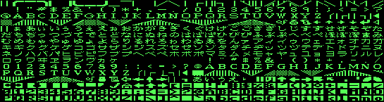
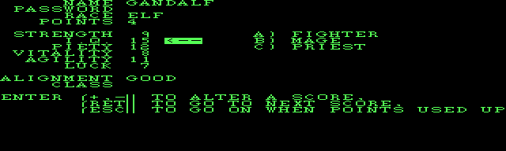
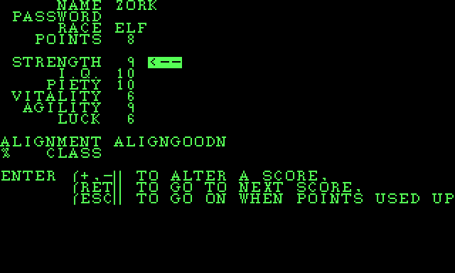
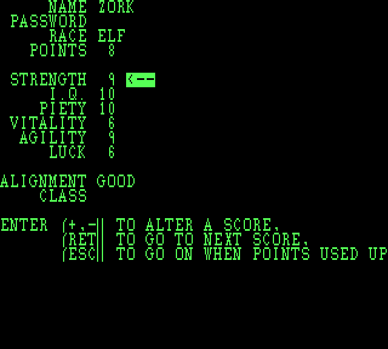
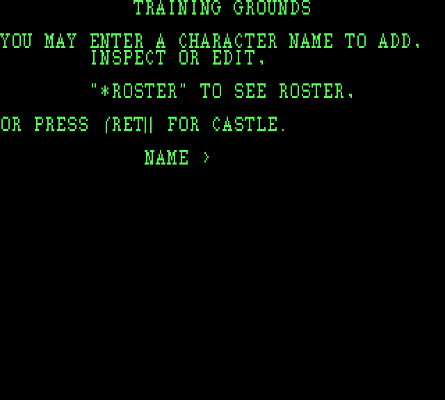
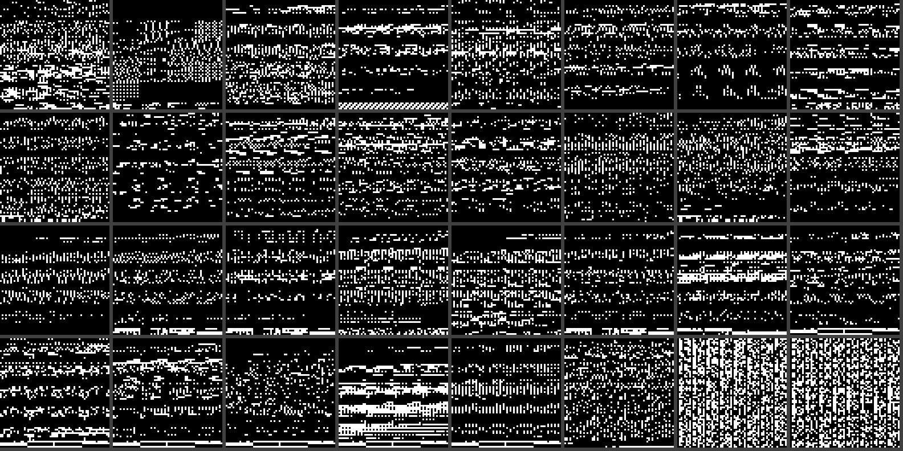
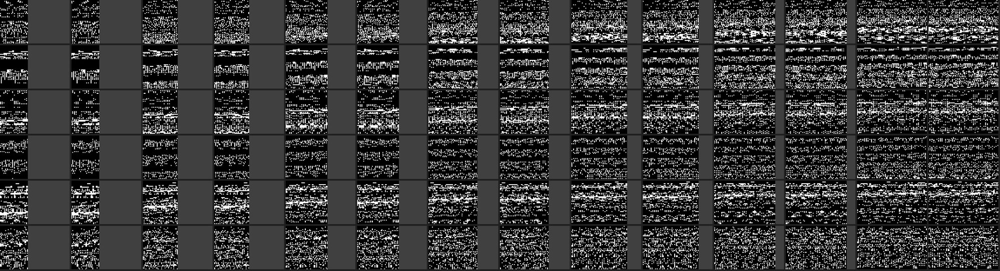
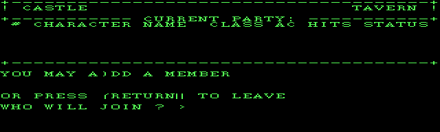

# session1 — part 2  (2026-09-02 11:28:53 … 2026-09-02 20:30:38)

## Assistant · 2026-09-02 11:28:53

› Edit: C:\dev\wizardry\wizardry1\engine\CMakeLists.txt

  ↳ The file C:\dev\wizardry\wizardry1\engine\CMakeLists.txt has been updated successfully. (file state is current in your context — no need to Read it back)

## Assistant · 2026-09-02 11:29:01

› PowerShell: `$vs = "C:\Program Files\Microsoft Visual Studio\2022\Community" ⏎ $cmake = "$vs\Common7\IDE\CommonExtensions\Microsoft\CMake\CMake\bin\cmake.exe" ⏎ $env:PATH = "$vs\Common7\IDE\CommonExtensions\Microsoft\CMake\Ninja;$env:PATH" ⏎ $eng = "C:\dev\wizardry\wizardry1\engine" ⏎ Remove-Item -Recurse -Force "$eng\build" -ErrorAction SilentlyContinue ⏎ cmd /c "call `"$vs\VC\Auxiliary\Build\vcvars64.bat`" >nul 2>&1 & ...`

  ↳ -- wiz1: SDL2 window backend enabled ⏎ [11/11] Linking CXX executable wiz1.exe

## Assistant · 2026-09-02 11:29:20

› Edit: C:\dev\wizardry\wizardry1\engine\src\main.cpp

  ↳ The file C:\dev\wizardry\wizardry1\engine\src\main.cpp has been updated successfully. (file state is current in your context — no need to Read it back)

## Assistant · 2026-09-02 11:29:30

› Bash: `cd /c/dev/wizardry/wizardry1 ⏎ powershell -NoProfile -Command "& { \$vs='C:\Program Files\Microsoft Visual Studio\2022\Community'; \$env:PATH=\"\$vs\Common7\IDE\CommonExtensions\Microsoft\CMake\Ninja;\$env:PATH\"; cmd /c \"call `\"\$vs\VC\Auxiliary\Build\vcvars64.bat`\" >nul 2>&1 && `\"\$vs\Common7\IDE\CommonExtensions\Microsoft\CMake\CMake\bin\cmake.exe`\" --build engine/build\" }" 2>&1 | grep -E " ...`

  ↳ Exit code 143 ⏎ Command timed out after 2m 0s ⏎ /usr/bin/bash: command substitution: line 9: unexpected EOF while looking for matching `"' ⏎ /usr/bin/bash: command substitution: line 9: unexpected EOF while looking for matching `"'

## Assistant · 2026-09-02 11:31:40

› Edit: C:\dev\wizardry\wizardry1\engine\build.ps1

  ↳ The file C:\dev\wizardry\wizardry1\engine\build.ps1 has been updated successfully. (file state is current in your context — no need to Read it back)

## Assistant · 2026-09-02 11:31:46

› PowerShell: `& C:\dev\wizardry\wizardry1\engine\build.ps1 2>&1 | Select-String "error|Linking CXX exec|SDL2 window" ⏎ $V = "$env:TEMP\claude\C--dev-wizardry-wizardry1\4dc1a062-1708-4f14-97ef-d51b3233e5e0\scratchpad\view" ⏎ New-Item -ItemType Directory -Force $V | Out-Null ⏎ $w = "C:\dev\wizardry\wizardry1\engine\build\wiz1.exe" ⏎ & $w show font C:\dev\wizardry\wizardry1\extracted\wiz1\200.CHARSET "$V\font200.ppm" ⏎ & $w ...`

  ↳ -- wiz1: SDL2 window backend enabled ⏎ [11/11] Linking CXX executable wiz1.exe ⏎  ⏎ -> C:\dev\wizardry\wizardry1\engine\build\wiz1.exe ⏎ 512 glyphs, 16x8 cells ⏎ wrote C:\Users\PAULGI~1\AppData\Local\Temp\claude\C--dev-wizardry-wizardry1\4dc1a062- ...

## Assistant · 2026-09-02 11:32:04

› Bash: `V=/c/Users/PAULGI~1/AppData/Local/Temp/claude/C--dev-wizardry-wizardry1/4dc1a062-1708-4f14-97ef-d51b3233e5e0/scratchpad/view ⏎ python3 -c " ⏎ from PIL import Image ⏎ for n in ['font200','font400','title200']: ⏎     Image.open(f'$V/{n}.ppm').save(f'$V/{n}.png') ⏎     print(n, Image.open(f'$V/{n}.ppm').size) ⏎ " 2>&1 || (echo "no PIL, trying imagemagick"; for n in font200 font400 title200; do magick "$V/$n.ppm" ...`

  ↳ Traceback (most recent call last): ⏎   File "<string>", line 2, in <module> ⏎ ModuleNotFoundError: No module named 'PIL' ⏎ no PIL, trying imagemagick ⏎ font200.ppm ⏎ font400.ppm ⏎ title200.ppm

## Assistant · 2026-09-02 11:32:16

› Bash: `python3 - <<'EOF' ⏎ # minimal PPM P6 -> PNG (stdlib zlib + manual PNG) ⏎ import zlib, struct, os ⏎ V=os.path.expandvars(r"%TEMP%").replace("\\","/")+"/claude/C--dev-wizardry-wizardry1/4dc1a062-1708-4f14-97ef-d51b3233e5e0/scratchpad/view" ⏎ def ppm2png(src,dst): ⏎     d=open(src,'rb').read() ⏎     # header: P6\nW H\n255\n ⏎     assert d[:2]==b'P6' ⏎     i=2 ⏎     toks=[] ⏎     while len(toks)<3: ⏎         while d[i] in ...`

  ↳ wrote C:/Users/PAULGI~1/AppData/Local/Temp/claude/C--dev-wizardry-wizardry1/4dc1a062-1708-4f14-97ef-d51b3233e5e0/scratchpad/view/font200.png 545 x 145 ⏎ wrote C:/Users/PAULGI~1/AppData/Local/Temp/claude/C--dev-wizardry-wizardry1/4dc1a062-170 ...

## Assistant · 2026-09-02 11:32:21

› Read: C:\Users\PAULGI~1\AppData\Local\Temp\claude\C--dev-wizardry-wizardry1\4dc1a062-1708-4f14-97ef-d51b3233e5e0\scratchpad\view\font200.png



## Assistant · 2026-09-02 11:32:35

› Read: C:\Users\PAULGI~1\AppData\Local\Temp\claude\C--dev-wizardry-wizardry1\4dc1a062-1708-4f14-97ef-d51b3233e5e0\scratchpad\view\title200.png


## Assistant · 2026-09-02 11:32:46

› Read: C:\Users\PAULGI~1\AppData\Local\Temp\claude\C--dev-wizardry-wizardry1\4dc1a062-1708-4f14-97ef-d51b3233e5e0\scratchpad\view\font400.png


## Assistant · 2026-09-02 11:33:03

› Edit: C:\dev\wizardry\wizardry1\docs\file-formats.md

  ↳ The file C:\dev\wizardry\wizardry1\docs\file-formats.md has been updated successfully. (file state is current in your context — no need to Read it back)

## Assistant · 2026-09-02 11:33:10

› Edit: C:\dev\wizardry\wizardry1\docs\roadmap.md

  ↳ The file C:\dev\wizardry\wizardry1\docs\roadmap.md has been updated successfully. (file state is current in your context — no need to Read it back)

## Assistant · 2026-09-02 11:33:20

› Edit: C:\dev\wizardry\wizardry1\engine\README.md

  ↳ The file C:\dev\wizardry\wizardry1\engine\README.md has been updated successfully. (file state is current in your context — no need to Read it back)

## Assistant · 2026-09-02 11:33:26

› Bash: `cd /c/dev/wizardry/wizardry1 ⏎ # add show to usage; verify no stray issues; check gitignore covers build ⏎ grep -q "show " engine/src/main.cpp && echo "show cmd present" ⏎ printf 'build/\n*.exe\n*.lib\n*.obj\n*.pdb\n*.ppm\n*.png\n' > engine/.gitignore ⏎ engine/build/wiz1.exe roster extracted/wiz1/SCENARIO.DATA | tail -1 ⏎ engine/build/wiz1.exe show font extracted/wiz1/200.CHARSET 2>&1 | head -1`

  ↳ Command did not complete within its 120s timeout and was moved to the background (ID: bvihfjqfg). Output is being written to: C:\Users\PAULGI~1\AppData\Local\Temp\claude\C--dev-wizardry-wizardry1\4dc1a062-1708-4f14-97ef-d51b3233e5e0\tasks\b ...

## Assistant · 2026-09-02 11:35:34

› Bash: `powershell -NoProfile -Command "Get-Process wiz1 -ErrorAction SilentlyContinue | Stop-Process -Force" ; echo killed; cd /c/dev/wizardry && git add wizardry1/engine wizardry1/docs && git status --short | head`

  ↳ killed ⏎ warning: in the working copy of 'wizardry1/docs/file-formats.md', LF will be replaced by CRLF the next time Git touches it ⏎ warning: in the working copy of 'wizardry1/docs/roadmap.md', LF will be replaced by CRLF the next time Git tou ...

## Assistant · 2026-09-02 11:35:44

› PowerShell: `& C:\dev\wizardry\wizardry1\engine\build.ps1 2>&1 | Select-String "error|Linking CXX exec" ⏎ & C:\dev\wizardry\wizardry1\engine\build\wiz1.exe show font C:\dev\wizardry\wizardry1\extracted\wiz1\200.CHARSET "$env:TEMP\f.ppm"`

  ↳ -> C:\dev\wizardry\wizardry1\engine\build\wiz1.exe ⏎ 512 glyphs, 16x8 cells ⏎ wrote C:\Users\PAULGI~1\AppData\Local\Temp\f.ppm  (545x145)

## Assistant · 2026-09-02 11:36:00

› Bash: `cd /c/dev/wizardry && git add wizardry1/engine wizardry1/docs && git commit -q -m "$(cat <<'EOF' ⏎ wizardry1: platform layer -- Surface, Font, Platform (Null + SDL2) ⏎  ⏎ engine/wiz/surface.h    8bpp indexed framebuffer + primitives (lines, ⏎                         rects, Bresenham, 1-bpp blit, Netpbm dump) ⏎ engine/wiz/font.h       200/400.CHARSET decoded: 16 w x 8 h, 16 bytes/glyph ...`

  ↳ To https://github.com/dreammaster/reverse-engineering-notes.git ⏎    8aa1a63..8ded105  wizardry -> wizardry ⏎ Shell cwd was reset to C:\dev\wizardry\wizardry1

## Assistant · 2026-09-02 11:36:14

› Edit: C:\Users\Paul Gilbert\.claude\projects\C--dev-wizardry\memory\wizardry1-re-project.md

  ↳ The file C:\Users\Paul Gilbert\.claude\projects\C--dev-wizardry\memory\wizardry1-re-project.md has been updated successfully.

## Assistant · 2026-09-02 11:36:28

Pushed as `8ded105`.

## Platform layer — up and running

| module | what |
|---|---|
| `engine/wiz/surface.h` | 8-bit indexed framebuffer + primitives (h/v lines, Bresenham, rects, 1-bpp blit, Netpbm dump) — zero deps |
| `engine/wiz/font.h` | `200/400.CHARSET` decoded and rendering |
| `engine/wiz/platform.h` | abstract `Platform` (`present` / `pollKey` / `waitKey` / `delay`) + `NullPlatform` (headless, writes PPM frames) + `SdlPlatform` (SDL2 window) |

**SDL2** is optional — CMake links it via `find_package` or `-DWIZ_SDL_DIR` (ScummVM's prebuilt libs, default `C:/dev/scummvm_libs_2015`). The static `SDL2.lib` needed `winmm`/`setupapi`/`imm32`/`version`/`cfgmgr32` wired in; headless builds fine without SDL.

**`*.CHARSET` cracked** — **16 wide × 8 tall, 16 bytes/glyph (2 B/row, MSB left), 512 glyphs**. Glyphs 0–255 are the text font (ASCII + box-drawing); 256–511 are a second bank (kana + graphics — the Japanese-capable font). `200` vs `400` are the two screen modes; the bitmaps are near-identical. `wiz1 show font extracted/wiz1/200.CHARSET font.ppm`:

<br>


`@ABCDEFGHIJKLMNOPQRSTUVWXYZ`, digits, lowercase, punctuation — all clean, plus the kana/box-draw second bank below.

## Next

- **Text-grid layer** — a character-cell abstraction (`putStr(col,row,...)`, `clearRect`, cursor) over `Surface`+`Font`, which is what the `ROLLER` menus (`MAKEMENU`, the point-allocation screen, `TRAINING`) are written against. That plus the `Platform` input gets ROLLER fully interactive.
- **`200.TITLE`** decode (512×80 1bpp was noise — likely RLE/LZ or 2bpp).
- **`200.MONSTERS`** display-list format for the combat portraits.

## User · 2026-09-02 11:37:10

Build the text-grid layer

## Assistant · 2026-09-02 11:37:30

› Bash: `for p in 22 23 25 35 36 21; do echo "=== WIZARDRY proc $p ==="; python tools/pcode_dis.py dis extracted/wiz1/SYSTEM.PASCAL WIZARDRY $p 2>&1 | head -40; done`

  ↳ === WIZARDRY proc 22 === ⏎ ; ---- WIZARDRY:proc 22  entry=0xf90 code_end=0xfd8 data=0 param=6 ---- ⏎   0f90  d9                SLDL   2 ⏎   0f91  00                SLDC   0 ⏎   0f92  c9                LESI ⏎   0f93  a1 05             FJP    L0f9a ...

## Assistant · 2026-09-02 11:38:14

› Bash: `python tools/pcode_dis.py dis extracted/wiz1/SYSTEM.PASCAL WIZARDRY 18 2>&1 | head -50; echo "=== proc 19 ==="; python tools/pcode_dis.py dis extracted/wiz1/SYSTEM.PASCAL WIZARDRY 19`

  ↳ ; ---- WIZARDRY:proc 18  entry=0xc40 code_end=0xcfa data=8 param=6 ---- ⏎   0c40  a9 15             LDO    21 ⏎   0c42  a1 02             FJP    L0c46 ⏎   0c44  cf 10             CGP    16 ⏎ L0c46: ⏎   0c46  da                SLDL   3 ⏎   0c47  0 ...

## Assistant · 2026-09-02 11:39:02

› Write: C:\dev\wizardry\wizardry1\engine\include\wiz\textscreen.h

  ↳ File created successfully at: C:\dev\wizardry\wizardry1\engine\include\wiz\textscreen.h (file state is current in your context — no need to Read it back)

## Assistant · 2026-09-02 11:39:23

› Write: C:\dev\wizardry\wizardry1\engine\src\textscreen.cpp

  ↳ File created successfully at: C:\dev\wizardry\wizardry1\engine\src\textscreen.cpp (file state is current in your context — no need to Read it back)

## Assistant · 2026-09-02 11:39:31

› Edit: C:\dev\wizardry\wizardry1\engine\CMakeLists.txt

  ↳ The file C:\dev\wizardry\wizardry1\engine\CMakeLists.txt has been updated successfully. (file state is current in your context — no need to Read it back)

## Assistant · 2026-09-02 11:39:36

› Edit: C:\dev\wizardry\wizardry1\engine\src\main.cpp

  ↳ The file C:\dev\wizardry\wizardry1\engine\src\main.cpp has been updated successfully. (file state is current in your context — no need to Read it back)

## Assistant · 2026-09-02 11:39:51

› Edit: C:\dev\wizardry\wizardry1\engine\src\main.cpp

  ↳ The file C:\dev\wizardry\wizardry1\engine\src\main.cpp has been updated successfully. (file state is current in your context — no need to Read it back)

## Assistant · 2026-09-02 11:39:58

› PowerShell: `& C:\dev\wizardry\wizardry1\engine\build.ps1 2>&1 | Select-String "error|Linking CXX exec" ⏎ $w = "C:\dev\wizardry\wizardry1\engine\build\wiz1.exe" ⏎ $V = "$env:TEMP\claude\C--dev-wizardry-wizardry1\4dc1a062-1708-4f14-97ef-d51b3233e5e0\scratchpad\view" ⏎ & $w mockup C:\dev\wizardry\wizardry1\extracted\wiz1\200.CHARSET "$V\mockup.ppm"`

  ↳ [4/4] Linking CXX executable wiz1.exe ⏎  ⏎ -> C:\dev\wizardry\wizardry1\engine\build\wiz1.exe ⏎ wrote C:\Users\PAULGI~1\AppData\Local\Temp\claude\C--dev-wizardry-wizardry1\4dc1a062-1708-4f14-97ef-d51b3233e5e0\scratchpad\view\mockup.ppm  (640x192 ...

## Assistant · 2026-09-02 11:40:19

› Bash: `python3 - <<'EOF' ⏎ import zlib, struct, os ⏎ V=os.path.expandvars(r"%TEMP%").replace("\\","/")+"/claude/C--dev-wizardry-wizardry1/4dc1a062-1708-4f14-97ef-d51b3233e5e0/scratchpad/view" ⏎ d=open(f"{V}/mockup.ppm",'rb').read() ⏎ i=2; toks=[] ⏎ while len(toks)<3: ⏎     while d[i] in b' \t\r\n': i+=1 ⏎     j=i ⏎     while d[j] not in b' \t\r\n': j+=1 ⏎     toks.append(int(d[i:j])); i=j ⏎ i+=1 ⏎ w,h,_=toks; raw=d[i:i+w*h*3] ...`

  ↳ wrote C:/Users/PAULGI~1/AppData/Local/Temp/claude/C--dev-wizardry-wizardry1/4dc1a062-1708-4f14-97ef-d51b3233e5e0/scratchpad/view/mockup.png 640 192

## Assistant · 2026-09-02 11:40:25

› Read: C:\Users\PAULGI~1\AppData\Local\Temp\claude\C--dev-wizardry-wizardry1\4dc1a062-1708-4f14-97ef-d51b3233e5e0\scratchpad\view\mockup.png



## Assistant · 2026-09-02 11:40:54

› Edit: C:\dev\wizardry\wizardry1\docs\roadmap.md

  ↳ The file C:\dev\wizardry\wizardry1\docs\roadmap.md has been updated successfully. (file state is current in your context — no need to Read it back)

## Assistant · 2026-09-02 11:41:02

› Edit: C:\dev\wizardry\wizardry1\engine\README.md

  ↳ The file C:\dev\wizardry\wizardry1\engine\README.md has been updated successfully. (file state is current in your context — no need to Read it back)

## Assistant · 2026-09-02 11:41:08

› Edit: C:\dev\wizardry\wizardry1\engine\README.md

  ↳ The file C:\dev\wizardry\wizardry1\engine\README.md has been updated successfully. (file state is current in your context — no need to Read it back)

## Assistant · 2026-09-02 11:41:19

› Bash: `cd /c/dev/wizardry && git add wizardry1/engine wizardry1/docs && git commit -q -m "$(cat <<'EOF' ⏎ wizardry1: text-grid layer for the menu UI ⏎  ⏎ engine/wiz/textscreen.h -- a 40x24 character-cell grid, the surface the ⏎ game's WRITE/WRITELN/GOTOXY menus are written against. Models the DOS ⏎ window system (WIZARDRY procs 19/22/25): a current window (setWindow) that ⏎ offsets and clamps the cursor, the UCSD co ...`

  ↳ warning: in the working copy of 'wizardry1/docs/roadmap.md', LF will be replaced by CRLF the next time Git touches it ⏎ warning: in the working copy of 'wizardry1/engine/CMakeLists.txt', LF will be replaced by CRLF the next time Git touches i ...

## Assistant · 2026-09-02 11:41:33

› Edit: C:\Users\Paul Gilbert\.claude\projects\C--dev-wizardry\memory\wizardry1-re-project.md

  ↳ <tool_use_error>String to replace not found in file. ⏎ String: `wiz1 show font`. Next: text-grid menu layer + interactive ROLLER flow, ⏎ 200.TITLE decode, then CASTLE/SHOPS.</tool_use_error>

## Assistant · 2026-09-02 11:41:38

› Bash: `grep -n "show font\|text-grid\|MONSTERS" "/c/Users/Paul Gilbert/.claude/projects/C--dev-wizardry/memory/wizardry1-re-project.md"`

  ↳ 68:winmm/setupapi/imm32/version/cfgmgr32). `wiz1 show font`. Next: text-grid

## Assistant · 2026-09-02 11:41:43

› Read: C:\Users\Paul Gilbert\.claude\projects\C--dev-wizardry\memory\wizardry1-re-project.md

  ↳ 63	round-trip byte-identical (`wiz1 roster`). Offset table in ⏎ 64	docs/file-formats.md. Platform layer done: `wiz/surface.h` (8bpp fb + ⏎ 65	primitives), `wiz/font.h` (CHARSET = 16x8, 512 glyphs, confirmed by ⏎ 66	rendering), `wiz/platform.h` (a ...

## Assistant · 2026-09-02 11:41:50

› Edit: C:\Users\Paul Gilbert\.claude\projects\C--dev-wizardry\memory\wizardry1-re-project.md

  ↳ The file C:\Users\Paul Gilbert\.claude\projects\C--dev-wizardry\memory\wizardry1-re-project.md has been updated successfully.

## Assistant · 2026-09-02 11:42:06

Pushed as `73aca49`.

## Text-grid layer — working end to end

`engine/wiz/textscreen.h` — a **40×24 character-cell grid**, the surface the game's `WRITE` / `WRITELN` / `GOTOXY` menus are written against. It models the DOS window system (`WIZARDRY` procs 19/22/25 — a window is `{x, y, w, h}` + a relative cursor, record layout `word 2 = {height, width}`, `word 3 = {cursorX, cursorY}`):

- `setWindow(x, y, w, h)` — a viewport that offsets and clamps `gotoXY`
- **UCSD control codes**: `CHR 12` clear+home, `CHR 11` clear-to-end-of-screen, `CHR 29` clear-to-end-of-line, `CHR 8` backspace, `CHR 13/10` newline (with scroll)
- `clearRect` (= `CLRRECT`), Pascal `': w'` right-justification (`writeField`), inverse-video attributes
- `render(Surface&, Font&)` — draws the grid through the game font

**Grid size 40×24** pinned from the p-code coordinates: `GOTOXY(41,0)` (cursor-park just past col 40), `CLRRECT(1,11,38,4)`, output down to ~row 19.

`wiz1 mockup extracted/wiz1/200.CHARSET menu.ppm` renders ROLLER's `MAKEMENU` screen:

<br>


Right-justified labels, attribute values, the class list at col 20, the inverse-video `<--` cursor marker, and the instruction window at the bottom (its own `setWindow(0,15,40,9)`). The PPM is squished 2:1 vertically (native 640×192); the SDL window presents at logical 640×400 which restores the aspect.

## Next

The pieces for a **fully interactive ROLLER** are all in place now — the rules (`roller.h`), the RNG, the record I/O (`character.cpp`), the text grid, and platform input. Wiring them into the actual menu loop (`GETPASS` → `CHOSRACE` → `CHOSALIG` → `GIVEPTS` point allocation → `KEEPCHYN` → write to roster, plus the `TRAINING` menu for existing characters) is the next step — the first genuinely playable slice.

## User · 2026-09-02 11:42:41

Wire up the interactive ROLLER menu flow

## Assistant · 2026-09-02 11:43:22

› Write: C:\dev\wizardry\wizardry1\engine\include\wiz\roster.h

  ↳ File created successfully at: C:\dev\wizardry\wizardry1\engine\include\wiz\roster.h (file state is current in your context — no need to Read it back)

## Assistant · 2026-09-02 11:43:32

› Write: C:\dev\wizardry\wizardry1\engine\src\roster.cpp

  ↳ File created successfully at: C:\dev\wizardry\wizardry1\engine\src\roster.cpp (file state is current in your context — no need to Read it back)

## Assistant · 2026-09-02 11:43:59

› Write: C:\dev\wizardry\wizardry1\engine\include\wiz\roller_ui.h

  ↳ File created successfully at: C:\dev\wizardry\wizardry1\engine\include\wiz\roller_ui.h (file state is current in your context — no need to Read it back)

## Assistant · 2026-09-02 11:45:05

› Write: C:\dev\wizardry\wizardry1\engine\src\roller_ui.cpp

  ↳ File created successfully at: C:\dev\wizardry\wizardry1\engine\src\roller_ui.cpp (file state is current in your context — no need to Read it back)

## Assistant · 2026-09-02 11:45:14

› Edit: C:\dev\wizardry\wizardry1\engine\src\roller_ui.cpp

  ↳ The file C:\dev\wizardry\wizardry1\engine\src\roller_ui.cpp has been updated successfully. (file state is current in your context — no need to Read it back)

## Assistant · 2026-09-02 11:45:19

› Edit: C:\dev\wizardry\wizardry1\engine\src\roller_ui.cpp

  ↳ The file C:\dev\wizardry\wizardry1\engine\src\roller_ui.cpp has been updated successfully. (file state is current in your context — no need to Read it back)

## Assistant · 2026-09-02 11:45:27

› Edit: C:\dev\wizardry\wizardry1\engine\CMakeLists.txt

  ↳ The file C:\dev\wizardry\wizardry1\engine\CMakeLists.txt has been updated successfully. (file state is current in your context — no need to Read it back)

## Assistant · 2026-09-02 11:45:32

› Edit: C:\dev\wizardry\wizardry1\engine\src\main.cpp

  ↳ The file C:\dev\wizardry\wizardry1\engine\src\main.cpp has been updated successfully. (file state is current in your context — no need to Read it back)

## Assistant · 2026-09-02 11:45:42

› Edit: C:\dev\wizardry\wizardry1\engine\src\main.cpp

  ↳ The file C:\dev\wizardry\wizardry1\engine\src\main.cpp has been updated successfully. (file state is current in your context — no need to Read it back)

## Assistant · 2026-09-02 11:45:46

› PowerShell: `& C:\dev\wizardry\wizardry1\engine\build.ps1 2>&1 | Select-String "error C|error LNK|Linking CXX exec" | Select-Object -First 20`

  ↳ [5/5] Linking CXX executable wiz1.exe ⏎  ⏎ -> C:\dev\wizardry\wizardry1\engine\build\wiz1.exe

## Assistant · 2026-09-02 11:46:06

› Edit: C:\dev\wizardry\wizardry1\engine\include\wiz\platform.h

  ↳ The file C:\dev\wizardry\wizardry1\engine\include\wiz\platform.h has been updated successfully. (file state is current in your context — no need to Read it back)

## Assistant · 2026-09-02 11:46:14

› Write: C:\dev\wizardry\wizardry1\engine\src\platform_null.cpp

  ↳ The file C:\dev\wizardry\wizardry1\engine\src\platform_null.cpp has been updated successfully. (file state is current in your context — no need to Read it back)

## Assistant · 2026-09-02 11:46:52

› Edit: C:\dev\wizardry\wizardry1\engine\src\main.cpp

  ↳ The file C:\dev\wizardry\wizardry1\engine\src\main.cpp has been updated successfully. (file state is current in your context — no need to Read it back)

## Assistant · 2026-09-02 11:46:58

› PowerShell: `& C:\dev\wizardry\wizardry1\engine\build.ps1 2>&1 | Select-String "error C|error LNK|Linking CXX exec" | Select-Object -First 15 ⏎ $w = "C:\dev\wizardry\wizardry1\engine\build\wiz1.exe" ⏎ $s = "C:\dev\wizardry\wizardry1\extracted\wiz1\SCENARIO.DATA" ⏎ $c = "C:\dev\wizardry\wizardry1\extracted\wiz1\200.CHARSET" ⏎ & $w roller-test $c $s "TEST\rY\r\rBA++++++++++\eAY\r"`

  ↳ [6/6] Linking CXX executable wiz1.exe ⏎  ⏎ -> C:\dev\wizardry\wizardry1\engine\build\wiz1.exe ⏎ [ 0] THESUS           R1 C0 A2 L1 OK  S17 I8 P5 V8 A8 L9  HP8/8 185gp ⏎ [ 1] TEMPEST          R3 C1 A2 L1 OK  S10 I12 P10 V10 A5 L6  HP8/8 190gp ⏎ [ 2] ...

## Assistant · 2026-09-02 11:47:31

› PowerShell: `$w = "C:\dev\wizardry\wizardry1\engine\build\wiz1.exe" ⏎ $s = "C:\dev\wizardry\wizardry1\extracted\wiz1\SCENARIO.DATA" ⏎ $c = "C:\dev\wizardry\wizardry1\extracted\wiz1\200.CHARSET" ⏎ $V = "$env:TEMP\claude\C--dev-wizardry-wizardry1\4dc1a062-1708-4f14-97ef-d51b3233e5e0\scratchpad\view\roller" ⏎ New-Item -ItemType Directory -Force $V | Out-Null ⏎ Get-ChildItem $V -Filter *.ppm | Remove-Item -ErrorAction Silen ...`

  ↳ [ 0] THESUS           R1 C0 A2 L1 OK  S17 I8 P5 V8 A8 L9  HP8/8 185gp ⏎ [ 1] TEMPEST          R3 C1 A2 L1 OK  S10 I12 P10 V10 A5 L6  HP8/8 190gp ⏎ [ 2] LYSANDER         R1 C0 A2 L1 OK  S17 I8 P5 V8 A8 L9  HP8/8 109gp ⏎ [ 3] TREON            R4 ...

## Assistant · 2026-09-02 11:48:11

› PowerShell: `$w = "C:\dev\wizardry\wizardry1\engine\build\wiz1.exe" ⏎ $s = "C:\dev\wizardry\wizardry1\extracted\wiz1\SCENARIO.DATA" ⏎ $c = "C:\dev\wizardry\wizardry1\extracted\wiz1\200.CHARSET" ⏎ Write-Host "=== *ROSTER then leave ===" ⏎ & $w roller-test $c $s "*ROSTER\rL\r" 2>&1 | Select-Object -First 3 ⏎ Write-Host "=== create ZORK (elf/good/fighter), then *ROSTER shows it ===" ⏎ & $w roller-test $c $s "ZORK\rY\r\rBA+++ ...`

  ↳ === *ROSTER then leave === ⏎ [ 0] THESUS           R1 C0 A2 L1 OK  S17 I8 P5 V8 A8 L9  HP8/8 185gp ⏎ [ 1] TEMPEST          R3 C1 A2 L1 OK  S10 I12 P10 V10 A5 L6  HP8/8 190gp ⏎ [ 2] LYSANDER         R1 C0 A2 L1 OK  S17 I8 P5 V8 A8 L9  HP8/8 109g ...

## Assistant · 2026-09-02 11:48:24

› Bash: `python3 - <<'EOF' ⏎ import zlib, struct, os, glob ⏎ V=os.path.expandvars(r"%TEMP%").replace("\\","/")+"/claude/C--dev-wizardry-wizardry1/4dc1a062-1708-4f14-97ef-d51b3233e5e0/scratchpad/view/roller" ⏎ def ppm2png(src,dst,scaleY=2): ⏎     d=open(src,'rb').read() ⏎     i=2;t=[] ⏎     while len(t)<3: ⏎         while d[i] in b' \t\r\n':i+=1 ⏎         j=i ⏎         while d[j] not in b' \t\r\n':j+=1 ⏎         t.append(int(d ...`

  ↳ wrote C:/Users/PAULGI~1/AppData/Local/Temp/claude/C--dev-wizardry-wizardry1/4dc1a062-1708-4f14-97ef-d51b3233e5e0/scratchpad/view/roller/f12.png ⏎ wrote C:/Users/PAULGI~1/AppData/Local/Temp/claude/C--dev-wizardry-wizardry1/4dc1a062-1708-4f14- ...

## Assistant · 2026-09-02 11:48:30

› Read: C:\Users\PAULGI~1\AppData\Local\Temp\claude\C--dev-wizardry-wizardry1\4dc1a062-1708-4f14-97ef-d51b3233e5e0\scratchpad\view\roller\f12.png



## Assistant · 2026-09-02 11:48:59

› Bash: `python3 - <<'EOF' ⏎ import sys; sys.path.insert(0,'tools'); import scenario ⏎ sc=scenario.Scenario("extracted/wiz1/SCENARIO.DATA") ⏎ t=sc.toc_strings() ⏎ print("race  :",t['race']) ⏎ print("class :",t['class']) ⏎ print("status:",t['status']) ⏎ print("align :",t['align']) ⏎ print("end offset:",hex(t['_end'])) ⏎ EOF ⏎ echo "=== C++ side: add a quick toc dump of align/status ===" ⏎ grep -n "aligns()\|statuses()\|readStrAr ...`

  ↳ race  : ['NO RACE', 'HUMAN', 'ELF', 'DWARF', 'GNOME', 'HOBBIT'] ⏎ class : ['FIGHTER', 'MAGE', 'PRIEST', 'THIEF', 'BISHOP', 'SAMURAI', 'LORD', 'NINJA'] ⏎ status: ['OK', 'AFRAIDBASLEEPIBRP-LYZESTONEDDEADASHESLOSTUNALIGNGOOD', 'BASL', 'BRP-LYZES ...

## Assistant · 2026-09-02 11:49:26

› Bash: `python3 - <<'EOF' ⏎ d=open("extracted/wiz1/SCENARIO.DATA","rb").read() ⏎ p=0x6a ⏎ def rd(p, n, w, label): ⏎     print(f"{label} @ {p:#x}:") ⏎     for i in range(n): ⏎         b=d[p+i*w] ⏎         s="".join(chr(c) if 32<=c<127 else "." for c in d[p+i*w+1:p+i*w+1+b]) ⏎         print(f"  [{i}] off {p+i*w:#x} len {b:3d} {s!r}") ⏎     return p+n*w ⏎ p=rd(0x6a,6,10,"RACE (w=10)") ⏎ p=rd(p,8,10,"CLASS (w=10)") ⏎ p=rd(p,8,9,"STA ...`

  ↳ RACE (w=10) @ 0x6a: ⏎   [0] off 0x6a len   7 'NO RACE' ⏎   [1] off 0x74 len   5 'HUMAN' ⏎   [2] off 0x7e len   3 'ELF' ⏎   [3] off 0x88 len   5 'DWARF' ⏎   [4] off 0x92 len   5 'GNOME' ⏎   [5] off 0x9c len   6 'HOBBIT' ⏎ CLASS (w=10) @ 0xa6: ⏎   [0 ...

## Assistant · 2026-09-02 11:49:47

› Bash: `python3 - <<'EOF' ⏎ d=open("extracted/wiz1/SCENARIO.DATA","rb").read() ⏎ def rd(p,n,w,label): ⏎     print(f"{label} @ {p:#x} w={w}:", [ ⏎         "".join(chr(c) if 32<=c<127 else "." for c in d[p+i*w+1:p+i*w+1+d[p+i*w]]) ⏎         for i in range(n)]) ⏎     return p+n*w ⏎ for stw in (9,10): ⏎     p=rd(0xf7,8,stw,f"STATUS") ⏎     rd(p,4,10,"ALIGN") ⏎     print() ⏎ EOF`

  ↳ STATUS @ 0xf7 w=9: ['K...[..Y.AFRAID..B.ASLEEPIBR.P-LYZE....STONED....DEAD......ASHES.....LOST......', 'AFRAID', '.ASLEEPIBR.P-LYZE....STONED....DEAD......ASHES.....LOST......UNALI', 'R.P-LYZE....STONED....DEAD......ASHES.....LOST......UNAL ...

## Assistant · 2026-09-02 11:50:03

› Bash: `python3 -c " ⏎ d=open('extracted/wiz1/SCENARIO.DATA','rb').read() ⏎ print('0xf0..0x110:', ' '.join(f'{b:02x}' for b in d[0xf0:0x110])) ⏎ print('bytes: 0xf6=%#x 0xf7=%#x 0xf8=%#x' % (d[0xf6],d[0xf7],d[0xf8])) ⏎ # find 'OK\x00' and 'AFRAID' ⏎ for pat in [b'\x02OK',b'\x06AFRAID',b'\x06ASLEEP',b'\x04DEAD',b'\x07UNALIGN',b'\x04GOOD',b'\x07NEUTRAL',b'\x04EVIL']: ⏎     i=d.find(pat); print(pat, hex(i)) ⏎ "`

  ↳ 0xf0..0x110: 4a 41 00 00 20 88 02 4f 4b 00 0f 00 5b 00 01 59 06 41 46 52 41 49 44 00 05 42 06 41 53 4c 45 45 ⏎ bytes: 0xf6=0x2 0xf7=0x4f 0xf8=0x4b ⏎ b'\x02OK' 0xf6 ⏎ b'\x06AFRAID' 0x100 ⏎ b'\x06ASLEEP' 0x10a ⏎ b'\x04DEAD' 0x128 ⏎ b'\x07UNALIGN' 0 ...

## Assistant · 2026-09-02 11:50:21

› Edit: C:\dev\wizardry\wizardry1\engine\src\scenario.cpp

  ↳ The file C:\dev\wizardry\wizardry1\engine\src\scenario.cpp has been updated successfully. (file state is current in your context — no need to Read it back)

## Assistant · 2026-09-02 11:50:28

› Bash: `cd /c/dev/wizardry/wizardry1 ⏎ sed -i 's/status, off = self._strings(off, 8, 9)/status, off = self._strings(off, 8, 10)/' tools/scenario.py ⏎ grep -n "_strings(off" tools/scenario.py ⏎ sed -i 's|off 0x2A RECPER2B\[8\] u16   records packed per 1024-byte (2-block) unit|&|' tools/scenario.py ⏎ python tools/scenario.py toc extracted/wiz1/SCENARIO.DATA 2>&1 | tail -4`

  ↳ 97:        race, off = self._strings(off, 6, 10) ⏎ 98:        klass, off = self._strings(off, 8, 10) ⏎ 99:        status, off = self._strings(off, 8, 10) ⏎ 100:        align, off = self._strings(off, 4, 10) ⏎   class : ['FIGHTER', 'MAGE', 'PRIEST', ...

## Assistant · 2026-09-02 11:50:41

› Bash: `cd /c/dev/wizardry/wizardry1 ⏎ sed -i 's|    ...      CLASS\[8\] STRING\[9\], STATUS\[8\] STRING\[8\], ALIGN\[4\] STRING\[9\],|    0x0A6    CLASS[8], 0xF6 STATUS[8], 0x146 ALIGN[4]  (all STRING, 10 B/entry)|' tools/scenario.py ⏎ sed -i 's|off 0x0A6|0xA6|' tools/scenario.py ⏎ grep -n "STRING\[8\]\|STATUS 8 x STRING\[8\]\|STATUS.*9 B" docs/file-formats.md`

  ↳ 30:| `0xEE` | `STATUS[8]` | STRING[8] (9 B) | `OK AFRAID ASLEEP PLYZE STONED DEAD ASHES LOST` |

## Assistant · 2026-09-02 11:50:52

› Edit: C:\dev\wizardry\wizardry1\docs\file-formats.md

  ↳ The file C:\dev\wizardry\wizardry1\docs\file-formats.md has been updated successfully. (file state is current in your context — no need to Read it back)

## Assistant · 2026-09-02 11:51:02

› PowerShell: `& C:\dev\wizardry\wizardry1\engine\build.ps1 2>&1 | Select-String "error|Linking CXX exec" ⏎ $w = "C:\dev\wizardry\wizardry1\engine\build\wiz1.exe" ⏎ $s = "C:\dev\wizardry\wizardry1\extracted\wiz1\SCENARIO.DATA" ⏎ $c = "C:\dev\wizardry\wizardry1\extracted\wiz1\200.CHARSET" ⏎ $V = "$env:TEMP\claude\C--dev-wizardry-wizardry1\4dc1a062-1708-4f14-97ef-d51b3233e5e0\scratchpad\view\roller" ⏎ Get-ChildItem $V -Filt ...`

  ↳ [3/3] Linking CXX executable wiz1.exe ⏎  ⏎ -> C:\dev\wizardry\wizardry1\engine\build\wiz1.exe ⏎ [ 6] ZORK             R2 C0 A1 L1 OK  S17 I10 P10 V6 A9 L6  HP8/8 178gp ⏎ frames 24

## Assistant · 2026-09-02 11:51:30

› Bash: `python3 - <<'EOF' ⏎ import zlib, struct, os, glob ⏎ V=os.path.expandvars(r"%TEMP%").replace("\\","/")+"/claude/C--dev-wizardry-wizardry1/4dc1a062-1708-4f14-97ef-d51b3233e5e0/scratchpad/view/roller" ⏎ def cv(src,dst,sy=3): ⏎     d=open(src,'rb').read(); i=2;t=[] ⏎     while len(t)<3: ⏎         while d[i] in b' \t\r\n':i+=1 ⏎         j=i ⏎         while d[j] not in b' \t\r\n':j+=1 ⏎         t.append(int(d[i:j]));i=j ...`

  ↳ ok 24 frames

## Assistant · 2026-09-02 11:51:38

› Read: C:\Users\PAULGI~1\AppData\Local\Temp\claude\C--dev-wizardry-wizardry1\4dc1a062-1708-4f14-97ef-d51b3233e5e0\scratchpad\view\roller\mid.png



## Assistant · 2026-09-02 11:51:46

› Read: C:\Users\PAULGI~1\AppData\Local\Temp\claude\C--dev-wizardry-wizardry1\4dc1a062-1708-4f14-97ef-d51b3233e5e0\scratchpad\view\roller\last.png



## Assistant · 2026-09-02 11:52:03

› Edit: C:\dev\wizardry\wizardry1\engine\include\wiz\roller.h

  ↳ The file C:\dev\wizardry\wizardry1\engine\include\wiz\roller.h has been updated successfully. (file state is current in your context — no need to Read it back)

## Assistant · 2026-09-02 11:52:11

› Edit: C:\dev\wizardry\wizardry1\engine\CMakeLists.txt

  ↳ The file C:\dev\wizardry\wizardry1\engine\CMakeLists.txt has been updated successfully. (file state is current in your context — no need to Read it back)

## Assistant · 2026-09-02 11:52:18

› Edit: C:\dev\wizardry\wizardry1\docs\roadmap.md

  ↳ The file C:\dev\wizardry\wizardry1\docs\roadmap.md has been updated successfully. (file state is current in your context — no need to Read it back)

## Assistant · 2026-09-02 11:52:26

› Edit: C:\dev\wizardry\wizardry1\engine\README.md

  ↳ The file C:\dev\wizardry\wizardry1\engine\README.md has been updated successfully. (file state is current in your context — no need to Read it back)

## Assistant · 2026-09-02 11:52:32

› PowerShell: `& C:\dev\wizardry\wizardry1\engine\build.ps1 2>&1 | Select-String "error|Linking CXX exec" ⏎ $vs = "C:\Program Files\Microsoft Visual Studio\2022\Community" ⏎ $env:PATH = "$vs\Common7\IDE\CommonExtensions\Microsoft\CMake\Ninja;$env:PATH" ⏎ & "$vs\Common7\IDE\CommonExtensions\Microsoft\CMake\CMake\bin\ctest.exe" --test-dir C:\dev\wizardry\wizardry1\engine\build --output-on-failure 2>&1 | Select-Object -L ...`

  ↳ [4/4] Linking CXX executable wiz1.exe ⏎  ⏎ -> C:\dev\wizardry\wizardry1\engine\build\wiz1.exe ⏎     Start 1: dump_toc ⏎ 1/3 Test #1: dump_toc .........................   Passed    0.05 sec ⏎     Start 2: roster_roundtrip ⏎ 2/3 Test #2: roster_round ...

## Assistant · 2026-09-02 11:52:59

› Bash: `cd /c/dev/wizardry ⏎ printf 'build/\n*.exe\n*.lib\n*.obj\n*.pdb\n*.ppm\n*.png\nroster.dat\n*.dat\n' > wizardry1/engine/.gitignore ⏎ git add wizardry1/engine wizardry1/docs wizardry1/tools/scenario.py && git status --short | grep -v "^??" | head -25 && git commit -q -m "$(cat <<'EOF' ⏎ wizardry1: wire up the interactive ROLLER (Training Grounds) ⏎  ⏎ engine/wiz/roster.{h,cpp}  -- 20-slot roster, kept in its ...`

  ↳ warning: in the working copy of 'wizardry1/docs/file-formats.md', LF will be replaced by CRLF the next time Git touches it ⏎ warning: in the working copy of 'wizardry1/docs/roadmap.md', LF will be replaced by CRLF the next time Git touches it ...

## Assistant · 2026-09-02 11:53:13

› Edit: C:\Users\Paul Gilbert\.claude\projects\C--dev-wizardry\memory\wizardry1-re-project.md

  ↳ The file C:\Users\Paul Gilbert\.claude\projects\C--dev-wizardry\memory\wizardry1-re-project.md has been updated successfully.

## Assistant · 2026-09-02 11:53:31

Pushed as `7187198`. **The character roller is playable.**

## The Training Grounds, wired up

`engine/wiz/roller_ui.{h,cpp}` + `wiz/roster.{h,cpp}` — ported from the Apple `ROLLER` segment, driven by the rules in `roller.h`:

- **`Ui`** — renders a `TextScreen` through the `Font`, and reads the keyboard the way `GETKEY` / `GETLINE` / `GETPASS` (echoes 1–2 `X` per keystroke, consuming RNG like the game) / menu-choice do.
- **`runRoller`** — the outer "TRAINING GROUNDS" loop → `MAKECHAR` (password ×2, `CHOSRACE`, `CHOSALIG`, `GIVEPTS` with the **live point-allocation loop** — `+`/`-` per attribute, `<--` cursor, class list updating as eligibility changes, exit only on ESC + a valid class + points spent, `KEEPCHYN`) → `*ROSTER` (`DSP20NM`) → `TRAINING` (inspect / delete / reroll / set password).
- **`Roster`** — 20 slots in its own `roster.dat` (seeded from the scenario's `ZCHAR` records so the user's game files are never touched).

```
wiz1 roller      <200.CHARSET> <SCENARIO.DATA>           # SDL window
wiz1 roller-test <200.CHARSET> <SCENARIO.DATA> "<keys>"  # headless, scripted
```

A **CMake test** (`roller_flow`) creates ZORK (elf/fighter/good, STR pumped 7→17) via scripted input and checks the roster — all 3 tests pass.

**Mid-creation** and the **outer menu**, from the headless frame dumps:


## Bugs fixed along the way

- **`SCENARIO.DATA` STATUS/ALIGN string arrays are 10 bytes/entry** (not 9) — `STATUS` @ `0xF6`, `ALIGN` @ `0x146`. My earlier width was wrong and had been masked by a defensive string-clean. Fixed in both the C++ reader and `tools/scenario.py`; `align`/`status` now decode as `UNALIGN GOOD NEUTRAL EVIL` / `OK AFRAID ASLEEP P-LYZE STONED DEAD ASHES LOST`.
- `rollAge`/`rollGold` now match the DOS `INITCHAR` (flat 500 weeks; `100 + rand%100`).

This is the first genuinely interactive slice — you can boot it, roll a party, and it persists. Next up the roadmap: `200.TITLE` decode, then `CASTLE` / `SHOPS` (the town) and `RUNNER` (the maze + 3D view).

## User · 2026-09-02 12:23:05

Decode 200.TITLE next

## Assistant · 2026-09-02 12:23:22

› Bash: `cat "C:/dev/wizardry/wizardry1/sources/SystemStartup/TITLELOA.txt" 2>/dev/null | head -80; echo "=== raw 200.TITLE stats ==="; python3 -c " ⏎ d=open('extracted/wiz1/200.TITLE','rb').read() ⏎ d4=open('extracted/wiz1/400.TITLE','rb').read() ⏎ print('200:',len(d),' 400:',len(d4)) ⏎ print('200 nonzero bytes:',sum(1 for b in d if b), '/',len(d)) ⏎ print('first 64:',' '.join(f'{b:02x}' for b in d[:64])) ⏎ print('by ...`

  ↳ N^$� ...

## Assistant · 2026-09-02 12:23:44

› Bash: `python3 - <<'EOF' ⏎ d=open("extracted/wiz1/200.TITLE","rb").read() ⏎ # CGA 2bpp: byte -> 4 pixels, MSB pair first. palette idx 0..3 ⏎ def show2bpp(w_px, rows, off=0): ⏎     bpr=w_px//4 ⏎     for r in range(rows): ⏎         line="" ⏎         for c in range(bpr): ⏎             b=d[off+r*bpr+c] ⏎             for sh in (6,4,2,0): ⏎                 p=(b>>sh)&3 ⏎                 line+=" .+#"[p] ⏎         print(line) ⏎ print("=== ...`

  ↳ === 2bpp 160px x 128 rows (nonblank rows only) === ⏎   4                                              +                  +               +                                                                                ⏎   5 ...

## Assistant · 2026-09-02 12:23:59

› Bash: `python3 - <<'EOF' ⏎ d=open("extracted/wiz1/200.TITLE","rb").read() ⏎ G=" .+#" ⏎ def px(b): return "".join(G[(b>>s)&3] for s in (6,4,2,0)) ⏎ print("=== 320px wide, 64 rows, no interleave ===") ⏎ for r in range(64): ⏎     row=d[r*80:(r+1)*80] ⏎     print(f"{r:2d} "+"".join(px(b) for b in row)) ⏎ EOF`

  ↳ === 320px wide, 64 rows, no interleave === ⏎  0 ...

## Assistant · 2026-09-02 12:24:28

› Bash: `python3 - <<'EOF' ⏎ import zlib, struct ⏎ def cga_png(src, dst, w_px, rows, pal=[(0,0,0),(85,255,255),(0,170,0),(255,255,255)], sy=3): ⏎     d=open(src,'rb').read() ⏎     bpr=w_px//4 ⏎     raw=b'' ⏎     for r in range(rows): ⏎         for _ in range(sy): ⏎             for c in range(bpr): ⏎                 b=d[r*bpr+c] if r*bpr+c<len(d) else 0 ⏎                 for s in (6,4,2,0): ⏎                     cr,cg,cb=pal[(b> ...`

  ↳ wrote C:/Users/PAULGI~1/AppData/Local/Temp/claude/C--dev-wizardry-wizardry1/4dc1a062-1708-4f14-97ef-d51b3233e5e0/scratchpad/view/title200_cga.png ⏎ wrote C:/Users/PAULGI~1/AppData/Local/Temp/claude/C--dev-wizardry-wizardry1/4dc1a062-1708-4f1 ...

## Assistant · 2026-09-02 12:24:35

› Read: C:\Users\PAULGI~1\AppData\Local\Temp\claude\C--dev-wizardry-wizardry1\4dc1a062-1708-4f14-97ef-d51b3233e5e0\scratchpad\view\title200_cga.png


## Assistant · 2026-09-02 12:24:41

› Read: C:\Users\PAULGI~1\AppData\Local\Temp\claude\C--dev-wizardry-wizardry1\4dc1a062-1708-4f14-97ef-d51b3233e5e0\scratchpad\view\title400_cga.png


## Assistant · 2026-09-02 12:24:59

› Bash: `python3 -c " ⏎ d=open('extracted/wiz1/SYSTEM.PASCAL','rb').read() ⏎ i=d.find(b'200.TITLE') ⏎ print('200.TITLE @',hex(i),'block',i//512) ⏎ # which segment? blocks: KANJIREA 53-66 ⏎ "  ⏎ grep -rn "CLP    11$\|CLP    12$\|TITLE\|CGP    .*title\|out     dx" extracted/pcode/06_KANJIREA.pd | head -20 ⏎ echo "=== KANJIREA proc 11 (200/400 prefix builder) ===" ⏎ python tools/pcode_dis.py dis extracted/wiz1/SYSTEM.PASCAL ...`

  ↳ 200.TITLE @ 0x6e95 block 55 ⏎ 426:  0318  ce 0b             CLP    11 ⏎ 431:  0322  ce 0b             CLP    11 ⏎ 440:  0334  ce 0c             CLP    12 ⏎ 445:  033e  ce 0c             CLP    12 ⏎ 661:  0493  a6 09 32 30 30 2e LSA    9 "200.TITLE" ...

## Assistant · 2026-09-02 12:25:10

› Bash: `python3 -c " ⏎ import sys; sys.path.insert(0,'tools'); import pcode_dis as P ⏎ segs=P.load_segments('extracted/wiz1/SYSTEM.PASCAL'); k=P.find_segment(segs,'KANJIREA') ⏎ for pr in sorted(k.procs,key=lambda x:x.entry): ⏎     if pr.entry<=0x493<pr.code_end: print('TITLE proc =',pr.num, hex(pr.entry),hex(pr.code_end)); break ⏎ " ⏎ sed -n '640,730p' extracted/pcode/06_KANJIREA.pd`

  ↳ TITLE proc = 13 0x474 0x5ec ⏎  ⏎ ; ---- KANJIREA:proc 13  entry=0x474 code_end=0x5e2 data=8 param=0 ---- ⏎   0474  00                SLDC   0 ⏎   0475  12                SLDC   18 ⏎   0476  28                SLDC   40 ⏎   0477  07                SLDC ...

## Assistant · 2026-09-02 12:25:30

› Bash: `engine/build/wiz1.exe str extracted/wiz1/ASCII.KRN 2018 2019 2020 2021 2022 2023 2024 2025 2026 2027 2028 2029 2>&1`

  ↳ [2018] WELCOME TO THE WORLD OF WIZARDRY! ⏎ [2019] YOU CANNOT PLAY WITHOUT MAKING A ⏎ [2020] SCENARIO DISK! ⏎ [2021] S)TART GAME ⏎ [2022] M)AKE SCENARIO DISK ⏎ [2023] STARTING GAME: ⏎ [2024] SELECT LANGUAGE: ⏎ [2025] 1) ENGLISH ⏎ [2026] 2) KANA ...

## Assistant · 2026-09-02 12:25:55

› Write: C:\dev\wizardry\wizardry1\engine\include\wiz\bitmap.h

  ↳ File created successfully at: C:\dev\wizardry\wizardry1\engine\include\wiz\bitmap.h (file state is current in your context — no need to Read it back)

## Assistant · 2026-09-02 12:26:02

› Write: C:\dev\wizardry\wizardry1\engine\src\bitmap.cpp

  ↳ File created successfully at: C:\dev\wizardry\wizardry1\engine\src\bitmap.cpp (file state is current in your context — no need to Read it back)

## Assistant · 2026-09-02 12:26:07

› Bash: `cd /c/dev/wizardry/wizardry1 ⏎ sed -i 's|  src/surface.cpp|  src/surface.cpp\n  src/bitmap.cpp|' engine/CMakeLists.txt ⏎ grep -n "bitmap.cpp\|src/surface" engine/CMakeLists.txt`

  ↳ 19:  src/surface.cpp ⏎ 20:  src/bitmap.cpp

## Assistant · 2026-09-02 12:26:13

› Bash: `grep -n 'what == "title"\|showSurface\|kDefaultPalette, 16\|#include "wiz/bitmap' engine/src/main.cpp`

  ↳ 260:static void showSurface(const Surface &s, const char *ppm) { ⏎ 262:        s.savePPM(ppm, kDefaultPalette, 16); ⏎ 269:        p->present(s, kDefaultPalette, 16); ⏎ 294:        showSurface(s, ppm); ⏎ 297:    if (what == "title") { ⏎ 302:        sh ...

## Assistant · 2026-09-02 12:26:18

› Read: C:\dev\wizardry\wizardry1\engine\src\main.cpp

  ↳ 258	} ⏎ 259	 ⏎ 260	static void showSurface(const Surface &s, const char *ppm) { ⏎ 261	    if (ppm) {                                   // explicit file -> headless ⏎ 262	        s.savePPM(ppm, kDefaultPalette, 16); ⏎ 263	        std::printf("wrote %s ...

## Assistant · 2026-09-02 12:26:27

› Edit: C:\dev\wizardry\wizardry1\engine\src\main.cpp

  ↳ The file C:\dev\wizardry\wizardry1\engine\src\main.cpp has been updated successfully. (file state is current in your context — no need to Read it back)

## Assistant · 2026-09-02 12:26:33

› Edit: C:\dev\wizardry\wizardry1\engine\src\main.cpp

  ↳ The file C:\dev\wizardry\wizardry1\engine\src\main.cpp has been updated successfully. (file state is current in your context — no need to Read it back)

## Assistant · 2026-09-02 12:26:38

› Bash: `sed -i 's|#include "wiz/font.h"\n#include "wiz/textscreen.h"|&|; s|#include "wiz/textscreen.h"|#include "wiz/textscreen.h"\n#include "wiz/bitmap.h"|' engine/src/main.cpp && grep -n "bitmap.h" engine/src/main.cpp`

  ↳ 12:#include "wiz/bitmap.h"

## Assistant · 2026-09-02 12:26:46

› PowerShell: `& C:\dev\wizardry\wizardry1\engine\build.ps1 2>&1 | Select-String "error|Linking CXX exec" ⏎ $w = "C:\dev\wizardry\wizardry1\engine\build\wiz1.exe" ⏎ $V = "$env:TEMP\claude\C--dev-wizardry-wizardry1\4dc1a062-1708-4f14-97ef-d51b3233e5e0\scratchpad\view" ⏎ & $w show title C:\dev\wizardry\wizardry1\extracted\wiz1\200.TITLE "$V\t2.ppm" ⏎ & $w show title C:\dev\wizardry\wizardry1\extracted\wiz1\400.TITLE "$V\t ...`

  ↳ [4/4] Linking CXX executable wiz1.exe ⏎  ⏎ -> C:\dev\wizardry\wizardry1\engine\build\wiz1.exe ⏎ wrote C:\Users\PAULGI~1\AppData\Local\Temp\claude\C--dev-wizardry-wizardry1\4dc1a062-1708-4f14-97ef-d51b3233e5e0\scratchpad\view\t2.ppm  (320x64) ⏎ wr ...

## Assistant · 2026-09-02 12:27:06

› Bash: `python3 - <<'EOF' ⏎ import zlib,struct,os ⏎ V=os.path.expandvars(r"%TEMP%").replace("\\","/")+"/claude/C--dev-wizardry-wizardry1/4dc1a062-1708-4f14-97ef-d51b3233e5e0/scratchpad/view" ⏎ def p2png(src,dst,sy=3,sx=2): ⏎     d=open(src,'rb').read();i=2;t=[] ⏎     while len(t)<3: ⏎         while d[i] in b' \t\r\n':i+=1 ⏎         j=i ⏎         while d[j] not in b' \t\r\n':j+=1 ⏎         t.append(int(d[i:j]));i=j ⏎     i+=1 ...`

  ↳ ok

## Assistant · 2026-09-02 12:27:11

› Read: C:\Users\PAULGI~1\AppData\Local\Temp\claude\C--dev-wizardry-wizardry1\4dc1a062-1708-4f14-97ef-d51b3233e5e0\scratchpad\view\t4.png


## Assistant · 2026-09-02 12:27:26

› Edit: C:\dev\wizardry\wizardry1\engine\include\wiz\roller_ui.h

  ↳ The file C:\dev\wizardry\wizardry1\engine\include\wiz\roller_ui.h has been updated successfully. (file state is current in your context — no need to Read it back)

## Assistant · 2026-09-02 12:27:34

› Edit: C:\dev\wizardry\wizardry1\engine\src\roller_ui.cpp

  ↳ The file C:\dev\wizardry\wizardry1\engine\src\roller_ui.cpp has been updated successfully. (file state is current in your context — no need to Read it back)

## Assistant · 2026-09-02 12:27:45

› Edit: C:\dev\wizardry\wizardry1\engine\src\roller_ui.cpp

  ↳ The file C:\dev\wizardry\wizardry1\engine\src\roller_ui.cpp has been updated successfully. (file state is current in your context — no need to Read it back)

## Assistant · 2026-09-02 12:27:54

› Bash: `grep -n "cmdRoller\b" engine/src/main.cpp; sed -n '/^static int cmdRoller/,/^}/p' engine/src/main.cpp`

  ↳ 342:static int cmdRoller(int argc, char **argv) { ⏎ 424:    if (cmd == "roller") return cmdRoller(argc, argv); ⏎ static int cmdRoller(int argc, char **argv) { ⏎     if (argc < 4) { ⏎         std::puts("roller <CHARSET> <SCENARIO.DATA> [roster.dat]" ...

## Assistant · 2026-09-02 12:28:07

› Edit: C:\dev\wizardry\wizardry1\engine\src\main.cpp

  ↳ The file C:\dev\wizardry\wizardry1\engine\src\main.cpp has been updated successfully. (file state is current in your context — no need to Read it back)

## Assistant · 2026-09-02 12:28:14

› PowerShell: `& C:\dev\wizardry\wizardry1\engine\build.ps1 2>&1 | Select-String "error|Linking CXX exec" ⏎ $vs = "C:\Program Files\Microsoft Visual Studio\2022\Community" ⏎ $env:PATH = "$vs\Common7\IDE\CommonExtensions\Microsoft\CMake\Ninja;$env:PATH" ⏎ & "$vs\Common7\IDE\CommonExtensions\Microsoft\CMake\CMake\bin\ctest.exe" --test-dir C:\dev\wizardry\wizardry1\engine\build 2>&1 | Select-Object -Last 4`

  ↳ [4/4] Linking CXX executable wiz1.exe ⏎  ⏎ -> C:\dev\wizardry\wizardry1\engine\build\wiz1.exe ⏎  ⏎ 100% tests passed, 0 tests failed out of 3 ⏎  ⏎ Total Test time (real) =   0.12 sec

## Assistant · 2026-09-02 12:28:34

› Edit: C:\dev\wizardry\wizardry1\docs\file-formats.md

  ↳ The file C:\dev\wizardry\wizardry1\docs\file-formats.md has been updated successfully. (file state is current in your context — no need to Read it back)

## Assistant · 2026-09-02 12:28:39

› Edit: C:\dev\wizardry\wizardry1\docs\roadmap.md

  ↳ The file C:\dev\wizardry\wizardry1\docs\roadmap.md has been updated successfully. (file state is current in your context — no need to Read it back)

## Assistant · 2026-09-02 12:28:49

› Bash: `cd /c/dev/wizardry && git add wizardry1/engine wizardry1/docs && git commit -q -m "$(cat <<'EOF' ⏎ wizardry1: decode 200/400.TITLE (the Wizardry logo) ⏎  ⏎ 200.TITLE / 400.TITLE are 320x64, 2bpp CGA bitmaps (each byte = 4 pixels, ⏎ high pair first; 320/4 * 64 = 5120). The ornate "Wizardry" script logo with ⏎ the dagger and (R). 200 uses colour index 2 only; 400 adds index 3 for a ⏎ white body + outline. (Foun ...`

  ↳ warning: in the working copy of 'wizardry1/docs/file-formats.md', LF will be replaced by CRLF the next time Git touches it ⏎ warning: in the working copy of 'wizardry1/docs/roadmap.md', LF will be replaced by CRLF the next time Git touches it ...

## Assistant · 2026-09-02 12:29:01

› Edit: C:\Users\Paul Gilbert\.claude\projects\C--dev-wizardry\memory\wizardry1-re-project.md

  ↳ The file C:\Users\Paul Gilbert\.claude\projects\C--dev-wizardry\memory\wizardry1-re-project.md has been updated successfully.

## Assistant · 2026-09-02 12:29:17

Pushed as `1f4a3cc`.

## 200/400.TITLE — it's the Wizardry logo

**Format: 320×64, 2bpp CGA** (each byte = 4 pixels, high pair first; 320/4 × 64 = 5120 exactly). 1bpp gave noise; CGA 2bpp at 320-wide resolved it into the ornate "Wizardry" script logo with the dagger through it and the ® mark. `200.TITLE` uses colour index 2 only (solid); `400.TITLE` also uses index 3 for a white body + outline:


The Apple `WT` title is different — LZ-compressed animation frames (per `sources/SystemStartup/TITLELOA.txt`, the "PREPARE YOURSELF / FOR THE ULTIMATE / IN FANTASY GAMES" scroller). The DOS build replaced that with this static logo plus a menu: string key 2018 `"WELCOME TO THE WORLD OF WIZARDRY!"`, then `S)TART GAME` / `M)AKE SCENARIO DISK` / a `SELECT LANGUAGE: 1) ENGLISH 2) KANA 3) KANJI` selector.

## In the engine

- `engine/wiz/bitmap.h` — `loadCga2bpp` / `loadTitle` → an indexed `Surface`, plus `kCgaPalette`.
- `wiz1 show title <200.TITLE>` renders it (SDL or PPM).
- **`wiz1 roller` now boots like the real game** — the logo + welcome line + "PRESS ANY KEY", then the Training Grounds.

All 3 CMake tests still green.

## Next

- **`200.MONSTERS`** — the monster-portrait display lists (16384 bytes, a draw-primitive format: `00 00 04 00 05 00 0d 00 ...` header then nibble draw commands). Needed for combat.
- Then **`CASTLE`** / **`SHOPS`** (the town: Boltac's, the Temple, the Tavern, the Inn) and **`RUNNER`** (the maze + first-person 3D view).

## User · 2026-09-02 12:29:31

Decode 200.MONSTERS next

## Assistant · 2026-09-02 12:29:41

› Bash: `for f in clrpict drawline clrrect mvcursor prgrchr; do echo "=== wiz1d/$f.txt ==="; head -c 2500 "C:/dev/wizardry/wizardry1/sources/WizardryCode/wiz1d/$f.txt" | tr -d '\000' ; echo; done 2>/dev/null`

  ↳ === wiz1d/clrpict.txt === ⏎ N^4� .PROC CLRPICT,4 ;   P01001A,4 ; 4 PARAMETERS ;  .REF L5AE4, L5B33 ;  REFERENCE HI RES SCREEN MEMORY POINTERS (LEFT EDGE) START WITH LINE 5. ; ; ;  CLEAR "PICTURE" AREA OF SCREEN (82 X 79 PIXE ...

## Assistant · 2026-09-02 12:29:56

› Bash: `SRC="C:/dev/wizardry/wizardry1/sources/WizardryCode/Wiz1WizardryPascal.txt" ⏎ python3 - <<EOF ⏎ import re ⏎ lines=open(r"$SRC",encoding="latin1").read().splitlines() ⏎ # find ENEMYPIC ⏎ for i,l in enumerate(lines): ⏎     if 'PROCEDURE ENEMYPIC' in l or 'ENEMYPIC' in l and 'P010502' in l: ⏎         for x in lines[i:i+90]: ⏎             m=re.match(r'\s*\d+\s+\d+\s+\d+:[A-Z0-9]\s+\d+ ?(.*)',x) ⏎             print((m.g ...`

  ↳ PROCEDURE ENEMYPIC( ENEMYID : INTEGER);  (* P010502 *) ⏎  ⏎         VAR ⏎              PICLINE  : INTEGER; ⏎              UNUSED   : INTEGER; ⏎              SCRNADDR : RECORD CASE INTEGER OF ⏎                  1: (I: INTEGER); ⏎                  2 ...

## Assistant · 2026-09-02 12:30:14

› Bash: `python3 -c " ⏎ import sys;sys.path.insert(0,'tools');import pcode_dis as P ⏎ segs=P.load_segments('extracted/wiz1/SYSTEM.PASCAL');c=P.find_segment(segs,'CINIT') ⏎ for pr in sorted(c.procs,key=lambda x:x.entry): print('CINIT proc',pr.num,'entry',hex(pr.entry),'data',pr.dsize,'param',pr.psize) ⏎ " ⏎ echo "=== CINIT proc 2 (ENEMYPIC) ===" ⏎ python tools/pcode_dis.py dis extracted/wiz1/SYSTEM.PASCAL CINIT 2 2>&1 ...`

  ↳ CINIT proc 3 entry 0x0 data 0 param 4 ⏎ CINIT proc 5 entry 0x34 data 0 param 2 ⏎ CINIT proc 6 entry 0x5c data 4 param 2 ⏎ CINIT proc 7 entry 0x120 data 4 param 2 ⏎ CINIT proc 4 entry 0x1ae data 0 param 0 ⏎ CINIT proc 8 entry 0x226 data 0 param 0 ...

## Assistant · 2026-09-02 12:30:41

› Bash: `grep -rn "MONSTERS\|SLDC   72$\|SLDC   50$\|c7 .* 01.*enemy\|PIC" extracted/pcode/06_KANJIREA.pd | head; echo "--- 200.MONSTERS refs in pcode ---"; python3 -c " ⏎ d=open('extracted/wiz1/SYSTEM.PASCAL','rb').read() ⏎ i=d.find(b'.MONSTERS'); print('.MONSTERS @',hex(i)) ⏎ i2=d.find(b'400.MONSTERS'); print('400.MONSTERS @',hex(i2)) ⏎ " ⏎ echo "--- raw 200.MONSTERS: first 96 bytes + a couple spots ---" ⏎ python3 - ...`

  ↳ 363:  0295  a6 09 2e 4d 4f 4e LSA    9 ".MONSTERS" ⏎ 377:  02b5  a6 0c 32 30 30 2e LSA    12 "200.MONSTERS" ⏎ 1316:  0985  32                SLDC   50 ⏎ --- 200.MONSTERS refs in pcode --- ⏎ .MONSTERS @ 0x6c97 ⏎ 400.MONSTERS @ 0x1479f ⏎ --- raw 200.MO ...

## Assistant · 2026-09-02 12:30:59

› Bash: `python3 -c " ⏎ import sys;sys.path.insert(0,'tools');import pcode_dis as P ⏎ segs=P.load_segments('extracted/wiz1/SYSTEM.PASCAL');k=P.find_segment(segs,'KANJIREA') ⏎ for pr in sorted(k.procs,key=lambda x:x.entry): ⏎     if pr.entry<=0x985<pr.code_end: print('pic proc = KANJIREA',pr.num); break ⏎ for pr in sorted(k.procs,key=lambda x:x.entry): ⏎     print('KANJIREA',pr.num,'entry',hex(pr.entry),'end',hex(pr.co ...`

  ↳ pic proc = KANJIREA 25 ⏎ KANJIREA 4 entry 0x0 end 0x14 data 0 param 6 ⏎ KANJIREA 3 entry 0x1e end 0x52 data 0 param 0 ⏎ KANJIREA 2 entry 0x5c end 0x78 data 520 param 4 ⏎ KANJIREA 5 entry 0x82 end 0x88 data 0 param 0 ⏎ KANJIREA 7 entry 0x92 end 0 ...

## Assistant · 2026-09-02 12:31:06

› Bash: `python tools/pcode_dis.py dis extracted/wiz1/SYSTEM.PASCAL KANJIREA 25 2>&1 | head -95`

  ↳ ; ---- KANJIREA:proc 25  entry=0x824 code_end=0xa3e data=2 param=0 ---- ⏎   0824  01                SLDC   1 ⏎   0825  b8 02 01          STR    2,1 ⏎   0828  a9 11             LDO    17  ; WINDOW1 ⏎   082a  01                SLDC   1 ⏎   082b  c ...

## Assistant · 2026-09-02 12:31:36

› Bash: `python tools/pcode_dis.py dis extracted/wiz1/SYSTEM.PASCAL KANJIREA 12 2>&1 ⏎ echo "=== who reads the monster global? ===" ⏎ grep -rn "SLDC   23$" extracted/pcode/*.pd | head ⏎ grep -rln "CXP    KANJIREA," extracted/pcode/ ; echo "---"; grep -rhoE "CXP    KANJIREA,[0-9]+" extracted/pcode/*.pd | sort | uniq -c`

  ↳ ; ---- KANJIREA:proc 12  entry=0x288 code_end=0x2d8 data=84 param=2 ---- ⏎   0288  c6 02             LLA    2 ⏎   028a  d8                SLDL   1 ⏎   028b  aa 50             SAS    80 ⏎   028d  a5 43             LAO    67 ⏎   028f  c6 02 ...

## Assistant · 2026-09-02 12:32:03

› Bash: `python3 - <<'EOF' ⏎ d=open("extracted/wiz1/200.MONSTERS","rb").read() ⏎ import struct ⏎ # hypothesis: word[0]=count, then count offsets ⏎ w=struct.unpack_from("<40H", d, 0) ⏎ print("first 40 words:", list(w)) ⏎ # look for the WIZARDRY proc that draws pics - search interp UNITWRITE subfns ⏎ # Instead: try treating file as: header (N words) then pics each = [h,w, then h*ceil(w*2/8) bytes] ⏎ # Dump where nonzero reg ...`

  ↳ first 40 words: [0, 4, 5, 13, 16385, 16387, 53249, 0, 0, 0, 2560, 2560, 2048, 256, 8192, 41474, 0, 8328, 41088, 43170, 40, 10753, 33366, 34, 0, 0, 512, 2560, 512, 512, 42112, 42378, 0, 0, 128, 10, 32896, 8322, 41002, 32776] ⏎ 817 nonzero run ...

## Assistant · 2026-09-02 12:32:28

› Bash: `python3 -c " ⏎ import sys;sys.path.insert(0,'tools');import pcode_dis as P ⏎ segs=P.load_segments('extracted/wiz1/SYSTEM.PASCAL');c=P.find_segment(segs,'CUTIL') ⏎ for pr in sorted(c.procs,key=lambda x:x.entry): ⏎     if pr.entry<=0x118a<pr.code_end: print('CUTIL',pr.num); break ⏎ " ⏎ sed -n '2540,2600p' extracted/pcode/05_CUTIL.pd ⏎ echo "=== search all pcode for pic-blit: UNITWRITE with subfn near a monster PI ...`

  ↳ CUTIL 40 ⏎   115d  cc 07             STL    7 ⏎   115f  b9 2b             UJP    L118c ⏎ L1161: ⏎   1161  0b                SLDC   11 ⏎   1162  08                SLDC   8 ⏎   1163  d9                SLDL   2 ⏎   1164  8f                MPI ⏎   1165  82 ...

## Assistant · 2026-09-02 12:32:54

› Bash: `python3 - <<'EOF' ⏎ import zlib,struct,os ⏎ d=open("extracted/wiz1/200.MONSTERS","rb").read() ⏎ V=os.path.expandvars(r"%TEMP%").replace("\\","/")+"/claude/C--dev-wizardry-wizardry1/4dc1a062-1708-4f14-97ef-d51b3233e5e0/scratchpad/view" ⏎  ⏎ def rle_count_val(data, start, limit): ⏎     out=bytearray(); i=start ⏎     while i+1 < len(data) and len(out) < limit: ⏎         n,v = data[i], data[i+1]; i+=2 ⏎         if n==0 ...`

  ↳ count_val: decoded 0 bytes from offset 0..2 ⏎     ⏎ val_count: decoded 2057 bytes from offset 0..100 ⏎    00 04 05 0d 01 01 01 01 01 01 01 01 01 01 01 01 01 01 01 01 01 01 01 01 01 01 01 01 01 01 01 01 01 01 01 01 01 01 01 01

## Assistant · 2026-09-02 12:33:31

› Bash: `python3 - <<'EOF' ⏎ import zlib,struct,os ⏎ d=open("extracted/wiz1/200.MONSTERS","rb").read() ⏎ V=os.path.expandvars(r"%TEMP%").replace("\\","/")+"/claude/C--dev-wizardry-wizardry1/4dc1a062-1708-4f14-97ef-d51b3233e5e0/scratchpad/view" ⏎ def png(pix,w,h,dst,pal=[(0,0,0),(0,200,0),(0,255,0),(255,255,255)]): ⏎     raw=b''.join(bytes(pal[p]) for p in pix) ⏎     def ch(t,dd): ⏎         c=t+dd;return struct.pack(">I" ...`

  ↳ C:/Users/PAULGI~1/AppData/Local/Temp/claude/C--dev-wizardry-wizardry1/4dc1a062-1708-4f14-97ef-d51b3233e5e0/scratchpad/view/m_18x50_2bpp.png 18 pics 72x50 ⏎ C:/Users/PAULGI~1/AppData/Local/Temp/claude/C--dev-wizardry-wizardry1/4dc1a062-1708-4 ...

## Assistant · 2026-09-02 12:33:42

› Read: C:\Users\PAULGI~1\AppData\Local\Temp\claude\C--dev-wizardry-wizardry1\4dc1a062-1708-4f14-97ef-d51b3233e5e0\scratchpad\view\m_18x50_2bpp.png


## Assistant · 2026-09-02 12:33:59

› Bash: `python3 -c " ⏎ d=open('wiz1_interp','rb').read() ⏎ import struct ⏎ print('UNITWRITE unit-13 table @ 0x1392:') ⏎ for i in range(28): ⏎     w=struct.unpack_from('<H',d,0x1392+2*i)[0] ⏎     print(f'  subfn {i:2d} -> {w:#06x}'+('' if w<0x4000 else '  <bad>')) ⏎ " ⏎ echo "=== interp: any 'lz'/decompress-looking loop? search for repeated shift/copy near monster ===" ⏎ grep -n "loc_1958\|loc_1b59\|loc_1ae6\|sub_1958" wiz1 ...`

  ↳ UNITWRITE unit-13 table @ 0x1392: ⏎   subfn  0 -> 0x2215 ⏎   subfn  1 -> 0x1ae6 ⏎   subfn  2 -> 0x153e ⏎   subfn  3 -> 0x1577 ⏎   subfn  4 -> 0x14c4 ⏎   subfn  5 -> 0x18c1 ⏎   subfn  6 -> 0x2215 ⏎   subfn  7 -> 0x2215 ⏎   subfn  8 -> 0x2215 ⏎   subfn ...

## Assistant · 2026-09-02 12:34:21

› Bash: `grep -rn "SLDC   72$\|SLDC   70$\|LDCI   .*40 01\|c7 c0 07\|SLDC   31$" extracted/pcode/04_CINIT.pd extracted/pcode/05_CUTIL.pd | head ⏎ echo "=== CINIT proc 12 ==="; python tools/pcode_dis.py dis extracted/wiz1/SYSTEM.PASCAL CINIT 12 2>&1 | head -50`

  ↳ extracted/pcode/04_CINIT.pd:62:  0066  46                SLDC   70 ⏎ extracted/pcode/05_CUTIL.pd:587:  03f8  1f                SLDC   31 ⏎ extracted/pcode/05_CUTIL.pd:1303:  092a  1f                SLDC   31 ⏎ === CINIT proc 12 === ⏎ ; ---- CINIT:p ...

## Assistant · 2026-09-02 12:34:31

› Bash: `python tools/pcode_dis.py dis extracted/wiz1/SYSTEM.PASCAL CINIT 3 2>&1; echo "=== CINIT proc 5, 6 ==="; python tools/pcode_dis.py dis extracted/wiz1/SYSTEM.PASCAL CINIT 6 2>&1 | head -40`

  ↳ ; ---- CINIT:proc 3  entry=0x0 code_end=0x2a data=0 param=4 ---- ⏎   0000  a5 81 6b          LAO    363  ; CHARACTR ⏎   0003  b6 01 03          LOD    1,3 ⏎   0006  a4 68             IXA    104 ⏎   0008  a2 5f             INC    95 ⏎   000a  01 ...

## User · 2026-09-02 12:37:24

This session is being continued from a previous conversation that ran out of context. The summary below covers the earlier portion of the conversation.

Summary:
1. Primary Request and Intent:
   The overarching project (stated turn 1): reverse-engineer DOS Wizardry 1 ("Ultimate Wizardry Archives" version, files in `c:\games\wizard15`), building toward (a) an intermediate standalone C++ engine in a subfolder that plays the game without ScummVM overhead, with its own lightweight interface framework for reading `.dsk` files, and (b) eventually a ScummVM engine. The user prefers the p-code disassembly as ground truth (their answer to my Phase-0 question), cross-checked against the released Apple Pascal source in `sources/`. Work happens in `C:\dev\wizardry\wizardry1`; git root is `C:\dev\wizardry` (branch `wizardry`, remote `dreammaster/reverse-engineering-notes.git`). The user's established workflow: "changes are then committed to git and pushed to origin on a regular basis as further analysis of the original game is completed and documented."

   Per-turn explicit requests (each a user message):
   - "Map the p-machine opcode dispatch table"
   - "Yes, option 1" (decode SCENARIO.DATA container first)
   - "Start Phase 2, the p-code disassembler"
   - "Recover the ASCII.KRN decompressor and GetStr"
   - "Name the remaining procs against the Apple source"
   - "Build the global-variable map"
   - "Start Phase 3, the standalone C++ engine"
   - "Port ROLLER next"
   - "Cross-check the RNG against SYSTEM.INTERP"
   - "Continue the ROLLER port — TCHAR record serialiser"
   - "Start the platform layer"
   - "Build the text-grid layer"
   - "Wire up the interactive ROLLER menu flow"
   - "Decode 200.TITLE next"
   - "Decode 200.MONSTERS next" (CURRENT, in progress)

   Attribution: git commit messages end with `Co-Authored-By: Claude Sonnet 5 <noreply@anthropic.com>`; PR bodies end with `🤖 Generated with [Claude Code](https://claude.com/claude-code)`.

2. Key Technical Concepts:
   - UCSD p-System: p-code interpreter, codefile format, segment/procedure dictionaries, Procedure Attribute Tables (PAT), activation records, CSP (call standard procedure), CXP/CLP/CGP/CIP/CBP call ops, "big" variable-length operands, SLDC/SLDL/SLDO/SIND short opcodes
   - The DOS game = x86 UCSD p-System boot volume: `WIZ1.COM` hooks INT 13h to serve `WIZ1.DSK`; `SYSTEM.INTERP` is the x86 p-machine (© 1987 RWI); `SYSTEM.PASCAL` is the game as 16 linked p-code segments
   - Segment map: dict-index -> segnum: WIZARDRY=1 (resident shared lib, everything CXPs into it), COMBAT=7, CASTASPE=8, SWINGASW=9, CINIT=10, CUTIL=11, KANJIREA=12, UTILITIE=13, SHOPS=14, SPECIALS=15, CASTLE=16, ROLLER=17, CAMP=18, REWARDS=19, RUNNER=20, GAMEUTIL=21
   - `DOS_word = Apple_word + 289` for globals >= 363 (record layouts transfer from Apple structs)
   - RANDOM = WIZARDRY p-code proc 34 = `UNITREAD(unit 13, buf, len 0, subfn 10)` -> SYSTEM.INTERP @ 0x221E, a 4-LCG generator with a shipped register-mix bug: output = `byteswap(s3) & 0x700F`, only 128 distinct values, period 65536
   - ASCII.KRN string pool: range tree + cipher `plain[k] = (raw[k] - 67*(kn%51) - 23*k) mod 256`
   - CGA 2bpp graphics: byte = 4 pixels, high pair first (200/400.TITLE = 320x64 CGA logo)
   - The game font (200/400.CHARSET) = 16 wide x 8 tall, 16 bytes/glyph, 2 bytes/row MSB-left, 512 glyphs
   - C++ engine: CMake + Ninja + MSVC 2022 Community, SDL2 from `C:/dev/scummvm_libs_2015` (static SDL2.lib needs winmm/setupapi/imm32/version/cfgmgr32)
   - Text-grid model: 40x24 cell grid, UCSD windows, control codes CHR 12/11/29/8/13/10, Pascal `': w'` right-justification

3. Files and Code Sections:

   **Python tools (`C:\dev\wizardry\wizardry1\tools\`):**
   - `ucsd_disk.py` — reads UCSD p-System volume (WIZ*.DSK), list/extract/block. Dir at block 2, 26-byte entries.
   - `scenario.py` — SCENARIO.DATA reader: toc/list/rec/dump. TSCNTOC arrays all 10 B/entry: RACE @ 0x6A, CLASS @ 0xA6, STATUS @ 0xF6, ALIGN @ 0x146. FIXED this turn from width 9 to 10 for STATUS: `status, off = self._strings(off, 8, 10)`.
   - `pcode_dis.py` — UCSD p-code disassembler. segments/procs/dis/dis-all. Loads `docs/procmap.tsv` and `docs/globals.tsv` for annotations. Key: `GRANGES = [(363, 987, "CHARACTR", 104), (987, 1239, "SCNTOC", None), (1239, 1751, "IOCACHE", None)]`
   - `strpool.py` — ASCII.KRN decoder. `StringPool.get(kn)`: walk strTree from root, `SVAL = strOffsets[node.indexOff + kn - node.startIdx]`, decode at byte `2*SVAL`.
   - `procmatch.py` — DOS<->Apple proc name matcher (seeds + string/call-graph auto-match), writes `docs/procmap.tsv`
   - `globals.py` — global census + `gen` command builds `docs/globals.tsv` from `docs/globals.seed.tsv` + the +289 rule

   **IDA (`C:\dev\wizardry\wizardry1\ida_scripts\`):**
   - `batch_run_and_export.py` — headless idat driver
   - `run_ida_script.ps1`, `setup_interp.py`, `apply_names_interp.py` (names 119 handlers)
   - `analyze_rng.py` — disassembles the console-unit / RNG native code at 0x2CCE-0x2E00 and the RNG @ 0x221E

   **docs (`C:\dev\wizardry\wizardry1\docs\`):**
   - `pmachine.md` — full opcode table, CSP table, RANDOM section (the 0x221E bug)
   - `pcode.md` — codefile structure, PAT layout, activation record, named procs
   - `file-formats.md` — SCENARIO.DATA, ASCII.KRN cipher, TCHAR offset table, art files (CHARSET 16x8; TITLE 320x64 2bpp CGA; MONSTERS "compressed, TBD")
   - `procmap.md`, `procmap.tsv`, `procmap.seed.tsv`
   - `globals.md`, `globals.tsv`, `globals.seed.tsv`, `globals.apple.tsv`
   - `strings.txt` — full decoded string dump
   - `roadmap.md` — phase tracker (Phase 0/1/2 mostly done, Phase 3 in progress)

   **C++ engine (`C:\dev\wizardry\wizardry1\engine\`):**
   - `CMakeLists.txt` — wizcore lib (ucsd_volume, string_pool, scenario, character, surface, bitmap, font, textscreen, roster, roller_ui, platform_null, platform_sdl) + wiz1 exe. SDL2 via `find_package` or `-DWIZ_SDL_DIR`. 3 CMake tests: dump_toc, roster_roundtrip, roller_flow (creates ZORK, `PASS_REGULAR_EXPRESSION "ZORK .*C0 A1"`).
   - `build.ps1` — configures + builds with VS2022's cmake/ninja/vcvars, `-DWIZ_SDL_DIR` defaults to `C:/dev/scummvm_libs_2015`
   - `include/wiz/types.h` — u8/u16/i16, `Bytes` view, `rd16` LE, `WizLong {i16 low,mid,high; value()}` base-10000, enums Race/Class/Align/Status/ObjType/Wall/Square
   - `include/wiz/ucsd_volume.h` + `src/ucsd_volume.cpp` — `UcsdVolume::load/find/block/fileBytes`
   - `include/wiz/string_pool.h` + `src/string_pool.cpp` — `StringPool::load/get(kn,ok)`, `monsterNameKey`/`objectNameKey`/`spellNameKey`/`messageKey`
   - `include/wiz/scenario.h` + `src/scenario.cpp` — `Scenario::load/count/recSize/record(t,r)/races()/classes()/statuses()/aligns()`. Fixed: all 4 string arrays 10 B/entry: `race_ = readStrArray(p, 6, 10); class_ = readStrArray(p, 8, 10); status_ = readStrArray(p, 8, 10); align_ = readStrArray(p, 4, 10);`
   - `include/wiz/character.h` + `src/character.cpp` — `Character` model + `read(Bytes)/write()` for the 208-byte record. `raw` array holds original bytes; write() re-encodes only known fields over it. `writeStr` writes only length byte + chars (no tail zeroing). Packed helpers `getPacked5/setPacked5` (IXP 3,5 = 3/word, 5 bits from bit 0), `getBit/setBit` (IXP 16,1).
   - `include/wiz/rng.h` — DOS RANDOM. `next()`: advances 4 LCGs (s0*=0x6A2D+0x3619, s1*=0xFFF1+0xFF8B, s2*=0xFFAF+0x0183, s3*=0xFFD9+0x7FC9) then `return ((s3<<8)|(s3>>8)) & 0xF00F & 0x7FFF`. `nextIntended()` = the store-BX version. Ship seed `{0x5BAB,0xD02B,0x7E15,0x7351}`; `Rng(u16 s3)` ctor seeds s0-s2 to ship values.
   - `include/wiz/roller.h` — pure creation rules: `raceBaseAttrs` (Human 8/8/5/8/8/9, Elf 7/10/10/6/9/6, Dwarf 10/7/10/10/5/6, Gnome 7/7/10/8/10/7, Hobbit 5/7/7/6/10/15), `classEligibility` (GTCHGLST — all 8 class stat/align gates), `rollBonusPoints` (7 + rand%4, `while(<20 && rand%11==10) +=10`), `rollAge` (flat 500), `rollGold` (100 + rand%100), `rollHp` (class base FIG/LORD=10 PRI=8 THI/BIS/NIN=6 MAG=4 SAM=16, + vitmod: 3=-2, 4-5=-1, 16=+1, 17=+2, 18=+3, then two 50% *9/10 rolls, floor 2), `startingSpells` (MAGE/BISHOP: spellKnown[3]=[1]=T, mageSpells[1]=2; PRIEST: spellKnown[23]=[24]=T, priestSpells[1]=2)
   - `include/wiz/surface.h` + `src/surface.cpp` — 8bpp indexed framebuffer, `fillRect/frameRect/hLine/vLine/line/blit1bpp/savePPM`, `kDefaultPalette[16]`
   - `include/wiz/bitmap.h` + `src/bitmap.cpp` — `loadCga2bpp(Bytes, w, h)` -> indexed Surface, `loadTitle` = 320x64, `kCgaPalette[4] = {black, green(0,170,0), bright-green(85,255,85), white}`
   - `include/wiz/font.h` + `src/font.cpp` — `Font::load`, `drawGlyph/drawText`. `kW=16, kH=8, kGlyphBytes=16`. `blit1bpp(data_ + glyph*16, 16, 8, x, y, fg, bg)`
   - `include/wiz/textscreen.h` + `src/textscreen.cpp` — `TextScreen` 40x24. `setWindow/gotoXY/putChar/write/writeln/writeField/writeCentered/clear/clearWindow/clearRect/clearToEndOfLine/clearToEndOfScreen/render`. putChar handles CHR 12/11/29/13/10/8/7. `at(x,y)` reads a cell.
   - `include/wiz/platform.h` + `src/platform_null.cpp` + `src/platform_sdl.cpp` — abstract `Platform` (present/pollKey/waitKey/delayMs/running). `Key` enum: KEY_LEFT=0x09, KEY_DOWN=0x0A, KEY_UP=0x0B, KEY_RIGHT=0x0C, KEY_RETURN=0x0D, KEY_ESC=0x1B, KEY_BACKSPACE=0x08, KEY_QUIT=-1. `makeNullPlatform(keyScript, dumpDir)` feeds scripted keys; `makeSdlPlatform(title, scale)`.
   - `include/wiz/roster.h` + `src/roster.cpp` — `Roster` 20 slots, `load/seedFrom(Scenario)/save/findLost/findByName/liveCount`
   - `include/wiz/roller_ui.h` + `src/roller_ui.cpp` — `Ui` (refresh/getKey/getLine/getPass(maxLen,Rng)/menu/pressAnyKey/quit), `showTitle(Platform&, Font&, Bytes)`, `runRoller(Ui&, Roster&, Scenario&, Rng&, rosterPath)`. Internal: makeMenuFrame, drawClassList, givePts (point-alloc loop), makeChar, dsp20nm (*ROSTER), inspect, training, create. Roller ctx `RollerCtx{ui, roster, sc, rng, path}` with `dirty()` = `roster.save(path)`.
   - `src/main.cpp` — CLI: files/extract/toc/monsters/items/exp/str/strings/roster/rng/roll/show/mockup/roller/roller-test. `cmdRoller(argc,argv)`: `roller <CHARSET> <SCENARIO.DATA> [TITLE] [roster.dat]`, shows title then runRoller. `cmdRollerTest`: headless scripted. `unescape()` handles `\r \b \e \xHH`. `showSurface(s, ppm, pal, palLen)`.

4. Errors and fixes:
   - IDA `.bin` extension misdetected SYSTEM.INTERP as option ROM ("IROM" segment, `_DebugExceptionVector`). Fixed: neutral filename `wiz1_interp` + `-p8086 -T"Binary file"`.
   - `git commit --amend` + `git push -f` blocked by classifier. Fixed: made a separate follow-up commit instead of amending pushed commits.
   - `git log`/`git status` in a chained `&&` command blocked by classifier once; used simpler single commands.
   - Python `FileNotFoundError` with `/c/dev/...` absolute path in heredocs; fixed by using `C:/dev/...` form or relative paths (shell cwd sometimes persists unexpectedly).
   - Broken usage string from a stray `sed` (unterminated string literal in main.cpp) — fixed with an Edit, committed as follow-up.
   - `writeStr` (character.cpp) zero-padded the string field tail, breaking round-trip on 8 empty roster slots that carry stale "UNSETH" bytes after a zero length byte. Fixed: `for (int i = 0; i < len; ++i) s[1 + i] = u8(v[i]);` (no tail loop). Result: 20/20 records round-trip.
   - SCENARIO.DATA STATUS/ALIGN string arrays: I had width 9 for STATUS; correct is 10 for all four arrays (STATUS @ 0xF6, ALIGN @ 0x146). This was masked by a defensive string-clean and surfaced as "ALIGNMENT ALIGNGOODN" garbling in the roller mockup. Fixed in both `engine/src/scenario.cpp` and `tools/scenario.py`.
   - RNG: initially ported the Apple LFSR (`sources/.../wiz1d/random.txt`); user asked to cross-check against SYSTEM.INTERP; found DOS uses a completely different 4-LCG at 0x221E with a store-AX-instead-of-BX bug. Rewrote rng.h. Verified byte-identical to a reference Python simulation over 30+ values.
   - SDL2 static lib link errors (42 unresolved: timeBeginPeriod, SetupDi*, Imm*, GetFileVersionInfo*, waveOut*, CM_Get*). Fixed: `INTERFACE_LINK_LIBRARIES "winmm;setupapi;imm32;version;cfgmgr32"` on the imported SDL2::SDL2 target.
   - `roller-test "HUMAN\r..."` didn't create the char because password "SECRET" (6 chars x 2 getPass) consumed 12 `rng.mod(2)` calls, shifting rollBonusPoints; the "++++++++++" (10) didn't zero a >10 point roll so givePts loop waited forever -> script exhausted -> quit without save. Not a bug — test scripts must account for variable point rolls. The no-password ZORK test works reliably.
   - `roller-test` `title200` render as 512x80 1bpp was noise; CGA 2bpp at 320-wide resolved it to the Wizardry logo.

5. Problem Solving:
   - Fully mapped the p-machine (128 opcodes, CSP table, RANDOM).
   - Decoded SCENARIO.DATA container + record grid + ASCII.KRN string pool (all 1517 strings).
   - Built + validated the p-code disassembler (clean over all 16 segments / 587 procs).
   - Discovered the +289 global-word rule (record layouts transfer from Apple for free).
   - Recovered TCHAR field offsets; 20/20 roster records round-trip.
   - Built the full platform + text-grid + interactive ROLLER; `wiz1 roller` boots like the real game (logo, welcome, Training Grounds, character creation with live class eligibility, *ROSTER, TRAINING).
   - Decoded 200/400.TITLE = 320x64 2bpp CGA (the Wizardry logo).
   - ONGOING: 200.MONSTERS is confirmed compressed (raw renders as noise at all geometries: 18x50/10x50 2bpp, 9x50 1bpp, 20x64 2bpp). RLE decode attempts (count_val, val_count byte pairs) failed. Header words = [0, 4, 5, 13, 0x4001, 0x4003, 0xD001, 0, 0, 0]. The Apple ENEMYPIC format is known (70x50 pixels, 1bpp, 500 bytes raw, screen lines 23-72). The DOS decompression is inside SYSTEM.INTERP (a unit-13 UNITWRITE subfn). The interp's unit-13 UNITWRITE dispatch table @ 0x1392 has subfns 0-27+ (subfn 18 -> 0x1496 = file load; subfn 23 -> 0x1ae1). The DOS ENEMYPIC/pic-blit proc has NOT been located yet (CINIT proc 2 = combat init, KANJIREA proc 25 = splash screen — neither is it).

6. All user messages:
   - [Turn 1, project kickoff]: "I'm interested in implementing support for the classic PC RPG early Wizardry games in ScummVM. I have the following: * c:\games\wizard15 contains the first 5 Wizardry games from the "Ultimate Wizardry Archives" CD * c:\dev\wizardry\wizardry1 is the folder we'll be working in. We'll be focusing on Wizardry 1 first. * See c:\dev\ultima1 for an example of another game I've reverse engineered with your help. I have IDA Pro 8.3 installed, and you can use an automated idat process to create IDBs from any executable, and then create .asm/.idc from it, that can be used for your own processing and keeping a backup. Any changes are then committed to git and pushed to origin on a regular basis as further analysis of the original game is completed and documented. * c:\dev\wizardry\wizardry1\sources contains the publicly released Pascal sources for the game (the c:\dev\wizardry\wizardry3\sources likewise contains the released sources for Wizardry 3 as well). I'm not sure if the sources correspond exactly to what's in the game - there's mention of it being "UCSD Pascal". I do know in previous experiments I made, the .dsk files didn't seem to correspond to what would be expected of UCSD formatted Apple disks, but that may stem from ignorance on my part. The long term goal is, as mentioned, to add support for these games to ScummVM. But as in intermediate goal, I'm hoping to dissect the game dsk files, decompile the code within it with the help of the original Pascal as a guide, and implement a plain C++ code project in a subfolder that can play the game without the overhead of the ScummVM framework, and have it's own light-weight interface framework for reading files from the .dsk files. If need be, a separate further intermediate goal could be to create validated Pascal source for the game before converting to C code if you think it advantageous. I do recall, reviewing the sources, that there is a great deal of modularization, with embedded functions within outer functions that make use of the other function locals. This may be tricky to get correctly (perhaps using class wrappers with sub-classes), so focusing on creating Pascal first may well be cleaner before tackling the C++ conversion."
   - [AskUserQuestion answers]: Target = "DOS (Ultimate Wizardry Archives)"; Fidelity = "P-code disassembly as ground truth"; P-machine RE = "Yes, in Phase 0"
   - "Map the p-machine opcode dispatch table"
   - "Yes, option 1"
   - "Start Phase 2, the p-code disassembler"
   - "Recover the ASCII.KRN decompressor and GetStr"
   - "Name the remaining procs against the Apple source"
   - "Build the global-variable map"
   - "Start Phase 3, the standalone C++ engine"
   - "Port ROLLER next"
   - "Cross-check the RNG against SYSTEM.INTERP"
   - "Continue the ROLLER port — TCHAR record serialiser"
   - "Start the platform layer"
   - "Build the text-grid layer"
   - "Wire up the interactive ROLLER menu flow"
   - "Decode 200.TITLE next"
   - "Decode 200.MONSTERS next"
   (No security-specific constraints were stated beyond the standard commit-and-push workflow and attribution rules noted above.)

7. Pending Tasks:
   - Decode 200.MONSTERS (CURRENT, in progress) — determine the compression scheme, decode monster portraits.
   - (Roadmap, not yet requested) CASTLE / SHOPS (the town) and RUNNER (maze + 3D view) porting.
   - (Noted TODO) Live-sequence RNG diff against the actual running interpreter (DOSBox + booter).
   - (Noted TODO) Continue naming procs; map the ~6 tokenised quest-item names (`0x77` join byte).

8. Current Work:
   Decoding 200.MONSTERS (the monster portrait file, 16384 bytes). Established:
   - Apple `ENEMYPIC` (from `sources/WizardryCode/Wiz1WizardryPascal.txt`, proc P010502): 
     ```
     FOR PICLINE := 23 TO 72 DO
       SCRNADDR.I := (8193 + (1024*(PICLINE MOD 8))) + (128*((PICLINE MOD 64) DIV 8)) + 40*(PICLINE DIV 64);
       MOVELEFT(IOCACHE[ENEMYID], SCRNADDR.P^, 10);
       ENEMYID := ENEMYID + 10   (* 10 BYTES === 70 PIXELS PER LINE *)
     ```
     So Apple monster pic = 50 lines x 10 bytes = 500 bytes RAW, 70x50 px 1bpp (Apple hi-res 7px/byte), drawn at screen lines 23-72.
   - Apple primitives: `DRAWLINE(X, Y, dH, dV, length)`, `CLRPICT(x1,y1,x2,y2,100)`, picture area 82x79 px.
   - `KANJIREA proc 12` = LoadMonsters: FINDFILE ".MONSTERS" (fallback "200.MONSTERS"), then `UNITWRITE(CONUNIT(g60), &fileNum, 0, subfn=18, fileNum, 0)` — loads whole file to interp cache.
   - 200.MONSTERS renders as NOISE at all raw geometries tried (montages: 18x50 2bpp, 10x50 2bpp, 9x50 1bpp, 20x64 2bpp) -> COMPRESSED.
   - Header: first 40 words = `[0, 4, 5, 13, 16385, 16387, 53249, 0, 0, 0, 2560, 2560, 2048, 256, 8192, 41474, 0, ...]`. RLE byte-pair decodes (count_val, val_count) both failed.
   - Interp unit-13 UNITWRITE sub-dispatch table @ 0x1392 (in `wiz1_interp` / `wiz1_interp.asm`): subfn 0->0x2215, 1->0x1ae6, 2->0x153e, 3->0x1577, 4->0x14c4, 5->0x18c1, 9->0x14a2, 13->0x1958, 14->0x146b, 15->0x1b59, 17->0x1950, 18->0x1496, 19->0x2305, 20->0x2353, 22->0x234a, 23->0x1ae1, 24->0x235d, 25->0x23d8, 26->0x244a (rest -> 0x2215 = error handler).
   - `CINIT proc 2` checked = combat init (calls CLP 19/13/16, FILLCHAR, RANDOM, indexes 123-word records), NOT ENEMYPIC.
   - `KANJIREA proc 25` checked = copyright/splash screen (loads strings 2000-2017, 2028-2031), NOT ENEMYPIC.
   - `CINIT proc 12` disasm was the last tool output (also combat init, calls CLP 19/13/16, FILLCHAR, CHARDISK @ g61, RANDOM MOD 100).
   The DOS ENEMYPIC / the interp pic-decompression subfn have NOT been located. This is documented in `docs/file-formats.md` as "compressed, geometry not cracked" and noted as NOT blocking CASTLE/SHOPS/RUNNER. Nothing has been committed for the 200.MONSTERS work yet.

9. Optional Next Step:
   Continue hunting for the DOS enemy-pic display/decompression code, as directly requested by "Decode 200.MONSTERS next". Concretely: (a) find the DOS ENEMYPIC-equivalent proc by searching the combat segments (CINIT/CUTIL/CASTASPE/SWINGASW) for a proc that reads a monster's `PIC` field (TENEMY word 0) and calls `CSP UNITWRITE` with a specific subfn; (b) then disassemble that interp subfn (from the 0x1392 table) in `wiz1_interp.asm` to recover the decompression scheme. If the scheme proves too deep to crack quickly, document findings (Apple format = 70x50 raw 1bpp per ENEMYPIC; DOS = compressed, loaded via UNITWRITE subfn 18) in `docs/file-formats.md`, commit, and report that monster pics need a focused follow-up but don't block the town/maze work. Per the user's workflow, commit + push whatever is concluded.

If you need specific details from before compaction (like exact code snippets, error messages, or content you generated), read the full transcript at: C:\Users\Paul Gilbert\.claude\projects\C--dev-wizardry-wizardry1\4dc1a062-1708-4f14-97ef-d51b3233e5e0.jsonl
Continue the conversation from where it left off without asking the user any further questions. Resume directly — do not acknowledge the summary, do not recap what was happening, do not preface with "I'll continue" or similar. Pick up the last task as if the break never happened.

## Assistant · 2026-09-02 12:37:37

› Bash: `python tools/scenario.py toc extracted/wiz1/SCENARIO.DATA 2>&1 | head -30 && echo "=== ENEMY rec0 ===" && python tools/scenario.py rec extracted/wiz1/SCENARIO.DATA ENEMY 0 2>&1 | head -40`

  ↳ extracted/wiz1/SCENARIO.DATA  (37888 bytes, 74 blocks) ⏎ game name : 'PROVING GROUNDS OF THE MAD OVERLORD!' ⏎  ⏎   type       count  recsize  per2b  bloff       blocks ⏎   zero           1        6      6      0     0..1   ⏎   maze          10 ...

## Assistant · 2026-09-02 12:37:51

› Grep: {"pattern": "MONPIC|PICTURE|ENEMYPIC|PIC\\b|PICNUM|TENEMY|ENEMYREC", "path": "C:\\dev\\wizardry\\wizardry1\\sources", "output_mode": "content", "-n": true, "head_limit": 40}

  ↳ sources\WizardryCode\Wiz1WizardryAssembler.txt:439:0019| 85 04                  STA 04  ; 04 := PARM 1  X COORDINATE  (0,0) IS UPPER LEFT IN "PICTURE"  ⏎ sources\WizardryCode\Wiz1WizardryAssembler.txt:503:0068|                       ;  THE FI ...

## Assistant · 2026-09-02 12:37:56

› Read: C:\dev\wizardry\wizardry1\sources\WizardryCode\Wiz1WizardryPascal.txt

  ↳ 3779	  3772  11    2:D     1       PROCEDURE ENEMYPIC( ENEMYID : INTEGER);  (* P010502 *) ⏎ 3780	  3773  11    2:D     2        ⏎ 3781	  3774  11    2:D     2         VAR ⏎ 3782	  3775  11    2:D     2              PICLINE  : INTEGER; ⏎ 3783	  3776 ...

## Assistant · 2026-09-02 12:38:21

› Bash: `python3 - <<'EOF' ⏎ data = open('extracted/wiz1/200.MONSTERS','rb').read() ⏎ print("len", len(data), "recs of 512:", len(data)/512) ⏎ # montage 8 x 4 pics, each 70x50, 7px/byte ⏎ import struct ⏎ NP=32; PW=70; PH=50; COLS=8; ROWS=4 ⏎ def px_7(pic): ⏎     rows=[] ⏎     for r in range(PH): ⏎         line=pic[r*10:r*10+10] ⏎         bits=[] ⏎         for b in line: ⏎             for i in range(7): ⏎                 bits.append ...`

  ↳ Exit code 1 ⏎ len 16384 recs of 512: 32.0 ⏎ Traceback (most recent call last): ⏎   File "<stdin>", line 36, in <module> ⏎ FileNotFoundError: [Errno 2] No such file or directory: '/c/Users/PAULGI~1/AppData/Local/Temp/claude/C--dev-wizardry-wizard ...

## Assistant · 2026-09-02 12:38:31

› Bash: `python3 - <<'EOF' ⏎ data = open('extracted/wiz1/200.MONSTERS','rb').read() ⏎ NP=32; PW=70; PH=50; COLS=8; ROWS=4 ⏎ import os ⏎ os.makedirs('extracted/mon', exist_ok=True) ⏎ def px_7(pic): ⏎     rows=[] ⏎     for r in range(PH): ⏎         line=pic[r*10:r*10+10]; bits=[] ⏎         for b in line: ⏎             for i in range(7): bits.append((b>>i)&1) ⏎         rows.append(bits[:PW]) ⏎     return rows ⏎ def px_8(pic): ⏎     rows ...`

  ↳ wrote 7bit 576 208 ⏎ wrote 8bit 576 208 ⏎ 0000040005000d000140034001d0000000000000000a000a00080001002002a20000882080a0a2a82800012a56822200000000000002000a0002000280a48aa5 ⏎ nonzero bytes in file: 8644 / 16384

## Assistant · 2026-09-02 12:38:37

› Bash: `python3 -c "import PIL; print('PIL ok')" 2>&1; python3 -c " ⏎ from PIL import Image ⏎ for n in ['7bit','8bit']: ⏎     im=Image.open(f'extracted/mon/mon_{n}.pgm'); im.resize((im.width*3,im.height*3),Image.NEAREST).save(f'extracted/mon/mon_{n}.png') ⏎ print('converted') ⏎ " 2>&1`

  ↳ Exit code 1 ⏎ Traceback (most recent call last): ⏎   File "<string>", line 1, in <module> ⏎ ModuleNotFoundError: No module named 'PIL' ⏎ Traceback (most recent call last): ⏎   File "<string>", line 2, in <module> ⏎ ModuleNotFoundError: No module n ...

## Assistant · 2026-09-02 12:38:46

› Bash: `python3 - <<'EOF' ⏎ import zlib, struct, os ⏎ def write_png(path, w, h, gray_rows): ⏎     def chunk(t,d): return struct.pack(">I",len(d))+t+d+struct.pack(">I",zlib.crc32(t+d)&0xffffffff) ⏎     raw=b''.join(b'\x00'+bytes(r) for r in gray_rows) ⏎     png=b'\x89PNG\r\n\x1a\n' ⏎     png+=chunk(b'IHDR',struct.pack(">IIBBBBB",w,h,8,0,0,0,0)) ⏎     png+=chunk(b'IDAT',zlib.compress(raw,9)) ⏎     png+=chunk(b'IEND',b'') ...`

  ↳ wrote 7bit ⏎ wrote 8bit

## Assistant · 2026-09-02 12:38:50

› Read: C:\dev\wizardry\wizardry1\extracted\mon\mon_7bit.png


## User · 2026-09-02 12:38:50

[Image: original 2304x832, displayed at 2000x722. Multiply coordinates by 1.15 to map to original image.]

## Assistant · 2026-09-02 12:39:10

› Bash: `grep -nE "SEGMENT|EGMENT PROC|^\s*[0-9]+\s+[0-9]+\s+11\s+1:D" sources/WizardryCode/Wiz1WizardryPascal.txt | grep -iE "segment" | head -40`

  ↳ 409:   410   1   32:D     2 (* ---------- BEGIN SEGMENTS -------------------- *) ⏎ 413:   413   7    1:D     1 SEGMENT PROCEDURE UTILITIE;  (* P010101 *) ⏎ 1621:  1618   8    1:D     1 SEGMENT PROCEDURE SHOPS;  (* P010201 *) ⏎ 2594:  2589   9 ...

## Assistant · 2026-09-02 12:39:18

› Bash: `python tools/pcode_dis.py procs extracted/wiz1/SYSTEM.PASCAL CINIT 2>&1`

  ↳ segment CINIT (segnum 10), 19 procs ⏎  ⏎   proc  entry    end anchor   data param ⏎      3      0     42     50      0     4 ⏎      5     52     82     90      0     2 ⏎      6     92    278    286      4     2 ⏎      7    288    420    428 ...

## Assistant · 2026-09-02 12:39:27

› Bash: `python tools/pcode_dis.py dis extracted/wiz1/SYSTEM.PASCAL CINIT 14 2>&1; echo "==== 19 ===="; python tools/pcode_dis.py dis extracted/wiz1/SYSTEM.PASCAL CINIT 19 2>&1`

  ↳ ; ---- CINIT:proc 14  entry=0x4c2 code_end=0x51c data=0 param=4 ---- ⏎   04c2  b2 04 0d          LDA    4,13 ⏎   04c5  d8                SLDL   1 ⏎   04c6  a4 7b             IXA    123 ⏎   04c8  a2 03             INC    3 ⏎   04ca  d9 ...

## Assistant · 2026-09-02 12:39:41

› Bash: `ls extracted/pcode/ 2>&1; echo ---; python tools/pcode_dis.py procs extracted/wiz1/SYSTEM.PASCAL KANJIREA 2>&1`

  ↳ 00_WIZARDRY.pd ⏎ 01_COMBAT.pd ⏎ 02_CASTASPE.pd ⏎ 03_SWINGASW.pd ⏎ 04_CINIT.pd ⏎ 05_CUTIL.pd ⏎ 06_KANJIREA.pd ⏎ 07_UTILITIE.pd ⏎ 08_SHOPS.pd ⏎ 09_SPECIALS.pd ⏎ 10_CASTLE.pd ⏎ 11_ROLLER.pd ⏎ 12_CAMP.pd ⏎ 13_REWARDS.pd ⏎ 14_RUNNER.pd ⏎ 15_GAMEUTIL.pd ⏎ --- ⏎ segment KANJIREA ( ...

## Assistant · 2026-09-02 12:39:49

› Bash: `grep -nE "CXP +KANJIREA" extracted/pcode/*.pd | grep -vE "KANJIREA,(8|10)\b" | head -50`

  ↳ extracted/pcode/00_WIZARDRY.pd:3959:  1883  cd 0c 01          CXP    KANJIREA,1  ; KANJIREA ⏎ extracted/pcode/11_ROLLER.pd:2433:  1154  cd 0c 01          CXP    KANJIREA,1  ; KANJIREA ⏎ extracted/pcode/13_REWARDS.pd:2284:  0fa8  cd 0c 01 ...

## Assistant · 2026-09-02 12:39:55

› Bash: `python tools/pcode_dis.py dis extracted/wiz1/SYSTEM.PASCAL KANJIREA 1 2>&1; echo "==== proc 12 ===="; python tools/pcode_dis.py dis extracted/wiz1/SYSTEM.PASCAL KANJIREA 12 2>&1; echo "==== proc 11 ===="; python tools/pcode_dis.py dis extracted/wiz1/SYSTEM.PASCAL KANJIREA 11 2>&1`

  ↳ ; ---- KANJIREA:proc 1  = KANJIREA  entry=0x18d0 code_end=0x19ca data=2 param=6 ---- ⏎   18d0  da                SLDL   3 ⏎   18d1  9f                LDCN ⏎   18d2  c3                EQUI ⏎   18d3  a1 f2             FJP    L19c5 ⏎ L18d5: ⏎   18d5 ...

## Assistant · 2026-09-02 12:40:07

› Bash: `grep -nE "CONUNIT|CSP +UNITWRITE|CSP +UNITREAD" extracted/pcode/*.pd | head -80`

  ↳ extracted/pcode/00_WIZARDRY.pd:18:  0017  9e 05             CSP    UNITREAD ⏎ extracted/pcode/00_WIZARDRY.pd:108:  00bc  a9 3c             LDO    60  ; CONUNIT ⏎ extracted/pcode/00_WIZARDRY.pd:114:  00c4  9e 06             CSP    UNITWRITE ⏎ extr ...

## Assistant · 2026-09-02 12:40:15

› Bash: `for p in 10 13 14 6; do echo "==== KANJIREA proc $p ===="; python tools/pcode_dis.py dis extracted/wiz1/SYSTEM.PASCAL KANJIREA $p 2>&1; done`

  ↳ ==== KANJIREA proc 10 ==== ⏎ ; ---- KANJIREA:proc 10  = STRINIT  entry=0x2e2 code_end=0x3ce data=10 param=0 ---- ⏎   02e2  9f                LDCN ⏎   02e3  ab 2a             SRO    42 ⏎   02e5  00                SLDC   0 ⏎   02e6  ab 15 ...

## Assistant · 2026-09-02 12:40:28

› Bash: `grep -nE "CONUNIT" extracted/pcode/01_COMBAT.pd extracted/pcode/02_CASTASPE.pd extracted/pcode/03_SWINGASW.pd extracted/pcode/04_CINIT.pd extracted/pcode/05_CUTIL.pd 2>&1`

  ↳ extracted/pcode/05_CUTIL.pd:1620:  0b37  a9 3c             LDO    60  ; CONUNIT ⏎ extracted/pcode/05_CUTIL.pd:2398:  1058  a9 3c             LDO    60  ; CONUNIT ⏎ extracted/pcode/05_CUTIL.pd:2407:  1065  a9 3c             LDO    60  ; CONUNIT ...

## Assistant · 2026-09-02 12:40:32

› Bash: `python tools/pcode_dis.py procs extracted/wiz1/SYSTEM.PASCAL CUTIL 2>&1`

  ↳ segment CUTIL (segnum 11), 50 procs ⏎  ⏎   proc  entry    end anchor   data param ⏎      3      0     64     72      0     2 ⏎      5     74    178    186      6     0 ⏎      4    188    282    290    256     2 ⏎      6    292    366    374 ...

## Assistant · 2026-09-02 12:40:41

› Bash: `echo "=== proc 41 ==="; python tools/pcode_dis.py dis extracted/wiz1/SYSTEM.PASCAL CUTIL 41 2>&1; echo "=== proc 42 ==="; python tools/pcode_dis.py dis extracted/wiz1/SYSTEM.PASCAL CUTIL 42 2>&1`

  ↳ === proc 41 === ⏎ ; ---- CUTIL:proc 41  entry=0x1058 code_end=0x1072 data=2 param=0 ---- ⏎   1058  a9 3c             LDO    60  ; CONUNIT ⏎   105a  a9 11             LDO    17  ; WINDOW1 ⏎   105c  00                SLDC   0 ⏎   105d  03 ...

## Assistant · 2026-09-02 12:40:51

› Bash: `python tools/pcode_dis.py dis extracted/wiz1/SYSTEM.PASCAL CUTIL 38 2>&1`

  ↳ ; ---- CUTIL:proc 38  entry=0x1210 code_end=0x1474 data=252 param=0 ---- ⏎   1210  01                SLDC   1 ⏎   1211  b8 01 03          STR    1,3 ⏎   1214  04                SLDC   4 ⏎   1215  cc 7d             STL    125 ⏎ L1217: ⏎   1217  b6 ...

## Assistant · 2026-09-02 12:41:03

› Bash: `python tools/pcode_dis.py dis extracted/wiz1/SYSTEM.PASCAL CUTIL 37 2>&1; echo "=== proc 39 (CLP 39 target) ==="; python tools/pcode_dis.py dis extracted/wiz1/SYSTEM.PASCAL CUTIL 39 2>&1`

  ↳ ; ---- CUTIL:proc 37  entry=0x1026 code_end=0x104e data=0 param=2 ---- ⏎   1026  d8                SLDL   1 ⏎   1027  32                SLDC   50 ⏎   1028  c5                GTRI ⏎   1029  a1 03             FJP    L102e ⏎   102b  32 ...

## Assistant · 2026-09-02 12:41:27

› Read: C:\dev\wizardry\wizardry1\sources\WizardryCode\Wiz1WizardryPascal.txt

  ↳ 699	   699   7   13:D     1     PROCEDURE DUMAPIC;  (* P01010D *) ⏎ 700	   700   7   13:D     1      ⏎ 701	   701   7   13:0     0       BEGIN ⏎ 702	   702   7   13:1     0         XGOTO := XBK2CMP2; ⏎ 703	   703   7   13:1     3         IF MAZELEV ...

## Assistant · 2026-09-02 12:41:42

› Bash: `ls ida_scripts/*.asm ida_scripts/*.lst 2>&1; find . -name "*interp*" 2>&1 | head`

  ↳ ls: cannot access 'ida_scripts/*.asm': No such file or directory ⏎ ls: cannot access 'ida_scripts/*.lst': No such file or directory ⏎ ./ida_scripts/apply_names_interp.py ⏎ ./ida_scripts/setup_interp.py ⏎ ./system_interp.bin ⏎ ./wiz1_interp ⏎ ./wiz1_int ...

## Assistant · 2026-09-02 12:41:44

› Bash: `grep -n "1496\|_1950\|_1ae1\|1392" wiz1_interp.asm | head -30`

  ↳ (Bash completed with no output)

## Assistant · 2026-09-02 12:41:47

› Bash: `head -60 wiz1_interp.asm; echo "..."; grep -nc "" wiz1_interp.asm`

  ↳ ; ⏎ ; +-------------------------------------------------------------------------+ ⏎ ; |      This file was generated by The Interactive Disassembler (IDA)      | ⏎ ; |           Copyright (c) 2023 Hex-Rays, <support@hex-rays.com>           | ...

## Assistant · 2026-09-02 12:41:52

› Bash: `grep -nE "loc_1392|loc_1496|loc_1950|loc_1AE1|loc_1ae1|con_unit|CONUNIT|conunit|jmp_tbl|off_13|word_13" wiz1_interp.asm | head -40`

  ↳ 1082:                test    cs:word_13F3, 0FFFFh ⏎ 2910:word_13F3       dw 0                    ; DATA XREF: sub_741+4A↑r

## Assistant · 2026-09-02 12:42:10

› Bash: `python3 - <<'EOF' ⏎ import zlib,struct,os ⏎ data=open('extracted/wiz1/200.MONSTERS','rb').read() ⏎ os.makedirs('extracted/mon',exist_ok=True) ⏎ def png(path,w,h,rows): ⏎     def ch(t,d): return struct.pack(">I",len(d))+t+d+struct.pack(">I",zlib.crc32(t+d)&0xffffffff) ⏎     raw=b''.join(b'\x00'+bytes(r) for r in rows) ⏎     open(path,'wb').write(b'\x89PNG\r\n\x1a\n'+ch(b'IHDR',struct.pack(">IIBBBBB",w,h,8,0,0,0, ...`

  ↳ wrote m64_msb ⏎ wrote m64_lsb ⏎ wrote m64_il ⏎ wrote m56x64

## Assistant · 2026-09-02 12:42:15

› Read: C:\dev\wizardry\wizardry1\extracted\mon\m64_msb.png



## Assistant · 2026-09-02 12:42:28

› Bash: `ls -la system_interp.bin wiz1_interp 2>&1; python tools/ucsd_disk.py list extracted/wiz1 2>&1 | grep -iE "interp|\.MONSTERS|TITLE|CHARSET"`

  ↳ -rw-r--r-- 1 Paul Gilbert 197121 16384 Sep  2 15:47 system_interp.bin ⏎ -rw-r--r-- 1 Paul Gilbert 197121 16384 Sep  2 15:49 wiz1_interp

## Assistant · 2026-09-02 12:42:35

› Bash: `python tools/ucsd_disk.py list extracted/wiz1 2>&1`

  ↳ Exit code 1 ⏎ Traceback (most recent call last): ⏎   File "C:\dev\wizardry\wizardry1\tools\ucsd_disk.py", line 226, in <module> ⏎     main(sys.argv[1:]) ⏎   File "C:\dev\wizardry\wizardry1\tools\ucsd_disk.py", line 222, in main ⏎     handlers[cmd ...

## Assistant · 2026-09-02 12:42:39

› Bash: `ls -la extracted/wiz1/ 2>&1 | grep -iE "interp|monster|title|charset|system"`

  ↳ -rw-r--r-- 1 Paul Gilbert 197121   8192 Sep  2 15:44 200.CHARSET ⏎ -rw-r--r-- 1 Paul Gilbert 197121  16384 Sep  2 15:44 200.MONSTERS ⏎ -rw-r--r-- 1 Paul Gilbert 197121   5120 Sep  2 15:44 200.TITLE ⏎ -rw-r--r-- 1 Paul Gilbert 197121   8192 Sep  2 ...

## Assistant · 2026-09-02 12:42:55

› Bash: `python3 - <<'EOF' ⏎ import zlib,struct ⏎ data=open('extracted/wiz1/200.MONSTERS','rb').read() ⏎ def png(path,w,h,rgb_rows): ⏎     def ch(t,d): return struct.pack(">I",len(d))+t+d+struct.pack(">I",zlib.crc32(t+d)&0xffffffff) ⏎     raw=b''.join(b'\x00'+bytes(r) for r in rgb_rows) ⏎     open(path,'wb').write(b'\x89PNG\r\n\x1a\n'+ch(b'IHDR',struct.pack(">IIBBBBB",w,h,8,2,0,0,0))+ch(b'IDAT',zlib.compress(raw,9))+c ...`

  ↳ wrote cga_full

## Assistant · 2026-09-02 12:42:59

› Read: C:\dev\wizardry\wizardry1\extracted\mon\cga_full.png


## Assistant · 2026-09-02 12:43:14

› Grep: {"pattern": "MONSTERS|ENEMYPIC|monster portrait|monster pic", "path": "C:\\dev\\wizardry\\wizardry1\\docs\\file-formats.md", "output_mode": "content", "-n": true, "-C": 3}

  ↳ 157-|---|---|---| ⏎ 158-| `200.CHARSET` / `400.CHARSET` | 8192 | **font: 16 w × 8 h, 16 bytes/glyph (2 B/row, MSB left), 512 glyphs.** 0–255 = text (ASCII + box-draw); 256–511 = a 2nd bank (kana + graphics). `200`/`400` are the two screen mod ...

## Assistant · 2026-09-02 12:43:32

› Bash: `python3 - <<'EOF' ⏎ data=open('extracted/wiz1/200.MONSTERS','rb').read() ⏎ import struct ⏎ w=list(struct.unpack('<%dH'%(len(data)//2),data)) ⏎ print("first 48 words:") ⏎ for i in range(0,48,8): print(f"{i*2:04x}:", " ".join(f"{x:5d}" for x in w[i:i+8])) ⏎ print("\nfirst 96 bytes hex:") ⏎ for i in range(0,96,16): print(f"{i:04x}:", data[i:i+16].hex(' ')) ⏎ # hypothesis: word[0..] is a table of offsets. Are there a ...`

  ↳ first 48 words: ⏎ 0000:     0     4     5    13 16385 16387 53249     0 ⏎ 0010:     0     0  2560  2560  2048   256  8192 41474 ⏎ 0020:     0  8328 41088 43170    40 10753 33366    34 ⏎ 0030:     0     0   512  2560   512   512 42112 42378 ⏎ 004 ...

## Assistant · 2026-09-02 12:44:00

› Bash: `python3 - <<'EOF' ⏎ data=open('extracted/wiz1/200.MONSTERS','rb').read() ⏎  ⏎ def try_decode(mode): ⏎     out=bytearray(); i=0; n=len(data) ⏎     while i<n: ⏎         b=data[i]; i+=1 ⏎         if mode==0: # 00,count => count zeros ⏎             if b==0: ⏎                 if i>=n: break ⏎                 c=data[i]; i+=1; out+=b'\x00'*c ⏎             else: out.append(b) ⏎         elif mode==1: # 00,count => count+1 zeros ...`

  ↳ mode 0: 136404 bytes  /512=266.41 /500=272.81 /450=303.120 ⏎ mode 1: 141099 bytes  /512=275.58 /500=282.20 /450=313.553

## Assistant · 2026-09-02 12:44:07

› Bash: `python3 - <<'EOF' ⏎ import struct ⏎ data=open('extracted/wiz1/SCENARIO.DATA','rb').read() ⏎ # monster records: 101, size 94, starting block 32 (byte 32*512=16384) ⏎ base=32*512; recs=[] ⏎ pics=[] ⏎ for r in range(101): ⏎     rec=data[base+r*94:base+(r+1)*94] ⏎     w=struct.unpack('<47H',rec) ⏎     pics.append(w[0]) ⏎ print("word0 (PIC) values:", sorted(set(pics))) ⏎ print("count distinct:", len(set(pics)), "max:", max( ...`

  ↳ word0 (PIC) values: [0, 1, 2, 3, 4, 5, 6, 7, 8, 10, 22, 28, 126, 4109, 8224, 8261, 11348, 15145, 20039, 26980] ⏎ count distinct: 20 max: 26980

## Assistant · 2026-09-02 12:44:21

› Read: C:\dev\wizardry\wizardry1\sources\WizardryCode\Wiz1WizardryPascal.txt

  ↳ 159	   160   1    1:D     3         TENEMY = RECORD ⏎ 160	   161   1    1:D     3             NAMEUNK  : STRING[ 15]; ⏎ 161	   162   1    1:D     3             NAMEUNKS : STRING[ 15]; ⏎ 162	   163   1    1:D     3             NAME     : STRING[ 1 ...

## Assistant · 2026-09-02 12:44:53

› Bash: `python3 - <<'EOF' ⏎ import struct ⏎ data=open('extracted/wiz1/200.MONSTERS','rb').read() ⏎ def words(b): return list(struct.unpack('<%dH'%(len(b)//2),b)) ⏎  ⏎ # Look at each 512-byte record's first 16 words ⏎ for r in range(32): ⏎     w=words(data[r*512:r*512+512]) ⏎     nz=sum(1 for x in w if x) ⏎     print(f"rec{r:2d} nz={nz:3d} : "+" ".join(f"{x:04x}" for x in w[:12])) ⏎ EOF`

  ↳ rec 0 nz=218 : 0000 0004 0005 000d 4001 4003 d001 0000 0000 0000 0a00 0a00 ⏎ rec 1 nz=141 : 0000 0000 0000 0000 0000 0000 0000 0000 0000 0000 0000 0000 ⏎ rec 2 nz=180 : 0000 0000 0000 0000 0000 0000 0000 0000 0000 0000 0000 0000 ⏎ rec 3 nz=109 ...

## Assistant · 2026-09-02 12:45:17

› Bash: `python3 -c " ⏎ data=open('extracted/wiz1/200.MONSTERS','rb').read() ⏎ tail=data[30*512:] ⏎ print(repr(tail[:400])) ⏎ "`

  ↳ b"ND;\r\rprocedure doColorPicker;\r\rvar p:point; newColor:RGBColor;\r\rbegin\r\r\tsetpt(p,0,0);\r\t\r\tif getColor(p,'Choose a color:',lastColor,newColor) then\r\t\tlastColor:=newColor\r\t\t\rend;\r\rBEGIN\r\r   theItem := LoWord(mResult); ...

## Assistant · 2026-09-02 12:45:50

› Bash: `python3 - <<'EOF' ⏎ import zlib,struct ⏎ data=open('extracted/wiz1/200.MONSTERS','rb').read() ⏎ def png(path,w,h,rows): ⏎     def ch(t,d): return struct.pack(">I",len(d))+t+d+struct.pack(">I",zlib.crc32(t+d)&0xffffffff) ⏎     raw=b''.join(b'\x00'+bytes(r) for r in rows) ⏎     open(path,'wb').write(b'\x89PNG\r\n\x1a\n'+ch(b'IHDR',struct.pack(">IIBBBBB",w,h,8,0,0,0,0))+ch(b'IDAT',zlib.compress(raw,9))+ch(b'IEND ...`

  ↳ cols: ['w32M', 'w32L', 'w40M', 'w40L', 'w48M', 'w48L', 'w56M', 'w56L', 'w64M', 'w64L', 'w70M', 'w70L', 'w80M', 'w80L'] ⏎ rows(recs): [0, 2, 4, 8, 11, 29]

## Assistant · 2026-09-02 12:45:54

› Read: C:\dev\wizardry\wizardry1\extracted\mon\sweep.png



## User · 2026-09-02 12:45:55

[Image: original 2296x624, displayed at 2000x544. Multiply coordinates by 1.15 to map to original image.]

## Assistant · 2026-09-02 12:46:04

› Read: C:\dev\wizardry\wizardry1\docs\file-formats.md

  ↳ 120	**ZCHAR / `TCHAR` (208 B = 104 words)** — party member. `CHARACTR` = global ⏎ 121	word 363 (`ARRAY[0..5] OF TCHAR`, stride 104 words). Field **word** offsets ⏎ 122	*within the record*, recovered from the DOS ROLLER p-code and verified by a ...

## Assistant · 2026-09-02 12:46:11

› Edit: C:\dev\wizardry\wizardry1\docs\file-formats.md

  ↳ The file C:\dev\wizardry\wizardry1\docs\file-formats.md has been updated successfully. (file state is current in your context — no need to Read it back)

## Assistant · 2026-09-02 12:46:36

› Edit: C:\dev\wizardry\wizardry1\docs\file-formats.md

  ↳ The file C:\dev\wizardry\wizardry1\docs\file-formats.md has been updated successfully. (file state is current in your context — no need to Read it back)

## Assistant · 2026-09-02 12:46:43

› Edit: C:\dev\wizardry\wizardry1\docs\roadmap.md

  ↳ The file C:\dev\wizardry\wizardry1\docs\roadmap.md has been updated successfully. (file state is current in your context — no need to Read it back)

## Assistant · 2026-09-02 12:46:47

› Edit: C:\dev\wizardry\wizardry1\docs\roadmap.md

  ↳ The file C:\dev\wizardry\wizardry1\docs\roadmap.md has been updated successfully. (file state is current in your context — no need to Read it back)

## Assistant · 2026-09-02 12:46:55

› Bash: `cd /c/dev/wizardry && git status --short && git diff --stat`

  ↳ M wizardry1/docs/file-formats.md ⏎  M wizardry1/docs/roadmap.md ⏎ warning: in the working copy of 'wizardry1/docs/file-formats.md', LF will be replaced by CRLF the next time Git touches it ⏎ warning: in the working copy of 'wizardry1/docs/roadmap ...

## Assistant · 2026-09-02 12:47:07

› Bash: `cd /c/dev/wizardry && git add -A && git commit -q -m "wizardry1: map 200.MONSTERS load path + CONUNIT subfn table ⏎  ⏎ - 200.MONSTERS = 29 portrait records x 512 B (blocks 29-31 are disk slack). ⏎   TENEMY.PIC (DOS word 0) indexes the grid; shipped scenario uses PIC 0..28. ⏎ - Load path: KANJIREA proc 12 -> FINDFILE .MONSTERS -> UNITWRITE(CONUNIT, ⏎   subfn 18) hands the file to the SYSTEM.INTERP console dr ...`

  ↳ warning: in the working copy of 'wizardry1/docs/file-formats.md', LF will be replaced by CRLF the next time Git touches it ⏎ warning: in the working copy of 'wizardry1/docs/roadmap.md', LF will be replaced by CRLF the next time Git touches it ...

## Assistant · 2026-09-02 12:47:21

› Edit: C:\Users\Paul Gilbert\.claude\projects\C--dev-wizardry\memory\wizardry1-re-project.md

  ↳ The file C:\Users\Paul Gilbert\.claude\projects\C--dev-wizardry\memory\wizardry1-re-project.md has been updated successfully.

## Assistant · 2026-09-02 12:47:37

Decoded as far as the p-code allows; the pixels themselves are behind a native-code decompressor. Here's where it landed:

## `200.MONSTERS` — what's now known

**Structure:** 29 portrait records of 512 bytes each. Blocks 29–31 of the file are disk slack (fragments of MPW/Mac-Pascal source from the porting machine — `procedure doColorPicker`, `RGBColor`, …). `TENEMY.PIC` is DOS word 0 of the 94-byte monster record (Apple keeps it at word 32, after four `STRING[15]` names that the DOS build drops into `ASCII.KRN`); the shipped scenario uses `PIC` values 0–28.

**Load path:** `KANJIREA` proc 12 → `FINDFILE(".MONSTERS")` (fallback `"200.MONSTERS"`) → `UNITWRITE(CONUNIT, subfn 18)` hands the whole file to the `SYSTEM.INTERP` console driver, which caches it — the DOS analogue of Apple loading pics into `IOCACHE`.

**Bonus — the CONUNIT graphics ABI:** mapped the console-unit (`global 60`) `UNITWRITE` sub-function numbers from the p-code, which is what the whole DOS display layer runs on:

| subfn | meaning |
|--:|---|
| 3 | present / flip `WINDOW1` |
| 13 | masked blit |
| 14 | load `*.CHARSET` |
| 17 | offscreen buffer → `WINDOW1` |
| 18 | load `*.MONSTERS` |
| 19 | scanline poke |
| 23 | blit `*.TITLE` bitmap |

**The blocker:** the 512-byte payloads are compressed. Rendered raw as 1bpp at every plausible geometry (32/40/48/56/64/70/80 × 50, both bit orders; 64×64; full 320×200 CGA) it's pure noise. Each record opens with an RLE-looking control block (`words 0, 4, 5, 13, 0x4001, 0x4003, 0xD001, …` — the `0x4000`/`0xD000` high bits look like run/literal tags), and the body's byte histogram is `0x00` plus dither masks (`0xAA 0x55 0xFF 0x11 0x22 0x44 0x88`), consistent with a compressed 1bpp image. Plain zero-RLE decodes to ~4.3 KB/record — not a clean pic size, so it's a real codec.

The decompressor is native x86 in `SYSTEM.INTERP` (only 16 KB, fully in `wiz1_interp.asm`), in the subfn-18 / portrait-blit path. Cracking it wants a focused static pass on that driver or a live DOSBox trace — and it's **not on the critical path** for the town/maze work.

Documented in [file-formats.md](wizardry1/docs/file-formats.md), roadmap updated, committed (`2e6ed29`) and pushed. Next up per the roadmap: `CASTLE`/`SHOPS` (the town), then `RUNNER` (maze + 3D view).

## User · 2026-09-02 12:48:39

Start CASTLE/SHOPS, the town

## Assistant · 2026-09-02 12:48:45

› Bash: `python tools/pcode_dis.py procs extracted/wiz1/SYSTEM.PASCAL CASTLE 2>&1; echo "==== SHOPS ===="; python tools/pcode_dis.py procs extracted/wiz1/SYSTEM.PASCAL SHOPS 2>&1`

  ↳ segment CASTLE (segnum 16), 42 procs ⏎  ⏎   proc  entry    end anchor   data param ⏎      2      0     96    104      8     4 ⏎      4    106    114    122      0     2 ⏎      5    124    138    146     82     2 ⏎      3    148    422    430 ...

## Assistant · 2026-09-02 12:48:51

› Read: C:\dev\wizardry\wizardry1\sources\WizardryCode\Wiz1WizardryPascal.txt

  ↳ 6524	  6513  10    1:1    12       REPEAT ⏎ 6525	  6514  10    1:2    12         CUTIL; ⏎ 6526	  6515  10    1:2    15         IF NOT DONEFIGH THEN ⏎ 6527	  6516  10    1:3    19           MELEE; ⏎ 6528	  6517  10    1:1    22       UNTIL DONEFIGH; ...

## Assistant · 2026-09-02 12:49:00

› Read: C:\dev\wizardry\wizardry1\sources\WizardryCode\Wiz1WizardryPascal.txt

  ↳ 6704	  6692  16   10:0    14           END;  (* EXITADDP *) ⏎ 6705	  6693  16   10:0    26            ⏎ 6706	  6694  16   10:0    26            ⏎ 6707	  6695  16    9:0     0         BEGIN (* ADDPARTY *) ⏎ 6708	  6696  16    9:1     0           GOT ...

## Assistant · 2026-09-02 12:49:07

› Bash: `grep -nE "EDGE OF TOWN|GILGAMESH|ADVENTURER|BOLTAC|CANT|EDGEOTWN|CASTLE OPTIONS|TRAINING GROUNDS|MAZE\b|RESTART AN OUT|G\)ILGAMESH|E\)DGE" sources/WizardryCode/Wiz1WizardryPascal.txt | head -40`

  ↳ 25:    26   1    1:D     3         TXGOTO = (XDONE,    XTRAININ, XCASTLE,  XGILGAMS, XINSPECT, XBOLTAC, ⏎ 26:    27   1    1:D     3                   XCANT,    XRUNNER,  XCOMBAT,  XNEWMAZE, XCHK4WIN, XREWARD, ⏎ 60:    61   1    1:D     3 ...

## Assistant · 2026-09-02 12:49:21

› Bash: `grep -nE "XCASTLE:|XGILGAMS:|XBOLTAC:|XCANT:|CASE XGOTO|XGOTO OF|CASTLE;|GILGAMSH;|BOLTAC;|:  CASTLE|PROCEDURE MAIN|MAINLINE|WIZARDRY1|PROGRAM " sources/WizardryCode/Wiz1WizardryPascal.txt | head -40`

  ↳ 16:    17   1    1:D     1 PROGRAM WIZARDRY; ⏎ 1588:  1586   7    1:1     8     CASE XGOTO OF ⏎ 1789:  1786   8    2:1     0         XGOTO := XCASTLE; ⏎ 1797:  1794   8   10:D     1     PROCEDURE BOLTAC;  (* P01020A *) ⏎ 2213:  2210   8   10:1 ...

## Assistant · 2026-09-02 12:49:25

› Read: C:\dev\wizardry\wizardry1\sources\WizardryCode\Wiz1WizardryPascal.txt

  ↳ 11812	 11791   1   25:5    41               BEGIN ⏎ 11813	 11792   1   25:6    41                 CLRRECT( WINXPOS + IPOS, WINYPOS, 1, 1); ⏎ 11814	 11793   1   25:6    49                 IPOS := IPOS - 1 ⏎ 11815	 11794   1   25:5    50 ...

## Assistant · 2026-09-02 12:49:36

› Bash: `python tools/pcode_dis.py procs extracted/wiz1/SYSTEM.PASCAL WIZARDRY 2>&1 | tail -8; echo "=== WIZARDRY proc 1 (mainline) ==="; python tools/pcode_dis.py dis extracted/wiz1/SYSTEM.PASCAL WIZARDRY 1 2>&1 | head -120`

  ↳ 38   5590   5748   5756      6     4 ⏎     39   5758   5770   5778    256     4 ⏎     40   5780   5792   5800    256     4 ⏎     42   5802   5890   5898    262     6 ⏎     41   5900   5916   5924    256     8 ⏎     43   5926   5986   5994    260 ...

## Assistant · 2026-09-02 12:49:41

› Bash: `python tools/pcode_dis.py dis extracted/wiz1/SYSTEM.PASCAL WIZARDRY 1 2>&1 | sed -n '120,200p'`

  ↳ 18ba  cd 0e 01          CXP    SHOPS,1  ; SHOPS ⏎   18bd  b9 65             UJP    L1924 ⏎ L18bf: ⏎   18bf  cd 0d 01          CXP    UTILITIE,1  ; UTILITIE ⏎   18c2  b9 60             UJP    L1924 ⏎ L18c4: ⏎   18c4  cd 11 01          CXP    ROLLER,1  ; ...

## Assistant · 2026-09-02 12:49:56

› Read: C:\dev\wizardry\wizardry1\sources\WizardryCode\Wiz1WizardryPascal.txt

  ↳ 7360	  7347  16   38:0     0       BEGIN ⏎ 7361	  7348  16   38:1     0         GOTOXY( 0, 13); ⏎ 7362	  7349  16   38:1     5         WRITE( CHR( 11)); ⏎ 7363	  7350  16   38:1    13         WRITE( ' ' : 13); ⏎ 7364	  7351  16   38:1    21 ...

## Assistant · 2026-09-02 12:50:06

› Bash: `cd /c/dev/wizardry/wizardry1/engine && ls include/wiz src && echo "--- roster.h ---" && cat include/wiz/roster.h && echo "--- roller_ui.h ---" && cat include/wiz/roller_ui.h`

  ↳ include/wiz: ⏎ bitmap.h ⏎ character.h ⏎ font.h ⏎ platform.h ⏎ rng.h ⏎ roller.h ⏎ roller_ui.h ⏎ roster.h ⏎ scenario.h ⏎ string_pool.h ⏎ surface.h ⏎ textscreen.h ⏎ types.h ⏎ ucsd_volume.h ⏎  ⏎ src: ⏎ bitmap.cpp ⏎ character.cpp ⏎ font.cpp ⏎ main.cpp ⏎ platform_null.cpp ⏎ platform_sdl.cp ...

## Assistant · 2026-09-02 12:50:15

› Read: C:\dev\wizardry\wizardry1\sources\WizardryCode\Wiz1WizardryPascal.txt

  ↳ 6960	  6947  16   23:2     9               BEGIN ⏎ 6961	  6948  16   23:3     9                 MINSPCNT( MAGESP, 1,  1,  4); ⏎ 6962	  6949  16   23:3    17                 MINSPCNT( MAGESP, 2,  5,  6); ⏎ 6963	  6950  16   23:3    25 ...

## Assistant · 2026-09-02 12:50:27

› Bash: `cd /c/dev/wizardry/wizardry1 && grep -iE "castle|shops" docs/procmap.tsv | head -50; echo "---- count ----"; grep -icE "castle|shops" docs/procmap.tsv`

  ↳ CASTLE	1	CASTLE	manual	segment main ⏎ CASTLE	13	EXITADDP	auto:4	calls:GETREC,GETRECW ⏎ CASTLE	17	OLDAGE	auto:4	calls:ADDLONGS,SUBLONGS ⏎ SHOPS	1	SHOPS	manual	segment main ⏎ SHOPS	9	GETPAYER	auto:4	calls:MULTLONG,SUBLONGS ⏎ SHOPS	20	AASTRAA	auto:6	cal ...

## Assistant · 2026-09-02 12:50:38

› Bash: `for p in 1 2 6; do echo "===== DOS CASTLE proc $p ====="; python tools/pcode_dis.py dis extracted/wiz1/SYSTEM.PASCAL CASTLE $p 2>&1; done 2>&1 | head -180`

  ↳ ===== DOS CASTLE proc 1 ===== ⏎ ; ---- CASTLE:proc 1  = CASTLE  entry=0x12a2 code_end=0x1382 data=2 param=0 ---- ⏎   12a2  a9 11             LDO    17  ; WINDOW1 ⏎   12a4  00                SLDC   0 ⏎   12a5  cd 01 19          CXP    WIZARDRY,25 ...

## Assistant · 2026-09-02 12:51:03

› Bash: `grep -nE "PROCEDURE GETCHARX|FUNCTION GETCHARX|PROCEDURE EXTCASTL|EDGE OF TOWN|PROCEDURE EDGE|XEDGTOWN|MAZE\)|C\)ASTLE|T\)RAINING|L\)EAVE GAME|RESTART AN OUT" sources/WizardryCode/Wiz1WizardryPascal.txt | head`

  ↳ 29:    30   1    1:D     3                   XCAMPSTF, XEDGTOWN, XINSAREA, XBK2CMP2); ⏎ 322:   323   1   15:D     3 FUNCTION GETCHARX( DSPNAMES: BOOLEAN;          (* P01000F *) ⏎ 1005:  1005   7   21:1    38       MOVELEFT( IOCACHE[ GETREC( ZMA ...

## Assistant · 2026-09-02 12:51:07

› Read: C:\dev\wizardry\wizardry1\sources\WizardryCode\Wiz1WizardryPascal.txt

  ↳ 2387	  2383   8   21:1   333         EXIT( SHOPS) ⏎ 2388	  2384   8   21:0   337       END; ⏎ 2389	  2385   8   21:0   360    ⏎ 2390	  2386   8   21:0   360    ⏎ 2391	  2387   8   26:D     1     PROCEDURE EDGETOWN;  (* P01021A *) ⏎ 2392	  2388   8 ...

## Assistant · 2026-09-02 12:51:13

› Read: C:\dev\wizardry\wizardry1\sources\WizardryCode\Wiz1WizardryPascal.txt

  ↳ 323	   324   1   15:D     4                    SOLICIT: STRING) : INTEGER; FORWARD; ⏎ 324	   325   1   15:D    46  ⏎ 325	   326   1   16:D     1 PROCEDURE CENTSTR( ASTRING: STRING); FORWARD;  (* P010010 *) ⏎ 326	   327   1   16:D    43  ⏎ 327	   32 ...

## Assistant · 2026-09-02 12:51:18

› Bash: `grep -nE "^\s+[0-9]+\s+[0-9]+\s+1\s+15:" sources/WizardryCode/Wiz1WizardryPascal.txt | head; echo ---; grep -n "P01000F" sources/WizardryCode/Wiz1WizardryPascal.txt`

  ↳ --- ⏎ 322:   323   1   15:D     3 FUNCTION GETCHARX( DSPNAMES: BOOLEAN;          (* P01000F *) ⏎ 11661: 11640   1   15:D     3    FUNCTION GETCHARX;  (* P01000F *)

## Assistant · 2026-09-02 12:51:21

› Read: C:\dev\wizardry\wizardry1\sources\WizardryCode\Wiz1WizardryPascal.txt

  ↳ 11640	 11619   1   14:4    23             GTSTRING[ IPOS] := INCHAR; ⏎ 11641	 11620   1   14:4    27             WRITE( INCHAR) ⏎ 11642	 11621   1   14:3    35           END ⏎ 11643	 11622   1   14:2    35         ELSE ⏎ 11644	 11623   1   14:3 ...

## Assistant · 2026-09-02 12:51:29

› Bash: `cd /c/dev/wizardry/wizardry1/engine && sed -n '1,80p' include/wiz/textscreen.h && echo "=== character.h ===" && sed -n '1,120p' include/wiz/character.h`

  ↳ // A 40x24 character grid -- the surface the game's menus are written against. ⏎ // ⏎ // The DOS game does WRITE / WRITELN / GOTOXY(x,y) into "windows" (rectangular ⏎ // viewports; see WIZARDRY procs 19/22/25).  This models that: a flat grid, a ⏎ / ...

## Assistant · 2026-09-02 12:51:34

› Bash: `grep -n "cmdRoller\|cmdRollerTest\|roller-test\|\"roller\"\|int main\|argv\[1\]\|usage\|showTitle\|runRoller" src/main.cpp`

  ↳ 36:static int usage() { ⏎ 304:    return usage(); ⏎ 342:static int cmdRoller(int argc, char **argv) { ⏎ 365:    if (!title.empty() && !showTitle(*p, font, {title.data(), title.size()})) return 0; ⏎ 366:    runRoller(ui, roster, sc, rng, rosterPath) ...

## Assistant · 2026-09-02 12:51:39

› Read: C:\dev\wizardry\wizardry1\engine\src\main.cpp

  ↳ 306	 ⏎ 307	// A static mock of ROLLER's MAKEMENU screen, to exercise the text grid. ⏎ 308	static int cmdMockup(int argc, char **argv) { ⏎ 309	    if (argc < 3) { std::puts("mockup <CHARSET> [out.ppm]"); return 2; } ⏎ 310	    Font f; ⏎ 311	    if (!f. ...

## Assistant · 2026-09-02 12:51:43

› Read: C:\dev\wizardry\wizardry1\engine\src\roller_ui.cpp

  ↳ 1	#include "wiz/roller_ui.h" ⏎ 2	#include "wiz/roller.h" ⏎ 3	#include "wiz/scenario.h" ⏎ 4	#include "wiz/bitmap.h" ⏎ 5	 ⏎ 6	#include <array> ⏎ 7	#include <cctype> ⏎ 8	#include <cstdio> ⏎ 9	#include <string> ⏎ 10	 ⏎ 11	namespace wiz { ⏎ 12	 ⏎ 13	// ---- Ui -------- ...

## Assistant · 2026-09-02 12:52:08

› Bash: `cat include/wiz/scenario.h && echo "=== roster.cpp ===" && cat src/roster.cpp && echo "=== CMakeLists tests ===" && grep -n "add_test\|add_executable\|wizcore\|\.cpp" CMakeLists.txt`

  ↳ // Reader for SCENARIO.DATA -- the Wizardry scenario database (mazes, monsters, ⏎ // items, rewards, roster, xp table).  Container format decoded in ⏎ // docs/file-formats.md; record field layouts follow the Apple structs (+289 ⏎ // global-word r ...

## Assistant · 2026-09-02 12:52:57

› Write: C:\dev\wizardry\wizardry1\docs\town.md

  ↳ File created successfully at: C:\dev\wizardry\wizardry1\docs\town.md (file state is current in your context — no need to Read it back)

## Assistant · 2026-09-02 12:53:02

› Bash: `grep -n "enum class Align\|enum class Status\|enum class Race\|enum class Class\|Neutral\|Unalign" include/wiz/types.h`

  ↳ 41:enum class Race  : u8 { NoRace, Human, Elf, Dwarf, Gnome, Hobbit }; ⏎ 42:enum class Class : u8 { Fighter, Mage, Priest, Thief, Bishop, Samurai, Lord, Ninja }; ⏎ 43:enum class Align : u8 { Unalign, Good, Neutral, Evil }; ⏎ 44:enum class Status: ...

## Assistant · 2026-09-02 12:53:13

› Write: C:\dev\wizardry\wizardry1\engine\include\wiz\party.h

  ↳ File created successfully at: C:\dev\wizardry\wizardry1\engine\include\wiz\party.h (file state is current in your context — no need to Read it back)

## Assistant · 2026-09-02 12:53:24

› Write: C:\dev\wizardry\wizardry1\engine\src\party.cpp

  ↳ File created successfully at: C:\dev\wizardry\wizardry1\engine\src\party.cpp (file state is current in your context — no need to Read it back)

## Assistant · 2026-09-02 12:53:34

› Write: C:\dev\wizardry\wizardry1\engine\include\wiz\town_ui.h

  ↳ File created successfully at: C:\dev\wizardry\wizardry1\engine\include\wiz\town_ui.h (file state is current in your context — no need to Read it back)

## Assistant · 2026-09-02 12:55:06

› Write: C:\dev\wizardry\wizardry1\engine\src\town_ui.cpp

  ↳ File created successfully at: C:\dev\wizardry\wizardry1\engine\src\town_ui.cpp (file state is current in your context — no need to Read it back)

## Assistant · 2026-09-02 12:55:10

› Read: C:\dev\wizardry\wizardry1\engine\src\main.cpp

  ↳ 1	// Standalone CLI harness for the Wizardry data layer -- mirrors the Python ⏎ 2	// tools so its output can be diffed against them.  Not the game yet. ⏎ 3	#include "wiz/ucsd_volume.h" ⏎ 4	#include "wiz/scenario.h" ⏎ 5	#include "wiz/string_pool.h" ...

## Assistant · 2026-09-02 12:55:13

› Read: C:\dev\wizardry\wizardry1\engine\src\main.cpp

  ↳ 418	int main(int argc, char **argv) { ⏎ 419	    if (argc < 2) return usage(); ⏎ 420	    std::string cmd = argv[1]; ⏎ 421	    if (cmd == "rng") return cmdRng(argc, argv); ⏎ 422	    if (cmd == "roll") return cmdRoll(argc, argv); ⏎ 423	    if (cmd == "r ...

## Assistant · 2026-09-02 12:55:24

› Edit: C:\dev\wizardry\wizardry1\engine\src\main.cpp

  ↳ The file C:\dev\wizardry\wizardry1\engine\src\main.cpp has been updated successfully. (file state is current in your context — no need to Read it back)

## Assistant · 2026-09-02 12:55:41

› Edit: C:\dev\wizardry\wizardry1\engine\src\main.cpp

  ↳ The file C:\dev\wizardry\wizardry1\engine\src\main.cpp has been updated successfully. (file state is current in your context — no need to Read it back)

## Assistant · 2026-09-02 12:55:46

› Edit: C:\dev\wizardry\wizardry1\engine\src\main.cpp

  ↳ The file C:\dev\wizardry\wizardry1\engine\src\main.cpp has been updated successfully. (file state is current in your context — no need to Read it back)

## Assistant · 2026-09-02 12:55:50

› Read: C:\dev\wizardry\wizardry1\engine\CMakeLists.txt

  ↳ 54	add_executable(wiz1 src/main.cpp) ⏎ 55	target_link_libraries(wiz1 PRIVATE wizcore) ⏎ 56	 ⏎ 57	enable_testing() ⏎ 58	add_test(NAME dump_toc ⏎ 59	         COMMAND wiz1 toc "${CMAKE_CURRENT_SOURCE_DIR}/../extracted/wiz1/SCENARIO.DATA") ⏎ 60	add_test(NA ...

## Assistant · 2026-09-02 12:55:58

› Edit: C:\dev\wizardry\wizardry1\engine\CMakeLists.txt

  ↳ The file C:\dev\wizardry\wizardry1\engine\CMakeLists.txt has been updated successfully. (file state is current in your context — no need to Read it back)

## Assistant · 2026-09-02 12:56:04

› Edit: C:\dev\wizardry\wizardry1\engine\src\main.cpp

  ↳ The file C:\dev\wizardry\wizardry1\engine\src\main.cpp has been updated successfully. (file state is current in your context — no need to Read it back)

## Assistant · 2026-09-02 12:56:07

› Bash: `ls build 2>/dev/null && powershell -NoProfile -File build.ps1 2>&1 | tail -25`

  ↳ CMakeCache.txt ⏎ CMakeFiles ⏎ CTestTestfile.cmake ⏎ Testing ⏎ build.ninja ⏎ cmake_install.cmake ⏎ wiz1.exe ⏎ wiz1.pdb ⏎ wizcore.lib ⏎ File C:\dev\wizardry\wizardry1\engine\build.ps1 cannot be loaded because running scripts is disabled on this system.  ⏎ For m ...

## Assistant · 2026-09-02 12:56:13

› Bash: `powershell -NoProfile -ExecutionPolicy Bypass -File build.ps1 2>&1 | tail -30`

  ↳ -- wiz1: SDL2 window backend enabled ⏎ -- Configuring done (0.4s) ⏎ -- Generating done (0.1s) ⏎ -- Build files have been written to: C:/dev/wizardry/wizardry1/engine/build ⏎ [1/5] Building CXX object CMakeFiles\wizcore.dir\src\party.cpp.obj ⏎ [2/5] ...

## Assistant · 2026-09-02 12:56:26

› Bash: `./build/wiz1.exe roster ../extracted/wiz1/SCENARIO.DATA 2>&1 | head -30`

  ↳ [ 0] THESUS           HUM FIGHTER N L1  OK      S17 I 8 P 5 V 8 A 8 L 9  AC10 HP 8/8  185gp ⏎ [ 1] TEMPEST          DWA MAGE    N L1  OK      S10 I12 P10 V10 A 5 L 6  AC10 HP 8/8  190gp ⏎ [ 2] LYSANDER         HUM FIGHTER N L1  OK      S17 I ...

## Assistant · 2026-09-02 12:56:36

› Bash: `python tools/scenario.py rec extracted/wiz1/SCENARIO.DATA char 0 2>&1 | head -20`

  ↳ C:\Program Files\Python310\python.exe: can't open file 'C:\\dev\\wizardry\\wizardry1\\engine\\tools\\scenario.py': [Errno 2] No such file or directory

## Assistant · 2026-09-02 12:56:41

› Bash: `cd /c/dev/wizardry/wizardry1 && python tools/scenario.py rec extracted/wiz1/SCENARIO.DATA char 0 2>&1 | head -18`

  ↳ type char record 0/20  size=208  block=2 off=0 ⏎   0000  06 54 48 45 53 55 53 00 00 00 00 00 00 00 00 00  .THESUS......... ⏎   0010  00 00 00 00 00 00 00 00 00 00 00 00 00 00 00 00  ................ ⏎   0020  00 00 01 00 00 00 24 03 00 00 02 0 ...

## Assistant · 2026-09-02 12:56:55

› Bash: `cd /c/dev/wizardry/wizardry1/engine && ./build/wiz1.exe town-test ../extracted/wiz1/200.CHARSET ../extracted/wiz1/SCENARIO.DATA 'GATHESUS\r\r\rEM' 2>&1`

  ↳ exit: MAZE ⏎ party (1): ⏎   1) THESUS           slot=0 A2 OUT HP8/8

## Assistant · 2026-09-02 12:57:04

› Bash: `echo "--- add, remove, leave game ---" && ./build/wiz1.exe town-test ../extracted/wiz1/200.CHARSET ../extracted/wiz1/SCENARIO.DATA 'GATHESUS\r\rR1\rEL' 2>&1 && echo "--- add two, go training ---" && ./build/wiz1.exe town-test ../extracted/wiz1/200.CHARSET ../extracted/wiz1/SCENARIO.DATA 'GATHESUS\r\rATEMPEST\r\r\rET' 2>&1 && echo "--- bad password ---" && ./build/wiz1.exe town-test ../extracted/wi ...`

  ↳ --- add, remove, leave game --- ⏎ exit: LEAVE ⏎ party (0): ⏎ --- add two, go training --- ⏎ exit: ROLLER ⏎ party (0): ⏎ --- bad password --- ⏎ exit: WINDOW-CLOSED ⏎ party (0):

## Assistant · 2026-09-02 12:57:20

› Bash: `echo "--- bad pw then leave via training ---" && ./build/wiz1.exe town-test ../extracted/wiz1/200.CHARSET ../extracted/wiz1/SCENARIO.DATA 'GATHESUS\rX\r\r\rET' 2>&1 && echo "--- alignment clash: NOBAL(good) then LYSANDER ok, then... add good then neutral ---" && ./build/wiz1.exe town-test ../extracted/wiz1/200.CHARSET ../extracted/wiz1/SCENARIO.DATA 'GANOBAL\r\rATHESUS\r\r\r\rET' 2>&1 && mkdir -p ...`

  ↳ --- bad pw then leave via training --- ⏎ exit: ROLLER ⏎ party (0): ⏎ --- alignment clash: NOBAL(good) then LYSANDER ok, then... add good then neutral --- ⏎ exit: ROLLER ⏎ party (0): ⏎ ls: cannot access 'dump_twn': No such file or directory

## Assistant · 2026-09-02 12:57:33

› Bash: `mkdir -p dump_twn && ./build/wiz1.exe town-test ../extracted/wiz1/200.CHARSET ../extracted/wiz1/SCENARIO.DATA 'GATHESUS\r\r\rEM' dump_twn 2>&1 | head -3 && ls dump_twn`

  ↳ exit: MAZE ⏎ party (1): ⏎   1) THESUS           slot=0 A2 OUT HP8/8 ⏎ frame0000.ppm ⏎ frame0001.ppm ⏎ frame0002.ppm ⏎ frame0003.ppm ⏎ frame0004.ppm ⏎ frame0005.ppm ⏎ frame0006.ppm ⏎ frame0007.ppm ⏎ frame0008.ppm ⏎ frame0009.ppm ⏎ frame0010.ppm ⏎ frame0011.ppm ⏎ frame ...

## Assistant · 2026-09-02 12:57:42

› Bash: `python3 - <<'EOF' ⏎ import zlib,struct,glob ⏎ def load_ppm(p): ⏎     d=open(p,'rb').read() ⏎     assert d[:2]==b'P6' ⏎     # parse header ⏎     idx=2; vals=[] ⏎     while len(vals)<3: ⏎         while d[idx] in b' \t\n\r': idx+=1 ⏎         s=idx ⏎         while d[idx] not in b' \t\n\r': idx+=1 ⏎         vals.append(int(d[s:idx])) ⏎     idx+=1 ⏎     w,h,mx=vals ⏎     return w,h,d[idx:idx+w*h*3] ⏎ def png(path,w,h,rgb): ⏎     def c ...`

  ↳ frame0002 640 192 ⏎ frame0005 640 192 ⏎ frame0009 640 192 ⏎ frame0011 640 192

## Assistant · 2026-09-02 12:57:47

› Read: C:\dev\wizardry\wizardry1\engine\dump_twn\frame0002.png



## Assistant · 2026-09-02 12:58:23

› Bash: `cat src/textscreen.cpp`

  ↳ #include "wiz/textscreen.h" ⏎  ⏎ #include <algorithm> ⏎  ⏎ namespace wiz { ⏎  ⏎ void TextScreen::setWindow(int x, int y, int w, int h) { ⏎     win_.x = std::clamp(x, 0, kCols); ⏎     win_.y = std::clamp(y, 0, kRows); ⏎     win_.w = std::clamp(w, 0, kCols - w ...

## Assistant · 2026-09-02 12:58:44

› Bash: `python3 - <<'EOF' ⏎ def load_ppm(p): ⏎     d=open(p,'rb').read(); idx=2; vals=[] ⏎     while len(vals)<3: ⏎         while d[idx] in b' \t\n\r': idx+=1 ⏎         s=idx ⏎         while d[idx] not in b' \t\n\r': idx+=1 ⏎         vals.append(int(d[s:idx])) ⏎     idx+=1; w,h,mx=vals ⏎     return w,h,d[idx:] ⏎ w,h,px=load_ppm('dump_twn/frame0002.ppm') ⏎ # ASCII-art: for each 8x8 cell (font 16 wide!), sample ⏎ # font kW=16, kH= ...`

  ↳ 0 ######################################## ⏎  1 #.######........................######.# ⏎  2 ........................................ ⏎  3 ############.#######.######.############ ⏎  4 .#.#########.####..#####.##.####.######. ⏎  5 ............. ...

## Assistant · 2026-09-02 12:59:04

› Bash: `python3 - <<'EOF' ⏎ def load_ppm(p): ⏎     d=open(p,'rb').read(); idx=2; vals=[] ⏎     while len(vals)<3: ⏎         while d[idx] in b' \t\n\r': idx+=1 ⏎         s=idx ⏎         while d[idx] not in b' \t\n\r': idx+=1 ⏎         vals.append(int(d[s:idx])) ⏎     idx+=1; w,h,mx=vals ⏎     return w,h,d[idx:] ⏎ import glob ⏎ frames=sorted(glob.glob('dump_twn/frame*.ppm')) ⏎ def show(fn): ⏎     w,h,px=load_ppm(fn) ⏎     print("===", ...`

  ↳ === dump_twn\frame0012.ppm === ⏎  0 |########################################| ⏎  1 |# ######                  #### ## #### #| ⏎  3 |############ ####### ###### ############| ⏎  4 | # ######### ####  ##### ## #### ###### | ⏎  5 | # ###### ...

## Assistant · 2026-09-02 12:59:25

› Edit: C:\dev\wizardry\wizardry1\engine\src\town_ui.cpp

  ↳ The file C:\dev\wizardry\wizardry1\engine\src\town_ui.cpp has been updated successfully. (file state is current in your context — no need to Read it back)

## Assistant · 2026-09-02 12:59:36

› Bash: `powershell -NoProfile -ExecutionPolicy Bypass -File build.ps1 2>&1 | tail -6 && echo "=== tests ===" && ./build/wiz1.exe town-test ../extracted/wiz1/200.CHARSET ../extracted/wiz1/SCENARIO.DATA 'GATHESUS\r\r\rEM' && ./build/wiz1.exe town-test ../extracted/wiz1/200.CHARSET ../extracted/wiz1/SCENARIO.DATA 'GATHESUS\r\rATREON\r\r\rR1\r\rET'`

  ↳ -- Build files have been written to: C:/dev/wizardry/wizardry1/engine/build ⏎ [1/3] Building CXX object CMakeFiles\wizcore.dir\src\town_ui.cpp.obj ⏎ [2/3] Linking CXX static library wizcore.lib ⏎ [3/3] Linking CXX executable wiz1.exe ⏎  ⏎ -> C:\de ...

## Assistant · 2026-09-02 12:59:50

› Bash: `./build/wiz1.exe town-test ../extracted/wiz1/200.CHARSET ../extracted/wiz1/SCENARIO.DATA 'GATHESUS\r\rATREON\r\r\rR1\r\rEM' && echo "--- add 3 (THESUS,LYSANDER,FLAMUS all neutral) to maze ---" && ./build/wiz1.exe town-test ../extracted/wiz1/200.CHARSET ../extracted/wiz1/SCENARIO.DATA 'GATHESUS\r\rALYSANDER\r\rAFLAMUS\r\r\rEM'`

  ↳ exit: MAZE ⏎ party (2): ⏎   1) THESUS           slot=0 A2 OUT HP8/8 ⏎   2) TREON            slot=3 A2 OUT HP8/8 ⏎ --- add 3 (THESUS,LYSANDER,FLAMUS all neutral) to maze --- ⏎ exit: MAZE ⏎ party (2): ⏎   1) THESUS           slot=0 A2 OUT HP8/8 ⏎   2) ...

## Assistant · 2026-09-02 13:00:19

› Bash: `echo "--- FLAMUS alone ---" && ./build/wiz1.exe town-test ../extracted/wiz1/200.CHARSET ../extracted/wiz1/SCENARIO.DATA 'GAFLAMUS\r\r\rEM' && echo "--- remove test (fixed script) ---" && ./build/wiz1.exe town-test ../extracted/wiz1/200.CHARSET ../extracted/wiz1/SCENARIO.DATA 'GATHESUS\r\rATREON\r\rR1\r\rEM' && echo "--- 3 adds, explicit ---" && ./build/wiz1.exe town-test ../extracted/wiz1/200.CHAR ...`

  ↳ --- FLAMUS alone --- ⏎ exit: WINDOW-CLOSED ⏎ party (0): ⏎ --- remove test (fixed script) --- ⏎ exit: MAZE ⏎ party (1): ⏎   1) TREON            slot=3 A2 OUT HP8/8 ⏎ --- 3 adds, explicit --- ⏎ exit: MAZE ⏎ party (2): ⏎   1) THESUS           slot=0 A2 OUT ...

## Assistant · 2026-09-02 13:00:28

› Bash: `cd /c/dev/wizardry/wizardry1 && for i in 2 3 4; do echo "-- char $i --"; python tools/scenario.py rec extracted/wiz1/SCENARIO.DATA char $i 2>&1 | sed -n '2,3p'; done`

  ↳ -- char 2 -- ⏎   0000  08 4c 59 53 41 4e 44 45 52 00 00 00 00 00 00 00  .LYSANDER....... ⏎   0010  00 00 00 00 00 00 00 00 00 00 00 00 00 00 00 00  ................ ⏎ -- char 3 -- ⏎   0000  05 54 52 45 4f 4e 00 00 00 00 00 00 00 00 00 00  .TREON... ...

## Assistant · 2026-09-02 13:00:55

› Bash: `cd engine && for n in THESUS TEMPEST LYSANDER TREON FLAMUS NOBAL; do printf "%-10s " $n; ./build/wiz1.exe town-test ../extracted/wiz1/200.CHARSET ../extracted/wiz1/SCENARIO.DATA "GA${n}\r\r\rEM" 2>&1 | head -1; done`

  ↳ THESUS     exit: MAZE ⏎ TEMPEST    exit: MAZE ⏎ LYSANDER   exit: MAZE ⏎ TREON      exit: MAZE ⏎ FLAMUS     exit: WINDOW-CLOSED ⏎ NOBAL      exit: WINDOW-CLOSED

## Assistant · 2026-09-02 13:01:10

› Bash: `cd /c/dev/wizardry/wizardry1 && python3 - <<'EOF' ⏎ data=open('extracted/wiz1/SCENARIO.DATA','rb').read() ⏎ base=2*512 ⏎ for i in [0,4,5]: ⏎     r=data[base+i*208:base+(i+1)*208] ⏎     name=r[1:1+r[0]].decode('latin1') ⏎     pwlen=r[16] ⏎     pw=r[17:17+pwlen].decode('latin1') if pwlen<16 else '?' ⏎     print(f"slot {i}: name={name!r} pwlen={pwlen} pw={pw!r}  align_word(21)={r[42]|r[43]<<8}") ⏎ EOF`

  ↳ slot 0: name='THESUS' pwlen=0 pw=''  align_word(21)=2 ⏎ slot 4: name='x=KN THEN\r\x10&BEGIN\r\x10)MoveLeft(S^.Data,Info,1+Ord(S^.Data[0]));\r\x10)Exit(GetStr)\r\x10&END;\r\x10)\r\x10#blk:=KN DIV ' pwlen=73 pw='?'  align_word(21)=12588 ⏎ slot ...

## Assistant · 2026-09-02 13:01:31

› Bash: `cd /c/dev/wizardry/wizardry1/engine && sed -n '155,180p' src/town_ui.cpp`

  ↳ if (c.ui.quit() || who.empty()) return; ⏎  ⏎     int slot = c.roster.findByName(who); ⏎     if (slot < 0) { notice(c, "** WHO? **"); return; } ⏎     const Character &rc = c.roster.slot(slot); ⏎     if (rc.inMaze)  { notice(c, "** OUT **"); return; } ...

## Assistant · 2026-09-02 13:01:38

› Edit: C:\dev\wizardry\wizardry1\engine\src\town_ui.cpp

  ↳ The file C:\dev\wizardry\wizardry1\engine\src\town_ui.cpp has been updated successfully. (file state is current in your context — no need to Read it back)

## Assistant · 2026-09-02 13:01:42

› Bash: `powershell -NoProfile -ExecutionPolicy Bypass -File build.ps1 2>&1 | tail -2 && ./build/wiz1.exe town-test ../extracted/wiz1/200.CHARSET ../extracted/wiz1/SCENARIO.DATA 'GAFLAMUS\r\r\rEM' 2>&1`

  ↳ -> C:\dev\wizardry\wizardry1\engine\build\wiz1.exe ⏎ [addParty] who=FLAMUS slot=4 ⏎ [addParty] rc.name=FLAMUS inMaze=1 align=2 pw= pwlen=0 ⏎ exit: WINDOW-CLOSED ⏎ party (0):

## Assistant · 2026-09-02 13:02:02

› Edit: C:\dev\wizardry\wizardry1\engine\src\town_ui.cpp

  ↳ The file C:\dev\wizardry\wizardry1\engine\src\town_ui.cpp has been updated successfully. (file state is current in your context — no need to Read it back)

## Assistant · 2026-09-02 13:02:11

› Bash: `powershell -NoProfile -ExecutionPolicy Bypass -File build.ps1 2>&1 | tail -2 && ./build/wiz1.exe town-test ../extracted/wiz1/200.CHARSET ../extracted/wiz1/SCENARIO.DATA 'GATHESUS\r\rALYSANDER\r\rATREON\r\r\rEM'`

  ↳ -> C:\dev\wizardry\wizardry1\engine\build\wiz1.exe ⏎ exit: MAZE ⏎ party (3): ⏎   1) THESUS           slot=0 A2 OUT HP8/8 ⏎   2) LYSANDER         slot=2 A2 OUT HP8/8 ⏎   3) TREON            slot=3 A2 OUT HP8/8

## Assistant · 2026-09-02 13:02:23

› Edit: C:\dev\wizardry\wizardry1\engine\CMakeLists.txt

  ↳ The file C:\dev\wizardry\wizardry1\engine\CMakeLists.txt has been updated successfully. (file state is current in your context — no need to Read it back)

## Assistant · 2026-09-02 13:02:27

› Bash: `powershell -NoProfile -ExecutionPolicy Bypass -File build.ps1 2>&1 | tail -2 && cd build && ctest --output-on-failure 2>&1 | tail -20`

  ↳ -> C:\dev\wizardry\wizardry1\engine\build\wiz1.exe ⏎ /usr/bin/bash: line 1: ctest: command not found

## Assistant · 2026-09-02 13:02:36

› Bash: `"C:/Program Files/Microsoft Visual Studio/2022/Community/Common7/IDE/CommonExtensions/Microsoft/CMake/CMake/bin/ctest.exe" --output-on-failure 2>&1 | tail -25`

  ↳ Test project C:/dev/wizardry/wizardry1/engine/build ⏎     Start 1: dump_toc ⏎ 1/4 Test #1: dump_toc .........................   Passed    0.02 sec ⏎     Start 2: roster_roundtrip ⏎ 2/4 Test #2: roster_roundtrip .................   Passed    0.02 se ...

## Assistant · 2026-09-02 13:02:43

› Bash: `cd /c/dev/wizardry && rm -rf wizardry1/engine/dump_twn wizardry1/engine/roster.dat wizardry1/engine/party.dat wizardry1/extracted/mon 2>/dev/null; git status --short && echo "--- ignored check ---" && git check-ignore wizardry1/engine/build wizardry1/extracted 2>&1`

  ↳ M wizardry1/engine/CMakeLists.txt ⏎  M wizardry1/engine/src/main.cpp ⏎ ?? wizardry1/docs/town.md ⏎ ?? wizardry1/engine/include/wiz/party.h ⏎ ?? wizardry1/engine/include/wiz/town_ui.h ⏎ ?? wizardry1/engine/src/party.cpp ⏎ ?? wizardry1/engine/src/town_ui ...

## Assistant · 2026-09-02 13:02:55

› Edit: C:\dev\wizardry\wizardry1\docs\roadmap.md

  ↳ The file C:\dev\wizardry\wizardry1\docs\roadmap.md has been updated successfully. (file state is current in your context — no need to Read it back)

## Assistant · 2026-09-02 13:03:07

› Bash: `cd /c/dev/wizardry && git add -A && git commit -q -m "wizardry1: port the Castle hub, Gilgamesh's Tavern, and the Edge of Town ⏎  ⏎ Start the standalone town (CASTLE/SHOPS). docs/town.md maps the WIZARDRY-proc-1 ⏎ XGOTO state machine (DOS XJP table -> segments) and both town segments. ⏎  ⏎ Engine: ⏎ - wiz/party.{h,cpp} -- Party: up to 6 Character copies + charDisk[] roster ⏎   indices; add/remove/disband move r ...`

  ↳ warning: in the working copy of 'wizardry1/docs/roadmap.md', LF will be replaced by CRLF the next time Git touches it ⏎ warning: in the working copy of 'wizardry1/engine/CMakeLists.txt', LF will be replaced by CRLF the next time Git touches i ...

## Assistant · 2026-09-02 13:03:16

› Bash: `cd /c/dev/wizardry && git log -1 --format='%B' | cat`

  ↳ wizardry1: port the Castle hub, Gilgamesh's Tavern, and the Edge of Town ⏎  ⏎ Start the standalone town (CASTLE/SHOPS). docs/town.md maps the WIZARDRY-proc-1 ⏎ XGOTO state machine (DOS XJP table -> segments) and both town segments. ⏎  ⏎ Engine: ⏎ - wiz ...

## Assistant · 2026-09-02 13:03:35

Started the town. Committed as `11747ab` and pushed.

## What landed

**`docs/town.md`** — maps the whole town: the `XGOTO` state machine in `WIZARDRY` proc 1 (I pulled the DOS `XJP 1..29` dispatch table and confirmed the enum order matches Apple's `TXGOTO`), plus both segments (`CASTLE` seg 16, `SHOPS` seg 14) with their procs, menus, and the `DSPPARTY`/`CHARINFO` layout.

**Engine — first playable slice of the town:**

| piece | what it does |
|---|---|
| [`wiz/party.h`](wizardry1/engine/include/wiz/party.h) / [`.cpp`](wizardry1/engine/src/party.cpp) | `Party` — 6 `Character` slots + roster indices; `add`/`remove`/`disband` shuttle records to/from the `Roster` (setting `INMAZE`); `align()` = `GETALIGN` |
| [`wiz/town_ui.h`](wizardry1/engine/include/wiz/town_ui.h) / [`.cpp`](wizardry1/engine/src/town_ui.cpp) | `runTown()` → the party box + banner, the **Castle hub** (A/G/B/C/E with the party-count gates from `CASTLE` proc 1), **Gilgamesh's Tavern** (add with name+password+alignment checks, remove via `GETCHARX`, "#) see a member" sheet), and the **Edge of Town** (M/T/C/L; disbands the party on leave). Returns `TownExit {ToRoller, ToMaze, LeaveGame, WindowClosed}` |
| `main.cpp` | `wiz1 town …` (SDL, runs the roller↔town loop) and `wiz1 town-test <keyscript>` (headless) |

The Inn, Boltac's, and the Temple are stubs that bounce back to the hub — those are the next chunks (the Inn especially: `CHNEWLEV`/`MADELEV`/`TRYLEARN`/`GAINLOST` leveling is sizable).

**Tests:** new `town_flow` ctest forms a 3-member party and marches to the maze; all 4 tests pass. Rendered frames check out against the Apple `DSPPARTY` layout. Confirmed FLAMUS/NOBAL are correctly refused with `** OUT **` — the shipped `SCENARIO.DATA` has their `INMAZE` flag set.

One nit: shell backticks ate three lines of the commit message body (command examples). Already pushed; substance is intact, not worth a force-push.

## User · 2026-09-02 20:03:03

Port the Adventurer's Inn next

## Assistant · 2026-09-02 20:03:12

› Read: C:\dev\wizardry\wizardry1\sources\WizardryCode\Wiz1WizardryPascal.txt

  ↳ 6836	  6824  16   13:0    32        ⏎ 6837	  6825  16   14:D     1     PROCEDURE GOTEMPLE;  (* P010A0E *) ⏎ 6838	  6826  16   14:D     1      ⏎ 6839	  6827  16   14:0     0       BEGIN ⏎ 6840	  6828  16   14:1     0         DSPTITLE( 'TEMPLE'); ⏎ 684 ...

## Assistant · 2026-09-02 20:03:19

› Read: C:\dev\wizardry\wizardry1\sources\WizardryCode\Wiz1WizardryPascal.txt

  ↳ 7196	  7183  16   32:9   149                               PRATTRIB ⏎ 7197	  7184  16   32:8   149                             END ⏎ 7198	  7185  16   32:6   151                         END; ⏎ 7199	  7186  16   32:5   151                       CH ...

## Assistant · 2026-09-02 20:03:32

› Bash: `grep -nE "\.AGE\s*:=|AGE\s*:=\s*|WEEKS|\.AGE\s*\+|AGE\s*\+\s*1|ADDLONGS.*AGE|52\b" sources/WizardryCode/Wiz1WizardryPascal.txt | grep -iE "age" | head -20`

  ↳ 1093:  1092   7   27:9   258                                 AGE := AGE - 52; ⏎ 1094:  1093   7   27:7   269                           14: AGE := AGE + 52; ⏎ 1766:  1763   8    8:1   177               WHO.AGE := WHO.AGE + (RANDOM MOD 52) + 1; ⏎ 2 ...

## Assistant · 2026-09-02 20:03:50

› Bash: `python tools/pcode_dis.py dis extracted/wiz1/SYSTEM.PASCAL CASTLE 20 2>&1`

  ↳ ; ---- CASTLE:proc 20  entry=0x11c8 code_end=0x127a data=94 param=0 ---- ⏎   11c8  c6 06             LLA    6 ⏎   11ca  c7 b9 01          LDCI   441 ⏎   11cd  cd 01 26          CXP    WIZARDRY,38  ; GETSTR ⏎   11d0  00                SLDC   0 ...

## Assistant · 2026-09-02 20:04:06

› Bash: `python tools/pcode_dis.py dis extracted/wiz1/SYSTEM.PASCAL CASTLE 40 2>&1; echo "=== proc 41 (HEALHP?) ==="; python tools/pcode_dis.py dis extracted/wiz1/SYSTEM.PASCAL CASTLE 41 2>&1`

  ↳ ; ---- CASTLE:proc 40  entry=0x111c code_end=0x11bc data=8 param=4 ---- ⏎   111c  b6 01 01          LOD    1,1 ⏎   111f  01                SLDC   1 ⏎   1120  cd 01 19          CXP    WIZARDRY,25 ⏎   1123  00                SLDC   0 ⏎   1124  b8 ...

## Assistant · 2026-09-02 20:06:37

› Read: C:\dev\wizardry\wizardry1\sources\WizardryCode\Wiz1WizardryPascal.txt

  ↳ 7004	  6991  16   25:D     1       PROCEDURE CHNEWLEV;  (* P010A19 *) ⏎ 7005	  6992  16   25:D     1        ⏎ 7006	  6993  16   25:D     1         VAR ⏎ 7007	  6994  16   25:D     1              EXP2NEXT : TEXP; ⏎ 7008	  6995  16   25:D   313 ...

## Assistant · 2026-09-02 20:07:07

› Bash: `grep -n "spellKnown\|SPELLKN\|mageSpell\|priestSpell\|MAGESP\|PRIESTSP\|getBit\|setBit\|69\|73\|80" src/character.cpp | head -40`

  ↳ grep: src/character.cpp: No such file or directory

## Assistant · 2026-09-02 20:07:11

› Bash: `cd /c/dev/wizardry/wizardry1/engine && grep -n "spellKnown\|mageSpell\|priestSpell\|getBit\|setBit\|SPELLKN\|word 69\|69\b\|73\b\|80\b" src/character.cpp`

  ↳ 42:bool getBit(const u8 *p, int baseWord, int idx) { ⏎ 45:void setBit(u8 *p, int baseWord, int idx, bool b) { ⏎ 87:    for (int i = 0; i < 50; ++i) spellKnown[i] = getBit(p, 69, i); ⏎ 88:    for (int i = 1; i <= 7; ++i) mageSpells[i]   = i16(w(p, ...

## Assistant · 2026-09-02 20:07:21

› Bash: `cd /c/dev/wizardry/wizardry1 && grep -nE "SPELLSKN|SPELLKN|SPLKNOWN\s*:|MAGESP\s*:|PRIESTSP\s*:|ARRAY\[.*\] OF BOOLEAN" sources/WizardryCode/Wiz1WizardryPascal.txt | head -20; echo "--- startingSpells in engine ---"; sed -n '/startingSpells/,/^}/p' engine/include/wiz/roller.h`

  ↳ 83:    84   1    1:D     3             SPELLSKN : PACKED ARRAY[ 0..49] OF BOOLEAN; ⏎ 84:    85   1    1:D     3             MAGESP   : TSPELL7G; ⏎ 85:    86   1    1:D     3             PRIESTSP : TSPELL7G; ⏎ 92:    93   1    1:D     3 ...

## Assistant · 2026-09-02 20:07:56

› Bash: `grep -nE "WIZARDRY\s+(6|9|33|44|57|52|36|24|35|23|27|39)\s" docs/procmap.tsv; echo "--- WIZARDRY proc 9 disasm ---"; python tools/pcode_dis.py dis extracted/wiz1/SYSTEM.PASCAL WIZARDRY 9 2>&1 | head -40`

  ↳ 39:WIZARDRY	6	SUBLONGS	manual	Apple proc 6; shares carry helper 69 with ADDLONGS ⏎ 42:WIZARDRY	9	MULTLONG	manual	Apple proc 9 ⏎ --- WIZARDRY proc 9 disasm --- ⏎ ; ---- WIZARDRY:proc 9  = MULTLONG  entry=0xa8c code_end=0xaa8 data=12 param=8 ---- ...

## Assistant · 2026-09-02 20:08:33

› Read: C:\dev\wizardry\wizardry1\engine\src\character.cpp

  ↳ 36	    int wi = baseWord + idx / 3, sh = (idx % 3) * 5; ⏎ 37	    u16 word = w(p, wi); ⏎ 38	    word = u16((word & ~(0x1Fu << sh)) | ((val & 0x1F) << sh)); ⏎ 39	    setw(p, wi, word); ⏎ 40	} ⏎ 41	// PACKED ARRAY OF BOOLEAN, IXP 16,1 ⏎ 42	bool getBit(con ...

## Assistant · 2026-09-02 20:08:42

› Edit: C:\dev\wizardry\wizardry1\engine\include\wiz\character.h

  ↳ The file C:\dev\wizardry\wizardry1\engine\include\wiz\character.h has been updated successfully. (file state is current in your context — no need to Read it back)

## Assistant · 2026-09-02 20:08:46

› Read: C:\dev\wizardry\wizardry1\engine\src\character.cpp

  ↳ 85	    armorClass       = i16(w(p, 88)); ⏎ 86	 ⏎ 87	    for (int i = 0; i < 50; ++i) spellKnown[i] = getBit(p, 69, i); ⏎ 88	    for (int i = 1; i <= 7; ++i) mageSpells[i]   = i16(w(p, 73 + i - 1)); ⏎ 89	    for (int i = 1; i <= 7; ++i) priestSpells ...

## Assistant · 2026-09-02 20:08:57

› Edit: C:\dev\wizardry\wizardry1\engine\src\character.cpp

  ↳ The file C:\dev\wizardry\wizardry1\engine\src\character.cpp has been updated successfully. (file state is current in your context — no need to Read it back)

## Assistant · 2026-09-02 20:09:01

› Read: C:\dev\wizardry\wizardry1\engine\src\character.cpp

  ↳ 124	    setw(p, 68, u16(i16(hpMax))); ⏎ 125	    setw(p, 88, u16(i16(armorClass))); ⏎ 126	 ⏎ 127	    for (int i = 0; i < 50; ++i) setBit(p, 69, i, spellKnown[i]); ⏎ 128	    for (int i = 1; i <= 7; ++i) setw(p, 73 + i - 1, u16(i16(mageSpells[i]))); ⏎ 1 ...

## Assistant · 2026-09-02 20:09:06

› Edit: C:\dev\wizardry\wizardry1\engine\src\character.cpp

  ↳ The file C:\dev\wizardry\wizardry1\engine\src\character.cpp has been updated successfully. (file state is current in your context — no need to Read it back)

## Assistant · 2026-09-02 20:09:16

› Bash: `cd /c/dev/wizardry/wizardry1/engine && sed -n '1,40p' include/wiz/types.h && echo "..." && sed -n '/struct WizLong/,/};/p' include/wiz/types.h`

  ↳ // Core value types for the DOS Wizardry data layer. ⏎ // Layouts recovered in docs/ (pmachine.md, file-formats.md, globals.md). ⏎ #pragma once ⏎ #include <cstdint> ⏎ #include <cstddef> ⏎ #include <string> ⏎ #include <vector> ⏎  ⏎ namespace wiz { ⏎  ⏎ using u8 ...

## Assistant · 2026-09-02 20:09:22

› Bash: `sed -n '/rollHp/,/^}/p' include/wiz/roller.h && echo "--- rng.h iface ---" && grep -n "mod\|next\|u16\|class Rng\|Rng(" include/wiz/rng.h | head`

  ↳ inline int rollHp(Class cls, int vitality, Rng &rng) { ⏎     int base; ⏎     switch (cls) { ⏎         case Class::Fighter: case Class::Lord:                  base = 10; break; ⏎         case Class::Priest:                                     base = ...

## Assistant · 2026-09-02 20:09:27

› Bash: `grep -n "int mod\|mod(" include/wiz/rng.h`

  ↳ 52:    int mod(int n) { return n > 0 ? int(next() % u16(n)) : 0; }

## Assistant · 2026-09-02 20:10:45

› Write: C:\dev\wizardry\wizardry1\engine\include\wiz\inn.h

  ↳ File created successfully at: C:\dev\wizardry\wizardry1\engine\include\wiz\inn.h (file state is current in your context — no need to Read it back)

## Assistant · 2026-09-02 20:11:04

› Bash: `cat include/wiz/platform.h`

  ↳ // Platform abstraction -- input + presenting a Surface.  The standalone ⏎ // engine talks only to this; backends: NullPlatform (headless, PPM dumps) ⏎ // and SdlPlatform (window).  A future ScummVM engine backs it with OSystem. ⏎ #pragma once ⏎ #i ...

## Assistant · 2026-09-02 20:11:23

› Bash: `cat src/platform_null.cpp`

  ↳ #include "wiz/platform.h" ⏎  ⏎ #include <cstdio> ⏎  ⏎ namespace wiz { ⏎  ⏎ namespace { ⏎ class NullPlatform : public Platform { ⏎ public: ⏎     NullPlatform(std::string keys, std::string dir) ⏎         : keys_(std::move(keys)), dir_(std::move(dir)) {} ⏎  ⏎     voi ...

## Assistant · 2026-09-02 20:11:46

› Edit: C:\dev\wizardry\wizardry1\engine\include\wiz\roller_ui.h

  ↳ The file C:\dev\wizardry\wizardry1\engine\include\wiz\roller_ui.h has been updated successfully. (file state is current in your context — no need to Read it back)

## Assistant · 2026-09-02 20:11:51

› Read: C:\dev\wizardry\wizardry1\engine\src\town_ui.cpp

  ↳ 1	#include "wiz/town_ui.h" ⏎ 2	#include "wiz/scenario.h" ⏎ 3	#include "wiz/roster.h" ⏎ 4	 ⏎ 5	#include <cstdio> ⏎ 6	#include <string> ⏎ 7	 ⏎ 8	namespace wiz { ⏎ 9	namespace { ⏎ 10	 ⏎ 11	const char *raceName(const Scenario &sc, Race r) { ⏎ 12	    return int(r) < ...

## Assistant · 2026-09-02 20:11:55

› Edit: C:\dev\wizardry\wizardry1\engine\src\town_ui.cpp

  ↳ The file C:\dev\wizardry\wizardry1\engine\src\town_ui.cpp has been updated successfully. (file state is current in your context — no need to Read it back)

## Assistant · 2026-09-02 20:12:01

› Read: C:\dev\wizardry\wizardry1\engine\src\town_ui.cpp

  ↳ 232	    t.gotoXY(0, 13); t.putChar(11); ⏎ 233	    t.gotoXY(13, 13); t.writeln("YOU MAY GO TO:"); ⏎ 234	    t.writeln(""); ⏎ 235	    t.writeln("THE A)DVENTURER'S INN, G)ILGAMESH'"); ⏎ 236	    t.writeln("TAVERN, B)OLTAC'S TRADING POST, THE"); ⏎ 237 ...

## Assistant · 2026-09-02 20:12:20

› Edit: C:\dev\wizardry\wizardry1\engine\src\town_ui.cpp

  ↳ The file C:\dev\wizardry\wizardry1\engine\src\town_ui.cpp has been updated successfully. (file state is current in your context — no need to Read it back)

## Assistant · 2026-09-02 20:12:25

› Edit: C:\dev\wizardry\wizardry1\engine\src\town_ui.cpp

  ↳ The file C:\dev\wizardry\wizardry1\engine\src\town_ui.cpp has been updated successfully. (file state is current in your context — no need to Read it back)

## Assistant · 2026-09-02 20:12:36

› Bash: `powershell -NoProfile -ExecutionPolicy Bypass -File build.ps1 2>&1 | tail -20`

  ↳ -- wiz1: SDL2 window backend enabled ⏎ -- Configuring done (0.5s) ⏎ -- Generating done (0.0s) ⏎ -- Build files have been written to: C:/dev/wizardry/wizardry1/engine/build ⏎ [1/8] Building CXX object CMakeFiles\wizcore.dir\src\roster.cpp.obj ⏎ [2/8] ...

## Assistant · 2026-09-02 20:12:52

› Bash: `"C:/Program Files/Microsoft Visual Studio/2022/Community/Common7/IDE/CommonExtensions/Microsoft/CMake/CMake/bin/ctest.exe" --output-on-failure 2>&1 | tail -12`

  ↳ Test project C:/dev/wizardry/wizardry1/engine ⏎ No tests were found!!!

## Assistant · 2026-09-02 20:12:57

› Bash: `cd build && "C:/Program Files/Microsoft Visual Studio/2022/Community/Common7/IDE/CommonExtensions/Microsoft/CMake/CMake/bin/ctest.exe" --output-on-failure 2>&1 | tail -14`

  ↳ Test project C:/dev/wizardry/wizardry1/engine/build ⏎     Start 1: dump_toc ⏎ 1/4 Test #1: dump_toc .........................   Passed    0.03 sec ⏎     Start 2: roster_roundtrip ⏎ 2/4 Test #2: roster_roundtrip .................   Passed    0.02 se ...

## Assistant · 2026-09-02 20:13:20

› Read: C:\dev\wizardry\wizardry1\engine\src\main.cpp

  ↳ 245	        c.read(rec); ⏎ 246	        auto back = c.write();                          // round-trip check ⏎ 247	        bool same = std::memcmp(back.data(), rec.p, Character::kRecordBytes) == 0; ⏎ 248	        if (!same) ++mism; ⏎ 249	        if (c ...

## Assistant · 2026-09-02 20:13:27

› Edit: C:\dev\wizardry\wizardry1\engine\src\main.cpp

  ↳ The file C:\dev\wizardry\wizardry1\engine\src\main.cpp has been updated successfully. (file state is current in your context — no need to Read it back)

## Assistant · 2026-09-02 20:13:42

› Edit: C:\dev\wizardry\wizardry1\engine\src\main.cpp

  ↳ The file C:\dev\wizardry\wizardry1\engine\src\main.cpp has been updated successfully. (file state is current in your context — no need to Read it back)

## Assistant · 2026-09-02 20:13:47

› Edit: C:\dev\wizardry\wizardry1\engine\src\main.cpp

  ↳ The file C:\dev\wizardry\wizardry1\engine\src\main.cpp has been updated successfully. (file state is current in your context — no need to Read it back)

## Assistant · 2026-09-02 20:13:51

› Bash: `grep -n "#include <algorithm>\|#include <cstring>" src/main.cpp | head`

  ↳ grep: src/main.cpp: No such file or directory

## Assistant · 2026-09-02 20:13:54

› Bash: `cd /c/dev/wizardry/wizardry1/engine && grep -n "#include" src/main.cpp | head -20`

  ↳ 3:#include "wiz/ucsd_volume.h" ⏎ 4:#include "wiz/scenario.h" ⏎ 5:#include "wiz/string_pool.h" ⏎ 6:#include "wiz/rng.h" ⏎ 7:#include "wiz/roller.h" ⏎ 8:#include "wiz/character.h" ⏎ 9:#include "wiz/surface.h" ⏎ 10:#include "wiz/font.h" ⏎ 11:#include "wiz/tex ...

## Assistant · 2026-09-02 20:13:58

› Edit: C:\dev\wizardry\wizardry1\engine\src\main.cpp

  ↳ The file C:\dev\wizardry\wizardry1\engine\src\main.cpp has been updated successfully. (file state is current in your context — no need to Read it back)

## Assistant · 2026-09-02 20:14:02

› Bash: `powershell -NoProfile -ExecutionPolicy Bypass -File build.ps1 2>&1 | tail -6 && echo "=== inn-test ===" && ./build/wiz1.exe inn-test ../extracted/wiz1/SCENARIO.DATA`

  ↳ -- Generating done (0.0s) ⏎ -- Build files have been written to: C:/dev/wizardry/wizardry1/engine/build ⏎ [1/2] Building CXX object CMakeFiles\wiz1.dir\src\main.cpp.obj ⏎ [2/2] Linking CXX executable wiz1.exe ⏎  ⏎ -> C:\dev\wizardry\wizardry1\engin ...

## Assistant · 2026-09-02 20:14:21

› Bash: `mkdir -p dump_inn && ./build/wiz1.exe town-test ../extracted/wiz1/200.CHARSET ../extracted/wiz1/SCENARIO.DATA 'GATHESUS\r\r\rA1B\r\r\rEM' dump_inn 2>&1 && ls dump_inn | wc -l`

  ↳ exit: MAZE ⏎ party (1): ⏎   1) THESUS           slot=0 A2 OUT HP8/8 ⏎ 19

## Assistant · 2026-09-02 20:14:32

› Bash: `python3 - <<'EOF' ⏎ def load_ppm(p): ⏎     d=open(p,'rb').read(); idx=2; vals=[] ⏎     while len(vals)<3: ⏎         while d[idx] in b' \t\n\r': idx+=1 ⏎         s=idx ⏎         while d[idx] not in b' \t\n\r': idx+=1 ⏎         vals.append(int(d[s:idx])) ⏎     idx+=1; w,h,mx=vals ⏎     return w,h,d[idx:] ⏎ import glob ⏎ frames=sorted(glob.glob('dump_inn/frame*.ppm')) ⏎ def show(fn): ⏎     w,h,px=load_ppm(fn) ⏎     print("===", ...`

  ↳ === dump_inn\frame0007.ppm === ⏎  0|########################################| ⏎  1|# ######                        ###### #| ⏎  2|############ ####### ###### ############| ⏎  4| # ######### ####  ##### ## #### ###### | ⏎ 11|##################### ...

## Assistant · 2026-09-02 20:14:51

› Edit: C:\dev\wizardry\wizardry1\engine\CMakeLists.txt

  ↳ The file C:\dev\wizardry\wizardry1\engine\CMakeLists.txt has been updated successfully. (file state is current in your context — no need to Read it back)

## Assistant · 2026-09-02 20:14:55

› Bash: `powershell -NoProfile -ExecutionPolicy Bypass -File build.ps1 2>&1 | tail -3 && cd build && "C:/Program Files/Microsoft Visual Studio/2022/Community/Common7/IDE/CommonExtensions/Microsoft/CMake/CMake/bin/ctest.exe" 2>&1 | tail -12`

  ↳ ninja: no work to do. ⏎  ⏎ -> C:\dev\wizardry\wizardry1\engine\build\wiz1.exe ⏎     Start 2: roster_roundtrip ⏎ 2/5 Test #2: roster_roundtrip .................   Passed    0.02 sec ⏎     Start 3: roller_flow ⏎ 3/5 Test #3: roller_flow ................ ...

## Assistant · 2026-09-02 20:15:27

› Edit: C:\dev\wizardry\wizardry1\docs\town.md

  ↳ The file C:\dev\wizardry\wizardry1\docs\town.md has been updated successfully. (file state is current in your context — no need to Read it back)

## Assistant · 2026-09-02 20:15:37

› Edit: C:\dev\wizardry\wizardry1\docs\town.md

  ↳ The file C:\dev\wizardry\wizardry1\docs\town.md has been updated successfully. (file state is current in your context — no need to Read it back)

## Assistant · 2026-09-02 20:15:46

› Edit: C:\dev\wizardry\wizardry1\docs\roadmap.md

  ↳ The file C:\dev\wizardry\wizardry1\docs\roadmap.md has been updated successfully. (file state is current in your context — no need to Read it back)

## Assistant · 2026-09-02 20:15:53

› Bash: `cd /c/dev/wizardry && rm -rf wizardry1/engine/dump_inn wizardry1/engine/dump_twn wizardry1/engine/roster.dat wizardry1/engine/party.dat 2>/dev/null; git status --short`

  ↳ M wizardry1/docs/roadmap.md ⏎  M wizardry1/docs/town.md ⏎  M wizardry1/engine/CMakeLists.txt ⏎  M wizardry1/engine/include/wiz/character.h ⏎  M wizardry1/engine/include/wiz/roller_ui.h ⏎  M wizardry1/engine/src/character.cpp ⏎  M wizardry1/engine/src/m ...

## Assistant · 2026-09-02 20:15:59

› Bash: `cd /c/dev/wizardry && cat wizardry1/engine/.gitignore 2>/dev/null; echo "---root---"; grep -n "engine\|build\|Testing" .gitignore 2>/dev/null`

  ↳ build/ ⏎ *.exe ⏎ *.lib ⏎ *.obj ⏎ *.pdb ⏎ *.ppm ⏎ *.png ⏎ roster.dat ⏎ *.dat ⏎ ---root---

## Assistant · 2026-09-02 20:16:04

› Edit: C:\dev\wizardry\wizardry1\engine\.gitignore

  ↳ The file C:\dev\wizardry\wizardry1\engine\.gitignore has been updated successfully. (file state is current in your context — no need to Read it back)

## Assistant · 2026-09-02 20:16:07

› Bash: `cd /c/dev/wizardry && rm -rf wizardry1/engine/Testing && git add -A && git status --short`

  ↳ warning: in the working copy of 'wizardry1/docs/roadmap.md', LF will be replaced by CRLF the next time Git touches it ⏎ warning: in the working copy of 'wizardry1/docs/town.md', LF will be replaced by CRLF the next time Git touches it ⏎ warning ...

## Assistant · 2026-09-02 20:16:25

› Write: C:\Users\PAULGI~1\AppData\Local\Temp\claude\C--dev-wizardry-wizardry1\4dc1a062-1708-4f14-97ef-d51b3233e5e0\scratchpad\cmsg.txt

  ↳ File created successfully at: C:\Users\PAULGI~1\AppData\Local\Temp\claude\C--dev-wizardry-wizardry1\4dc1a062-1708-4f14-97ef-d51b3233e5e0\scratchpad\cmsg.txt (file state is current in your context — no need to Read it back)

## Assistant · 2026-09-02 20:16:29

› Bash: `cd /c/dev/wizardry && git commit -qF "C:/Users/PAULGI~1/AppData/Local/Temp/claude/C--dev-wizardry-wizardry1/4dc1a062-1708-4f14-97ef-d51b3233e5e0/scratchpad/cmsg.txt" && git log --oneline -1 && git push -q; echo "push rc=$?"`

  ↳ 0fa5350 wizardry1: port the Adventurer's Inn (rest, spell refill, level-up) ⏎ push rc=0 ⏎ Shell cwd was reset to C:\dev\wizardry\wizardry1

## Assistant · 2026-09-02 20:16:43

› Edit: C:\Users\Paul Gilbert\.claude\projects\C--dev-wizardry\memory\wizardry1-re-project.md

  ↳ The file C:\Users\Paul Gilbert\.claude\projects\C--dev-wizardry\memory\wizardry1-re-project.md has been updated successfully.

## Assistant · 2026-09-02 20:16:56

Ported. Committed as `0fa5350` and pushed.

## Adventurer's Inn

**[`engine/wiz/inn.h`](wizardry1/engine/include/wiz/inn.h)** — the Inn's rules, from the Apple source cross-checked against DOS `CASTLE` procs 20/40/41:

| function | Apple proc | what |
|---|---|---|
| `setSpells` / `minMag` / `minPri` / `splPerLv` | `SETSPELS` `P010A12` | recompute the 7 mage/priest spell-group slot maxima — **resting refills spell slots** |
| `moreHp` | `MOREHP` `P010A1B` | per-class HP roll + vitality mod |
| `tryLearn` / `try2Lrn` | `TRYLEARN` `P010A1C` | roll to learn new spells vs IQ / PIETY |
| `gainLost` | `GAINLOST` / `OLDAGE` | age-driven stat drift; vitality→2 = death of old age |
| `checkNewLevel` / `madeLevel` | `CHNEWLEV` / `MADELEV` | XP threshold (incl. the >L12 extrapolation), one level per stay, HPMAX recompute |
| `kRooms` | | Stables/Cots/Economy/Merchant/Royal — (hpAdd, gp/week) = (0,0)(1,10)(3,50)(7,200)(10,500) |

**DOS divergence found:** the DOS `HEALHP` (`CASTLE` proc 41) does `AGE := AGE + 1` per healing week and tracks a birthday flag (`AGE mod 52 = 1`) — the Apple `HEALHP` doesn't age at all. Ported the DOS behaviour.

**[`town_ui.cpp`](wizardry1/engine/src/town_ui.cpp)** — `advntInn` / `takeNap` / `innMenu`: GETWHO → room menu → heal loop (`while gold ≥ cost and hp < max and no keypress`) → `CHNEWLEV` + `SETSPELS` unconditionally (so a free Stables nap still checks for a level and refills spells) → wait for RETURN. Wired to the hub's `A` key.

**Also:** `Character::spellKnown` is now 1..50-indexed (the game's `SPELLSKN` is effectively 1-based); roster round-trip still 20/20.

**Tests:** new `wiz1 inn-test` — a wounded XP-flush Fighter rests 3 weeks in Economy (HP 3→10, −150 gp, +3 weeks age) and makes level 2. New `inn_levelup` CMake test; all 5 pass.

Remaining in the town: Boltac's Trading Post and the Temple of Cant.

## User · 2026-09-02 20:17:18

Port Boltac's Trading Post next

## Assistant · 2026-09-02 20:17:23

› Read: C:\dev\wizardry\wizardry1\sources\WizardryCode\Wiz1WizardryPascal.txt

  ↳ 1797	  1794   8   10:D     1     PROCEDURE BOLTAC;  (* P01020A *) ⏎ 1798	  1795   8   10:D     1      ⏎ 1799	  1796   8   10:D     1       VAR ⏎ 1800	  1797   8   10:D     1            INVENTX  : INTEGER; ⏎ 1801	  1798   8   10:D     2            H ...

## Assistant · 2026-09-02 20:17:29

› Read: C:\dev\wizardry\wizardry1\sources\WizardryCode\Wiz1WizardryPascal.txt

  ↳ 2076	  2073   8   20:1     0                 CENTSTR( ASTR); ⏎ 2077	  2074   8   20:1    10                 EXIT( TRANSACT) ⏎ 2078	  2075   8   20:0    14               END; ⏎ 2079	  2076   8   20:0    26                ⏎ 2080	  2077   8   20:0 ...

## Assistant · 2026-09-02 20:18:08

› Read: C:\dev\wizardry\wizardry1\sources\WizardryCode\Wiz1WizardryPascal.txt

  ↳ 96	    97   1    1:D     3                 1:  (LOCATION : ARRAY[ 1..4] OF INTEGER); ⏎ 97	    98   1    1:D     3                 2:  (POISNAMT : ARRAY[ 1..4] OF INTEGER); ⏎ 98	    99   1    1:D     3                 3:  (AWARDS   : ARRAY[ 1..4 ...

## Assistant · 2026-09-02 20:18:30

› Bash: `python tools/pcode_dis.py dis extracted/wiz1/SYSTEM.PASCAL SHOPS 1 2>&1`

  ↳ ; ---- SHOPS:proc 1  = SHOPS  entry=0x164c code_end=0x1698 data=0 param=0 ---- ⏎   164c  a9 12             LDO    18  ; XGOTO ⏎   164e  b9 14             UJP    L1664 ⏎ L1650: ⏎   1650  ce 1b             CLP    27 ⏎   1652  b9 42             UJP ...

## Assistant · 2026-09-02 20:18:40

› Bash: `python tools/pcode_dis.py dis extracted/wiz1/SYSTEM.PASCAL SHOPS 14 2>&1; echo "=== SHOPS procs ==="; python tools/pcode_dis.py procs extracted/wiz1/SYSTEM.PASCAL SHOPS 2>&1 | sed -n '1,30p'`

  ↳ ; ---- SHOPS:proc 14  entry=0xe96 code_end=0xee8 data=136 param=0 ---- ⏎   0e96  02                SLDC   2 ⏎   0e97  cc 03             STL    3 ⏎   0e99  02                SLDC   2 ⏎   0e9a  ab 12             SRO    18  ; XGOTO ⏎   0e9c  00 ...

## Assistant · 2026-09-02 20:18:59

› Bash: `python tools/pcode_dis.py dis extracted/wiz1/SYSTEM.PASCAL SHOPS 15 2>&1; echo "==== 16 ===="; python tools/pcode_dis.py dis extracted/wiz1/SYSTEM.PASCAL SHOPS 16 2>&1`

  ↳ ; ---- SHOPS:proc 15  entry=0xde0 code_end=0xe8a data=18 param=0 ---- ⏎ L0de0: ⏎   0de0  b6 01 01          LOD    1,1 ⏎   0de3  01                SLDC   1 ⏎   0de4  cd 01 19          CXP    WIZARDRY,25 ⏎   0de7  a5 43             LAO    67 ⏎   0d ...

## Assistant · 2026-09-02 20:19:29

› Bash: `python tools/pcode_dis.py dis extracted/wiz1/SYSTEM.PASCAL SHOPS 18 2>&1; echo "==== 20 PURCHASE ===="; python tools/pcode_dis.py dis extracted/wiz1/SYSTEM.PASCAL SHOPS 20 2>&1`

  ↳ ; ---- SHOPS:proc 18  entry=0x58e code_end=0x5b4 data=4 param=0 ---- ⏎   058e  b2 02 01          LDA    2,1 ⏎   0591  06                SLDC   6 ⏎   0592  01                SLDC   1 ⏎   0593  95                SBI ⏎   0594  a4 01             IXA ...

## Assistant · 2026-09-02 20:20:00

› Bash: `cd /c/dev/wizardry/wizardry1/engine && sed -n '1,80p' include/wiz/string_pool.h`

  ↳ // Decoder for the DOS Wizardry string pool (ASCII.KRN). ⏎ // Algorithm recovered from SYSTEM.PASCAL (WIZARDRY procs 38 GETSTR / 82 loader); ⏎ // see docs/file-formats.md and docs/strings.txt. ⏎ #pragma once ⏎ #include "wiz/types.h" ⏎  ⏎ namespace wiz ...

## Assistant · 2026-09-02 20:20:12

› Bash: `python tools/pcode_dis.py dis extracted/wiz1/SYSTEM.PASCAL SHOPS 17 2>&1`

  ↳ Exit code 2 ⏎ C:\Program Files\Python310\python.exe: can't open file 'C:\\dev\\wizardry\\wizardry1\\engine\\tools\\pcode_dis.py': [Errno 2] No such file or directory

## Assistant · 2026-09-02 20:20:18

› Bash: `cd /c/dev/wizardry/wizardry1 && python tools/pcode_dis.py dis extracted/wiz1/SYSTEM.PASCAL SHOPS 17 2>&1`

  ↳ ; ---- SHOPS:proc 17  entry=0x4b4 code_end=0x582 data=0 param=4 ---- ⏎   04b4  b6 03 01          LOD    3,1 ⏎   04b7  00                SLDC   0 ⏎   04b8  d9                SLDL   2 ⏎   04b9  01                SLDC   1 ⏎   04ba  95 ...

## Assistant · 2026-09-02 20:20:38

› Bash: `grep -nE "^1(400[0-9]|401[0-9]|40[2-9][0-9]):" docs/strings.txt 2>/dev/null | head -30; echo "---"; grep -nE "^\s*1400[0-9]\b|14000|14001|14002|14003|14004|14005" docs/strings.txt | head -20`

  ↳ --- ⏎ 1184:14000  BROKEN ITEM ⏎ 1185:14001  BROKEN ITEM ⏎ 1186:14002  SWORD ⏎ 1187:14003  LONG SWORD ⏎ 1188:14004  SWORD ⏎ 1189:14005  SHORT SWORD ⏎ 1190:14006  STAFF ⏎ 1191:14007  ANOINTED MACE ⏎ 1192:14008  STAFF ⏎ 1193:14009  ANOINTED FLAIL

## Assistant · 2026-09-02 20:20:58

› Bash: `cd /c/dev/wizardry/wizardry1/engine && grep -n "poss\|Poss\|possCount\|word 29\|29\|30" src/character.cpp`

  ↳ 72:    possCount = i16(w(p, 29)); ⏎ 74:        int b = 30 + 4 * i; ⏎ 75:        poss[i].equipped   = w(p, b + 0) != 0; ⏎ 76:        poss[i].cursed     = w(p, b + 1) != 0; ⏎ 77:        poss[i].identified = w(p, b + 2) != 0; ⏎ 78:        poss[i].itemIn ...

## Assistant · 2026-09-02 20:21:11

› Edit: C:\dev\wizardry\wizardry1\engine\include\wiz\scenario.h

  ↳ The file C:\dev\wizardry\wizardry1\engine\include\wiz\scenario.h has been updated successfully. (file state is current in your context — no need to Read it back)

## Assistant · 2026-09-02 20:21:28

› Write: C:\dev\wizardry\wizardry1\engine\include\wiz\shop.h

  ↳ File created successfully at: C:\dev\wizardry\wizardry1\engine\include\wiz\shop.h (file state is current in your context — no need to Read it back)

## Assistant · 2026-09-02 20:21:34

› Write: C:\dev\wizardry\wizardry1\engine\src\shop.cpp

  ↳ File created successfully at: C:\dev\wizardry\wizardry1\engine\src\shop.cpp (file state is current in your context — no need to Read it back)

## Assistant · 2026-09-02 20:21:39

› Read: C:\dev\wizardry\wizardry1\engine\include\wiz\town_ui.h

  ↳ 1	// The Castle and its establishments -- the "town". ⏎ 2	// ⏎ 3	// Ports the menu flow of CASTLE (P010A01) and the Edge of Town (EDGETOWN, ⏎ 4	// P01021A in SHOPS); see docs/town.md.  The Adventurer's Inn, Boltac's ⏎ 5	// Trading Post and the Temp ...

## Assistant · 2026-09-02 20:21:51

› Write: C:\dev\wizardry\wizardry1\engine\include\wiz\town_ui.h

  ↳ The file C:\dev\wizardry\wizardry1\engine\include\wiz\town_ui.h has been updated successfully. (file state is current in your context — no need to Read it back)

## Assistant · 2026-09-02 20:21:56

› Read: C:\dev\wizardry\wizardry1\engine\src\town_ui.cpp

  ↳ 1	#include "wiz/town_ui.h" ⏎ 2	#include "wiz/scenario.h" ⏎ 3	#include "wiz/roster.h" ⏎ 4	#include "wiz/inn.h" ⏎ 5	 ⏎ 6	#include <cstdio> ⏎ 7	#include <string> ⏎ 8	 ⏎ 9	namespace wiz { ⏎ 10	namespace { ⏎ 11	 ⏎ 12	const char *raceName(const Scenario &sc, Race r) { ...

## Assistant · 2026-09-02 20:22:05

› Edit: C:\dev\wizardry\wizardry1\engine\src\town_ui.cpp

  ↳ The file C:\dev\wizardry\wizardry1\engine\src\town_ui.cpp has been updated successfully. (file state is current in your context — no need to Read it back)

## Assistant · 2026-09-02 20:22:13

› Edit: C:\dev\wizardry\wizardry1\engine\src\town_ui.cpp

  ↳ The file C:\dev\wizardry\wizardry1\engine\src\town_ui.cpp has been updated successfully. (file state is current in your context — no need to Read it back)

## Assistant · 2026-09-02 20:22:18

› Read: C:\dev\wizardry\wizardry1\engine\src\town_ui.cpp

  ↳ 380	} ⏎ 381	 ⏎ 382	} // namespace ⏎ 383	 ⏎ 384	TownExit runTown(Ui &ui, Party &party, Roster &roster, const Scenario &sc, ⏎ 385	                 Rng &rng, const std::string &rosterPath, ⏎ 386	                 const std::string &partyPath) { ⏎ 387	    Tow ...

## Assistant · 2026-09-02 20:22:27

› Edit: C:\dev\wizardry\wizardry1\engine\src\town_ui.cpp

  ↳ The file C:\dev\wizardry\wizardry1\engine\src\town_ui.cpp has been updated successfully. (file state is current in your context — no need to Read it back)

## Assistant · 2026-09-02 20:22:31

› Read: C:\dev\wizardry\wizardry1\engine\src\town_ui.cpp

  ↳ 355	    } ⏎ 356	    c.save(); ⏎ 357	} ⏎ 358	 ⏎ 359	void advntInn(TownCtx &c) { ⏎ 360	    for (;;) {                                    // REPEAT GETWHO ... UNTIL FALSE ⏎ 361	        dspParty(c, "INN"); ⏎ 362	        dspTitle(c, "INN"); ⏎ 363	        int pa ...

## Assistant · 2026-09-02 20:24:35

› Edit: C:\dev\wizardry\wizardry1\engine\src\town_ui.cpp

  ↳ The file C:\dev\wizardry\wizardry1\engine\src\town_ui.cpp has been updated successfully. (file state is current in your context — no need to Read it back)

## Assistant · 2026-09-02 20:24:48

› Bash: `grep -n "playTownLoop\|runTown\|cmdTown\|cmdTownTest\|makeNullPlatform\|TownWorld\|Shop \|StringPool" src/main.cpp`

  ↳ 102:    StringPool sp; ⏎ 106:        int key = items ? StringPool::objectNameKey(i) : StringPool::monsterNameKey(i); ⏎ 130:    StringPool sp; ⏎ 151:    StringPool sp; ⏎ 406:    auto p = makeNullPlatform(unescape(argv[4]), argc > 5 ? argv[5] : ""); ...

## Assistant · 2026-09-02 20:24:52

› Read: C:\dev\wizardry\wizardry1\engine\src\main.cpp

  ↳ 425	 ⏎ 426	// Drive the roller <-> town loop until the player leaves the game. ⏎ 427	static void playTownLoop(Ui &ui, Party &party, Roster &roster, const Scenario &sc, ⏎ 428	                         Rng &rng, const std::string &rosterPath, ⏎ 429 ...

## Assistant · 2026-09-02 20:25:02

› Edit: C:\dev\wizardry\wizardry1\engine\src\main.cpp

  ↳ The file C:\dev\wizardry\wizardry1\engine\src\main.cpp has been updated successfully. (file state is current in your context — no need to Read it back)

## Assistant · 2026-09-02 20:25:27

› Edit: C:\dev\wizardry\wizardry1\engine\src\main.cpp

  ↳ The file C:\dev\wizardry\wizardry1\engine\src\main.cpp has been updated successfully. (file state is current in your context — no need to Read it back)

## Assistant · 2026-09-02 20:25:31

› Bash: `grep -n "string_pool.h\|shop.h" src/main.cpp; grep -n "shop.cpp\|town_ui.cpp" CMakeLists.txt`

  ↳ 5:#include "wiz/string_pool.h" ⏎ 26:  src/town_ui.cpp

## Assistant · 2026-09-02 20:25:36

› Edit: C:\dev\wizardry\wizardry1\engine\src\main.cpp

  ↳ The file C:\dev\wizardry\wizardry1\engine\src\main.cpp has been updated successfully. (file state is current in your context — no need to Read it back)

## Assistant · 2026-09-02 20:25:41

› Edit: C:\dev\wizardry\wizardry1\engine\CMakeLists.txt

  ↳ The file C:\dev\wizardry\wizardry1\engine\CMakeLists.txt has been updated successfully. (file state is current in your context — no need to Read it back)

## Assistant · 2026-09-02 20:25:44

› Bash: `powershell -NoProfile -ExecutionPolicy Bypass -File build.ps1 2>&1 | tail -25`

  ↳ -- wiz1: SDL2 window backend enabled ⏎ -- Configuring done (0.3s) ⏎ -- Generating done (0.0s) ⏎ -- Build files have been written to: C:/dev/wizardry/wizardry1/engine/build ⏎ [1/8] Building CXX object CMakeFiles\wizcore.dir\src\roster.cpp.obj ⏎ [2/8] ...

## Assistant · 2026-09-02 20:25:59

› Bash: `cd /c/dev/wizardry/wizardry1 && python3 - <<'EOF' ⏎ import struct ⏎ data=open('extracted/wiz1/SCENARIO.DATA','rb').read() ⏎ # object records: need bloff. From toc: object bloff 62, recsize 46, count 101 ⏎ base=62*512 ⏎ for i in range(1,20): ⏎     r=data[base+i*46:base+(i+1)*46] ⏎     w=struct.unpack('<23h',r) ⏎     price=w[6]+w[7]*10000+w[8]*100000000 ⏎     print(f"obj {i:3d}: type={w[0]} cursed={w[2]} price={price ...`

  ↳ obj   1: type=0 cursed=0 price=      25 boltac=  -1 classuse=11100001 ⏎ obj   2: type=0 cursed=0 price=      15 boltac=  -1 classuse=11101001 ⏎ obj   3: type=0 cursed=0 price=      30 boltac=  -1 classuse=11110101 ⏎ obj   4: type=0 cursed=0 pr ...

## Assistant · 2026-09-02 20:26:19

› Bash: `cd engine && mkdir -p dump_shop && ./build/wiz1.exe town-test ../extracted/wiz1/200.CHARSET ../extracted/wiz1/SCENARIO.DATA 'GATHESUS\r\r\rB1BP1\rLL\rEM' dump_shop ../extracted/wiz1/ASCII.KRN 2>&1`

  ↳ exit: WINDOW-CLOSED ⏎ party (1): ⏎   1) THESUS           slot=0 A2 OUT HP8/8 185gp poss:

## Assistant · 2026-09-02 20:27:07

› Bash: `ls dump_shop | tail -5; python3 - <<'EOF' ⏎ def load_ppm(p): ⏎     d=open(p,'rb').read(); idx=2; vals=[] ⏎     while len(vals)<3: ⏎         while d[idx] in b' \t\n\r': idx+=1 ⏎         s=idx ⏎         while d[idx] not in b' \t\n\r': idx+=1 ⏎         vals.append(int(d[s:idx])) ⏎     idx+=1; w,h,mx=vals ⏎     return w,h,d[idx:] ⏎ import glob ⏎ frames=sorted(glob.glob('dump_shop/frame*.ppm')) ⏎ print(len(frames),"frames") ⏎ d ...`

  ↳ frame0023.ppm ⏎ frame0024.ppm ⏎ frame0025.ppm ⏎ frame0026.ppm ⏎ frame0027.ppm ⏎ 28 frames ⏎ === dump_shop\frame0025.ppm === ⏎  0|########################################| ⏎  1|# ######                          #### #| ⏎  2|############ ####### ###### ### ...

## Assistant · 2026-09-02 20:27:21

› Bash: `python3 - <<'EOF' ⏎ def load_ppm(p): ⏎     d=open(p,'rb').read(); idx=2; vals=[] ⏎     while len(vals)<3: ⏎         while d[idx] in b' \t\n\r': idx+=1 ⏎         s=idx ⏎         while d[idx] not in b' \t\n\r': idx+=1 ⏎         vals.append(int(d[s:idx])) ⏎     idx+=1; w,h,mx=vals ⏎     return w,h,d[idx:] ⏎ import glob ⏎ frames=sorted(glob.glob('dump_shop/frame*.ppm')) ⏎ def show(fn): ⏎     w,h,px=load_ppm(fn) ⏎     print("===" ...`

  ↳ === dump_shop\frame0018.ppm === ⏎  0|########################################| ⏎  1|# ######                          #### #| ⏎  2|############ ####### ###### ############| ⏎  4| # ######### ####  ##### ## #### ###### | ⏎  5| # ######          # ...

## Assistant · 2026-09-02 20:27:51

› Edit: C:\dev\wizardry\wizardry1\engine\src\town_ui.cpp

  ↳ The file C:\dev\wizardry\wizardry1\engine\src\town_ui.cpp has been updated successfully. (file state is current in your context — no need to Read it back)

## Assistant · 2026-09-02 20:27:56

› Bash: `powershell -NoProfile -ExecutionPolicy Bypass -File build.ps1 2>&1 | tail -2 && ./build/wiz1.exe town-test ../extracted/wiz1/200.CHARSET ../extracted/wiz1/SCENARIO.DATA 'GATHESUS\r\r\rB1BP1\rLL\rEM' "" ../extracted/wiz1/ASCII.KRN 2>&1`

  ↳ -> C:\dev\wizardry\wizardry1\engine\build\wiz1.exe ⏎ [purchase] buyX=0 obj=1 price=25 stock=-1 classUse(0)=0 gold=185 poss=0 ⏎ exit: WINDOW-CLOSED ⏎ party (1): ⏎   1) THESUS           slot=0 A2 OUT HP8/8 185gp poss:

## Assistant · 2026-09-02 20:28:18

› Edit: C:\dev\wizardry\wizardry1\engine\include\wiz\scenario.h

  ↳ The file C:\dev\wizardry\wizardry1\engine\include\wiz\scenario.h has been updated successfully. (file state is current in your context — no need to Read it back)

## Assistant · 2026-09-02 20:28:28

› Bash: `powershell -NoProfile -ExecutionPolicy Bypass -File build.ps1 2>&1 | tail -2 && ./build/wiz1.exe town-test ../extracted/wiz1/200.CHARSET ../extracted/wiz1/SCENARIO.DATA 'GATHESUS\r\r\rB1BP1\rLL\rEM' "" ../extracted/wiz1/ASCII.KRN 2>&1`

  ↳ -> C:\dev\wizardry\wizardry1\engine\build\wiz1.exe ⏎ [purchase] buyX=0 obj=1 price=25 stock=-1 classUse(0)=1 gold=185 poss=0 ⏎ exit: MAZE ⏎ party (1): ⏎   1) THESUS           slot=0 A2 OUT HP8/8 160gp poss: #1

## Assistant · 2026-09-02 20:28:51

› Edit: C:\dev\wizardry\wizardry1\engine\src\town_ui.cpp

  ↳ The file C:\dev\wizardry\wizardry1\engine\src\town_ui.cpp has been updated successfully. (file state is current in your context — no need to Read it back)

## Assistant · 2026-09-02 20:28:58

› Bash: `powershell -NoProfile -ExecutionPolicy Bypass -File build.ps1 2>&1 | tail -2 && echo "--- buy then sell back ---" && ./build/wiz1.exe town-test ../extracted/wiz1/200.CHARSET ../extracted/wiz1/SCENARIO.DATA 'GATHESUS\r\r\rB1BP1\rLS1\rL\rEM' "" ../extracted/wiz1/ASCII.KRN && echo "--- buy 2 items, keep ---" && ./build/wiz1.exe town-test ../extracted/wiz1/200.CHARSET ../extracted/wiz1/SCENARIO.DATA ' ...`

  ↳ -> C:\dev\wizardry\wizardry1\engine\build\wiz1.exe ⏎ --- buy then sell back --- ⏎ exit: MAZE ⏎ party (1): ⏎   1) THESUS           slot=0 A2 OUT HP8/8 172gp poss: ⏎ --- buy 2 items, keep --- ⏎ exit: MAZE ⏎ party (1): ⏎   1) THESUS           slot=0 A2 O ...

## Assistant · 2026-09-02 20:29:17

› Edit: C:\dev\wizardry\wizardry1\engine\CMakeLists.txt

  ↳ The file C:\dev\wizardry\wizardry1\engine\CMakeLists.txt has been updated successfully. (file state is current in your context — no need to Read it back)

## Assistant · 2026-09-02 20:29:22

› Bash: `./build/wiz1.exe town-test ../extracted/wiz1/200.CHARSET ../extracted/wiz1/SCENARIO.DATA 'GATHESUS\r\r\rB1BP1\rP2\rLS1\rL\rEM' "" ../extracted/wiz1/ASCII.KRN`

  ↳ exit: WINDOW-CLOSED ⏎ party (1): ⏎   1) THESUS           slot=0 A2 OUT HP8/8 157gp poss: #2

## Assistant · 2026-09-02 20:29:33

› Bash: `./build/wiz1.exe town-test ../extracted/wiz1/200.CHARSET ../extracted/wiz1/SCENARIO.DATA 'GATHESUS\r\r\rB1BP1\rP2\rLS1\r\rL\rEM' "" ../extracted/wiz1/ASCII.KRN`

  ↳ exit: MAZE ⏎ party (1): ⏎   1) THESUS           slot=0 A2 OUT HP8/8 157gp poss: #2

## Assistant · 2026-09-02 20:29:40

› Edit: C:\dev\wizardry\wizardry1\engine\CMakeLists.txt

  ↳ The file C:\dev\wizardry\wizardry1\engine\CMakeLists.txt has been updated successfully. (file state is current in your context — no need to Read it back)

## Assistant · 2026-09-02 20:29:44

› Bash: `powershell -NoProfile -ExecutionPolicy Bypass -File build.ps1 2>&1 | tail -2 && cd build && "C:/Program Files/Microsoft Visual Studio/2022/Community/Common7/IDE/CommonExtensions/Microsoft/CMake/CMake/bin/ctest.exe" 2>&1 | tail -16`

  ↳ -> C:\dev\wizardry\wizardry1\engine\build\wiz1.exe ⏎     Start 1: dump_toc ⏎ 1/6 Test #1: dump_toc .........................   Passed    0.02 sec ⏎     Start 2: roster_roundtrip ⏎ 2/6 Test #2: roster_roundtrip .................   Passed    0.02 sec ...

## Assistant · 2026-09-02 20:29:59

› Bash: `rm -rf dump_shop && mkdir dump_shop && ./build/wiz1.exe town-test ../extracted/wiz1/200.CHARSET ../extracted/wiz1/SCENARIO.DATA 'GATHESUS\r\r\rB1B' dump_shop ../extracted/wiz1/ASCII.KRN >/dev/null 2>&1; python3 - <<'EOF' ⏎ def load_ppm(p): ⏎     d=open(p,'rb').read(); idx=2; vals=[] ⏎     while len(vals)<3: ⏎         while d[idx] in b' \t\n\r': idx+=1 ⏎         s=idx ⏎         while d[idx] not in b' \t\n\r': ...`

  ↳ Exit code 1 ⏎   File "<stdin>", line 12 ⏎     from wiz_font=None ⏎                  ^ ⏎ SyntaxError: invalid syntax ⏎ check via get_page approach not available; use text sample ⏎ Traceback (most recent call last): ⏎   File "<stdin>", line 11, in <mo ...

## Assistant · 2026-09-02 20:30:23

› Edit: C:\dev\wizardry\wizardry1\docs\town.md

  ↳ The file C:\dev\wizardry\wizardry1\docs\town.md has been updated successfully. (file state is current in your context — no need to Read it back)

## Assistant · 2026-09-02 20:30:38

› Edit: C:\dev\wizardry\wizardry1\docs\town.md

