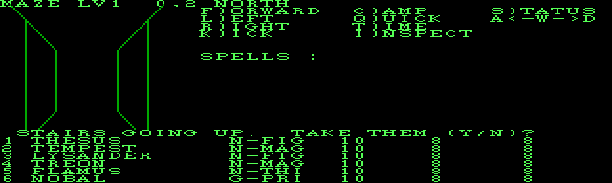
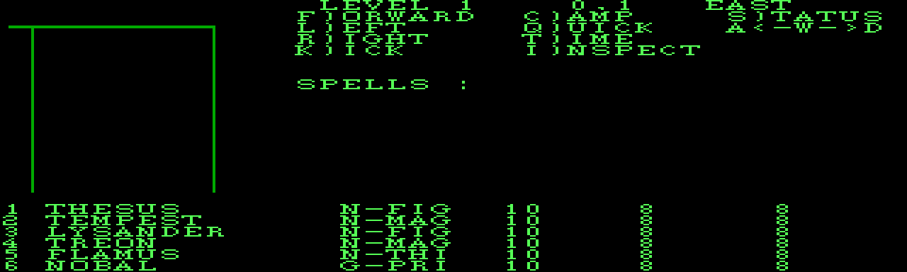

# session1 — part 3  (2026-09-02 20:30:38 … 2026-09-03 00:27:43)

  ↳ The file C:\dev\wizardry\wizardry1\docs\town.md has been updated successfully. (file state is current in your context — no need to Read it back)

## Assistant · 2026-09-02 20:30:46

› Edit: C:\dev\wizardry\wizardry1\docs\roadmap.md

  ↳ The file C:\dev\wizardry\wizardry1\docs\roadmap.md has been updated successfully. (file state is current in your context — no need to Read it back)

## Assistant · 2026-09-02 20:30:50

› Bash: `cd /c/dev/wizardry && rm -rf wizardry1/engine/dump_shop wizardry1/engine/Testing wizardry1/engine/*.dat 2>/dev/null; git add -A && git status --short`

  ↳ warning: in the working copy of 'wizardry1/docs/roadmap.md', LF will be replaced by CRLF the next time Git touches it ⏎ warning: in the working copy of 'wizardry1/docs/town.md', LF will be replaced by CRLF the next time Git touches it ⏎ warning ...

## Assistant · 2026-09-02 20:31:05

› Write: C:\Users\PAULGI~1\AppData\Local\Temp\claude\C--dev-wizardry-wizardry1\4dc1a062-1708-4f14-97ef-d51b3233e5e0\scratchpad\cmsg2.txt

  ↳ File created successfully at: C:\Users\PAULGI~1\AppData\Local\Temp\claude\C--dev-wizardry-wizardry1\4dc1a062-1708-4f14-97ef-d51b3233e5e0\scratchpad\cmsg2.txt (file state is current in your context — no need to Read it back)

## Assistant · 2026-09-02 20:31:09

› Bash: `cd /c/dev/wizardry && git commit -qF "C:/Users/PAULGI~1/AppData/Local/Temp/claude/C--dev-wizardry-wizardry1/4dc1a062-1708-4f14-97ef-d51b3233e5e0/scratchpad/cmsg2.txt" && git log --oneline -1 && git push -q; echo "push rc=$?"`

  ↳ 97d8051 wizardry1: port Boltac's Trading Post (buy / sell / uncurse / identify) ⏎ push rc=0 ⏎ Shell cwd was reset to C:\dev\wizardry\wizardry1

## Assistant · 2026-09-02 20:31:26

› Edit: C:\Users\Paul Gilbert\.claude\projects\C--dev-wizardry\memory\wizardry1-re-project.md

  ↳ The file C:\Users\Paul Gilbert\.claude\projects\C--dev-wizardry\memory\wizardry1-re-project.md has been updated successfully.

## Assistant · 2026-09-02 20:31:39

Ported. Committed as `97d8051` and pushed.

## Boltac's Trading Post

**Reverse-engineering:** confirmed the DOS `TOBJREC` layout (46 B / 23 words — Apple's minus the two dropped `STRING[15]` name fields) against DOS `SHOPS` procs 17 & 20. Also fixed a latent bug in `ObjectRec` — some accessors used byte offsets where word offsets were meant.

**[`engine/wiz/shop.h`](wizardry1/engine/include/wiz/shop.h) / [`.cpp`](wizardry1/engine/src/shop.cpp):** `Shop` — per-object `BOLTACXX` stock, seeded from the scenario's `ZOBJECT` records and persisted to `shop.dat` (the engine never rewrites the user's `SCENARIO.DATA`, unlike the DOS game). `HALFPRIC = 2`: Boltac buys / uncurses / identifies at half list price; an unidentified item is worth 1 gp.

**[`town_ui.cpp`](wizardry1/engine/src/town_ui.cpp):**

| function | Apple proc | what |
|---|---|---|
| `boltac` / `doPlayer` | `P01020A/B` | who enters → B/S/U/I/L menu |
| `doBuy` + `scrollPage` / `drawShopPage` | `DOBUY` / `SCROLPOS`/`SCROLNEG` | 6-item scrolling window over the stock; `UNUSABLE` tag per class |
| `purchase` | `PURCHASE` | last-one / carry-8 / afford / unusable-confirm checks; append possession, decrement stock |
| `sellIdun` / `transact` | `SELLIDUN` / `TRANSACT` | SELL (cursed refused, item returns to stock), UNCURSE (item destroyed), IDENTIFY (sets the flag) |

Item names come from `ASCII.KRN` — `objectNameKey(idx, 0)` unidentified / `(idx, 1)` identified.

`runTown` now takes a `TownWorld` bundle (party / roster / shop / scenario / string pool / rng + save paths) instead of an 8-parameter list.

**Tests:** new `shop_buy_sell` — THESUS buys a long sword (25 gp) and a short sword (15 gp), sells the sword back (12 gp): 185 → 157 gp, keeps item #2. All 6 CMake tests pass. `wiz1 town` gains `[ASCII.KRN]` and `[shop.dat]` args.

Last town establishment remaining: the Temple of Cant.

## User · 2026-09-02 20:32:01

Port the Temple of Cant next

## Assistant · 2026-09-02 20:32:07

› Read: C:\dev\wizardry\wizardry1\sources\WizardryCode\Wiz1WizardryPascal.txt

  ↳ 1621	  1618   8    1:D     1 SEGMENT PROCEDURE SHOPS;  (* P010201 *) ⏎ 1622	  1619   8    1:D     1    ⏎ 1623	  1620   8    2:D     1     PROCEDURE CANT;  (* P010202 *) ⏎ 1624	  1621   8    2:D     1      ⏎ 1625	  1622   8    2:D     1       VAR ⏎ 16 ...

## Assistant · 2026-09-02 20:32:42

› Bash: `python tools/pcode_dis.py dis extracted/wiz1/SYSTEM.PASCAL SHOPS 2 2>&1; echo "=== procs 3-9 ==="; python tools/pcode_dis.py procs extracted/wiz1/SYSTEM.PASCAL SHOPS 2>&1 | sed -n '4,14p'`

  ↳ ; ---- SHOPS:proc 2  entry=0x488 code_end=0x4a8 data=300 param=0 ---- ⏎   0488  02                SLDC   2 ⏎   0489  ab 12             SRO    18  ; XGOTO ⏎   048b  02                SLDC   2 ⏎   048c  04                SLDC   4 ⏎   048d  24 ...

## Assistant · 2026-09-02 20:32:57

› Bash: `for p in 12 4 13; do echo "==== SHOPS proc $p ===="; python tools/pcode_dis.py dis extracted/wiz1/SYSTEM.PASCAL SHOPS $p 2>&1; done`

  ↳ ==== SHOPS proc 12 ==== ⏎ ; ---- SHOPS:proc 12  entry=0x3f0 code_end=0x424 data=4 param=0 ---- ⏎   03f0  00                SLDC   0 ⏎   03f1  cc 01             STL    1 ⏎   03f3  eb                SLDO   4  ; PARTYCNT ⏎   03f4  01 ...

## Assistant · 2026-09-02 20:33:17

› Bash: `for p in 6 8; do echo "==== SHOPS proc $p ===="; python tools/pcode_dis.py dis extracted/wiz1/SYSTEM.PASCAL SHOPS $p 2>&1; done`

  ↳ ==== SHOPS proc 6 ==== ⏎ ; ---- SHOPS:proc 6  entry=0x120 code_end=0x196 data=42 param=0 ---- ⏎   0120  b6 02 01          LOD    2,1 ⏎   0123  01                SLDC   1 ⏎   0124  cd 01 19          CXP    WIZARDRY,25 ⏎   0127  ce 07             C ...

## Assistant · 2026-09-02 20:33:36

› Bash: `for p in 3 7 5; do echo "==== SHOPS proc $p ===="; python tools/pcode_dis.py dis extracted/wiz1/SYSTEM.PASCAL SHOPS $p 2>&1; done`

  ↳ ==== SHOPS proc 3 ==== ⏎ ; ---- SHOPS:proc 3  entry=0x0 code_end=0xe data=0 param=0 ---- ⏎   0000  b2 01 01          LDA    1,1 ⏎   0003  00                SLDC   0 ⏎   0004  cd 01 14          CXP    WIZARDRY,20 ⏎   0007  0e                SLDC ...

## Assistant · 2026-09-02 20:34:10

› Bash: `for p in 9 10 11; do echo "==== SHOPS proc $p ===="; python tools/pcode_dis.py dis extracted/wiz1/SYSTEM.PASCAL SHOPS $p 2>&1; done`

  ↳ ==== SHOPS proc 9 ==== ⏎ ; ---- SHOPS:proc 9  = GETPAYER  entry=0x1a4 code_end=0x288 data=0 param=0 ---- ⏎   01a4  00                SLDC   0 ⏎   01a5  b8 01 03          STR    1,3 ⏎   01a8  00                SLDC   0 ⏎   01a9  b8 01 02 ...

## Assistant · 2026-09-02 20:35:49

› Write: C:\dev\wizardry\wizardry1\engine\include\wiz\temple.h

  ↳ File created successfully at: C:\dev\wizardry\wizardry1\engine\include\wiz\temple.h (file state is current in your context — no need to Read it back)

## Assistant · 2026-09-02 20:35:58

› Edit: C:\dev\wizardry\wizardry1\engine\include\wiz\temple.h

  ↳ The file C:\dev\wizardry\wizardry1\engine\include\wiz\temple.h has been updated successfully. (file state is current in your context — no need to Read it back)

## Assistant · 2026-09-02 20:36:04

› Edit: C:\dev\wizardry\wizardry1\engine\include\wiz\temple.h

  ↳ The file C:\dev\wizardry\wizardry1\engine\include\wiz\temple.h has been updated successfully. (file state is current in your context — no need to Read it back)

## Assistant · 2026-09-02 20:36:11

› Edit: C:\dev\wizardry\wizardry1\engine\include\wiz\party.h

  ↳ The file C:\dev\wizardry\wizardry1\engine\include\wiz\party.h has been updated successfully. (file state is current in your context — no need to Read it back)

## Assistant · 2026-09-02 20:36:16

› Edit: C:\dev\wizardry\wizardry1\engine\src\party.cpp

  ↳ The file C:\dev\wizardry\wizardry1\engine\src\party.cpp has been updated successfully. (file state is current in your context — no need to Read it back)

## Assistant · 2026-09-02 20:36:43

› Edit: C:\dev\wizardry\wizardry1\engine\src\town_ui.cpp

  ↳ The file C:\dev\wizardry\wizardry1\engine\src\town_ui.cpp has been updated successfully. (file state is current in your context — no need to Read it back)

## Assistant · 2026-09-02 20:37:10

› Edit: C:\dev\wizardry\wizardry1\engine\src\town_ui.cpp

  ↳ The file C:\dev\wizardry\wizardry1\engine\src\town_ui.cpp has been updated successfully. (file state is current in your context — no need to Read it back)

## Assistant · 2026-09-02 20:37:18

› Read: C:\dev\wizardry\wizardry1\engine\src\town_ui.cpp

  ↳ 543	        if (!p.cursed && action == SA_UNCURSE) { aastraa(c, "** THAT IS NOT A CURSED ITEM **"); return; } ⏎ 544	        if (p.identified && action == SA_IDENTIFY) { aastraa(c, "** THAT HAS BEEN IDENTIFIED **"); return; } ⏎ 545	        if (c ...

## Assistant · 2026-09-02 20:37:23

› Read: C:\dev\wizardry\wizardry1\engine\src\town_ui.cpp

  ↳ 636	    int slot[26], n = 0; ⏎ 637	    for (int i = 0; i < c.roster.count() && n < 20; ++i) { ⏎ 638	        const Character &r = c.roster.slot(i); ⏎ 639	        if (r.name.empty() || r.inMaze || !templeTreatable(r.status)) continue; ⏎ 640	        s ...

## Assistant · 2026-09-02 20:37:43

› Edit: C:\dev\wizardry\wizardry1\engine\src\town_ui.cpp

  ↳ The file C:\dev\wizardry\wizardry1\engine\src\town_ui.cpp has been updated successfully. (file state is current in your context — no need to Read it back)

## Assistant · 2026-09-02 20:37:49

› Read: C:\dev\wizardry\wizardry1\engine\src\town_ui.cpp

  ↳ 726	        if (k == 'G') { ⏎ 727	            gilgamesh(c); ⏎ 728	        } else if (k == 'A') { ⏎ 729	            advntInn(c); ⏎ 730	        } else if (k == 'B') { ⏎ 731	            boltac(c); ⏎ 732	        } else if (k == 'C') { ⏎ 733	            notic ...

## Assistant · 2026-09-02 20:37:54

› Edit: C:\dev\wizardry\wizardry1\engine\src\town_ui.cpp

  ↳ The file C:\dev\wizardry\wizardry1\engine\src\town_ui.cpp has been updated successfully. (file state is current in your context — no need to Read it back)

## Assistant · 2026-09-02 20:38:00

› Bash: `powershell -NoProfile -ExecutionPolicy Bypass -File build.ps1 2>&1 | tail -18`

  ↳ The argument 'build.ps1' to the -File parameter does not exist. Provide the path to an existing '.ps1' file as an argument to the -File parameter. ⏎ Windows PowerShell ⏎ Copyright (C) Microsoft Corporation. All rights reserved.

## Assistant · 2026-09-02 20:38:07

› Bash: `cd /c/dev/wizardry/wizardry1/engine && powershell -NoProfile -ExecutionPolicy Bypass -File build.ps1 2>&1 | tail -18`

  ↳ -- wiz1: SDL2 window backend enabled ⏎ -- Configuring done (0.2s) ⏎ -- Generating done (0.0s) ⏎ -- Build files have been written to: C:/dev/wizardry/wizardry1/engine/build ⏎ [1/5] Building CXX object CMakeFiles\wizcore.dir\src\party.cpp.obj ⏎ [2/5] ...

## Assistant · 2026-09-02 20:38:24

› Read: C:\dev\wizardry\wizardry1\engine\src\main.cpp

  ↳ 521	                    c.inMaze ? "OUT" : "in", c.hpLeft, c.hpMax, (long long)c.gold.v); ⏎ 522	        for (int j = 0; j < c.possCount; ++j) ⏎ 523	            std::printf(" #%d%s", c.poss[j].itemIndex, c.poss[j].identified ? "" : "?"); ⏎ 524 ...

## Assistant · 2026-09-02 20:38:28

› Read: C:\dev\wizardry\wizardry1\engine\src\main.cpp

  ↳ 576	                c.attrib[4], c.attrib[5]); ⏎ 577	    return c.charLevel == 2 ? 0 : 1; ⏎ 578	} ⏎ 579	 ⏎ 580	int main(int argc, char **argv) { ⏎ 581	    if (argc < 2) return usage(); ⏎ 582	    std::string cmd = argv[1]; ⏎ 583	    if (cmd == "rng") retu ...

## Assistant · 2026-09-02 20:38:41

› Edit: C:\dev\wizardry\wizardry1\engine\src\main.cpp

  ↳ The file C:\dev\wizardry\wizardry1\engine\src\main.cpp has been updated successfully. (file state is current in your context — no need to Read it back)

## Assistant · 2026-09-02 20:38:46

› Edit: C:\dev\wizardry\wizardry1\engine\src\main.cpp

  ↳ The file C:\dev\wizardry\wizardry1\engine\src\main.cpp has been updated successfully. (file state is current in your context — no need to Read it back)

## Assistant · 2026-09-02 20:38:51

› Edit: C:\dev\wizardry\wizardry1\engine\src\main.cpp

  ↳ The file C:\dev\wizardry\wizardry1\engine\src\main.cpp has been updated successfully. (file state is current in your context — no need to Read it back)

## Assistant · 2026-09-02 20:38:57

› Bash: `powershell -NoProfile -ExecutionPolicy Bypass -File build.ps1 2>&1 | tail -4 && echo "=== temple-test ===" && ./build/wiz1.exe temple-test`

  ↳ [1/2] Building CXX object CMakeFiles\wiz1.dir\src\main.cpp.obj ⏎ [2/2] Linking CXX executable wiz1.exe ⏎  ⏎ -> C:\dev\wizardry\wizardry1\engine\build\wiz1.exe ⏎ === temple-test === ⏎ paralyzed     L3 fee=300  3 -> 0  (CURED)  age +35wk ⏎    | LAZARU ...

## Assistant · 2026-09-02 20:39:16

› Bash: `./build/wiz1.exe town-test ../extracted/wiz1/200.CHARSET ../extracted/wiz1/SCENARIO.DATA 'GATHESUS\r\r\rC\rEM' "" ../extracted/wiz1/ASCII.KRN 2>&1`

  ↳ exit: MAZE ⏎ party (1): ⏎   1) THESUS           slot=0 A2 OUT HP8/8 185gp poss:

## Assistant · 2026-09-02 20:39:26

› Read: C:\dev\wizardry\wizardry1\engine\src\main.cpp

  ↳ 486	    roster.save(rosterPath); ⏎ 487	    party.save(partyPath); ⏎ 488	    shop.save(shopPath); ⏎ 489	    return 0; ⏎ 490	} ⏎ 491	 ⏎ 492	// Headless: seed the world, script one trip through the town, print the party. ⏎ 493	static int cmdTownTest(int arg ...

## Assistant · 2026-09-02 20:39:37

› Edit: C:\dev\wizardry\wizardry1\engine\src\main.cpp

  ↳ The file C:\dev\wizardry\wizardry1\engine\src\main.cpp has been updated successfully. (file state is current in your context — no need to Read it back)

## Assistant · 2026-09-02 20:39:43

› Read: C:\dev\wizardry\wizardry1\engine\src\main.cpp

  ↳ 524	    Ui ui(*p, font); ⏎ 525	    TownWorld world{party, roster, shop, sc, haveSp ? &sp : nullptr, rng, "", "", ""}; ⏎ 526	    TownExit e = runTown(ui, world); ⏎ 527	 ⏎ 528	    static const char *kExit[] = {"ROLLER", "MAZE", "LEAVE", "WINDOW-CLOSE ...

## Assistant · 2026-09-02 20:39:51

› Edit: C:\dev\wizardry\wizardry1\engine\src\main.cpp

  ↳ The file C:\dev\wizardry\wizardry1\engine\src\main.cpp has been updated successfully. (file state is current in your context — no need to Read it back)

## Assistant · 2026-09-02 20:39:57

› Bash: `powershell -NoProfile -ExecutionPolicy Bypass -File build.ps1 2>&1 | tail -3 && echo "--- heal DEAD roster slot 6, THESUS pays ---" && ./build/wiz1.exe town-test ../extracted/wiz1/200.CHARSET ../extracted/wiz1/SCENARIO.DATA 'GATHESUS\r\r\rCA1\r\rEM' "" ../extracted/wiz1/ASCII.KRN 'wound=6:5'`

  ↳ [2/2] Linking CXX executable wiz1.exe ⏎  ⏎ -> C:\dev\wizardry\wizardry1\engine\build\wiz1.exe ⏎ --- heal DEAD roster slot 6, THESUS pays --- ⏎ wounded roster slot 6 (SUIL SIBMOBAD) -> status 5 ⏎ exit: MAZE ⏎ party (1): ⏎   1) THESUS           slot=0 ...

## Assistant · 2026-09-02 20:40:18

› Bash: `echo "--- heal PARALYZED roster slot 6 (fee 100, THESUS has 185) ---" && ./build/wiz1.exe town-test ../extracted/wiz1/200.CHARSET ../extracted/wiz1/SCENARIO.DATA 'GATHESUS\r\r\rCA1\r\rEM' "" ../extracted/wiz1/ASCII.KRN 'wound=6:3'`

  ↳ --- heal PARALYZED roster slot 6 (fee 100, THESUS has 185) --- ⏎ wounded roster slot 6 (SUIL SIBMOBAD) -> status 3 ⏎ exit: MAZE ⏎ party (1): ⏎   1) THESUS           slot=0 A2 OUT HP8/8 85gp poss:

## Assistant · 2026-09-02 20:40:41

› Edit: C:\dev\wizardry\wizardry1\engine\CMakeLists.txt

  ↳ The file C:\dev\wizardry\wizardry1\engine\CMakeLists.txt has been updated successfully. (file state is current in your context — no need to Read it back)

## Assistant · 2026-09-02 20:40:46

› Bash: `powershell -NoProfile -ExecutionPolicy Bypass -File build.ps1 2>&1 | tail -2 && cd build && "C:/Program Files/Microsoft Visual Studio/2022/Community/Common7/IDE/CommonExtensions/Microsoft/CMake/CMake/bin/ctest.exe" 2>&1 | tail -18`

  ↳ -> C:\dev\wizardry\wizardry1\engine\build\wiz1.exe ⏎     Start 2: roster_roundtrip ⏎ 2/8 Test #2: roster_roundtrip .................   Passed    0.02 sec ⏎     Start 3: roller_flow ⏎ 3/8 Test #3: roller_flow ......................   Passed    0.02 ...

## Assistant · 2026-09-02 20:40:59

› Bash: `rm -rf dump_t && mkdir dump_t && ./build/wiz1.exe town-test ../extracted/wiz1/200.CHARSET ../extracted/wiz1/SCENARIO.DATA 'GATHESUS\r\r\rCA1' dump_t ../extracted/wiz1/ASCII.KRN 'wound=6:3' >/dev/null 2>&1; python3 - <<'EOF' ⏎ def load_ppm(p): ⏎     d=open(p,'rb').read(); idx=2; vals=[] ⏎     while len(vals)<3: ⏎         while d[idx] in b' \t\n\r': idx+=1 ⏎         s=idx ⏎         while d[idx] not in b' \t\n\r ...`

  ↳ 0 frames

## Assistant · 2026-09-02 20:41:12

› Bash: `cd /c/dev/wizardry/wizardry1/engine && rm -rf dump_t; mkdir -p dump_t && ls -la dump_t && ./build/wiz1.exe town-test ../extracted/wiz1/200.CHARSET ../extracted/wiz1/SCENARIO.DATA 'GATHESUS\r\r\rCA1\r\r' dump_t ../extracted/wiz1/ASCII.KRN 'wound=6:3' 2>&1 | head -3; ls dump_t | tail -3`

  ↳ total 4 ⏎ drwxr-xr-x 1 Paul Gilbert 197121 0 Sep  3 06:41 . ⏎ drwxr-xr-x 1 Paul Gilbert 197121 0 Sep  3 06:41 .. ⏎ wounded roster slot 6 (SUIL SIBMOBAD) -> status 3 ⏎ exit: WINDOW-CLOSED ⏎ party (1): ⏎ frame0017.ppm ⏎ frame0018.ppm ⏎ frame0019.ppm

## Assistant · 2026-09-02 20:41:20

› Bash: `python3 - <<'EOF' ⏎ def load_ppm(p): ⏎     d=open(p,'rb').read(); idx=2; vals=[] ⏎     while len(vals)<3: ⏎         while d[idx] in b' \t\n\r': idx+=1 ⏎         s=idx ⏎         while d[idx] not in b' \t\n\r': idx+=1 ⏎         vals.append(int(d[s:idx])) ⏎     return vals[0],vals[1],d[idx+1:] ⏎ import glob ⏎ frames=sorted(glob.glob('dump_t/frame*.ppm')) ⏎ def show(fn): ⏎     w,h,px=load_ppm(fn); print("===",fn.split('/')[- ...`

  ↳ === dump_t\frame0010.ppm === ⏎  0|########################################| ⏎  1|# ######                        ###### #| ⏎  2|############ ####### ###### ############| ⏎  4| # ######### ####  ##### ## #### ###### | ⏎  5| # ######          #### ...

## Assistant · 2026-09-02 20:41:40

› Edit: C:\dev\wizardry\wizardry1\docs\town.md

  ↳ The file C:\dev\wizardry\wizardry1\docs\town.md has been updated successfully. (file state is current in your context — no need to Read it back)

## Assistant · 2026-09-02 20:41:54

› Edit: C:\dev\wizardry\wizardry1\docs\town.md

  ↳ The file C:\dev\wizardry\wizardry1\docs\town.md has been updated successfully. (file state is current in your context — no need to Read it back)

## Assistant · 2026-09-02 20:42:04

› Edit: C:\dev\wizardry\wizardry1\docs\roadmap.md

  ↳ The file C:\dev\wizardry\wizardry1\docs\roadmap.md has been updated successfully. (file state is current in your context — no need to Read it back)

## Assistant · 2026-09-02 20:42:09

› Bash: `cd /c/dev/wizardry && rm -rf wizardry1/engine/dump_t wizardry1/engine/dump_shop wizardry1/engine/dump_inn wizardry1/engine/Testing wizardry1/engine/*.dat 2>/dev/null; git add -A && git status --short`

  ↳ warning: in the working copy of 'wizardry1/docs/roadmap.md', LF will be replaced by CRLF the next time Git touches it ⏎ warning: in the working copy of 'wizardry1/docs/town.md', LF will be replaced by CRLF the next time Git touches it ⏎ warning ...

## Assistant · 2026-09-02 20:42:23

› Write: C:\Users\PAULGI~1\AppData\Local\Temp\claude\C--dev-wizardry-wizardry1\4dc1a062-1708-4f14-97ef-d51b3233e5e0\scratchpad\cmsg3.txt

  ↳ File created successfully at: C:\Users\PAULGI~1\AppData\Local\Temp\claude\C--dev-wizardry-wizardry1\4dc1a062-1708-4f14-97ef-d51b3233e5e0\scratchpad\cmsg3.txt (file state is current in your context — no need to Read it back)

## Assistant · 2026-09-02 20:42:27

› Bash: `cd /c/dev/wizardry && git commit -qF "C:/Users/PAULGI~1/AppData/Local/Temp/claude/C--dev-wizardry-wizardry1/4dc1a062-1708-4f14-97ef-d51b3233e5e0/scratchpad/cmsg3.txt" && git log --oneline -1 && git push -q; echo "rc=$?"`

  ↳ 82640d3 wizardry1: port the Temple of Radiant Cant -- the town is complete ⏎ rc=0 ⏎ Shell cwd was reset to C:\dev\wizardry\wizardry1

## Assistant · 2026-09-02 20:42:47

› Edit: C:\Users\Paul Gilbert\.claude\projects\C--dev-wizardry\memory\wizardry1-re-project.md

  ↳ The file C:\Users\Paul Gilbert\.claude\projects\C--dev-wizardry\memory\wizardry1-re-project.md has been updated successfully.

## Assistant · 2026-09-02 20:43:00

Ported. Committed as `82640d3` and pushed. **The town is now complete.**

## Temple of Radiant Cant

**Reverse-engineering:** worked from Apple `CANT` (`P010202`) cross-checked against DOS `SHOPS` procs 2 / 6–11, which confirmed the fee table, the resurrection roll formulas, and the DOS structural wrapper (proc 12 flushes party→roster, proc 13 reloads roster→party keeping gold — so a party member who is also the patient stays in sync).

**[`engine/wiz/temple.h`](wizardry1/engine/include/wiz/temple.h):**

| | |
|---|---|
| `templeFee(status, level)` | `P-LYZE` 100 · `STONED` 200 · `DEAD` 250 · `ASHES` 500, × patient level |
| `templeTreatable(status)` | the four above (DOS/Apple `GETPAYER` can't price `AFRAID`/`ASLEEP`, and DOS's `XJP 3..6` would trap on them) |
| `doCant(who, rng, log)` → `CantResult` | `P-LYZE`/`STONED` always cured; `DEAD` succeeds when `rand%100 ≤ 50 + 3·VIT`, `ASHES` when `≤ 40 + 3·VIT`. Success → `OK`, HP set, `AGE += rand%52 + 1`. Failure → `DEAD→ASHES` / `ASHES→LOST`, donation kept. |

**[`town_ui.cpp`](wizardry1/engine/src/town_ui.cpp)** `temple` / `templeWelcome` / `cantShop`: the patient is picked from a lettered list of **roster** characters (present, treatable — DOS shows a list, Apple types a name); the payer is a **party** member via `GETCHARX`. `donation > payer gold` → `** CHEAP APOSTATES! OUT! **`.

**[`Party::resyncFromRoster`](wizardry1/engine/src/party.cpp)** mirrors a Temple heal back into any matching party member (keeping the party copy's gold and in-maze flag).

**Tests:** `wiz1 temple-test` (deterministic — paralysis cure, guaranteed resurrection at VIT 18, forced worsening at VIT 3 → "WILL BE BURIED"); `town-test` gains a `wound=S:ST` hook, and `temple_heal` walks THESUS in to tithe 100 gp for a level-1 paralysis cure. All 8 CMake tests pass.

Next on the roadmap: `RUNNER` — the maze and the 3D view.

## User · 2026-09-02 20:43:13

Start RUNNER, the maze and 3D view

## Assistant · 2026-09-02 20:43:21

› Read: C:\dev\wizardry\wizardry1\sources\WizardryCode\Wiz1WizardryPascal.txt

  ↳ 10310	 10292  19    1:1     0     CASE XGOTO OF ⏎ 10311	 10293  19    1:1     3      ⏎ 10312	 10294  19    1:1     3        XREWARD:  BEGIN ⏎ 10313	 10295  19    1:3     3                    XGOTO := XRUNNER; ⏎ 10314	 10296  19    1:3     6 ...

## Assistant · 2026-09-02 20:43:26

› Read: C:\dev\wizardry\wizardry1\sources\WizardryCode\Wiz1WizardryPascal.txt

  ↳ 10490	 10471  20    8:1    35             DRAWLINE( LR, LR, 1,  1, WALWIDTH); ⏎ 10491	 10472  20    8:1    49             DRAWLINE( LR + WALWIDTH, UL - WALWIDTH, ⏎ 10492	 10473  20    8:1    63                               0,  1, WALHEIGH + WA ...

## Assistant · 2026-09-02 20:43:32

› Read: C:\dev\wizardry\wizardry1\sources\WizardryCode\Wiz1WizardryPascal.txt

  ↳ 10730	 10710  20   11:4   352               END;  (* 'WITH' *) ⏎ 10731	 10711  20   11:2   352           END;  (* 'FOR' *) ⏎ 10732	 10712  20   11:2   359                ⏎ 10733	 10713  20   11:1   359           IF NOT ANYALIVE THEN ⏎ 10734	 10714 ...

## Assistant · 2026-09-02 20:43:37

› Read: C:\dev\wizardry\wizardry1\sources\WizardryCode\Wiz1WizardryPascal.txt

  ↳ 10990	 10970  20   16:0     0         BEGIN  (* SPECSQAR *) ⏎ 10991	 10971  20   16:1     0           CLRRECT( 1, 11, 38, 4); ⏎ 10992	 10972  20   16:1     7           MVCURSOR( 1, 11); ⏎ 10993	 10973  20   16:1    12           SQTYPE := MAZE.SQR ...

## Assistant · 2026-09-02 20:43:42

› Read: C:\dev\wizardry\wizardry1\sources\WizardryCode\Wiz1WizardryPascal.txt

  ↳ 11249	 11229  20   14:2   193              ((RANDOM MOD 8) = 3) ⏎ 11250	 11230  20   14:2   202           THEN ⏎ 11251	 11231  20   14:3   206             ENCOUNTR; ⏎ 11252	 11232  20   14:3   208              ⏎ 11253	 11233  20   14:2   208 ...

## Assistant · 2026-09-02 20:43:46

› Read: C:\dev\wizardry\wizardry1\sources\WizardryCode\Wiz1WizardryPascal.txt

  ↳ 11289	 11269  20   14:0   360        ⏎ 11290	 11270  20   38:D     1     PROCEDURE CLROOMFG( XLOOP: INTEGER;  (* P010026 *) ⏎ 11291	 11271  20   38:D     2                         YLOOP: INTEGER); ⏎ 11292	 11272  20   38:D     3      ⏎ 11293	 11273 ...

## Assistant · 2026-09-02 20:44:07

› Bash: `python tools/pcode_dis.py procs extracted/wiz1/SYSTEM.PASCAL RUNNER 2>&1`

  ↳ segment RUNNER (segnum 20), 74 procs ⏎  ⏎   proc  entry    end anchor   data param ⏎      2      0     52     60      4     0 ⏎      4     62     78     86      0     0 ⏎      5     88    132    140     18    12 ⏎      6    142    152    160 ...

## Assistant · 2026-09-02 20:44:24

› Bash: `grep -nE "GETREC|GETRECW|SIZEOF|MOVELEFT" extracted/pcode/14_RUNNER.pd | head -30; echo "---"; grep -nE "LDCI 894|c7 7e 03|SLDC.*894" extracted/pcode/14_RUNNER.pd | head`

  ↳ 3955:  17f5  cd 01 04          CXP    WIZARDRY,4  ; GETRECW ⏎ 3957:  17fb  9e 02             CSP    MOVELEFT ⏎ 4642:  1cb0  cd 01 04          CXP    WIZARDRY,4  ; GETRECW ⏎ 4644:  1cb6  9e 02             CSP    MOVELEFT ⏎ 4657:  1cc9  cd 01 03 ...

## Assistant · 2026-09-02 20:44:33

› Bash: `python tools/pcode_dis.py dis extracted/wiz1/SYSTEM.PASCAL RUNNER 3 2>&1`

  ↳ ; ---- RUNNER:proc 3  entry=0x1008 code_end=0x1088 data=40 param=0 ---- ⏎   1008  ef                SLDO   8 ⏎   1009  cc 06             STL    6 ⏎   100b  ee                SLDO   7 ⏎   100c  cc 05             STL    5 ⏎   100e  a9 20 ...

## Assistant · 2026-09-02 20:45:08

› Bash: `for p in 4 5 6 7; do echo "==== RUNNER proc $p ===="; python tools/pcode_dis.py dis extracted/wiz1/SYSTEM.PASCAL RUNNER $p 2>&1; done`

  ↳ ==== RUNNER proc 4 ==== ⏎ ; ---- RUNNER:proc 4  entry=0x3e code_end=0x4e data=0 param=0 ---- ⏎   003e  a9 3c             LDO    60  ; CONUNIT ⏎   0040  a9 11             LDO    17  ; WINDOW1 ⏎   0042  00                SLDC   0 ⏎   0043  03 ...

## Assistant · 2026-09-02 20:45:25

› Bash: `for p in 13 8; do echo "==== RUNNER proc $p ===="; python tools/pcode_dis.py dis extracted/wiz1/SYSTEM.PASCAL RUNNER $p 2>&1; done`

  ↳ ==== RUNNER proc 13 ==== ⏎ ; ---- RUNNER:proc 13  entry=0x21e code_end=0x282 data=4 param=6 ---- ⏎   021e  b6 02 06          LOD    2,6 ⏎   0221  cc 05             STL    5 ⏎   0223  b6 02 05          LOD    2,5 ⏎   0226  cc 04             STL ...

## Assistant · 2026-09-02 20:45:50

› Bash: `grep -nE "IXP (4,4|16,1|8,2)|LDA +3,(2[0-9][0-9]|3[0-9][0-9]|4[0-4][0-9])" extracted/pcode/14_RUNNER.pd | head -40`

  ↳ 368:  0233  b2 03 80 cc       LDA    3,204 ⏎ 431:  02b0  b2 03 80 cc       LDA    3,204 ⏎ 502:  033d  b2 03 80 cc       LDA    3,204 ⏎ 887:  05aa  b2 03 81 30       LDA    3,304 ⏎ 894:  05bd  b2 03 81 94       LDA    3,404 ⏎ 901:  05cb  b2 03 81 98 ...

## Assistant · 2026-09-02 20:45:59

› Bash: `grep -nE "LDA +3,(26[0-9]|27[0-9])|IXP +16,1" extracted/pcode/14_RUNNER.pd | head; echo "--- proc containing 05aa (304=SQREXTRA) ---"; python tools/pcode_dis.py dis extracted/wiz1/SYSTEM.PASCAL RUNNER 17 2>&1 | sed -n '1,60p'`

  ↳ 2907:  10f2  c0 10 01          IXP    16,1 ⏎ 2936:  1123  c0 10 01          IXP    16,1 ⏎ 2976:  1161  c0 10 01          IXP    16,1 ⏎ 2982:  116c  c0 10 01          IXP    16,1 ⏎ 3034:  11c0  c0 10 01          IXP    16,1 ⏎ 3534:  14ea  c0 10 01 ...

## Assistant · 2026-09-02 20:46:14

› Bash: `grep -nE "LDA +3,10[0-9]|LDA +3,264|b2 03 (08|10|18|88)|IXP +8,2" extracted/pcode/14_RUNNER.pd | grep -vE "80 cc" | head -20; echo "=== proc list re-check: which proc has 05aa? ==="; awk 'NR>=880 && NR<=945' extracted/pcode/14_RUNNER.pd | grep -E "proc|LDA|IXP|CIP" | head`

  ↳ 372:  023b  c0 08 02          IXP    8,2 ⏎ 381:  024b  c0 08 02          IXP    8,2 ⏎ 390:  025a  c0 08 02          IXP    8,2 ⏎ 394:  0262  b2 03 18          LDA    3,24 ⏎ 398:  0269  c0 08 02          IXP    8,2 ⏎ 422:  02a1  b2 03 18          LDA ...

## Assistant · 2026-09-02 20:46:27

› Bash: `python tools/pcode_dis.py dis extracted/wiz1/SYSTEM.PASCAL RUNNER 19 2>&1 | head -40`

  ↳ ; ---- RUNNER:proc 19  entry=0x5aa code_end=0x642 data=0 param=28 ---- ⏎   05aa  b2 03 81 30       LDA    3,304 ⏎   05ae  b6 01 05          LOD    1,5 ⏎   05b1  a4 05             IXA    5 ⏎   05b3  b6 01 04          LOD    1,4 ⏎   05b6  c0 04 04 ...

## Assistant · 2026-09-02 20:46:53

› Bash: `grep -nE "enum (class )?(Wall|Square)|Wall\s*:|Square\s*:" /c/dev/wizardry/wizardry1/engine/include/wiz/types.h`

  ↳ 48:enum class Wall : u8 { Open, Wall, Door, HiddenDoor }; ⏎ 51:enum class Square : u8 {

## Assistant · 2026-09-02 20:46:57

› Bash: `sed -n '44,70p' /c/dev/wizardry/wizardry1/engine/include/wiz/types.h`

  ↳ enum class Status: u8 { OK, Afraid, Asleep, Paralyzed, Stoned, Dead, Ashes, Lost }; ⏎ enum class ObjType : u8 { Weapon, Armor, Shield, Helmet, Gauntlet, Special, Misc }; ⏎  ⏎ // Maze wall state per edge (2 bits packed on disk). ⏎ enum class Wall : ...

## Assistant · 2026-09-02 20:47:14

› Write: C:\dev\wizardry\wizardry1\engine\include\wiz\maze.h

  ↳ File created successfully at: C:\dev\wizardry\wizardry1\engine\include\wiz\maze.h (file state is current in your context — no need to Read it back)

## Assistant · 2026-09-02 20:47:24

› Write: C:\dev\wizardry\wizardry1\engine\src\maze.cpp

  ↳ File created successfully at: C:\dev\wizardry\wizardry1\engine\src\maze.cpp (file state is current in your context — no need to Read it back)

## Assistant · 2026-09-02 20:47:58

› Write: C:\dev\wizardry\wizardry1\engine\include\wiz\runner.h

  ↳ File created successfully at: C:\dev\wizardry\wizardry1\engine\include\wiz\runner.h (file state is current in your context — no need to Read it back)

## Assistant · 2026-09-02 20:48:13

› Read: C:\dev\wizardry\wizardry1\engine\src\main.cpp

  ↳ 579	    const RoomTier &rt = kRooms[2];        // Economy: +3 hp / 50 gp per week ⏎ 580	    int weeks = 0; ⏎ 581	    while (c.gold.v >= rt.goldPerWeek && c.hpLeft < c.hpMax) { ⏎ 582	        c.hpLeft = std::min(c.hpMax, c.hpLeft + rt.hpPerWeek); ⏎ 5 ...

## Assistant · 2026-09-02 20:48:17

› Read: C:\dev\wizardry\wizardry1\engine\src\main.cpp

  ↳ 625	    int fails = 0; ⏎ 626	    for (const Case &k : cases) { ⏎ 627	        Character who = make(k.st, k.vit, k.lvl); ⏎ 628	        int64_t fee = templeFee(k.st, k.lvl); ⏎ 629	        InnLog log; ⏎ 630	        Status before = who.status; ⏎ 631 ...

## Assistant · 2026-09-02 20:48:21

› Read: C:\dev\wizardry\wizardry1\engine\src\main.cpp

  ↳ 640	} ⏎ 641	 ⏎ 642	int main(int argc, char **argv) { ⏎ 643	    if (argc < 2) return usage(); ⏎ 644	    std::string cmd = argv[1]; ⏎ 645	    if (cmd == "rng") return cmdRng(argc, argv); ⏎ 646	    if (cmd == "roll") return cmdRoll(argc, argv); ⏎ 647	    if ...

## Assistant · 2026-09-02 20:48:44

› Edit: C:\dev\wizardry\wizardry1\engine\src\main.cpp

  ↳ The file C:\dev\wizardry\wizardry1\engine\src\main.cpp has been updated successfully. (file state is current in your context — no need to Read it back)

## Assistant · 2026-09-02 20:48:49

› Edit: C:\dev\wizardry\wizardry1\engine\src\main.cpp

  ↳ The file C:\dev\wizardry\wizardry1\engine\src\main.cpp has been updated successfully. (file state is current in your context — no need to Read it back)

## Assistant · 2026-09-02 20:48:54

› Edit: C:\dev\wizardry\wizardry1\engine\CMakeLists.txt

  ↳ The file C:\dev\wizardry\wizardry1\engine\CMakeLists.txt has been updated successfully. (file state is current in your context — no need to Read it back)

## Assistant · 2026-09-02 20:48:58

› Bash: `cd /c/dev/wizardry/wizardry1/engine && powershell -NoProfile -ExecutionPolicy Bypass -File build.ps1 2>&1 | tail -8`

  ↳ -- Generating done (0.0s) ⏎ -- Build files have been written to: C:/dev/wizardry/wizardry1/engine/build ⏎ [1/4] Building CXX object CMakeFiles\wizcore.dir\src\maze.cpp.obj ⏎ [2/4] Linking CXX static library wizcore.lib ⏎ [3/4] Building CXX object ...

## Assistant · 2026-09-02 20:49:09

› Bash: `./build/wiz1.exe maze ../extracted/wiz1/SCENARIO.DATA 1 2>&1 | head -45`

  ↳ === maze level 1 === ⏎ +--+··+--+--+--+--+--+--+--+--+  +--+--+--+--+--+--+--+--+--+ ⏎ |     |  |  |  |  |        |M :D |  :     :     :     |  |  | ⏎ +--+--+··+--+··+--+  +  +  +--+  +  +··+··+--+--+  +  +··+··+ ⏎ |     :           :        |D ...

## Assistant · 2026-09-02 20:49:23

› Bash: `./build/wiz1.exe maze ../extracted/wiz1/SCENARIO.DATA 1 'FFFRFF' 2>&1 | grep -A1 "^> \|^@"`

  ↳ @ (0,0) facing NORTH   walls: F=0 L=1 R=0 B=1 ⏎   square: STAIRS  aux0=0 aux1=0 aux2=0 ⏎ -- ⏎ > F ⏎ @ (0,1) facing NORTH   walls: F=0 L=1 R=1 B=0 ⏎  ⏎ > F ⏎ @ (0,2) facing NORTH   walls: F=0 L=1 R=1 B=0 ⏎  ⏎ > F ⏎ @ (0,3) facing NORTH   walls: F=0 L=1 R=1 B=0 ...

## Assistant · 2026-09-02 20:49:36

› Edit: C:\dev\wizardry\wizardry1\engine\CMakeLists.txt

  ↳ The file C:\dev\wizardry\wizardry1\engine\CMakeLists.txt has been updated successfully. (file state is current in your context — no need to Read it back)

## Assistant · 2026-09-02 20:49:41

› Bash: `powershell -NoProfile -ExecutionPolicy Bypass -File build.ps1 2>&1 | tail -2 && cd build && "C:/Program Files/Microsoft Visual Studio/2022/Community/Common7/IDE/CommonExtensions/Microsoft/CMake/CMake/bin/ctest.exe" 2>&1 | tail -6`

  ↳ Command did not complete within its 120s timeout and was moved to the background (ID: b2zv4p2xi). Output is being written to: C:\Users\PAULGI~1\AppData\Local\Temp\claude\C--dev-wizardry-wizardry1\4dc1a062-1708-4f14-97ef-d51b3233e5e0\tasks\b ...

## Assistant · 2026-09-02 20:51:48

› Bash: `sleep 20; cat /c/Users/PAULGI~1/AppData/Local/Temp/claude/C--dev-wizardry-wizardry1/4dc1a062-1708-4f14-97ef-d51b3233e5e0/tasks/b2zv4p2xi.output 2>&1 | tail -20`

  ↳ -> C:\dev\wizardry\wizardry1\engine\build\wiz1.exe

## Assistant · 2026-09-02 20:52:14

› Bash: `cd /c/dev/wizardry/wizardry1/engine/build && "C:/Program Files/Microsoft Visual Studio/2022/Community/Common7/IDE/CommonExtensions/Microsoft/CMake/CMake/bin/ctest.exe" --output-on-failure 2>&1 | tail -14`

  ↳ Command did not complete within its 120s timeout and was moved to the background (ID: bvk75hgdf). Output is being written to: C:\Users\PAULGI~1\AppData\Local\Temp\claude\C--dev-wizardry-wizardry1\4dc1a062-1708-4f14-97ef-d51b3233e5e0\tasks\b ...

## Assistant · 2026-09-02 20:54:25

› Bash: `cat /c/Users/PAULGI~1/AppData/Local/Temp/claude/C--dev-wizardry-wizardry1/4dc1a062-1708-4f14-97ef-d51b3233e5e0/tasks/bvk75hgdf.output 2>&1 | tail -30`

  ↳ (Bash completed with no output)

## Assistant · 2026-09-02 20:54:31

› Bash: `timeout 15 ./build/wiz1.exe maze ../extracted/wiz1/SCENARIO.DATA 1 "FFFRF" 2>&1 | tail -5; echo "exit: $?"`

  ↳ +  +  +--+--+--+  +  +  +  +  +  +  +--+--+--+--+--+--+  +  + ⏎ |  |              |        |D  D |                       |  | ⏎ +  +--+--+--+--+--+--+··+--+  +  +--+--+--+--+--+--+--+--+--+ ⏎ |S                         |D  D  D  D  D  D  D  D ...

## Assistant · 2026-09-02 20:54:41

› Bash: `cat /c/Users/PAULGI~1/AppData/Local/Temp/claude/C--dev-wizardry-wizardry1/4dc1a062-1708-4f14-97ef-d51b3233e5e0/tasks/b2zv4p2xi.output 2>&1 | tail -25`

  ↳ -> C:\dev\wizardry\wizardry1\engine\build\wiz1.exe

## Assistant · 2026-09-02 20:54:49

› Bash: `cd /c/dev/wizardry/wizardry1/engine/build && for t in dump_toc roster_roundtrip roller_flow town_flow inn_levelup shop_buy_sell temple_rules temple_heal maze_walk; do timeout 20 "C:/Program Files/Microsoft Visual Studio/2022/Community/Common7/IDE/CommonExtensions/Microsoft/CMake/CMake/bin/ctest.exe" -R "^$t\$" 2>&1 | grep -E "Passed|Failed|Timeout|\*\*\*"; done`

  ↳ Exit code 1 ⏎ 1/1 Test #1: dump_toc .........................   Passed    0.03 sec ⏎ 1/1 Test #2: roster_roundtrip .................   Passed    0.04 sec ⏎ 1/1 Test #3: roller_flow ......................   Passed    0.04 sec ⏎ 1/1 Test #4: town_flo ...

## Assistant · 2026-09-02 20:55:37

› Bash: `cd /c/dev/wizardry/wizardry1/engine/build && timeout 15 "C:/Program Files/Microsoft Visual Studio/2022/Community/Common7/IDE/CommonExtensions/Microsoft/CMake/CMake/bin/ctest.exe" -R "^maze_walk\$" --output-on-failure 2>&1 | tail -20; echo "rc=$?"`

  ↳ Test project C:/dev/wizardry/wizardry1/engine/build ⏎     Start 9: maze_walk ⏎ 1/1 Test #9: maze_walk ........................rc=0

## Assistant · 2026-09-02 20:56:15

› Edit: C:\dev\wizardry\wizardry1\engine\src\main.cpp

  ↳ The file C:\dev\wizardry\wizardry1\engine\src\main.cpp has been updated successfully. (file state is current in your context — no need to Read it back)

## Assistant · 2026-09-02 20:56:25

› Edit: C:\dev\wizardry\wizardry1\engine\CMakeLists.txt

  ↳ The file C:\dev\wizardry\wizardry1\engine\CMakeLists.txt has been updated successfully. (file state is current in your context — no need to Read it back)

## Assistant · 2026-09-02 20:56:34

› Edit: C:\dev\wizardry\wizardry1\engine\CMakeLists.txt

  ↳ The file C:\dev\wizardry\wizardry1\engine\CMakeLists.txt has been updated successfully. (file state is current in your context — no need to Read it back)

## Assistant · 2026-09-02 20:56:40

› Bash: `powershell -NoProfile -ExecutionPolicy Bypass -File build.ps1 2>&1 | tail -2 && cd build && timeout 60 "C:/Program Files/Microsoft Visual Studio/2022/Community/Common7/IDE/CommonExtensions/Microsoft/CMake/CMake/bin/ctest.exe" 2>&1 | tail -8`

  ↳ Exit code 1 ⏎ Copyright (C) Microsoft Corporation. All rights reserved. ⏎  ⏎ /usr/bin/bash: line 1: cd: build: No such file or directory

## Assistant · 2026-09-02 20:56:46

› Bash: `cd /c/dev/wizardry/wizardry1/engine && powershell -NoProfile -ExecutionPolicy Bypass -File build.ps1 2>&1 | tail -3; cd build && timeout 90 "C:/Program Files/Microsoft Visual Studio/2022/Community/Common7/IDE/CommonExtensions/Microsoft/CMake/CMake/bin/ctest.exe" --timeout 20 2>&1 | tail -8`

  ↳ [2/2] Linking CXX executable wiz1.exe ⏎  ⏎ -> C:\dev\wizardry\wizardry1\engine\build\wiz1.exe ⏎     Start 8: temple_heal ⏎ 8/9 Test #8: temple_heal ......................   Passed    0.05 sec ⏎     Start 9: maze_walk ⏎ 9/9 Test #9: maze_walk ......... ...

## Assistant · 2026-09-02 20:57:05

› Bash: `grep -n "TMAZE\|SCENARIO.DATA\|maze\|MAZE" /c/dev/wizardry/wizardry1/docs/file-formats.md | head -20`

  ↳ 14:## SCENARIO.DATA — scenario database  ✅ container decoded & validated ⏎ 36:The 8 types (`TZSCN = ZZERO ZMAZE ZENEMY ZREWARD ZOBJECT ZCHAR ZSPCCHRS ZEXP`): ⏎ 41:| 1 | ZMAZE | 10 | 894 | 1 | 12–31 | maze levels 1–10 | ⏎ 94:**ZMAZE (894 B)** — `T ...

## Assistant · 2026-09-02 20:57:09

› Read: C:\dev\wizardry\wizardry1\docs\file-formats.md

  ↳ 92	### Record layouts (partial — field order per Apple, sizes per DOS) ⏎ 93	 ⏎ 94	**ZMAZE (894 B)** — `TMAZE`: four `PACKED ARRAY[0..19][0..19] OF TWALL` ⏎ 95	(W,S,E,N; `TWALL = OPEN WALL DOOR HIDEDOOR`, 2 bits) ≈ perimeter shows as ⏎ 96	runs of `0 ...

## Assistant · 2026-09-02 20:57:24

› Edit: C:\dev\wizardry\wizardry1\docs\file-formats.md

  ↳ The file C:\dev\wizardry\wizardry1\docs\file-formats.md has been updated successfully. (file state is current in your context — no need to Read it back)

## Assistant · 2026-09-02 20:57:57

› Write: C:\dev\wizardry\wizardry1\docs\maze.md

  ↳ File created successfully at: C:\dev\wizardry\wizardry1\docs\maze.md (file state is current in your context — no need to Read it back)

## Assistant · 2026-09-02 20:58:01

› Read: C:\dev\wizardry\wizardry1\docs\roadmap.md

  ↳ 104	      `engine/wiz/bitmap.h` (`loadCga2bpp`/`loadTitle`); `wiz1 show title`; ⏎ 105	      shown at boot by `wiz1 roller`. ⏎ 106	- [~] `200.MONSTERS` — grid + load path mapped; compressed payload TBD (needs ⏎ 107	      `SYSTEM.INTERP` console-dr ...

## Assistant · 2026-09-02 20:58:10

› Edit: C:\dev\wizardry\wizardry1\docs\roadmap.md

  ↳ The file C:\dev\wizardry\wizardry1\docs\roadmap.md has been updated successfully. (file state is current in your context — no need to Read it back)

## Assistant · 2026-09-02 20:58:15

› Bash: `cd /c/dev/wizardry && rm -rf wizardry1/engine/Testing wizardry1/engine/*.dat wizardry1/engine/dump_* 2>/dev/null; git add -A && git status --short`

  ↳ warning: in the working copy of 'wizardry1/docs/file-formats.md', LF will be replaced by CRLF the next time Git touches it ⏎ warning: in the working copy of 'wizardry1/docs/roadmap.md', LF will be replaced by CRLF the next time Git touches it ...

## Assistant · 2026-09-02 20:58:32

› Write: C:\Users\PAULGI~1\AppData\Local\Temp\claude\C--dev-wizardry-wizardry1\4dc1a062-1708-4f14-97ef-d51b3233e5e0\scratchpad\cmsg4.txt

  ↳ File created successfully at: C:\Users\PAULGI~1\AppData\Local\Temp\claude\C--dev-wizardry-wizardry1\4dc1a062-1708-4f14-97ef-d51b3233e5e0\scratchpad\cmsg4.txt (file state is current in your context — no need to Read it back)

## Assistant · 2026-09-02 20:58:38

› Bash: `cd /c/dev/wizardry && git commit -qF "C:/Users/PAULGI~1/AppData/Local/Temp/claude/C--dev-wizardry-wizardry1/4dc1a062-1708-4f14-97ef-d51b3233e5e0/scratchpad/cmsg4.txt" && git log --oneline -1 && git push -q; echo "rc=$?"`

  ↳ e7385bd wizardry1: start RUNNER -- crack the TMAZE format + maze navigation ⏎ rc=0 ⏎ Shell cwd was reset to C:\dev\wizardry\wizardry1

## Assistant · 2026-09-02 20:58:56

› Edit: C:\Users\Paul Gilbert\.claude\projects\C--dev-wizardry\memory\wizardry1-re-project.md

  ↳ The file C:\Users\Paul Gilbert\.claude\projects\C--dev-wizardry\memory\wizardry1-re-project.md has been updated successfully.

## Assistant · 2026-09-02 20:59:15

Started. Committed as `e7385bd` and pushed.

## The TMAZE format is cracked

The big win: the 894-byte `TMAZE` record's bit-packing, confirmed from DOS `RUNNER` procs 13 (`FRWDVIEW`) and 19 (`SPECSQAR`) plus the UCSD packed-array rules, and **validated by rendering level 1** — the render shows the start at `@(0,0)` facing north on the castle stairs, the famous door-lined east-west corridor, teleport/button squares, and the big `DARK` room, all where they should be.

| word | field | packing |
|--:|---|---|
| 0 / 60 / 120 / 180 | `W` / `S` / `E` / `N` `[x][y]` | 2 bits, 3 words/row (`IXP 8,2`) |
| 240 | `FIGHTS[x][y]` | 1 bit (`IXP 16,1`) |
| 280 | `SQREXTRA[x][y]` | 4 bits (`IXP 4,4`) → 0..15 |
| 380 | `SQRETYPE[0..15]` | 4 bits → `TSQUARE` |
| 384 / 400 / 416 | `AUX0` / `AUX1` / `AUX2 [0..15]` | i16 (stair/chute/teleport target lev/y/x) |
| 432 | `ENMYCALC[1..3]` | 5×i16 |

## Ported

- **[`wiz/maze.h`](wizardry1/engine/include/wiz/maze.h) / [`.cpp`](wizardry1/engine/src/maze.cpp)** — `MazeLevel`: `wall(x,y,dir)`, `squareAt`, `fights`, `aux0/1/2`, `enemyCalc`; x/y wrap mod 20.
- **[`wiz/runner.h`](wizardry1/engine/include/wiz/runner.h)** — `MazePos {x,y,dir}`, `shftPos` (`SHFTPOS`), `stepForward` (`MOVEFRWD`), `turn` (`DOTURN`), `canWalk`/`canKick` (`FORWRD`/`KICK` — kick passes doors + hidden doors), and `frwd`/`left`/`righView` (the wall a square shows toward front/left/right — what the wireframe renderer will consume).
- **`wiz1 maze <SCENARIO.DATA> [level] [F/L/R/K/Q script]`** — top-down ASCII map + per-cell wall/square dump + scripted walk. New `maze_walk` CMake test (all 9 pass).
- **[`docs/maze.md`](wizardry1/docs/maze.md)** maps the whole segment: the `RUNMAIN` turn loop, encounter checks, and the full `SPECSQAR` trap/stairs/teleport table (with the `AUX` semantics).

## Next

`DRAWMAZE` (`P010E02`) — the first-person wireframe. It's a `DRAWLINE`-based perspective renderer: `LIGHTDIS` squares deep, halving the wall width each step toward a vanishing point, drawing left/right side panels and perpendicular faces, with door cut-outs that only reveal `HIDEDOOR`s on a `RANDOM mod 6 = 3` roll in the dark. That's the meaty remaining piece — the data and movement it needs are now in place.

## User · 2026-09-02 21:25:52

Port DRAWMAZE, the first-person wireframe view

## Assistant · 2026-09-02 21:26:55

› Bash: `grep -nE "WIZARDRY\s+(26|27|28)\s" docs/procmap.tsv; echo "=== WIZARDRY proc 26 ==="; python tools/pcode_dis.py dis extracted/wiz1/SYSTEM.PASCAL WIZARDRY 26 2>&1; echo "=== 27 ==="; python tools/pcode_dis.py dis extracted/wiz1/SYSTEM.PASCAL WIZARDRY 27 2>&1`

  ↳ === WIZARDRY proc 26 === ⏎ ; ---- WIZARDRY:proc 26  entry=0xedc code_end=0xf40 data=12 param=10 ---- ⏎   0edc  dc                SLDL   5 ⏎   0edd  c6 04             LLA    4 ⏎   0edf  c6 03             LLA    3 ⏎   0ee1  ce 4d             CLP ...

## Assistant · 2026-09-02 21:27:14

› Bash: `grep -nE "SLDC +72|SLDC +64|LDCI|SLDC +32" extracted/pcode/14_RUNNER.pd | grep -B1 -A1 "SLDC +72" | head -30; echo "==="; grep -nE "proc [0-9]+ +entry" extracted/pcode/14_RUNNER.pd | head; echo "--- find UL=8;LR=72 ---"; grep -nE "^\s+[0-9a-f]+\s+08\s+SLDC\s+8$" extracted/pcode/14_RUNNER.pd | head`

  ↳ === ⏎ 3:; ---- RUNNER:proc 2  entry=0x0 code_end=0x32 data=4 param=0 ---- ⏎ 40:; ---- RUNNER:proc 4  entry=0x3e code_end=0x4e data=0 param=0 ---- ⏎ 53:; ---- RUNNER:proc 5  entry=0x58 code_end=0x84 data=18 param=12 ---- ⏎ 81:; ---- RUNNER:proc 6  e ...

## Assistant · 2026-09-02 21:27:21

› Bash: `python tools/pcode_dis.py dis extracted/wiz1/SYSTEM.PASCAL RUNNER 2 2>&1; echo "=== proc 5 (DRAWLINE?) already seen; proc 12 ==="; python tools/pcode_dis.py dis extracted/wiz1/SYSTEM.PASCAL RUNNER 12 2>&1`

  ↳ ; ---- RUNNER:proc 2  entry=0x0 code_end=0x32 data=4 param=0 ---- ⏎   0000  cd 01 0b          CXP    WIZARDRY,11 ⏎   0003  01                SLDC   1 ⏎   0004  cc 01             STL    1 ⏎   0006  b2 01 07          LDA    1,7 ⏎   0009  00 ...

## Assistant · 2026-09-02 21:27:43

› Bash: `grep -nE "CLP +12|CIP +12|CLP +0c|proc [0-9]+ +entry" extracted/pcode/14_RUNNER.pd | grep -B2 "12" | head -30`

  ↳ 3:; ---- RUNNER:proc 2  entry=0x0 code_end=0x32 data=4 param=0 ---- ⏎ 40:; ---- RUNNER:proc 4  entry=0x3e code_end=0x4e data=0 param=0 ---- ⏎ 53:; ---- RUNNER:proc 5  entry=0x58 code_end=0x84 data=18 param=12 ---- ⏎ -- ⏎ 517:; ---- RUNNER:proc 16 ...

## Assistant · 2026-09-02 21:28:14

› Bash: `python tools/pcode_dis.py dis extracted/wiz1/SYSTEM.PASCAL RUNNER 17 2>&1`

  ↳ ; ---- RUNNER:proc 17  entry=0x38e code_end=0x444 data=0 param=0 ---- ⏎   038e  00                SLDC   0 ⏎   038f  00                SLDC   0 ⏎   0390  00                SLDC   0 ⏎   0391  ae 0d             CIP    13 ⏎   0393  00 ...

## Assistant · 2026-09-02 21:28:39

› Bash: `for p in 16 21 27; do echo "==== RUNNER proc $p ===="; python tools/pcode_dis.py dis extracted/wiz1/SYSTEM.PASCAL RUNNER $p 2>&1; done`

  ↳ ==== RUNNER proc 16 ==== ⏎ ; ---- RUNNER:proc 16  entry=0x368 code_end=0x384 data=0 param=6 ---- ⏎   0368  da                SLDL   3 ⏎   0369  03                SLDC   3 ⏎   036a  c3                EQUI ⏎   036b  a1 11             FJP    L037e ...

## Assistant · 2026-09-02 21:28:52

› Bash: `for p in 22 23 26 18; do echo "==== RUNNER proc $p ===="; python tools/pcode_dis.py dis extracted/wiz1/SYSTEM.PASCAL RUNNER $p 2>&1; done`

  ↳ ==== RUNNER proc 22 ==== ⏎ ; ---- RUNNER:proc 22  entry=0x6ea code_end=0x73c data=0 param=0 ---- ⏎   06ea  b6 02 09          LOD    2,9 ⏎   06ed  00                SLDC   0 ⏎   06ee  c3                EQUI ⏎   06ef  a1 04             FJP    L06f5 ...

## Assistant · 2026-09-02 21:30:05

› Write: C:\dev\wizardry\wizardry1\engine\include\wiz\maze3d.h

  ↳ File created successfully at: C:\dev\wizardry\wizardry1\engine\include\wiz\maze3d.h (file state is current in your context — no need to Read it back)

## Assistant · 2026-09-02 21:30:58

› Write: C:\dev\wizardry\wizardry1\engine\src\maze3d.cpp

  ↳ File created successfully at: C:\dev\wizardry\wizardry1\engine\src\maze3d.cpp (file state is current in your context — no need to Read it back)

## Assistant · 2026-09-02 21:31:03

› Bash: `grep -nE "void set|u8 get|int width|int height|fillRect|savePPM|Surface\(|resize|fill\(" /c/dev/wizardry/wizardry1/engine/include/wiz/surface.h`

  ↳ 12:    Surface() = default; ⏎ 13:    Surface(int w, int h) { resize(w, h); } ⏎ 15:    void resize(int w, int h) { w_ = w; h_ = h; px_.assign(size_t(w) * h, 0); } ⏎ 16:    int width() const { return w_; } ⏎ 17:    int height() const { return h_; } ⏎ 2 ...

## Assistant · 2026-09-02 21:31:16

› Edit: C:\dev\wizardry\wizardry1\engine\src\main.cpp

  ↳ The file C:\dev\wizardry\wizardry1\engine\src\main.cpp has been updated successfully. (file state is current in your context — no need to Read it back)

## Assistant · 2026-09-02 21:31:23

› Edit: C:\dev\wizardry\wizardry1\engine\src\main.cpp

  ↳ The file C:\dev\wizardry\wizardry1\engine\src\main.cpp has been updated successfully. (file state is current in your context — no need to Read it back)

## Assistant · 2026-09-02 21:31:29

› Edit: C:\dev\wizardry\wizardry1\engine\src\main.cpp

  ↳ The file C:\dev\wizardry\wizardry1\engine\src\main.cpp has been updated successfully. (file state is current in your context — no need to Read it back)

## Assistant · 2026-09-02 21:31:35

› Edit: C:\dev\wizardry\wizardry1\engine\src\main.cpp

  ↳ The file C:\dev\wizardry\wizardry1\engine\src\main.cpp has been updated successfully. (file state is current in your context — no need to Read it back)

## Assistant · 2026-09-02 21:31:40

› Edit: C:\dev\wizardry\wizardry1\engine\CMakeLists.txt

  ↳ The file C:\dev\wizardry\wizardry1\engine\CMakeLists.txt has been updated successfully. (file state is current in your context — no need to Read it back)

## Assistant · 2026-09-02 21:31:45

› Bash: `cd /c/dev/wizardry/wizardry1/engine && powershell -NoProfile -ExecutionPolicy Bypass -File build.ps1 2>&1 | tail -6`

  ↳ [1/4] Building CXX object CMakeFiles\wizcore.dir\src\maze3d.cpp.obj ⏎ [2/4] Linking CXX static library wizcore.lib ⏎ [3/4] Building CXX object CMakeFiles\wiz1.dir\src\main.cpp.obj ⏎ [4/4] Linking CXX executable wiz1.exe ⏎  ⏎ -> C:\dev\wizardry\wi ...

## Assistant · 2026-09-02 21:32:00

› Bash: `./build/wiz1.exe maze ../extracted/wiz1/SCENARIO.DATA 1 "" 2>&1 | sed -n '43,85p'`

  ↳ @ (0,0) facing NORTH   walls: F=0 L=1 R=0 B=1 ⏎   square: STAIRS  aux0=0 aux1=0 aux2=0 ⏎   |#                                        | ⏎   | #                                       | ⏎   |  #                                      | ⏎   |   # ...

## Assistant · 2026-09-02 21:32:53

› Bash: `cd /c/dev/wizardry/wizardry1 && python3 - <<'EOF' ⏎ import struct ⏎ data=open('extracted/wiz1/SCENARIO.DATA','rb').read() ⏎ base=12*512  # maze bloff 12 ⏎ rec=data[base:base+894] ⏎ w=struct.unpack('<447H',rec) ⏎ def wall(x,y,d): ⏎     b={0:180,1:120,2:60,3:0}[d]  # N E S W ⏎     word=b + x*3 + y//8 ⏎     return (w[word] >> ((y%8)*2)) & 3 ⏎ # check E[x][y] vs W[x+1][y] consistency ⏎ mm=0; tot=0 ⏎ for y in range(20): ⏎     f ...`

  ↳ E[x][y] vs W[x+1][y] mismatches: 19/400 ⏎ N[x][y] vs S[x][y+1] mismatches: 13/400 ⏎ (0,0): N=0 E=0 S=1 W=1   (1,0) W=0 ⏎ (0,1): N=0 E=1 S=0 W=1   (1,1) W=1 ⏎ (0,2): N=0 E=1 S=0 W=1   (1,2) W=1 ⏎ (0,3): N=0 E=1 S=0 W=1   (1,3) W=1

## Assistant · 2026-09-02 21:33:15

› Bash: `./build/wiz1.exe maze ../extracted/wiz1/SCENARIO.DATA 1 "FFFR" 2>&1 | tail -44`

  ↳ /usr/bin/bash: line 1: ./build/wiz1.exe: No such file or directory

## Assistant · 2026-09-02 21:33:20

› Bash: `cd /c/dev/wizardry/wizardry1/engine && ./build/wiz1.exe maze ../extracted/wiz1/SCENARIO.DATA 1 "FFFR" 2>&1 | tail -44`

  ↳ |                                         | ⏎  ⏎ +--+··+--+--+--+--+--+--+--+--+  +--+--+--+--+--+--+--+--+--+ ⏎ |     |  |  |  |  |        |M :D |  :     :     :     |  |  | ⏎ +--+--+··+--+··+--+  +  +  +--+  +  +··+··+--+--+  +  +··+··+ ⏎ | ...

## Assistant · 2026-09-02 21:33:30

› Bash: `./build/wiz1.exe maze ../extracted/wiz1/SCENARIO.DATA 1 "FFFR" 2>&1 | sed -n '/^> R/,/RESULT/p' | head -45`

  ↳ > R ⏎ @ (0,3) facing EAST   walls: F=1 L=0 R=0 B=1 ⏎   |                                         | ⏎   |                                         | ⏎   |                                         | ⏎   |                                         | ⏎   |#### ...

## Assistant · 2026-09-02 21:33:58

› Edit: C:\dev\wizardry\wizardry1\engine\src\main.cpp

  ↳ The file C:\dev\wizardry\wizardry1\engine\src\main.cpp has been updated successfully. (file state is current in your context — no need to Read it back)

## Assistant · 2026-09-02 21:34:06

› Edit: C:\dev\wizardry\wizardry1\engine\src\main.cpp

  ↳ The file C:\dev\wizardry\wizardry1\engine\src\main.cpp has been updated successfully. (file state is current in your context — no need to Read it back)

## Assistant · 2026-09-02 21:34:12

› Bash: `grep -n "kCgaPalette\|#include \"wiz/bitmap.h\"" src/main.cpp | head; grep -n "kCgaPalette" include/wiz/bitmap.h`

  ↳ 12:#include "wiz/bitmap.h" ⏎ 312:        showSurface(s, ppm, kCgaPalette, 4); ⏎ 792:        plat->present(pic, kCgaPalette, 4); ⏎ 17:extern const Color kCgaPalette[4];

## Assistant · 2026-09-02 21:34:17

› Edit: C:\dev\wizardry\wizardry1\engine\src\main.cpp

  ↳ The file C:\dev\wizardry\wizardry1\engine\src\main.cpp has been updated successfully. (file state is current in your context — no need to Read it back)

## Assistant · 2026-09-02 21:34:21

› Bash: `powershell -NoProfile -ExecutionPolicy Bypass -File build.ps1 2>&1 | tail -4`

  ↳ [1/2] Building CXX object CMakeFiles\wiz1.dir\src\main.cpp.obj ⏎ [2/2] Linking CXX executable wiz1.exe ⏎  ⏎ -> C:\dev\wizardry\wizardry1\engine\build\wiz1.exe

## Assistant · 2026-09-02 21:34:55

› Bash: `./build/wiz1.exe maze ../extracted/wiz1/SCENARIO.DATA 1 "FFFR" 2>&1 | sed -n '/^> R/,/^$/p' | cat -A | sed -n '3,10p'`

  ↳ |                                         |$ ⏎   |                                         |$ ⏎   |                                         |$ ⏎   |                                         |$ ⏎   |#########################################|$ ⏎   | ...

## Assistant · 2026-09-02 21:35:26

› Edit: C:\dev\wizardry\wizardry1\engine\CMakeLists.txt

  ↳ The file C:\dev\wizardry\wizardry1\engine\CMakeLists.txt has been updated successfully. (file state is current in your context — no need to Read it back)

## Assistant · 2026-09-02 21:35:31

› Bash: `powershell -NoProfile -ExecutionPolicy Bypass -File build.ps1 2>&1 | tail -2 && cd build && timeout 90 "C:/Program Files/Microsoft Visual Studio/2022/Community/Common7/IDE/CommonExtensions/Microsoft/CMake/CMake/bin/ctest.exe" --timeout 20 2>&1 | tail -6`

  ↳ -> C:\dev\wizardry\wizardry1\engine\build\wiz1.exe ⏎       Start 10: maze_3d ⏎ 10/10 Test #10: maze_3d ..........................   Passed    0.03 sec ⏎  ⏎ 100% tests passed, 0 tests failed out of 10 ⏎  ⏎ Total Test time (real) =   0.40 sec

## Assistant · 2026-09-02 21:35:48

› Bash: `python3 - <<'EOF' ⏎ import zlib,struct,subprocess ⏎ # Get the ASCII wireframe from a few positions and also render PNGs via a helper build path. ⏎ # Instead: dump the pic to PPM via a tiny C++-less route -- just parse the ASCII from the tool. ⏎ out=subprocess.run(['./build/wiz1.exe','maze','../extracted/wiz1/SCENARIO.DATA','1','FRF'],capture_output=True,text=True).stdout ⏎ # print the three wireframes (star ...`

  ↳ Exit code 1 ⏎ Traceback (most recent call last): ⏎   File "<stdin>", line 4, in <module> ⏎   File "C:\Program Files\Python310\lib\subprocess.py", line 501, in run ⏎     with Popen(*popenargs, **kwargs) as process: ⏎   File "C:\Program Files\Pytho ...

## Assistant · 2026-09-02 21:35:55

› Bash: `./build/wiz1.exe maze ../extracted/wiz1/SCENARIO.DATA 1 "RF" 2>&1 | sed -n '/facing NORTH/,/^$/p'; echo "==== after F (into corridor) ===="; ./build/wiz1.exe maze ../extracted/wiz1/SCENARIO.DATA 1 "F" 2>&1 | sed -n '/^> F/,/^$/p'`

  ↳ ==== after F (into corridor) ====

## Assistant · 2026-09-02 21:36:02

› Bash: `./build/wiz1.exe maze ../extracted/wiz1/SCENARIO.DATA 1 "F" 2>&1 | sed -n '46,90p'`

  ↳ (Bash completed with no output)

## Assistant · 2026-09-02 21:36:08

› Bash: `./build/wiz1.exe maze ../extracted/wiz1/SCENARIO.DATA 1 "F" 2>&1 | grep -n "> F" ; ./build/wiz1.exe maze ../extracted/wiz1/SCENARIO.DATA 1 "F" 2>&1 | tail -50 | head -46`

  ↳ /usr/bin/bash: line 1: ./build/wiz1.exe: No such file or directory

## Assistant · 2026-09-02 21:36:15

› Bash: `cd /c/dev/wizardry/wizardry1/engine && ./build/wiz1.exe maze ../extracted/wiz1/SCENARIO.DATA 1 "F" 2>&1 | awk '/> F/{f=1} f' | head -44`

  ↳ > F ⏎ @ (0,1) facing NORTH   walls: F=0 L=1 R=1 B=0 ⏎   |#                                      ##| ⏎   | #                                    ## | ⏎   |  #                                  ##  | ⏎   |   #                                ##   | ⏎   | ...

## Assistant · 2026-09-02 21:36:43

› Edit: C:\dev\wizardry\wizardry1\docs\maze.md

  ↳ <tool_use_error>String to replace not found in file. ⏎ String: ## The 3D view — `DRAWMAZE` (`P010E02`)  *(not yet ported)* ⏎  ⏎ A wireframe drawn with the interp's `DRAWLINE(x, y, dH, dV, len)` primitive ⏎ into an 82×79 picture area.  `LIGHTDIS` sq ...

## Assistant · 2026-09-02 21:36:48

› Bash: `grep -n "3D view\|not yet ported\|DRAWMAZE\|wireframe" /c/dev/wizardry/wizardry1/docs/maze.md`

  ↳ 4:first-person wireframe view.  Entered on `XGOTO = XRUNNER`; `XNEWMAZE` ⏎ 31:2. if `NEEDDRMZ` → `DRAWMAZE` ⏎ 63:## The 3D view — `DRAWMAZE` (`P010E02`)  *(not yet ported)* ⏎ 65:A wireframe drawn with the interp's `DRAWLINE(x, y, dH, dV, len)` pr ...

## Assistant · 2026-09-02 21:36:52

› Read: C:\dev\wizardry\wizardry1\docs\maze.md

  ↳ 63	## The 3D view — `DRAWMAZE` (`P010E02`)  *(not yet ported)* ⏎ 64	 ⏎ 65	A wireframe drawn with the interp's `DRAWLINE(x, y, dH, dV, len)` primitive ⏎ 66	into an 82×79 picture area.  `LIGHTDIS` squares deep (2 dark / 3–5 with ⏎ 67	`LIGHT`, halved ...

## Assistant · 2026-09-02 21:37:10

› Edit: C:\dev\wizardry\wizardry1\docs\maze.md

  ↳ The file C:\dev\wizardry\wizardry1\docs\maze.md has been updated successfully. (file state is current in your context — no need to Read it back)

## Assistant · 2026-09-02 21:37:23

› Edit: C:\dev\wizardry\wizardry1\docs\roadmap.md

  ↳ The file C:\dev\wizardry\wizardry1\docs\roadmap.md has been updated successfully. (file state is current in your context — no need to Read it back)

## Assistant · 2026-09-02 21:37:27

› Bash: `cd /c/dev/wizardry && rm -rf wizardry1/engine/Testing wizardry1/engine/*.dat 2>/dev/null; git add -A && git status --short`

  ↳ warning: in the working copy of 'wizardry1/docs/maze.md', LF will be replaced by CRLF the next time Git touches it ⏎ warning: in the working copy of 'wizardry1/docs/roadmap.md', LF will be replaced by CRLF the next time Git touches it ⏎ warning ...

## Assistant · 2026-09-02 21:37:44

› Write: C:\Users\PAULGI~1\AppData\Local\Temp\claude\C--dev-wizardry-wizardry1\4dc1a062-1708-4f14-97ef-d51b3233e5e0\scratchpad\cmsg5.txt

  ↳ File created successfully at: C:\Users\PAULGI~1\AppData\Local\Temp\claude\C--dev-wizardry-wizardry1\4dc1a062-1708-4f14-97ef-d51b3233e5e0\scratchpad\cmsg5.txt (file state is current in your context — no need to Read it back)

## Assistant · 2026-09-02 21:37:50

› Bash: `cd /c/dev/wizardry && git commit -qF "C:/Users/PAULGI~1/AppData/Local/Temp/claude/C--dev-wizardry-wizardry1/4dc1a062-1708-4f14-97ef-d51b3233e5e0/scratchpad/cmsg5.txt" && git log --oneline -1 && git push -q; echo "rc=$?"`

  ↳ 2ab735c wizardry1: port DRAWMAZE -- the first-person wireframe view ⏎ rc=0 ⏎ Shell cwd was reset to C:\dev\wizardry\wizardry1

## Assistant · 2026-09-02 21:38:07

› Edit: C:\Users\Paul Gilbert\.claude\projects\C--dev-wizardry\memory\wizardry1-re-project.md

  ↳ The file C:\Users\Paul Gilbert\.claude\projects\C--dev-wizardry\memory\wizardry1-re-project.md has been updated successfully.

## Assistant · 2026-09-02 21:38:23

Ported. Committed as `2ab735c` and pushed.

## DRAWMAZE — the first-person wireframe

**RE finding:** the DOS build (`RUNNER` procs 3/12/17/21…39) *precomputes* the view into 4 fixed depth layers and draws them via `CONUNIT UNITWRITE` subfn 5 — where `DRAWLINE(x, y, dH, dV, len)` plots a run of `len` points stepping `(dH,dV)` along one of 8 directions. The Apple source expresses the identical shape as a clean halving loop, so I ported that.

**[`engine/wiz/maze3d.h`](wizardry1/engine/include/wiz/maze3d.h) / [`.cpp`](wizardry1/engine/src/maze3d.cpp)** — `drawMazeView(pic, maze, pos, level, light, quickPlot, rng)` renders into an 82×79 `Surface`:

- `LIGHTDIS` squares deep (2 unlit / 3–5 with `LIGHT` / 3 with quick-plot; a lit draw burns a `LIGHT` charge)
- geometry starts `UL=8 LR=72 WALWIDTH=32 WALHEIGH=64`; each step halves `WALWIDTH` and insets `UL/LR` toward the vanishing point
- per depth: `DRAWLEFT`/`DRAWRIGH` receding trapezoids when the side wall isn't open (narrowing the clip); `DRAWFRNT` for the perpendicular face one square over when a side *is* open; `DRAWFRNT` + stop on a closed wall ahead
- door cut-outs for a real `DOOR`, or a `HIDEDOOR` that's lit or passes the `RANDOM mod 6 = 3` glimpse roll
- stops on a `DARK` square; follows a same-level `TRANSFER`

**Verified against level 1:**

```
(0,0) facing NORTH — west-wall corridor,     (0,1) NORTH — nested receding
a wall closing off the NE:                    "box" corridor going deep:
  |    #                              ######|   |    #       #       #    |
  |    #       #               #       #    |   |    #       #       #    |
  |    #       #               #       #    |   |    #      ##  ...  #    |
  |    #      ##               #       #    |   |    #    ##      #  #    |
  |    ###                           # #    |   |    ###          # #    |

(0,3) facing EAST — solid dead-end wall face filling the view:
  |#########################################|
  |    #                               #    |
  |#########################################|
```

**Commands:** `wiz1 maze <SCENARIO.DATA> [level] [F/L/R/K script]` now prints the wireframe as ASCII after every step (new `maze_3d` CMake test — 10 total, all pass); `wiz1 maze-sdl <SCENARIO.DATA> [level]` walks a level with the wireframe in an SDL window.

Next: wire the maze into a real game loop — the text HUD around the pic, `SPECSQAR` (traps, stairs, teleporters, spinners), and `RUNMAIN`'s encounter checks that hand off to `COMBAT`.

## User · 2026-09-02 22:09:27

Wire the maze into the game loop with the HUD

## Assistant · 2026-09-02 22:10:12

› Read: C:\dev\wizardry\wizardry1\sources\WizardryCode\Wiz1WizardryPascal.txt

  ↳ 894	   894   7   21:D     1   PROCEDURE NEWMAZE;  (* P010115 *) ⏎ 895	   895   7   21:D     1    ⏎ 896	   896   7   21:D     1     VAR ⏎ 897	   897   7   21:D     1          MAZEMAP  : TMAZE; ⏎ 898	   898   7   21:D   448          UNUSED   : ARRAY[ ...

## Assistant · 2026-09-02 22:10:50

› Bash: `cd /c/dev/wizardry/wizardry1/engine && sed -n '1,45p' include/wiz/surface.h; echo "=== Ui in roller_ui.h ==="; sed -n '/class Ui/,/^};/p' include/wiz/roller_ui.h`

  ↳ // A simple 8-bit indexed framebuffer + drawing primitives.  No dependencies; ⏎ // a Platform backend turns it into pixels on screen. ⏎ #pragma once ⏎ #include "wiz/types.h" ⏎  ⏎ namespace wiz { ⏎  ⏎ struct Color { u8 r = 0, g = 0, b = 0; }; ⏎  ⏎ class Surfa ...

## Assistant · 2026-09-02 22:11:31

› Edit: C:\dev\wizardry\wizardry1\engine\include\wiz\roller_ui.h

  ↳ The file C:\dev\wizardry\wizardry1\engine\include\wiz\roller_ui.h has been updated successfully. (file state is current in your context — no need to Read it back)

## Assistant · 2026-09-02 22:11:37

› Edit: C:\dev\wizardry\wizardry1\engine\src\roller_ui.cpp

  ↳ The file C:\dev\wizardry\wizardry1\engine\src\roller_ui.cpp has been updated successfully. (file state is current in your context — no need to Read it back)

## Assistant · 2026-09-02 22:11:44

› Edit: C:\dev\wizardry\wizardry1\engine\include\wiz\maze.h

  ↳ The file C:\dev\wizardry\wizardry1\engine\include\wiz\maze.h has been updated successfully. (file state is current in your context — no need to Read it back)

## Assistant · 2026-09-02 22:11:49

› Edit: C:\dev\wizardry\wizardry1\engine\include\wiz\maze.h

  ↳ The file C:\dev\wizardry\wizardry1\engine\include\wiz\maze.h has been updated successfully. (file state is current in your context — no need to Read it back)

## Assistant · 2026-09-02 22:11:58

› Edit: C:\dev\wizardry\wizardry1\engine\include\wiz\maze.h

  ↳ The file C:\dev\wizardry\wizardry1\engine\include\wiz\maze.h has been updated successfully. (file state is current in your context — no need to Read it back)

## Assistant · 2026-09-02 22:12:03

› Edit: C:\dev\wizardry\wizardry1\engine\src\maze.cpp

  ↳ The file C:\dev\wizardry\wizardry1\engine\src\maze.cpp has been updated successfully. (file state is current in your context — no need to Read it back)

## Assistant · 2026-09-02 22:12:09

› Edit: C:\dev\wizardry\wizardry1\engine\src\maze.cpp

  ↳ The file C:\dev\wizardry\wizardry1\engine\src\maze.cpp has been updated successfully. (file state is current in your context — no need to Read it back)

## Assistant · 2026-09-02 22:12:22

› Edit: C:\dev\wizardry\wizardry1\engine\src\maze.cpp

  ↳ The file C:\dev\wizardry\wizardry1\engine\src\maze.cpp has been updated successfully. (file state is current in your context — no need to Read it back)

## Assistant · 2026-09-02 22:13:37

› Write: C:\dev\wizardry\wizardry1\engine\include\wiz\maze_ui.h

  ↳ File created successfully at: C:\dev\wizardry\wizardry1\engine\include\wiz\maze_ui.h (file state is current in your context — no need to Read it back)

## Assistant · 2026-09-02 22:13:41

› Bash: `grep -nE "kW|kH|kGlyphBytes" include/wiz/font.h`

  ↳ 14:    static constexpr int kW = 16, kH = 8, kGlyphBytes = 16; ⏎ 17:    int glyphCount() const { return int(data_.size()) / kGlyphBytes; }

## Assistant · 2026-09-02 22:14:58

› Write: C:\dev\wizardry\wizardry1\engine\src\maze_ui.cpp

  ↳ File created successfully at: C:\dev\wizardry\wizardry1\engine\src\maze_ui.cpp (file state is current in your context — no need to Read it back)

## Assistant · 2026-09-02 22:15:05

› Edit: C:\dev\wizardry\wizardry1\engine\src\maze_ui.cpp

  ↳ The file C:\dev\wizardry\wizardry1\engine\src\maze_ui.cpp has been updated successfully. (file state is current in your context — no need to Read it back)

## Assistant · 2026-09-02 22:15:09

› Bash: `grep -n "ToMaze\|playTownLoop\|maze-sdl\|cmdMazeSdl\|maze3d.h\|maze_ui" src/main.cpp`

  ↳ 23:#include "wiz/maze3d.h" ⏎ 432:static void playTownLoop(Ui &ui, TownWorld &world, bool startInTown) { ⏎ 443:        else if (e == TownExit::ToMaze) { ⏎ 488:    playTownLoop(ui, world, party.count() > 0); ⏎ 773:// wiz1 maze-sdl <SCENARIO.DATA> [le ...

## Assistant · 2026-09-02 22:15:15

› Read: C:\dev\wizardry\wizardry1\engine\src\main.cpp

  ↳ 431	// Drive the roller <-> town loop until the player leaves the game. ⏎ 432	static void playTownLoop(Ui &ui, TownWorld &world, bool startInTown) { ⏎ 433	    bool inTown = startInTown; ⏎ 434	    for (;;) { ⏎ 435	        if (!inTown) { ⏎ 436 ...

## Assistant · 2026-09-02 22:15:22

› Edit: C:\dev\wizardry\wizardry1\engine\src\main.cpp

  ↳ The file C:\dev\wizardry\wizardry1\engine\src\main.cpp has been updated successfully. (file state is current in your context — no need to Read it back)

## Assistant · 2026-09-02 22:15:34

› Edit: C:\dev\wizardry\wizardry1\engine\src\main.cpp

  ↳ The file C:\dev\wizardry\wizardry1\engine\src\main.cpp has been updated successfully. (file state is current in your context — no need to Read it back)

## Assistant · 2026-09-02 22:15:38

› Edit: C:\dev\wizardry\wizardry1\engine\src\main.cpp

  ↳ The file C:\dev\wizardry\wizardry1\engine\src\main.cpp has been updated successfully. (file state is current in your context — no need to Read it back)

## Assistant · 2026-09-02 22:15:46

› Read: C:\dev\wizardry\wizardry1\engine\src\main.cpp

  ↳ 774	 ⏎ 775	// wiz1 maze-sdl <SCENARIO.DATA> [level] -- walk a level with the wireframe. ⏎ 776	static int cmdMazeSdl(int argc, char **argv) { ⏎ 777	    if (argc < 3) { std::puts("maze-sdl <SCENARIO.DATA> [level]"); return 2; } ⏎ 778	    Scenario sc; ...

## Assistant · 2026-09-02 22:16:05

› Edit: C:\dev\wizardry\wizardry1\engine\src\main.cpp

  ↳ The file C:\dev\wizardry\wizardry1\engine\src\main.cpp has been updated successfully. (file state is current in your context — no need to Read it back)

## Assistant · 2026-09-02 22:16:11

› Edit: C:\dev\wizardry\wizardry1\engine\src\main.cpp

  ↳ The file C:\dev\wizardry\wizardry1\engine\src\main.cpp has been updated successfully. (file state is current in your context — no need to Read it back)

## Assistant · 2026-09-02 22:16:15

› Edit: C:\dev\wizardry\wizardry1\engine\CMakeLists.txt

  ↳ The file C:\dev\wizardry\wizardry1\engine\CMakeLists.txt has been updated successfully. (file state is current in your context — no need to Read it back)

## Assistant · 2026-09-02 22:16:20

› Bash: `powershell -NoProfile -ExecutionPolicy Bypass -File build.ps1 2>&1 | tail -20`

  ↳ -- wiz1: SDL2 window backend enabled ⏎ -- Configuring done (0.8s) ⏎ -- Generating done (0.1s) ⏎ -- Build files have been written to: C:/dev/wizardry/wizardry1/engine/build ⏎ [1/8] Building CXX object CMakeFiles\wizcore.dir\src\maze.cpp.obj ⏎ [2/8] B ...

## Assistant · 2026-09-02 22:16:42

› Bash: `mkdir -p dump_mz && ./build/wiz1.exe maze-play-test ../extracted/wiz1/200.CHARSET ../extracted/wiz1/SCENARIO.DATA 'FFFRF\e' dump_mz 2>&1 && ls dump_mz | wc -l`

  ↳ exit: WINDOW-CLOSED   pos (0,0) NORTH  level 1 ⏎   THESUS HP 8/8  status 0 ⏎   TEMPEST HP 8/8  status 0 ⏎   LYSANDER HP 8/8  status 0 ⏎   TREON HP 8/8  status 0 ⏎   FLAMUS HP 8/8  status 0 ⏎   NOBAL HP 8/8  status 0 ⏎ 10

## Assistant · 2026-09-02 22:16:56

› Bash: `./build/wiz1.exe maze-play-test ../extracted/wiz1/200.CHARSET ../extracted/wiz1/SCENARIO.DATA 'NFFFRF\e' 2>&1`

  ↳ exit: TO-TOWN   pos (0,3) EAST  level 1 ⏎   THESUS HP 8/8  status 0 ⏎   TEMPEST HP 8/8  status 0 ⏎   LYSANDER HP 8/8  status 0 ⏎   TREON HP 8/8  status 0 ⏎   FLAMUS HP 8/8  status 0 ⏎   NOBAL HP 8/8  status 0

## Assistant · 2026-09-02 22:17:11

› Bash: `rm -rf dump_mz && mkdir dump_mz && ./build/wiz1.exe maze-play-test ../extracted/wiz1/200.CHARSET ../extracted/wiz1/SCENARIO.DATA 'NFF' dump_mz >/dev/null 2>&1; ls dump_mz | tail -3; python3 - <<'EOF' ⏎ def load_ppm(p): ⏎     d=open(p,'rb').read(); i=2; v=[] ⏎     while len(v)<3: ⏎         while d[i] in b' \t\n\r': i+=1 ⏎         s=i ⏎         while d[i] not in b' \t\n\r': i+=1 ⏎         v.append(int(d[s:i])) ...`

  ↳ frame0005.ppm ⏎ frame0006.ppm ⏎ frame0007.ppm ⏎ dump_mz\frame0007.ppm 640 192 ⏎  0|#### ###  #.# #####                     | ⏎  1|             ########  #####    ####### | ⏎  2|             #####     ######   ####### | ⏎  3|             ######    ### ...

## Assistant · 2026-09-02 22:17:49

› Bash: `python3 - <<'EOF' ⏎ def load_ppm(p): ⏎     d=open(p,'rb').read(); i=2; v=[] ⏎     while len(v)<3: ⏎         while d[i] in b' \t\n\r': i+=1 ⏎         s=i ⏎         while d[i] not in b' \t\n\r': i+=1 ⏎         v.append(int(d[s:i])) ⏎     return v[0],v[1],d[i+1:] ⏎ w,h,px=load_ppm('dump_mz/frame0007.ppm') ⏎ # check pixels in the pic region rows 0-135, cols 0-180 ⏎ lit=0 ⏎ for y in range(0,140): ⏎     for x in range(0,190): ...`

  ↳ lit px in pic region: 472 ⏎ ##### ###   ### #####      ###  ## ##  ##             ####       ⏎ ##########  ### #####      ##### ###   ###            ####  ## ...

## Assistant · 2026-09-02 22:18:11

› Bash: `./build/wiz1.exe maze ../extracted/wiz1/SCENARIO.DATA 1 "FF" 2>&1 | awk '/> F/{n++} n==2' | head -20`

  ↳ > F ⏎ @ (0,2) facing NORTH   walls: F=0 L=1 R=1 B=0 ⏎   |#                                      ##| ⏎   | #                                    ## | ⏎   |  #                                  ##  | ⏎   |   #                                ##   | ⏎   | ...

## Assistant · 2026-09-02 22:18:25

› Bash: `grep -nA20 "kDefaultPalette\[\]" src/surface.cpp include/wiz/surface.h 2>/dev/null; grep -rn "kDefaultPalette" src/*.cpp | head`

  ↳ src/main.cpp:274:                        const Color *pal = kDefaultPalette, int palLen = 16) { ⏎ src/roller_ui.cpp:17:    p_.present(surf_, kDefaultPalette, 16); ⏎ src/roller_ui.cpp:25:    p_.present(surf_, kDefaultPalette, 16); ⏎ src/surface.cp ...

## Assistant · 2026-09-02 22:18:30

› Bash: `sed -n '9,30p' src/surface.cpp`

  ↳ const Color kDefaultPalette[16] = { ⏎     {0, 0, 0},       {255, 255, 255}, {0, 170, 0},     {0, 170, 170}, ⏎     {170, 0, 0},     {170, 0, 170},   {170, 85, 0},    {170, 170, 170}, ⏎     {85, 85, 85},    {85, 85, 255},   {85, 255, 85},   {85, 25 ...

## Assistant · 2026-09-02 22:18:47

› Edit: C:\dev\wizardry\wizardry1\engine\src\maze_ui.cpp

  ↳ The file C:\dev\wizardry\wizardry1\engine\src\maze_ui.cpp has been updated successfully. (file state is current in your context — no need to Read it back)

## Assistant · 2026-09-02 22:18:54

› Bash: `powershell -NoProfile -ExecutionPolicy Bypass -File build.ps1 2>&1 | tail -2 && ./build/wiz1.exe maze-play-test ../extracted/wiz1/200.CHARSET ../extracted/wiz1/SCENARIO.DATA 'NFF\e' 2>&1 | head -12`

  ↳ -> C:\dev\wizardry\wizardry1\engine\build\wiz1.exe ⏎ [present] valid=1 picLit=288 big=164x132 at (10,4) ⏎ [present] valid=1 picLit=288 big=164x132 at (10,4) ⏎ [present] valid=1 picLit=284 big=164x132 at (10,4) ⏎ [present] valid=1 picLit=284 big= ...

## Assistant · 2026-09-02 22:19:17

› Bash: `rm -rf dump_mz && mkdir dump_mz && ./build/wiz1.exe maze-play-test ../extracted/wiz1/200.CHARSET ../extracted/wiz1/SCENARIO.DATA 'NF' dump_mz 2>/dev/null; python3 - <<'EOF' ⏎ def load_ppm(p): ⏎     d=open(p,'rb').read(); i=2; v=[] ⏎     while len(v)<3: ⏎         while d[i] in b' \t\n\r': i+=1 ⏎         s=i ⏎         while d[i] not in b' \t\n\r': i+=1 ⏎         v.append(int(d[s:i])) ⏎     return v[0],v[1],d[i+1:] ...`

  ↳ exit: WINDOW-CLOSED   pos (0,1) NORTH  level 1 ⏎   THESUS HP 8/8  status 0 ⏎   TEMPEST HP 8/8  status 0 ⏎   LYSANDER HP 8/8  status 0 ⏎   TREON HP 8/8  status 0 ⏎   FLAMUS HP 8/8  status 0 ⏎   NOBAL HP 8/8  status 0 ⏎ 6 frames: ['dump_mz\\frame000 ...

## Assistant · 2026-09-02 22:19:50

› Edit: C:\dev\wizardry\wizardry1\engine\include\wiz\roller_ui.h

  ↳ The file C:\dev\wizardry\wizardry1\engine\include\wiz\roller_ui.h has been updated successfully. (file state is current in your context — no need to Read it back)

## Assistant · 2026-09-02 22:19:56

› Edit: C:\dev\wizardry\wizardry1\engine\include\wiz\roller_ui.h

  ↳ The file C:\dev\wizardry\wizardry1\engine\include\wiz\roller_ui.h has been updated successfully. (file state is current in your context — no need to Read it back)

## Assistant · 2026-09-02 22:20:03

› Edit: C:\dev\wizardry\wizardry1\engine\src\roller_ui.cpp

  ↳ The file C:\dev\wizardry\wizardry1\engine\src\roller_ui.cpp has been updated successfully. (file state is current in your context — no need to Read it back)

## Assistant · 2026-09-02 22:20:14

› Edit: C:\dev\wizardry\wizardry1\engine\src\maze_ui.cpp

  ↳ The file C:\dev\wizardry\wizardry1\engine\src\maze_ui.cpp has been updated successfully. (file state is current in your context — no need to Read it back)

## Assistant · 2026-09-02 22:20:21

› Edit: C:\dev\wizardry\wizardry1\engine\src\maze_ui.cpp

  ↳ The file C:\dev\wizardry\wizardry1\engine\src\maze_ui.cpp has been updated successfully. (file state is current in your context — no need to Read it back)

## Assistant · 2026-09-02 22:20:29

› Bash: `powershell -NoProfile -ExecutionPolicy Bypass -File build.ps1 2>&1 | tail -3 && rm -rf dump_mz && mkdir dump_mz && ./build/wiz1.exe maze-play-test ../extracted/wiz1/200.CHARSET ../extracted/wiz1/SCENARIO.DATA 'NFF' dump_mz 2>/dev/null; python3 - <<'EOF' ⏎ def load_ppm(p): ⏎     d=open(p,'rb').read(); i=2; v=[] ⏎     while len(v)<3: ⏎         while d[i] in b' \t\n\r': i+=1 ⏎         s=i ⏎         while d[i] no ...`

  ↳ [6/6] Linking CXX executable wiz1.exe ⏎  ⏎ -> C:\dev\wizardry\wizardry1\engine\build\wiz1.exe ⏎ exit: WINDOW-CLOSED   pos (0,2) NORTH  level 1 ⏎   THESUS HP 8/8  status 0 ⏎   TEMPEST HP 8/8  status 0 ⏎   LYSANDER HP 8/8  status 0 ⏎   TREON HP 8/8  s ...

## Assistant · 2026-09-02 22:21:08

› Edit: C:\dev\wizardry\wizardry1\engine\src\maze_ui.cpp

  ↳ The file C:\dev\wizardry\wizardry1\engine\src\maze_ui.cpp has been updated successfully. (file state is current in your context — no need to Read it back)

## Assistant · 2026-09-02 22:21:17

› Edit: C:\dev\wizardry\wizardry1\engine\src\maze_ui.cpp

  ↳ The file C:\dev\wizardry\wizardry1\engine\src\maze_ui.cpp has been updated successfully. (file state is current in your context — no need to Read it back)

## Assistant · 2026-09-02 22:21:26

› Bash: `powershell -NoProfile -ExecutionPolicy Bypass -File build.ps1 2>&1 | tail -2 && echo "--- decline + walk + esc ---" && ./build/wiz1.exe maze-play-test ../extracted/wiz1/200.CHARSET ../extracted/wiz1/SCENARIO.DATA 'NFFFR\e' 2>&1 | head -2 && echo "--- take stairs to castle ---" && ./build/wiz1.exe maze-play-test ../extracted/wiz1/200.CHARSET ../extracted/wiz1/SCENARIO.DATA 'Y' 2>&1 | head -2`

  ↳ -> C:\dev\wizardry\wizardry1\engine\build\wiz1.exe ⏎ --- decline + walk + esc --- ⏎ exit: TO-TOWN   pos (0,3) EAST  level 1 ⏎   THESUS HP 8/8  status 0 ⏎ --- take stairs to castle --- ⏎ exit: TO-TOWN   pos (0,0) NORTH  level 1 ⏎   THESUS HP 8/8  sta ...

## Assistant · 2026-09-02 22:21:49

› Read: C:\dev\wizardry\wizardry1\engine\src\main.cpp

  ↳ 524	        } ⏎ 525	    } ⏎ 526	 ⏎ 527	    auto p = makeNullPlatform(unescape(argv[4]), argc > 5 ? argv[5] : ""); ⏎ 528	    Rng rng; ⏎ 529	    Ui ui(*p, font); ⏎ 530	    TownWorld world{party, roster, shop, sc, haveSp ? &sp : nullptr, rng, "", "", ""}; ...

## Assistant · 2026-09-02 22:21:57

› Edit: C:\dev\wizardry\wizardry1\engine\src\main.cpp

  ↳ The file C:\dev\wizardry\wizardry1\engine\src\main.cpp has been updated successfully. (file state is current in your context — no need to Read it back)

## Assistant · 2026-09-02 22:22:03

› Bash: `powershell -NoProfile -ExecutionPolicy Bypass -File build.ps1 2>&1 | tail -2 && ./build/wiz1.exe town-test ../extracted/wiz1/200.CHARSET ../extracted/wiz1/SCENARIO.DATA 'GATHESUS\r\r\rEMNFF\e' "" ../extracted/wiz1/ASCII.KRN 2>&1 | head -6`

  ↳ -> C:\dev\wizardry\wizardry1\engine\build\wiz1.exe ⏎ maze exit: TO-TOWN  pos (0,2) NORTH level 1 ⏎ exit: MAZE ⏎ party (1): ⏎   1) THESUS           slot=0 A2 OUT HP8/8 185gp poss:

## Assistant · 2026-09-02 22:22:25

› Edit: C:\dev\wizardry\wizardry1\engine\CMakeLists.txt

  ↳ The file C:\dev\wizardry\wizardry1\engine\CMakeLists.txt has been updated successfully. (file state is current in your context — no need to Read it back)

## Assistant · 2026-09-02 22:22:30

› Bash: `powershell -NoProfile -ExecutionPolicy Bypass -File build.ps1 2>&1 | tail -2 && cd build && timeout 100 "C:/Program Files/Microsoft Visual Studio/2022/Community/Common7/IDE/CommonExtensions/Microsoft/CMake/CMake/bin/ctest.exe" --timeout 20 2>&1 | tail -8`

  ↳ -> C:\dev\wizardry\wizardry1\engine\build\wiz1.exe ⏎       Start 11: maze_play ⏎ 11/12 Test #11: maze_play ........................   Passed    0.04 sec ⏎       Start 12: town_to_maze ⏎ 12/12 Test #12: town_to_maze .....................   Passed ...

## Assistant · 2026-09-02 22:22:51

› Bash: `rm -rf dump_mz && mkdir dump_mz && ./build/wiz1.exe maze-play-test ../extracted/wiz1/200.CHARSET ../extracted/wiz1/SCENARIO.DATA 'NF' dump_mz 2>/dev/null; python3 - <<'EOF' ⏎ import zlib,struct,glob ⏎ def load_ppm(p): ⏎     d=open(p,'rb').read(); i=2; v=[] ⏎     while len(v)<3: ⏎         while d[i] in b' \t\n\r': i+=1 ⏎         s=i ⏎         while d[i] not in b' \t\n\r': i+=1 ⏎         v.append(int(d[s:i])) ⏎     r ...`

  ↳ Exit code 1 ⏎ Traceback (most recent call last): ⏎   File "<stdin>", line 14, in <module> ⏎ IndexError: list index out of range

## Assistant · 2026-09-02 22:22:57

› Bash: `ls dump_mz/ 2>&1; cd /c/dev/wizardry/wizardry1/engine && ls dump_mz/ 2>&1 | head`

  ↳ frame0000.ppm ⏎ frame0001.ppm ⏎ frame0002.ppm ⏎ frame0003.ppm ⏎ frame0004.ppm ⏎ frame0005.ppm ⏎ frame0006.ppm ⏎ frame0007.ppm

## Assistant · 2026-09-02 22:23:06

› Bash: `python3 - <<'EOF' ⏎ import zlib,struct,glob ⏎ def load_ppm(p): ⏎     d=open(p,'rb').read(); i=2; v=[] ⏎     while len(v)<3: ⏎         while d[i] in b' \t\n\r': i+=1 ⏎         s=i ⏎         while d[i] not in b' \t\n\r': i+=1 ⏎         v.append(int(d[s:i])) ⏎     return v[0],v[1],d[i+1:] ⏎ def png(path,w,h,rgb): ⏎     def ch(t,dd): return struct.pack(">I",len(dd))+t+dd+struct.pack(">I",zlib.crc32(t+dd)&0xffffffff) ⏎     ra ...`

  ↳ ok 1280 384

## Assistant · 2026-09-02 22:23:11

› Read: C:\dev\wizardry\wizardry1\engine\dump_mz\hud.png



## Assistant · 2026-09-02 22:23:32

› Edit: C:\dev\wizardry\wizardry1\engine\src\maze_ui.cpp

  ↳ The file C:\dev\wizardry\wizardry1\engine\src\maze_ui.cpp has been updated successfully. (file state is current in your context — no need to Read it back)

## Assistant · 2026-09-02 22:23:36

› Edit: C:\dev\wizardry\wizardry1\engine\src\maze_ui.cpp

  ↳ The file C:\dev\wizardry\wizardry1\engine\src\maze_ui.cpp has been updated successfully. (file state is current in your context — no need to Read it back)

## Assistant · 2026-09-02 22:23:46

› Bash: `powershell -NoProfile -ExecutionPolicy Bypass -File build.ps1 2>&1 | tail -2 && rm -rf dump_mz && mkdir dump_mz && ./build/wiz1.exe maze-play-test ../extracted/wiz1/200.CHARSET ../extracted/wiz1/SCENARIO.DATA 'NFR' dump_mz 2>/dev/null; python3 - <<'EOF' ⏎ import zlib,struct,glob ⏎ def load_ppm(p): ⏎     d=open(p,'rb').read(); i=2; v=[] ⏎     while len(v)<3: ⏎         while d[i] in b' \t\n\r': i+=1 ⏎         s ...`

  ↳ -> C:\dev\wizardry\wizardry1\engine\build\wiz1.exe ⏎ exit: WINDOW-CLOSED   pos (0,1) EAST  level 1 ⏎   THESUS HP 8/8  status 0 ⏎   TEMPEST HP 8/8  status 0 ⏎   LYSANDER HP 8/8  status 0 ⏎   TREON HP 8/8  status 0 ⏎   FLAMUS HP 8/8  status 0 ⏎   NOB ...

## Assistant · 2026-09-02 22:24:00

› Read: C:\dev\wizardry\wizardry1\engine\dump_mz\hud.png



## Assistant · 2026-09-02 22:24:13

› Read: C:\dev\wizardry\wizardry1\docs\maze.md

  ↳ 26	## RUNMAIN (`P010E0E`) — the turn loop ⏎ 27	 ⏎ 28	`RUNINIT` draws the fixed HUD (`F)ORWARD C)AMP S)TATUS` … , `PRSTATS`), then ⏎ 29	`REPEAT`: ⏎ 30	1. update `LIGHT` / `PROTECT` indicators ⏎ 31	2. if `NEEDDRMZ` → `DRAWMAZE` ⏎ 32	3. if the current cel ...

## Assistant · 2026-09-02 22:24:21

› Edit: C:\dev\wizardry\wizardry1\docs\maze.md

  ↳ The file C:\dev\wizardry\wizardry1\docs\maze.md has been updated successfully. (file state is current in your context — no need to Read it back)

## Assistant · 2026-09-02 22:24:37

› Edit: C:\dev\wizardry\wizardry1\docs\maze.md

  ↳ The file C:\dev\wizardry\wizardry1\docs\maze.md has been updated successfully. (file state is current in your context — no need to Read it back)

## Assistant · 2026-09-02 22:24:47

› Edit: C:\dev\wizardry\wizardry1\docs\roadmap.md

  ↳ The file C:\dev\wizardry\wizardry1\docs\roadmap.md has been updated successfully. (file state is current in your context — no need to Read it back)

## Assistant · 2026-09-02 22:24:51

› Bash: `cd /c/dev/wizardry && rm -rf wizardry1/engine/Testing wizardry1/engine/dump_* wizardry1/engine/*.dat 2>/dev/null; git add -A && git status --short`

  ↳ warning: in the working copy of 'wizardry1/docs/maze.md', LF will be replaced by CRLF the next time Git touches it ⏎ warning: in the working copy of 'wizardry1/docs/roadmap.md', LF will be replaced by CRLF the next time Git touches it ⏎ warning ...

## Assistant · 2026-09-02 22:25:09

› Write: C:\Users\PAULGI~1\AppData\Local\Temp\claude\C--dev-wizardry-wizardry1\4dc1a062-1708-4f14-97ef-d51b3233e5e0\scratchpad\cmsg6.txt

  ↳ File created successfully at: C:\Users\PAULGI~1\AppData\Local\Temp\claude\C--dev-wizardry-wizardry1\4dc1a062-1708-4f14-97ef-d51b3233e5e0\scratchpad\cmsg6.txt (file state is current in your context — no need to Read it back)

## Assistant · 2026-09-02 22:25:14

› Bash: `cd /c/dev/wizardry && git commit -qF "C:/Users/PAULGI~1/AppData/Local/Temp/claude/C--dev-wizardry-wizardry1/4dc1a062-1708-4f14-97ef-d51b3233e5e0/scratchpad/cmsg6.txt" && git log --oneline -1 && git push -q; echo "rc=$?"`

  ↳ 4b8771d wizardry1: wire the maze into a game loop with the HUD ⏎ rc=0 ⏎ Shell cwd was reset to C:\dev\wizardry\wizardry1

## Assistant · 2026-09-02 22:25:28

› Edit: C:\Users\Paul Gilbert\.claude\projects\C--dev-wizardry\memory\wizardry1-re-project.md

  ↳ <tool_use_error>String to replace not found in file. ⏎ String: `wiz1 maze` (ASCII wireframe walk) / `wiz1 maze-sdl` (SDL). 10 CMake tests. NEXT: wire ⏎ maze into game loop w/ HUD + SPECSQAR (traps/stairs/encounters), then COMBAT.</tool_use_erro ...

## Assistant · 2026-09-02 22:25:32

› Bash: `grep -n "maze" "/c/Users/Paul Gilbert/.claude/projects/C--dev-wizardry/memory/wizardry1-re-project.md" | tail -6`

  ↳ 96:RUNNER (maze) started, `docs/maze.md`. **TMAZE 894-byte format CRACKED** ⏎ 99:384/400/416, ENMYCALC@432. Validated vs level 1. `engine/wiz/maze.{h,cpp}` ⏎ 102:`engine/wiz/maze3d.{h,cpp}` `drawMazeView()` -> 82x79 Surface. DOS builds it ⏎ 106:c ...

## Assistant · 2026-09-02 22:25:37

› Read: C:\Users\Paul Gilbert\.claude\projects\C--dev-wizardry\memory\wizardry1-re-project.md

  ↳ 106	cutouts for DOOR / revealed HIDEDOOR). Verified vs level 1. `wiz1 maze` ⏎ 107	(ASCII wireframe walk) / `wiz1 maze-sdl` (SDL). 10 CMake tests. NEXT: wire ⏎ 108	maze into game loop w/ HUD + SPECSQAR (traps/stairs/encounters), then COMBAT. ⏎ 109

## Assistant · 2026-09-02 22:25:47

› Edit: C:\Users\Paul Gilbert\.claude\projects\C--dev-wizardry\memory\wizardry1-re-project.md

  ↳ The file C:\Users\Paul Gilbert\.claude\projects\C--dev-wizardry\memory\wizardry1-re-project.md has been updated successfully.

## Assistant · 2026-09-02 22:26:04

Wired in. Committed as `4b8771d` and pushed.

## The maze game loop + HUD

**[`engine/wiz/maze_ui.h`](wizardry1/engine/include/wiz/maze_ui.h) / [`.cpp`](wizardry1/engine/src/maze_ui.cpp)** — `runMaze(Ui&, Party&, Scenario&, Rng&, MazeState&) → MazeExit`, porting `RUNMAIN` / `RUNINIT` / `PRSTATS` / `SPECSQAR`.

| piece | Apple | what |
|---|---|---|
| `MazeState` | globals | level + `MazePos` + light/protect/quick-plot, carried across levels and town↔maze |
| `RUNINIT` | `P010E25` | the fixed HUD: command list, `SPELLS`/`LIGHT`/`PROTECT`, and `PRSTATS` — the party panel (`# NAME  A-CLS  AC  HP  HPMAX/STATUS`, sorted alive-first) |
| wireframe pane | `DRAWMAZE` | blitted over the text via a new `Ui::setOverlay` so it survives every `present` (each `getKey` re-renders) |
| `FightMap` (`maze.h`) | `FIGHTS`/`CLROOMFG` | 9 random fight-cell seeds + every `ENCOUNTE` square, flood-filled; cleared for the spawn room |
| `SPECSQAR` | `P010E10` | stairs (Y/N → change level; **target level 0 → back to town**), chutes, teleporters, spinners (`DIRECTIO := rand%4`), darkness, pit/ouch (`ROCKWATR` dodge + damage), the river (→ level 1), buttons |

```
    LEVEL 1   0,1  EAST                        <- header + command list
+--------+          F)ORWARD   C)AMP    S)TATUS
|        |          L)EFT      Q)UICK   A<-W->D
|        |          R)IGHT     T)IME
|        |          K)ICK      I)NSPECT
|        |
|        |          SPELLS :
+--------+
1  THESUS            N-FIG   10        8       <- PRSTATS
2  TEMPEST           N-MAG   10        8
...  6  NOBAL        G-PRI   10        8
```

**Flow:** Edge of Town → `M` → `runMaze`. Movement `F/W/↑ L/A/← R/D/→ K S Q Esc`. `wiz1 maze-sdl <CHARSET> <SCENARIO.DATA> [level]` plays it in a window; `wiz1 maze-play-test` scripts it headless. New `maze_play` + `town_to_maze` CMake tests — 12 total, all pass.

**Not ported yet:** the combat hand-off (encounters are detected — `rand%99=35`, an unfought room, a kick into a fight square — but the room is just auto-cleared and the walk continues), `UPDATEHP` regen/poison (needs `POISNAMT`/`HEALPTS` on `Character`), `SETTIME`, the `SCNMSG` scripted wall messages, and camp/inspect (`C`/`I` currently bail to town).

Next on the roadmap: the `COMBAT` family, so those encounters become real fights.

## User · 2026-09-02 23:08:11

Port the COMBAT family next

## Assistant · 2026-09-02 23:08:25

› Read: C:\dev\wizardry\wizardry1\sources\WizardryCode\Wiz1WizardryPascal.txt

  ↳ 3689	  3683   9    1:1    18     ELSE ⏎ 3690	  3684   9    1:2    22       SPCMISC ⏎ 3691	  3685   9    1:2    22  ⏎ 3692	  3686   9    1:0    22   END;  (* SPECIALS *) ⏎ 3693	  3687   9    1:0    36 (*$I WIZ1B:SPECIALS2 *) ⏎ 3694	  3688   9    1:0 ...

## Assistant · 2026-09-02 23:08:41

› Read: C:\dev\wizardry\wizardry1\sources\WizardryCode\Wiz1WizardryPascal.txt

  ↳ 159	   160   1    1:D     3         TENEMY = RECORD ⏎ 160	   161   1    1:D     3             NAMEUNK  : STRING[ 15]; ⏎ 161	   162   1    1:D     3             NAMEUNKS : STRING[ 15]; ⏎ 162	   163   1    1:D     3             NAME     : STRING[ 1 ...

## Assistant · 2026-09-02 23:09:01

› Bash: `grep -nE "THPREC\s*=|FUNCTION CALCHP|PROCEDURE MELEE|PROCEDURE SWINGSWD|PROCEDURE INITATTK|CALCHP\(|BATTLERC\[ 0\]\.B\.CALC1|ENMYHPTS|MONHP" sources/WizardryCode/Wiz1WizardryPascal.txt | head -30`

  ↳ 51:    52   1    1:D     3         THPREC = RECORD ⏎ 3836:  3829  11    4:D     1       PROCEDURE INITATTK;  (* P010504 *) ⏎ 5193:  5183  13    1:D     1 SEGMENT PROCEDURE MELEE;  (* P010701 *) ⏎ 6031:  6020  15    5:D     3       FUNCTION CALCHP ...

## Assistant · 2026-09-02 23:09:06

› Read: C:\dev\wizardry\wizardry1\sources\WizardryCode\Wiz1WizardryPascal.txt

  ↳ 51	    52   1    1:D     3         THPREC = RECORD ⏎ 52	    53   1    1:D     3             LEVEL   : INTEGER; ⏎ 53	    54   1    1:D     3             HPFAC   : INTEGER; ⏎ 54	    55   1    1:D     3             HPMINAD : INTEGER; ⏎ 55	    56   1 ...

## Assistant · 2026-09-02 23:09:10

› Read: C:\dev\wizardry\wizardry1\sources\WizardryCode\Wiz1WizardryPascal.txt

  ↳ 6031	  6020  15    5:D     3       FUNCTION CALCHP( AHPREC: THPREC) : INTEGER;  (* P010905 *) ⏎ 6032	  6021  15    5:D     7                             ⏎ 6033	  6022  15    5:D     7         VAR ⏎ 6034	  6023  15    5:D     7              HITPTS ...

## Assistant · 2026-09-02 23:09:21

› Read: C:\dev\wizardry\wizardry1\sources\WizardryCode\Wiz1WizardryPascal.txt

  ↳ 5183	  5174  12    1:2    11           EXIT( CUTIL); ⏎ 5184	  5175  12    1:1    15         ENATTACK; ⏎ 5185	  5176  12    1:1    17         CACTION; ⏎ 5186	  5177  12    1:1    19         SURPRISE := 0 ⏎ 5187	  5178  12    1:0    19       END;  (* ...

## Assistant · 2026-09-02 23:09:41

› Read: C:\dev\wizardry\wizardry1\sources\WizardryCode\Wiz1WizardryPascal.txt

  ↳ 6064	  6053  15    6:6   100                     HITDAM := (HITDAM + 1) DIV 2; ⏎ 6065	  6054  15    6:5   107                   IF CHARACTR[ CHARX].WEPVSTY3[ 1][ BATTLERC[ BATG].B.BREATHE]  ⏎ 6066	  6055  15    6:5   132                       T ...

## Assistant · 2026-09-02 23:10:03

› Read: C:\dev\wizardry\wizardry1\sources\WizardryCode\Wiz1WizardryPascal.txt

  ↳ 6282	  6271  15    8:5   392                     MVCURSOR( 1, 14); ⏎ 6283	  6272  15    8:5   397                     PRINTSTR( CHARACTR[ MYVICTIM].NAME); ⏎ 6284	  6273  15    8:5   405                     PRINTSTR( ' IS SLAIN!'); ⏎ 6285	  6274 ...

## Assistant · 2026-09-02 23:10:44

› Read: C:\dev\wizardry\wizardry1\sources\WizardryCode\Wiz1WizardryPascal.txt

  ↳ 3836	  3829  11    4:D     1       PROCEDURE INITATTK;  (* P010504 *) ⏎ 3837	  3830  11    4:D     1        ⏎ 3838	  3831  11    4:D     1         VAR ⏎ 3839	  3832  11    4:D     1              UNUSEDWW : INTEGER; ⏎ 3840	  3833  11    4:D     2 ...

## Assistant · 2026-09-02 23:11:13

› Bash: `grep -nE "SWINGCNT\s*:=|HPCALCMD\s*:=|HPDAMRC|PROCEDURE (RECALC|SETSTAT|CALCSTAT|NEWSTATS|FIXCHAR)|WEPVSTYP|CRITHITM\s*:=" sources/WizardryCode/Wiz1WizardryPascal.txt | head -30`

  ↳ 91:    92   1    1:D     3             HPDAMRC  : THPREC; ⏎ 94:    95   1    1:D     3             WEPVSTYP : PACKED ARRAY[ 0..13] OF BOOLEAN; ⏎ 126:   127   1    1:D     3             WEPVSTYP : PACKED ARRAY[ 0..13] OF BOOLEAN; ⏎ 1187:  1186   7 ...

## Assistant · 2026-09-02 23:11:19

› Read: C:\dev\wizardry\wizardry1\sources\WizardryCode\Wiz1WizardryPascal.txt

  ↳ 1395	  1394   7   25:4   118                         END; ⏎ 1396	  1395   7   25:4   120                          ⏎ 1397	  1396   7   25:3   120                  LORD : BEGIN ⏎ 1398	  1397   7   25:5   120                           UPLCKSKL( 0, 2 ...

## Assistant · 2026-09-02 23:11:38

› Read: C:\dev\wizardry\wizardry1\sources\WizardryCode\Wiz1WizardryPascal.txt

  ↳ 83	    84   1    1:D     3             SPELLSKN : PACKED ARRAY[ 0..49] OF BOOLEAN; ⏎ 84	    85   1    1:D     3             MAGESP   : TSPELL7G; ⏎ 85	    86   1    1:D     3             PRIESTSP : TSPELL7G; ⏎ 86	    87   1    1:D     3 ...

## Assistant · 2026-09-02 23:12:05

› Read: C:\dev\wizardry\wizardry1\engine\include\wiz\character.h

  ↳ 55	    Possession poss[8]; ⏎ 56	 ⏎ 57	    int maxLevelAcquired = 1; ⏎ 58	    int charLevel = 1; ⏎ 59	    int hpLeft = 0; ⏎ 60	    int hpMax  = 0; ⏎ 61	    int armorClass = 10; ⏎ 62	 ⏎ 63	    bool spellKnown[51] = {};       // 1..50 (the game's SPELLSKN is ...

## Assistant · 2026-09-02 23:12:16

› Edit: C:\dev\wizardry\wizardry1\engine\include\wiz\character.h

  ↳ The file C:\dev\wizardry\wizardry1\engine\include\wiz\character.h has been updated successfully. (file state is current in your context — no need to Read it back)

## Assistant · 2026-09-02 23:12:20

› Read: C:\dev\wizardry\wizardry1\engine\src\character.cpp

  ↳ 80	 ⏎ 81	    maxLevelAcquired = i16(w(p, 65)); ⏎ 82	    charLevel        = i16(w(p, 66)); ⏎ 83	    hpLeft           = i16(w(p, 67)); ⏎ 84	    hpMax            = i16(w(p, 68)); ⏎ 85	    armorClass       = i16(w(p, 88)); ⏎ 86	 ⏎ 87	    for (int i = 1; i <= ...

## Assistant · 2026-09-02 23:12:30

› Edit: C:\dev\wizardry\wizardry1\engine\src\character.cpp

  ↳ The file C:\dev\wizardry\wizardry1\engine\src\character.cpp has been updated successfully. (file state is current in your context — no need to Read it back)

## Assistant · 2026-09-02 23:12:34

› Read: C:\dev\wizardry\wizardry1\engine\src\character.cpp

  ↳ 129	    } ⏎ 130	 ⏎ 131	    setw(p, 65, u16(i16(maxLevelAcquired))); ⏎ 132	    setw(p, 66, u16(i16(charLevel))); ⏎ 133	    setw(p, 67, u16(i16(hpLeft))); ⏎ 134	    setw(p, 68, u16(i16(hpMax))); ⏎ 135	    setw(p, 88, u16(i16(armorClass))); ⏎ 136

## Assistant · 2026-09-02 23:12:38

› Read: C:\dev\wizardry\wizardry1\engine\src\character.cpp

  ↳ 136	 ⏎ 137	    for (int i = 1; i <= 50; ++i) setBit(p, 69, i, spellKnown[i]); ⏎ 138	    for (int i = 1; i <= 7; ++i) setw(p, 73 + i - 1, u16(i16(mageSpells[i]))); ⏎ 139	    for (int i = 1; i <= 7; ++i) setw(p, 80 + i - 1, u16(i16(priestSpells[i]) ...

## Assistant · 2026-09-02 23:12:46

› Edit: C:\dev\wizardry\wizardry1\engine\src\character.cpp

  ↳ The file C:\dev\wizardry\wizardry1\engine\src\character.cpp has been updated successfully. (file state is current in your context — no need to Read it back)

## Assistant · 2026-09-02 23:12:51

› Bash: `grep -n "^inline\|^}" include/wiz/roller.h | tail -20`

  ↳ grep: include/wiz/roller.h: No such file or directory

## Assistant · 2026-09-02 23:12:55

› Bash: `cd /c/dev/wizardry/wizardry1/engine && grep -n "^inline\|startingSpells\|^} // namespace" include/wiz/roller.h | tail`

  ↳ 14:inline void raceBaseAttrs(Race r, int out[ATTR_COUNT]) { ⏎ 28:inline bool classEligibility(const int a[ATTR_COUNT], Align al, bool elig[8]) { ⏎ 47:inline int rollBonusPoints(Rng &rng) { ⏎ 55:inline int rollAge(Rng &)     { return 500; } ⏎ 56:inl ...

## Assistant · 2026-09-02 23:12:59

› Read: C:\dev\wizardry\wizardry1\engine\include\wiz\roller.h

  ↳ 84	inline void startingSpells(Character &c) { ⏎ 85	    if (c.cls == Class::Mage || c.cls == Class::Bishop) { ⏎ 86	        c.spellKnown[3] = c.spellKnown[1] = true;   // KATINO, HALITO ⏎ 87	        c.mageSpells[1] = 2; ⏎ 88	    } ⏎ 89	    if (c.cls == ...

## Assistant · 2026-09-02 23:13:10

› Edit: C:\dev\wizardry\wizardry1\engine\include\wiz\roller.h

  ↳ The file C:\dev\wizardry\wizardry1\engine\include\wiz\roller.h has been updated successfully. (file state is current in your context — no need to Read it back)

## Assistant · 2026-09-02 23:13:14

› Bash: `grep -n "startingSpells\|rollHp\|makeChar\|c.roster.slot(slotIdx) = ch" src/roller_ui.cpp`

  ↳ 211:void makeChar(RollerCtx &c, int slotIdx, const std::string &startName) { ⏎ 287:    startingSpells(ch); ⏎ 288:    ch.hpMax = ch.hpLeft = rollHp(ch.cls, ch.attrib[VIT], c.rng); ⏎ 290:    c.roster.slot(slotIdx) = ch; ⏎ 389:                makeChar ...

## Assistant · 2026-09-02 23:13:20

› Edit: C:\dev\wizardry\wizardry1\engine\src\roller_ui.cpp

  ↳ The file C:\dev\wizardry\wizardry1\engine\src\roller_ui.cpp has been updated successfully. (file state is current in your context — no need to Read it back)

## Assistant · 2026-09-02 23:13:29

› Bash: `grep -n "struct MonsterRec" -A5 include/wiz/scenario.h`

  ↳ 45:struct MonsterRec { ⏎ 46-    Bytes b; ⏎ 47-    int pic() const { return rd16s(b.p + 0); }       // portrait index in *.MONSTERS ⏎ 48-    // name comes from the string pool: StringPool::monsterNameKey(index) ⏎ 49-}; ⏎ 50-

## Assistant · 2026-09-02 23:13:45

› Edit: C:\dev\wizardry\wizardry1\engine\include\wiz\scenario.h

  ↳ The file C:\dev\wizardry\wizardry1\engine\include\wiz\scenario.h has been updated successfully. (file state is current in your context — no need to Read it back)

## Assistant · 2026-09-02 23:14:34

› Write: C:\dev\wizardry\wizardry1\engine\include\wiz\combat.h

  ↳ File created successfully at: C:\dev\wizardry\wizardry1\engine\include\wiz\combat.h (file state is current in your context — no need to Read it back)

## Assistant · 2026-09-02 23:15:14

› Write: C:\dev\wizardry\wizardry1\engine\src\combat.cpp

  ↳ File created successfully at: C:\dev\wizardry\wizardry1\engine\src\combat.cpp (file state is current in your context — no need to Read it back)

## Assistant · 2026-09-02 23:15:32

› Write: C:\dev\wizardry\wizardry1\engine\include\wiz\combat_ui.h

  ↳ File created successfully at: C:\dev\wizardry\wizardry1\engine\include\wiz\combat_ui.h (file state is current in your context — no need to Read it back)

## Assistant · 2026-09-02 23:15:57

› Write: C:\dev\wizardry\wizardry1\engine\src\combat_ui.cpp

  ↳ File created successfully at: C:\dev\wizardry\wizardry1\engine\src\combat_ui.cpp (file state is current in your context — no need to Read it back)

## Assistant · 2026-09-02 23:16:06

› Bash: `grep -n "encounterRoll\|-- AN ENCOUNTER\|-- MONSTERS\|Square::Encounter\|runMaze\|const Scenario" src/maze_ui.cpp include/wiz/maze_ui.h`

  ↳ src/maze_ui.cpp:16:const char *alignName(const Scenario &sc, Align a) { ⏎ src/maze_ui.cpp:19:const char *className(const Scenario &sc, Class c) { ⏎ src/maze_ui.cpp:22:const char *statusName(const Scenario &sc, Status s) { ⏎ src/maze_ui.cpp:29: ...

## Assistant · 2026-09-02 23:16:11

› Edit: C:\dev\wizardry\wizardry1\engine\include\wiz\maze_ui.h

  ↳ The file C:\dev\wizardry\wizardry1\engine\include\wiz\maze_ui.h has been updated successfully. (file state is current in your context — no need to Read it back)

## Assistant · 2026-09-02 23:16:16

› Edit: C:\dev\wizardry\wizardry1\engine\include\wiz\maze_ui.h

  ↳ The file C:\dev\wizardry\wizardry1\engine\include\wiz\maze_ui.h has been updated successfully. (file state is current in your context — no need to Read it back)

## Assistant · 2026-09-02 23:16:20

› Read: C:\dev\wizardry\wizardry1\engine\src\maze_ui.cpp

  ↳ 1	#include "wiz/maze_ui.h" ⏎ 2	#include "wiz/maze.h" ⏎ 3	#include "wiz/maze3d.h" ⏎ 4	#include "wiz/scenario.h" ⏎ 5	 ⏎ 6	#include <algorithm> ⏎ 7	#include <cstdio> ⏎ 8	#include <string> ⏎ 9	 ⏎ 10	namespace wiz { ⏎ 11	namespace { ⏎ 12	 ⏎ 13	// --- HUD geometry (640x ...

## Assistant · 2026-09-02 23:16:26

› Edit: C:\dev\wizardry\wizardry1\engine\src\maze_ui.cpp

  ↳ The file C:\dev\wizardry\wizardry1\engine\src\maze_ui.cpp has been updated successfully. (file state is current in your context — no need to Read it back)

## Assistant · 2026-09-02 23:16:32

› Edit: C:\dev\wizardry\wizardry1\engine\src\maze_ui.cpp

  ↳ The file C:\dev\wizardry\wizardry1\engine\src\maze_ui.cpp has been updated successfully. (file state is current in your context — no need to Read it back)

## Assistant · 2026-09-02 23:16:36

› Read: C:\dev\wizardry\wizardry1\engine\src\maze_ui.cpp

  ↳ 232	                c.fm.clearRoom(c.m, c.st.pos.x, c.st.pos.y); ⏎ 233	                c.needDraw = true; ⏎ 234	            } ⏎ 235	            break; ⏎ 236	        } ⏎ 237	        case Square::ScnMsg: ⏎ 238	            msg(c, "THERE IS WRITING ON THE ...

## Assistant · 2026-09-02 23:16:55

› Edit: C:\dev\wizardry\wizardry1\engine\src\maze_ui.cpp

  ↳ The file C:\dev\wizardry\wizardry1\engine\src\maze_ui.cpp has been updated successfully. (file state is current in your context — no need to Read it back)

## Assistant · 2026-09-02 23:17:04

› Bash: `grep -n "^void msg\|^void msgClear\|^void prStats\|^void runInit\|^void rockDamage" src/maze_ui.cpp`

  ↳ 56:void prStats(MazeCtx &c) { ⏎ 106:void msgClear(MazeCtx &c) { ⏎ 110:void msg(MazeCtx &c, const std::string &s) { ⏎ 118:void runInit(MazeCtx &c) { ⏎ 132:void rockDamage(MazeCtx &c, int sq) {

## Assistant · 2026-09-02 23:17:09

› Read: C:\dev\wizardry\wizardry1\engine\src\maze_ui.cpp

  ↳ 110	void msg(MazeCtx &c, const std::string &s) { ⏎ 111	    msgClear(c); ⏎ 112	    c.t().gotoXY(1, 17); ⏎ 113	    c.t().write(s.substr(0, 38)); ⏎ 114	} ⏎ 115	 ⏎ 116	// ---- RUNINIT (P010E25): the fixed HUD frame --------------------------- ⏎ 117

## Assistant · 2026-09-02 23:17:17

› Edit: C:\dev\wizardry\wizardry1\engine\src\maze_ui.cpp

  ↳ The file C:\dev\wizardry\wizardry1\engine\src\maze_ui.cpp has been updated successfully. (file state is current in your context — no need to Read it back)

## Assistant · 2026-09-02 23:17:22

› Edit: C:\dev\wizardry\wizardry1\engine\src\maze_ui.cpp

  ↳ The file C:\dev\wizardry\wizardry1\engine\src\maze_ui.cpp has been updated successfully. (file state is current in your context — no need to Read it back)

## Assistant · 2026-09-02 23:17:29

› Edit: C:\dev\wizardry\wizardry1\engine\src\maze_ui.cpp

  ↳ The file C:\dev\wizardry\wizardry1\engine\src\maze_ui.cpp has been updated successfully. (file state is current in your context — no need to Read it back)

## Assistant · 2026-09-02 23:17:35

› Bash: `grep -n "runMaze\|StringPool\|makeNullPlatform\|Party party\|scratchParty" src/main.cpp | head -30`

  ↳ 108:    StringPool sp; ⏎ 112:        int key = items ? StringPool::objectNameKey(i) : StringPool::monsterNameKey(i); ⏎ 136:    StringPool sp; ⏎ 157:    StringPool sp; ⏎ 412:    auto p = makeNullPlatform(unescape(argv[4]), argc > 5 ? argv[5] : ""); ...

## Assistant · 2026-09-02 23:17:42

› Bash: `sed -i 's/runMaze(ui, world.party, world.sc, world.rng, st)/runMaze(ui, world.party, world.sc, world.sp, world.rng, st)/; s/runMaze(ui, party, sc, rng, mst)/runMaze(ui, party, sc, haveSp ? \&sp : nullptr, rng, mst)/; s/runMaze(ui, party, sc, rng, st)/runMaze(ui, party, sc, nullptr, rng, st)/g' src/main.cpp && grep -n "runMaze" src/main.cpp`

  ↳ 446:            MazeExit me = runMaze(ui, world.party, world.sc, world.sp, world.rng, st); ⏎ 534:        MazeExit me = runMaze(ui, party, sc, haveSp ? &sp : nullptr, rng, mst); ⏎ 807:    runMaze(ui, party, sc, nullptr, rng, st); ⏎ 824:    MazeExi ...

## Assistant · 2026-09-02 23:17:55

› Edit: C:\dev\wizardry\wizardry1\engine\CMakeLists.txt

  ↳ The file C:\dev\wizardry\wizardry1\engine\CMakeLists.txt has been updated successfully. (file state is current in your context — no need to Read it back)

## Assistant · 2026-09-02 23:18:00

› Bash: `powershell -NoProfile -ExecutionPolicy Bypass -File build.ps1 2>&1 | tail -20`

  ↳ -- wiz1: SDL2 window backend enabled ⏎ -- Configuring done (0.5s) ⏎ -- Generating done (0.0s) ⏎ -- Build files have been written to: C:/dev/wizardry/wizardry1/engine/build ⏎ [1/13] Building CXX object CMakeFiles\wizcore.dir\src\shop.cpp.obj ⏎ [2/13] ...

## Assistant · 2026-09-02 23:18:22

› Bash: `./build/wiz1.exe roster ../extracted/wiz1/SCENARIO.DATA 2>&1 | tail -2; echo "--- combat via maze ---"; ./build/wiz1.exe maze-play-test ../extracted/wiz1/200.CHARSET ../extracted/wiz1/SCENARIO.DATA 'NKKF\r\r\r\r\r\r\r\r\r\r\r\r\r\r\r\e' 2>&1 | head -20`

  ↳ [11] ELMER            ELF PRIEST  G L1  LOST    S 7 I10 P16 V 6 A 9 L 6  AC10 HP 8/8  187gp ⏎ round-trip: 7/20 records re-encode identically ⏎ --- combat via maze --- ⏎ exit: TO-TOWN   pos (0,3) NORTH  level 1 ⏎   THESUS HP 8/8  status 0 ⏎   TEMP ...

## Assistant · 2026-09-02 23:18:45

› Bash: `cd /c/dev/wizardry/wizardry1 && python3 - <<'EOF' ⏎ import struct, subprocess ⏎ # use the tool's own dump path -- read scenario char recs and compare to a re-encode is hard here. ⏎ # Instead: check which words the engine now writes and whether shipped values are "clean". ⏎ data=open('extracted/wiz1/SCENARIO.DATA','rb').read() ⏎ # char records: the python scenario.py knows the offset. Let's find it: block 2, ...`

  ↳ THESUS rec at byte 1024 ⏎ THESUS         w87=    4 w89=    0 w90=    0 w91=    1 w92-94=(2, 2, 2) w98=    0 w99=    0 w100=0 w101=0 w102=0 ⏎ TEMPEST        w87=    0 w89=    0 w90=    0 w91=    0 w92-94=(0, 0, 0) w98=    0 w99=    0 w100=0 w1 ...

## Assistant · 2026-09-02 23:19:02

› Bash: `cd /c/dev/wizardry/wizardry1/engine && grep -n "record\|recPer2b\|bloff\|512" src/scenario.cpp | head -20`

  ↳ 29:        recPer2b_[t] = rd16(d + 0x2A + 2 * t); ⏎ 32:        bloff_[t]    = rd16(d + 0x5A + 2 * t); ⏎ 43:Bytes Scenario::record(Type t, int r) const { ⏎ 44:    if (t < 0 || t >= TypeCount || r < 0 || r >= count_[t] || recPer2b_[t] == 0) ⏎ 46: ...

## Assistant · 2026-09-02 23:19:19

› Bash: `./build/wiz1.exe roster ../extracted/wiz1/SCENARIO.DATA 2>&1 | grep -iE "round-trip|!round" | head`

  ↳ [ 1] TEMPEST          DWA MAGE    N L1  OK      S10 I12 P10 V10 A 5 L 6  AC10 HP 8/8  190gp  [!round-trip] ⏎ [ 2] LYSANDER         HUM FIGHTER N L1  OK      S17 I 8 P 5 V 8 A 8 L 9  AC10 HP 8/8  109gp  [!round-trip] ⏎ [ 3] TREON            GNO ...

## Assistant · 2026-09-02 23:19:34

› Edit: C:\dev\wizardry\wizardry1\engine\src\character.cpp

  ↳ The file C:\dev\wizardry\wizardry1\engine\src\character.cpp has been updated successfully. (file state is current in your context — no need to Read it back)

## Assistant · 2026-09-02 23:19:47

› Edit: C:\dev\wizardry\wizardry1\engine\src\combat_ui.cpp

  ↳ The file C:\dev\wizardry\wizardry1\engine\src\combat_ui.cpp has been updated successfully. (file state is current in your context — no need to Read it back)

## Assistant · 2026-09-02 23:19:53

› Edit: C:\dev\wizardry\wizardry1\engine\src\combat_ui.cpp

  ↳ The file C:\dev\wizardry\wizardry1\engine\src\combat_ui.cpp has been updated successfully. (file state is current in your context — no need to Read it back)

## Assistant · 2026-09-02 23:19:58

› Bash: `powershell -NoProfile -ExecutionPolicy Bypass -File build.ps1 2>&1 | tail -3 && ./build/wiz1.exe roster ../extracted/wiz1/SCENARIO.DATA 2>&1 | tail -1`

  ↳ [4/4] Linking CXX executable wiz1.exe ⏎  ⏎ -> C:\dev\wizardry\wizardry1\engine\build\wiz1.exe ⏎ round-trip: 20/20 records re-encode identically

## Assistant · 2026-09-02 23:20:14

› Bash: `grep -n "cmdMazePlayTest\|maze-play-test\|scratchParty" src/main.cpp | head`

  ↳ 784:static Party scratchParty(const Scenario &sc, Roster &roster, int n = 6) { ⏎ 799:    Party party = scratchParty(sc, roster); ⏎ 812:static int cmdMazePlayTest(int argc, char **argv) { ⏎ 813:    if (argc < 5) { std::puts("maze-play-test <CHARSE ...

## Assistant · 2026-09-02 23:20:19

› Read: C:\dev\wizardry\wizardry1\engine\src\main.cpp

  ↳ 812	static int cmdMazePlayTest(int argc, char **argv) { ⏎ 813	    if (argc < 5) { std::puts("maze-play-test <CHARSET> <SCENARIO.DATA> <keyscript>"); return 2; } ⏎ 814	    Font font; ⏎ 815	    Scenario sc; ⏎ 816	    if (!font.load(readFile(argv[2])) ...

## Assistant · 2026-09-02 23:20:30

› Edit: C:\dev\wizardry\wizardry1\engine\src\main.cpp

  ↳ The file C:\dev\wizardry\wizardry1\engine\src\main.cpp has been updated successfully. (file state is current in your context — no need to Read it back)

## Assistant · 2026-09-02 23:20:35

› Bash: `sed -i 's#if (cmd == "maze-play-test") return cmdMazePlayTest(argc, argv);#if (cmd == "maze-play-test") return cmdMazePlayTest(argc, argv);\n    if (cmd == "combat-test") return cmdCombatTest(argc, argv);#' src/main.cpp && grep -n '"combat-test"\|combat_ui.h' src/main.cpp`

  ↳ 867:    if (cmd == "combat-test") return cmdCombatTest(argc, argv);

## Assistant · 2026-09-02 23:20:43

› Bash: `sed -i 's#include "wiz/maze_ui.h"#include "wiz/maze_ui.h"\n#include "wiz/combat_ui.h"#' src/main.cpp && grep -n 'combat_ui.h' src/main.cpp && powershell -NoProfile -ExecutionPolicy Bypass -File build.ps1 2>&1 | tail -6`

  ↳ Exit code 1 ⏎ sed: -e expression #1, char 54: unknown option to `s'

## Assistant · 2026-09-02 23:20:49

› Edit: C:\dev\wizardry\wizardry1\engine\src\main.cpp

  ↳ The file C:\dev\wizardry\wizardry1\engine\src\main.cpp has been updated successfully. (file state is current in your context — no need to Read it back)

## Assistant · 2026-09-02 23:20:53

› Bash: `powershell -NoProfile -ExecutionPolicy Bypass -File build.ps1 2>&1 | tail -6`

  ↳ -- Generating done (0.1s) ⏎ -- Build files have been written to: C:/dev/wizardry/wizardry1/engine/build ⏎ [1/2] Building CXX object CMakeFiles\wiz1.dir\src\main.cpp.obj ⏎ [2/2] Linking CXX executable wiz1.exe ⏎  ⏎ -> C:\dev\wizardry\wizardry1\engin ...

## Assistant · 2026-09-02 23:21:08

› Bash: `printf 'FIGHT the weakest monster (idx 1), all F+A repeatedly:\n'; ./build/wiz1.exe combat-test ../extracted/wiz1/200.CHARSET ../extracted/wiz1/SCENARIO.DATA 1 '\rFAFAFAFAFAFAFAFAFAFA\r\r\r\r' ../extracted/wiz1/ASCII.KRN 2>&1`

  ↳ FIGHT the weakest monster (idx 1), all F+A repeatedly: ⏎ result: WON ⏎   THESUS       HP   5/8   st0  0 ep  205 gp ⏎   TEMPEST      HP   8/8   st0  0 ep  210 gp ⏎   LYSANDER     HP   8/8   st0  0 ep  129 gp ⏎   TREON        HP   8/8   st0  0 ep ...

## Assistant · 2026-09-02 23:21:23

› Bash: `cd /c/dev/wizardry/wizardry1 && python3 -c " ⏎ import struct ⏎ d=open('extracted/wiz1/SCENARIO.DATA','rb').read() ⏎ # monster records: bloff 32, recsize 94, per2b 10 ⏎ def rec(i): ⏎     blk=32+2*(i//10); off=blk*512+94*(i%10); return d[off:off+94] ⏎ for i in [0,1,2,3,10]: ⏎     w=struct.unpack('<47h',rec(i)) ⏎     exp=w[31]+w[32]*10000+w[33]*100000000 ⏎     print(f'mon {i:3}: pic={w[0]} cnt={{{w[1]},{w[2]},{w[3]}}} ...`

  ↳ mon   0: pic=28 cnt={2,2,0} hp={1,3,1} cls=8 ac=12 recsN=1 exp=0 drain=0 sppc=0000000000000000 ⏎ mon   1: pic=22 cnt={3,2,0} hp={1,4,0} cls=0 ac=10 recsN=1 exp=0 drain=0 sppc=0000000000110000 ⏎ mon   2: pic=6 cnt={2,2,1} hp={2,3,1} cls=0 ac=8 ...

## Assistant · 2026-09-02 23:21:53

› Bash: `python3 -c " ⏎ import struct ⏎ d=open('extracted/wiz1/SCENARIO.DATA','rb').read() ⏎ def rec(i): ⏎     blk=32+2*(i//10); off=blk*512+94*(i%10); return d[off:off+94] ⏎ for i in [1,2,10,20]: ⏎     w=struct.unpack('<47H',rec(i)) ⏎     print(f'mon {i}:', ' '.join(f'{j}:{w[j]}' for j in range(47) if w[j])) ⏎ "`

  ↳ mon 1: 0:22 1:3 2:2 4:1 5:4 8:10 9:1 10:1 11:4 37:10 38:2 39:20 42:65535 45:2 46:48 ⏎ mon 2: 0:6 1:2 2:2 3:1 4:2 5:3 6:1 8:8 9:2 10:1 11:2 12:1 13:1 14:2 15:1 37:10 38:1 39:15 42:65535 45:5 46:48 ⏎ mon 10: 0:5 1:1 2:1 4:1 5:4 6:1 7:1 8:4 9:1 ...

## Assistant · 2026-09-02 23:22:21

› Bash: `python tools/pcode_dis.py procs extracted/wiz1/SYSTEM.PASCAL SWINGASW 2>&1 | head -20; echo "=== grep IND in SWINGASW pd ==="; grep -nE "IND +(3[0-9]|4[0-6])\b" extracted/pcode/03_SWINGASW.pd | head -30`

  ↳ segment SWINGASW (segnum 9), 22 procs ⏎  ⏎   proc  entry    end anchor   data param ⏎      2      0     58     66      2     4 ⏎      3     68    138    146      0     8 ⏎      4    148    176    184    256     6 ⏎      5    186    216    224 ...

## Assistant · 2026-09-02 23:22:53

› Bash: `grep -nE "IND +(3[1-9])\b|GETREC|LDCI 94|SLDC 94|c7 5e 00" extracted/pcode/13_REWARDS.pd | head -20; echo "--- CINIT INITGRUP for EXPAMT? grep 04_CINIT ---"; grep -nE "IND +(3[1-9]|4[0-6])\b" extracted/pcode/04_CINIT.pd | head`

  ↳ 104:  00b3  cd 01 03          CXP    WIZARDRY,3  ; GETREC ⏎ 125:  00d4  cd 01 04          CXP    WIZARDRY,4  ; GETRECW ⏎ 183:  0133  cd 01 03          CXP    WIZARDRY,3  ; GETREC ⏎ 282:  01e6  cd 01 03          CXP    WIZARDRY,3  ; GETREC ⏎ 2324: ...

## Assistant · 2026-09-02 23:23:20

› Edit: C:\dev\wizardry\wizardry1\engine\src\combat.cpp

  ↳ The file C:\dev\wizardry\wizardry1\engine\src\combat.cpp has been updated successfully. (file state is current in your context — no need to Read it back)

## Assistant · 2026-09-02 23:23:28

› Bash: `python tools/pcode_dis.py dis extracted/wiz1/SYSTEM.PASCAL REWARDS 3 2>&1 | head -60; echo "==="; python tools/pcode_dis.py procs extracted/wiz1/SYSTEM.PASCAL REWARDS 2>&1 | head -8`

  ↳ ; ---- REWARDS:proc 3  entry=0x5c code_end=0xa0 data=0 param=2 ---- ⏎   005c  a5 43             LAO    67 ⏎   005e  00                SLDC   0 ⏎   005f  04                SLDC   4 ⏎   0060  c7 ff 00          LDCI   255 ⏎   0063  9e 0a ...

## Assistant · 2026-09-02 23:23:35

› Bash: `python tools/pcode_dis.py dis extracted/wiz1/SYSTEM.PASCAL REWARDS 4 2>&1`

  ↳ ; ---- REWARDS:proc 4  = ENMYREWD  entry=0xaa code_end=0x104 data=94 param=0 ---- ⏎   00aa  a5 84 d7          LAO    1239  ; IOCACHE ⏎   00ad  02                SLDC   2 ⏎   00ae  a9 25             LDO    37 ⏎   00b0  5e                SLDC   9 ...

## Assistant · 2026-09-02 23:24:03

› Bash: `./build/wiz1.exe monsters ../extracted/wiz1/SCENARIO.DATA ../extracted/wiz1/ASCII.KRN 2>&1 | head -6; echo "..."; python3 -c " ⏎ import struct ⏎ d=open('extracted/wiz1/SCENARIO.DATA','rb').read() ⏎ def rec(i): ⏎     blk=32+2*(i//10); off=blk*512+94*(i%10); return d[off:off+94] ⏎ # scan ALL 101 monsters for nonzero word 31-33 ⏎ for i in range(101): ⏎     w=struct.unpack('<47H',rec(i)) ⏎     e=w[31]+w[32]*10000+w[3 ...`

  ↳ /usr/bin/bash: line 11: ./build/wiz1.exe: No such file or directory ⏎ ...

## Assistant · 2026-09-02 23:24:11

› Bash: `python3 -c " ⏎ import struct ⏎ d=open('extracted/wiz1/SCENARIO.DATA','rb').read() ⏎ def rec(i): ⏎     blk=32+2*(i//10); off=blk*512+94*(i%10); return d[off:off+94] ⏎ cnt=0 ⏎ for i in range(101): ⏎     w=struct.unpack('<47H',rec(i)) ⏎     e=w[31]+w[32]*10000+w[33]*100000000 ⏎     if e: print(i,'exp',e); cnt+=1 ⏎ print('monsters with nonzero words31-33:',cnt) ⏎ # maybe EXPAMT is elsewhere. scan for a TWIZLONG-looking tri ...`

  ↳ monsters with nonzero words31-33: 0 ⏎ 1 [22, 3, 2, 0, 1, 4, 0, 0, 10, 1, 1, 4, 0, 0, 0, 0, 0, 0, 0, 0, 0, 0, 0, 0, 0, 0, 0, 0, 0, 0, 0, 0, 0, 0, 0, 0, 0, 10, 2, 20, 0, 0, -1, 0, 0, 2, 48] ⏎ 2 [6, 2, 2, 1, 2, 3, 1, 0, 8, 2, 1, 2, 1, 1, 2, 1, 0 ...

## Assistant · 2026-09-02 23:24:49

› Edit: C:\dev\wizardry\wizardry1\engine\include\wiz\scenario.h

  ↳ The file C:\dev\wizardry\wizardry1\engine\include\wiz\scenario.h has been updated successfully. (file state is current in your context — no need to Read it back)

## Assistant · 2026-09-02 23:24:57

› Edit: C:\dev\wizardry\wizardry1\engine\src\combat.cpp

  ↳ The file C:\dev\wizardry\wizardry1\engine\src\combat.cpp has been updated successfully. (file state is current in your context — no need to Read it back)

## Assistant · 2026-09-02 23:25:03

› Bash: `powershell -NoProfile -ExecutionPolicy Bypass -File build.ps1 2>&1 | tail -2 && ./build/wiz1.exe combat-test ../extracted/wiz1/200.CHARSET ../extracted/wiz1/SCENARIO.DATA 2 '\rFAFAFAFAFAFAFAFAFAFAFAFA\r\r\r\r\r' ../extracted/wiz1/ASCII.KRN 2>&1`

  ↳ Exit code 127 ⏎ Copyright (C) Microsoft Corporation. All rights reserved. ⏎  ⏎ /usr/bin/bash: line 1: ./build/wiz1.exe: No such file or directory

## Assistant · 2026-09-02 23:25:10

› Bash: `cd /c/dev/wizardry/wizardry1/engine && ./build/wiz1.exe combat-test ../extracted/wiz1/200.CHARSET ../extracted/wiz1/SCENARIO.DATA 2 '\rFAFAFAFAFAFAFAFAFAFAFAFAFAFA\r\r\r\r\r' ../extracted/wiz1/ASCII.KRN 2>&1; echo "--- dump combat frames ---"; mkdir -p dmz; ./build/wiz1.exe combat-test ../extracted/wiz1/200.CHARSET ../extracted/wiz1/SCENARIO.DATA 2 '\rFA' dmz ../extracted/wiz1/ASCII.KRN 2>&1 | hea ...`

  ↳ result: WINDOW-CLOSED ⏎   THESUS       HP   0/8   st5  0 ep  185 gp ⏎   TEMPEST      HP   8/8   st0  0 ep  190 gp ⏎   LYSANDER     HP   3/8   st0  0 ep  109 gp ⏎   TREON        HP   8/8   st0  0 ep  173 gp ⏎   FLAMUS       HP   8/8   st0  0 ep ...

## Assistant · 2026-09-02 23:25:25

› Bash: `./build/wiz1.exe combat-test ../extracted/wiz1/200.CHARSET ../extracted/wiz1/SCENARIO.DATA 2 '\rFFFFFF\rFFFFFF\rFFFFFF\rFFFFFF\r\r\r\r\r\r' ../extracted/wiz1/ASCII.KRN 2>&1`

  ↳ result: WON ⏎   THESUS       HP   0/8   st5  0 ep  185 gp ⏎   TEMPEST      HP   8/8   st0  0 ep  195 gp ⏎   LYSANDER     HP   3/8   st0  0 ep  114 gp ⏎   TREON        HP   8/8   st0  0 ep  178 gp ⏎   FLAMUS       HP   8/8   st0  0 ep  120 gp ...

## Assistant · 2026-09-02 23:25:52

› Edit: C:\dev\wizardry\wizardry1\engine\src\combat.cpp

  ↳ The file C:\dev\wizardry\wizardry1\engine\src\combat.cpp has been updated successfully. (file state is current in your context — no need to Read it back)

## Assistant · 2026-09-02 23:25:58

› Bash: `powershell -NoProfile -ExecutionPolicy Bypass -File build.ps1 2>&1 | tail -1 && ./build/wiz1.exe combat-test ../extracted/wiz1/200.CHARSET ../extracted/wiz1/SCENARIO.DATA 2 '\rFFFFFF\rFFFFFF\rFFFFFF\rFFFFFF\r\r\r\r\r\r' ../extracted/wiz1/ASCII.KRN 2>&1 | grep -E "rewards|result"`

  ↳ -> C:\dev\wizardry\wizardry1\engine\build\wiz1.exe ⏎ [rewards] groups=1 xp=471 gold=66 living=6 ⏎ result: WON

## Assistant · 2026-09-02 23:26:32

› Edit: C:\dev\wizardry\wizardry1\engine\src\combat_ui.cpp

  ↳ The file C:\dev\wizardry\wizardry1\engine\src\combat_ui.cpp has been updated successfully. (file state is current in your context — no need to Read it back)

## Assistant · 2026-09-02 23:26:39

› Bash: `powershell -NoProfile -ExecutionPolicy Bypass -File build.ps1 2>&1 | tail -1 && ./build/wiz1.exe combat-test ../extracted/wiz1/200.CHARSET ../extracted/wiz1/SCENARIO.DATA 2 '\rFFFFFF\rFFFFFF\rFFFFFF\rFFFFFF\r\r\r\r\r\r' ../extracted/wiz1/ASCII.KRN 2>&1 | grep -E "rewards|result|THESUS|postr"`

  ↳ -> C:\dev\wizardry\wizardry1\engine\build\wiz1.exe ⏎ [rewards] groups=1 xp=471 gold=66 living=6 ⏎ [postrewards] m0.exp=78 m0.gold=196 ⏎ result: WON ⏎   THESUS       HP   8/8   st0  78 ep  196 gp

## Assistant · 2026-09-02 23:26:54

› Bash: `sed -i '/\[rewards\] groups/d; /\[postrewards\]/d' src/combat.cpp src/combat_ui.cpp && grep -c "fprintf(stderr" src/combat.cpp src/combat_ui.cpp`

  ↳ src/combat.cpp:0 ⏎ src/combat_ui.cpp:0

## Assistant · 2026-09-02 23:27:01

› Edit: C:\dev\wizardry\wizardry1\engine\src\combat_ui.cpp

  ↳ The file C:\dev\wizardry\wizardry1\engine\src\combat_ui.cpp has been updated successfully. (file state is current in your context — no need to Read it back)

## Assistant · 2026-09-02 23:27:10

› Bash: `powershell -NoProfile -ExecutionPolicy Bypass -File build.ps1 2>&1 | tail -3 && ./build/wiz1.exe combat-test ../extracted/wiz1/200.CHARSET ../extracted/wiz1/SCENARIO.DATA 2 '\rFFFFFF\rFFFFFF\rFFFFFF\rFFFFFF\r\r\r' ../extracted/wiz1/ASCII.KRN 2>&1 | head -3`

  ↳ + CategoryInfo          : OperationStopped: (build failed:String) [], RuntimeException ⏎     + FullyQualifiedErrorId : build failed ⏎   ⏎ [rewards] groups=1 xp=471 gold=66 living=6 ⏎ [postrewards] m0.exp=78 m0.gold=196 ⏎ result: WON

## Assistant · 2026-09-02 23:27:22

› Bash: `powershell -NoProfile -ExecutionPolicy Bypass -File build.ps1 2>&1 | grep -iE "error|combat" | head -15`

  ↳ [1/3] Building CXX object CMakeFiles\wizcore.dir\src\combat.cpp.obj ⏎ FAILED: CMakeFiles/wizcore.dir/src/combat.cpp.obj  ⏎ C:\PROGRA~1\MICROS~3\2022\COMMUN~1\VC\Tools\MSVC\1438~1.331\bin\Hostx64\x64\cl.exe  /nologo /TP -DWIZ_HAVE_SDL -D_CRT_SEC ...

## Assistant · 2026-09-02 23:27:34

› Bash: `sed -n '215,235p' src/combat.cpp`

  ↳ if (per == 0) per = int64_t(r.hpDice()) * r.hpFac() * 12 + r.reward2() * 8 + 5; ⏎         xp += per * bt.grp[g].count; ⏎         gold += int64_t(bt.grp[g].count) * (rng.mod(bt.mazeLevel * 20 + 10) + 1); ⏎     } ⏎     int living = 0; ⏎     for (int i ...

## Assistant · 2026-09-02 23:27:39

› Edit: C:\dev\wizardry\wizardry1\engine\src\combat.cpp

  ↳ The file C:\dev\wizardry\wizardry1\engine\src\combat.cpp has been updated successfully. (file state is current in your context — no need to Read it back)

## Assistant · 2026-09-02 23:27:45

› Bash: `powershell -NoProfile -ExecutionPolicy Bypass -File build.ps1 2>&1 | tail -3 && ./build/wiz1.exe combat-test ../extracted/wiz1/200.CHARSET ../extracted/wiz1/SCENARIO.DATA 2 '\rFFFFFF\rFFFFFF\rFFFFFF\rFFFFFF\r\r\r' ../extracted/wiz1/ASCII.KRN 2>&1 | head -8`

  ↳ [3/3] Linking CXX executable wiz1.exe ⏎  ⏎ -> C:\dev\wizardry\wizardry1\engine\build\wiz1.exe ⏎ result: WON ⏎   THESUS       HP   8/8   st0  78 ep  196 gp ⏎   TEMPEST      HP   8/8   st0  78 ep  201 gp ⏎   LYSANDER     HP   8/8   st0  78 ep  120 gp ...

## Assistant · 2026-09-02 23:28:00

› Bash: `cd build && "C:/Program Files/Microsoft Visual Studio/2022/Community/Common7/IDE/CommonExtensions/Microsoft/CMake/CMake/bin/ctest.exe" --timeout 25 2>&1 | tail -6`

  ↳ Start 12: town_to_maze ⏎ 12/12 Test #12: town_to_maze .....................   Passed    0.04 sec ⏎  ⏎ 100% tests passed, 0 tests failed out of 12 ⏎  ⏎ Total Test time (real) =   0.50 sec

## Assistant · 2026-09-02 23:28:13

› Edit: C:\dev\wizardry\wizardry1\engine\CMakeLists.txt

  ↳ The file C:\dev\wizardry\wizardry1\engine\CMakeLists.txt has been updated successfully. (file state is current in your context — no need to Read it back)

## Assistant · 2026-09-02 23:28:19

› Bash: `powershell -NoProfile -ExecutionPolicy Bypass -File build.ps1 2>&1 | tail -1 && cd build && timeout 60 "C:/Program Files/Microsoft Visual Studio/2022/Community/Common7/IDE/CommonExtensions/Microsoft/CMake/CMake/bin/ctest.exe" -R combat --timeout 25 --output-on-failure 2>&1 | tail -6`

  ↳ Exit code 1 ⏎  ⏎ /usr/bin/bash: line 1: cd: build: No such file or directory

## Assistant · 2026-09-02 23:28:25

› Bash: `timeout 60 "C:/Program Files/Microsoft Visual Studio/2022/Community/Common7/IDE/CommonExtensions/Microsoft/CMake/CMake/bin/ctest.exe" --timeout 25 2>&1 | tail -6`

  ↳ Start 12: town_to_maze ⏎ 12/12 Test #12: town_to_maze .....................   Passed    0.04 sec ⏎  ⏎ 100% tests passed, 0 tests failed out of 12 ⏎  ⏎ Total Test time (real) =   0.48 sec

## Assistant · 2026-09-02 23:28:35

› Bash: `"C:/Program Files/Microsoft Visual Studio/2022/Community/Common7/IDE/CommonExtensions/Microsoft/CMake/CMake/bin/cmake.exe" .. >/dev/null 2>&1; timeout 40 "C:/Program Files/Microsoft Visual Studio/2022/Community/Common7/IDE/CommonExtensions/Microsoft/CMake/CMake/bin/ctest.exe" --timeout 25 2>&1 | tail -6`

  ↳ Start 13: combat_fight ⏎ 13/13 Test #13: combat_fight .....................   Passed    0.04 sec ⏎  ⏎ 100% tests passed, 0 tests failed out of 13 ⏎  ⏎ Total Test time (real) =   0.56 sec

## Assistant · 2026-09-02 23:29:11

› Write: C:\dev\wizardry\wizardry1\docs\combat.md

  ↳ File created successfully at: C:\dev\wizardry\wizardry1\docs\combat.md (file state is current in your context — no need to Read it back)

## Assistant · 2026-09-02 23:29:21

› Edit: C:\dev\wizardry\wizardry1\docs\roadmap.md

  ↳ The file C:\dev\wizardry\wizardry1\docs\roadmap.md has been updated successfully. (file state is current in your context — no need to Read it back)

## Assistant · 2026-09-02 23:29:26

› Bash: `cd /c/dev/wizardry && rm -rf wizardry1/engine/Testing wizardry1/engine/dmz wizardry1/engine/*.dat 2>/dev/null; git add -A && git status --short | head -25`

  ↳ warning: in the working copy of 'wizardry1/docs/roadmap.md', LF will be replaced by CRLF the next time Git touches it ⏎ warning: in the working copy of 'wizardry1/engine/CMakeLists.txt', LF will be replaced by CRLF the next time Git touches i ...

## Assistant · 2026-09-02 23:29:47

› Write: C:\Users\PAULGI~1\AppData\Local\Temp\claude\C--dev-wizardry-wizardry1\4dc1a062-1708-4f14-97ef-d51b3233e5e0\scratchpad\cmsg7.txt

  ↳ File created successfully at: C:\Users\PAULGI~1\AppData\Local\Temp\claude\C--dev-wizardry-wizardry1\4dc1a062-1708-4f14-97ef-d51b3233e5e0\scratchpad\cmsg7.txt (file state is current in your context — no need to Read it back)

## Assistant · 2026-09-02 23:29:52

› Bash: `cd /c/dev/wizardry && git commit -qF "C:/Users/PAULGI~1/AppData/Local/Temp/claude/C--dev-wizardry-wizardry1/4dc1a062-1708-4f14-97ef-d51b3233e5e0/scratchpad/cmsg7.txt" && git log --oneline -1 && git push -q; echo "rc=$?"`

  ↳ b2b93e5 wizardry1: port a combat core (COMBAT / CINIT / MELEE / SWINGASW) ⏎ rc=0 ⏎ Shell cwd was reset to C:\dev\wizardry\wizardry1

## Assistant · 2026-09-02 23:30:09

› Edit: C:\Users\Paul Gilbert\.claude\projects\C--dev-wizardry\memory\wizardry1-re-project.md

  ↳ <tool_use_error>String to replace not found in file. ⏎ String: Edge-of-Town M -> runMaze. `wiz1 maze-sdl` / `maze-play-test`. 12 CMake tests. ⏎ NOT ported: combat hand-off, UPDATEHP regen/poison (need POISNAMT/HEALPTS on ⏎ Character), SETTIME, SC ...

## Assistant · 2026-09-02 23:30:15

› Bash: `tail -8 "/c/Users/Paul Gilbert/.claude/projects/C--dev-wizardry/memory/wizardry1-re-project.md"`

  ↳ (toc/list/rec/dump; pass ASCII.KRN for names), `tools/pcode_dis.py` ⏎ (segments/procs/dis/dis-all), `tools/strpool.py` (info/get/dump), ⏎ `tools/procmatch.py` (proc-name matcher). ⏎ `ida_scripts/` headless `idat.exe` driver from the ultima1 patte ...

## Assistant · 2026-09-02 23:30:22

› Bash: `grep -n "maze game loop\|12 CMake\|NEXT: COMBAT\|maze-play-test" "/c/Users/Paul Gilbert/.claude/projects/C--dev-wizardry/memory/wizardry1-re-project.md"`

  ↳ 113:runMaze. `wiz1 maze` (ASCII) / `maze-sdl` (SDL HUD) / `maze-play-test` ⏎ 114:(headless). 12 CMake tests. NOT ported: combat hand-off, UPDATEHP regen/ ⏎ 116:NEXT: COMBAT family.

## Assistant · 2026-09-02 23:30:28

› Read: C:\Users\Paul Gilbert\.claude\projects\C--dev-wizardry\memory\wizardry1-re-project.md

  ↳ 108	`runMaze()->MazeExit` (RUNMAIN/RUNINIT/PRSTATS/SPECSQAR); `FightMap` in ⏎ 109	maze.{h,cpp} (FIGHTS/CLROOMFG). Wireframe pane blitted over the text grid via ⏎ 110	new `Ui::setOverlay`. SPECSQAR: stairs (target lvl 0 -> town), chutes/ ⏎ 111	tel ...

## Assistant · 2026-09-02 23:30:42

› Edit: C:\Users\Paul Gilbert\.claude\projects\C--dev-wizardry\memory\wizardry1-re-project.md

  ↳ The file C:\Users\Paul Gilbert\.claude\projects\C--dev-wizardry\memory\wizardry1-re-project.md has been updated successfully.

## Assistant · 2026-09-02 23:30:58

Ported a combat core. Committed as `b2b93e5` and pushed.

## COMBAT

**RE:** confirmed the DOS `TENEMY` layout (94 B / 47 words) from the maze/combat p-code and `REWARDS` proc 4 — `CALC1`@1-3 (group-count dice), `HPREC`@4-6, `CLASS`@7, `AC`@8, `RECSN`@9, `RECS[1..7]`@10-30, `EXPAMT`@31-33 (**0 in this scenario**), `REWARD2`@37, `UNIQUE`@42, `SPPC`@46.

**[`engine/wiz/combat.{h,cpp}`](wizardry1/engine/include/wiz/combat.h):**

| | Apple | |
|---|---|---|
| `buildEncounter` | `CINIT` `INITGRUP`/`ENGROUPS` | group count `clamp(CALC1 roll, 1, min(9, 4+lvl))`, per-monster `HP = HPREC roll` |
| `partyAttack` | `DAM2ENMY` | `chance = clamp(21 − monAC − HPCALCMD − 3·group, 1, 19)`; `SWINGCNT` swings; ×2 vs sleeping / slay-flag; `CRITHITM` instant-kill roll |
| `monsterAttack` | `DAM2ME` | `chance = clamp(20 − charAC − monHD + 2, …)`; `RECSN` attacks; `CASEDAMG` = `SPPC` poison/paralyse/stone (resisted by `LUCKSKIL`), level drain, SPPC crit |
| `distributeRewards` | `GIVEEXP` | XP + gold split among survivors (XP is an HD/reward-tier heuristic since `EXPAMT` is 0) |

**Character:** added the `TCHAR` combat tail (words 87-99) + `deriveStats` (`UTILITIE` proc 25 — the unarmed base recompute); roster round-trip still 20/20.

**[`combat_ui.cpp`](wizardry1/engine/src/combat_ui.cpp):** the encounter screen + round loop — each conscious member picks `F)IGHT` (+ group letter) / `P)ARRY` / `R)UN` (~75% escape), then every living monster retaliates. Returns `CombatResult {Won, Fled, PartyWiped, WindowClosed}`.

**Wired into the maze:** `ENCOUNTE` squares (`CHENCOUN`: `ENEMYINX = AUX2 + rand%AUX1`) and the random `ENCOUNTR` roll (`rand%99=35` / an unfought room / a kick into a fight square) now call `runCombat`; a wipe → `MazeExit::PartyWiped`. `wiz1 combat-test` — headless, new `combat_fight` CMake test (13 total, all pass). A full party can now fight the weakest monster group and win with XP.

**Not ported:** spellcasting (`CASTASPE` — party *and* monster), `DOBREATH`, allied-group summons / `YELLHELP`, the `FRIENDLY` parley, the full `ZREWARD` item-drop table, and the cemetery scene.

## User · 2026-09-03 00:18:13

Port combat spellcasting next

## Assistant · 2026-09-03 00:18:23

› Bash: `grep -nE "PROCEDURE (CASTIT|DOSPELL|CASTASPE|MAGESPEL|SPELCAST|SPELHASH)|CASE SPELL OF|CASE SPELHASH|SPELL := |CASTGR|HITHEAL|SPELLPWR" sources/WizardryCode/Wiz1WizardryPascal.txt | head -40`

  ↳ 116:   117   1    1:D     3             SPELLPWR : INTEGER; ⏎ 4117:  4109  12    6:3    69                   IF OBJECT.SPELLPWR > 0 THEN ⏎ 4198:  4190  12    4:1    71             LLBASE04 := SCNTOC.SPELLHSH[ OBJECT.SPELLPWR]; ⏎ 4199:  4191  12 ...

## Assistant · 2026-09-03 00:18:33

› Read: C:\dev\wizardry\wizardry1\sources\WizardryCode\Wiz1WizardryPascal.txt

  ↳ 5300	  5290  14    4:2   146             END; ⏎ 5301	  5291  14    4:1   146           PRINTSTR( SDAMTYPE); ⏎ 5302	  5292  14    4:1   151           PAUSE1; ⏎ 5303	  5293  14    4:1   154           CLRRECT( 1, 13, 38, 1) ⏎ 5304	  5294  14    4:0 ...

## Assistant · 2026-09-03 00:18:42

› Bash: `grep -nE "^\s+[0-9]+\s+[0-9]+\s+14\s+[0-9]+:1.*(HALITO|MAHALITO|KATINO|DIOS|BADIOS|MOGREF|PORFIC|CASE|SPELL =|= SPELL|SPELHASH)" sources/WizardryCode/Wiz1WizardryPascal.txt | head -50`

  ↳ (Bash completed with no output)

## Assistant · 2026-09-03 00:18:48

› Bash: `grep -nE "IF SPELL = |= HALITO|= KATINO|= DIOS|= MAHALITO|= MILWA|= BADIOS|= MOGREF|SPELCASTR|PROCEDURE CASTIT|BEGIN.*CASTASPE|DOSPELL" sources/WizardryCode/Wiz1WizardryPascal.txt | sed -n '1,40p'`

  ↳ 4217:  4209  12   12:D     1           PROCEDURE DOSPELL;  (* P01060C *) ⏎ 4285:  4277  12   12:0     0             BEGIN (* DOSPELL *) ⏎ 4293:  4285  12   12:0    86             END;  (* DOSPELL *) ⏎ 4310:  4302  12   11:1    92             DOSP ...

## Assistant · 2026-09-03 00:18:55

› Read: C:\dev\wizardry\wizardry1\sources\WizardryCode\Wiz1WizardryPascal.txt

  ↳ 5763	  5753  14   26:1   109           EXIT( COMBAT) ⏎ 5764	  5754  14   26:0   113         END; ⏎ 5765	  5755  14   26:0   130          ⏎ 5766	  5756  14   26:0   130          ⏎ 5767	  5757  14   27:D     1       PROCEDURE DOPRIEST;  (* P01081B *) ...

## Assistant · 2026-09-03 00:19:56

› Bash: `grep -nE "PROCEDURE HITGROUP" sources/WizardryCode/Wiz1WizardryPascal.txt; sed -n '5334,5360p' sources/WizardryCode/Wiz1WizardryPascal.txt | grep -n "HITGROUP" ; grep -nE "14   [0-9]+:D.*HITGROUP|PROCEDURE HITGROUP" sources/WizardryCode/Wiz1WizardryPascal.txt`

  ↳ 5641:  5631  14   23:D     1       PROCEDURE HITGROUP( GROUPI:  INTEGER;  (* P010817 *) ⏎ 5641:  5631  14   23:D     1       PROCEDURE HITGROUP( GROUPI:  INTEGER;  (* P010817 *)

## Assistant · 2026-09-03 00:20:01

› Read: C:\dev\wizardry\wizardry1\sources\WizardryCode\Wiz1WizardryPascal.txt

  ↳ 5641	  5631  14   23:D     1       PROCEDURE HITGROUP( GROUPI:  INTEGER;  (* P010817 *) ⏎ 5642	  5632  14   23:D     2                           HITSX:   INTEGER; ⏎ 5643	  5633  14   23:D     3                           HITSR:   INTEGER; ⏎ 5644 ...

## Assistant · 2026-09-03 00:20:27

› Edit: C:\dev\wizardry\wizardry1\engine\include\wiz\combat.h

  ↳ The file C:\dev\wizardry\wizardry1\engine\include\wiz\combat.h has been updated successfully. (file state is current in your context — no need to Read it back)

## Assistant · 2026-09-03 00:20:33

› Edit: C:\dev\wizardry\wizardry1\engine\src\combat.cpp

  ↳ The file C:\dev\wizardry\wizardry1\engine\src\combat.cpp has been updated successfully. (file state is current in your context — no need to Read it back)

## Assistant · 2026-09-03 00:21:03

› Edit: C:\dev\wizardry\wizardry1\engine\include\wiz\combat.h

  ↳ The file C:\dev\wizardry\wizardry1\engine\include\wiz\combat.h has been updated successfully. (file state is current in your context — no need to Read it back)

## Assistant · 2026-09-03 00:21:59

› Edit: C:\dev\wizardry\wizardry1\engine\src\combat.cpp

  ↳ The file C:\dev\wizardry\wizardry1\engine\src\combat.cpp has been updated successfully. (file state is current in your context — no need to Read it back)

## Assistant · 2026-09-03 00:22:16

› Read: C:\dev\wizardry\wizardry1\engine\src\combat_ui.cpp

  ↳ 75	    for (int i = 0; i < c.party.count(); ++i) { ⏎ 76	        Character &ch = c.party.member(i); ⏎ 77	        if (ch.status != Status::OK && ch.status != Status::Afraid) continue; ⏎ 78	        if (allMonstersDead(c.bt)) break; ⏎ 79	 ⏎ 80	        fo ...

## Assistant · 2026-09-03 00:22:40

› Edit: C:\dev\wizardry\wizardry1\engine\src\combat_ui.cpp

  ↳ The file C:\dev\wizardry\wizardry1\engine\src\combat_ui.cpp has been updated successfully. (file state is current in your context — no need to Read it back)

## Assistant · 2026-09-03 00:22:48

› Edit: C:\dev\wizardry\wizardry1\engine\src\combat_ui.cpp

  ↳ The file C:\dev\wizardry\wizardry1\engine\src\combat_ui.cpp has been updated successfully. (file state is current in your context — no need to Read it back)

## Assistant · 2026-09-03 00:22:55

› Edit: C:\dev\wizardry\wizardry1\engine\src\combat_ui.cpp

  ↳ The file C:\dev\wizardry\wizardry1\engine\src\combat_ui.cpp has been updated successfully. (file state is current in your context — no need to Read it back)

## Assistant · 2026-09-03 00:23:00

› Bash: `powershell -NoProfile -ExecutionPolicy Bypass -File build.ps1 2>&1 | tail -12`

  ↳ The argument 'build.ps1' to the -File parameter does not exist. Provide the path to an existing '.ps1' file as an argument to the -File parameter. ⏎ Windows PowerShell ⏎ Copyright (C) Microsoft Corporation. All rights reserved.

## Assistant · 2026-09-03 00:23:06

› Bash: `cd /c/dev/wizardry/wizardry1/engine && powershell -NoProfile -ExecutionPolicy Bypass -File build.ps1 2>&1 | tail -12`

  ↳ -- wiz1: SDL2 window backend enabled ⏎ -- Configuring done (0.5s) ⏎ -- Generating done (0.0s) ⏎ -- Build files have been written to: C:/dev/wizardry/wizardry1/engine/build ⏎ [1/4] Building CXX object CMakeFiles\wizcore.dir\src\combat.cpp.obj ⏎ C:\de ...

## Assistant · 2026-09-03 00:23:30

› Bash: `python3 -c " ⏎ import struct ⏎ d=open('../extracted/wiz1/SCENARIO.DATA','rb').read() ⏎ def rec(i): ⏎     blk=2+2*(i//4); off=blk*512+208*(i%4); return d[off:off+208] ⏎ for i in range(6): ⏎     w=struct.unpack('<104H',rec(i)); nm=rec(i)[1:1+rec(i)[0]].decode('latin1') ⏎     sk=[b for b in range(1,51) if (w[69+b//16]>>(b%16))&1] ⏎     print(f'{nm:10} class{w[18]} spellKnown={sk} mageSp={w[73:80]} priSp={w[80:87]}') ...`

  ↳ THESUS     class0 spellKnown=[] mageSp=(0, 0, 0, 0, 0, 0, 0) priSp=(0, 0, 0, 0, 0, 0, 0) ⏎ TEMPEST    class1 spellKnown=[1, 3] mageSp=(0, 0, 0, 0, 0, 0, 0) priSp=(0, 0, 0, 0, 0, 0, 0) ⏎ LYSANDER   class0 spellKnown=[] mageSp=(0, 0, 0, 0, 0, 0 ...

## Assistant · 2026-09-03 00:23:47

› Bash: `grep -n "scratchParty" src/main.cpp | head -1; sed -n '784,796p' src/main.cpp`

  ↳ 785:static Party scratchParty(const Scenario &sc, Roster &roster, int n = 6) { ⏎ // standalone maze commands. ⏎ static Party scratchParty(const Scenario &sc, Roster &roster, int n = 6) { ⏎     roster.seedFrom(sc); ⏎     Party p; ⏎     for (int i = 0; ...

## Assistant · 2026-09-03 00:23:54

› Edit: C:\dev\wizardry\wizardry1\engine\src\main.cpp

  ↳ The file C:\dev\wizardry\wizardry1\engine\src\main.cpp has been updated successfully. (file state is current in your context — no need to Read it back)

## User · 2026-09-03 00:27:02

This session is being continued from a previous conversation that ran out of context. The summary below covers the earlier portion of the conversation.

Summary:
1. Primary Request and Intent:
   The overarching project: reverse-engineer DOS Wizardry 1 ("Ultimate Wizardry Archives" version), building a standalone C++ engine in `C:\dev\wizardry\wizardry1\engine\` that plays the game, using the p-code disassembly of `SYSTEM.PASCAL` as ground truth cross-checked against the released Apple Pascal source in `sources/`. Work is committed to git and pushed to origin regularly as analysis is documented.

   Per-turn explicit user requests (each a distinct user message this session-chain, in order):
   - "Start CASTLE/SHOPS, the town"
   - "Port the Adventurer's Inn next"
   - "Port Boltac's Trading Post next"
   - "Port the Temple of Cant next"
   - "Start RUNNER, the maze and 3D view"
   - "Port DRAWMAZE, the first-person wireframe view"
   - "Wire the maze into the game loop with the HUD"
   - "Port the COMBAT family next"
   - "Port combat spellcasting next" (CURRENT — in progress)

   Constraints/workflow (must remain in effect):
   - Commit + push after each documented increment.
   - Commit messages end with: `Co-Authored-By: Claude Sonnet 5 <noreply@anthropic.com>`
   - PR bodies end with: `🤖 Generated with [Claude Code](https://claude.com/claude-code)`
   - Use `git commit -qF <messagefile>` (write message to a scratchpad file first) because backticks in heredoc commit messages trigger shell command substitution and mangle the message.
   - git root is `C:\dev\wizardry` (branch `wizardry`, remote `dreammaster/reverse-engineering-notes.git`); the C++ engine is in `wizardry1/engine/`.
   - Don't touch the user's SCENARIO.DATA — the engine keeps its own files (roster.dat, party.dat, shop.dat).

2. Key Technical Concepts:
   - UCSD p-System p-code, packed arrays (IXP opcode: `IXP n,b` = n elements per word, b bits each), THPREC dice records `{LEVEL, HPFAC, HPMINAD}` → `CALCHP = HPMINAD + LEVEL×(rand%HPFAC + 1)`
   - DOS = Apple record layout minus the dropped leading STRING[15] name fields (TENEMY: −32 words / 94B; TOBJREC: −16 words / 46B). Names live in ASCII.KRN string pool.
   - `DOS_word = Apple_word + 289` for globals ≥ 363 (record layouts transfer).
   - DOS RNG at SYSTEM.INTERP 0x221E: 4-LCG with a shipped bug, `engine/wiz/rng.h` `Rng::mod(n)` = `RANDOM MOD n`.
   - Screen: TextScreen 40×24 grid, Font 16×8 → renders 640×192. `Ui` wraps TextScreen + Font + Platform. `Ui::setOverlay(const Surface*, x, y)` blits a graphics pane over text on every present.
   - XGOTO state machine (WIZARDRY proc 1 mainline): town states map to segments (XCASTLE/XGILGAMS→CASTLE, XBOLTAC/XCANT/XEDGTOWN→SHOPS, XTRAININ→ROLLER, XRUNNER→RUNNER, XCOMBAT→COMBAT).
   - Combat: `BATTLERC[0]` = party battle state, `BATTLERC[1..4]` = monster groups. TEMP04 per-instance state. CINIT builds groups. DAM2ENMY (party→monster) / DAM2ME (monster→party). CASTASPE = spellcasting (DOMAGE proc 28, DOPRIEST proc 27).
   - Wizardry spell numbering 1-50 (mage 1-21, priest 22-50) matches `Character::spellKnown[1..50]`.

3. Files and Code Sections:

   - **`engine/include/wiz/combat.h`** (created earlier session, extended this session):
     - `enum class CombatResult { Won, Fled, PartyWiped, WindowClosed };`
     - `struct MonGroup { int enemyId=-1; bool identified=false; int count=0,alive=0; int hp[9]={}; Status status[9]={}; int acMod[9]={}; MonsterRec rec(const Scenario&) const; int firstLiving() const; };`
     - `struct Battle { MonGroup grp[4]; int nGroups=0; bool friendly=false; int mazeLevel=1; int pAcMod[Party::kMax]={}; int acMod2=0; };` — the `pAcMod`/`acMod2` fields were ADDED this session for spell buffs (MOGREF/KALKI/MAPORFIC).
     - `inline int calcHp(int dice,int fac,int add,Rng&rng){ int t=add; for(int i=0;i<dice&&fac>0;++i) t+=rng.mod(fac)+1; return t; }`
     - `void buildEncounter(Battle&, const Scenario&, int enemyInx, int mazeLevel, Rng&);`
     - `std::string groupName(const Scenario&, const StringPool*, const MonGroup&);`
     - `void partyAttack(Battle&, const Scenario&, Character &atk, int tg, Rng&, CombatLog&);`
     - `void monsterAttack(Battle&, const Scenario&, Party&, int gi, int ii, Rng&, CombatLog&);`
     - `bool allMonstersDead(const Battle&); bool partyCanFight(const Party&);`
     - ADDED this session:
       ```cpp
       enum SpTarg { SP_SELF, SP_ONE_ENEMY, SP_ENEMY_GROUP, SP_ONE_ALLY, SP_PARTY, SP_ALL_ENEMIES };
       struct SpellDef { const char *name; int level; bool priest; SpTarg targ; bool offensive; };
       const SpellDef *spellDef(int no);   // 1..50
       void castSpell(Battle&, const Scenario&, Party&, bool casterMon, int casterLevel,
                      int no, int tgGroup, int tgInst, int tgAlly, Rng&, CombatLog&);
       ```
     - `void distributeRewards(const Battle&, const Scenario&, Party&, Rng&, CombatLog&);`

   - **`engine/src/combat.cpp`** (extended this session):
     - `engroups()` — chases ENMYTEAM to UNIQUE record, guard(8); does NOT recurse to build allied groups (ENMYTEAM/TEAMPERC offsets marked "provisional").
     - `buildEncounter()` — group count `clamp(calcHp(cntDice,cntFac,cntAdd), 1, min(9,4+mazeLevel))`, per-monster `hp = max(1, calcHp(hpDice,hpFac,hpAdd))`.
     - `partyAttack()` (DAM2ENMY): `chance = clamp(21 - r.ac() - atk.hpCalcMd + mg.acMod[inst] - 3*(tg+1), 1, 19)`; for `atk.swingCnt` swings hit needs `rng.mod(20) >= chance`, damage `calcHp(atk.hpDamRc[0..2])`; ×2 vs sleeping / `(atk.wepSlay >> (r.cls()&15))&1`; crit weapon: `rng.mod(100)<min(50,2*charLevel) && rng.mod(35) > r.hpDice()+10` → instakill.
     - `monsterAttack()` (DAM2ME): `chance = clamp(20 - v.armorClass - r.hpDice() + 2 + bt.pAcMod[victim] + bt.acMod2, 1, 19)` (the `+ bt.pAcMod[victim] + bt.acMod2` was ADDED this session); `r.recsN()` attacks; CASEDAMG: SPPC bit 1(=`&2`) poison via `resist(0)` (`rng.mod(20)>v.luckSkill[ls]`), bit 2(=`&4`) paralyze, bit 0(=`&1`) stone via `resist(1)`, `r.drainAmt()>0` level drain, bit 3(=`&8`) crit. Victim chosen `who[rng.mod(min(3,n))]` (favours front).
     - ADDED this session — a 51-entry `kTable` static array (index 1..50) of `SpRow { const char *name; int lvl; bool pri; SpTarg targ; bool off; int kind, a, b, elem; }` with kind codes `K_DMG1, K_DMGG, K_HEAL, K_HEALF, K_ACSELF, K_ACPARTY, K_ACPEN, K_SLEEP, K_HOLD, K_SILENCE, K_DEATH, K_CUREPARA, K_UNPOISON, K_SETHP, K_NOP`. Full spell list e.g.: `{"HALITO",1,0,SP_ONE_ENEMY,1,K_DMG1,1,8,1}`, `{"KATINO",1,0,SP_ENEMY_GROUP,1,K_SLEEP,20,0,0}`, `{"MOGREF",1,0,SP_SELF,0,K_ACSELF,2,0,0}`, `{"DIOS",1,1,SP_ONE_ALLY,0,K_HEAL,1,8,0}`, `{"BADIOS",1,1,SP_ONE_ENEMY,1,K_DMG1,1,8,0}`, `{"MAHALITO",3,0,SP_ENEMY_GROUP,1,K_DMGG,4,6,1}`, `{"TILTOWAIT",7,0,SP_ALL_ENEMIES,1,K_DMGG,10,15,0}`, `{"MAPORFIC",4,1,SP_PARTY,0,K_ACPARTY,-99,0,0}` (-99 → acMod2:=2), `{"BADI",5,1,SP_ONE_ENEMY,1,K_DEATH,10,0,0}`, `{"MADI",6,1,SP_ONE_ALLY,0,K_HEALF,0,0,0}`, `{"MABADI",6,1,SP_ONE_ENEMY,1,K_SETHP,1,8,0}`, etc.
     - ADDED helpers: `doHits(bt,sc,g,i,dice,sides,rng,log)` (DOHITS with UNAFFCT resist `rng.mod(100)<r.unaffct()`), `hitGroup(...)` (each living monster), `statusRoll(bt,g,i,isNotChance,Status,rng,log)` (ISISNOT: `if rng.mod(100) < isNotChance` → resisted).
     - ADDED `spellDef(int no)` returns `static SpellDef d` filled from kTable.
     - ADDED `castSpell(...)`: if `casterMon` → K_DMG1/K_DMGG damage party members, K_SLEEP/K_DEATH status roll `rng.mod(20) > v.luckSkill[0]` to resist; else party-member cast → switch on kind (K_DMG1→doHits, K_DMGG→hitGroup(s), K_DEATH→statusRoll death, K_SLEEP/K_HOLD→statusRoll asleep/paralyzed, K_ACPEN→`grp.acMod[i] += s.a`, K_ACSELF→`bt.pAcMod[tgAlly] += s.a`, K_ACPARTY→`if s.a==-99: bt.acMod2=2 else bt.pAcMod[i]+=s.a`, K_HEAL/K_HEALF→heal `min(hpMax, hpLeft+pts)`, K_CUREPARA, K_UNPOISON, K_SETHP→`grp.hp[i] = 1+rng.mod(8)`).
     - `distributeRewards()`: `per = r.expAmt().value(); if (per==0) per = hpDice*hpFac*12 + reward2*8 + 5;` (EXPAMT is 0 in this scenario; heuristic). `xp += per*count`. `gold += count*(rng.mod(mazeLevel*20+10)+1)`. Split among living: `eachXp = xp/living`, `c.exp.v += eachXp; c.gold.v += eachGp`.

   - **`engine/src/combat_ui.cpp`** (extended this session):
     - `struct CombatCtx { Ui&ui; Party&party; const Scenario&sc; const StringPool*sp; Rng&rng; Battle bt; std::deque<std::string> log; ... void draw(); void pause(); void say(...); };`
     - `draw()` — clears screen, shows `*** ENCOUNTER ***`, monster groups `A) 3 KOBOLDS` (rows 1-4), party status header row 6, party rows 7+, log at rows 15+.
     - ADDED `int pickGroup(CombatCtx&, bool &quit)` — reads a letter A..nGroups-1 with living monsters.
     - ADDED `bool doCast(CombatCtx&, Character &ch, bool &quit)` — builds `Avail av[16]` of spells where `ch.spellKnown[sp] && pool>0` (pool = `d->priest ? ch.priestSpells[d->level] : ch.mageSpells[d->level]`); shows `CAST: 1)HALITO 2)KATINO`; reads digit; target select (group for enemy, `1-6` for ally, self for party); decrements pool; `castSpell(c.bt, c.sc, c.party, false, ch.charLevel, sp, tg, -1, tgAlly, c.rng, l)`.
     - ADDED `void monsterTurn(CombatCtx&, int g, int m)` — if `max(r.magSpels(), r.priSpels()) > 0 && rng.mod(3)==0` → cast (priest: `ml>=4?41:24`, mage: `ml>=3?7:ml>=1?3:1`) via `castSpell(..., true, r.hpDice(), sp, 0, -1, -1, ...)`; else `monsterAttack`.
     - `round()` menu changed to `ch.name + ": F)IGHT  C)AST  P)ARRY  R)UN"`; added `if (k == 'C') { bool q=false; if (doCast(c,ch,q)) break; if (q) {...WindowClosed...} continue; }`.
     - Monster retaliation loop now skips Asleep/Paralyzed monsters and calls `monsterTurn(c, g, m)` and breaks if `!partyCanFight(c.party)`.
     - `runCombat()`: `for each party member: if (ch.swingCnt<1 || ch.hpDamRc[1]<1) deriveStats(ch);` then buildEncounter, round loop, on Won → distributeRewards, `guard < 200`.

   - **`engine/include/wiz/scenario.h`** — `MonsterRec` full TENEMY decode (this session earlier, comments refined):
     ```cpp
     struct MonsterRec {
         Bytes b;
         u16 w(int i) const { return rd16(b.p + i * 2); }
         int  pic() const      { return i16(w(0)); }
         int  cntDice()/cntFac()/cntAdd() const;   // words 1-3 CALC1 group-count dice
         int  hpDice()/hpFac()/hpAdd() const;      // words 4-6 HPREC
         int  cls() const { return i16(w(7)); }
         int  ac() const  { return i16(w(8)); }
         int  recsN() const { return i16(w(9)); }
         void atkDice(int k,int&dice,int&fac,int&add) const;  // k=1..7, words 10..30
         WizLong expAmt() const { return WizLong::read(b.p + 31*2); }  // 0 in this scenario
         int drainAmt()/healPts() const;  // 34/35
         int reward1()/reward2() const;   // 36/37 (reward2 confirmed from REWARDS proc 4)
         int enmyTeam()/teamPerc() const; // 38/39 (provisional)
         int magSpels()/priSpels() const; // 40/41
         int unique() const;              // 42 (-1 = directly encounterable)
         int breathe()/unaffct() const;   // 43/44
         u16 wepVsty3()/sppc() const;      // 45/46 (SPPC bits: 0 stone,1 poison,2 paralyze,3 crit)
     };
     ```
     Also has extended `ObjectRec` (TOBJREC decode) and `ExpTable`.

   - **`engine/include/wiz/character.h`** — added combat tail fields (this session earlier):
     ```cpp
     int  hpCalcMd = 0;   // word 87
     int  healPts  = 0;   // word 89
     bool critHitM = false; // word 90
     int  swingCnt = 1;   // word 91
     int  hpDamRc[3] = {2, 2, 0};  // words 92-94 THPREC
     u16  wepSlay  = 0;   // word 98 WEPVSTYP
     int  poison   = 0;   // word 99 POISNAMT[1]
     ```

   - **`engine/src/character.cpp`** — `read()` reads words 87,89,90,91,92-94,98,99 (NO repair clamps — this was critical for round-trip). `write()` writes them back: `setw(p,87..)`, `setw(p,90, critHitM?1:0)`, etc.

   - **`engine/include/wiz/roller.h`** — added `deriveStats(Character&)` (UTILITIE proc 25 P010119, base unarmed):
     ```cpp
     inline void deriveStats(Character &c) {
         bool fighty = c.cls==Class::Fighter || c.cls==Class::Priest || int(c.cls)>=int(Class::Samurai);
         c.hpCalcMd = fighty ? 2 + c.charLevel/3 : c.charLevel/5;
         c.hpDamRc[0]=2; c.hpDamRc[1]=2; c.hpDamRc[2]=0;
         int str = c.attrib[STR];
         if (str>15) { c.hpCalcMd += str-15; c.hpDamRc[2] = str-15; }
         else if (str<6) c.hpCalcMd += str-6;
         c.healPts = 0;
         c.critHitM = c.cls==Class::Ninja;
         c.swingCnt = 1;
         if (c.cls==Class::Ninja) c.hpDamRc[1]=4;
         c.armorClass = 10;
         if (c.cls==Class::Fighter || int(c.cls)>=int(Class::Samurai))
             c.swingCnt += c.charLevel/5 + (c.cls==Class::Ninja?1:0);
         if (c.swingCnt>10) c.swingCnt=10;
         c.wepSlay = 0;
     }
     ```
     `startingSpells` still sets `spellKnown[1]&[3]` + `mageSpells[1]=2` for MAGE/BISHOP, `spellKnown[23]&[24]` + `priestSpells[1]=2` for PRIEST.

   - **`engine/src/roller_ui.cpp`** — `makeChar` calls `deriveStats(ch)` after `startingSpells(ch)`, before `rollHp`. `Ui::refresh()` blits `ov_` overlay if set. `Ui::setOverlay` declared in roller_ui.h.

   - **`engine/include/wiz/roller_ui.h`** — `Ui` has `void setOverlay(const Surface *ov, int x=0, int y=0)`, private `const Surface *ov_=nullptr; int ovX_=0, ovY_=0;`, plus `int pollKey()`, `void delayMs(int)`.

   - **`engine/include/wiz/maze.h`** — `MazeLevel` (wall/squareExtra/squareType/squareAt/fights/aux0/1/2/enemyCalc, `valid()`) + `FightMap { bool cell[20][20]; bool at(x,y); void build(const MazeLevel&, Rng&); void fillRoom(...); void clearRoom(...); }`. `enum Dir { NORTH=0, EAST=1, SOUTH=2, WEST=3 }`, `wrap20()`, `struct EnemyCalc`.

   - **`engine/src/maze.cpp`** — `packed_(baseWord, rowWords, perWord, bits, x, y)`; `wall()` base[4]={180,120,60,0} for {N,E,S,W}; `FightMap::build()` = FIGHTS (9 random FINDSPOT+FILLROOM seeds + all ENCOUNTE squares).

   - **`engine/include/wiz/maze_ui.h`** — `struct MazeState { int level=1; MazePos pos{0,0,NORTH}; int light=0; int protect=0; bool quickPlot=false; };` `enum class MazeExit { ToTown, PartyWiped, WindowClosed };` `MazeExit runMaze(Ui&, Party&, const Scenario&, const StringPool *sp, Rng&, MazeState&);` (the `const StringPool *sp` param was added this session for combat).

   - **`engine/src/maze_ui.cpp`** — `MazeCtx` has `const StringPool *sp`. `runFight(MazeCtx&, int enemyInx, MazeExit &out)` → calls `runCombat(c.ui, c.party, c.sc, c.sp, c.rng, enemyInx, c.st.level)`, returns true on WindowClosed/PartyWiped. `specSquare` Square::Encounter case: `int a1=max(1,c.m.aux1(sq)); int inx=c.m.aux2(sq)+c.rng.mod(a1); if (runFight(c,inx,out)) return true;`. `rollEnemyInx(MazeCtx&)` = ENCOUNTR: `encType=1; while rng.mod(4)==2 && encType<3: ++encType; EnemyCalc e = c.m.enemyCalc(encType); encCalc=0; while rng.mod(100)<e.percWorse && encCalc<e.worse01: ++encCalc; return e.minEnemy + rng.mod(max(1,e.range0n)) + e.multWorse*encCalc;`. In runMaze loop: `if (initTurn && encounterRoll(...)) { MazeExit out; if (runFight(c, rollEnemyInx(c), out)) return out; c.fm.clearRoom(...); }`. HUD geometry `constexpr int kPicX=6, kPicY=2, kPicScale=2, kPicClipH=134;`. `prStats` at rows 18-23. `msg` at row 17, `msgClear` clears rows 15-17.

   - **`engine/src/main.cpp`** — includes `wiz/combat_ui.h`. `runMaze` calls updated: playTownLoop uses `world.sp`, cmdTownTest uses `haveSp ? &sp : nullptr`, cmdMazeSdl/cmdMazePlayTest use `nullptr`. `scratchParty(const Scenario&, Roster&, int n=6)` seeds roster and adds first n non-Lost members. `cmdCombatTest` = `wiz1 combat-test <CHARSET> <SCENARIO.DATA> <monsterIdx> <keyscript> [ASCII.KRN]` → `runCombat(...)`, prints result + party HP/status/ep/gp. `cmdMaze` prints top-down + `printMaze3d` ASCII wireframe + `RESULT (x,y) DIR bumps=N square=T` line. `cmdMazeSdl` = `wiz1 maze-sdl <CHARSET> <SCENARIO.DATA> [level]` runs `runMaze`. `cmdMazePlayTest` = `wiz1 maze-play-test`.

   - **`engine/CMakeLists.txt`** — wizcore sources include `src/maze.cpp src/maze3d.cpp src/maze_ui.cpp src/combat.cpp src/combat_ui.cpp src/town_ui.cpp` etc. 13 tests: dump_toc, roster_roundtrip, roller_flow, town_flow, inn_levelup, shop_buy_sell, temple_rules, temple_heal, maze_walk, maze_3d, maze_play, town_to_maze, combat_fight (`wiz1 combat-test ... 1 "\\rFFFFFF\\rFFFFFF\\rFFFFFF\\rFFFFFF\\rFFFFFF\\r\\r\\r" ...ASCII.KRN` expects `result: WON(.|\n)*THESUS[^\n]* [1-9][0-9]* ep`).

   - **`docs/combat.md`** — created this session (COMBAT/CINIT/CUTIL/MELEE/SWINGASW), documents TENEMY layout table, deriveStats, buildEncounter, DAM2ENMY/DAM2ME formulas, distributeRewards, UI/flow, and "Not ported" list (spellcasting was listed as not ported — now being done).

   - **`docs/maze.md`**, **`docs/town.md`**, **`docs/file-formats.md`** (TMAZE + TOBJREC tables), **`docs/roadmap.md`** all updated across sessions.

   - **`C:\Users\Paul Gilbert\.claude\projects\C--dev-wizardry\memory\wizardry1-re-project.md`** — updated each session with progress.

4. Errors and fixes:
   - **CTest catastrophic-backtracking regex hang** (maze session): `PASS_REGULAR_EXPRESSION` with three sequential `(.|\n)*` over ~2500 chars hung ctest. Fixed by adding a compact `RESULT (x,y) DIR bumps=N square=T` summary line to `cmdMaze` output and matching on that single line instead.
   - **Roster round-trip broke to 7/20** (combat session): after adding read/write of Character combat-tail words 87-99, `Character::read()` had "repair" clamps `if (swingCnt < 1) swingCnt = 1; if (hpDamRc[1] < 1) { hpDamRc = {2,2,0}; }`. For shipped chars with those words all-zero, read produced defaults that then re-encoded differently. Fixed by removing the clamps from `read()` entirely (raw values only); the repair/derive belongs in `deriveStats` called at combat start. Round-trip returned to 20/20.
   - **sed mangling combat_ui.cpp / combat.cpp** (combat session): `sed -i '/pattern/d'` deleted a debug `fprintf(stderr,` line but left the dangling arg list `(long long)party.member(0).exp.v, ...);` and `bt.nGroups, (long long)xp, ...);` causing `error C2059: syntax error: ')'`. Fixed with targeted Edit calls removing the orphaned lines.
   - **sed `-e expression char 54: unknown option to 's'`** — a sed command with `#include` in the pattern broke; switched to Edit tool for the include insertion.
   - **`Ui::getKey()` re-rendered without the pic overlay** (maze HUD session): frames saved right before reading a key showed no wireframe (only 116 green px vs expected ~960). Fixed by adding `Ui::setOverlay(const Surface*, x, y)` so `refresh()` (called by getKey) always blits the pane; `MazeCtx::present()` sets the overlay each turn.
   - **ObjectRec byte-vs-word offset bug** (Boltac session): accessors used `rd16(b, N)` where N was a BYTE offset but should be word*2 (e.g. `classUse` read byte 11 not word 11). THESUS classUse(0) returned 0 instead of 1. Fixed all ObjectRec accessors to `w(int i) const { return rd16(b.p + i*2); }`.
   - **PowerShell `build.ps1` "cannot be loaded because running scripts is disabled"** — fixed by always invoking as `powershell -NoProfile -ExecutionPolicy Bypass -File build.ps1` from `engine/`.
   - **cwd resets between Bash calls** — must `cd /c/dev/wizardry/wizardry1/engine &&` at the start of each command.
   - **Combat XP showed 0** — EXPAMT (TENEMY words 31-33) is 0 for ALL monsters in this scenario (verified by scanning all 101 records). Fixed distributeRewards with a heuristic `per = hpDice*hpFac*12 + reward2*8 + 5` and noted that real GIVEEXP reads the ZREWARD record (not yet decoded).

5. Problem Solving:
   - Cracked the TMAZE 894-byte bit-packing (major foundational win, validated against Wizardry level 1 rendering).
   - Confirmed DOS TENEMY 94-byte layout from p-code (REWARDS proc 4 gave REWARD1/2 = words 36/37, forcing RECS = words 10-30, EXPAMT = 31-33).
   - The DOS first-person view is 4 precomputed depth layers (RUNNER procs 21/27/33/39) drawn via CONUNIT UNITWRITE subfn 5, but the Apple halving-loop DRAWMAZE produces the equivalent shape and is fully specified — ported that.
   - Combat verified end-to-end: a 6-member party can FIGHT the weakest monster group and win with XP (`combat_fight` test passes, THESUS ends with 78 ep, 196 gp).
   - Ongoing (spellcasting): built the full spell effect table from CASTASPE (DOMAGE/DOPRIEST), wired C)AST and monster casting. Build succeeds. Just discovered shipped roster mages have `spellKnown` but zero `mageSpells` pool → `doCast` says "HAS NO SPELLS READY". About to fix by calling `setSpells` (from inn.h SETSPELS) in `scratchParty`.

6. All user messages:
   - "Start CASTLE/SHOPS, the town"
   - "Port the Adventurer's Inn next"
   - "Port Boltac's Trading Post next"
   - "Port the Temple of Cant next"
   - "Start RUNNER, the maze and 3D view"
   - "Port DRAWMAZE, the first-person wireframe view"
   - "Wire the maze into the game loop with the HUD"
   - "Port the COMBAT family next"
   - "Port combat spellcasting next"
   (No new security-specific constraints beyond the standing commit-and-push workflow and attribution rules. A system reminder noted "The user can follow this conversation from another device; to put a file in front of them there... send it with SendUserFile.")

7. Pending Tasks:
   - **CURRENT: "Port combat spellcasting next"** — finish wiring so it actually works in tests: make `scratchParty` (or `runCombat`) give casters spell points via `setSpells`, add a spell CMake test (e.g. `combat_spell`), verify a mage casting HALITO/KATINO and a priest casting DIOS work headlessly, update `docs/combat.md` to move spellcasting from "not ported" to ported, commit + push, update memory file.
   - (Roadmap, not yet requested) combat: DOBREATH, allied-group summons/YELLHELP, FRIENDLY parley, the full ZREWARD item-drop table, cemetery scene. Also: maze UPDATEHP regen/poison, SETTIME, SCNMSG scripted messages, CAMP, save/restore (PLAYER.DATA), then ScummVM engine (Phase 4).

8. Current Work:
   Immediately before this summary, working on "Port combat spellcasting next". Completed:
   - Read Apple CASTASPE (`P010801`, Apple seg 14) source: effect procs CALCPTS/MODAC/DOHEAL/DOHITS/DOHOLD/DOSILENC/DOSLAIN/DOSLEPT/HITGROUP/ISISNOT, and dispatch procs DOPRIEST (proc 27, line 5757+) and DOMAGE (proc 28, line 5854+), plus CASTASPE main (line 5921+: `SPELL := TEMP04[BATI].SPELLHSH`, checks INAUDCNT/FIZZLES, then `DOMAGE; DOPRIEST`).
   - Added `Battle::pAcMod[Party::kMax]` and `Battle::acMod2` to combat.h; updated `monsterAttack` chance calc in combat.cpp to `+ bt.pAcMod[victim] + bt.acMod2`.
   - Added `SpTarg` enum, `SpellDef`, `spellDef()`, `castSpell()` declarations to combat.h.
   - Added to combat.cpp: 51-entry `kTable` spell table (index 1..50), kind enum, `doHits`/`hitGroup`/`statusRoll` helpers, `spellDef()`, `castSpell()` (monster-cast path damages/statuses party; party-cast path switches on kind).
   - Added to combat_ui.cpp: `pickGroup()`, `doCast()` (lists `Avail av[16]` of known spells with `pool>0`, target select, decrement pool, `castSpell`), `monsterTurn()` (spellcaster monsters cast with `rng.mod(3)==0`). Wired `C)AST` into the round menu; monster loop skips Asleep/Paralyzed and calls `monsterTurn`.
   - Build succeeded (only harmless `warning C4100: 'sc' unreferenced` in combat.cpp line 58).
   - Ran `python3 -c "..."` to inspect shipped roster: TEMPEST/TREON know spells [1,3] (HALITO,KATINO), NOBAL knows [23,24] (DIOS,BADIOS), but ALL have `mageSp`/`priSp` = all 0 → **no spell points, so `doCast` reports "HAS NO SPELLS READY"**.
   - Ran `grep -n "scratchParty" src/main.cpp | head -1; sed -n '784,796p' src/main.cpp` and saw:
     ```cpp
     static Party scratchParty(const Scenario &sc, Roster &roster, int n = 6) {
         roster.seedFrom(sc);
         Party p;
         for (int i = 0; i < roster.count() && p.count() < n; ++i)
             if (roster.slot(i).status != Status::Lost) p.add(roster, i);
         return p;
     }
     ```

9. Optional Next Step:
   Edit `scratchParty` in `engine/src/main.cpp` to give casters their spell points so `combat-test` can exercise spellcasting. Specifically, add a call to `setSpells(roster.slot(i))` (from `wiz/inn.h`, already included in main.cpp) — or better, call `setSpells` per party member inside `runCombat`'s pre-loop in `combat_ui.cpp` alongside `deriveStats` when a caster has `spellKnown` bits but all pools are 0 (treat as "freshly rested"). Then build, run a headless `wiz1 combat-test` with a script that casts a mage spell (e.g. `\rFC1A...`) and a priest heal, verify the log, add a `combat_spell` CMake test, update `docs/combat.md` and the roadmap/memory, and `git commit -qF <file>` + push.

   Direct quote of where I left off (my last action was the grep/sed of scratchParty; my plan stated): "For the combat test, I should call `setSpells(ch)` (from inn.h) at combat start too, OR the scratchParty should... Let me add `setSpells` to `scratchParty`." and "`scratchParty` is in main.cpp. Let me add `#include "wiz/inn.h"` (already there) and call `setSpells`."

If you need specific details from before compaction (like exact code snippets, error messages, or content you generated), read the full transcript at: C:\Users\Paul Gilbert\.claude\projects\C--dev-wizardry-wizardry1\4dc1a062-1708-4f14-97ef-d51b3233e5e0.jsonl
Continue the conversation from where it left off without asking the user any further questions. Resume directly — do not acknowledge the summary, do not recap what was happening, do not preface with "I'll continue" or similar. Pick up the last task as if the break never happened.

## Assistant · 2026-09-03 00:27:07

› Grep: {"pattern": "setSpells|SETSPELS|void setSpells", "path": "C:\\dev\\wizardry\\wizardry1\\engine", "output_mode": "content", "-n": true}

  ↳ src\main.cpp:602:    setSpells(c); ⏎ src\main.cpp:790:    for (int i = 0; i < p.count(); ++i) { deriveStats(p.member(i)); setSpells(p.member(i)); } ⏎ include\wiz\inn.h:18:// ---- spell slots (SETSPELS / MINMAG / MINPRI / SPLPERLV) ------------- ...

## Assistant · 2026-09-03 00:27:11

› Read: C:\dev\wizardry\wizardry1\engine\include\wiz\inn.h

  ↳ 18	// ---- spell slots (SETSPELS / MINMAG / MINPRI / SPLPERLV) ------------------- ⏎ 19	 ⏎ 20	// SPLPERLV: raise each of the 7 spell-group counts toward (level - levelMod), ⏎ 21	// stepping down by levMod2 per group; cap 9.  `g` is used [1..7]. ⏎ 2 ...

## Assistant · 2026-09-03 00:27:16

› Bash: `powershell -NoProfile -ExecutionPolicy Bypass -File build.ps1 2>&1 | tail -30`

  ↳ -- wiz1: SDL2 window backend enabled ⏎ -- Configuring done (0.5s) ⏎ -- Generating done (0.0s) ⏎ -- Build files have been written to: C:/dev/wizardry/wizardry1/engine/build ⏎ [1/2] Building CXX object CMakeFiles\wiz1.dir\src\main.cpp.obj ⏎ [2/2] Link ...

## Assistant · 2026-09-03 00:27:33

› Grep: {"pattern": "combat-test|cmdCombatTest|combat_fight|combat_spell", "path": "C:\\dev\\wizardry\\wizardry1\\engine", "output_mode": "content", "-n": true}

  ↳ CMakeLists.txt:146:add_test(NAME combat_fight ⏎ CMakeLists.txt:147:         COMMAND wiz1 combat-test ⏎ CMakeLists.txt:153:set_tests_properties(combat_fight PROPERTIES ⏎ src\main.cpp:837:// wiz1 combat-test <CHARSET> <SCENARIO.DATA> <monsterIdx> < ...

## Assistant · 2026-09-03 00:27:37

› Read: C:\dev\wizardry\wizardry1\engine\src\main.cpp

  ↳ 837	// wiz1 combat-test <CHARSET> <SCENARIO.DATA> <monsterIdx> <keyscript> [ASCII.KRN] ⏎ 838	static int cmdCombatTest(int argc, char **argv) { ⏎ 839	    if (argc < 6) { std::puts("combat-test <CHARSET> <SCENARIO.DATA> <monsterIdx> <keyscript> [ ...

## Assistant · 2026-09-03 00:27:43

› Read: C:\dev\wizardry\wizardry1\engine\CMakeLists.txt

  ↳ 140	                 "${CMAKE_CURRENT_SOURCE_DIR}/../extracted/wiz1/200.CHARSET" ⏎ 141	                 "${CMAKE_CURRENT_SOURCE_DIR}/../extracted/wiz1/SCENARIO.DATA" ⏎ 142	                 "GATHESUS\\r\\r\\rEMNFF\\e") ⏎ 143	# form a party, Edge o ...

