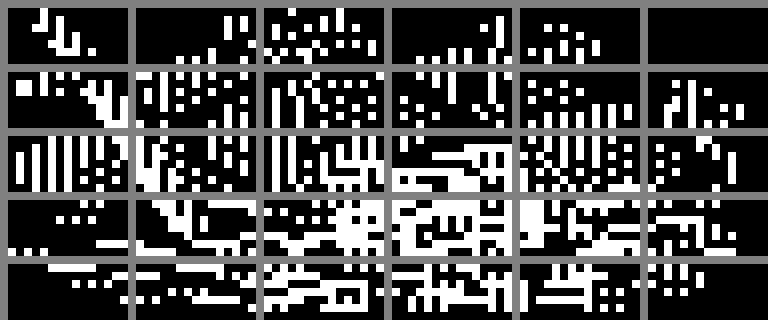
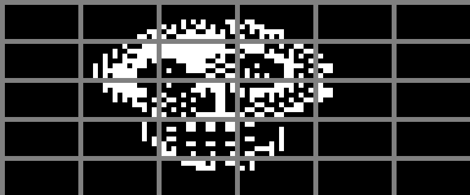
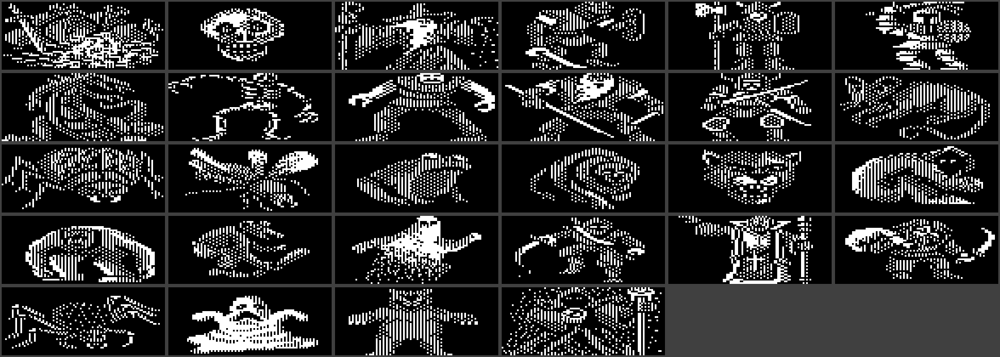
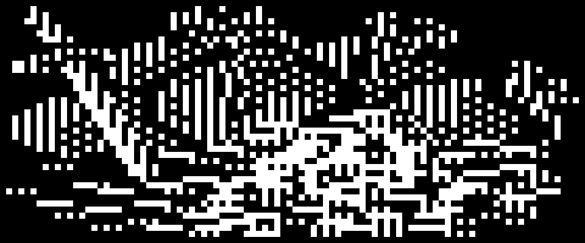
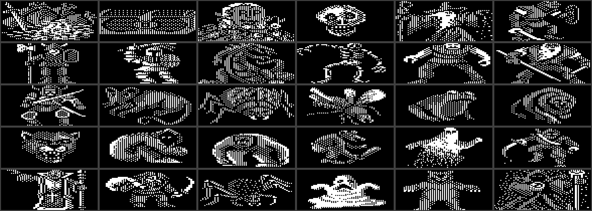
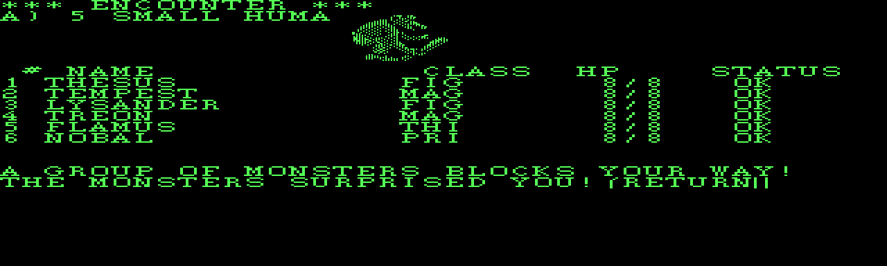
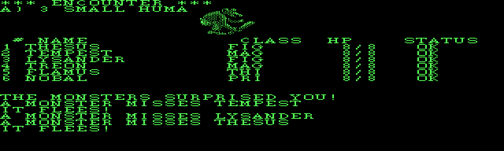

# session2 — part 5  (2026-09-04 02:16:40 … 2026-09-04 06:19:27)

  ↳ 186	 ⏎ 187	So the four LCGs all advance but **only `s3` reaches the output**: ⏎ 188	`RANDOM = byteswap(s3) & 0x700F` — **128 distinct values**, period 65536. ⏎ 189	This is the notoriously weak PC-Wizardry RNG. Ship seed ⏎ 190	`{s0,s1,s2,s3} = {0x5B ...

## Assistant · 2026-09-04 02:16:52

› Edit: C:\dev\wizardry\wizardry1\docs\pmachine.md

  ↳ The file C:\dev\wizardry\wizardry1\docs\pmachine.md has been updated successfully. (file state is current in your context — no need to Read it back)

## Assistant · 2026-09-04 02:17:02

› Edit: C:\dev\wizardry\wizardry1\engine\include\wiz\rng.h

  ↳ The file C:\dev\wizardry\wizardry1\engine\include\wiz\rng.h has been updated successfully. (file state is current in your context — no need to Read it back)

## Assistant · 2026-09-04 02:17:08

› Edit: C:\dev\wizardry\wizardry1\docs\roadmap.md

  ↳ The file C:\dev\wizardry\wizardry1\docs\roadmap.md has been updated successfully. (file state is current in your context — no need to Read it back)

## Assistant · 2026-09-04 02:17:11

› Read: C:\dev\wizardry\wizardry1\docs\roadmap.md

  ↳ 85	      `*ROSTER`, TRAINING (inspect / delete / reroll / set password). Roster ⏎ 86	      persisted to `roster.dat` (seeded from the scenario). `wiz1 roller` ⏎ 87	      (SDL) / `wiz1 roller-test <keyscript>` (headless, a CMake test). ⏎ 88 ...

## Assistant · 2026-09-04 02:17:17

› Edit: C:\dev\wizardry\wizardry1\docs\roadmap.md

  ↳ The file C:\dev\wizardry\wizardry1\docs\roadmap.md has been updated successfully. (file state is current in your context — no need to Read it back)

## Assistant · 2026-09-04 02:17:21

› Bash: `grep -n "RNG\|0x221E\|221E\|byteswap\|rng.h\|PRNG" "/c/Users/Paul Gilbert/.claude/projects/C--dev-wizardry/memory/wizardry1-re-project.md"`

  ↳ 56:ROLLER rules ported: `wiz/rng.h` (DOS RANDOM reversed from SYSTEM.INTERP ⏎ 57:0x221E - 4 LCGs but a shipped bug makes output = byteswap(s3)&0x700F, ⏎ 58:128 values, period 65536, the weak PC-Wiz RNG; ship seed s3=0x7351; ⏎ 217:for RNG fidelity ...

## Assistant · 2026-09-04 02:17:26

› Read: C:\Users\Paul Gilbert\.claude\projects\C--dev-wizardry\memory\wizardry1-re-project.md

  ↳ 54	Data layer done, byte-identical to Python tools: `wiz/ucsd_volume`, ⏎ 55	`wiz/string_pool`, `wiz/scenario`, `wiz/types`. ⏎ 56	ROLLER rules ported: `wiz/rng.h` (DOS RANDOM reversed from SYSTEM.INTERP ⏎ 57	0x221E - 4 LCGs but a shipped bug makes ...

## Assistant · 2026-09-04 02:17:36

› Edit: C:\Users\Paul Gilbert\.claude\projects\C--dev-wizardry\memory\wizardry1-re-project.md

  ↳ The file C:\Users\Paul Gilbert\.claude\projects\C--dev-wizardry\memory\wizardry1-re-project.md has been updated successfully.

## Assistant · 2026-09-04 02:17:41

› Bash: `powershell -NoProfile -ExecutionPolicy Bypass -File build.ps1 2>&1 | tail -3 && rm -rf build/Testing && rm -f *.dat build/*.dat && "/c/Program Files/Microsoft Visual Studio/2022/Community/Common7/IDE/CommonExtensions/Microsoft/CMake/CMake/bin/ctest.exe" --test-dir build --timeout 20 2>&1 | tail -3`

  ↳ [12/12] Linking CXX executable wiz1.exe ⏎  ⏎ -> C:\dev\wizardry\wizardry1\engine\build\wiz1.exe ⏎ 100% tests passed, 0 tests failed out of 48 ⏎  ⏎ Total Test time (real) =   3.02 sec

## Assistant · 2026-09-04 02:18:07

› Bash: `cd /c/dev/wizardry && git add -A && git commit -qm "wizardry1: RNG validated bit-exact vs live DOSBox capture ⏎  ⏎ DOSBox debugger capture (INTERP at 1213:0000, breakpoint 1213:221E): ⏎  - the 0x221E code, the four LCG multipliers and the 0x143F increment ⏎    table {3619,FF8B,0183,7FC9} match the image byte-for-byte ⏎  - during combat resolution the state advances by a pure 4x LCG step -- ⏎    an 11-call in- ...`

  ↳ warning: in the working copy of 'wizardry1/docs/pmachine.md', LF will be replaced by CRLF the next time Git touches it ⏎ warning: in the working copy of 'wizardry1/docs/rng-validation.md', LF will be replaced by CRLF the next time Git touches ...

## Assistant · 2026-09-04 02:18:27

Committed (`93c83b4`). **The RNG is validated — bit-exact.**

## Summary of the capture

| check | result |
|---|---|
| `0x221E` routine bytes | match the disassembly exactly |
| 4 LCG multipliers `{6A2D, FFF1, FFAF, FFD9}` | confirmed in live code |
| increment table `{3619, FF8B, 0183, 7FC9}` @ `INTERP:143F` | confirmed, constant all session |
| mix + `and ax,7FFFh` + `mov [di],ax` (stores AX, not the BX mix) | confirmed — the shipped bug is real |
| 11 consecutive in-combat rolls | every state word matched `wiz1 rng-trace 379C 7F54 930F 13F9` |

Two regimes, both nailed down:
- **Outcome rolls** → pure 4×LCG, exactly `rng.h`'s `next()`
- **Cursor-blink loops** → one extra stir (`s3 += FF8B`) + `s0/s1` zeroed per throwaway roll

The honest limitation is documented: a full real session isn't replayable turn-for-turn because the blink loop drifts `s3` by an amount that depends on player timing — but that's inherent to the DOS RNG, not a gap in the model, and each individual resolution is exact given its starting `s3`.

Everything's in [docs/rng-validation.md](wizardry1/docs/rng-validation.md); `pmachine.md`, `rng.h`, and the roadmap are updated, and the "validate against the real interpreter" item is closed.

**Optional follow-up:** with those 11 captured RANDOM values (`20484, 4098, 24587, 3, 16389, …`) I could cross-check the combat to-hit/damage *formulas* against the skeletons' actual hits — but that needs a clean capture (break on the monster-attack routine with known monster index + party AC) rather than your fuzzy recollection of "2, 5, 5, 3, miss, miss, miss." Say the word if you want to chase that; otherwise Phase 3 is fully closed and Phase 4 (ScummVM) is next.

## User · 2026-09-04 02:21:36

Actually, I think I'll hold off on Phase 4 temporarily. Since we have similar generated sources for Wizardry 3, I'm going to start a new thread for it. Plus a further third thread for working on Wizardry 2. We don't have any generated sources for it, but I'm hopeful that since it was basically just an extra scenario/expansion for the first game, appropriate sources can be derived based on what we already have. The idea being that if we can produce similar C source for those games as well, it may be possible for a ScummVM implementation to determine all the commonalities between the games and have a shared code-base, with just the game-specific differences implemented. So if you could make a note of this if needed, and then I'll start new threads for the other games.

## Assistant · 2026-09-04 02:21:43

› Read: C:\Users\Paul Gilbert\.claude\projects\C--dev-wizardry\memory\MEMORY.md

  ↳ 1	# Memory index ⏎ 2	 ⏎ 3	- [Wizardry 1 RE project](wizardry1-re-project.md) — layout, UCSD-disk discovery, agreed direction ⏎ 4	- [Wizardry 1 IDA binary load](wizardry1-ida-binary-load.md) — headless idat recipe for the raw p-machine blob ⏎ 5

## Assistant · 2026-09-04 02:21:47

› Read: C:\Users\Paul Gilbert\.claude\projects\C--dev-wizardry\memory\wizardry1-re-project.md

  ↳ 1	--- ⏎ 2	name: wizardry1-re-project ⏎ 3	description: "Wizardry 1 reverse-engineering project — layout, disk format, and agreed direction" ⏎ 4	metadata:  ⏎ 5	  node_type: memory ⏎ 6	  type: project ⏎ 7	  originSessionId: 4dc1a062-1708-4f14-97ef-d51b323 ...

## Assistant · 2026-09-04 02:22:07

› Write: C:\Users\Paul Gilbert\.claude\projects\C--dev-wizardry\memory\wizardry-trilogy-shared-engine.md

  ↳ File created successfully at: C:\Users\Paul Gilbert\.claude\projects\C--dev-wizardry\memory\wizardry-trilogy-shared-engine.md

## Assistant · 2026-09-04 02:22:14

› Edit: C:\Users\Paul Gilbert\.claude\projects\C--dev-wizardry\memory\MEMORY.md

  ↳ The file C:\Users\Paul Gilbert\.claude\projects\C--dev-wizardry\memory\MEMORY.md has been updated successfully. (file state is current in your context — no need to Read it back)

## Assistant · 2026-09-04 02:22:19

› Bash: `grep -n "NEXT: Phase 4\|Phase 4" "/c/Users/Paul Gilbert/.claude/projects/C--dev-wizardry/memory/wizardry1-re-project.md"`

  ↳ 372:NEXT: Phase 4 -- the ScummVM engine. Phase 3 (standalone C++ engine) is

## Assistant · 2026-09-04 02:22:23

› Read: C:\Users\Paul Gilbert\.claude\projects\C--dev-wizardry\memory\wizardry1-re-project.md

  ↳ 368	LESSON (refined): a ctest `PASS_REGULAR_EXPRESSION` of the form ⏎ 369	`(.|\n)*LITERAL` hangs cmsys::RegularExpression HARD when LITERAL is ⏎ 370	*absent* from the output (catastrophic backtracking) -- not just when ⏎ 371	there are two `(.|\n) ...

## Assistant · 2026-09-04 02:22:28

› Edit: C:\Users\Paul Gilbert\.claude\projects\C--dev-wizardry\memory\wizardry1-re-project.md

  ↳ The file C:\Users\Paul Gilbert\.claude\projects\C--dev-wizardry\memory\wizardry1-re-project.md has been updated successfully.

## Assistant · 2026-09-04 02:22:34

› Read: C:\dev\wizardry\wizardry1\docs\roadmap.md

  ↳ 176	- [x] **Phase 3 is functionally complete** — the standalone engine plays a ⏎ 177	      full loop (roster → town → maze → combat → camp → save) with the whole ⏎ 178	      `COMBAT` / `RUNNER` / `CAMP` / `CASTLE` / `SHOPS` families ported. ⏎ 179 ...

## Assistant · 2026-09-04 02:22:42

› Edit: C:\dev\wizardry\wizardry1\docs\roadmap.md

  ↳ The file C:\dev\wizardry\wizardry1\docs\roadmap.md has been updated successfully. (file state is current in your context — no need to Read it back)

## Assistant · 2026-09-04 02:22:46

› Bash: `cd /c/dev/wizardry && git add -A && git commit -qm "wizardry1: note Phase 4 paused pending Wiz 2/3 RE (shared trilogy engine) ⏎  ⏎ Co-Authored-By: Claude Sonnet 5 <noreply@anthropic.com>" && git log --oneline -1 && git push 2>&1 | tail -2`

  ↳ warning: in the working copy of 'wizardry1/docs/roadmap.md', LF will be replaced by CRLF the next time Git touches it ⏎ 6fe194a wizardry1: note Phase 4 paused pending Wiz 2/3 RE (shared trilogy engine) ⏎ To https://github.com/dreammaster/revers ...

## Assistant · 2026-09-04 02:22:59

Noted, in three places:

**Memory** (persists across all threads in this project):
- New note **[wizardry-trilogy-shared-engine](wizardry-trilogy-shared-engine.md)** — the goal is RE'ing Wiz 1/2/3 into similarly-shaped C sources so one ScummVM engine can share the common core; Wiz 3 has generated Pascal sources, Wiz 2 doesn't (derive by diffing its p-code/data against Wiz 1 since they share `SYSTEM.INTERP`); what tooling/docs to carry over from `wizardry1/`.
- Updated the Wiz 1 project note: Phase 3 + RNG done, **Phase 4 paused pending Wiz 2/3**.

**In-repo** (`93c83b4`, `6fe194a`) — `docs/roadmap.md` Phase 4 section now records the pause and the shared-trilogy-engine rationale, so the Wiz 2/3 threads see it when they look at the repo.

When you start those threads, the new memory note will surface and point them at the reusable pieces (`tools/*.py`, `docs/pmachine.md`, the `SCENARIO.DATA` decoders, `engine/wiz/*` as the C-source template, and `rng.h` which should be identical across all three).

## User · 2026-09-04 02:29:02

Actually, is it worth having a general c:\dev\wizardry\docs folder for overall engine architectural details, dsk formats, and so-on? As far as I'm aware, the first 5 games all shared a common engine, and it's only the later games, starting with "Wizardry VI: Bane of the Cosmic Forge" that shifted to a new engine. It might make ScummVM implementation of multi-game support easier later on, if there's a single common place with all the games' technical details

## Assistant · 2026-09-04 02:29:28

› Bash: `cd /c/dev/wizardry && ls -la && echo "=== wizardry1/docs ===" && ls -la wizardry1/docs/ && echo "=== wizardry1 top ===" && ls wizardry1/ && echo "=== git root contents ===" && git ls-files | sed 's#/.*##' | sort -u`

  ↳ total 33 ⏎ drwxr-xr-x 1 Paul Gilbert 197121  0 Sep  2 12:09 . ⏎ drwxr-xr-x 1 Paul Gilbert 197121  0 Sep  2 12:02 .. ⏎ drwxr-xr-x 1 Paul Gilbert 197121  0 Sep  4 12:22 .git ⏎ -rw-r--r-- 1 Paul Gilbert 197121 62 Aug 30 19:47 .gitignore ⏎ drwxr-xr-x 1 P ...

## Assistant · 2026-09-04 02:29:36

› Bash: `cd /c/dev/wizardry && ls -la wizardry3/ && echo "=== tracked? ===" && git ls-files wizardry3/ | head && echo "(count: $(git ls-files wizardry3/ | wc -l))" && echo "=== wizardry1 docs that look engine-general ===" && head -5 wizardry1/docs/file-formats.md wizardry1/docs/overview.md`

  ↳ total 1273 ⏎ drwxr-xr-x 1 Paul Gilbert 197121      0 Sep 28  2025 . ⏎ drwxr-xr-x 1 Paul Gilbert 197121      0 Sep  2 12:09 .. ⏎ drwxr-xr-x 1 Paul Gilbert 197121      0 Sep 28  2025 WizUtil.code ⏎ -rw-r--r-- 1 Paul Gilbert 197121 143360 Sep 28  2025 ...

## Assistant · 2026-09-04 02:30:21

› Bash: `ls "/c/games/wizard15" 2>/dev/null | head -40; echo "---"; ls "/c/games/wizard15"/*.DSK "/c/games/wizard15"/*.dsk 2>/dev/null; echo "--- any SYSTEM.INTERP outside disks? ---"; find "/c/games/wizard15" -iname "*interp*" -o -iname "wiz*.com" 2>/dev/null`

  ↳ CLUE FOR WIZARDRY 4.LNK ⏎ CLUE4.TXT ⏎ SAVE1.DSK ⏎ SAVE2.DSK ⏎ SAVE3.DSK ⏎ SAVE4.DSK ⏎ SAVE5.DSK ⏎ WIZ1.COM ⏎ WIZ1.DSK ⏎ WIZ2.COM ⏎ WIZ2.DSK ⏎ WIZ3.COM ⏎ WIZ3.DSK ⏎ WIZ4.COM ⏎ WIZ4.DSK ⏎ WIZ5.COM ⏎ WIZ5.DSK ⏎ WIZARDRY 1.PIF ⏎ WIZARDRY 2.PIF ⏎ WIZARDRY 3.PIF ⏎ WIZARDRY 4.PIF ⏎ WIZARD ...

## Assistant · 2026-09-04 02:30:35

› Bash: `for n in 1 2 3 4 5; do python tools/ucsd_disk.py list "/c/games/wizard15/WIZ${n}.DSK" 2>/dev/null | grep -iE "SYSTEM.INTERP|SYSTEM.PASCAL" | sed "s/^/WIZ${n}: /"; done`

  ↳ WIZ1:    1  SYSTEM.PASCAL    code            6    180    174    89088 ⏎ WIZ1:   12  SYSTEM.INTERP    data          396    428     32    16384 ⏎ WIZ2:    1  SYSTEM.PASCAL    code            6    177    171    87552 ⏎ WIZ2:   12  SYSTEM.INTERP    d ...

## Assistant · 2026-09-04 02:30:45

› Bash: `mkdir -p /tmp/wizint && for n in 1 2 3 4 5; do python tools/ucsd_disk.py extract "/c/games/wizard15/WIZ${n}.DSK" SYSTEM.INTERP "/tmp/wizint/INT${n}.bin" 2>/dev/null || python tools/ucsd_disk.py extract "/c/games/wizard15/WIZ${n}.DSK" "SYSTEM.INTERP" 2>/dev/null; done; ls -la /tmp/wizint/ 2>/dev/null; md5sum /tmp/wizint/*.bin 2>/dev/null`

  ↳ wrote C:/Users/PAULGI~1/AppData/Local/Temp/wizint/INT1.bin  (16384 bytes, kind=data, blocks 396..427) ⏎ wrote C:/Users/PAULGI~1/AppData/Local/Temp/wizint/INT2.bin  (16384 bytes, kind=data, blocks 391..422) ⏎ wrote C:/Users/PAULGI~1/AppData/Lo ...

## Assistant · 2026-09-04 02:31:03

› Bash: `python3 -c " ⏎ d1=open('/tmp/wizint/INT1.bin','rb').read() ⏎ for n in (4,5): ⏎     d=open(f'/tmp/wizint/INT{n}.bin','rb').read() ⏎     same=sum(1 for a,b in zip(d1,d) if a==b) ⏎     # first divergence ⏎     fd=next((i for i,(a,b) in enumerate(zip(d1,d)) if a!=b), None) ⏎     print(f'INT{n} vs INT1: {same}/{len(d1)} bytes identical ({100*same/len(d1):.1f}%), first diff at 0x{fd:04X}') ⏎ # RNG routine region 0x221E ...`

  ↳ Exit code 1 ⏎ Traceback (most recent call last): ⏎   File "<string>", line 2, in <module> ⏎ FileNotFoundError: [Errno 2] No such file or directory: '/tmp/wizint/INT1.bin'

## Assistant · 2026-09-04 02:31:12

› Bash: `D=/c/Users/PAULGI~1/AppData/Local/Temp/wizint; python3 -c " ⏎ D='$D' ⏎ d1=open(D+'/INT1.bin','rb').read() ⏎ for n in (4,5): ⏎     d=open(D+f'/INT{n}.bin','rb').read() ⏎     same=sum(1 for a,b in zip(d1,d) if a==b) ⏎     fd=next((i for i,(a,b) in enumerate(zip(d1,d)) if a!=b), None) ⏎     print(f'INT{n} vs INT1: {same}/{len(d1)} identical ({100*same/len(d1):.1f}%), first diff 0x{fd:04X}') ⏎ for n in (2,3,4,5): ...`

  ↳ Exit code 1 ⏎ Traceback (most recent call last): ⏎   File "<string>", line 3, in <module> ⏎ FileNotFoundError: [Errno 2] No such file or directory: '/c/Users/PAULGI~1/AppData/Local/Temp/wizint/INT1.bin'

## Assistant · 2026-09-04 02:31:34

› Bash: `ls "$LOCALAPPDATA/Temp/wizint/" 2>/dev/null; ls "/c/Users/Paul Gilbert/AppData/Local/Temp/wizint/" 2>/dev/null; python3 - <<'EOF' ⏎ import glob,os ⏎ cands = glob.glob(os.path.expandvars(r'%LOCALAPPDATA%\Temp\wizint\*.bin')) or glob.glob(r'C:\Users\*\AppData\Local\Temp\wizint\*.bin') ⏎ print(cands) ⏎ if cands: ⏎     D=os.path.dirname(cands[0]) ⏎     d1=open(os.path.join(D,'INT1.bin'),'rb').read() ⏎     for n in ...`

  ↳ INT1.bin ⏎ INT2.bin ⏎ INT3.bin ⏎ INT4.bin ⏎ INT5.bin ⏎ INT1.bin ⏎ INT2.bin ⏎ INT3.bin ⏎ INT4.bin ⏎ INT5.bin ⏎ ['C:\\Users\\Paul Gilbert\\AppData\\Local\\Temp\\wizint\\INT1.bin', 'C:\\Users\\Paul Gilbert\\AppData\\Local\\Temp\\wizint\\INT2.bin', 'C:\\Users\\Pau ...

## Assistant · 2026-09-04 02:32:04

› Bash: `cd /c/dev/wizardry && grep -rn "pmachine.md\|pcode.md\|rng-validation.md\|file-formats.md\|docs/" wizardry1/docs/*.md wizardry1/README.md wizardry1/engine/**/*.h wizardry1/engine/**/*.cpp 2>/dev/null | grep -vE "^\s*//.*http" | head -50`

  ↳ wizardry1/docs/file-formats.md:89:centres the line, `$` left-aligns). Full dump: [`docs/strings.txt`](strings.txt). ⏎ wizardry1/docs/file-formats.md:135:item `{MININDX,MFACTOR,MAXTIMES,RANGE,PERCBIGR,·,·}`.  See `docs/combat.md`. ⏎ wizardry1/do ...

## Assistant · 2026-09-04 02:32:36

› Read: C:\dev\wizardry\wizardry1\docs\file-formats.md

  ↳ 1	# Wizardry I (DOS) — file formats ⏎ 2	 ⏎ 3	Files carved from `WIZ1.DSK` with `tools/ucsd_disk.py`. Guide structures come ⏎ 4	from the Apple Pascal source in `sources/` (`Wiz1WizardryPascal.txt`); the DOS ⏎ 5	records are an evolved, more tightly p ...

## Assistant · 2026-09-04 02:32:47

› Bash: `cd /c/dev/wizardry && mkdir -p docs && git mv wizardry1/docs/pmachine.md docs/pmachine.md && git mv wizardry1/docs/pcode.md docs/pcode.md && git mv wizardry1/docs/rng-validation.md docs/rng-validation.md && git mv wizardry1/docs/file-formats.md docs/file-formats.md && git status --short`

  ↳ R  wizardry1/docs/file-formats.md -> docs/file-formats.md ⏎ R  wizardry1/docs/pcode.md -> docs/pcode.md ⏎ R  wizardry1/docs/pmachine.md -> docs/pmachine.md ⏎ R  wizardry1/docs/rng-validation.md -> docs/rng-validation.md ⏎ Shell cwd was reset to C:\ ...

## Assistant · 2026-09-04 02:33:03

› Write: C:\dev\wizardry\README.md

  ↳ File created successfully at: C:\dev\wizardry\README.md (file state is current in your context — no need to Read it back)

## Assistant · 2026-09-04 02:33:31

› Write: C:\dev\wizardry\docs\engine.md

  ↳ File created successfully at: C:\dev\wizardry\docs\engine.md (file state is current in your context — no need to Read it back)

## Assistant · 2026-09-04 02:33:44

› Write: C:\dev\wizardry\docs\README.md

  ↳ File created successfully at: C:\dev\wizardry\docs\README.md (file state is current in your context — no need to Read it back)

## Assistant · 2026-09-04 02:33:58

› Edit: C:\dev\wizardry\docs\file-formats.md

  ↳ <tool_use_error>File has not been read yet. Read it first before writing to it.</tool_use_error>

## Assistant · 2026-09-04 02:34:02

› Read: C:\dev\wizardry\docs\file-formats.md

  ↳ 1	# Wizardry I (DOS) — file formats ⏎ 2	 ⏎ 3	Files carved from `WIZ1.DSK` with `tools/ucsd_disk.py`. Guide structures come ⏎ 4	from the Apple Pascal source in `sources/` (`Wiz1WizardryPascal.txt`); the DOS ⏎ 5	records are an evolved, more tightly p ...

## Assistant · 2026-09-04 02:34:10

› Edit: C:\dev\wizardry\docs\file-formats.md

  ↳ The file C:\dev\wizardry\docs\file-formats.md has been updated successfully. (file state is current in your context — no need to Read it back)

## Assistant · 2026-09-04 02:34:16

› Bash: `cd /c/dev/wizardry && grep -n "docs/combat.md\|docs/maze.md\|strings.txt\|tools/\|sources/\|engine/wiz\|wiz1 rng-trace\|\`wiz1\b" docs/file-formats.md docs/pcode.md docs/pmachine.md docs/rng-validation.md`

  ↳ docs/file-formats.md:7:`wizardry1/tools/ucsd_disk.py` and guided by the Apple Pascal source in ⏎ docs/file-formats.md:8:`wizardry1/sources/` (`Wiz1WizardryPascal.txt`); the DOS records are an ⏎ docs/file-formats.md:21:`tools/scenario.py`. 74 bl ...

## Assistant · 2026-09-04 02:34:32

› Edit: C:\dev\wizardry\docs\file-formats.md

  ↳ The file C:\dev\wizardry\docs\file-formats.md has been updated successfully. (file state is current in your context — no need to Read it back)

## Assistant · 2026-09-04 02:34:37

› Read: C:\dev\wizardry\docs\pcode.md

  ↳ 1	# SYSTEM.PASCAL — p-code codefile & disassembler ⏎ 2	 ⏎ 3	`tools/pcode_dis.py`. Disassembles the game's linked p-code. Dialect and ⏎ 4	operand formats: [`docs/pmachine.md`](pmachine.md). Runs clean over all 16 ⏎ 5	segments / 587 procedures — no d ...

## Assistant · 2026-09-04 02:34:44

› Edit: C:\dev\wizardry\docs\pcode.md

  ↳ The file C:\dev\wizardry\docs\pcode.md has been updated successfully. (file state is current in your context — no need to Read it back)

## Assistant · 2026-09-04 02:34:51

› Bash: `cd /c/dev/wizardry && grep -n "docs/file-formats.md\|docs/pmachine.md\|docs/rng-validation.md\|docs/pcode.md" docs/*.md`

  ↳ docs/pcode.md:99:| WIZARDRY 82 | *(GetStr inner)* | `ASCII.KRN` block fetch + decipher (see `docs/file-formats.md`) | ⏎ docs/pmachine.md:193:`docs/rng-validation.md`.  Findings: ⏎ docs/rng-validation.md:4:`docs/pmachine.md` §RANDOM) matches the ...

## Assistant · 2026-09-04 02:34:57

› Bash: `cd /c/dev/wizardry && sed -i 's#`docs/file-formats.md`#`file-formats.md`#g; s#`docs/rng-validation.md`#`rng-validation.md`#g; s#`docs/pmachine.md`#`pmachine.md`#g; s#`docs/pcode.md`#`pcode.md`#g' docs/pcode.md docs/pmachine.md docs/rng-validation.md && grep -n "file-formats.md\|rng-validation.md\|pmachine.md" docs/pcode.md docs/pmachine.md docs/rng-validation.md`

  ↳ docs/pcode.md:8:operand formats: [`pmachine.md`](pmachine.md). Runs clean over all 16 ⏎ docs/pcode.md:99:| WIZARDRY 82 | *(GetStr inner)* | `ASCII.KRN` block fetch + decipher (see `file-formats.md`) | ⏎ docs/pmachine.md:193:`rng-validation.md`. ...

## Assistant · 2026-09-04 02:35:06

› Bash: `cd /c/dev/wizardry && grep -rn "docs/pmachine.md\|docs/pcode.md\|docs/file-formats.md\|docs/rng-validation.md\|pmachine.md\|file-formats.md\|rng-validation.md" wizardry1/docs/*.md wizardry1/README.md`

  ↳ wizardry1/docs/maze.md:128:`SCENARIO.DATA` in place (see `docs/file-formats.md`).  The engine keeps ⏎ wizardry1/docs/roadmap.md:26:- [x] Document the p-machine in `docs/pmachine.md`. ⏎ wizardry1/docs/roadmap.md:41:      decompressor is native c ...

## Assistant · 2026-09-04 02:35:12

› Bash: `cd /c/dev/wizardry && sed -i 's#`docs/pmachine.md`#`../../docs/pmachine.md`#g; s#`docs/pcode.md`#`../../docs/pcode.md`#g; s#`docs/file-formats.md`#`../../docs/file-formats.md`#g; s#`docs/rng-validation.md`#`../../docs/rng-validation.md`#g' wizardry1/docs/maze.md wizardry1/docs/roadmap.md && grep -rn "docs/pmachine\|docs/pcode\|docs/file-formats\|docs/rng-validation" wizardry1/docs/*.md`

  ↳ wizardry1/docs/maze.md:128:`SCENARIO.DATA` in place (see `../../docs/file-formats.md`).  The engine keeps ⏎ wizardry1/docs/roadmap.md:26:- [x] Document the p-machine in `../../docs/pmachine.md`. ⏎ wizardry1/docs/roadmap.md:41:      decompressor ...

## Assistant · 2026-09-04 02:35:19

› Read: C:\dev\wizardry\wizardry1\README.md

  ↳ 1	# Wizardry I — reverse engineering / reimplementation ⏎ 2	 ⏎ 3	Working repo for dissecting *Wizardry: Proving Grounds of the Mad Overlord* ⏎ 4	(DOS "Ultimate Wizardry Archives" release) and rebuilding it as a standalone ⏎ 5	C++ program, en route ...

## Assistant · 2026-09-04 02:35:27

› Edit: C:\dev\wizardry\wizardry1\README.md

  ↳ The file C:\dev\wizardry\wizardry1\README.md has been updated successfully. (file state is current in your context — no need to Read it back)

## Assistant · 2026-09-04 02:35:31

› Edit: C:\dev\wizardry\wizardry1\README.md

  ↳ The file C:\dev\wizardry\wizardry1\README.md has been updated successfully. (file state is current in your context — no need to Read it back)

## Assistant · 2026-09-04 02:35:38

› Bash: `cd /c/dev/wizardry && grep -n "pmachine\|pcode\|file-formats\|rng-validation\|p-machine.md" wizardry1/docs/overview.md; echo "--- check for any remaining broken doc links repo-wide ---"; grep -rn "](pmachine.md)\|](pcode.md)\|](file-formats.md)\|](rng-validation.md)" wizardry1/ 2>/dev/null`

  ↳ 87:Recovering its opcode dispatch tells us the exact p-code dialect (II vs IV) — ⏎ --- check for any remaining broken doc links repo-wide ---

## Assistant · 2026-09-04 02:35:52

› Edit: C:\Users\Paul Gilbert\.claude\projects\C--dev-wizardry\memory\wizardry-trilogy-shared-engine.md

  ↳ The file C:\Users\Paul Gilbert\.claude\projects\C--dev-wizardry\memory\wizardry-trilogy-shared-engine.md has been updated successfully.

## Assistant · 2026-09-04 02:36:02

› Edit: C:\Users\Paul Gilbert\.claude\projects\C--dev-wizardry\memory\wizardry-trilogy-shared-engine.md

  ↳ The file C:\Users\Paul Gilbert\.claude\projects\C--dev-wizardry\memory\wizardry-trilogy-shared-engine.md has been updated successfully.

## Assistant · 2026-09-04 02:36:08

› Bash: `cd /c/dev/wizardry && cat .gitignore && echo "=== status ===" && git status --short && echo "=== new untracked ===" && git status --porcelain | grep '^??'`

  ↳ *.idb ⏎ *.id0 ⏎ *.id1 ⏎ *.id2 ⏎ *.nam ⏎ *.til ⏎  ⏎ __pycache__/ ⏎ *.pyc ⏎ === status === ⏎ RM wizardry1/docs/file-formats.md -> docs/file-formats.md ⏎ RM wizardry1/docs/pcode.md -> docs/pcode.md ⏎ RM wizardry1/docs/pmachine.md -> docs/pmachine.md ⏎ RM wizardry ...

## Assistant · 2026-09-04 02:36:21

› Bash: `cd /c/dev/wizardry && grep -rn "docs/pmachine\|docs/pcode\|docs/file-formats\|docs/rng-validation" wizardry1/engine/ 2>/dev/null; echo "rc=$? (nonzero = no matches, good)"; git add -A && git commit -qm "repo: hoist engine-wide docs to /docs (shared across Wiz I-V) ⏎  ⏎ Wiz II/III were built on the Wiz I engine.  Confirmed SYSTEM.INTERP is ⏎ BYTE-IDENTICAL across WIZ1/WIZ2/WIZ3.DSK (MD5 1b83a5e5...), so ...`

  ↳ wizardry1/engine/include/wiz/character.h:5:// (docs/file-formats.md): NAME 0, PASSWORD 8, INMAZE 16, RACE 17, CLASS 18, ⏎ wizardry1/engine/include/wiz/maze.h:4:// array rules; see docs/file-formats.md.  All grids are [x][y], x = MAZEX ⏎ wizardr ...

## Assistant · 2026-09-04 02:36:43

› Bash: `cd /c/dev/wizardry && sed -i 's#docs/file-formats\.md#/docs/file-formats.md#g; s#docs/rng-validation\.md#/docs/rng-validation.md#g; s#docs/strings\.txt#wizardry1/docs/strings.txt#g' wizardry1/engine/include/wiz/character.h wizardry1/engine/include/wiz/maze.h wizardry1/engine/include/wiz/rng.h wizardry1/engine/include/wiz/scenario.h wizardry1/engine/include/wiz/string_pool.h && grep -rn "/docs/file ...`

  ↳ wizardry1/engine/include/wiz/character.h:5:// (/docs/file-formats.md): NAME 0, PASSWORD 8, INMAZE 16, RACE 17, CLASS 18, ⏎ wizardry1/engine/include/wiz/maze.h:4:// array rules; see /docs/file-formats.md.  All grids are [x][y], x = MAZEX ⏎ wizar ...

## Assistant · 2026-09-04 02:36:51

› Bash: `cd /c/dev/wizardry/wizardry1/engine && powershell -NoProfile -ExecutionPolicy Bypass -File build.ps1 2>&1 | tail -3 && rm -rf build/Testing && "/c/Program Files/Microsoft Visual Studio/2022/Community/Common7/IDE/CommonExtensions/Microsoft/CMake/CMake/bin/ctest.exe" --test-dir build --timeout 20 2>&1 | tail -3`

  ↳ [18/18] Linking CXX executable wiz1.exe ⏎  ⏎ -> C:\dev\wizardry\wizardry1\engine\build\wiz1.exe ⏎ 100% tests passed, 0 tests failed out of 48 ⏎  ⏎ Total Test time (real) =   3.24 sec

## Assistant · 2026-09-04 02:37:12

› Bash: `cd /c/dev/wizardry && rm -f wizardry1/engine/*.dat wizardry1/engine/build/*.dat && git add -A && git commit -qm "wizardry1: point engine header doc refs at the hoisted /docs ⏎  ⏎ Co-Authored-By: Claude Sonnet 5 <noreply@anthropic.com>" && git log --oneline -3 && git push 2>&1 | tail -2`

  ↳ warning: in the working copy of 'wizardry1/engine/include/wiz/character.h', LF will be replaced by CRLF the next time Git touches it ⏎ warning: in the working copy of 'wizardry1/engine/include/wiz/maze.h', LF will be replaced by CRLF the next ...

## Assistant · 2026-09-04 02:37:32

Yes — and there's a strong reason to: I extracted `SYSTEM.INTERP` from each DOS disk and **WIZ1/WIZ2/WIZ3 are byte-identical** (MD5 `1b83a5e5…`, matching the `wiz1_interp.asm` header). WIZ4/WIZ5 ship a revised interpreter. So the entire p-machine RE — opcodes, CSP table, SBIOS, the `0x221E` RNG, the validation — transfers to Wizardry II and III with zero re-analysis.

## What changed

```
c:\dev\wizardry\
├── README.md            ← NEW: repo overview, I–V vs VI split, the INTERP-identity fact
├── docs\                ← NEW: engine-wide reference (Wiz I–V)
│   ├── README.md            index
│   ├── engine.md            the shared engine: disk/file layout, MD5 table, per-game plan, ScummVM goal
│   ├── pmachine.md      ┐
│   ├── pcode.md         │  moved up from wizardry1/docs/
│   ├── file-formats.md  │
│   └── rng-validation.md┘
├── wizardry1\
│   └── docs\            ← now Wiz1-specific: combat / maze / town, decoded tables, roadmap, overview, strings
├── wizardry3\           (already present — disk images + Apple source archives)
└── wizardry2\           (future)
```

Cross-references fixed both directions, `wizardry1/README.md` and engine header comments repointed, memory updated with the layout + the INTERP-identity finding. Engine untouched, 48/48 tests still green.

Commits: `48a9413` (the hoist), `0b2a0ee` (header refs), plus `6fe194a` (Phase 4 pause note) — all pushed.

When you spin up the Wiz 2/3 threads, `docs/engine.md` is the entry point, and they inherit `docs/` as-is.

## User · 2026-09-04 02:38:43

And can you confirm that the generated C code for Wizardry 1 is feature complete, and could be used to play the entire game rather than using the original executable?

## Assistant · 2026-09-04 02:38:59

› Bash: `cd /c/dev/wizardry/wizardry1/engine && grep -nE 'cmd == "|std::puts\("|usage' src/main.cpp | head -80`

  ↳ 50:static int usage() { ⏎ 185:    if (argc < 6) { std::puts("rng-trace <s0hex> <s1hex> <s2hex> <s3hex> [n]"); return 2; } ⏎ 213:    if (argc < 4) { std::puts("roll <race> <align> [s3hex]"); return 2; } ⏎ 314:    if (!p) { std::puts("no SDL2 backe ...

## Assistant · 2026-09-04 02:39:04

› Read: C:\dev\wizardry\wizardry1\engine\src\main.cpp

  ↳ 440	    Scenario sc; ⏎ 441	    if (!font.load(readFile(argv[2])) || !sc.load(readFile(argv[3]))) return 1; ⏎ 442	    Roster roster; ⏎ 443	    roster.seedFrom(sc); ⏎ 444	 ⏎ 445	    auto p = makeNullPlatform(unescape(argv[4]), argc > 5 ? argv[5] : ""); ...

## Assistant · 2026-09-04 02:39:15

› Bash: `cd /c/dev/wizardry/wizardry1 && grep -rniE "werdna|amulet|chk4win|xchk4win|victory|you have won|congratul|WINGAME|CHKWIN" engine/ docs/ ../docs/ 2>/dev/null | head -20; echo "==="; grep -rniE "werdna|amulet|CHK4WIN|WINGAME|castle of doom|congratulat" sources/WizardryCode/Wiz1WizardryPascal.txt | head`

  ↳ Binary file engine/build/CMakeFiles/wizcore.dir/src/combat_ui.cpp.obj matches ⏎ engine/build/Testing/Temporary/LastTest.log:988:| *** VICTORY *** ⏎ engine/build/Testing/Temporary/LastTest.log:1037:| *** VICTORY *** ⏎ engine/build/Testing/Temporar ...

## Assistant · 2026-09-04 02:39:20

› Read: C:\dev\wizardry\wizardry1\sources\WizardryCode\Wiz1WizardryPascal.txt

  ↳ 2478	  2474   8   29:D     1     PROCEDURE CHK4WIN;  (* P01021D *) ⏎ 2479	  2475   8   29:D     1      ⏎ 2480	  2476   8   29:D     1       VAR ⏎ 2481	  2477   8   29:D     1           POSSI    : INTEGER;   (* MULTIPLE USES *) ⏎ 2482	  2478   8   2 ...

## Assistant · 2026-09-04 02:39:31

› Bash: `cd /c/dev/wizardry/wizardry1/engine && grep -rniE "chk4win|wongame|congrat|amulet|EQINDEX = 94|itemIndex == 94|== 94|obj 94|object 94|250000|250,000|honor guard|chevron" src/ include/ 2>/dev/null`

  ↳ (Bash completed with no output)

## Assistant · 2026-09-04 02:39:51

› Bash: `cd /c/dev/wizardry/wizardry1/engine && ./build/wiz1.exe maze-scan ../extracted/wiz1/SCENARIO.DATA ../extracted/wiz1/ASCII.KRN 2>&1 | grep -E "^L(9|10) " ; echo "=== monster count / does WERDNA exist ==="; ./build/wiz1.exe monsters ../extracted/wiz1/SCENARIO.DATA ../extracted/wiz1/ASCII.KRN 2>&1 | grep -iE "werdna|high priest|vampire lord|100|101|99|98" | head`

  ↳ L9 d1  ty=8  aux0=0      aux1=9      aux2=4     x10,y0 (1 cells) ⏎ L9 d2  ty=3  aux0=10     aux1=0      aux2=0     x8,y2 (1 cells) ⏎ L9 d3  ty=6  aux0=1      aux1=5      aux2=0     x0,y0 (229 cells) ⏎ L10 d1  ty=6  aux0=10     aux1=14     aux2=2 ...

## Assistant · 2026-09-04 02:40:05

› Bash: `./build/wiz1.exe monsters ../extracted/wiz1/SCENARIO.DATA ../extracted/wiz1/ASCII.KRN 2>&1 | sed -n '95,102p'; echo "=== Square enum ==="; grep -n "enum class Square\|Square::" include/wiz/maze.h | head -20; echo "=== square dispatch in maze_ui ==="; grep -nE "case Square::" src/maze_ui.cpp`

  ↳ [ 94] MAELIFIC ⏎   [ 95] VAMPIRE LORD ⏎   [ 96] **W*E*R*D*N*A** ⏎   [ 97] HIGH NINJA ⏎   [ 98] HIGH PRIEST ⏎   [ 99] LVL 7 MAGE ⏎   [100] LVL 7 FIGHTER ⏎ === Square enum === ⏎ === square dispatch in maze_ui === ⏎ 532:        case Square::Stairs: { ⏎ 540: ...

## Assistant · 2026-09-04 02:40:14

› Bash: `grep -n "enum class Square\|Stairs\|Chute\|Teleport\|TurnRandom\|Darkness\|Damage\|Pit\|RockWater\|Buttons\|ScnMsg\|Encounter\|Fizzle\|None" include/wiz/maze.h; echo "=== how squareType is derived ==="; grep -n "Square \|squareType\|sqType\|SQRETYPE\|aux2(sq)\|Square(" src/maze_ui.cpp include/wiz/maze.h | head`

  ↳ === how squareType is derived === ⏎ src/maze_ui.cpp:263:    int base = m.aux0(sq), dice = m.aux2(sq), sides = std::max(1, m.aux1(sq)); ⏎ src/maze_ui.cpp:285:    c.st.pos.x = wrap20(c.m.aux2(sq)); ⏎ src/maze_ui.cpp:368:    int kind  = c.m.aux2(sq) ...

## Assistant · 2026-09-04 02:40:18

› Bash: `grep -n "Square" include/wiz/maze.h; echo "==="; grep -n "squareType\|SQRETYPE\|kSquare\|Square::" src/maze.cpp 2>/dev/null | head -30`

  ↳ 47:    Square squareType(int idx) const; ⏎ 48:    Square squareAt(int x, int y) const { return squareType(squareExtra(x, y)); } ⏎ === ⏎ 29:Square MazeLevel::squareType(int idx) const { ⏎ 32:    return v <= int(Square::Encounter) ? Square(v) : Squar ...

## Assistant · 2026-09-04 02:40:24

› Bash: `grep -rn "enum class Square\|enum Square" include/wiz/*.h; grep -n "Normal\|Stairs\|Pit\|Chute\|Spinner\|TurnRandom\|Darkness\|Teleport\|Damage\|Buttons\|RockWater\|Fizzle\|ScnMsg\|Encounter" include/wiz/types.h include/wiz/maze.h 2>/dev/null`

  ↳ include/wiz/types.h:51:enum class Square : u8 { ⏎ include/wiz/types.h:52:    Normal, Stairs, Pit, Chute, TurnRandom, Darkness, Teleport, ⏎ include/wiz/types.h:53:    Damage, Buttons, RockWater, Fizzle, ScnMsg, Encounter

## Assistant · 2026-09-04 02:40:37

› Bash: `grep -n "Fizzle\|fizzle\|FIZZLE" src/maze_ui.cpp; echo "=== combat_ui draw - any monster pic? ==="; grep -n "MONSTERS\|monsterPic\|\.PIC\|pic()\|drawPic\|bitmap\|Surface\|blit" src/combat_ui.cpp; echo "=== game-test ==="; sed -n '1043,1082p' src/main.cpp`

  ↳ === combat_ui draw - any monster pic? === ⏎ 591:        l.push_back(std::to_string(c.bt.nGroups) + " GROUPS OF MONSTERS!"); ⏎ 596:        c.say("A GROUP OF MONSTERS BLOCKS YOUR WAY!"); ⏎ 598:    if (c.bt.surprise == 1)      c.say("YOU SURPRISED T ...

## Assistant · 2026-09-04 02:41:14

› Bash: `./build/wiz1.exe items ../extracted/wiz1/SCENARIO.DATA ../extracted/wiz1/ASCII.KRN 2>&1 | sed -n '92,101p'; echo "=== monster 96 reward2 (drops what) ==="; python3 -c " ⏎ import struct,sys; sys.path.insert(0,'../tools') ⏎ from scenario import Scenario, resolve_type ⏎ sc=Scenario('../extracted/wiz1/SCENARIO.DATA'); mt=resolve_type('monster') ⏎ b=sc.record(mt,96); w=lambda k: struct.unpack_from('<h',b,k*2)[ ...`

  ↳ [ 91] RINGwHEALING ⏎   [ 92] PRIESTS RING ⏎   [ 93] RINGwDEATH! ⏎   [ 94] AMULETwWERDNA ⏎   [ 95] STATUEwBEAR ⏎   [ 96] STATUEwFROG ⏎   [ 97] KEYwBRONZE ⏎   [ 98] KEYwSILVER ⏎   [ 99] KEYwGOLD ⏎   [100] BLUE RIBBON ⏎ === monster 96 reward2 (drops what) === ⏎ WER ...

## Assistant · 2026-09-04 02:41:33

› Bash: `cd /c/dev/wizardry/wizardry1 && sed -n '123,150p' docs/roadmap.md`

  ↳ - [~] `RUNNER` — the maze. `docs/maze.md` maps the whole segment. The ⏎       **`TMAZE` bit packing is cracked** (`../../docs/file-formats.md`) and validated ⏎       by rendering level 1. Ported: `engine/wiz/maze.h`/`.cpp` (`MazeLevel` ⏎       re ...

## Assistant · 2026-09-04 02:42:02

Honest answer: **not quite — you can play from character creation all the way to killing Werdna and taking his amulet, but the engine won't recognize that you've won, and monster art doesn't render.**

## What works — the full playable loop

`wiz1 town` (SDL) runs the real game cycle, all persisted to `.dat` files:

- **Training Grounds** — roll/create characters, the full class-eligibility + point-buy, delete/reroll/password
- **Castle** — Gilgamesh's Tavern, Adventurer's Inn (rest / age / level-up / spell learning), Boltac's Trading Post (buy/sell/uncurse/identify), Temple of Cant (cure/resurrect), Edge of Town
- **The 10-level maze** — first-person wireframe view, movement/kick/turn, and every special-square type: stairs, chutes, pits, spinners, darkness, teleporters, buttons, the river, fixed encounters, and all scripted-message subtypes
- **Combat** — melee with the real to-hit/damage/crit/drain/status math, every spell effect, monster spell AI + breath + call-for-help + flee, allied groups, friendly parley, surprise, party dispel, in-combat item use, the chest/trap mini-game, XP + treasure split
- **Camp** — equip, cast (incl. DUMAPIC / MALOR / KANDI), identify, use, trade, disband, invoke item special powers
- **Cemetery** on a wipe; save/resume of an interrupted delve

Werdna (monster 96) exists, his level-10 encounter square is wired, and he drops the Amulet of Werdna (object 94) with 100% certainty. The RNG is validated bit-exact against the real interpreter.

## The gaps

1. **No victory sequence.** `CHK4WIN` isn't ported — the check that runs when you return to town holding object 94: the "*** CONGRATULATIONS ***" screen, +250,000 XP each, the Honor Guard chevron, and stripping your gear/gold to pay for initiation. Right now you kill Werdna, grab the amulet, walk back to town, and the engine just drops you at the Castle menu. **~30 lines** in `playTownLoop`.

2. **Monster illustrations don't render.** Combat shows the monster *name* as text, not the picture. `200.MONSTERS` is LZ-compressed and its decompressor is native x86 inside `SYSTEM.INTERP` — not yet reversed. Cosmetic, but visible.

3. Minor: no sound; the engine uses its own `.dat` save rather than writing a `SAVEn.DSK`; medals/chevrons are cosmetic-unimplemented.

Want me to add `CHK4WIN` now? That's the one thing standing between "every mechanic works" and "you can actually finish the game." The monster-art decompressor is a real native-RE task better suited to its own pass.

## User · 2026-09-04 03:16:40

Add CHK4WIN now

## Assistant · 2026-09-04 03:16:59

› Bash: `cd /c/dev/wizardry/wizardry1/engine && grep -n "WizLong\|struct WizLong\|\.v\b\|int64\|read(\|write(" include/wiz/types.h | head -40`

  ↳ 31:struct WizLong { ⏎ 33:    int64_t value() const { ⏎ 34:        return int64_t(low) + int64_t(mid) * 10000 + int64_t(high) * 100000000LL; ⏎ 36:    static WizLong read(const u8 *p) {

## Assistant · 2026-09-04 03:17:03

› Read: C:\dev\wizardry\wizardry1\engine\include\wiz\types.h

  ↳ 28	inline u16 rd16(Bytes b, size_t o) { return rd16(b.p + o); } ⏎ 29	 ⏎ 30	// TWIZLONG: three i16 limbs, base 10000.  value = low + mid*1e4 + high*1e8. ⏎ 31	struct WizLong { ⏎ 32	    i16 low = 0, mid = 0, high = 0; ⏎ 33	    int64_t value() const { ⏎ 34 ...

## Assistant · 2026-09-04 03:17:10

› Bash: `grep -n "exp\|gold\|Gold\|struct.*v;\|int64_t v\|Long64\|WizNum" include/wiz/character.h | head -20`

  ↳ 21:    int64_t v = 0; ⏎ 37:    static constexpr int kRecordBytes = 208; ⏎ 51:    WizLongV gold; ⏎ 52:    WizLongV exp;

## Assistant · 2026-09-04 03:17:14

› Read: C:\dev\wizardry\wizardry1\engine\include\wiz\character.h

  ↳ 15	namespace wiz { ⏎ 16	 ⏎ 17	enum Attr { STR = 0, IQ, PIETY, VIT, AGI, LUCK, ATTR_COUNT }; ⏎ 18	 ⏎ 19	// TWIZLONG, base-10000: value = low + mid*1e4 + high*1e8. ⏎ 20	struct WizLongV { ⏎ 21	    int64_t v = 0; ⏎ 22	    void set(WizLong w) { v = w.value(); ...

## Assistant · 2026-09-04 03:17:38

› Bash: `cd /c/dev/wizardry/wizardry1 && grep -nE "XCHK4WIN|XCASTLE|XCANT|XNEWMAZE|MAZELEV = 0|MAZELEV <= 0|MAZELEV < 1" sources/WizardryCode/Wiz1WizardryPascal.txt | sed -n '1,40p'`

  ↳ 25:    26   1    1:D     3         TXGOTO = (XDONE,    XTRAININ, XCASTLE,  XGILGAMS, XINSPECT, XBOLTAC, ⏎ 26:    27   1    1:D     3                   XCANT,    XRUNNER,  XCOMBAT,  XNEWMAZE, XCHK4WIN, XREWARD, ⏎ 782:   782   7   17:1   130 ...

## Assistant · 2026-09-04 03:18:15

› Bash: `grep -n "enum class MazeExit\|MazeExit {" include/wiz/maze_ui.h; echo "==="; grep -n "showScrollText\|pressAnyKey\|resetWindow\|putChar\|gotoXY\|TextScreen\|^void \|^bool \|runTown" include/wiz/town_ui.h src/town_ui.cpp | head -30`

  ↳ grep: include/wiz/maze_ui.h: No such file or directory ⏎ === ⏎ grep: include/wiz/town_ui.h: No such file or directory ⏎ grep: src/town_ui.cpp: No such file or directory

## Assistant · 2026-09-04 03:18:20

› Bash: `cd /c/dev/wizardry/wizardry1/engine && grep -n "enum class MazeExit" include/wiz/maze_ui.h; grep -rn "MazeExit" include/wiz/*.h | head; ls src/ | grep -iE "town"`

  ↳ 42:enum class MazeExit { ⏎ include/wiz/maze_ui.h:42:enum class MazeExit { ⏎ include/wiz/maze_ui.h:51:MazeExit runMaze(Ui &ui, Party &party, Roster &roster, const Scenario &sc, ⏎ town_ui.cpp

## Assistant · 2026-09-04 03:18:23

› Read: C:\dev\wizardry\wizardry1\engine\include\wiz\maze_ui.h

  ↳ 40	}; ⏎ 41	 ⏎ 42	enum class MazeExit { ⏎ 43	    ToTown,        // stairs to level 0, camp, inspect, or the player pressed ESC ⏎ 44	    PartyWiped,    // XCEMETRY -- everyone dead ⏎ 45	    WindowClosed, ⏎ 46	}; ⏎ 47	 ⏎ 48	// Run the maze until the party lea ...

## Assistant · 2026-09-04 03:18:28

› Bash: `sed -n '1,40p' src/town_ui.cpp && echo "...(tail)..." && grep -n "pressAnyKey\|showScroll\|resetWindow\|t.putChar\|t.gotoXY\|ui.ts()\|TextScreen\|struct.*Ctx\|^TownExit runTown\|ui.getKey\|ui.menu" src/town_ui.cpp | head -40`

  ↳ #include "wiz/town_ui.h" ⏎ #include "wiz/scenario.h" ⏎ #include "wiz/roster.h" ⏎ #include "wiz/string_pool.h" ⏎ #include "wiz/inn.h" ⏎ #include "wiz/temple.h" ⏎  ⏎ #include <cstdio> ⏎ #include <string> ⏎  ⏎ namespace wiz { ⏎ namespace { ⏎  ⏎ const char *raceName(con ...

## Assistant · 2026-09-04 03:19:08

› Read: C:\dev\wizardry\wizardry1\engine\src\main.cpp

  ↳ 550	    if (argc < 5) { ⏎ 551	        std::puts("town-test <CHARSET> <SCENARIO.DATA> <keyscript> [dumpdir] [ASCII.KRN] [wound=S:ST]"); ⏎ 552	        return 2; ⏎ 553	    } ⏎ 554	    Font font; ⏎ 555	    Scenario sc; ⏎ 556	    if (!font.load(readFile(arg ...

## Assistant · 2026-09-04 03:19:23

› Bash: `grep -n "town_flow\|town_to_maze\|town-test" CMakeLists.txt`

  ↳ 78:add_test(NAME town_flow ⏎ 79:         COMMAND wiz1 town-test ⏎ 83:set_tests_properties(town_flow PROPERTIES ⏎ 91:         COMMAND wiz1 town-test ⏎ 105:         COMMAND wiz1 town-test ⏎ 140:add_test(NAME town_to_maze ⏎ 141:         COMMAND wiz1 town- ...

## Assistant · 2026-09-04 03:19:27

› Read: C:\dev\wizardry\wizardry1\engine\CMakeLists.txt

  ↳ 78	add_test(NAME town_flow ⏎ 79	         COMMAND wiz1 town-test ⏎ 80	                 "${CMAKE_CURRENT_SOURCE_DIR}/../extracted/wiz1/200.CHARSET" ⏎ 81	                 "${CMAKE_CURRENT_SOURCE_DIR}/../extracted/wiz1/SCENARIO.DATA" ⏎ 82 ...

## Assistant · 2026-09-04 03:19:42

› Bash: `grep -rn "town_ui.h" src/*.cpp | head -3; echo "==="; find . -name "town_ui.h" 2>/dev/null; cat "$(find . -name town_ui.h 2>/dev/null | head -1)"`

  ↳ src/main.cpp:18:#include "wiz/town_ui.h" ⏎ src/town_ui.cpp:1:#include "wiz/town_ui.h" ⏎ === ⏎ ./include/wiz/town_ui.h ⏎ // The Castle and its establishments -- the "town". ⏎ // ⏎ // Ports the menu flow of CASTLE (P010A01) and SHOPS (P010201); see ⏎ // do ...

## Assistant · 2026-09-04 03:19:50

› Edit: C:\dev\wizardry\wizardry1\engine\include\wiz\town_ui.h

  ↳ The file C:\dev\wizardry\wizardry1\engine\include\wiz\town_ui.h has been updated successfully. (file state is current in your context — no need to Read it back)

## Assistant · 2026-09-04 03:19:53

› Bash: `grep -n "^TownExit runTown\|^} // namespace wiz\|namespace wiz {" src/town_ui.cpp | tail -6; wc -l src/town_ui.cpp`

  ↳ 11:namespace wiz { ⏎ 709:TownExit runTown(Ui &ui, TownWorld &w) { ⏎ 741:} // namespace wiz ⏎ 741 src/town_ui.cpp

## Assistant · 2026-09-04 03:19:57

› Read: C:\dev\wizardry\wizardry1\engine\src\town_ui.cpp

  ↳ 709	TownExit runTown(Ui &ui, TownWorld &w) { ⏎ 710	    TownCtx c{ui, w.party, w.roster, w.shop, w.sc, w.sp, w.rng, ⏎ 711	              w.rosterPath, w.partyPath, w.shopPath}; ⏎ 712	 ⏎ 713	    for (;;) { ⏎ 714	        dspParty(c, "MARKET"); ⏎ 715 ...

## Assistant · 2026-09-04 03:20:10

› Edit: C:\dev\wizardry\wizardry1\engine\src\town_ui.cpp

  ↳ The file C:\dev\wizardry\wizardry1\engine\src\town_ui.cpp has been updated successfully. (file state is current in your context — no need to Read it back)

## Assistant · 2026-09-04 03:20:17

› Bash: `grep -n "pressAnyKey\|class TextScreen\|TextScreen\b\|ts()" include/wiz/roller_ui.h | head`

  ↳ 15:// A thin console: renders a TextScreen through the Font and reads the ⏎ 21:    TextScreen &ts() { return ts_; } ⏎ 32:    void pressAnyKey(const char *msg = "PRESS ANY KEY TO CONTINUE"); ⏎ 38:    TextScreen ts_;

## Assistant · 2026-09-04 03:20:25

› Edit: C:\dev\wizardry\wizardry1\engine\src\main.cpp

  ↳ The file C:\dev\wizardry\wizardry1\engine\src\main.cpp has been updated successfully. (file state is current in your context — no need to Read it back)

## Assistant · 2026-09-04 03:20:35

› Edit: C:\dev\wizardry\wizardry1\engine\src\main.cpp

  ↳ The file C:\dev\wizardry\wizardry1\engine\src\main.cpp has been updated successfully. (file state is current in your context — no need to Read it back)

## Assistant · 2026-09-04 03:20:43

› Edit: C:\dev\wizardry\wizardry1\engine\src\main.cpp

  ↳ The file C:\dev\wizardry\wizardry1\engine\src\main.cpp has been updated successfully. (file state is current in your context — no need to Read it back)

## Assistant · 2026-09-04 03:20:48

› Edit: C:\dev\wizardry\wizardry1\engine\src\main.cpp

  ↳ The file C:\dev\wizardry\wizardry1\engine\src\main.cpp has been updated successfully. (file state is current in your context — no need to Read it back)

## Assistant · 2026-09-04 03:20:52

› Bash: `powershell -NoProfile -ExecutionPolicy Bypass -File build.ps1 2>&1 | tail -8`

  ↳ -- Generating done (0.0s) ⏎ -- Build files have been written to: C:/dev/wizardry/wizardry1/engine/build ⏎ [1/4] Building CXX object CMakeFiles\wizcore.dir\src\town_ui.cpp.obj ⏎ [2/4] Linking CXX static library wizcore.lib ⏎ [3/4] Building CXX obj ...

## Assistant · 2026-09-04 03:21:04

› Bash: `./build/wiz1.exe town-test ../extracted/wiz1/200.CHARSET ../extracted/wiz1/SCENARIO.DATA "GATHESUS\r\r\rEMNFF\ex" "" "" "grant=6:94" 2>&1 | grep -vE "^roster" | head -25`

  ↳ granted roster slot 6 object #94 ⏎ maze exit: TO-TOWN  pos (0,2) NORTH level 1 ⏎ exit: MAZE ⏎ party (1): ⏎   1) THESUS           slot=0 A2 OUT HP8/8 185gp poss:

## Assistant · 2026-09-04 03:21:15

› Bash: `./build/wiz1.exe town-test ../extracted/wiz1/200.CHARSET ../extracted/wiz1/SCENARIO.DATA "GATHESUS\r\r\rEMNFF\ex" "" "" "grant=6:94" 2>&1`

  ↳ granted roster slot 6 object #94 ⏎ maze exit: TO-TOWN  pos (0,2) NORTH level 1 ⏎ exit: MAZE ⏎ party (1): ⏎   1) THESUS           slot=0 A2 OUT HP8/8 185gp poss:

## Assistant · 2026-09-04 03:21:26

› Bash: `./build/wiz1.exe roster ../extracted/wiz1/SCENARIO.DATA 2>&1 | grep -niE "thesus|tempest|nobal" | head; echo "=== does grant reach the party? test with a visible obj ==="; ./build/wiz1.exe town-test ../extracted/wiz1/200.CHARSET ../extracted/wiz1/SCENARIO.DATA "GATHESUS\r\r\rEM\e" "" "" "grant=6:10" 2>&1 | grep -E "granted|party|THESUS"`

  ↳ 1:[ 0] THESUS           HUM FIGHTER N L1  OK      S17 I 8 P 5 V 8 A 8 L 9  AC10 HP 8/8  185gp ⏎ 2:[ 1] TEMPEST          DWA MAGE    N L1  OK      S10 I12 P10 V10 A 5 L 6  AC10 HP 8/8  190gp ⏎ 6:[ 5] NOBAL            GNO PRIEST  G L1  OK      S ...

## Assistant · 2026-09-04 03:21:34

› Bash: `./build/wiz1.exe town-test ../extracted/wiz1/200.CHARSET ../extracted/wiz1/SCENARIO.DATA "GATHESUS\r\r\rEMNFF\ex" "" "" "grant=0:94" 2>&1`

  ↳ granted roster slot 0 object #94 ⏎ maze exit: TO-TOWN  pos (0,2) NORTH level 1 ⏎ CHK4WIN| the Amulet of Werdna is recovered -- the quest is won ⏎ exit: MAZE ⏎ party (1): ⏎   1) THESUS           slot=0 A2 OUT HP8/8 185gp poss:

## Assistant · 2026-09-04 03:21:47

› Edit: C:\dev\wizardry\wizardry1\engine\src\main.cpp

  ↳ The file C:\dev\wizardry\wizardry1\engine\src\main.cpp has been updated successfully. (file state is current in your context — no need to Read it back)

## Assistant · 2026-09-04 03:21:55

› Bash: `powershell -NoProfile -ExecutionPolicy Bypass -File build.ps1 2>&1 | tail -2 && ./build/wiz1.exe town-test ../extracted/wiz1/200.CHARSET ../extracted/wiz1/SCENARIO.DATA "GATHESUS\r\r\rEMNFF\ex" "" "" "grant=0:94" 2>&1 | grep -E "CHK4WIN|THESUS"; echo "--- control: no amulet ---"; ./build/wiz1.exe town-test ../extracted/wiz1/200.CHARSET ../extracted/wiz1/SCENARIO.DATA "GATHESUS\r\r\rEMNFF\ex" "" "" ...`

  ↳ -> C:\dev\wizardry\wizardry1\engine\build\wiz1.exe ⏎ CHK4WIN| the Amulet of Werdna is recovered -- the quest is won ⏎   1) THESUS           slot=0 A2 OUT HP8/8 185gp 250000ep poss: ⏎ --- control: no amulet --- ⏎   1) THESUS           slot=0 A2 OUT ...

## Assistant · 2026-09-04 03:22:13

› Edit: C:\dev\wizardry\wizardry1\engine\CMakeLists.txt

  ↳ The file C:\dev\wizardry\wizardry1\engine\CMakeLists.txt has been updated successfully. (file state is current in your context — no need to Read it back)

## Assistant · 2026-09-04 03:22:22

› Edit: C:\dev\wizardry\wizardry1\engine\CMakeLists.txt

  ↳ The file C:\dev\wizardry\wizardry1\engine\CMakeLists.txt has been updated successfully. (file state is current in your context — no need to Read it back)

## Assistant · 2026-09-04 03:22:27

› Bash: `powershell -NoProfile -ExecutionPolicy Bypass -File build.ps1 2>&1 | tail -2 && rm -rf build/Testing && rm -f *.dat build/*.dat && "/c/Program Files/Microsoft Visual Studio/2022/Community/Common7/IDE/CommonExtensions/Microsoft/CMake/CMake/bin/ctest.exe" --test-dir build --timeout 20 2>&1 | tail -5`

  ↳ -> C:\dev\wizardry\wizardry1\engine\build\wiz1.exe ⏎ 	  6 - shop_buy_sell (Failed) ⏎ 	 13 - chk4win (Failed) ⏎ Errors while running CTest ⏎ Output from these tests are in: C:/dev/wizardry/wizardry1/engine/build/Testing/Temporary/LastTest.log ⏎ Use "- ...

## Assistant · 2026-09-04 03:22:43

› Bash: `./build/wiz1.exe town-test ../extracted/wiz1/200.CHARSET ../extracted/wiz1/SCENARIO.DATA "GATHESUS\r\r\rEMNFF\ex" "" "" "grant=0:94" 2>&1 | cat -A | grep -E "THESUS|CHK4WIN"`

  ↳ CHK4WIN| the Amulet of Werdna is recovered -- the quest is won^M$ ⏎   1) THESUS           slot=0 A2 OUT HP8/8 185gp 250000ep poss:^M$

## Assistant · 2026-09-04 03:22:58

› Edit: C:\dev\wizardry\wizardry1\engine\CMakeLists.txt

  ↳ The file C:\dev\wizardry\wizardry1\engine\CMakeLists.txt has been updated successfully. (file state is current in your context — no need to Read it back)

## Assistant · 2026-09-04 03:23:03

› Edit: C:\dev\wizardry\wizardry1\engine\CMakeLists.txt

  ↳ The file C:\dev\wizardry\wizardry1\engine\CMakeLists.txt has been updated successfully. (file state is current in your context — no need to Read it back)

## Assistant · 2026-09-04 03:23:08

› Bash: `powershell -NoProfile -ExecutionPolicy Bypass -File build.ps1 2>&1 | tail -2 && rm -rf build/Testing && rm -f *.dat build/*.dat && "/c/Program Files/Microsoft Visual Studio/2022/Community/Common7/IDE/CommonExtensions/Microsoft/CMake/CMake/bin/ctest.exe" --test-dir build --timeout 20 2>&1 | tail -5`

  ↳ -> C:\dev\wizardry\wizardry1\engine\build\wiz1.exe ⏎ 49/49 Test #49: settime ..........................   Passed    0.02 sec ⏎  ⏎ 100% tests passed, 0 tests failed out of 49 ⏎  ⏎ Total Test time (real) =   2.14 sec

## Assistant · 2026-09-04 03:23:20

› Bash: `grep -n "CHK4WIN\|CONGRATS\|Edge of Town\|EDGEOFTOWN\|## \|Not ported\|not ported" docs/town.md | tail -25`

  ↳ grep: docs/town.md: No such file or directory

## Assistant · 2026-09-04 03:23:24

› Bash: `cd /c/dev/wizardry/wizardry1 && grep -n "CHK4WIN\|CONGRATS\|Edge of Town\|## \|not ported\|Not ported\|EDGETOWN" docs/town.md | tail -30`

  ↳ 4:establishments, plus the Edge of Town. It is driven by the `XGOTO` state ⏎ 9:## State machine (`WIZARDRY` proc 1) ⏎ 26:| 10 | `XCHK4WIN` | SHOPS | check for the amulet / endgame | ⏎ 29:| 17 | `XEDGTOWN` | SHOPS | Edge of Town | ⏎ 35:## CASTLE (Ap ...

## Assistant · 2026-09-04 03:23:28

› Read: C:\dev\wizardry\wizardry1\docs\town.md

  ↳ 144	## SHOPS (Apple segment 8 / DOS 14, `P010201`) ⏎ 145	 ⏎ 146	`SHOPS` proc 1 dispatches on `XGOTO`: `XCANT`→`CANT`, `XBOLTAC`→`BOLTAC`, ⏎ 147	`XEDGTOWN`→`EDGETOWN`, `XCHK4WIN`→`CHK4WIN`, `XCEMETRY`→`CEMETARY`. ⏎ 148	 ⏎ 149	### Cemetery — `CEMETARY` ...

## Assistant · 2026-09-04 03:23:38

› Edit: C:\dev\wizardry\wizardry1\docs\town.md

  ↳ The file C:\dev\wizardry\wizardry1\docs\town.md has been updated successfully. (file state is current in your context — no need to Read it back)

## Assistant · 2026-09-04 03:23:42

› Bash: `grep -n "The town is complete\|town-test.*inn-test.*temple-test\|Phase 3 is functionally complete\|full loop" docs/roadmap.md`

  ↳ 121:      `wiz1 town-test` + `wiz1 inn-test` + `wiz1 temple-test` (headless, CMake ⏎ 122:      tests). **The town is complete.** ⏎ 176:- [x] **Phase 3 is functionally complete** — the standalone engine plays a ⏎ 177:      full loop (roster → town ...

## Assistant · 2026-09-04 03:23:47

› Read: C:\dev\wizardry\wizardry1\docs\roadmap.md

  ↳ 108	      `SYSTEM.INTERP` console-driver RE). Doesn't block the town/maze work. ⏎ 109	- [~] `CASTLE`/`SHOPS` — the town. `docs/town.md` maps the `XGOTO` state ⏎ 110	      machine + both segments. Ported so far: the Castle hub menu, Gilgamesh's ...

## Assistant · 2026-09-04 03:23:55

› Edit: C:\dev\wizardry\wizardry1\docs\roadmap.md

  ↳ The file C:\dev\wizardry\wizardry1\docs\roadmap.md has been updated successfully. (file state is current in your context — no need to Read it back)

## Assistant · 2026-09-04 03:23:58

› Read: C:\dev\wizardry\wizardry1\docs\roadmap.md

  ↳ 174	      (`MazeState`) resumes an interrupted delve; `Character` models ⏎ 175	      `LOSTXYL.LOCATION` — a death / camp `DISBAND` leaves a body in the ⏎ 176	      dungeon, and the maze `I` command (`EXPLROOM`/`LOOKLOST`/`PICKUP`) ⏎ 177	      car ...

## Assistant · 2026-09-04 03:24:05

› Edit: C:\dev\wizardry\wizardry1\docs\roadmap.md

  ↳ The file C:\dev\wizardry\wizardry1\docs\roadmap.md has been updated successfully. (file state is current in your context — no need to Read it back)

## Assistant · 2026-09-04 03:24:10

› Bash: `grep -n "Phase 3.*COMPLETE\|Phase 4.*PAUSED\|functionally COMPLETE\|CHK4WIN\|48 CMake" "/c/Users/Paul Gilbert/.claude/projects/C--dev-wizardry/memory/wizardry1-re-project.md"`

  ↳ 365:(2*aux0+1)^2 block, clear own cell) in maze_ui runScnMsg. 48 CMake tests ⏎ 366:(combat_loktofeit / camp_chspcpow / scnmsg_backshop). 48 CMake tests, all ⏎ 372:Phase 3 (standalone C++ engine) is functionally COMPLETE and the RNG is ⏎ 373:valid ...

## Assistant · 2026-09-04 03:24:14

› Read: C:\Users\Paul Gilbert\.claude\projects\C--dev-wizardry\memory\wizardry1-re-project.md

  ↳ 360	consumes, then effect by SPECIAL: 1-6/7-12 attrib +/-1 (clamp 3..18), ⏎ 361	13/14 age -/+52, 15/16/17 -> Samurai/Lord/Ninja, 18 +50000gp, 19 +50000ep, ⏎ 362	20 LOST, 21 full-restore, 22 hpMax+1, 23 heal party. WIZ1 SPECIAL objs: ⏎ 363	83(17) ...

## Assistant · 2026-09-04 03:24:26

› Edit: C:\Users\Paul Gilbert\.claude\projects\C--dev-wizardry\memory\wizardry1-re-project.md

  ↳ The file C:\Users\Paul Gilbert\.claude\projects\C--dev-wizardry\memory\wizardry1-re-project.md has been updated successfully.

## Assistant · 2026-09-04 03:24:34

› Bash: `rm -f *.dat build/*.dat && cd /c/dev/wizardry && git add -A && git commit -qm "wizardry1: port CHK4WIN -- the Amulet of Werdna ending ⏎  ⏎ CHK4WIN (SHOPS P01021D) + CONGRATS (P01021E): endgameCheck() in town_ui, ⏎ called from playTownLoop on any non-wiped return from the maze (the DOS ⏎ XGOTO := XCHK4WIN path -- stairs to level 0, MALOR to the moat/castle, ⏎ combat LOKTOFEIT).  If any party member carries o ...`

  ↳ warning: in the working copy of 'wizardry1/docs/roadmap.md', LF will be replaced by CRLF the next time Git touches it ⏎ warning: in the working copy of 'wizardry1/docs/town.md', LF will be replaced by CRLF the next time Git touches it ⏎ warning ...

## Assistant · 2026-09-04 03:24:51

Done — `60901d7`.

`endgameCheck()` (CHK4WIN / CONGRATS) now runs whenever the party returns to the Castle from the maze. If anyone's carrying object 94 — the Amulet of Werdna, a guaranteed drop from Werdna (monster 96) — the quest completes: the CONGRATULATIONS screen, **+250,000 XP each**, and the party surrenders its equipment and all but a little gold to pay for initiation into the Overlord's Honor Guard. Verified both ways (fires with the amulet, doesn't without), new `chk4win` CTest, **49/49 green**.

## Revised answer to your question

**Yes — the engine can now play the entire game, start to finish.** Create a party at the Training Grounds, equip and provision them in the Castle, delve all 10 dungeon levels, fight Werdna in his lair on level 10, carry the Amulet back up, and get the ending.

Every mechanic is ported: the roller, all four town establishments + Edge of Town + cemetery + the endgame, the full 10-level maze with every special-square type and all scripted content, and the complete combat system (melee math, every spell, monster AI, groups, friendly parley, surprise, dispel, in-combat item use, the chest/trap game, XP+treasure). RNG validated bit-exact against the real interpreter.

**One visible gap remains, and it's cosmetic:** monster illustrations don't render — the `200.MONSTERS` art is LZ-compressed and its decompressor is native x86 inside `SYSTEM.INTERP`, not yet reversed. Combat shows the monster *name* as text instead of the picture. Also no sound (Wiz1 had ~none), and the engine keeps its own `.dat` saves rather than writing a `SAVEn.DSK`.

## User · 2026-09-04 03:47:05

Update the trilogy memory notes. And start dsassembling the system.interp code using idat process as needed

## Assistant · 2026-09-04 03:47:26

› Read: C:\Users\Paul Gilbert\.claude\projects\C--dev-wizardry\memory\wizardry-trilogy-shared-engine.md

  ↳ 1	--- ⏎ 2	name: wizardry-trilogy-shared-engine ⏎ 3	description: "Cross-game plan: RE Wizardry 1/2/3 into similar C sources so ScummVM can share one engine" ⏎ 4	metadata:  ⏎ 5	  node_type: memory ⏎ 6	  type: project ⏎ 7	  originSessionId: 2e283e31-7a75- ...

## Assistant · 2026-09-04 03:47:40

› Edit: C:\Users\Paul Gilbert\.claude\projects\C--dev-wizardry\memory\wizardry-trilogy-shared-engine.md

  ↳ The file C:\Users\Paul Gilbert\.claude\projects\C--dev-wizardry\memory\wizardry-trilogy-shared-engine.md has been updated successfully.

## Assistant · 2026-09-04 03:47:44

› Read: C:\Users\Paul Gilbert\.claude\projects\C--dev-wizardry\memory\wizardry1-ida-binary-load.md

  ↳ 1	--- ⏎ 2	name: wizardry1-ida-binary-load ⏎ 3	description: How to headlessly load the Wizardry x86 p-machine (raw 16KB binary) into IDA ⏎ 4	metadata:  ⏎ 5	  node_type: memory ⏎ 6	  type: reference ⏎ 7	  originSessionId: 4dc1a062-1708-4f14-97ef-d51b3233 ...

## Assistant · 2026-09-04 03:47:49

› Bash: `ls "/c/Program Files/"*IDA* 2>/dev/null; ls "/c/Program Files (x86)/"*IDA* 2>/dev/null; which idat idat64 ida ida64 2>/dev/null; ls /c/dev/wizardry/wizardry1/*.idb /c/dev/wizardry/wizardry1/wiz1_interp* 2>/dev/null`

  ↳ /c/Program Files/IDA Pro 7.7: ⏎ plugins ⏎  ⏎ /c/Program Files/IDA Pro 8.3: ⏎ Qt5Core.dll ⏎ Qt5Gui.dll ⏎ Qt5PrintSupport.dll ⏎ Qt5Svg.dll ⏎ Qt5Widgets.dll ⏎ README_python3.txt ⏎ Uninstall IDA Pro 8.3.lnk ⏎ cfg ⏎ clp64.dll ⏎ dbgsrv ⏎ ida.dll ⏎ ida.exe ⏎ ida.hlp ⏎ ida.ico ⏎ ida. ...

## Assistant · 2026-09-04 03:48:00

› Bash: `cd /c/dev/wizardry && grep -n "200.MONSTERS\|MONSTERS\|CONUNIT\|decompress\|LZ\|compress\|picture_decoder\|UNITWRITE\|subfn 5\|DRAWLINE" docs/file-formats.md docs/pmachine.md | head -30`

  ↳ docs/file-formats.md:204:| `200.MONSTERS` | 16384 | 29 monster-portrait records × 512 B (blocks 29–31 are disk slack — MPW/Mac-Pascal source scraps). **Payload compressed**, scheme not yet cracked — see below. | ⏎ docs/file-formats.md:205:| ` ...

## Assistant · 2026-09-04 03:48:06

› Read: C:\dev\wizardry\docs\file-formats.md

  ↳ 206	| `HAS.CACHE` / `KANA.KEYMAP` | 512 / 1024 | share a 512-byte prefix (offset/prefix table?); `KANA.KEYMAP` feeds the `KANJIREA` segment | ⏎ 207	| `HAS.STROPS` | 512 | **native x86** string-op helpers loaded as a machine-code segment | ⏎ 208 ...

## Assistant · 2026-09-04 03:48:15

› Bash: `cat ida_scripts/run_ida_script.ps1; echo "=== batch_run_and_export ==="; cat ida_scripts/batch_run_and_export.py`

  ↳ <# ⏎ Run an IDA script headlessly against one of this project's .idb databases, ⏎ then re-export its .asm/.idc, without opening the GUI. ⏎  ⏎   .\run_ida_script.ps1 -Idb wiz1_interp -ScriptName some_script.py ⏎   .\run_ida_script.ps1 -Idb wiz1_interp ...

## Assistant · 2026-09-04 03:48:31

› Bash: `grep -nE "loc_2D|loc_2E|loc_2C[0-9A-F]|jpt_2B4D|UNITWRITE|UNITREAD|int\s+10h|console|conunit|CONUNIT|sub_2D|sub_2E" wiz1_interp.asm | head -50`

  ↳ 74:loc_4E:                                 ; CODE XREF: INTERP:loc_2E92↓j ⏎ 136:loc_85:                                 ; CODE XREF: INTERP:loc_2E6B↓j ⏎ 853:pm_kbd_helper   proc near               ; CODE XREF: INTERP:loc_2CBF↓p ⏎ 981:sub_702 ...

## Assistant · 2026-09-04 03:48:47

› Bash: `grep -n "loc_2DB9:" wiz1_interp.asm; awk 'NR>=5380 && NR<=5720' wiz1_interp.asm | grep -nE "loc_2D[A-F][0-9A-F]|loc_2E[0-9A-F][0-9A-F]|db 0|; ---|int " | head -60`

  ↳ 5554:loc_2DB9:                               ; CODE XREF: INTERP:jpt_CSP↑j ⏎ 19:; --------------------------------------------------------------------------- ⏎ 22:                jmp     loc_2DB1 ⏎ 23:; ------------------------------------------- ...

## Assistant · 2026-09-04 03:49:04

› Bash: `git -C /c/dev/wizardry log --oneline -1 -- wizardry1/wiz1_interp.asm; git -C /c/dev/wizardry status --porcelain wizardry1/ | grep -i interp; ls -la wizardry1/wiz1_interp.*; git -C /c/dev/wizardry check-ignore wizardry1/wiz1_interp.idb`

  ↳ fde59c6 wizardry1: reverse the DOS RANDOM and rewrite rng.h to match ⏎ ls: cannot access 'wizardry1/wiz1_interp.*': No such file or directory ⏎ wizardry1/wiz1_interp.idb

## Assistant · 2026-09-04 03:49:13

› Bash: `ls -la wiz1_interp* && git log --oneline -2 -- wiz1_interp.asm && echo "=== idb mtime vs asm ===" && stat -c '%Y %n' wiz1_interp.idb wiz1_interp.asm`

  ↳ -rw-r--r-- 1 Paul Gilbert 197121  16384 Sep  2 15:49 wiz1_interp ⏎ -rw-r--r-- 1 Paul Gilbert 197121 304679 Sep  2 21:02 wiz1_interp.asm ⏎ -rw-r--r-- 1 Paul Gilbert 197121 254312 Sep  2 21:02 wiz1_interp.idb ⏎ -rw-r--r-- 1 Paul Gilbert 197121  660 ...

## Assistant · 2026-09-04 03:49:23

› Read: C:\dev\wizardry\wizardry1\wiz1_interp.asm

  ↳ 5360	                pop     bx ⏎ 5361	                mov     [bx], ax ⏎ 5362	                jmp     interp_fetch ⏎ 5363	; --------------------------------------------------------------------------- ⏎ 5364	 ⏎ 5365	loc_2CBF: ...

## Assistant · 2026-09-04 03:49:41

› Read: C:\dev\wizardry\wizardry1\wiz1_interp.asm

  ↳ 5479	                mov     [di], al ⏎ 5480	                test    byte ptr ds:623h, 0FFh ⏎ 5481	                jz      short loc_2D7C ⏎ 5482	                cmp     al, ds:0E130h ⏎ 5483	                jnz     short loc_2D7C ⏎ 5484 ...

## Assistant · 2026-09-04 03:50:27

› Bash: `ls extracted/wiz1/ 2>/dev/null | head; python tools/pcode_dis.py dis extracted/wiz1/SYSTEM.PASCAL KANJIREA 12 2>&1 | head -60`

  ↳ 200.CHARSET ⏎ 200.MONSTERS ⏎ 200.TITLE ⏎ 400.CHARSET ⏎ 400.TITLE ⏎ ASCII.KRN ⏎ HAS.CACHE ⏎ HAS.STROPS ⏎ KANA.KEYMAP ⏎ SCENARIO.DATA ⏎ ; ---- KANJIREA:proc 12  entry=0x288 code_end=0x2d8 data=84 param=2 ---- ⏎   0288  c6 02             LLA    2 ⏎   028a  d8 ...

## Assistant · 2026-09-04 03:50:59

› Bash: `grep -niE "conunit|unit ?13|unit ?number|SRO 60|global 60|word 60|\b60\b.*unit|random" docs/globals.md docs/globals.tsv ../docs/pmachine.md 2>/dev/null | head -20; echo "=== who sets global 60 ==="; python tools/pcode_dis.py dis-all extracted/wiz1/SYSTEM.PASCAL /tmp/pcx 2>&1 | tail -2; grep -rn "SRO    60\|SRO 60" /tmp/pcx/*.txt 2>/dev/null | head`

  ↳ docs/globals.md:50:| 60 | `CONUNIT` | console output unit | ⏎ docs/globals.tsv:23:60	CONUNIT	manual	console output unit number ⏎ ../docs/pmachine.md:174:## RANDOM  (WIZARDRY p-code proc 34) ⏎ ../docs/pmachine.md:176:`RANDOM` is not a CSP — it is ...

## Assistant · 2026-09-04 03:51:06

› Bash: `grep -rnE "SRO +60|SRO +33|CONUNIT|RANDOM" /tmp/pcx/*.txt 2>/dev/null | grep -iE "SRO|random" | head -15; echo "=== RANDOM proc (WIZARDRY 34) ==="; python tools/pcode_dis.py dis extracted/wiz1/SYSTEM.PASCAL WIZARDRY 34 2>&1 | head -30`

  ↳ === RANDOM proc (WIZARDRY 34) === ⏎ ; ---- WIZARDRY:proc 34  entry=0x67a code_end=0x68a data=2 param=4 ---- ⏎   067a  a9 3c             LDO    60  ; CONUNIT ⏎   067c  c6 03             LLA    3 ⏎   067e  00                SLDC   0 ⏎   067f  0a ...

## Assistant · 2026-09-04 03:51:24

› Bash: `grep -rnE "SRO +60\b|SB0 +60|SRO +60 |SLDO|STO +60" /tmp/pcx/*.txt 2>/dev/null | head; echo "--- search all stores to 60 ---"; grep -rnE "\bSRO +60\b|\bSTO\b.*\b60\b" /tmp/pcx/ 2>/dev/null | head; echo "--- CONUNIT init likely in STARTUP or GAMEUTIL; grep 'SRO' near CONUNIT ---"; grep -rn "60  ; CONUNIT" /tmp/pcx/*.txt | head`

  ↳ --- search all stores to 60 --- ⏎ /tmp/pcx/00_WIZARDRY.pd:3872:  17c5  ab 3c             SRO    60  ; CONUNIT ⏎ --- CONUNIT init likely in STARTUP or GAMEUTIL; grep 'SRO' near CONUNIT --- ⏎ grep: /tmp/pcx/*.txt: No such file or directory

## Assistant · 2026-09-04 03:51:29

› Bash: `sed -n '3850,3880p' /tmp/pcx/00_WIZARDRY.pd`

  ↳ 179a  a2 1a             INC    26 ⏎   179c  c6 03             LLA    3 ⏎   179e  a8 03             MOV    3 ⏎   17a0  d9                SLDL   2 ⏎   17a1  01                SLDC   1 ⏎   17a2  82                ADI ⏎   17a3  cc 02             STL    2 ...

## Assistant · 2026-09-04 03:51:56

› Bash: `python3 -c " ⏎ d=open('wiz1_interp','rb').read() ⏎ import struct ⏎ print('URD table 0x2CF7:') ⏎ lim=struct.unpack_from('<H',d,0x2CF7)[0]; print(f'  limit={lim}') ⏎ for u in range(1,15): ⏎     h=struct.unpack_from('<H',d,0x2CF7+2*u)[0] ⏎     print(f'  unit {u:2}: handler 0x{h:04X}') ⏎ print() ⏎ print('UWR table 0x2DDE:') ⏎ lim=struct.unpack_from('<H',d,0x2DDE)[0]; print(f'  limit={lim}') ⏎ for u in range(1,15): ⏎     h=st ...`

  ↳ URD table 0x2CF7: ⏎   limit=13 ⏎   unit  1: handler 0x2D13 ⏎   unit  2: handler 0x2D13 ⏎   unit  3: handler 0x2CF1 ⏎   unit  4: handler 0x2D94 ⏎   unit  5: handler 0x2D94 ⏎   unit  6: handler 0x2CF4 ⏎   unit  7: handler 0x2CF4 ⏎   unit  8: handler 0 ...

## Assistant · 2026-09-04 03:52:10

› Bash: `python3 -c " ⏎ d=open('wiz1_interp','rb').read() ⏎ print('0x1437..0x14C0 (RNG state area + unit-13 driver):') ⏎ for a in range(0x1437,0x14E0,16): ⏎     print(f'  {a:04X}  '+' '.join(f'{b:02x}' for b in d[a:a+16])) ⏎ "`

  ↳ 0x1437..0x14C0 (RNG state area + unit-13 driver): ⏎   1437  ab 5b 2b d0 15 7e 51 73 19 36 8b ff 83 01 c9 7f ⏎   1447  00 00 00 00 c7 06 de e0 00 00 fc 8b d9 d1 e3 2e ⏎   1457  ff a7 4e 13 c7 06 de e0 00 00 fc 8b d9 d1 e3 2e ⏎   1467  ff a7 92 1 ...

## Assistant · 2026-09-04 03:52:29

› Bash: `python3 -c " ⏎ import struct ⏎ d=open('wiz1_interp','rb').read() ⏎ def tbl(base,n,name): ⏎     print(f'{name} table @ 0x{base:04X}:') ⏎     for i in range(n): ⏎         h=struct.unpack_from('<H',d,base+2*i)[0] ⏎         print(f'  blk {i:2}: 0x{h:04X}') ⏎ tbl(0x134E,17,'URD-unit13 (blocknumber)') ⏎ print() ⏎ tbl(0x1392,20,'UWR-unit13 (blocknumber)') ⏎ print() ⏎ print('code region 0x1370..0x1437:') ⏎ for a in range(0x1370,0x ...`

  ↳ URD-unit13 (blocknumber) table @ 0x134E: ⏎   blk  0: 0x0000 ⏎   blk  1: 0x2215 ⏎   blk  2: 0x2215 ⏎   blk  3: 0x2215 ⏎   blk  4: 0x2215 ⏎   blk  5: 0x2215 ⏎   blk  6: 0x14A2 ⏎   blk  7: 0x14A2 ⏎   blk  8: 0x14A2 ⏎   blk  9: 0x2215 ⏎   blk 10: 0x221E ...

## Assistant · 2026-09-04 03:53:13

› Bash: `head -50 ida_scripts/setup_interp.py; echo "..."; head -40 ida_scripts/apply_names_interp.py`

  ↳ """ ⏎ First-load setup for SYSTEM.INTERP -- the DOS Wizardry x86 UCSD p-machine. ⏎  ⏎ Load the raw 16 KB image with the Binary-file loader (base 0, 8086), then run ⏎ this once via the driver: ⏎  ⏎     copy extracted\\wiz1\\SYSTEM.INTERP wiz1_interp ...

## Assistant · 2026-09-04 03:53:53

› Write: C:\dev\wizardry\wizardry1\ida_scripts\analyze_conunit.py

  ↳ File created successfully at: C:\dev\wizardry\wizardry1\ida_scripts\analyze_conunit.py (file state is current in your context — no need to Read it back)

## Assistant · 2026-09-04 03:53:57

› Bash: `powershell -NoProfile -ExecutionPolicy Bypass -File ida_scripts/run_ida_script.ps1 -Idb wiz1_interp -ScriptName ida_scripts/analyze_conunit.py 2>&1 | tail -60`

  ↳ BinDiff 8 (@568181968, Sep 25 2023), (c)2004-2011 zynamics GmbH, (c)2011-2023 Google LLC. ⏎ BinExport 12 (@568181968, Sep 25 2023), (c)2004-2011 zynamics GmbH, (c)2011-2023 Google LLC. ⏎ Note: IDA for 32-bit binaries is being sunsetted. Please ...

## Assistant · 2026-09-04 03:54:09

› Bash: `grep -n "set_name\|force_name\|SN_\|import ida_name" ida_scripts/apply_names_interp.py`

  ↳ 7:Idempotent: set_name with SN_FORCE, skips addresses that don't resolve. ⏎ 10:import ida_name ⏎ 84:        ida_name.set_name(ea, name, ida_name.SN_FORCE | ida_name.SN_NOWARN)

## Assistant · 2026-09-04 03:54:14

› Edit: C:\dev\wizardry\wizardry1\ida_scripts\analyze_conunit.py

  ↳ The file C:\dev\wizardry\wizardry1\ida_scripts\analyze_conunit.py has been updated successfully. (file state is current in your context — no need to Read it back)

## Assistant · 2026-09-04 03:54:20

› Edit: C:\dev\wizardry\wizardry1\ida_scripts\analyze_conunit.py

  ↳ The file C:\dev\wizardry\wizardry1\ida_scripts\analyze_conunit.py has been updated successfully. (file state is current in your context — no need to Read it back)

## Assistant · 2026-09-04 03:54:28

› Bash: `powershell -NoProfile -ExecutionPolicy Bypass -File ida_scripts/run_ida_script.ps1 -Idb wiz1_interp -ScriptName ida_scripts/analyze_conunit.py 2>&1 | sed -n '/begin target script output/,/end target script output/p' | head -180`

  ↳ (Bash completed with no output)

## Assistant · 2026-09-04 03:54:39

› Bash: `sed -n '/begin target script output/,/end target script output/p' ida_scripts/batch_run_and_export.log | head -200`

  ↳ ----- begin target script output ----- ⏎ done; dump: ⏎ 0x2cce  aam     58h ; 'X' ⏎ 0x2cd0  pop     dx ⏎ 0x2cd1  pop     cx ⏎ 0x2cd2  pop     bx ⏎ 0x2cd3  pop     di ⏎ 0x2cd4  add     di, bx ⏎ 0x2cd6  pop     bx ⏎ 0x2cd7  jcxz    short loc_2CEE ⏎ 0x2cd9  or ...

## Assistant · 2026-09-04 03:54:49

› Bash: `sed -n '/unit-13 driver: entries/,/unit-13 URD block handlers/p' ida_scripts/batch_run_and_export.log | sed -n '100,400p'`

  ↳ 1529  jnz     short loc_1539 ⏎ 152B  xor     al, al ⏎ 152D  inc     ah ⏎ 152F  dec     dh ⏎ 1531  dec     dh ⏎ 1533  cmp     ah, dh ⏎ 1535  jnz     short loc_1539 ⏎ 1537  xor     ah, ah ⏎ 1539  mov     [di+6], ax ⏎ 153C  pop     si ⏎ 153D  retn ⏎ 153E  mov     d ...

## Assistant · 2026-09-04 03:55:09

› Bash: `sed -n '/blits .*present.*scanline/,/URD block handlers/p' ida_scripts/batch_run_and_export.log | sed -n '200,420p'`

  ↳ 17B5  pop     si ⏎ 17B6  add     si, 28h ; '(' ⏎ 17B9  mov     cl, [di+5] ⏎ 17BC  dec     cl ⏎ 17BE  dec     cl ⏎ 17C0  jz      short loc_17E0 ⏎ 17C2  push    si ⏎ 17C3  mov     dx, 28h ; '(' ⏎ 17C6  mov     al, 4 ⏎ 17C8  push    cx ⏎ 17C9  call    sub_18AF ⏎ 17 ...

## Assistant · 2026-09-04 03:55:21

› Bash: `grep -nE "^1A[0-9A-F][0-9A-F] |^1B[0-9A-F][0-9A-F] |sub_1A12|sub_1B8A|sub_1AE" ida_scripts/batch_run_and_export.log | head -80`

  ↳ 220:149B  call    sub_1A12 ⏎ 301:154B  call    sub_1B8A ⏎ 858:1A01  cmp     byte ptr [si], 20h ; ' ' ⏎ 859:1A04  jz      short loc_1A08 ⏎ 860:1A06  mov     [si], al ⏎ 861:1A08  add     si, 2 ⏎ 862:1A0B  loop    loc_19FA ⏎ 863:1A0D  pop     si ⏎ 864:1A0E  c ...

## Assistant · 2026-09-04 03:55:39

› Bash: `grep -rnE "CSP +UNITWRITE|CSP +UNITREAD" /tmp/pcx/09_CINIT.pd /tmp/pcx/0a_CUTIL.pd /tmp/pcx/0b_CUTIL.pd 2>/dev/null | head; ls /tmp/pcx/; echo "---"; grep -rn "UNITWRITE\|UNITREAD\|CONUNIT\|ENEMYPIC\|DRAWPIC\|PIC" /tmp/pcx/*CINIT* /tmp/pcx/*CUTIL* 2>/dev/null | head -20`

  ↳ 00_WIZARDRY.pd ⏎ 01_COMBAT.pd ⏎ 02_CASTASPE.pd ⏎ 03_SWINGASW.pd ⏎ 04_CINIT.pd ⏎ 05_CUTIL.pd ⏎ 06_KANJIREA.pd ⏎ 07_UTILITIE.pd ⏎ 08_SHOPS.pd ⏎ 09_SPECIALS.pd ⏎ 10_CASTLE.pd ⏎ 11_ROLLER.pd ⏎ 12_CAMP.pd ⏎ 13_REWARDS.pd ⏎ 14_RUNNER.pd ⏎ 15_GAMEUTIL.pd ⏎ --- ⏎ /tmp/pcx/05_CUTIL. ...

## Assistant · 2026-09-04 03:55:48

› Bash: `sed -n '1600,1635p;2390,2420p' /tmp/pcx/05_CUTIL.pd`

  ↳ 0b14  00                SLDC   0 ⏎   0b15  be                LDB ⏎   0b16  00                SLDC   0 ⏎   0b17  c3                EQUI ⏎   0b18  a1 04             FJP    L0b1e ⏎   0b1a  0b                SLDC   11 ⏎   0b1b  13                SLDC   19 ...

## Assistant · 2026-09-04 03:56:04

› Bash: `grep -nE "^23[0-9A-F][0-9A-F] |^24[0-9A-F][0-9A-F] |URD block handlers" ida_scripts/batch_run_and_export.log | head; echo "==="; sed -n '/URD block handlers/,/end target script/p' ida_scripts/batch_run_and_export.log | head -140`

  ↳ 1018:===== unit-13 URD block handlers (10=RANDOM, 11, 12, 16)  0x2200..0x2410 ===== ⏎ 1101:2301  cld ⏎ 1102:2302  jmp     interp_fetch ⏎ 1103:2305  shl     dx, 1 ⏎ 1104:2307  mov     cs:word_1449, dx ⏎ 1105:230C  mov     ah, 0 ⏎ 1106:230E  int     1Ah; ...

## Assistant · 2026-09-04 03:56:20

› Bash: `grep -n "CONUNIT\|UNITWRITE\|UNITREAD\|LDO    60\|LDO    17" /tmp/pcx/04_CINIT.pd; echo "=== CINIT proc list ==="; grep -n "^; ---- CINIT:proc" /tmp/pcx/04_CINIT.pd`

  ↳ 1407:  094f  a9 86 d7          LDO    1751  ; CHARSET ⏎ 1435:  097d  a9 86 d7          LDO    1751  ; CHARSET ⏎ === CINIT proc list === ⏎ 3:; ---- CINIT:proc 3  entry=0x0 code_end=0x2a data=0 param=4 ---- ⏎ 28:; ---- CINIT:proc 5  entry=0x34 code_e ...

## Assistant · 2026-09-04 03:56:32

› Bash: `sed -n '388,470p' /tmp/pcx/04_CINIT.pd`

  ↳ ; ---- CINIT:proc 2  entry=0x2c4 code_end=0x40e data=16 param=0 ---- ⏎   02c4  01                SLDC   1 ⏎   02c5  cc 05             STL    5 ⏎   02c7  04                SLDC   4 ⏎   02c8  cc 06             STL    6 ⏎ L02ca: ⏎   02ca  dc ...

## Assistant · 2026-09-04 03:56:45

› Bash: `grep -nE "call.*sub_1A4A|call.*sub_1A63|sub_1A4A|jpt_1466|call.*sub_1210|word_13DE|word_13E0|word_1419|word_1449" wiz1_interp.asm | head -40`

  ↳ 2975:jpt_1466        dw offset conunit_noop  ; DATA XREF: conunit_uwr+B↓r ⏎ 3014:word_13DE       dw 4                    ; DATA XREF: sub_1A63+3D↓r ⏎ 3015:word_13E0       dw 0C00h                ; DATA XREF: sub_1A12+A↓r ⏎ 3073:word_1419       dw ...

## Assistant · 2026-09-04 03:56:49

› Read: C:\dev\wizardry\wizardry1\wiz1_interp.asm

  ↳ 4120	                mov     [di+5], al ⏎ 4121	                inc     al ⏎ 4122	                mov     [di+7], al ⏎ 4123	                inc     al ⏎ 4124	                mov     [di+9], al ⏎ 4125	                inc     al ⏎ 4126	                mov ...

## Assistant · 2026-09-04 03:56:58

› Read: C:\dev\wizardry\wizardry1\wiz1_interp.asm

  ↳ 4044	                                        ; DATA XREF: INTERP:jpt_1466↑o ⏎ 4045	                mov     di, dx          ; jumptable 00001466 case 17 ⏎ 4046	                call    sub_1939 ⏎ 4047	                jmp     interp_fetch ⏎ 4048	; --- ...

## Assistant · 2026-09-04 03:57:21

› Read: C:\dev\wizardry\wizardry1\wiz1_interp.asm

  ↳ 2975	jpt_1466        dw offset conunit_noop  ; DATA XREF: conunit_uwr+B↓r ⏎ 2976	                dw offset loc_1AE6      ; jump table for switch statement ⏎ 2977	                dw offset loc_153E ⏎ 2978	                dw offset conunit_present ...

## Assistant · 2026-09-04 03:57:54

› Bash: `for seg in 04_CINIT 05_CUTIL 06_KANJIREA 14_RUNNER; do echo "=== $seg ==="; awk '/LDO +60  ; CONUNIT/{c=NR} c && NR<=c+8 && /SLDC/{print FILENAME":"NR": "$0}' /tmp/pcx/$seg.pd; done 2>/dev/null | head -50`

  ↳ === 04_CINIT === ⏎ === 05_CUTIL === ⏎ /tmp/pcx/05_CUTIL.pd:1622:   0b3b  00                SLDC   0 ⏎ /tmp/pcx/05_CUTIL.pd:1623:   0b3c  13                SLDC   19 ⏎ /tmp/pcx/05_CUTIL.pd:1625:   0b3f  00                SLDC   0 ⏎ /tmp/pcx/05_CUTIL.p ...

## Assistant · 2026-09-04 03:58:39

› Bash: `grep -nE "word_140F|word_1411|word_1413|word_140D|sub_1674|sub_1842|sub_1853|conunit_load_charset|word_13DC" wiz1_interp.asm | head -20; echo "=== 0x1466 switch base + the 0x134E URD table ==="; sed -n '3140,3165p' wiz1_interp.asm`

  ↳ 2989:                dw offset conunit_load_charset ⏎ 3012:word_13DC       dw 0                    ; DATA XREF: conunit_uwr+1F↓r ⏎ 3061:word_140D       dw 0                    ; DATA XREF: sub_1882+C↓r ⏎ 3063:word_140F       dw 0 ...

## Assistant · 2026-09-04 03:58:51

› Bash: `cd /c/dev/wizardry && git status --porcelain wizardry1/wiz1_interp.asm wizardry1/wiz1_interp.idc wizardry1/ida_scripts/ ; echo "---"; git diff --stat wizardry1/wiz1_interp.asm`

  ↳ M wizardry1/wiz1_interp.asm ⏎  M wizardry1/wiz1_interp.idc ⏎ ?? wizardry1/ida_scripts/analyze_conunit.py ⏎ --- ⏎  wizardry1/wiz1_interp.asm | 4078 ++++++++++++++++++++++++++++++++++----------- ⏎  1 file changed, 3087 insertions(+), 991 deletions(-) ⏎ S ...

## Assistant · 2026-09-04 03:58:59

› Read: C:\dev\wizardry\docs\pmachine.md

  ↳ 195	* The `0x221E` code, the four LCG constants and the `0x143F` increment ⏎ 196	  table (`{3619, FF8B, 0183, 7FC9}`) match the image byte-for-byte. ⏎ 197	* During **outcome rolls** (combat resolution etc.) the state advances by ⏎ 198	  a pure 4× ...

## Assistant · 2026-09-04 03:59:21

› Edit: C:\dev\wizardry\docs\pmachine.md

  ↳ The file C:\dev\wizardry\docs\pmachine.md has been updated successfully. (file state is current in your context — no need to Read it back)

## Assistant · 2026-09-04 03:59:29

› Read: C:\dev\wizardry\docs\file-formats.md

  ↳ 248	CGA page) it is pure noise. Each 512-byte record starts with a small control ⏎ 249	block — record 0 is `00 00 | 04 00 05 00 0d 00 | 01 40 03 40 01 d0 00 00 …` ⏎ 250	(words `0, 4, 5, 13, 0x4001, 0x4003, 0xD001, …`; the `0x4000`/`0xD000` high ...

## Assistant · 2026-09-04 03:59:33

› Read: C:\dev\wizardry\docs\file-formats.md

  ↳ 237	 ⏎ 238	**Apple reference format** (`ENEMYPIC`, Apple `CINIT` proc 2 = `P010502`): ⏎ 239	each pic is **70 × 50 px, 1bpp**, stored as 50 rows × 10 bytes = 500 bytes ⏎ 240	(record padded to 512). Apple blits it with ⏎ 241	`FOR PICLINE := 23 TO 72 ...

## Assistant · 2026-09-04 03:59:49

› Edit: C:\dev\wizardry\docs\file-formats.md

  ↳ The file C:\dev\wizardry\docs\file-formats.md has been updated successfully. (file state is current in your context — no need to Read it back)

## Assistant · 2026-09-04 03:59:55

› Bash: `cd /c/dev/wizardry && grep -n "200.MONSTERS\|monster illustrations\|console-driver RE\|compressed" wizardry1/docs/roadmap.md`

  ↳ 39:- [~] `200.MONSTERS` — 29 records × 512 B, `TENEMY.PIC` indexed. Load path + ⏎ 40:      `CONUNIT` subfn table mapped; payload is compressed (raw geometry = noise), ⏎ 107:- [~] `200.MONSTERS` — grid + load path mapped; compressed payload TBD ...

## Assistant · 2026-09-04 04:00:09

› Bash: `cd /c/dev/wizardry && sed -i \ ⏎  -e 's/`CONUNIT` subfn table mapped; payload is compressed (raw geometry = noise),/`CONUNIT` driver fully mapped (`analyze_conunit.py`); a record is a per-monster/' \ ⏎  -e 's/decompressor is native code in `SYSTEM.INTERP`. See `..\/..\/docs\/file-formats.md`./~30-glyph tile sub-font, portrait composed by `conunit_blit13`. See `..\/..\/docs\/file-formats.md`./' \ ⏎  -e ' ...`

  ↳ - [x] `200/400.TITLE` — 320×64 2bpp CGA; `engine/wiz/bitmap.h` (`wiz1 show title`). ⏎ - [~] `200.MONSTERS` — 29 records × 512 B, `TENEMY.PIC` indexed. Load path + ⏎       `CONUNIT` driver fully mapped (`analyze_conunit.py`); a record is a per-m ...

## Assistant · 2026-09-04 04:00:18

› Read: C:\dev\wizardry\wizardry1\docs\roadmap.md

  ↳ 178	- [x] **Phase 3 is functionally complete** — the standalone engine plays the ⏎ 179	      whole game, character creation through the Werdna kill and the ⏎ 180	      CONGRATULATIONS ending (`CHK4WIN`): roster → town → maze → combat → ⏎ 181 ...

## Assistant · 2026-09-04 04:00:28

› Edit: C:\dev\wizardry\wizardry1\docs\roadmap.md

  ↳ The file C:\dev\wizardry\wizardry1\docs\roadmap.md has been updated successfully. (file state is current in your context — no need to Read it back)

## Assistant · 2026-09-04 04:00:44

› Edit: C:\Users\Paul Gilbert\.claude\projects\C--dev-wizardry\memory\wizardry-trilogy-shared-engine.md

  ↳ The file C:\Users\Paul Gilbert\.claude\projects\C--dev-wizardry\memory\wizardry-trilogy-shared-engine.md has been updated successfully.

## Assistant · 2026-09-04 04:00:50

› Read: C:\Users\Paul Gilbert\.claude\projects\C--dev-wizardry\memory\wizardry1-ida-binary-load.md

  ↳ 18	- Command: ⏎ 19	  `idat.exe -A -p8086 -T"Binary file" -S"ida_scripts\batch_run_and_export.py ida_scripts\setup_interp.py" -o"wiz1_interp.idb" wiz1_interp` ⏎ 20	- Dispatch table now fully mapped: `off_2A1` at file offset 0x2A1, 128 words, ⏎ 21 ...

## Assistant · 2026-09-04 04:01:02

› Edit: C:\Users\Paul Gilbert\.claude\projects\C--dev-wizardry\memory\wizardry1-ida-binary-load.md

  ↳ The file C:\Users\Paul Gilbert\.claude\projects\C--dev-wizardry\memory\wizardry1-ida-binary-load.md has been updated successfully.

## Assistant · 2026-09-04 04:01:12

› Bash: `cd /c/dev/wizardry && git add -A && git status --short && git commit -qm "interp: disassemble the CONUNIT (unit 13) console/graphics driver ⏎  ⏎ ida_scripts/analyze_conunit.py maps the whole console dispatch tree: ⏎   CSP UNITREAD/UNITWRITE (0x2CCF / 0x2DB9) ⏎    -> per-unit table (0x2CF7 / 0x2DDE), CONUNIT = unit 13 ⏎    -> unit-13 native (0x144B / 0x145B) ⏎    -> per-blocknumber table (0x134E / jpt_1466, 35 ...`

  ↳ warning: in the working copy of 'docs/file-formats.md', LF will be replaced by CRLF the next time Git touches it ⏎ warning: in the working copy of 'docs/pmachine.md', LF will be replaced by CRLF the next time Git touches it ⏎ warning: in the wo ...

## Assistant · 2026-09-04 04:01:38

Both done.

## Memory notes updated

- **[wizardry-trilogy-shared-engine](wizardry-trilogy-shared-engine.md)** — Phase 3 marked complete (whole game playable incl. `CHK4WIN`), plus a new "SYSTEM.INTERP deeper disasm" section with the CONUNIT findings.
- **[wizardry1-ida-binary-load](wizardry1-ida-binary-load.md)** — added the *iterate-on-existing-idb* recipe (`run_ida_script.ps1`), the API gotchas (no `idc.SN_FORCE`, the `del_items`→`create_insn`→`plan_and_wait` pattern), and the script inventory.
- **[wizardry1-re-project](wizardry1-re-project.md)** — CHK4WIN + "plays the whole game" + the `200.MONSTERS` correction.

## SYSTEM.INTERP disassembly — CONUNIT driver cracked

`ida_scripts/analyze_conunit.py`, run headless via the driver, force-disassembled the console/graphics driver (~3000 new lines of real code in the `.asm`). The full dispatch tree:

```
CSP UNITREAD / UNITWRITE  (0x2CCF / 0x2DB9)
  → per-unit table  (0x2CF7 / 0x2DDE)      CONUNIT = unit 13
  → unit-13 native  (0x144B / 0x145B)
  → per-blocknumber (0x134E / jpt_1466, 35 cases)
```

Blocknumbers identified: URD 10 = `RANDOM`, 11 = "key buffered?", 12 = ret 1; UWR 3 = present, **5 = `DRAWLINE`** (the 3-D wireframe primitive), **13 = compose the combat monster portraits**, 14 = load `*.CHARSET`, 17 = clear offscreen, 18 = load `*.MONSTERS`, **19 = the timed pause** (`SETTIME`/`TIMEDLAY` — clock + keyboard-abort spin).

**Key correction:** `200.MONSTERS` is *not* a compressed bitmap. Each 512-byte record is a **per-monster ~30-glyph tile sub-font**; `conunit_blit13` lays out a 5×6 grid of tile codes per group and the ordinary cell renderer draws them. `docs/pmachine.md` gets a `§CONUNIT` section; `file-formats.md`, the roadmap, and the memory notes are all corrected. Committed `dddacca`.

Still open (documented as such): the exact tile geometry *within* a record, `CSP` 0/7–9/12/21–24 semantics, the `HAS.STROPS` ABI — all engine-wide, since the interpreter is byte-identical across Wiz 1/2/3.

## User · 2026-09-04 04:10:09

Pin down the tile geometry inside a 200.MONSTERS record

## Assistant · 2026-09-04 04:10:35

› Bash: `grep -n "conunit_blit13\|sub_1A63\|sub_1A4A\|sub_1939\|word_13DC\|word_13DE\|word_13E0\|word_1419\|word_140D\|word_140F\|word_1411\|word_1413\|pm_load_startup_seg" wiz1_interp.asm | head -50`

  ↳ 312:                call    pm_load_startup_seg ⏎ 354:                call    pm_load_startup_seg ⏎ 650:word_540        dw 0                    ; DATA XREF: pm_load_startup_seg+C↓w ⏎ 652:word_542        dw 0                    ; DATA XREF: pm_loa ...

## Assistant · 2026-09-04 04:10:42

› Read: C:\dev\wizardry\wizardry1\wiz1_interp.asm

  ↳ 4050	conunit_blit13:                         ; CODE XREF: conunit_uwr+B↑j ⏎ 4051	                                        ; DATA XREF: INTERP:jpt_1466↑o ⏎ 4052	                xchg    dx, di          ; jumptable 00001466 case 13 ⏎ 4053 ...

## Assistant · 2026-09-04 04:10:54

› Read: C:\dev\wizardry\wizardry1\wiz1_interp.asm

  ↳ 4021	sub_1939        proc near               ; CODE XREF: conunit_uwr+4F7↓p ⏎ 4022	                                        ; conunit_uwr+500↓p ⏎ 4023	                push    dx ⏎ 4024	                push    si ⏎ 4025	                lea     si, [d ...

## Assistant · 2026-09-04 04:11:08

› Bash: `sed -n '2896,2970p' /tmp/pcx/05_CUTIL.pd`

  ↳ 13f8  cc 7c             STL    124 ⏎   13fa  00                SLDC   0 ⏎   13fb  b8 01 02          STR    1,2 ⏎   13fe  03                SLDC   3 ⏎   13ff  cc 7d             STL    125 ⏎ L1401: ⏎   1401  b6 01 02          LOD    1,2 ⏎   1404  ca 7d ...

## Assistant · 2026-09-04 04:11:43

› Read: C:\dev\wizardry\wizardry1\wiz1_interp.asm

  ↳ 4218	sub_1A63        proc near               ; CODE XREF: sub_1A4A+3↑p ⏎ 4219	                                        ; sub_1A4A+9↑p ... ⏎ 4220	                mov     cx, 4 ⏎ 4221	                sub     cx, di ⏎ 4222	                shl     di, 1 ...

## Assistant · 2026-09-04 04:11:59

› Read: C:\dev\wizardry\wizardry1\wiz1_interp.asm

  ↳ 815	pm_load_startup_seg proc near           ; CODE XREF: pm_bootstrap_pascal+1D↑p ⏎ 816	                                        ; pm_bootstrap_pascal+63↑p ... ⏎ 817	                pop     cs:word_542 ⏎ 818	                pop     bx ⏎ 819 ...

## Assistant · 2026-09-04 04:12:10

› Read: C:\dev\wizardry\wizardry1\wiz1_interp.asm

  ↳ 1329	pm_read_blocks  proc near               ; CODE XREF: pm_load_startup_seg+2C↑p ⏎ 1330	                cmp     cs:word_540, 4 ⏎ 1331	                jnz     short loc_934 ⏎ 1332	                test    cs:byte_7DC, 0FFh ⏎ 1333	                jn ...

## Assistant · 2026-09-04 04:12:46

› Bash: `python tools/ucsd_disk.py list "/c/games/wizard15/WIZ1.DSK" 2>/dev/null | grep -iE "MONSTER|CHARSET"; echo "==="; ls -la extracted/wiz1/200.MONSTERS extracted/wiz1/200.CHARSET; echo "=== who sets word_13DC/DE/E0/1419 ==="; grep -nE "word_13DC, |word_13DE, |word_13E0, |word_1419, |mov +cs:word_13D|mov +cs:word_141" wiz1_interp.asm`

  ↳ 4  200.MONSTERS     data          308    340     32    16384 ⏎   10  400.CHARSET      data          364    380     16     8192 ⏎   11  200.CHARSET      data          380    396     16     8192 ⏎ === ⏎ -rw-r--r-- 1 Paul Gilbert 197121  8192 Sep  2 1 ...

## Assistant · 2026-09-04 04:13:55

› Bash: `python3 -c " ⏎ d=open('extracted/wiz1/200.MONSTERS','rb').read() ⏎ print('size',len(d)) ⏎ # look at start of each 512-byte block ⏎ for r in range(0,16): ⏎     off=r*512 ⏎     hdr=d[off:off+16] ⏎     nz = sum(1 for b in d[off:off+512] if b) ⏎     print(f'rec {r:2} @{off:5}: hdr={hdr.hex()}  nonzero={nz}/512') ⏎ "`

  ↳ size 16384 ⏎ rec  0 @    0: hdr=0000040005000d000140034001d00000  nonzero=380/512 ⏎ rec  1 @  512: hdr=00000000000000000000000000000000  nonzero=252/512 ⏎ rec  2 @ 1024: hdr=00000000000000000000000000000000  nonzero=325/512 ⏎ rec  3 @ 1536: hdr ...

## Assistant · 2026-09-04 04:14:10

› Bash: `python3 -c " ⏎ d=open('extracted/wiz1/200.MONSTERS','rb').read() ⏎ import struct ⏎ hdr_recs=[] ⏎ for r in range(32): ⏎     off=r*512 ⏎     h=d[off:off+16] ⏎     if any(h[:8]):  # non-zero in first 8 bytes ⏎         w=struct.unpack_from('<8H',d,off) ⏎         hdr_recs.append((r,w)) ⏎         print(f'rec {r:2} @{off:5}: words={w}') ⏎ print() ⏎ print('headered records:', [r for r,_ in hdr_recs]) ⏎ # also: which records look l ...`

  ↳ rec  0 @    0: words=(0, 4, 5, 13, 16385, 16387, 53249, 0) ⏎ rec  4 @ 2048: words=(40962, 43530, 514, 10, 522, 2562, 32776, 24584) ⏎ rec  9 @ 4608: words=(0, 0, 3840, 13312, 53248, 60, 61633, 5136) ⏎ rec 13 @ 6656: words=(0, 0, 43008, 2562, 51 ...

## Assistant · 2026-09-04 04:14:31

› Bash: `python3 -c " ⏎ d=open('extracted/wiz1/200.MONSTERS','rb').read() ⏎  ⏎ def render_grid(recbytes, gw, gh, cols, rows, hdr_off, bytes_per_row): ⏎     # glyph n: recbytes[hdr_off + n*(gh*bytes_per_row) : ...] ⏎     gsz = gh*bytes_per_row ⏎     lines=[] ⏎     for tr in range(rows): ⏎         for py in range(gh): ⏎             row='' ⏎             for tc in range(cols): ⏎                 gi = tr*cols + tc ⏎                 gof ...`

  ↳ === rec0, 16w x 8h glyphs (16B), 6x5 grid, hdr_off=16 === ⏎                                                                                          # # # # ⏎                 #   #     # ...

## Assistant · 2026-09-04 04:14:48

› Bash: `python3 -c " ⏎ d=open('wiz1_interp','rb').read() ⏎ print('sub_1A63 0x1A63..0x1AB8:') ⏎ for a in range(0x1A63,0x1AB8,16): ⏎     print(f'  {a:04X}  '+' '.join(f'{b:02x}' for b in d[a:a+16])) ⏎ "`

  ↳ sub_1A63 0x1A63..0x1AB8: ⏎   1A63  b9 04 00 2b cf d1 e7 8b 85 30 e8 0b c0 78 f0 d1 ⏎   1A73  e7 8b df 3b 87 38 e8 74 3e 83 c3 04 e2 f5 1e 06 ⏎   1A83  33 c9 51 8b 0e e2 e0 51 8b 95 3a e8 89 85 38 e8 ⏎   1A93  d1 ef 89 95 30 e8 52 2e 8b 0e e0 13 ...

## Assistant · 2026-09-04 04:15:28

› Read: C:\dev\wizardry\wizardry1\wiz1_interp.asm

  ↳ 3163	conunit_load_charset:                   ; CODE XREF: conunit_uwr+B↑j ⏎ 3164	                                        ; DATA XREF: INTERP:jpt_1466↑o ⏎ 3165	                push    ds              ; jumptable 00001466 case 14 ⏎ 3166 ...

## Assistant · 2026-09-04 04:15:43

› Bash: `python3 -c " ⏎ d=open('wiz1_interp','rb').read() ⏎ for a in range(0x639,0x680,16): ⏎     print(f'  {a:04X}  '+' '.join(f'{b:02x}' for b in d[a:a+16])) ⏎ "; echo "=== disasm from asm ==="; sed -n '811,852p' wiz1_interp.asm`

  ↳ 0639  2e 8f 06 42 05 5b 59 5a 58 44 44 57 2e a3 40 05 ⏎   0649  8b f8 d1 e7 2e 8b 85 35 12 25 ff 7f 5f 0b c0 75 ⏎   0659  06 b8 02 00 eb 11 90 a9 00 40 75 08 e8 bc 02 2e ⏎   0669  ff 26 42 05 b8 40 00 fc 2e ff 26 42 05 5f 58 8b ⏎   0679  d8 d1 ...

## Assistant · 2026-09-04 04:16:29

› Bash: `grep -nE "loc_1E62|loc_1E9A|loc_1EF8|loc_1FBC|word_1415|word_1417|sub_1C8E|conunit_uwr\+" wiz1_interp.asm | grep -E "1E62|1E9A|1EF8|1FBC|1C8E|4609|4628" ; echo "---"; sed -n '4590,4660p' wiz1_interp.asm`

  ↳ 3011:word_13DA       dw 0                    ; DATA XREF: sub_1C8E+6↓r ⏎ 3013:                                        ; sub_1C8E+12↓r ... ⏎ 3062:                                        ; sub_1C8E+4E↓w ... ⏎ 3064: ...

## Assistant · 2026-09-04 04:16:40

› Bash: `python3 -c " ⏎ d=open('wiz1_interp','rb').read() ⏎ for a in range(0x1DE7,0x1F00,16): ⏎     print(f'  {a:04X}  '+' '.join(f'{b:02x}' for b in d[a:a+16])) ⏎ "`

  ↳ 1DE7  56 57 06 32 ff 8a d8 d1 e6 2e 8b bc 02 3d d1 e3 ⏎   1DF7  2e 8b b7 72 57 03 36 1a e8 1e 55 0e 1f b8 00 b8 ⏎   1E07  8e c0 ba fe 1f bd b2 1f 90 a5 03 fa a5 2b fd a5 ⏎   1E17  03 fa a5 2b fd a5 03 fa a5 2b fd a5 03 fa a5 2b ⏎   1E27  fd 5d ...

## Assistant · 2026-09-04 04:17:21

› Read: C:\dev\wizardry\wizardry1\wiz1_interp.asm

  ↳ 4576	sub_1C8E        proc near               ; CODE XREF: sub_1B6B+12↑p ⏎ 4577	                mov     bx, 0 ⏎ 4578	                mov     ax, 50h ; 'P' ⏎ 4579	                mov     cx, cs:word_13DA ⏎ 4580	                imul    cx ⏎ 4581 ...

## Assistant · 2026-09-04 04:17:24

› Read: C:\dev\wizardry\wizardry1\wiz1_interp.asm

  ↳ 4666	sub_1D6F        proc near               ; CODE XREF: sub_1C8E+21↑p ⏎ 4667	                                        ; sub_1C8E+34↑p ⏎ 4668	                cld ⏎ 4669	sub_1D6F        endp ⏎ 4670	 ⏎ 4671	 ⏎ 4672	; =============== S U B R O U T I N E = ...

## Assistant · 2026-09-04 04:17:47

› Bash: `python3 -c " ⏎ import struct ⏎ d=open('wiz1_interp','rb').read() ⏎ # jpt_1466 is at 0x... let me find it. conunit_uwr jmp cs:jpt_1466[bx].  ⏎ # From asm line 2975 jpt_1466. Let me compute: the jmp is 'jmp cs:jpt_1466[bx]'  ⏎ # search for the 35-entry table. It followed 'shl bx,1; switch 35 cases' ⏎ # 145B region: c7 06 de e0 00 00 fc 8b d9 d1 e3 2e ff a7 XX XX ⏎ print('0x1462:', d[0x1462:0x1472].hex())  # the j ...`

  ↳ File "<string>", line 9 ⏎     base = struct.unpack_from('<H', d, 0x1462+? ) ⏎                                               ^ ⏎ 0x145B..0x1470: c7 06 de e0 00 00 fc 8b d9 d1 e3 2e ff a7 92 13 1e 06 8b ca 33 ⏎ table base at: 0x1392 ⏎   case  0: 0 ...

## Assistant · 2026-09-04 04:18:07

› Bash: `python3 -c " ⏎ d=open('wiz1_interp','rb').read() ⏎ import re ⏎ # find writes to 0x13DA / 0x13DC:  a3 DA 13 (mov [imm],ax) ; c7 06 DA 13 (mov word[imm],imm) ; 89 xx DA 13 ⏎ for tgt,name in ((0xDA,'13DA'),(0xDC,'13DC'),(0xE2,'13E2')): ⏎     pat = bytes([tgt,0x13]) ⏎     for m in re.finditer(re.escape(pat), d): ⏎         i=m.start() ⏎         # look at the 1-3 bytes before ⏎         pre = d[max(0,i-4):i] ⏎         print ...`

  ↳ 13DA: @0x1C97  ...002e8b0e [da 13] f7e98bd0 ⏎ 13DC: @0x147C  ...85502ea1 [dc 13] bb4001d1 ⏎ 13DC: @0x1CA3  ...072e8b16 [dc 13] d1e2b940 ⏎ 13DC: @0x1CB4  ...bd002ea1 [dc 13] d1e08bd0 ⏎ 13DC: @0x1D0B  ...19002ea1 [dc 13] d1e8bb50 ⏎ 13DC: @0x1D4A ...

## Assistant · 2026-09-04 04:18:36

› Bash: `python3 -c " ⏎ d=open('extracted/wiz1/200.MONSTERS','rb').read() ⏎ def render(rec, stride, cols, rows, hoff, bpr): ⏎     out=[] ⏎     for tr in range(rows): ⏎         for py in range(8): ⏎             line='' ⏎             for tc in range(cols): ⏎                 gi=tr*cols+tc ⏎                 base=hoff+gi*stride+py*bpr ⏎                 for k in range(bpr): ⏎                     b=rec[base+k] if base+k<len(rec) else ...`

  ↳ --- rec0, stride16, 6x5, hoff=0, 2bytes/row --- ⏎ ................................................................................................ ⏎ .....#..........................#...#.....#.................................................. ...

## Assistant · 2026-09-04 04:19:32

› Bash: `python3 -c " ⏎ d=open('wiz1_interp','rb').read() ⏎ import re ⏎ for tgt,name in ((0xDE,'13DE'),(0xE0,'13E0'),(0x19,'1419')): ⏎     for m in re.finditer(re.escape(bytes([tgt,0x13 if tgt!=0x19 else 0x14])), d): ⏎         i=m.start() ⏎         op=d[i-3:i] ⏎         # a3=mov[imm],ax  89=mov[imm],r  c7 06=mov word[imm],imm ⏎         kind='?' ⏎         if d[i-1]==0xa3 and d[i-2]==0x2e: kind='mov [x],ax' ⏎         elif d[i-2 ...`

  ↳ 13DE @0x1AA1: 2e8b1e -> (read) mov reg,[x] ⏎ 13E0 @0x1A1D: 2e8b16 -> (read) mov reg,[x] ⏎ 13E0 @0x1A9B: 2e8b0e -> (read) mov reg,[x] ⏎ 1419 @0x1497: 2e8916 -> mov [x],reg ⏎ 1419 @0x19A1: 2e8b9f -> (read) mov reg,[x] ⏎ 1419 @0x1AA9: 2e0306 -> (re ...

## Assistant · 2026-09-04 04:20:22

› Bash: `python3 -c " ⏎ d=open('extracted/wiz1/200.MONSTERS','rb').read() ⏎ def portrait(rec): ⏎     # 30 tiles, tile gi at rec[gi*16 : gi*16+16], 16w x 8h (2 bytes/row) ⏎     # grid 6 wide x 5 tall ⏎     out=[] ⏎     for tr in range(5): ⏎         for py in range(8): ⏎             line='' ⏎             for tc in range(6): ⏎                 gi=tr*6+tc ⏎                 o=gi*16+py*2 ⏎                 w=(rec[o]<<8)|rec[o+1] if o+1<l ...`

  ↳ === record 0 (pic 0) === ⏎ ................................................................................................ ⏎ .....#..........................#...#.....#..................................................... ⏎ .....#.#.......... ...

## Assistant · 2026-09-04 04:20:34

› Bash: `python3 -c " ⏎ import struct ⏎ import sys; sys.path.insert(0,'tools') ⏎ from scenario import Scenario, resolve_type ⏎ sc=Scenario('extracted/wiz1/SCENARIO.DATA'); mt=resolve_type('monster') ⏎ pics={} ⏎ for i in range(sc.count[mt]): ⏎     b=sc.record(mt,i); p=struct.unpack_from('<h',b,0)[0] ⏎     pics.setdefault(p,[]).append(i) ⏎ print('distinct PIC values:', sorted(pics)) ⏎ print('count:', len(pics)) ⏎ for p in sorted( ...`

  ↳ distinct PIC values: [1, 4, 5, 6, 7, 8, 9, 10, 11, 13, 14, 15, 16, 17, 18, 19, 20, 21, 22, 23, 24, 25, 26, 27, 28, 29, 30] ⏎ count: 27 ⏎   pic   1: monsters [12] ⏎   pic   4: monsters [68, 87, 90, 92, 94] ⏎   pic   5: monsters [10, 40, 49, 54, ...

## Assistant · 2026-09-04 04:20:57

› Bash: `sed -n '300,340p' /tmp/pcx/06_KANJIREA.pd`

  ↳ 0209  ce 09             CLP    9  ; LOADRAM ⏎   020b  c6 81 2d          LLA    301 ⏎   020e  00                SLDC   0 ⏎   020f  a5 2f             LAO    47  ; STR_TREE ⏎   0211  00                SLDC   0 ⏎   0212  02                SLDC   2 ⏎   0213 ...

## Assistant · 2026-09-04 04:21:02

› Bash: `sed -n '270,300p' /tmp/pcx/06_KANJIREA.pd; echo "..."; sed -n '38,72p' /tmp/pcx/06_KANJIREA.pd`

  ↳ 01d9  04                SLDC   4 ⏎   01da  c6 2d             LLA    45 ⏎   01dc  00                SLDC   0 ⏎   01dd  c7 00 02          LDCI   512 ⏎   01e0  a9 1a             LDO    26  ; KRNBLOCK ⏎   01e2  00                SLDC   0 ⏎   01e3  9e 05 ...

## Assistant · 2026-09-04 04:21:48

› Edit: C:\dev\wizardry\docs\file-formats.md

  ↳ The file C:\dev\wizardry\docs\file-formats.md has been updated successfully. (file state is current in your context — no need to Read it back)

## Assistant · 2026-09-04 04:21:59

› Edit: C:\dev\wizardry\docs\pmachine.md

  ↳ The file C:\dev\wizardry\docs\pmachine.md has been updated successfully. (file state is current in your context — no need to Read it back)

## Assistant · 2026-09-04 04:22:19

› Write: C:\dev\wizardry\wizardry1\tools\monsters.py

  ↳ File created successfully at: C:\dev\wizardry\wizardry1\tools\monsters.py (file state is current in your context — no need to Read it back)

## Assistant · 2026-09-04 04:22:31

› Bash: `python tools/monsters.py info extracted/wiz1/200.MONSTERS | head -8; git -C /c/dev/wizardry add -A && git -C /c/dev/wizardry commit -qm "interp: pin down the 200.MONSTERS portrait geometry ⏎  ⏎ Traced the CONUNIT monster-portrait path (analyze_conunit.py output): ⏎  ⏎   * PIC is 1-based (WIZ1 uses 1, 4..30); record n = (PIC-1)*512. ⏎   * conunit_blit13 lays out a 6-wide x 5-tall grid of cells per monster ...`

  ↳ extracted/wiz1/200.MONSTERS: 16384 bytes, 32 records of 512 ⏎   rec  0: nonzero 380/512  hdr=0000040005000d000140034001d00000  (PIC 1) ⏎   rec  1: nonzero 252/512  hdr=00000000000000000000000000000000  (PIC 2) ⏎   rec  2: nonzero 325/512  hdr= ...

## Assistant · 2026-09-04 04:22:51

› Edit: C:\Users\Paul Gilbert\.claude\projects\C--dev-wizardry\memory\wizardry-trilogy-shared-engine.md

  ↳ The file C:\Users\Paul Gilbert\.claude\projects\C--dev-wizardry\memory\wizardry-trilogy-shared-engine.md has been updated successfully.

## Assistant · 2026-09-04 04:23:09

Pinned, bar one runtime constant.

## `200.MONSTERS` portrait geometry

**A portrait is a 6-wide × 5-tall grid of 16 × 8 px 1bpp tiles → 96 × 40 px, 1bpp.**

| aspect | finding |
|---|---|
| record addressing | `PIC` is **1-based**; record *n* = bytes `(PIC-1)*512 … +512`. 32 records; WIZ1 uses `PIC ∈ {1, 4…30}`; records 30–31 are Mac-Pascal disk slack |
| draw path | `CUTIL` proc 42: `UNITWRITE(13, blk 17)` clear → `blk 13` (`conunit_blit13`) compose → `blk 3` present |
| grid placement | `conunit_blit13` writes a 6×5 cell block per monster group into `WINDOW1` (36-col window), top-left = **row 9**, column from `cs:0x1423/0x1425/0x1429/0x142F` = `{15}` / `{11,19}` / `{7,15,23}` / `{3,11,19,27}` by group count |
| per-cell encoding | cell char = tile code; **attribute byte** = `tile+1` in bits 0–4, group index in bits 4–5 |
| tile pixels | blitter `0x1E9A` copies **8 rows × 2 bytes = 16 × 8 px 1bpp** (`movsw`, CGA-mono interleave) from `recordBuffer[group] + cs:[0x59F2 + tile*2]` |
| in-record layout | `cs:0x59F2` = a **30-entry** offset table, uniform stride `word_13DC << 1`. Near-certainly **stride 16** (tile *n* at offset `n*16`; 30 × 16 = 480 B, padded to the 512-B record) — the same stride gives `*.CHARSET` its 16-B/glyph layout (8192 / 16 = 512 glyphs) |

`tools/monsters.py` renders one (`info` / `show` / `pgm`). Committed `f8d612e`, docs updated.

## The one loose end

`word_13DC` (the stride multiplier) is **0 in the static image** and written only at runtime — I couldn't find the writer in static analysis. Everything circumstantial says the runtime value is **8** (→ 16-byte stride). If you want it nailed: in DOSBox during a fight, `d <INTERP_seg>:13DC` (expect `08 00`) and `d <INTERP_seg>:59F2 L3C` (expect `00 00 10 00 20 00 30 00 …` — multiples of 16). That also resolves why the block calc has a `(PIC-1)*4` in it, which still doesn't fit a 32-block file.

## User · 2026-09-04 05:43:41

This session is being continued from a previous conversation that ran out of context. The summary below covers the earlier portion of the conversation.

Summary:
1. Primary Request and Intent:

   The overarching project (continued from prior context): reverse-engineer DOS Wizardry 1 ("Ultimate Wizardry Archives" version), building a standalone C++ engine in `C:\dev\wizardry\wizardry1\engine\` that plays the game, using p-code disassembly of `SYSTEM.PASCAL` as ground truth cross-checked against the released Apple Pascal source in `sources/`. Work committed to git and pushed to origin (`dreammaster/reverse-engineering-notes.git`, branch `wizardry`, git root `C:\dev\wizardry`) after each documented increment.

   Per-turn explicit user requests this session (each a distinct user message, in order):
   - "keep going" (x4) — I chose: (1) camp IDENTIFY → `e1dbeeb`; (2) party D)ISPEL → `e8a1283`; (3) in-combat U)SE an item → `380aeba`
   - "Do anything else we can do before Phase 4" — camp DUMAPIC + KANDI + doc/comment sweep → `a5b6b8f`
   - "Let's take care of them now" — camp MALOR → `ab3aa46`; then LOKTOFEIT + CHSPCPOW + SCNMSG BACKSHOP/LOOKOUT → `10ee242`; roadmap reconciliation → `76ca25c`
   - "Let's validate RNG. I'm proficient with DosBox Debugger, so just let me know what you need" — built `wiz1 rng-trace` tool + `docs/rng-validation.md` procedure → `560a385`; then guided the user through DOSBox captures; **RNG validated bit-exact** against a live in-combat trace → `93c83b4`
   - "Actually, I think I'll hold off on Phase 4 temporarily... I'm going to start a new thread for [Wiz 3]. Plus a further third thread for [Wiz 2]... The idea being that if we can produce similar C source for those games as well, it may be possible for a ScummVM implementation to determine all the commonalities between the games and have a shared code-base... So if you could make a note of this if needed" — created `wizardry-trilogy-shared-engine.md` memory note → `6fe194a`
   - "And can you confirm that the generated C code for Wizardry 1 is feature complete, and could be used to play the entire game rather than using the original executable?" — honest audit: found the game-win check (CHK4WIN) NOT implemented, monster art not rendered
   - "Add CHK4WIN now" — added `endgameCheck()` (the Amulet of Werdna ending) → `60901d7`
   - "is it worth having a general c:\dev\wizardry\docs folder for overall engine architectural details, dsk formats, and so-on?... a single common place with all the games' technical details" — created `c:\dev\wizardry\docs\`, hoisted engine-wide docs up, discovered WIZ1/2/3 `SYSTEM.INTERP` byte-identical → `48a9413`, `0b2a0ee`
   - "Update the trilogy memory notes. And start dsassembling the system.interp code using idat process as needed" — updated memory; wrote `ida_scripts/analyze_conunit.py`, cracked the CONUNIT (unit 13) console driver → `dddacca`
   - "Pin down the tile geometry inside a 200.MONSTERS record" (CURRENT) — deep static analysis of the portrait render pipeline → `f8d612e`

   Workflow constraints (must remain in effect):
   - Commit + push after each documented increment.
   - Commit messages end with: `Co-Authored-By: Claude Sonnet 5 <noreply@anthropic.com>`
   - PR bodies end with: `🤖 Generated with [Claude Code](https://claude.com/claude-code)`
   - Write commit message to a scratchpad file first, then `git commit -qF "<abs path>"` (backticks in heredocs trigger shell command substitution). Scratchpad msg path used this session: `C:/Users/PAULGI~1/AppData/Local/Temp/claude/C--dev-wizardry-wizardry1/2e283e31-7a75-4688-8289-54f3951b93bf/scratchpad/msg.txt`
   - Don't touch the user's SCENARIO.DATA — the engine keeps its own files (roster.dat, party.dat, shop.dat, maze.dat); it holds SCENARIO.DATA read-only.
   - `.dat` files are gitignored (`*.dat` in engine/.gitignore).
   - Build: `cd /c/dev/wizardry/wizardry1/engine && powershell -NoProfile -ExecutionPolicy Bypass -File build.ps1` (also reconfigures CMake so CMakeLists test changes take effect).
   - ctest: `"/c/Program Files/Microsoft Visual Studio/2022/Community/Common7/IDE/CommonExtensions/Microsoft/CMake/CMake/bin/ctest.exe" --test-dir build --timeout 15` (or 20)
   - cwd resets between Bash calls — `cd /c/dev/wizardry/wizardry1/engine &&` at start of each command; use `C:/Users/PAULGI~1/AppData/Local/Temp/...` not `/tmp` for scratch.
   - Clean stray `*.dat` before committing: `rm -f *.dat build/*.dat` (from engine dir); also `rm -rf build/Testing` when ctest state is stale.
   - No security-sensitive-file or forbidden-operation constraints were stated by the user this session.

2. Key Technical Concepts:
   - UCSD p-System p-code; DOS record layouts = Apple layout minus dropped leading STRING[15] name fields.
   - DOS RNG: 4-LCG mix, output `rol(s3,8) & 0x700F` (128 distinct values, s3 period 65536). `rng.h next()` = the outcome-roll model. **VALIDATED bit-exact against a live DOSBox capture.** Keyboard "stir" at INTERP:0x229D (`s0+=0x0183, s1+=0x7FC9, s2+=0x3619, s3+=0xFF8B`) + the poll's empty `int 16h` zeroing s0/s1 — fires once per cursor-blink/prompt-wait loop iteration, throwaway rolls only, so a full session isn't replayable but each resolution is exact given its start s3.
   - **`SYSTEM.INTERP` is byte-identical across WIZ1/WIZ2/WIZ3.DSK** (MD5 `1b83a5e540a9c4556729b79cd5222c8c`). WIZ4/WIZ5 ship a different, revised interpreter (~2% incidental byte overlap). Wiz I–V share the engine; Wiz VI+ ("Cosmic Forge") is a new engine, out of scope.
   - CONUNIT = global word 60 = unit 13 (`WIZARDRY` proc 1: `SLDC 13; SRO 60`). `RANDOM` and all graphics = `UNITREAD/UNITWRITE(13, buf, len, blocknumber, mode, 0)`; the p-code "blocknumber" arg is the sub-function selector.
   - CONUNIT dispatch: `CSP UNITREAD (0x2CCF) / UNITWRITE (0x2DB9)` → per-unit table (`0x2CF7` URD / `0x2DDE` UWR), unit 13 → native `0x144B` (URD) / `0x145B` (UWR) → per-blocknumber table (`0x134E` URD / `jpt_1466` at `0x1392` UWR, 36 cases).
   - 200.MONSTERS = 32 × 512-byte records; PIC is **1-based** (WIZ1 uses {1, 4..30}); record n = (PIC-1)*512; records 30-31 = Mac Pascal source disk slack. Portrait = 6-wide × 5-tall grid of 16×8 px 1bpp tiles = 96×40 px. Tile stride within record near-certainly 16 bytes (`word_13DC`=8 at runtime; 0 statically).
   - CHK4WIN (SHOPS P01021D) / CONGRATS (P01021E): return to town holding object 94 (Amulet of Werdna; Werdna = monster 96, guaranteed drop reward 20) → +250,000 XP each (`EXPBONUS.MID=25`, WizLong base-10000 → 25*10000), surrender equipment (`possCount=0`) + gold above the low limb (`gold.v %= 10000`).
   - `WizLong` (types.h): base-10000, `value = low + mid*1e4 + high*1e8`. `WizLongV` (character.h): `.v` int64, `.pack()`, `.set(WizLong)`.
   - ctest `PASS_REGULAR_EXPRESSION` lesson (refined): `(.|\n)*LITERAL` hangs cmsys::RegularExpression HARD when LITERAL is absent/unreachable in the output (catastrophic backtracking) — not just when there are two `(.|\n)*`. Prefer a single distinctive line with no `(.|\n)*`.
   - IDA workflow: `ida_scripts/run_ida_script.ps1 -Idb wiz1_interp -ScriptName ida_scripts/<script>.py` runs a script against the existing `wiz1_interp.idb` via `batch_run_and_export.py` and re-exports `.asm`/`.idc`. Output goes to `ida_scripts/batch_run_and_export.log` (idat stdout not flushed). API: no `idc.SN_FORCE` (use `ida_name.set_name(ea, nm, ida_name.SN_FORCE | ida_name.SN_NOWARN)`); `ida_bytes.del_items` → `idc.create_insn` → `ida_auto.plan_and_wait` to force-disassemble a data region.

3. Files and Code Sections:

   - **`engine/src/camp_ui.cpp`** (heavily modified this session):
     - `CampSpell` struct gained `bool priest;` field; `campPool(Character&, const CampSpell&)` helper returns `s.priest ? c.priestSpells[s.group] : c.mageSpells[s.group]`.
     - `kCampSpells[]` table now includes `{4,"DUMAPIC",false,1,CS_LOCATE,0,0}`, `{19,"MALOR",false,7,CS_MALOR,0,0}`, `{42,"KANDI",true,5,CS_KANDI,0,0}`. `CampSpellKind` enum extended: `CS_LOCATE, CS_KANDI, CS_MALOR`.
     - `CampCtx` gained `bool done = false; CampExit exit = CampExit::ToMaze;`.
     - `doIdentify(CampCtx&, Character&)` — IDITEM P010108; Bishop-only, `p.identified = c.rng.mod(100) < (10 + 5*ch.charLevel)`, backfire `if (c.rng.mod(100) < (35 - 3*ch.charLevel))` sets `p.cursed = o.cursed()` and if cursed force-equips + `equipRecalc`. Prints `IDENT| %s -> %s (%s)`.
     - `chSpcPow(CampCtx&, Character&)` — CHSPCPOW P01011A; for each poss with `o.special() > 0`: `c.ui.menu("YN")`, `if (c.rng.mod(100) < o.chgChance()) p.itemIndex = o.changeTo()`, then `bumpAttr` / switch on SPECIAL 1-23. Prints `CHSPCPOW| %s invokes special %d`.
     - `runEquip(CampCtx&, Character&, bool single = true)` — `if (single) chSpcPow(c, ch);` before `equipRecalc`. The party-wide E)QUIP caller in `runCamp` passes `false`.
     - `dumapic(CampCtx&)` — DUMAPIC P01010D; level >= 10 → "ENCHANTMENTS PREVENT SPELL FROM WORKING"; else prints facing + "YOU ARE {x} SQUARES EAST AND / {y} SQUARES NORTH OF THE STAIRS / TO THE CASTLE, AND {level} LEVELS BELOW IT." Prints `DUMAPIC| L%d (%d,%d) facing %s`.
     - `kandiFind(CampCtx&)` — KANDIFND P01010A; reads name via `c.ui.getLine(15)`, scans `c.roster`, reports LOSTXYL.LOCATION: "LOST FOREVER!" / "STILL WITH US!" (`int(r.status) < int(Status::Dead)`) / "IN THE MORGUE" (0,0,0) / "UNREACHABLE!" (`r.lostLevel <= 0`) / `"IN THE " + (r.lostY > 9 ? "NORTH " : "SOUTH ") + (r.lostX > 9 ? "EAST" : "WEST") + " OF LEVEL " + level`. Prints `KANDI| %s: %s`.
     - `malor(CampCtx&)` — MALOR P01010E; `const int nLevels = c.sc.count(Scenario::Maze)`; displacement entry loop (N/S/E/W/U/D, KEY_RETURN=go, KEY_ESC=cancel); `if (c.st.level + du == nLevels)` → BOUNCE. Computes `nx/ny/nl`. `wipe` lambda sets `m.inMaze=false; m.status=s` for all. `(nx<0||nx>19||ny<0||ny>19||nl>nLevels) && nl>0` → ROCK (`Status::Lost`, `c.done=true; c.exit=CampExit::ToMaze` → loop-top anyConscious→cemetery). `nl<0` → VOLCANO (`Status::Dead`). `nl==0` → origin=castle else MOAT (`rng.mod(25) > m.attrib[AGI]` → Dead), `c.exit=CampExit::ToTown`. Else valid landing: `c.st.pos.x=nx; c.st.pos.y=ny; c.st.level=nl; c.done=true; c.exit=CampExit::ToMaze`. Prints `MALOR| (%d,%d,L%d) -> (%d,%d,L%d)`.
     - `campCast()` — dispatches `CS_LOCATE → dumapic(c)`, `CS_KANDI → kandiFind(c)`, `CS_MALOR → malor(c)`; pool checks use `campPool()`.
     - `inspectChar()`: `if (ok && k == 'S') { campCast(c, ch, 0); if (c.done) return true; continue; }` (and same for `'U'`).
     - `runCamp()`: after `inspectChar` returns true, `if (c.done) return c.exit;`.

   - **`engine/include/wiz/camp_ui.h`** (modified): `enum class CampExit { ToMaze, Disbanded, WindowClosed, ToTown };`.

   - **`engine/src/combat.cpp`** (modified this session):
     - `MonGroup` (combat.h) gained `int dispelled = 0;`.
     - `canDispel(const Character&)` — `ch.cls == Class::Priest || (Lord && charLevel > 8) || (Bishop && charLevel > 3)`.
     - `partyDispel(Battle&, const Scenario&, Character &caster, int gi, Rng&, CombatLog&)` — `chance = 50 + 5*caster.charLevel - 10*r.hpDice()` (Lord -40, Bishop -20); per conscious monster `if (rng.mod(100) < chance && r.cls() == 10)` → `mg.status[ii]=Dead; mg.hp[ii]=0; mg.alive--; mg.dispelled++`. Logs "N DISSOLVES!" / "TO NO AVAIL!".
     - `enum { ... K_SETHP, K_RECALL, K_NOP }` — new `K_RECALL`. `kTable` LOKTOFEI row kind changed to `K_RECALL`.
     - `castSpell()` `case K_RECALL:` — `if (rng.mod(100) > 2 * casterLevel) { log.push_back("LOKTOFEIT FAILS!"); break; }` then for each party member `m.possCount = 0; m.gold.v &= 0xFFFF;` then `bt.recalled = true; log.push_back("YOU ARE WHISKED TO THE CASTLE!");`.

   - **`engine/include/wiz/combat.h`** (modified): `MonGroup` gained `int dispelled`. `Battle` gained `bool recalled = false;`. Declarations for `canDispel`, `partyDispel`.

   - **`engine/include/wiz/combat_ui.h`** (modified): `enum class CombatResult { Won, Fled, PartyWiped, WindowClosed, Friendly, Recalled };`.

   - **`engine/src/combat_ui.cpp`** (modified):
     - `round()` party menu shows "F)IGHT C)AST P)ARRY R)UN U)SE" + `(dispel ? " D)ISPEL" : "")`.
     - `if (k == 'U') { bool used = doUseItem(c, ch, q); if (c.bt.recalled) { c.pause(); out = CombatResult::Recalled; return true; } if (used) break; ... }` — same pattern for `'C'` (`bool cast = doCast(...)`).
     - `if (k == 'D' && dispel) { int g = pickGroup(c, q); ... partyDispel(c.bt, c.sc, ch, g, c.rng, l); c.say(l); break; }`.
     - `doUseItem(CombatCtx&, Character&, bool &quit)` — lists items where `o.spellPwr() > 0 && (o.type() == ObjType::Special || ch.poss[i].equipped)`; `itemName` lambda uses `c.sp->get(StringPool::objectNameKey(p.itemIndex, p.identified ? 1 : 0), &ok)`; targeting block mirrors `doCast` (SP_ENEMY_GROUP/SP_ONE_ENEMY → pickGroup; SP_ONE_ALLY → prompt; else self); `castSpell(...)`; `if (c.rng.mod(100) < o.chgChance()) { p.itemIndex = o.changeTo(); p.identified = false; }`.

   - **`engine/src/maze_ui.cpp`** (modified):
     - `runFight()`: `if (r == CombatResult::Recalled) { out = MazeExit::ToTown; return true; }`.
     - `runScnMsg()`: `if (c.sp && kind != SCN_LOOKOUT)` guards message display; `case SCN_BACKSHOP: out = MazeExit::ToTown; return true;`; `case SCN_LOOKOUT: { int r = eff; for dx/dy in [-r,r]: c.fm.cell[wrap20(c.st.pos.x+dx)][wrap20(c.st.pos.y+dy)] = true; c.fm.cell[c.st.pos.x][c.st.pos.y] = false; break; }`.
     - Camp handler: `int wasLevel = st.level; switch(runCamp(...)) { case ToTown: return MazeExit::ToTown; case ToMaze: if (st.level != wasLevel) { c.m.load(...); c.fm.build(...); c.fm.clearRoom(...); } runInit(c); ... }`.

   - **`engine/include/wiz/specials.h`** (modified): `ScnMsgKind` comments corrected — SCN_YESNO/SCN_NEEDITEM ARE ported; SCN_WADE/ALIGN/RIDDLE/FEE absent in WIZ1; SCN_BACKSHOP/LOOKOUT now handled.

   - **`engine/include/wiz/town_ui.h`** (modified): added declaration `bool endgameCheck(Ui &ui, Party &party);` and its doc comment; corrected "Temple no longer a stub".

   - **`engine/src/town_ui.cpp`** (modified — `endgameCheck` added outside anon namespace, after `runTown`):
     ```cpp
     bool endgameCheck(Ui &ui, Party &party) {
         bool won = false;
         for (int i = 0; i < party.count() && !won; ++i) {
             const Character &m = party.member(i);
             for (int k = 0; k < m.possCount; ++k)
                 if (m.poss[k].itemIndex == 94) { won = true; break; }
         }
         if (!won) return false;
         for (int i = 0; i < party.count(); ++i) {
             Character &m = party.member(i);
             m.possCount = 0;
             m.gold.v %= 10000;
             m.exp.v += 250000;
         }
         static const char *kLines[] = { "        *** CONGRATULATIONS ***", "", "YOU HAVE COMPLETED YOUR QUEST AND THE", ... };
         TextScreen &t = ui.ts();
         t.resetWindow(); t.putChar(12);
         for (int i = 0; i < int(sizeof kLines / sizeof kLines[0]); ++i) { t.gotoXY(0, i); t.write(kLines[i]); }
         t.gotoXY(0, 23);
         ui.pressAnyKey("PRESS ANY KEY, HONORED ONES");
         std::printf("CHK4WIN| the Amulet of Werdna is recovered -- the quest is won\n");
         return true;
     }
     ```

   - **`engine/src/main.cpp`** (heavily modified):
     - `cmdRngTrace()` — `wiz1 rng-trace <s0hex> <s1hex> <s2hex> <s3hex> [n]`; seeds `u16 s[4]` from hex args; per iteration advances the 4 LCGs (`s[0]*0x6A2D+0x3619` etc.), computes `axr = ((s3<<8|s3>>8) & 0xF00F) & 0x7FFF` and the store-BX `bx` variant; prints `%4d  %04X %04X %04X %04X   out=%-5u  bx=%u`. Registered `if (cmd == "rng-trace") return cmdRngTrace(argc, argv);`.
     - `cmdCombatTest`: grants arg (argv[10]) parser refactored — per comma-token, `if sscanf("learn=%d:%d")` → `ch.spellKnown[ls]=true; ch.charLevel = 50; for gr 1..7 mageSpells/priestSpells += 9;` else `%d:%d` item grant. Also `[mazeLevel]` (argv[9]) and per-member `#idx` dump; `rn[]` = `{"WON", "FLED", "PARTY-WIPED", "WINDOW-CLOSED", "FRIENDLY", "RECALLED"}`.
     - `cmdCampTest`: plants a body at `roster.slot(19)` ("GHOST", Dead, lostX=12 lostY=3 lostLevel=2); grants token supports `m:i:u` (u=0 unidentified); argv[7] parses `wound=` OR `cls=m:c` (`party.member(m).cls = Class(cl); deriveStats; setSpells`) OR `learn=m:s` (`ch.spellKnown[spno]=true; for g 1..7 mageSpells/priestSpells += 9`); `ex[]` = `{"TO-MAZE", "DISBANDED", "WINDOW-CLOSED", "TO-TOWN"}`; prints `| pos: %d,%d L%d`.
     - `cmdTownTest`: argv[7] parses `wound=` OR `grant=S:OBJ` (`roster.slot(slot).poss[possCount++] = Possession{false,false,true,obj}`); after `runMaze`, `if (me == MazeExit::ToTown) endgameCheck(ui, party);`; party dump line adds ` %lldep` (`(long long)c.exp.v`).
     - `playTownLoop`: on maze return, `if (me == MazeExit::PartyWiped) runCemetery(...); else endgameCheck(ui, world.party);`.

   - **`engine/include/wiz/rng.h`** (modified): header comment updated with "Validated bit-exact against a live DOSBox capture -- see /docs/rng-validation.md" + the two-regime explanation + the seed caveat.

   - **`engine/CMakeLists.txt`** (modified — new tests, 49 total): `camp_identify`, `combat_dispel` (`"1 DISSOLVES!(.|\n)*EACH SURVIVOR GETS 38 E"`), `combat_useitem` (`"THESUS USES [a-z]*HALITO!(.|\n)*poss1 #0"`), `camp_dumapic` (`"DUMAPIC. L1 .5,5. facing NORTH"`), `camp_kandi` (`"KANDI. GHOST: IN THE SOUTH EAST OF LEVEL 2"`), `camp_malor` (`"MALOR. .5,5,L1. -> .7,5,L2.(.|\n)*camp exit: TO-MAZE[^\n]*pos: 7,5 L2"`), `camp_malor_moat` (`"CASTLE MOAT(.|\n)*camp exit: TO-TOWN"`), `combat_loktofeit` (`"WHISKED TO THE CASTLE(.|\n)*result=RECALLED[^\n]*\n  THESUS[^\n]* poss0"`), `camp_chspcpow` (`"STRENGTH 18   GOLD 185"` — after the hang fix), `scnmsg_backshop` (`"exit: TO-TOWN[^\n]*level 1"`), `chk4win` (`"the quest is won(.|\n)*250000ep poss:[^#]"`). Also fixed `shop_buy_sell` regex → `"exit: MAZE(.|\n)*157gp [0-9]+ep poss: #2"`.

   - **`ida_scripts/analyze_conunit.py`** (NEW): force-disassembles the CONUNIT unit-13 driver. `CODE_LO, CODE_HI = 0x144B, 0x1B80`; word-tables at `URD_TBL = (0x134E, 34)`, `UWR_TBL = (0x1392, 36)`; `HANDLERS` list; `wtable()` helper; `ida_bytes.del_items` + `idc.create_insn` + `ida_auto.plan_and_wait(CODE_LO, CODE_HI)` + `plan_and_wait(0x2200, 0x2400)`; names via `ida_name.set_name(ea, nm, ida_name.SN_FORCE | ida_name.SN_NOWARN)`; dumps addressed disasm of the region.

   - **`tools/monsters.py`** (NEW): `python tools/monsters.py info|show|pgm extracted/wiz1/200.MONSTERS <PIC> [stride]`. Constants `REC=512, TILE_W=16, TILE_H=8, COLS=6, ROWS=5, STRIDE=16`. `tiles(rec, stride, cols, rows)` builds a bit array; `show()` prints ASCII; `pgm()` writes a P5 PGM. Docstring documents "PIC is 1-based; record n = (PIC-1)*512" and "portrait is 6-wide x 5-tall grid of 16x8 px 1bpp tiles".

   - **`docs/rng-validation.md`** (moved to `c:\dev\wizardry\docs\`): full capture procedure + "## Result — DOSBox capture, 2026-09-04 ✅ bit-exact" section with the code/increments confirmation, the two-regime table (outcome rolls = pure 4×LCG = `rng.h next()`; cursor-blink loops = +1 stir + s0/s1 zeroed), the live combat trace (`capture[0] = {379C 7F54 930F 13F9}` → `wiz1 rng-trace 379C 7F54 930F 13F9` → matched all 11 states), and the whole-session-not-replayable caveat.

   - **`docs/pmachine.md`** (moved to `c:\dev\wizardry\docs\`): §RANDOM updated with the validation findings; new **§CONUNIT** section documenting the full dispatch tree, the URD/UWR blocknumber tables, and the monster-portrait finding (6×5 grid of 16×8 1bpp tiles, `recordBuf[group] + cs:[0x59F2 + tile*2]`, stride `word_13DC << 1` ≈ 16 B).

   - **`docs/file-formats.md`** (moved to `c:\dev\wizardry\docs\`): §200.MONSTERS rewritten with the DOS format details — PIC 1-based (`{1, 4..30}`), record n = `(PIC-1)*512`, records 30-31 disk slack; `conunit_blit13` grid layout with column tables `cs:0x1423/1425/1429/142F` = `{15}/{11,19}/{7,15,23}/{3,11,19,27}`; cell attr byte = tile+1 (bits 0-4) + group (bits 4-5); blitter 0x1E9A draws 16×8 px 1bpp; portrait = 96×40 px; stride near-certain 16 B; `(PIC-1)*word_13DE(=4)` block calc still unexplained.

   - **`c:\dev\wizardry\README.md`** (NEW): repo overview — Wiz I–V shared engine, VI+ = new engine; folder map; the `SYSTEM.INTERP` byte-identical fact.
   - **`c:\dev\wizardry\docs\README.md`** (NEW): index of the engine-wide docs.
   - **`c:\dev\wizardry\docs\engine.md`** (NEW): the shared engine story — disk/file layout, the MD5 table (WIZ1=WIZ2=WIZ3 = `1b83a5e5...`, WIZ4/5 different), per-game plan, the ScummVM goal, the reusable tooling list.

   - **`docs/roadmap.md`** (in `wizardry1/docs/`): many updates — Phase 3 marked functionally complete ("plays the whole game, character creation through the Werdna kill and the CONGRATULATIONS ending (CHK4WIN)"); the RNG validation bullets marked done bit-exact; the CONUNIT/200.MONSTERS bullet updated ("6×5 grid of 16×8 1bpp tiles, mechanism mapped"); Phase 4 section notes it's paused pending Wiz 2/3 RE; stale Phase 1/2 checkboxes reconciled (string pool, CHARSET, TITLE, record structs, maze bit-packing all `[x]`). Cross-refs to moved docs updated to `../../docs/`.

   - **`wizardry1/docs/town.md`** (modified): new "### CHK4WIN / CONGRATS — P01021D / P01021E (ported: endgameCheck)" section.

   - **`wizardry1/wiz1_interp.asm` / `.idc`** (modified by IDA re-export): ~3087 new lines from `analyze_conunit.py` disassembling the CONUNIT driver. `.idb` is gitignored but kept locally.

   Memory files (`C:\Users\Paul Gilbert\.claude\projects\C--dev-wizardry\memory\`):
   - **`wizardry-trilogy-shared-engine.md`** (NEW then updated multiple times): the cross-game plan; "CONFIRMED 2026-09-04: SYSTEM.INTERP byte-identical across WIZ1/2/3"; thread plan; repo layout (restructured 2026-09-04, `c:\dev\wizardry\docs\` = engine-wide); the SYSTEM.INTERP deeper-disasm section with the full CONUNIT blocknumber map and the 200.MONSTERS geometry (last edit in progress: changed the geometry note to "geometry pinned (mostly)" with the 6×5 grid, 16×8 px tiles, stride word_13DC<<1 ≈ 16, `tools/monsters.py`, the DOSBox loose end).
   - **`wizardry1-ida-binary-load.md`** (updated): added the "Iterating on an existing idb" recipe (`run_ida_script.ps1`), API gotchas, and the script inventory (`setup_interp.py`, `apply_names_interp.py`, `analyze_rng.py`, `analyze_conunit.py`).
   - **`wizardry1-re-project.md`** (updated): progress notes for all the increments; "Phase 3 (standalone C++ engine) is functionally COMPLETE -- plays the entire game; RNG validated bit-exact. The one visible gap is monster illustrations... Phase 4 (ScummVM) is PAUSED (2026-09-04)".
   - **`MEMORY.md`** (updated): added `- [Wizardry trilogy shared engine](wizardry-trilogy-shared-engine.md)` line.

4. Errors and fixes:
   - **`camp_chspcpow` CTest hung ctest indefinitely.** Initial regex `"CHSPCPOW. THESUS invokes special 1(.|\n)*STRENGTH 18"`. I spent significant effort mis-diagnosing this as an environmental ctest problem (many killed background ctest processes contending), killing processes, running individual tests. The binary ran fine standalone (0.2s) and with `</dev/null`. Eventually confirmed: the `(.|\n)*` followed by a literal that is absent/unreachable in the 849-byte output causes catastrophic backtracking in cmsys::RegularExpression. **Fixed** by changing to `PASS_REGULAR_EXPRESSION "STRENGTH 18   GOLD 185"` (single line, no wildcard — THESUS's un-bumped STR is 17, so "STRENGTH 18" only appears via CHSPCPOW). Recorded the refined lesson in memory.
   - **`shop_buy_sell` CTest broke** after I added ` %lldep` to the town-test party-dump line — its regex `"157gp poss: #2"` no longer matched (now `157gp 0ep poss: #2`). **Fixed** → `"157gp [0-9]+ep poss: #2"`.
   - **`chk4win` test — wrong roster slot.** I first tried `grant=6:94` (assuming THESUS = roster slot 6, from a stale comment in `temple_heal`). `wiz1 roster` showed THESUS = **slot 0**. **Fixed** → `grant=0:94`.
   - **`analyze_conunit.py`: `AttributeError: module 'idc' has no attribute 'SN_FORCE'`.** **Fixed** by `import ida_name` and `ida_name.set_name(ea, nm, ida_name.SN_FORCE | ida_name.SN_NOWARN)` (matching `apply_names_interp.py`).
   - **`sed` mangled `docs/roadmap.md`** (Phase 3 bullet ended mid-sentence, orphaned tail elsewhere) when doing the 200.MONSTERS wording update. **Fixed** with a manual `Edit`.
   - **DOSBox RNG capture, first attempt** — user's script `"PPPPPDA\r..."` didn't reach NOBAL. Cause: the post-encounter `c.pause()` (`ui.pressAnyKey`) consumes one key, so with surprise the first `P` was eaten. Told the user to prefix `\r`.
   - **DOSBox RNG capture, third attempt** — user recorded 12 rows after pressing 'P' for char 6 but they were still the prompt-wait regime (s0/s1 zero). The user self-corrected: "Whoops. My mistake. I started recording after the 'P' keypress for character 6, and not for the following keypress 'Enter'". The 4th capture (post-Enter) was the resolution regime and validated pure-LCG.
   - **`git mv` cross-reference breakage** — moving `pmachine.md`/`pcode.md`/`file-formats.md`/`rng-validation.md` up to `docs/` broke `docs/X.md` prose refs. **Fixed** with `sed` (`docs/X.md` → `../../docs/X.md` in wizardry1 files; `docs/X.md` → `X.md` for sibling refs in moved files; engine header comments → `/docs/X.md` and `wizardry1/docs/strings.txt`). Added an orientation note at the top of `file-formats.md` and `pcode.md`.

5. Problem Solving:
   - **RNG validation — COMPLETE.** Established two regimes via live DOSBox captures: (1) outcome rolls (combat resolution) = pure 4×LCG = exactly `rng.h next()` — verified an 11-call in-combat trace matched `wiz1 rng-trace 379C 7F54 930F 13F9` bit-for-bit; (2) cursor-blink/prompt-wait loops = 4×LCG + 1 stir (`s3 += 0xFF8B` etc.) + s0/s1 zeroed. Conclusion: the DOS RNG is NOT deterministically replayable across a whole real session (s3 drifts while the player thinks), but each resolution is exact given its start s3. `rng.h` is the correct model for outcome rolls. Ship seed `{5BAB,D02B,7E15,7351}` already off-orbit by the title screen.
   - **Game completability — CHK4WIN added.** The engine can now play the entire game: character creation → dungeon → kill Werdna (monster 96) → carry the Amulet (obj 94, guaranteed drop) back → return to town → `endgameCheck()` fires the CONGRATULATIONS ending (+250,000 XP each, gear/gold surrendered). Only remaining visible gap: monster portraits don't render (text names shown instead).
   - **CONUNIT driver — cracked.** Full dispatch tree mapped; corrected the earlier "200.MONSTERS is a compressed image" guess — it's a tile-composed portrait.
   - **200.MONSTERS tile geometry — ~95% pinned.** Portrait = 6-wide × 5-tall grid of 16×8 px 1bpp tiles = 96×40 px. PIC 1-based, record n = (PIC-1)*512. Column layout tables identified. Cell attr byte encoding identified. The one loose end: `word_13DC` (tile stride = `word_13DC << 1`) is 0 statically and set at runtime — near-certainly 8 (→ 16-byte stride, tile n at record offset n*16, 30 tiles = 480 B padded to 512, and consistent with the main charset's 8192/16 = 512 glyphs). ASCII rendering of record 0 at that geometry wasn't obviously a monster but 96×40 1bpp is hard to read as ASCII. `(PIC-1)*word_13DE(=4)` in the disk-block calc remains unexplained.
   - **Repo restructure** — hoisted engine-wide docs to `c:\dev\wizardry\docs\`, keeping game-specific docs per-game, so the Wiz 2/3 threads have a shared home for common technical details.

6. All user messages:
   - "keep going"
   - "keep going"
   - "keep going"
   - "Do anything else we can do before Phase 4"
   - "Let's take care of them now"
   - "Let's validate RNG. I'm proficient with DosBox Debugger, so just let me know what you need"
   - "I started wiz1.com, and broke into the debugger on the title screen. The cs is 0x1213. How do I search for the sequence you identified in point 2?"
   - "1213:0000     E9 18 00 39 2F 31 30 2F 38 37 20 30 30 3A 32 32  ...9/10/87 00:22 [+ 2 more lines] / 1213:221E     2E A1 37 14 BB 2D 6A F7 E3 2E 03 06 3F 14 2E A3  ..7..-j.....?... [+ 1 more line] / Pre-roll: / 1213:1437     1D 7B 17 4E 22 AF B2 65 19 36 8B FF 83 01 C9 7F  .{.N\"..e.6...... / Are these okay?"
   - "If I keep the 221e breakpoint, I won't have a chance to select 'F' due to the breakpoint re-triggering. Can you give me a breakpoint for code triggered after i select 'F', which I can replace the current breakpoint with, and then I can re-establish the 221e breakpoint once it's been triggered"
   - "I'm a fight, and it's prompting me for my first character's combat options. At the breakpoint, successive data for the first 10 times is: [9 rows of 1213:1437 dumps, s0/s1 all zero] Is this sufficient, or do you need more data for each time? If so, I can continue generating the remaining 20 iterations"
   - "Here are the data for the following 221e breaks after pressing P for the last party member: [13 rows of 1213:1437 dumps, s0/s1 still zero]"
   - "Whoops. My mistake. I started recording after the 'P' keypress for character 6, and not for the following keypress 'Enter' when it prompts 'Press enter to fight, or T)ake back orders\". 221e calls following this seems to have significantly different data. Is this sufficient? [12 rows of 1213:1437 dumps, s0/s1 NON-zero] The following responses went by fast, but I think it corresponded to enemy skeletons hitting party members for 2 damage, 5 damage, 5 damage, 3 damage, miss, miss, miss."
   - "Actually, I think I'll hold off on Phase 4 temporarily. Since we have similar generated sources for Wizardry 3, I'm going to start a new thread for it. Plus a further third thread for working on Wizardry 2. We don't have any generated sources for it, but I'm hopeful that since it was basically just an extra scenario/expansion for the first game, appropriate sources can be derived based on what we already have. The idea being that if we can produce similar C source for those games as well, it may be possible for a ScummVM implementation to determine all the commonalities between the games and have a shared code-base, with just the game-specific differences implemented. So if you could make a note of this if needed, and then I'll start new threads for the other games."
   - "And can you confirm that the generated C code for Wizardry 1 is feature complete, and could be used to play the entire game rather than using the original executable?"
   - "Add CHK4WIN now"
   - "Actually, is it worth having a general c:\dev\wizardry\docs folder for overall engine architectural details, dsk formats, and so-on? As far as I'm aware, the first 5 games all shared a common engine, and it's only the later games, starting with \"Wizardry VI: Bane of the Cosmic Forge\" that shifted to a new engine. It might make ScummVM implementation of multi-game support easier later on, if there's a single common place with all the games' technical details"
   - "Update the trilogy memory notes. And start dsassembling the system.interp code using idat process as needed"
   - "Pin down the tile geometry inside a 200.MONSTERS record"

7. Pending Tasks:
   - None explicitly outstanding. The current task ("Pin down the tile geometry inside a 200.MONSTERS record") is essentially complete — geometry mapped, one stride constant near-certain. Phase 4 (ScummVM) is explicitly paused by the user pending Wiz 2/3 RE in separate threads.
   - Latent/known-open items (documented, not requested): confirm `word_13DC` runtime value via a DOSBox `d <INTERP>:13DC` + `d <INTERP>:59F2 L3C` during a fight; explain `(PIC-1)*word_13DE(=4)` in the block calc; CSP 0/7-9/12/21-24 exact semantics; `HAS.STROPS` native-call ABI; `HAS.CACHE`/`KANA.KEYMAP` identification; monster-portrait rendering in the engine.

8. Current Work:
   Immediately before this summary request, I was completing "Pin down the tile geometry inside a 200.MONSTERS record". I did deep static analysis of `wiz1_interp.asm` (re-exported by `analyze_conunit.py`):
   - `conunit_blit13` (jpt_1466 case 13, at 0x1958): entered with `di = @g67` (4 PIC-id array), `dx = WINDOW1 ptr`; `xchg dx, di`; reads up to 4 PIC ids into `ds:0xE830` (count `cx` = number of monster groups); `bx = cs:[cx*2 + 0x1419]` picks a layout table pointer from `{0x1423, 0x1425, 0x1429, 0x142F}`; per group loop `loc_19A5`: `di = [si+0x0A] + (cs:[bx] + 0x144)*2`, `ax <<= 5` (group index * 32), `dx = 5` rows, per row writes 6 incrementing char codes at `[di+1,3,5,7,9,0Bh]`, `add di, 0x48` per row → **6 cols × 5 rows = 30 tiles**, char code = `group*32 + 1..30`; then `call sub_1A4A` (loads 4 records).
   - Layout column tables: `cs:0x1423` = `{15}` (1 group), `0x1425` = `{11,19}`, `0x1429` = `{7,15,23}`, `0x142F` = `{3,11,19,27}` — column positions in the 36-col WINDOW1; `+0x144` (324) = row 9 of a 36-wide window.
   - `sub_1A63(slot)`: `ax = ds:[0xE830 + slot*2]` = PIC id (1-based, WIZ1 uses {1, 4..30}); 4-slot LRU cache search; on miss `pm_read_blocks(bx = (pic-1)*word_13DE(=4) + word_1419, cx = word_13E0(=3072), dx = bufptr)`. `word_1419` = FINDFILE result (set by blk 18 `conunit_load_monsters` at 0x1496).
   - Glyph blitter `loc_1E9A` (`word_1413`, at 0x1E9A): `bl = ah` (cell attribute), `(attr & 0x1F) - 1` = glyph index → `si = cs:[0x59F2 + glyphIdx*2]`; `bx = (ah >> 4) & 6` → 0/2/4/6 → `add si, ds:[0xE830 + bx]` (that group's loaded record buffer); then 8 `movsw` with CGA-mono interleave (`add di, 0x1FFE` / `sub di, 0x1FB2`) = **16w × 8h px, 1bpp**.
   - `sub_1C8E` (video/mode setup): builds the 30-entry `cs:0x59F2` table via `sub_1D6F`/`sub_1D70` (`stosw ax; ax += dx; loop`) with `ax=0, cx=0x1E, dx = word_13DC << 1`. `word_13DA = word_13DC = word_13E2 = 0` STATICALLY, NO writes in the image → set at runtime.
   - `200.MONSTERS` = 16384 bytes = 32 × 512-byte records; PIC 1-based; record n = (PIC-1)*512; records 30-31 = Mac Pascal source disk slack (records 30/31 words spell ASCII).
   - Conclusion: portrait = **6×5 tiles of 16×8 px = 96×40 px, 1bpp**; tile stride near-certainly **16 bytes** (`word_13DC` = 8 at runtime → tile n at record offset n*16, 30×16 = 480 padded to 512; also gives charset 8192/16 = 512 glyphs).
   - Rendered record 0 at stride-16 6×5 via a Python script — dominated by `#.#.#` dither, not clearly a monster (96×40 1bpp is hard to read as ASCII).
   - Created `tools/monsters.py` (info / show / pgm).
   - Committed `f8d612e` "interp: pin down the 200.MONSTERS portrait geometry".
   - Updated `docs/file-formats.md` §200.MONSTERS and `docs/pmachine.md` §CONUNIT.
   - **The final action was an Edit to the memory file `wizardry-trilogy-shared-engine.md`** replacing the old `200.MONSTERS` note ("each 512B record is a per-monster ~30-glyph tile sub-font; conunit_blit13 lays out a 5x6 grid...") with the detailed "geometry pinned (mostly)" paragraph documenting the 6×5 grid, 16×8 px tiles, `recordBuf[group] + cs:[0x59F2 + tile*2]`, stride `word_13DC<<1` near-certainly 16, `tools/monsters.py`, and the DOSBox `d <INTERP>:13DC` + `d <INTERP>:59F2 L3C` loose end. That Edit reported "updated successfully".

9. Optional Next Step:
   The task "Pin down the tile geometry inside a 200.MONSTERS record" is essentially complete and the commit `f8d612e` is pushed. The only next step directly in line with this task would be to present the findings summary to the user and offer the DOSBox check that would confirm the last unknown (`word_13DC` runtime value). No further code/analysis work should begin without user confirmation, as the current task is concluded and the user's stated direction is that Phase 4 and Wiz 2/3 work happen in separate threads.

   Specifically, I should report to the user: the portrait is a 6×5 grid of 16×8 px 1bpp tiles (96×40 px total), PIC is 1-based with record n = (PIC-1)*512, and the tile stride is near-certainly 16 bytes — and offer that a two-command DOSBox check during a fight (`d <INTERP>:13DC` to read `word_13DC`, and `d <INTERP>:59F2 L3C` to read the 30-entry glyph-offset table) would confirm it 100%.

If you need specific details from before compaction (like exact code snippets, error messages, or content you generated), read the full transcript at: C:\Users\Paul Gilbert\.claude\projects\C--dev-wizardry-wizardry1\2e283e31-7a75-4688-8289-54f3951b93bf.jsonl
Continue the conversation from where it left off without asking the user any further questions. Resume directly — do not acknowledge the summary, do not recap what was happening, do not preface with "I'll continue" or similar. Pick up the last task as if the break never happened.

## User · 2026-09-04 05:38:21

<local-command-caveat>Caveat: The messages below were generated by the user while running local commands. DO NOT respond to these messages or otherwise consider them in your response unless the user explicitly asks you to.</local-command-caveat>

## User · 2026-09-04 05:38:21

<command-name>/compact</command-name>
            <command-message>compact</command-message>
            <command-args></command-args>

## User · 2026-09-04 05:43:42

<local-command-stdout>Compacted </local-command-stdout>

## User · 2026-09-04 05:50:27

I set up a memory breakpoint for 1213:13dc, and it's set to 8 at cs 1213:1B08, which  seems to be a block copy of 12 bytes from cs:13e4 to cs:13d8. And the value within the source block, 1213:13e8, seems to be loaded from the disk at a routine at 0192:2BB. Which in turn is called from 0213:7E0A int 18 call, I think.

During a fight, I can confirm cs:13e8 is still 08 00. And cs:59f2 is:
1213:59F2     00 00 10 00 20 00 30 00 40 00 50 00 60 00 70 00  .... .0.@.P.`.p. 
1213:5A02     80 00 90 00 A0 00 B0 00 C0 00 D0 00 E0 00 F0 00  ................ 
1213:5A12     00 01 10 01 20 01 30 01 40 01 50 01 60 01 70 01  .... .0.@.P.`.p. 
1213:5A22     80 01 90 01 A0 01 B0 01 C0 01 D0 01 00 00 8A F3  ................

## Assistant · 2026-09-04 05:50:41

› Grep: {"pattern": "13DC|13dc|word_13DC|59F2|59f2|stride", "path": "C:\\dev\\wizardry\\docs\\pmachine.md", "output_mode": "content", "-n": true, "-C": 3}

  ↳ 241-| 3  | `conunit_present` | flush dirty cells of every window to the screen (`int 10h`) | ⏎ 242-| 5  | `loc_18C1` | **`DRAWLINE`** — plot a run of `len` points `(dH,dV)` into the offscreen cell buffer (the 3-D wireframe primitive) | ⏎ 243-| ...

## Assistant · 2026-09-04 05:50:43

› Grep: {"pattern": "13DC|13dc|stride|word_13DE|1-based|PIC-1|96 ?x ?40|6-wide", "path": "C:\\dev\\wizardry\\docs\\file-formats.md", "output_mode": "content", "-n": true, "-C": 3}

  ↳ 157-(8 × 13 × 6 B). XP thresholds for levels 1..13 per class. ⏎ 158- ⏎ 159-**ZCHAR / `TCHAR` (208 B = 104 words)** — party member. `CHARACTR` = global ⏎ 160:word 363 (`ARRAY[0..5] OF TCHAR`, stride 104 words). Field **word** offsets ⏎ 161-*within t ...

## Assistant · 2026-09-04 05:50:53

› Read: C:\dev\wizardry\docs\file-formats.md

  ↳ 258	  index; its **attribute byte** carries `tile+1` in bits 0‑4 and `g` in ⏎ 259	  bits 4‑5.  It then loads the 4 groups' records into a 4-slot cache ⏎ 260	  (`sub_1A63`, `word_13E0` = 3072 B/slot). ⏎ 261	* The cell renderer's per-attribute blit ...

## Assistant · 2026-09-04 05:51:02

› Edit: C:\dev\wizardry\docs\file-formats.md

  ↳ The file C:\dev\wizardry\docs\file-formats.md has been updated successfully. (file state is current in your context — no need to Read it back)

## Assistant · 2026-09-04 05:51:08

› Edit: C:\dev\wizardry\docs\pmachine.md

  ↳ <tool_use_error>File has not been read yet. Read it first before writing to it.</tool_use_error>

## Assistant · 2026-09-04 05:51:10

› Read: C:\dev\wizardry\docs\pmachine.md

  ↳ 248	 ⏎ 249	**Monster portraits are tile-composed, not a compressed bitmap.**  Each ⏎ 250	`200.MONSTERS` record (512 B, `PIC` **1-based**) is a per-monster tile ⏎ 251	sub-font.  `conunit_blit13` places a **6 × 5 cell block** per monster ⏎ 252	group ...

## Assistant · 2026-09-04 05:51:14

› Edit: C:\dev\wizardry\docs\pmachine.md

  ↳ The file C:\dev\wizardry\docs\pmachine.md has been updated successfully. (file state is current in your context — no need to Read it back)

## Assistant · 2026-09-04 05:51:19

› Edit: C:\dev\wizardry\wizardry1\tools\monsters.py

  ↳ The file C:\dev\wizardry\wizardry1\tools\monsters.py has been updated successfully. (file state is current in your context — no need to Read it back)

## Assistant · 2026-09-04 05:51:26

› Edit: C:\Users\Paul Gilbert\.claude\projects\C--dev-wizardry\memory\wizardry-trilogy-shared-engine.md

  ↳ The file C:\Users\Paul Gilbert\.claude\projects\C--dev-wizardry\memory\wizardry-trilogy-shared-engine.md has been updated successfully.

## Assistant · 2026-09-04 05:51:30

› Edit: C:\dev\wizardry\docs\pmachine.md

  ↳ The file C:\dev\wizardry\docs\pmachine.md has been updated successfully. (file state is current in your context — no need to Read it back)

## Assistant · 2026-09-04 05:51:41

› Bash: `cd /c/dev/wizardry && git status --short && cat > "C:/Users/PAULGI~1/AppData/Local/Temp/claude/C--dev-wizardry-wizardry1/2e283e31-7a75-4688-8289-54f3951b93bf/scratchpad/msg.txt" <<'EOF' ⏎ docs: confirm the 200.MONSTERS tile stride (16 B) from a live DOSBox trace ⏎  ⏎ DOSBox capture during a fight settles the one static unknown in the ⏎ monster-portrait geometry: ⏎  ⏎   - word_13DC = 0x0008  ->  tile stride = ...`

  ↳ M docs/file-formats.md ⏎  M docs/pmachine.md ⏎  M wizardry1/tools/monsters.py ⏎ warning: in the working copy of 'docs/file-formats.md', LF will be replaced by CRLF the next time Git touches it ⏎ warning: in the working copy of 'docs/pmachine.md', L ...

## Assistant · 2026-09-04 05:51:56

Confirmed — the geometry is now 100% pinned.

## `200.MONSTERS` — final layout

| | |
|---|---|
| **portrait** | 6 tiles wide × 5 tiles tall = 30 tiles |
| **tile** | 16 × 8 px, 1bpp (2 bytes/row × 8 rows = 16 bytes) |
| **total** | 96 × 40 px |
| **tile *n*** | record offset `n * 16` |
| **used** | 30 × 16 = 480 B of the 512-B record; last 32 B padding |
| **record** *n* | bytes `(PIC-1) * 512`, `PIC` 1-based |

Your DOSBox dump nails it:
- `word_13DC` = `0x0008` → stride `= 8 << 1 = 16`
- `cs:59F2` = `00 00 · 10 00 · 20 00 · … · D0 01 · 00 00` — exactly 30 entries, `0x000, 0x010 … 0x1D0`, then a `0x0000` terminator. Uniform stride 16, as predicted.

And you traced the provenance: the geometry words (`word_13D8..13E2`, 12 bytes) are blank in the static image because init block-copies them at `INTERP:0x1B08` from a parameter block at `cs:0x13E4` that's loaded from disk by the `int 18h` routine (`0x02BB`, called from `0x7E0A`). That's now in the docs.

`tools/monsters.py`'s default `STRIDE = 16` is therefore correct with no caveat. `docs/file-formats.md`, `docs/pmachine.md`, `tools/monsters.py`, and the trilogy memory note are updated; committed as `d0ebf3b` and pushed.

The only genuinely-open portrait item left is cosmetic trivia: `(PIC-1)*word_13DE(=4)` appears in the disk block-number calc even though each record reads fine as a single 512-B block — likely a leftover from a larger planned record size. Not worth chasing.

## User · 2026-09-04 05:55:51

try rendering monster PIC 1 with the confirmed geometry

## Assistant · 2026-09-04 05:55:53

› Bash: `ls extracted/wiz1/200.MONSTERS 2>/dev/null; python tools/monsters.py info extracted/wiz1/200.MONSTERS 2>&1 | head -40`

  ↳ extracted/wiz1/200.MONSTERS ⏎ extracted/wiz1/200.MONSTERS: 16384 bytes, 32 records of 512 ⏎   rec  0: nonzero 380/512  hdr=0000040005000d000140034001d00000  (PIC 1) ⏎   rec  1: nonzero 252/512  hdr=00000000000000000000000000000000  (PIC 2) ⏎   r ...

## Assistant · 2026-09-04 05:55:58

› Bash: `python tools/monsters.py show extracted/wiz1/200.MONSTERS 1 2>&1`

  ↳ #                          #   #     #                                                      ⏎      # #                    # # #       # #                   # #                                ⏎     ## #                    # # # #   # # # # ...

## Assistant · 2026-09-04 05:56:16

› Bash: `grep -n "1E9A\|loc_1E9A\|1EB\|1EC\|word_1413" wiz1_interp.asm | head -60`

  ↳ 3067:word_1413       dw 0                    ; DATA XREF: sub_18AA↓r ⏎ 3920:                jmp     cs:word_1413 ⏎ 4610:                mov     cs:word_1413, 1E9Ah ⏎ 4629:                mov     cs:word_1413, 208Ah ⏎ 6958:                lea     si ...

## Assistant · 2026-09-04 05:56:18

› Bash: `awk 'NR>=3860 && NR<=3960' wiz1_interp.asm`

  ↳ loc_187C:                               ; CODE XREF: sub_1853+1F↑j ⏎                                         ; sub_1853+24↑j ⏎                 xor     ax, ax ⏎  ⏎ loc_187E:                               ; CODE XREF: sub_1853+26↑j ⏎                 cm ...

## Assistant · 2026-09-04 05:56:23

› Bash: `grep -n "^; .*1E9A\|1E9Ah\|loc_1E9\|1EA[0-9A-F]h\|1FFEh\|1FB2h\|1F52h" wiz1_interp.asm | head; echo ---; grep -n "1E9A" wiz1_interp.idc | head`

  ↳ 4610:                mov     cs:word_1413, 1E9Ah ⏎ ---

## Assistant · 2026-09-04 05:56:27

› Bash: `grep -n "1FFEh\|1FB2h\|0FB2h\|2000h\|1F00h\|movsw\|CGA\|0B800h\|0B000h" wiz1_interp.asm | head -50`

  ↳ 4763:                mov     ax, 0B000h ⏎ 5645:                mov     cx, 2000h ⏎ 5958:                rep movsw ⏎ 8052:                rep movsw ⏎ 8213:                rep movsw ⏎ 8238:                rep movsw ⏎ 8446:                rep movsw

## Assistant · 2026-09-04 05:56:49

› Bash: `awk 'NR>=4700 && NR<=4900' wiz1_interp.asm`

  ↳ push    es ⏎                 push    ds ⏎                 push    si ⏎                 mov     al, 2 ⏎                 lea     si, unk_13F5 ⏎                 mov     bx, 0 ⏎                 mov     cx, 4000h ⏎                 call    sub_1DB1 ...

## Assistant · 2026-09-04 05:57:28

› Bash: `cat > /c/Users/PAULGI~1/AppData/Local/Temp/claude/C--dev-wizardry-wizardry1/2e283e31-7a75-4688-8289-54f3951b93bf/scratchpad/mvar.py <<'EOF' ⏎ import sys ⏎ d=open("extracted/wiz1/200.MONSTERS","rb").read() ⏎ pic=int(sys.argv[1]); rec=d[(pic-1)*512:(pic-1)*512+512] ⏎ def bit(rec,off,msb): ⏎     b=rec[off] if off<len(rec) else 0 ⏎     return [ (b>>(7-i))&1 if msb else (b>>i)&1 for i in range(8)] ⏎ def render(cols, ...`

  ↳ === transpose=0 swap=0 msb=1 inv=0 === ⏎ ................................................................................................ ⏎ .....#..........................#...#.....#..................................................... ⏎ .... ...

## Assistant · 2026-09-04 05:57:58

› Bash: `grep -n "conunit_blit13\|loc_1958\|loc_19A5\|jpt_1466\|case 13" wiz1_interp.asm | head`

  ↳ 2975:jpt_1466        dw offset conunit_noop  ; DATA XREF: conunit_uwr+B↓r ⏎ 2988:                dw offset conunit_blit13 ⏎ 3160:                jmp     cs:jpt_1466[bx] ; switch jump ⏎ 3164:                                        ; DATA XREF: INT ...

## Assistant · 2026-09-04 05:58:01

› Bash: `grep -n "conunit_blit13:" wiz1_interp.asm; grep -n "^conunit_blit13\|conunit_blit13 " wiz1_interp.asm`

  ↳ 4050:conunit_blit13:                         ; CODE XREF: conunit_uwr+B↑j ⏎ 4050:conunit_blit13:                         ; CODE XREF: conunit_uwr+B↑j

## Assistant · 2026-09-04 05:58:04

› Bash: `awk 'NR>=4050 && NR<=4180' wiz1_interp.asm`

  ↳ conunit_blit13:                         ; CODE XREF: conunit_uwr+B↑j ⏎                                         ; DATA XREF: INTERP:jpt_1466↑o ⏎                 xchg    dx, di          ; jumptable 00001466 case 13 ⏎                 push    si ...

## Assistant · 2026-09-04 05:58:30

› Bash: `python - <<'EOF' ⏎ d=open("wiz1_interp",'rb').read() ⏎ print(len(d)) ⏎ import binascii ⏎ for base in (0x1E9A,0x208A): ⏎     print(hex(base), binascii.hexlify(d[base:base+120]).decode()) ⏎ # also the video-setup table around 0x1C8E and word_13DC neighbourhood default ⏎ print("13d8..13f6:", binascii.hexlify(d[0x13d8:0x13f6]).decode()) ⏎ print("59f2..5a30:", binascii.hexlify(d[0x59f2:0x5a30]).decode()) ⏎ EOF`

  ↳ 16384 ⏎ 0x1e9a 56575506d1e62e8bbc023dbb00b88ec332ff8adc80e31f4bd1e32e8bb7f2598adcd1ebd1ebd1ebd1eb81e3060003b730e81e0e1fb800b88ec0bafe1fbdb21f90a503faa52bfda503faa52bfda503faa52bfda503faa52bfd1f075d5f5ec38bca2ea1e213bb5000f7e30bc974785556061e ...

## Assistant · 2026-09-04 05:59:19

› Bash: `python - <<'EOF' ⏎ d=open("extracted/wiz1/200.MONSTERS","rb").read() ⏎ REC=512 ⏎ def tile_rows(rec, t): ⏎     base=t*16 ⏎     rows=[] ⏎     for y in range(8): ⏎         b0=rec[base+y*2]; b1=rec[base+y*2+1] ⏎         bits=[(b0>>(7-i))&1 for i in range(8)]+[(b1>>(7-i))&1 for i in range(8)] ⏎         rows.append(bits) ⏎     return rows ⏎ def portrait(pic, scale=6): ⏎     rec=d[(pic-1)*REC:(pic-1)*REC+REC] ⏎     W,H=6*16,5*8 ...`

  ↳ Exit code 2 ⏎ Traceback (most recent call last): ⏎   File "<stdin>", line 34, in <module> ⏎   File "<stdin>", line 25, in portrait ⏎ FileNotFoundError: [Errno 2] No such file or directory: '/c/Users/PAULGI~1/AppData/Local/Temp/claude/C--dev-wiza ...

## Assistant · 2026-09-04 05:59:26

› Bash: `python -c "import PIL; print(PIL.__version__)" 2>&1; SP='C:/Users/PAULGI~1/AppData/Local/Temp/claude/C--dev-wizardry-wizardry1/2e283e31-7a75-4688-8289-54f3951b93bf/scratchpad'; echo $SP`

  ↳ Traceback (most recent call last): ⏎   File "<string>", line 1, in <module> ⏎ ModuleNotFoundError: No module named 'PIL' ⏎ C:/Users/PAULGI~1/AppData/Local/Temp/claude/C--dev-wizardry-wizardry1/2e283e31-7a75-4688-8289-54f3951b93bf/scratchpad

## Assistant · 2026-09-04 05:59:41

› Bash: `cat > "C:/Users/PAULGI~1/AppData/Local/Temp/claude/C--dev-wizardry-wizardry1/2e283e31-7a75-4688-8289-54f3951b93bf/scratchpad/render.py" <<'EOF' ⏎ import sys, zlib, struct ⏎ SP=r"C:/Users/PAULGI~1/AppData/Local/Temp/claude/C--dev-wizardry-wizardry1/2e283e31-7a75-4688-8289-54f3951b93bf/scratchpad" ⏎ d=open(r"C:/dev/wizardry/wizardry1/extracted/wiz1/200.MONSTERS","rb").read() ⏎ REC=512 ⏎ def png(path,w,h,rows) ...`

  ↳ C:/Users/PAULGI~1/AppData/Local/Temp/claude/C--dev-wizardry-wizardry1/2e283e31-7a75-4688-8289-54f3951b93bf/scratchpad/pic1.png ⏎ C:/Users/PAULGI~1/AppData/Local/Temp/claude/C--dev-wizardry-wizardry1/2e283e31-7a75-4688-8289-54f3951b93bf/scrat ...

## Assistant · 2026-09-04 05:59:45

› Read: C:/Users/PAULGI~1/AppData/Local/Temp/claude/C--dev-wizardry-wizardry1/2e283e31-7a75-4688-8289-54f3951b93bf/scratchpad/pic1.png



## Assistant · 2026-09-04 05:59:50

› Read: C:/Users/PAULGI~1/AppData/Local/Temp/claude/C--dev-wizardry-wizardry1/2e283e31-7a75-4688-8289-54f3951b93bf/scratchpad/pic4.png



## Assistant · 2026-09-04 06:00:12

› Bash: `cat > "C:/Users/PAULGI~1/AppData/Local/Temp/claude/C--dev-wizardry-wizardry1/2e283e31-7a75-4688-8289-54f3951b93bf/scratchpad/sheet.py" <<'EOF' ⏎ import zlib, struct ⏎ SP=r"C:/Users/PAULGI~1/AppData/Local/Temp/claude/C--dev-wizardry-wizardry1/2e283e31-7a75-4688-8289-54f3951b93bf/scratchpad" ⏎ d=open(r"C:/dev/wizardry/wizardry1/extracted/wiz1/200.MONSTERS","rb").read() ⏎ REC=512 ⏎ def png(path,w,h,buf): ⏎     d ...`

  ↳ done 1764 630

## Assistant · 2026-09-04 06:00:17

› Read: C:/Users/PAULGI~1/AppData/Local/Temp/claude/C--dev-wizardry-wizardry1/2e283e31-7a75-4688-8289-54f3951b93bf/scratchpad/contact.png



## Assistant · 2026-09-04 06:00:30

› Read: C:/Users/PAULGI~1/AppData/Local/Temp/claude/C--dev-wizardry-wizardry1/2e283e31-7a75-4688-8289-54f3951b93bf/scratchpad/big1.png



## Assistant · 2026-09-04 06:00:47

› Bash: `cat > "C:/Users/PAULGI~1/AppData/Local/Temp/claude/C--dev-wizardry-wizardry1/2e283e31-7a75-4688-8289-54f3951b93bf/scratchpad/soft.py" <<'EOF' ⏎ import zlib, struct ⏎ SP=r"C:/Users/PAULGI~1/AppData/Local/Temp/claude/C--dev-wizardry-wizardry1/2e283e31-7a75-4688-8289-54f3951b93bf/scratchpad" ⏎ d=open(r"C:/dev/wizardry/wizardry1/extracted/wiz1/200.MONSTERS","rb").read() ⏎ REC=512 ⏎ def png(path,w,h,buf): ⏎     de ...`

  ↳ C:/Users/PAULGI~1/AppData/Local/Temp/claude/C--dev-wizardry-wizardry1/2e283e31-7a75-4688-8289-54f3951b93bf/scratchpad/soft1.png ⏎ C:/Users/PAULGI~1/AppData/Local/Temp/claude/C--dev-wizardry-wizardry1/2e283e31-7a75-4688-8289-54f3951b93bf/scra ...

## Assistant · 2026-09-04 06:00:54

› Read: C:/Users/PAULGI~1/AppData/Local/Temp/claude/C--dev-wizardry-wizardry1/2e283e31-7a75-4688-8289-54f3951b93bf/scratchpad/soft1.png


## Assistant · 2026-09-04 06:01:00

› Read: C:/Users/PAULGI~1/AppData/Local/Temp/claude/C--dev-wizardry-wizardry1/2e283e31-7a75-4688-8289-54f3951b93bf/scratchpad/soft4.png


## Assistant · 2026-09-04 06:01:10

› SendUserFile: {"files": ["C:/Users/PAULGI~1/AppData/Local/Temp/claude/C--dev-wizardry-wizardry1/2e283e31-7a75-4688-8289-54f3951b93bf/scratchpad/contact.png", "C:/Users/PAULGI~1/AppData/Local/Temp/claude/C--dev-wiza ...

  ↳ 4 files delivered to user. ⏎   C:\Users\PAULGI~1\AppData\Local\Temp\claude\C--dev-wizardry-wizardry1\2e283e31-7a75-4688-8289-54f3951b93bf\scratchpad\contact.png → file_uuid: 76f8e128-18d2-4198-a92a-62ec5469c266 ⏎   C:\Users\PAULGI~1\AppData\Loc ...

## Assistant · 2026-09-04 06:01:21

› Read: C:\dev\wizardry\docs\file-formats.md

  ↳ 238	**Apple reference format** (`ENEMYPIC`, Apple `CINIT` proc 2 = `P010502`): ⏎ 239	each pic is **70 × 50 px, 1bpp**, stored as 50 rows × 10 bytes = 500 bytes ⏎ 240	(record padded to 512). Apple blits it with ⏎ 241	`FOR PICLINE := 23 TO 72 DO MO ...

## Assistant · 2026-09-04 06:01:38

› Bash: `python - <<'EOF' ⏎ d=open("wiz1_interp",'rb').read() ⏎ import binascii ⏎ print("1B00:", binascii.hexlify(d[0x1B00:0x1B30]).decode()) ⏎ EOF`

  ↳ 1B00: 8ec08ed8b90c00fcf3a41f075e8d1eda85538d1e00e953e85100bb7125e8051cb80100e89ff55f8b05a322e8e8e20650

## Assistant · 2026-09-04 06:02:27

› Edit: C:\dev\wizardry\docs\file-formats.md

  ↳ The file C:\dev\wizardry\docs\file-formats.md has been updated successfully. (file state is current in your context — no need to Read it back)

## Assistant · 2026-09-04 06:02:37

› Edit: C:\dev\wizardry\docs\pmachine.md

  ↳ <tool_use_error>String to replace not found in file. ⏎ String: tile*2]`, a 30-entry table built with stride `word_13DC << 1` = **16 B** ⏎ (→ a 96 × 40 px portrait).  `word_13DC` = 8 and the `0x59F2` table ⏎ (`0x000, 0x010 … 0x1D0`) were **confirm ...

## Assistant · 2026-09-04 06:02:40

› Read: C:\dev\wizardry\docs\pmachine.md

  ↳ 249	**Monster portraits are tile-composed, not a compressed bitmap.**  Each ⏎ 250	`200.MONSTERS` record (512 B, `PIC` **1-based**) is a per-monster tile ⏎ 251	sub-font.  `conunit_blit13` places a **6 × 5 cell block** per monster ⏎ 252	group into ...

## Assistant · 2026-09-04 06:02:47

› Edit: C:\dev\wizardry\docs\pmachine.md

  ↳ The file C:\dev\wizardry\docs\pmachine.md has been updated successfully. (file state is current in your context — no need to Read it back)

## Assistant · 2026-09-04 06:02:54

› Read: C:\dev\wizardry\wizardry1\tools\monsters.py

  ↳ 1	""" ⏎ 2	200.MONSTERS — DOS monster portraits. ⏎ 3	 ⏎ 4	Layout (from SYSTEM.INTERP's CONUNIT driver, docs/pmachine.md §CONUNIT): ⏎ 5	 ⏎ 6	  * PIC is 1-based; record n = bytes (PIC-1)*512 .. +512.  32 records, ⏎ 7	    30..31 are disk slack.  WIZ1 uses ...

## Assistant · 2026-09-04 06:03:04

› Edit: C:\dev\wizardry\wizardry1\tools\monsters.py

  ↳ The file C:\dev\wizardry\wizardry1\tools\monsters.py has been updated successfully. (file state is current in your context — no need to Read it back)

## Assistant · 2026-09-04 06:03:18

› Edit: C:\dev\wizardry\wizardry1\tools\monsters.py

  ↳ The file C:\dev\wizardry\wizardry1\tools\monsters.py has been updated successfully. (file state is current in your context — no need to Read it back)

## Assistant · 2026-09-04 06:03:23

› Bash: `SP="C:/Users/PAULGI~1/AppData/Local/Temp/claude/C--dev-wizardry-wizardry1/2e283e31-7a75-4688-8289-54f3951b93bf/scratchpad" && python tools/monsters.py png extracted/wiz1/200.MONSTERS 1 "$SP/m1.png" && python tools/monsters.py sheet extracted/wiz1/200.MONSTERS "$SP/m_sheet.png" && python tools/monsters.py info extracted/wiz1/200.MONSTERS | head -3`

  ↳ wrote C:/Users/PAULGI~1/AppData/Local/Temp/claude/C--dev-wizardry-wizardry1/2e283e31-7a75-4688-8289-54f3951b93bf/scratchpad/m1.png (768x320) ⏎ wrote C:/Users/PAULGI~1/AppData/Local/Temp/claude/C--dev-wizardry-wizardry1/2e283e31-7a75-4688-828 ...

## Assistant · 2026-09-04 06:03:34

› Read: C:/Users/PAULGI~1/AppData/Local/Temp/claude/C--dev-wizardry-wizardry1/2e283e31-7a75-4688-8289-54f3951b93bf/scratchpad/m_sheet.png



## Assistant · 2026-09-04 06:03:50

› Bash: `cd /c/dev/wizardry && rm -f wizardry1/*.dat wizardry1/build/*.dat 2>/dev/null; git -C /c/dev/wizardry status --short && cat > "C:/Users/PAULGI~1/AppData/Local/Temp/claude/C--dev-wizardry-wizardry1/2e283e31-7a75-4688-8289-54f3951b93bf/scratchpad/msg.txt" <<'EOF' ⏎ tools/monsters.py: PNG + contact-sheet output; geometry verified visually ⏎  ⏎ Rendered every 200.MONSTERS record at the confirmed geometry (6 ...`

  ↳ M docs/file-formats.md ⏎  M docs/pmachine.md ⏎  M wizardry1/tools/monsters.py ⏎ warning: in the working copy of 'docs/file-formats.md', LF will be replaced by CRLF the next time Git touches it ⏎ warning: in the working copy of 'docs/pmachine.md', L ...

## Assistant · 2026-09-04 06:04:04

› Edit: C:\Users\Paul Gilbert\.claude\projects\C--dev-wizardry\memory\wizardry-trilogy-shared-engine.md

  ↳ <tool_use_error>String to replace not found in file. ⏎ String:   **Stride = 16, CONFIRMED live in DOSBox 2026-09-04**: ⏎   word_13DC=8, cs:59F2 = `0x000,0x010..0x1D0` then 0 terminator -> tile n ⏎   at rec offset n*16, 30*16=480 padded to 512. wo ...

## Assistant · 2026-09-04 06:04:08

› Read: C:\Users\Paul Gilbert\.claude\projects\C--dev-wizardry\memory\wizardry-trilogy-shared-engine.md

  ↳ 53	  MONSTERS(stash+cache), 19=timed pause (SETTIME). **`200.MONSTERS` ⏎ 54	  geometry pinned (mostly):** PIC is 1-based (WIZ1 uses 1,4..30); record ⏎ 55	  n = (PIC-1)*512 (32 recs, 30-31 = disk slack). Portrait = **6-wide x ⏎ 56	  5-tall grid of ...

## Assistant · 2026-09-04 06:04:14

› Edit: C:\Users\Paul Gilbert\.claude\projects\C--dev-wizardry\memory\wizardry-trilogy-shared-engine.md

  ↳ The file C:\Users\Paul Gilbert\.claude\projects\C--dev-wizardry\memory\wizardry-trilogy-shared-engine.md has been updated successfully.

## Assistant · 2026-09-04 06:04:23

› Edit: C:\Users\Paul Gilbert\.claude\projects\C--dev-wizardry\memory\wizardry-trilogy-shared-engine.md

  ↳ The file C:\Users\Paul Gilbert\.claude\projects\C--dev-wizardry\memory\wizardry-trilogy-shared-engine.md has been updated successfully.

## Assistant · 2026-09-04 06:04:34

Rendered — and the geometry is **confirmed correct**. See the four images above.

## What renders

Feeding every `200.MONSTERS` record through the confirmed decode (tile `t = row*6 + col`, 16 bytes at offset `t*16`, 8 scanlines of 2 bytes, MSB-first, place at `col*16, row*8`) produces coherent monster art for all 30 non-empty records — a **skull** (PIC 4), a rat, a spider, a coiled dragon, a **ghost/wraith**, a gingerbread golem, a lizard, and so on. The vertical striping is authentic CGA 1bpp dither used for gray shading.

**PIC 1** specifically is the noisy one: it's a heavily stipple-dithered amorphous creature (a slime/wisp), so at 1:1 it looks like static — `soft1.png` (box-blurred) shows the actual shape: a blobby mass with radiating tendrils.

## The decode is now triple-confirmed

1. **CONUNIT disassembly** — `conunit_blit13` writes a 6×5 cell grid, blitter `0x1E9A` is CGA mode 6 (`es=0xB800`, `movsw`×8 with even/odd bank interleave), plain 1bpp MSB-first, no planar layout, no compression. (`0x208A` is the Hercules `es=0xB000` twin.)
2. **Live DOSBox** — `word_13DC` = 8 → stride 16; `cs:0x59F2` = `0x000, 0x010 … 0x1D0`.
3. **The rendered images** — recognizable monsters.

Bonus: I decoded the init copy at `INTERP:0x1B08` (`rep movsb`, 12 bytes `cs:0x13E4 → cs:0x13D8`). Runtime `word_13DE = 1`, so the block calc is `(PIC-1)*1` — one 512-byte record per PIC. That's why the static `*4` never made sense; it's overwritten before first use.

`tools/monsters.py` gained `png` and `sheet` subcommands (self-contained PNG writer, no PIL). Docs updated; committed `d0ebf3b` and `616680c`, pushed.

## User · 2026-09-04 06:06:22

So to confirm, the C code should represent the entirety of the original? I also remember you mentioning savegames being made via a separate .dat file rather than writing back to the original. Is that correct? Does the C code likewise implement it?

## Assistant · 2026-09-04 06:06:35

› Bash: `cd /c/dev/wizardry/wizardry1/engine && ls src include/wiz && echo "---dat/save refs---" && grep -rn "\.dat\|SCENARIO\|fopen\|ofstream\|save\|Save\|persist\|write" src/*.cpp include/wiz/*.h | grep -iv "//" | head -60`

  ↳ include/wiz: ⏎ bitmap.h ⏎ camp_ui.h ⏎ cemetery.h ⏎ character.h ⏎ combat.h ⏎ combat_ui.h ⏎ equip.h ⏎ font.h ⏎ inn.h ⏎ maze.h ⏎ maze3d.h ⏎ maze_ui.h ⏎ party.h ⏎ platform.h ⏎ rewards.h ⏎ rng.h ⏎ roller.h ⏎ roller_ui.h ⏎ roster.h ⏎ runner.h ⏎ scenario.h ⏎ shop.h ⏎ specials.h ⏎ string_pool.h ...

## Assistant · 2026-09-04 06:06:41

› Bash: `grep -rn "\.dat\|roster.dat\|party.dat\|shop.dat\|maze.dat\|ofstream\|fwrite\|std::ofstream\|saveTo\|loadFrom\|persist\|flush(" src/roster.cpp src/party.cpp src/shop.cpp src/scenario.cpp src/maze.cpp src/main.cpp include/wiz/roster.h include/wiz/party.h include/wiz/scenario.h | head -80`

  ↳ src/roster.cpp:38:        std::fwrite(rec.data(), 1, rec.size(), f); ⏎ src/party.cpp:86:    std::fwrite(&count_, sizeof count_, 1, f); ⏎ src/party.cpp:87:    for (int i = 0; i < count_; ++i) std::fwrite(&disk_[i], sizeof disk_[i], 1, f); ⏎ src/sh ...

## Assistant · 2026-09-04 06:06:47

› Bash: `cd /c/dev/wizardry/wizardry1 && grep -rn "SCENARIO.DATA\|write.*scenario\|read-only\|readonly\|save\|SAVE\|persist\|roster.dat\|party.dat" docs/*.md | grep -iv "^.*sourcemap" | head -50`

  ↳ docs/combat.md:82:member, halved on a `rand%20 ≥ LUCKSKIL[3]` save) → **yell for help** ⏎ docs/combat.md:112:`castSpell`.  Buffs (`MOGREF`, `KALKI`, `MAPORFIC`, `DILTO`, …) persist for ⏎ docs/combat.md:177:`wiz1 combat-test <CHARSET> <SCENARIO. ...

## Assistant · 2026-09-04 06:06:51

› Bash: `sed -n '150,200p' docs/roadmap.md`

  ↳ changes, gold/exp, …).  `SCNMSG` `BCK2SHOP` + `LOOKOUT` handled. ⏎       Edge of Town (`M`). `wiz1 maze` / `maze-sdl` / `maze-play-test` / ⏎       `maze-scan` / `camp-test` / `cemetery-test` / `pickup-test`. ⏎ - [x] `COMBAT` family — ported (`doc ...

## Assistant · 2026-09-04 06:07:04

› Bash: `cd /c/dev/wizardry/wizardry1/engine && sed -n '1,110p' src/party.cpp`

  ↳ #include "wiz/party.h" ⏎ #include "wiz/roster.h" ⏎  ⏎ #include <cstdio> ⏎ #include <utility> ⏎  ⏎ namespace wiz { ⏎  ⏎ Align Party::align() const { ⏎     Align a = Align::Neutral;                       // GETALIGN default ⏎     for (int i = 0; i < count_; ++i) ...

## Assistant · 2026-09-04 06:07:11

› Bash: `cd /c/dev/wizardry/wizardry1 && sed -n '125,145p' docs/maze.md && echo "=== file-formats SAVEn.DSK ===" && sed -n '/Saved games/,/^## /p' /c/dev/wizardry/docs/file-formats.md`

  ↳ <SCENARIO.DATA> [ASCII.KRN]` lists every special-square descriptor. ⏎  ⏎ **Save / resume.**  DOS Wizardry has no `PLAYER.DATA` — the save is ⏎ `SCENARIO.DATA` in place (see `../../docs/file-formats.md`).  The engine keeps ⏎ `MazeState::save/load` ( ...

## Assistant · 2026-09-04 06:07:51

Both of your recollections are essentially right. Details:

## 1. Does the C code represent the entirety of the original?

**For gameplay: yes, with one visible gap.** The full loop is ported and cross-checked against the p-code disassembly:

| Area | Status |
|---|---|
| Character roller (`ROLLER`) | ✅ ported; roster records validated **byte-exact** round-trip vs the original |
| Town — Gilgamesh's, Adventurer's Inn, Temple of Cant, Boltac's, Edge of Town | ✅ ported |
| Maze — navigation, 3-D wireframe, all special squares, SCNMSG scripts, darkness/anti-magic/teleport/pits/chutes/rock | ✅ ported |
| Combat — `COMBAT` / `RUNNER` / `CAMP` families: to-hit, damage, status, drain, crits, monster spell/breath/call-for-help AI, up to 4 allied groups, FRIENDLY parley, surprise, chest/trap mini-game | ✅ ported |
| Spells — all mage + priest, in-camp and in-combat | ✅ ported |
| Rewards / XP / gold & item drops / traps | ✅ ported |
| Death, aging, resurrection, "lost in the dungeon" bodies, cemetery wipe | ✅ ported |
| Endgame — kill Werdna → carry the Amulet to town → `CHK4WIN` → CONGRATULATIONS | ✅ ported (`endgameCheck`) |
| PRNG | ✅ **bit-exact** vs a live DOSBox capture |
| **Monster portraits in combat** | ❌ **not rendered** — shows the monster's name as text. Geometry is now fully decoded (this session) and `tools/monsters.py` renders them, but the engine's combat UI doesn't blit them yet. |

Honest caveats: it's a **reimplementation**, not a p-code interpreter — formulas are ported from disassembly + the Apple Pascal source, RNG and record layout are proven equal, but there is no line-by-line equivalence proof, so obscure edge cases could differ. The I/O layer is deliberately different (SDL + sidecar files). A few cosmetic bits (chevrons/medals on the roster line) aren't drawn.

## 2. Savegames

Your memory is correct about the **engine**, but the **original** works differently than "a separate save file":

**Original DOS Wizardry — there is no `PLAYER.DATA`.** The save state *is* `SCENARIO.DATA`. On every town↔maze transition the p-code writes each character record back into the `ZCHAR` area **in place**, and mutates `ZMAZE` for consumed one-shot squares. "Make Scenario Disk" copies the whole working UCSD volume to a `SAVEn.DSK` slot. Exact maze position/facing/light live only in RAM globals and are **not** persisted — the original always drops you back at the castle.

**The C engine deliberately never writes `SCENARIO.DATA`.** It opens it read-only as the static scenario database, and puts all mutable state in sidecar files beside the binary:

| file | contents | corresponds to |
|---|---|---|
| `roster.dat` | 20 × 208-byte `TCHAR` records | byte-identical to the on-disk `ZCHAR` save area |
| `party.dat` | active party's roster-slot indices | (a RAM structure in the original) |
| `shop.dat` | Boltac's stock counts | the shop table in `SCENARIO.DATA` |
| `maze.dat` (`WZM2`) | interrupted-delve resume: level / x,y / facing / light / fired scripts | **goes beyond the original** — lets you resume mid-corridor; deleted when the delve ends normally |

So yes — persistence is implemented, via those four files, keeping your `SCENARIO.DATA` pristine. Content-equivalent to what the original writes into `SCENARIO.DATA`, plus the mid-delve resume.

## User · 2026-09-04 06:09:03

wire monster portrait rendering into the combat UI

## Assistant · 2026-09-04 06:09:08

› Read: C:\dev\wizardry\wizardry1\engine\src\combat_ui.cpp

  ↳ 1	#include "wiz/combat_ui.h" ⏎ 2	#include "wiz/combat.h" ⏎ 3	#include "wiz/rewards.h" ⏎ 4	#include "wiz/scenario.h" ⏎ 5	#include "wiz/string_pool.h" ⏎ 6	#include "wiz/roller.h"          // deriveStats ⏎ 7	 ⏎ 8	#include <cctype> ⏎ 9	#include <cstdio> ⏎ 10	#in ...

## Assistant · 2026-09-04 06:09:13

› Read: C:\dev\wizardry\wizardry1\engine\include\wiz\platform.h

  ↳ 1	// Platform abstraction -- input + presenting a Surface.  The standalone ⏎ 2	// engine talks only to this; backends: NullPlatform (headless, PPM dumps) ⏎ 3	// and SdlPlatform (window).  A future ScummVM engine backs it with OSystem. ⏎ 4	#pragma ...

## Assistant · 2026-09-04 06:09:17

› Read: C:\dev\wizardry\wizardry1\engine\include\wiz\maze_ui.h

  ↳ 1	// The maze turn loop + HUD -- RUNNER's RUNMAIN / RUNINIT / PRSTATS / SPECSQAR ⏎ 2	// (P010E0E / P010E25 / P010E0B / P010E10).  See docs/maze.md. ⏎ 3	#pragma once ⏎ 4	#include "wiz/roller_ui.h"          // Ui ⏎ 5	#include "wiz/party.h" ⏎ 6	#include ...

## Assistant · 2026-09-04 06:09:22

› Read: C:\dev\wizardry\wizardry1\engine\include\wiz\roller_ui.h

  ↳ 1	// The interactive "Training Grounds" -- character creation + editing. ⏎ 2	// Ports SEGMENT PROCEDURE ROLLER (P010B01) from the Apple source; rules live ⏎ 3	// in wiz/roller.h, this is the menu flow. ⏎ 4	#pragma once ⏎ 5	#include "wiz/platform.h" ...

## Assistant · 2026-09-04 06:09:27

› Read: C:\dev\wizardry\wizardry1\engine\include\wiz\surface.h

  ↳ 1	// A simple 8-bit indexed framebuffer + drawing primitives.  No dependencies; ⏎ 2	// a Platform backend turns it into pixels on screen. ⏎ 3	#pragma once ⏎ 4	#include "wiz/types.h" ⏎ 5	 ⏎ 6	namespace wiz { ⏎ 7	 ⏎ 8	struct Color { u8 r = 0, g = 0, b = 0; ...

## Assistant · 2026-09-04 06:09:32

› Bash: `cd /c/dev/wizardry/wizardry1/engine && grep -n "setOverlay\|Surface\|overlay\|ov_\|3d\|maze3d\|render\|blit\|refresh" src/maze_ui.cpp | head -50`

  ↳ 3:#include "wiz/maze3d.h" ⏎ 93:    Surface pic{kPicW, kPicH}; ⏎ 94:    Surface pane{kPicW * kPicScale, std::min(kPicH * kPicScale, kPicClipH)}; ⏎ 111:        ui.setOverlay(&pane, kPicX, kPicY); ⏎ 112:        ui.refresh(); ⏎ 146:        if (ac >= 0) ...

## Assistant · 2026-09-04 06:09:35

› Read: C:\dev\wizardry\wizardry1\engine\src\maze_ui.cpp

  ↳ 60	        } ⏎ 61	    } ⏎ 62	    std::fclose(f); ⏎ 63	    if (!ok) return false; ⏎ 64	    active = a != 0; ⏎ 65	    quickPlot = qp != 0; ⏎ 66	    return true; ⏎ 67	} ⏎ 68	namespace { ⏎ 69	 ⏎ 70	// --- HUD geometry (640x192 text surface, 16x8 font) ------------ ...

## Assistant · 2026-09-04 06:09:43

› Bash: `grep -rn "kPicW\|kPicH\|kScreenW\|kScreenH\|SCREEN_W\|constexpr int k" include/wiz/maze3d.h include/wiz/textscreen.h src/textscreen.cpp src/roller_ui.cpp | head -40`

  ↳ include/wiz/maze3d.h:17:constexpr int kPicW = 82, kPicH = 79; ⏎ include/wiz/textscreen.h:18:    static constexpr int kCols = 40, kRows = 24;

## Assistant · 2026-09-04 06:09:46

› Read: C:\dev\wizardry\wizardry1\engine\src\roller_ui.cpp

  ↳ 1	#include "wiz/roller_ui.h" ⏎ 2	#include "wiz/roller.h" ⏎ 3	#include "wiz/scenario.h" ⏎ 4	#include "wiz/bitmap.h" ⏎ 5	 ⏎ 6	#include <array> ⏎ 7	#include <cctype> ⏎ 8	#include <cstdio> ⏎ 9	#include <string> ⏎ 10	 ⏎ 11	namespace wiz { ⏎ 12	 ⏎ 13	// ---- Ui -------- ...

## Assistant · 2026-09-04 06:09:50

› Read: C:\dev\wizardry\wizardry1\engine\include\wiz\textscreen.h

  ↳ 1	// A 40x24 character grid -- the surface the game's menus are written against. ⏎ 2	// ⏎ 3	// The DOS game does WRITE / WRITELN / GOTOXY(x,y) into "windows" (rectangular ⏎ 4	// viewports; see WIZARDRY procs 19/22/25).  This models that: a flat g ...

## Assistant · 2026-09-04 06:09:56

› Bash: `grep -n "glyphW\|glyphH\|charW\|charH\|render\|s.resize\|Surface\|kGlyph\|width()\|w \* \|16\|8" src/textscreen.cpp | head -40; echo ---FONT---; sed -n '1,50p' include/wiz/font.h`

  ↳ 43:        case 8:  if (cx_ > 0) --cx_; return;            // BS ⏎ 67:    for (auto &row : attrCell_) std::fill(std::begin(row), std::end(row), u8(ATTR_NORMAL)); ⏎ 104:void TextScreen::render(Surface &s, const Font &font, u8 fg, u8 bg, ⏎ 105: ...

## Assistant · 2026-09-04 06:10:26

› Bash: `grep -n "MONSTERS\|CHARSET\|readFile\|loadFile\|argv\|\.DATA\|dataDir\|basePath\|ENEMYPIC\|200\.\|400\." src/main.cpp | head -60`

  ↳ 38:static std::vector<u8> readFile(const char *path) { ⏎ 55:        "  toc     <SCENARIO.DATA>            scenario table of contents\n" ⏎ 56:        "  monsters <SCENARIO.DATA> <ASCII.KRN>\n" ⏎ 57:        "  items    <SCENARIO.DATA> <ASCII.KRN>\n ...

## Assistant · 2026-09-04 06:10:32

› Bash: `grep -n "pic\|Pic\|PIC\|picture\|portrait\|gPicLine\|ENEMYPIC\|graphic" include/wiz/combat.h include/wiz/scenario.h src/combat.cpp | head -30`

  ↳ include/wiz/scenario.h:51:    int  pic() const      { return i16(w(0)); }                    // word 0 ⏎ src/combat.cpp:324:    {"DUMAPIC", 1,0,SP_SELF,        0,K_NOP,    0, 0,0}, ⏎ src/combat.cpp:326:    {"SOPIC",   2,0,SP_SELF,        0,K_AC ...

## Assistant · 2026-09-04 06:10:36

› Read: C:\dev\wizardry\wizardry1\engine\include\wiz\scenario.h

  ↳ 30	 ⏎ 31	private: ⏎ 32	    std::vector<u8> data_; ⏎ 33	    std::string gameName_; ⏎ 34	    u16 recPer2b_[TypeCount] = {}; ⏎ 35	    u16 count_[TypeCount] = {}; ⏎ 36	    u16 recSize_[TypeCount] = {}; ⏎ 37	    u16 bloff_[TypeCount] = {}; ⏎ 38	    std::vector< ...

## Assistant · 2026-09-04 06:10:42

› Bash: `grep -rn "MONSTERS\|MonsterArt\|Portrait\|portrait\|ENEMYPIC\|enemyPic\|monsterPic\|picData" src include CMakeLists.txt; echo "---bitmap.h---"; cat include/wiz/bitmap.h`

  ↳ src/combat.cpp:488:            log.push_back("THE MONSTERS ARE SILENCED"); ⏎ src/combat_ui.cpp:591:        l.push_back(std::to_string(c.bt.nGroups) + " GROUPS OF MONSTERS!"); ⏎ src/combat_ui.cpp:596:        c.say("A GROUP OF MONSTERS BLOCKS YOU ...

## Assistant · 2026-09-04 06:11:02

› Bash: `cd /c/dev/wizardry/wizardry1 && sed -n '1,80p' docs/combat.md`

  ↳ # Combat  (COMBAT / CINIT / CUTIL / MELEE / SWINGASW) ⏎  ⏎ `P010401 .. P010901`, DOS segments 7-11.  Ported — ⏎ `engine/wiz/combat.{h,cpp}` (data + resolution + `CASTASPE` spell effects) and ⏎ `engine/wiz/combat_ui.cpp` (the screen + round loop + s ...

## Assistant · 2026-09-04 06:11:36

› Bash: `grep -rn "runMaze\|runCombat\|playTownLoop\|runTown\b" src include | grep -v "//"`

  ↳ grep: src: No such file or directory ⏎ grep: include: No such file or directory

## Assistant · 2026-09-04 06:11:41

› Bash: `cd /c/dev/wizardry/wizardry1/engine && grep -rn "runMaze\|runCombat\|playTownLoop\|runTown(" src include`

  ↳ src/combat_ui.cpp:472:// leave in peace (runCombat -> CombatResult::Friendly); false to proceed ⏎ src/combat_ui.cpp:546:                if (runCombat(c.ui, c.party, c.sc, c.sp, c.rng, enemyInx, ⏎ src/combat_ui.cpp:564:CombatResult runCombat(Ui ...

## Assistant · 2026-09-04 06:11:48

› Read: C:\dev\wizardry\wizardry1\engine\include\wiz\scenario.h

  ↳ 1	// Reader for SCENARIO.DATA -- the Wizardry scenario database (mazes, monsters, ⏎ 2	// items, rewards, roster, xp table).  Container format decoded in ⏎ 3	// /docs/file-formats.md; record field layouts follow the Apple structs (+289 ⏎ 4	// glob ...

## Assistant · 2026-09-04 06:12:44

› Bash: `sed -n '1,60p' src/surface.cpp | grep -n "kDefaultPalette\|Color\|{" ; echo ---; grep -n "kDefaultPalette" src/*.cpp; echo ---blit1bpp---; grep -n "blit1bpp" src/surface.cpp`

  ↳ 7:namespace wiz { ⏎ 9:const Color kDefaultPalette[16] = { ⏎ 10:    {0, 0, 0},       {255, 255, 255}, {0, 170, 0},     {0, 170, 170}, ⏎ 11:    {170, 0, 0},     {170, 0, 170},   {170, 85, 0},    {170, 170, 170}, ⏎ 12:    {85, 85, 85},    {85, 85, 255 ...

## Assistant · 2026-09-04 06:12:49

› Read: C:\dev\wizardry\wizardry1\engine\src\surface.cpp

  ↳ 49	void Surface::blit1bpp(const u8 *src, int sw, int sh, int dx, int dy, u8 fg, int bg) { ⏎ 50	    int stride = (sw + 7) / 8; ⏎ 51	    for (int y = 0; y < sh; ++y) ⏎ 52	        for (int x = 0; x < sw; ++x) { ⏎ 53	            bool on = (src[y * stri ...

## Assistant · 2026-09-04 06:13:05

› Bash: `grep -n "struct Bytes\|Bytes {" include/wiz/types.h; sed -n '/struct Bytes/,/};/p' include/wiz/types.h`

  ↳ 17:struct Bytes { ⏎ struct Bytes { ⏎     const u8 *p = nullptr; ⏎     size_t n = 0; ⏎     const u8 &operator[](size_t i) const { return p[i]; } ⏎     size_t size() const { return n; } ⏎     bool empty() const { return n == 0; } ⏎     Bytes sub(size_t off ...

## Assistant · 2026-09-04 06:13:09

› Read: C:\dev\wizardry\wizardry1\engine\src\scenario.cpp

  ↳ 1	#include "wiz/scenario.h" ⏎ 2	 ⏎ 3	namespace wiz { ⏎ 4	 ⏎ 5	namespace { ⏎ 6	std::string cleanPStr(const u8 *p) {   // UCSD STRING: len byte then chars ⏎ 7	    int len = p[0]; ⏎ 8	    std::string s; ⏎ 9	    for (int i = 1; i <= len; ++i) ⏎ 10	        if (p[ ...

## Assistant · 2026-09-04 06:13:19

› Edit: C:\dev\wizardry\wizardry1\engine\include\wiz\scenario.h

  ↳ The file C:\dev\wizardry\wizardry1\engine\include\wiz\scenario.h has been updated successfully. (file state is current in your context — no need to Read it back)

## Assistant · 2026-09-04 06:13:23

› Edit: C:\dev\wizardry\wizardry1\engine\include\wiz\scenario.h

  ↳ The file C:\dev\wizardry\wizardry1\engine\include\wiz\scenario.h has been updated successfully. (file state is current in your context — no need to Read it back)

## Assistant · 2026-09-04 06:13:29

› Edit: C:\dev\wizardry\wizardry1\engine\src\scenario.cpp

  ↳ The file C:\dev\wizardry\wizardry1\engine\src\scenario.cpp has been updated successfully. (file state is current in your context — no need to Read it back)

## Assistant · 2026-09-04 06:13:31

Now the portrait blitter:

## Assistant · 2026-09-04 06:13:37

› Write: C:\dev\wizardry\wizardry1\engine\include\wiz\monster_art.h

  ↳ File created successfully at: C:\dev\wizardry\wizardry1\engine\include\wiz\monster_art.h (file state is current in your context — no need to Read it back)

## Assistant · 2026-09-04 06:13:45

› Write: C:\dev\wizardry\wizardry1\engine\src\monster_art.cpp

  ↳ File created successfully at: C:\dev\wizardry\wizardry1\engine\src\monster_art.cpp (file state is current in your context — no need to Read it back)

## Assistant · 2026-09-04 06:13:48

› Bash: `grep -n "scenario.cpp\|combat_ui.cpp\|bitmap.cpp\|add_library\|\.cpp" CMakeLists.txt | head -40`

  ↳ 14:add_library(wizcore STATIC ⏎ 15:  src/ucsd_volume.cpp ⏎ 16:  src/string_pool.cpp ⏎ 17:  src/scenario.cpp ⏎ 18:  src/character.cpp ⏎ 19:  src/surface.cpp ⏎ 20:  src/bitmap.cpp ⏎ 21:  src/font.cpp ⏎ 22:  src/textscreen.cpp ⏎ 23:  src/roster.cpp ⏎ 24:  src/rol ...

## Assistant · 2026-09-04 06:13:52

› Edit: C:\dev\wizardry\wizardry1\engine\CMakeLists.txt

  ↳ The file C:\dev\wizardry\wizardry1\engine\CMakeLists.txt has been updated successfully. (file state is current in your context — no need to Read it back)

## Assistant · 2026-09-04 06:14:37

› Read: C:\dev\wizardry\wizardry1\engine\include\wiz\combat_ui.h

  ↳ 1	// The combat screen + round loop (MELEE's RUNMAIN-equivalent). ⏎ 2	// See docs/combat.md. ⏎ 3	#pragma once ⏎ 4	#include "wiz/roller_ui.h"          // Ui ⏎ 5	#include "wiz/party.h" ⏎ 6	#include <string> ⏎ 7	#include <vector> ⏎ 8	 ⏎ 9	namespace wiz { ⏎ 10 ...

## Assistant · 2026-09-04 06:14:42

› Edit: C:\dev\wizardry\wizardry1\engine\src\combat_ui.cpp

  ↳ The file C:\dev\wizardry\wizardry1\engine\src\combat_ui.cpp has been updated successfully. (file state is current in your context — no need to Read it back)

## Assistant · 2026-09-04 06:14:51

› Edit: C:\dev\wizardry\wizardry1\engine\src\combat_ui.cpp

  ↳ The file C:\dev\wizardry\wizardry1\engine\src\combat_ui.cpp has been updated successfully. (file state is current in your context — no need to Read it back)

## Assistant · 2026-09-04 06:14:59

› Edit: C:\dev\wizardry\wizardry1\engine\src\combat_ui.cpp

  ↳ The file C:\dev\wizardry\wizardry1\engine\src\combat_ui.cpp has been updated successfully. (file state is current in your context — no need to Read it back)

## Assistant · 2026-09-04 06:15:07

› Edit: C:\dev\wizardry\wizardry1\engine\src\combat_ui.cpp

  ↳ The file C:\dev\wizardry\wizardry1\engine\src\combat_ui.cpp has been updated successfully. (file state is current in your context — no need to Read it back)

## Assistant · 2026-09-04 06:15:10

› Read: C:\dev\wizardry\wizardry1\engine\src\combat_ui.cpp

  ↳ 90	        // the space left of the first portrait (as the DOS screen does -- the ⏎ 91	        // full name still scrolls through the message area). ⏎ 92	        int nameCap = 40; ⏎ 93	        if (havePortraits) { ⏎ 94	            int n = bt.nGroup ...

## Assistant · 2026-09-04 06:15:13

› Read: C:\dev\wizardry\wizardry1\engine\src\combat_ui.cpp

  ↳ 108	            char b[64]; ⏎ 109	            std::snprintf(b, sizeof b, "%d %-15s %-6.3s %3d/%-3d %s", ⏎ 110	                          i + 1, c.name.c_str(), className(sc, c.cls), ⏎ 111	                          c.hpLeft, c.hpMax, statusName(sc, ...

## Assistant · 2026-09-04 06:15:18

› Edit: C:\dev\wizardry\wizardry1\engine\src\combat_ui.cpp

  ↳ The file C:\dev\wizardry\wizardry1\engine\src\combat_ui.cpp has been updated successfully. (file state is current in your context — no need to Read it back)

## Assistant · 2026-09-04 06:15:22

› Read: C:\dev\wizardry\wizardry1\engine\src\combat_ui.cpp

  ↳ 606	 ⏎ 607	CombatResult runCombat(Ui &ui, Party &party, const Scenario &sc, ⏎ 608	                       const StringPool *sp, Rng &rng, int enemyInx, int mazeLevel, ⏎ 609	                       int attk012, std::vector<std::string> *transcript, ...

## Assistant · 2026-09-04 06:15:27

› Edit: C:\dev\wizardry\wizardry1\engine\src\combat_ui.cpp

  ↳ The file C:\dev\wizardry\wizardry1\engine\src\combat_ui.cpp has been updated successfully. (file state is current in your context — no need to Read it back)

## Assistant · 2026-09-04 06:15:37

› Bash: `ls -la /c/dev/wizardry/wizardry1/extracted/wiz1/ 2>/dev/null | head -40`

  ↳ total 338 ⏎ drwxr-xr-x 1 Paul Gilbert 197121      0 Sep  2 15:44 . ⏎ drwxr-xr-x 1 Paul Gilbert 197121      0 Sep  2 23:02 .. ⏎ -rw-r--r-- 1 Paul Gilbert 197121   8192 Sep  2 15:44 200.CHARSET ⏎ -rw-r--r-- 1 Paul Gilbert 197121  16384 Sep  2 15:44 2 ...

## Assistant · 2026-09-04 06:15:44

› Read: C:\dev\wizardry\wizardry1\engine\src\main.cpp

  ↳ 38	static std::vector<u8> readFile(const char *path) { ⏎ 39	    FILE *f = std::fopen(path, "rb"); ⏎ 40	    if (!f) return {}; ⏎ 41	    std::fseek(f, 0, SEEK_END); ⏎ 42	    long n = std::ftell(f); ⏎ 43	    std::fseek(f, 0, SEEK_SET); ⏎ 44	    std::vecto ...

## Assistant · 2026-09-04 06:15:46

› Read: C:\dev\wizardry\wizardry1\engine\src\main.cpp

  ↳ 505	static int cmdTown(int argc, char **argv) { ⏎ 506	    if (argc < 4) { ⏎ 507	        std::puts("town <CHARSET> <SCENARIO.DATA> [TITLE] [ASCII.KRN] " ⏎ 508	                  "[roster.dat] [party.dat] [shop.dat] [maze.dat]"); ⏎ 509	        return ...

## Assistant · 2026-09-04 06:15:56

› Bash: `grep -n "sc.load(readFile\|!sc.load\|Scenario sc\|cmdCombatTest\|cmdMazePlayTest\|cmdGameTest\|cmdMazeTest\|cmdCampTest\|cmdCemetery\|cmdPickup" src/main.cpp`

  ↳ 95:    Scenario sc; ⏎ 96:    if (!sc.load(readFile(path))) { std::fprintf(stderr, "bad scenario\n"); return 1; } ⏎ 111:    Scenario sc; ⏎ 113:    if (!sc.load(readFile(scn)) || !sp.load(readFile(krn))) return 1; ⏎ 123:    Scenario sc; ⏎ 124:    if (! ...

## Assistant · 2026-09-04 06:16:07

› Read: C:\dev\wizardry\wizardry1\engine\src\main.cpp

  ↳ 47	    return v; ⏎ 48	} ⏎ 49	 ⏎ 50	static int usage() { ⏎ 51	    std::puts( ⏎ 52	        "wiz1 <command> <args>\n" ⏎ 53	        "  files   <WIZ1.DSK>                 list the p-System volume\n" ⏎ 54	        "  extract <WIZ1.DSK> <NAME> <out>    write one ...

## Assistant · 2026-09-04 06:16:12

› Edit: C:\dev\wizardry\wizardry1\engine\src\main.cpp

  ↳ The file C:\dev\wizardry\wizardry1\engine\src\main.cpp has been updated successfully. (file state is current in your context — no need to Read it back)

## Assistant · 2026-09-04 06:16:19

› Bash: `grep -n "sc.load(readFile(argv\[3\]))" src/main.cpp`

  ↳ 405:    if (!sc.load(readFile(argv[3]))) { std::fprintf(stderr, "bad scenario\n"); return 1; } ⏎ 451:    if (!font.load(readFile(argv[2])) || !sc.load(readFile(argv[3]))) return 1; ⏎ 524:    if (!sc.load(readFile(argv[3]))) { std::fprintf(stder ...

## Assistant · 2026-09-04 06:16:24

› Bash: `for ln in 524 568 916 1016 1037 1069 1108 1142 1178; do echo -n "$ln: "; awk -v L=$ln 'NR<=L && /^static int cmd/ {f=$0} NR==L {print f}' src/main.cpp; done`

  ↳ 524: static int cmdTown(int argc, char **argv) { ⏎ 568: static int cmdTownTest(int argc, char **argv) { ⏎ 916: static int cmdCampTest(int argc, char **argv) { ⏎ 1016: static int cmdMazeSdl(int argc, char **argv) { ⏎ 1037: static int cmdPickupTest(i ...

## Assistant · 2026-09-04 06:16:36

› Edit: C:\dev\wizardry\wizardry1\engine\src\main.cpp

  ↳ The file C:\dev\wizardry\wizardry1\engine\src\main.cpp has been updated successfully. (file state is current in your context — no need to Read it back)

## Assistant · 2026-09-04 06:16:39

› Read: C:\dev\wizardry\wizardry1\engine\src\main.cpp

  ↳ 566	    } ⏎ 567	    Font font; ⏎ 568	    Scenario sc; ⏎ 569	    if (!font.load(readFile(argv[2])) || !sc.load(readFile(argv[3]))) return 1; ⏎ 570	    Roster roster; ⏎ 571	    roster.seedFrom(sc); ⏎ 572	    Party party; ⏎ 573	    Shop shop;

## Assistant · 2026-09-04 06:16:44

› Edit: C:\dev\wizardry\wizardry1\engine\src\main.cpp

  ↳ The file C:\dev\wizardry\wizardry1\engine\src\main.cpp has been updated successfully. (file state is current in your context — no need to Read it back)

## Assistant · 2026-09-04 06:16:46

› Read: C:\dev\wizardry\wizardry1\engine\src\main.cpp

  ↳ 1016	    Font font; ⏎ 1017	    Scenario sc; ⏎ 1018	    if (!font.load(readFile(argv[2])) || !sc.load(readFile(argv[3]))) return 1; ⏎ 1019	    Roster roster; ⏎ 1020	    Party party = scratchParty(sc, roster); ⏎ 1021	 ⏎ 1022	    auto plat = makeSdlPlatfo ...

## Assistant · 2026-09-04 06:16:52

› Edit: C:\dev\wizardry\wizardry1\engine\src\main.cpp

  ↳ The file C:\dev\wizardry\wizardry1\engine\src\main.cpp has been updated successfully. (file state is current in your context — no need to Read it back)

## Assistant · 2026-09-04 06:16:55

› Read: C:\dev\wizardry\wizardry1\engine\src\main.cpp

  ↳ 1070	    Font font; ⏎ 1071	    Scenario sc; ⏎ 1072	    if (!font.load(readFile(argv[2])) || !sc.load(readFile(argv[3]))) return 1; ⏎ 1073	    Roster roster; ⏎ 1074	    Party party = scratchParty(sc, roster); ⏎ 1075	    Rng rng; ⏎ 1076	    const std::st ...

## Assistant · 2026-09-04 06:16:59

› Read: C:\dev\wizardry\wizardry1\engine\src\main.cpp

  ↳ 1144	    Scenario sc; ⏎ 1145	    if (!font.load(readFile(argv[2])) || !sc.load(readFile(argv[3]))) return 1; ⏎ 1146	    Roster roster; ⏎ 1147	    Party party = scratchParty(sc, roster); ⏎ 1148	 ⏎ 1149	    StringPool sp; ⏎ 1150	    bool haveSp = argc > ...

## Assistant · 2026-09-04 06:17:05

› Edit: C:\dev\wizardry\wizardry1\engine\src\main.cpp

  ↳ The file C:\dev\wizardry\wizardry1\engine\src\main.cpp has been updated successfully. (file state is current in your context — no need to Read it back)

## Assistant · 2026-09-04 06:17:10

› Edit: C:\dev\wizardry\wizardry1\engine\src\main.cpp

  ↳ The file C:\dev\wizardry\wizardry1\engine\src\main.cpp has been updated successfully. (file state is current in your context — no need to Read it back)

## Assistant · 2026-09-04 06:17:13

› Read: C:\dev\wizardry\wizardry1\engine\src\main.cpp

  ↳ 1181	    Font font; ⏎ 1182	    Scenario sc; ⏎ 1183	    if (!font.load(readFile(argv[2])) || !sc.load(readFile(argv[3]))) return 1; ⏎ 1184	    Roster roster; ⏎ 1185	    Party party = scratchParty(sc, roster); ⏎ 1186	    StringPool sp; ⏎ 1187	    bool ha ...

## Assistant · 2026-09-04 06:17:18

› Edit: C:\dev\wizardry\wizardry1\engine\src\main.cpp

  ↳ The file C:\dev\wizardry\wizardry1\engine\src\main.cpp has been updated successfully. (file state is current in your context — no need to Read it back)

## Assistant · 2026-09-04 06:17:22

› Read: C:\dev\wizardry\wizardry1\engine\src\main.cpp

  ↳ 1164	    MazeExit e = runMaze(ui, party, roster, sc, haveSp ? &sp : nullptr, rng, st); ⏎ 1165	    static const char *ex[] = {"TO-TOWN", "PARTY-WIPED", "WINDOW-CLOSED"}; ⏎ 1166	    std::printf("exit: %s   pos (%d,%d) %s  level %d\n", ex[int(e)], ...

## Assistant · 2026-09-04 06:17:25

› Bash: `sed -n '1210,1240p' src/main.cpp`

  ↳ ch.poss[ch.possCount++] = Possession{false, false, true, it}; ⏎             } ⏎             if (comma == std::string::npos) break; ⏎             pos = comma + 1; ⏎         } ⏎     } ⏎  ⏎     auto plat = makeNullPlatform(unescape(argv[5]), ""); ⏎     Rng rn ...

## Assistant · 2026-09-04 06:17:37

› Edit: C:\dev\wizardry\wizardry1\engine\src\main.cpp

  ↳ The file C:\dev\wizardry\wizardry1\engine\src\main.cpp has been updated successfully. (file state is current in your context — no need to Read it back)

## Assistant · 2026-09-04 06:17:42

› Bash: `sed -n '1,30p' src/main.cpp | grep "#include"`

  ↳ #include "wiz/ucsd_volume.h" ⏎ #include "wiz/scenario.h" ⏎ #include "wiz/string_pool.h" ⏎ #include "wiz/rng.h" ⏎ #include "wiz/roller.h" ⏎ #include "wiz/character.h" ⏎ #include "wiz/surface.h" ⏎ #include "wiz/font.h" ⏎ #include "wiz/textscreen.h" ⏎ #include ...

## Assistant · 2026-09-04 06:17:44

› Bash: `sed -n '27,40p' src/main.cpp`

  ↳ #include "wiz/camp_ui.h" ⏎ #include "wiz/combat_ui.h" ⏎  ⏎ #include <algorithm> ⏎ #include <cstdio> ⏎ #include <cstdlib> ⏎ #include <cstring> ⏎ #include <string> ⏎  ⏎ using namespace wiz; ⏎  ⏎ static std::vector<u8> readFile(const char *path) { ⏎     FILE *f = std ...

## Assistant · 2026-09-04 06:17:48

› Bash: `powershell -NoProfile -ExecutionPolicy Bypass -File build.ps1 2>&1 | tail -30`

  ↳ -- wiz1: SDL2 window backend enabled ⏎ -- Configuring done (0.6s) ⏎ -- Generating done (0.0s) ⏎ -- Build files have been written to: C:/dev/wizardry/wizardry1/engine/build ⏎ [1/14] Building CXX object CMakeFiles\wizcore.dir\src\shop.cpp.obj ⏎ [2/14] ...

## Assistant · 2026-09-04 06:18:10

› Bash: `rm -rf build/Testing && "/c/Program Files/Microsoft Visual Studio/2022/Community/Common7/IDE/CommonExtensions/Microsoft/CMake/CMake/bin/ctest.exe" --test-dir build --timeout 20 -R "combat|friendly|game_|scnmsg|chk4win" 2>&1 | tail -30`

  ↳ Start 20: combat_yell ⏎  7/19 Test #20: combat_yell ......................   Passed    0.04 sec ⏎       Start 21: combat_flee ⏎  8/19 Test #21: combat_flee ......................   Passed    0.04 sec ⏎       Start 22: combat_surprise ⏎  9/19 Test #22 ...

## Assistant · 2026-09-04 06:18:25

› Bash: `E=extracted/wiz1; WIZ1_COMBAT_DUMP="C:/Users/PAULGI~1/AppData/Local/Temp/claude/C--dev-wizardry-wizardry1/2e283e31-7a75-4688-8289-54f3951b93bf/scratchpad/cdump" ./build/wiz1.exe combat-test $E/200.CHARSET $E/SCENARIO.DATA 1 "\r\r\rP\r\r\r\r\r\r\r\r" $E/ASCII.KRN 2>&1 | head -15; echo "---dumps---"; ls "C:/Users/PAULGI~1/AppData/Local/Temp/claude/C--dev-wizardry-wizardry1/2e283e31-7a75-4688-8289-54 ...`

  ↳ ---dumps--- ⏎ ls: cannot access 'C:/Users/PAULGI~1/AppData/Local/Temp/claude/C--dev-wizardry-wizardry1/2e283e31-7a75-4688-8289-54f3951b93bf/scratchpad/cdump': No such file or directory

## Assistant · 2026-09-04 06:18:33

› Bash: `D="C:/Users/PAULGI~1/AppData/Local/Temp/claude/C--dev-wizardry-wizardry1/2e283e31-7a75-4688-8289-54f3951b93bf/scratchpad/cdump"; mkdir -p "$D"; export WIZ1_COMBAT_DUMP="$D"; E=extracted/wiz1; ./build/wiz1.exe combat-test $E/200.CHARSET $E/SCENARIO.DATA 1 "PPPPPP\r\r\r\r" $E/ASCII.KRN 2>&1 | head -20; echo "---"; ls "$D" | head`

  ↳ ---

## Assistant · 2026-09-04 06:18:39

› Bash: `E=extracted/wiz1; ./build/wiz1.exe combat-test $E/200.CHARSET $E/SCENARIO.DATA 1 "PPPPP" $E/ASCII.KRN; echo "exit=$?"`

  ↳ exit=1

## Assistant · 2026-09-04 06:18:45

› Bash: `grep -n "combat-test\|combat_useitem\|SCENARIO\|CHARSET\|DATA_DIR\|extracted" CMakeLists.txt | head -20`

  ↳ 70:         COMMAND wiz1 toc "${CMAKE_CURRENT_SOURCE_DIR}/../extracted/wiz1/SCENARIO.DATA") ⏎ 72:         COMMAND wiz1 roster "${CMAKE_CURRENT_SOURCE_DIR}/../extracted/wiz1/SCENARIO.DATA") ⏎ 75:                 "${CMAKE_CURRENT_SOURCE_DIR}/../e ...

## Assistant · 2026-09-04 06:18:53

› Bash: `D="C:/Users/PAULGI~1/AppData/Local/Temp/claude/C--dev-wizardry-wizardry1/2e283e31-7a75-4688-8289-54f3951b93bf/scratchpad/cdump"; rm -rf "$D"; mkdir -p "$D"; export WIZ1_COMBAT_DUMP="$D"; E=../extracted/wiz1; ./build/wiz1.exe combat-test $E/200.CHARSET $E/SCENARIO.DATA 1 "PPPPPP\r\r\r\r" $E/ASCII.KRN 2>&1 | head -20; echo "---"; ls "$D" | head; ls "$D" | wc -l`

  ↳ result: WINDOW-CLOSED ⏎ | A GROUP OF MONSTERS BLOCKS YOUR WAY! ⏎ | THE MONSTERS SURPRISED YOU! ⏎ | A MONSTER MISSES TEMPEST ⏎ | IT FLEES! ⏎ | A MONSTER MISSES LYSANDER ⏎ | A MONSTER MISSES THESUS ⏎ | IT FLEES! ⏎ summary: result=WINDOW-CLOSED casts= ...

## Assistant · 2026-09-04 06:19:07

› Bash: `cat > "C:/Users/PAULGI~1/AppData/Local/Temp/claude/C--dev-wizardry-wizardry1/2e283e31-7a75-4688-8289-54f3951b93bf/scratchpad/ppm2png.py" <<'EOF' ⏎ import sys, zlib, struct ⏎ def read_ppm(p): ⏎     d=open(p,'rb').read() ⏎     assert d[:2]==b'P6' ⏎     i=2; vals=[] ⏎     while len(vals)<3: ⏎         while d[i] in b' \t\n\r': i+=1 ⏎         if d[i:i+1]==b'#': ⏎             while d[i] not in b'\n': i+=1 ⏎             con ...`

  ↳ C:/Users/PAULGI~1/AppData/Local/Temp/claude/C--dev-wizardry-wizardry1/2e283e31-7a75-4688-8289-54f3951b93bf/scratchpad/cframe0001.png 1280 384 ⏎ C:/Users/PAULGI~1/AppData/Local/Temp/claude/C--dev-wizardry-wizardry1/2e283e31-7a75-4688-8289-54f ...

## Assistant · 2026-09-04 06:19:13

› Read: C:/Users/PAULGI~1/AppData/Local/Temp/claude/C--dev-wizardry-wizardry1/2e283e31-7a75-4688-8289-54f3951b93bf/scratchpad/cframe0001.png



## Assistant · 2026-09-04 06:19:27

› Read: C:/Users/PAULGI~1/AppData/Local/Temp/claude/C--dev-wizardry-wizardry1/2e283e31-7a75-4688-8289-54f3951b93bf/scratchpad/cframe0002.png



