# session2 — part 6  (2026-09-04 06:19:34 … 2026-10-25 20:45:17)

## Assistant · 2026-09-04 06:19:34

› Bash: `./build/wiz1.exe monsters ../extracted/wiz1/SCENARIO.DATA ../extracted/wiz1/ASCII.KRN 2>&1 | head -30`

  ↳ [  0] BUBBLY SLIME ⏎   [  1] ORC ⏎   [  2] KOBOLD ⏎   [  3] UNDEAD KOBOLD ⏎   [  4] ROGUE ⏎   [  5] BUSHWACKER ⏎   [  6] HIGHWAYMAN ⏎   [  7] ZOMBIE ⏎   [  8] CREEPING CRUD ⏎   [  9] GAS CLOUD ⏎   [ 10] LVL 1 MAGE ⏎   [ 11] LVL 1 PRIEST ⏎   [ 12] CREEP ...

## Assistant · 2026-09-04 06:19:43

› Bash: `python - <<'EOF' ⏎ # read PIC (word 0) for each monster record from SCENARIO.DATA via the engine's monsters dump?  ⏎ # Simpler: use tools/monsters.py-style; but PIC lives in SCENARIO. Use wiz1 toc?  ⏎ # Just brute: monster rec via combat-test isn't easy. Use python on SCENARIO.DATA TENEMY. ⏎ import struct ⏎ d=open("../extracted/wiz1/SCENARIO.DATA","rb").read() ⏎ def rd16(o): return d[o]|(d[o+1]<<8) ⏎ # TOC: rec ...`

  ↳ count 101 recSize 94 recPer2b 10 bloff 32 ⏎   [ 0] PIC=28 ⏎   [ 1] PIC=22 ⏎   [ 2] PIC=6 ⏎   [ 3] PIC=10 ⏎   [ 4] PIC=7 ⏎   [ 5] PIC=7 ⏎   [ 6] PIC=7 ⏎   [ 7] PIC=10 ⏎   [ 8] PIC=28 ⏎   [ 9] PIC=28 ⏎   [10] PIC=5 ⏎   [11] PIC=25 ⏎   [12] PIC=1 ⏎   [13] P ...

## Assistant · 2026-09-04 06:19:57

› Bash: `D="C:/Users/PAULGI~1/AppData/Local/Temp/claude/C--dev-wizardry-wizardry1/2e283e31-7a75-4688-8289-54f3951b93bf/scratchpad"; rm -rf "$D/cd2"; mkdir -p "$D/cd2"; export WIZ1_COMBAT_DUMP="$D/cd2"; E=../extracted/wiz1; ./build/wiz1.exe combat-test $E/200.CHARSET $E/SCENARIO.DATA 68 "\r\r\r\rFFFFFFFF\r\r\r\r\r\r\r\r" $E/ASCII.KRN 2 -1 1 2>&1 | head -14; echo "frames: $(ls "$D/cd2" | wc -l)"`

  ↳ result: WINDOW-CLOSED ⏎ | A GROUP OF MONSTERS BLOCKS YOUR WAY! ⏎ | YOU SURPRISED THE MONSTERS! ⏎ | THESUS MISSES ⏎ | TEMPEST MISSES ⏎ | LYSANDER MISSES ⏎ | TREON MISSES ⏎ | FLAMUS MISSES ⏎ | NOBAL MISSES ⏎ | THESUS MISSES ⏎ summary: result=WINDOW-CLO ...

## Assistant · 2026-09-04 06:20:05

› Bash: `D="C:/Users/PAULGI~1/AppData/Local/Temp/claude/C--dev-wizardry-wizardry1/2e283e31-7a75-4688-8289-54f3951b93bf/scratchpad"; python "$D/ppm2png.py" "$D/cd2/frame0003.ppm" "$D/sk3.png" 2; python "$D/ppm2png.py" "$D/cd2/frame0006.ppm" "$D/sk6.png" 2`

  ↳ C:/Users/PAULGI~1/AppData/Local/Temp/claude/C--dev-wizardry-wizardry1/2e283e31-7a75-4688-8289-54f3951b93bf/scratchpad/sk3.png 1280 384 ⏎ C:/Users/PAULGI~1/AppData/Local/Temp/claude/C--dev-wizardry-wizardry1/2e283e31-7a75-4688-8289-54f3951b93 ...

## Assistant · 2026-09-04 06:20:12

› Read: C:/Users/PAULGI~1/AppData/Local/Temp/claude/C--dev-wizardry-wizardry1/2e283e31-7a75-4688-8289-54f3951b93bf/scratchpad/sk6.png


## Assistant · 2026-09-04 06:20:21

› Bash: `D="C:/Users/PAULGI~1/AppData/Local/Temp/claude/C--dev-wizardry-wizardry1/2e283e31-7a75-4688-8289-54f3951b93bf/scratchpad"; for f in 8 12 20; do python "$D/ppm2png.py" "$D/cd2/frame00$(printf %02d $f).ppm" "$D/skr$f.png" 2 >/dev/null; done; echo done`

  ↳ done

## Assistant · 2026-09-04 06:20:26

› Read: C:/Users/PAULGI~1/AppData/Local/Temp/claude/C--dev-wizardry-wizardry1/2e283e31-7a75-4688-8289-54f3951b93bf/scratchpad/skr8.png

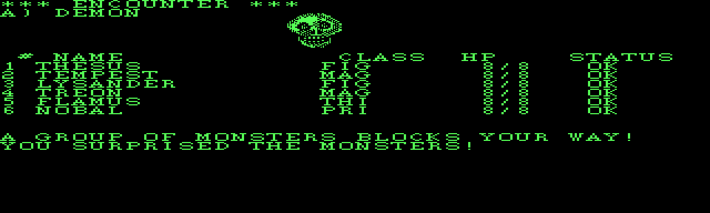

## Assistant · 2026-09-04 06:20:29

› Read: C:/Users/PAULGI~1/AppData/Local/Temp/claude/C--dev-wizardry-wizardry1/2e283e31-7a75-4688-8289-54f3951b93bf/scratchpad/skr20.png

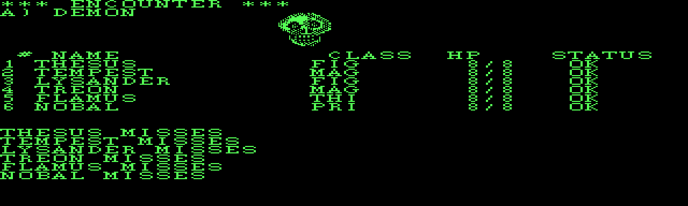

## Assistant · 2026-09-04 06:20:42

› Edit: C:\dev\wizardry\wizardry1\engine\src\combat_ui.cpp

  ↳ The file C:\dev\wizardry\wizardry1\engine\src\combat_ui.cpp has been updated successfully. (file state is current in your context — no need to Read it back)

## Assistant · 2026-09-04 06:20:52

› Bash: `powershell -NoProfile -ExecutionPolicy Bypass -File build.ps1 2>&1 | tail -5 && rm -rf build/Testing && "/c/Program Files/Microsoft Visual Studio/2022/Community/Common7/IDE/CommonExtensions/Microsoft/CMake/CMake/bin/ctest.exe" --test-dir build --timeout 20 2>&1 | tail -25`

  ↳ [1/3] Building CXX object CMakeFiles\wizcore.dir\src\combat_ui.cpp.obj ⏎ [2/3] Linking CXX static library wizcore.lib ⏎ [3/3] Linking CXX executable wiz1.exe ⏎  ⏎ -> C:\dev\wizardry\wizardry1\engine\build\wiz1.exe ⏎ 39/49 Test #39: camp_malor .... ...

## Assistant · 2026-09-04 06:21:05

› Bash: `grep -n "combat_useitem\|combat_dispel\|combat_groups" CMakeLists.txt`

  ↳ 238:add_test(NAME combat_groups ⏎ 246:set_tests_properties(combat_groups PROPERTIES ⏎ 248:add_test(NAME combat_dispel ⏎ 257:set_tests_properties(combat_dispel PROPERTIES ⏎ 259:add_test(NAME combat_useitem ⏎ 267:set_tests_properties(combat_useitem PRO ...

## Assistant · 2026-09-04 06:21:08

› Read: C:\dev\wizardry\wizardry1\engine\CMakeLists.txt

  ↳ 238	add_test(NAME combat_groups ⏎ 239	         COMMAND wiz1 combat-test ⏎ 240	                 "${CMAKE_CURRENT_SOURCE_DIR}/../extracted/wiz1/200.CHARSET" ⏎ 241	                 "${CMAKE_CURRENT_SOURCE_DIR}/../extracted/wiz1/SCENARIO.DATA" 82 ⏎ 242 ...

## Assistant · 2026-09-04 06:21:12

› Read: C:\dev\wizardry\wizardry1\engine\CMakeLists.txt

  ↳ 269	add_test(NAME combat_loktofeit ⏎ 270	         COMMAND wiz1 combat-test ⏎ 271	                 "${CMAKE_CURRENT_SOURCE_DIR}/../extracted/wiz1/200.CHARSET" ⏎ 272	                 "${CMAKE_CURRENT_SOURCE_DIR}/../extracted/wiz1/SCENARIO.DATA" 3 ⏎ 2 ...

## Assistant · 2026-09-04 06:21:20

› Edit: C:\dev\wizardry\wizardry1\engine\CMakeLists.txt

  ↳ The file C:\dev\wizardry\wizardry1\engine\CMakeLists.txt has been updated successfully. (file state is current in your context — no need to Read it back)

## Assistant · 2026-09-04 06:21:25

› Bash: `powershell -NoProfile -ExecutionPolicy Bypass -File build.ps1 2>&1 | tail -3 && rm -rf build/Testing && "/c/Program Files/Microsoft Visual Studio/2022/Community/Common7/IDE/CommonExtensions/Microsoft/CMake/CMake/bin/ctest.exe" --test-dir build --timeout 20 -R "combat|game_" 2>&1 | tail -20`

  ↳ ninja: no work to do. ⏎  ⏎ -> C:\dev\wizardry\wizardry1\engine\build\wiz1.exe ⏎       Start 21: combat_flee ⏎  5/12 Test #21: combat_flee ......................   Passed    0.04 sec ⏎       Start 22: combat_surprise ⏎  6/12 Test #22: combat_surprise . ...

## Assistant · 2026-09-04 06:21:39

› Bash: `rm -rf build/Testing && "/c/Program Files/Microsoft Visual Studio/2022/Community/Common7/IDE/CommonExtensions/Microsoft/CMake/CMake/bin/ctest.exe" --test-dir build --timeout 20 2>&1 | tail -4`

  ↳ 100% tests passed, 0 tests failed out of 50 ⏎  ⏎ Total Test time (real) =   2.14 sec

## Assistant · 2026-09-04 06:21:50

› Bash: `grep -n "^## \|^# " docs/combat.md`

  ↳ Exit code 2 ⏎ grep: docs/combat.md: No such file or directory

## Assistant · 2026-09-04 06:21:54

› Bash: `cd /c/dev/wizardry/wizardry1 && grep -n "^## \|^# " docs/combat.md && echo "---tail---" && tail -20 docs/combat.md`

  ↳ 1:# Combat  (COMBAT / CINIT / CUTIL / MELEE / SWINGASW) ⏎ 8:## Records ⏎ 33:## Encounter build — `CINIT` (`INITGRUP`/`ENGROUPS`) ⏎ 47:## Resolution — `DAM2ENMY` / `DAM2ME` ⏎ 59:## Spellcasting — `CASTASPE` (`DOMAGE` proc 28 / `DOPRIEST` proc 27) ⏎ 11 ...

## Assistant · 2026-09-04 06:21:57

› Read: C:\dev\wizardry\wizardry1\docs\combat.md

  ↳ 166	## UI / flow ⏎ 167	 ⏎ 168	`runCombat(Ui&, Party&, Scenario&, StringPool*, Rng&, enemyInx, mazeLevel, ⏎ 169	attk012=2, transcript=nullptr, parleyThresh=-1)` → `CombatResult {Won, Fled, ⏎ 170	PartyWiped, WindowClosed, Friendly, Recalled}`.  `INIT ...

## Assistant · 2026-09-04 06:22:09

› Edit: C:\dev\wizardry\wizardry1\docs\combat.md

  ↳ The file C:\dev\wizardry\wizardry1\docs\combat.md has been updated successfully. (file state is current in your context — no need to Read it back)

## Assistant · 2026-09-04 06:22:13

› Bash: `grep -n "monster portrait\|monster illustrat\|200.MONSTERS\|not yet.*render\|shows monster names" docs/roadmap.md`

  ↳ 39:- [~] `200.MONSTERS` — 29 records × 512 B, `TENEMY.PIC` indexed. Load path + ⏎ 107:- [~] `200.MONSTERS` — grid + CONUNIT driver mapped; records are per-monster ⏎ 182:      `SHOPS` families ported.  Only visible gap: monster portraits — ⏎ 183: ...

## Assistant · 2026-09-04 06:22:16

› Read: C:\dev\wizardry\wizardry1\docs\roadmap.md

  ↳ 36	      Phase 2 (`tools/strpool.py`, `engine/wiz/string_pool.h`). ⏎ 37	- [x] `200/400.CHARSET` — 16×8, 512 glyphs; `engine/wiz/font.h` (`wiz1 mockup`). ⏎ 38	- [x] `200/400.TITLE` — 320×64 2bpp CGA; `engine/wiz/bitmap.h` (`wiz1 show title`). ⏎ 39 ...

## Assistant · 2026-09-04 06:22:22

› Edit: C:\dev\wizardry\wizardry1\docs\roadmap.md

  ↳ The file C:\dev\wizardry\wizardry1\docs\roadmap.md has been updated successfully. (file state is current in your context — no need to Read it back)

## Assistant · 2026-09-04 06:22:25

› Read: C:\dev\wizardry\wizardry1\docs\roadmap.md

  ↳ 105	      `CLRRECT`, Pascal `': w'` right-justify, inverse video, font render. ⏎ 106	      `wiz1 mockup` renders the MAKEMENU screen. ⏎ 107	- [x] `200/400.TITLE` decoded — 320×64 2bpp CGA (the "Wizardry" logo). ⏎ 108	      `engine/wiz/bitmap.h` ( ...

## Assistant · 2026-09-04 06:22:29

› Edit: C:\dev\wizardry\wizardry1\docs\roadmap.md

  ↳ The file C:\dev\wizardry\wizardry1\docs\roadmap.md has been updated successfully. (file state is current in your context — no need to Read it back)

## Assistant · 2026-09-04 06:22:32

› Read: C:\dev\wizardry\wizardry1\docs\roadmap.md

  ↳ 180	      dungeon, and the maze `I` command (`EXPLROOM`/`LOOKLOST`/`PICKUP`) ⏎ 181	      carries it out for resurrection at the Temple. ⏎ 182	- [x] **Phase 3 is functionally complete** — the standalone engine plays the ⏎ 183	      whole game, cha ...

## Assistant · 2026-09-04 06:22:38

› Edit: C:\dev\wizardry\wizardry1\docs\roadmap.md

  ↳ The file C:\dev\wizardry\wizardry1\docs\roadmap.md has been updated successfully. (file state is current in your context — no need to Read it back)

## Assistant · 2026-09-04 06:22:43

› Edit: C:\dev\wizardry\wizardry1\docs\roadmap.md

  ↳ The file C:\dev\wizardry\wizardry1\docs\roadmap.md has been updated successfully. (file state is current in your context — no need to Read it back)

## Assistant · 2026-09-04 06:22:47

› Read: C:\dev\wizardry\wizardry1\docs\roadmap.md

  ↳ 191	      throwaway cursor-blink rolls, so a whole session isn't replayable but ⏎ 192	      each resolution is exact given its starting `s3`. ⏎ 193	- [ ] Nice-to-haves, none blocking: `HAS.CACHE` / `KANA.KEYMAP` id, `CSP` ⏎ 194	      0/7-9/12/21- ...

## Assistant · 2026-09-04 06:22:53

› Edit: C:\dev\wizardry\docs\file-formats.md

  ↳ The file C:\dev\wizardry\docs\file-formats.md has been updated successfully. (file state is current in your context — no need to Read it back)

## Assistant · 2026-09-04 06:22:57

› Read: C:\Users\Paul Gilbert\.claude\projects\C--dev-wizardry\memory\wizardry1-re-project.md

  ↳ 1	--- ⏎ 2	name: wizardry1-re-project ⏎ 3	description: "Wizardry 1 reverse-engineering project — layout, disk format, and agreed direction" ⏎ 4	metadata:  ⏎ 5	  node_type: memory ⏎ 6	  type: project ⏎ 7	  originSessionId: 4dc1a062-1708-4f14-97ef-d51b323 ...

## Assistant · 2026-09-04 06:23:14

› Edit: C:\Users\Paul Gilbert\.claude\projects\C--dev-wizardry\memory\wizardry1-re-project.md

  ↳ The file C:\Users\Paul Gilbert\.claude\projects\C--dev-wizardry\memory\wizardry1-re-project.md has been updated successfully.

## Assistant · 2026-09-04 06:23:22

› Edit: C:\Users\Paul Gilbert\.claude\projects\C--dev-wizardry\memory\wizardry-trilogy-shared-engine.md

  ↳ The file C:\Users\Paul Gilbert\.claude\projects\C--dev-wizardry\memory\wizardry-trilogy-shared-engine.md has been updated successfully.

## Assistant · 2026-09-04 06:23:27

› Bash: `cd /c/dev/wizardry && grep -rn "names as text\|LZ-compress\|compressed.*image\|monster illustrat\|portraits.*not\|not.*rendered" wizardry1/docs docs wizardry1/engine/include 2>/dev/null`

  ↳ docs/file-formats.md:247:compressed image.** ⏎ docs/pmachine.md:249:**Monster portraits are tile-composed, not a compressed bitmap.**  Each ⏎ Shell cwd was reset to C:\dev\wizardry\wizardry1

## Assistant · 2026-09-04 06:23:34

› Bash: `cd /c/dev/wizardry/wizardry1/engine && powershell -NoProfile -ExecutionPolicy Bypass -File build.ps1 2>&1 | tail -3 && rm -rf build/Testing && "/c/Program Files/Microsoft Visual Studio/2022/Community/Common7/IDE/CommonExtensions/Microsoft/CMake/CMake/bin/ctest.exe" --test-dir build --timeout 20 2>&1 | tail -4 && rm -f *.dat build/*.dat`

  ↳ ninja: no work to do. ⏎  ⏎ -> C:\dev\wizardry\wizardry1\engine\build\wiz1.exe ⏎  ⏎ 100% tests passed, 0 tests failed out of 50 ⏎  ⏎ Total Test time (real) =   3.65 sec

## Assistant · 2026-09-04 06:23:49

› Bash: `D="C:/Users/PAULGI~1/AppData/Local/Temp/claude/C--dev-wizardry-wizardry1/2e283e31-7a75-4688-8289-54f3951b93bf/scratchpad"; rm -rf "$D/cd3"; mkdir -p "$D/cd3"; export WIZ1_COMBAT_DUMP="$D/cd3"; E=../extracted/wiz1; ./build/wiz1.exe combat-test $E/200.CHARSET $E/SCENARIO.DATA 82 "\\r\\rPPPPPP\\r\\r\\r" $E/ASCII.KRN 2 -1 2 2>&1 | grep -E "PORTRAIT|GROUPS|result:"; python "$D/ppm2png.py" "$D/cd3/frame ...`

  ↳ PORTRAIT| A) pic 25 ⏎ PORTRAIT| B) pic 11 ⏎ result: WINDOW-CLOSED ⏎ | 2 GROUPS OF MONSTERS! ⏎ C:/Users/PAULGI~1/AppData/Local/Temp/claude/C--dev-wizardry-wizardry1/2e283e31-7a75-4688-8289-54f3951b93bf/scratchpad/groups.png 1280 384

## Assistant · 2026-09-04 06:23:54

› Read: C:/Users/PAULGI~1/AppData/Local/Temp/claude/C--dev-wizardry-wizardry1/2e283e31-7a75-4688-8289-54f3951b93bf/scratchpad/groups.png

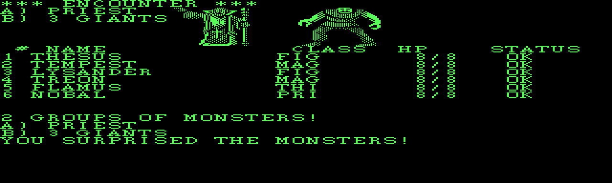

## Assistant · 2026-09-04 06:24:14

› Bash: `cd /c/dev/wizardry && git status --short && cat > "C:/Users/PAULGI~1/AppData/Local/Temp/claude/C--dev-wizardry-wizardry1/2e283e31-7a75-4688-8289-54f3951b93bf/scratchpad/msg.txt" <<'EOF' ⏎ wizardry1: render the 200.MONSTERS combat portraits (CONUNIT blk 13) ⏎  ⏎ Combat drew monster names as text; it now shows the picture band. ⏎  ⏎   - engine/wiz/monster_art.{h,cpp}: blitPortrait() decodes a 512-byte ⏎     200 ...`

  ↳ M docs/file-formats.md ⏎  M wizardry1/docs/combat.md ⏎  M wizardry1/docs/roadmap.md ⏎  M wizardry1/engine/CMakeLists.txt ⏎  M wizardry1/engine/include/wiz/scenario.h ⏎  M wizardry1/engine/src/combat_ui.cpp ⏎  M wizardry1/engine/src/main.cpp ⏎  M wizardry ...

## Assistant · 2026-09-04 06:24:25

› SendUserFile: {"files": ["C:/Users/PAULGI~1/AppData/Local/Temp/claude/C--dev-wizardry-wizardry1/2e283e31-7a75-4688-8289-54f3951b93bf/scratchpad/sk6.png", "C:/Users/PAULGI~1/AppData/Local/Temp/claude/C--dev-wizardry ...

  ↳ 2 files delivered to user. ⏎   C:\Users\PAULGI~1\AppData\Local\Temp\claude\C--dev-wizardry-wizardry1\2e283e31-7a75-4688-8289-54f3951b93bf\scratchpad\sk6.png → file_uuid: 57b54828-668e-49e9-9aab-241f6cd06a38 ⏎   C:\Users\PAULGI~1\AppData\Local\T ...

## Assistant · 2026-09-04 06:24:37

Wired in and shipped (`f53a712`).

## What changed

**`engine/wiz/monster_art.{h,cpp}`** — `blitPortrait(dst, rec512, dx, dy, fg)`: decodes a `200.MONSTERS` record (`PIC` 1-based) — the 6×5 grid of 16×8 px 1bpp tiles, tile *n* at offset `n*16`, MSB-left — straight into a `Surface`. Mirrors the DOS blitter at `INTERP:0x1E9A` (CGA mode 6, plain 1bpp).

**`Scenario::loadMonsterArt` / `monsterArtRecord(pic)`** — holds the companion file separately; `SCENARIO.DATA` is never touched. Returns empty for an unloaded / out-of-range / blank PIC, so combat degrades to names-only.

**`combat_ui.cpp` `CombatCtx::buildPortraits()`** — after `buildEncounter`, composes the picture band as a `Ui` overlay at text row 1, using the DOS per-group-count start columns (`cs:0x1423/25/29/2F` = `{15}` / `{11,19}` / `{7,15,23}` / `{3,11,19,27}`). While the band is up, the group-name lines are clipped to the gap on its left — the same thing the DOS screen does (full names still scroll through the message area).

**`main.cpp` `attachMonsterArt()`** — auto-loads `200.MONSTERS` from beside `SCENARIO.DATA` for `town`, the maze/game tests, and `combat-test`. `WIZ1_COMBAT_DUMP=<dir>` makes `combat-test` write a PPM per frame (used for the shots above).

## Verification

- 50/50 CMake tests pass; new `combat_portrait` asserts `PORTRAIT| A) pic 4` for monster 68 (the skull).
- Visual: single-group and 2-group encounters render the portraits at the right positions (see the two images) — the skull, a robed priest, spread-armed giants all recognizable.

The roadmap's "only visible gap" is now closed — Phase 3 is feature-complete with portraits. Remaining items are purely cosmetic (sound, chevron/medal glyphs).

## User · 2026-09-04 06:30:50

try it in the SDL build with a real party

## Assistant · 2026-09-04 06:31:03

› Bash: `cd /c/dev/wizardry/wizardry1/engine && grep -n "scratchParty" src/main.cpp | head -3 && sed -n '/^static Party scratchParty/,/^}/p' src/main.cpp`

  ↳ 903:static Party scratchParty(const Scenario &sc, Roster &roster, int n = 6) { ⏎ 920:    Party party = scratchParty(sc, roster); ⏎ 1021:    Party party = scratchParty(sc, roster); ⏎ static Party scratchParty(const Scenario &sc, Roster &roster, in ...

## Assistant · 2026-09-04 06:31:29

› Bash: `ls ../extracted/wiz1/200.MONSTERS && timeout 3 ./build/wiz1.exe maze-sdl ../extracted/wiz1/200.CHARSET ../extracted/wiz1/SCENARIO.DATA 1 2>&1; echo "exit=$? (124=timeout=window stayed open, good)"`

  ↳ ../extracted/wiz1/200.MONSTERS ⏎ exit=124 (124=timeout=window stayed open, good)

## Assistant · 2026-09-04 06:31:39

› Bash: `./build/wiz1.exe roster ../extracted/wiz1/SCENARIO.DATA 2>&1 | head -25`

  ↳ [ 0] THESUS           HUM FIGHTER N L1  OK      S17 I 8 P 5 V 8 A 8 L 9  AC10 HP 8/8  185gp ⏎ [ 1] TEMPEST          DWA MAGE    N L1  OK      S10 I12 P10 V10 A 5 L 6  AC10 HP 8/8  190gp ⏎ [ 2] LYSANDER         HUM FIGHTER N L1  OK      S17 I ...

## Assistant · 2026-09-04 06:31:54

› Bash: `./build/wiz1.exe maze-sdl ../extracted/wiz1/200.CHARSET ../extracted/wiz1/SCENARIO.DATA 1`

  ↳ Command running in background with ID: b8mse9d53. Output is being written to: C:\Users\PAULGI~1\AppData\Local\Temp\claude\C--dev-wizardry-wizardry1\2e283e31-7a75-4688-8289-54f3951b93bf\tasks\b8mse9d53.output. You will be notified when it co ...

## Assistant · 2026-09-04 06:32:04

› Read: C:\dev\wizardry\wizardry1\engine\src\main.cpp

  ↳ 560	// The optional 7th arg mangles a roster slot for testing, e.g. "wound=7:5" ⏎ 561	// sets roster slot 7 to status 5 (DEAD), HP 0. ⏎ 562	static int cmdTownTest(int argc, char **argv) { ⏎ 563	    if (argc < 5) { ⏎ 564	        std::puts("town-test ...

## Assistant · 2026-09-04 06:32:22

› Bash: `python -c " ⏎ import struct ⏎ open('party.dat','wb').write(struct.pack('<7i',6,0,1,2,3,4,5)) ⏎ print('wrote party.dat: 6 members, roster slots 0-5 (THESUS TEMPEST LYSANDER TREON FLAMUS NOBAL)') ⏎ " && ls -la party.dat roster.dat 2>&1`

  ↳ Exit code 2 ⏎ wrote party.dat: 6 members, roster slots 0-5 (THESUS TEMPEST LYSANDER TREON FLAMUS NOBAL) ⏎ ls: cannot access 'roster.dat': No such file or directory ⏎ -rw-r--r-- 1 Paul Gilbert 197121 28 Sep  4 16:32 party.dat

## Assistant · 2026-09-04 06:32:33

› Bash: `timeout 3 ./build/wiz1.exe town ../extracted/wiz1/200.CHARSET ../extracted/wiz1/SCENARIO.DATA ../extracted/wiz1/200.TITLE ../extracted/wiz1/ASCII.KRN 2>&1; echo "exit=$? (124 = window stayed up)"; ls -la roster.dat 2>&1`

  ↳ Exit code 2 ⏎ seeded roster.dat from the scenario roster ⏎ exit=124 (124 = window stayed up) ⏎ ls: cannot access 'roster.dat': No such file or directory

## Assistant · 2026-09-04 06:32:45

› Read: C:\Users\PAULGI~1\AppData\Local\Temp\claude\C--dev-wizardry-wizardry1\2e283e31-7a75-4688-8289-54f3951b93bf\tasks\b8mse9d53.output

  ↳ <system-reminder>Warning: the file exists but the contents are empty.</system-reminder>

## Assistant · 2026-09-04 06:33:02

The SDL maze is running now — a window should be open on your desktop with the scenario's own six-character party (THESUS, TEMPEST, LYSANDER, TREON, FLAMUS, NOBAL) on dungeon level 1.

```bash
cd C:\dev\wizardry\wizardry1\engine
.\build\wiz1.exe maze-sdl ..\extracted\wiz1\200.CHARSET ..\extracted\wiz1\SCENARIO.DATA 1
```

**Controls:** ↑ = forward, ↓ = back, ← / → = turn, `C` = camp, `M`/Esc = leave. Walk the corridors — level 1 has fixed encounter squares plus a random roll each step, so you'll hit a fight within a dozen moves and the portrait band appears above the party list.

**For the full town flow** (Gilgamesh's, Boltac's, the Inn, then delve), I dropped a ready `party.dat` in `engine\` pointing at roster slots 0–5, so you skip character creation:

```bash
cd C:\dev\wizardry\wizardry1\engine
.\build\wiz1.exe town ..\extracted\wiz1\200.CHARSET ..\extracted\wiz1\SCENARIO.DATA ..\extracted\wiz1\200.TITLE ..\extracted\wiz1\ASCII.KRN
```

First launch seeds `roster.dat` from the scenario; `M` at the Castle → Edge of Town → Maze. Both commands auto-load `200.MONSTERS` from beside `SCENARIO.DATA`, so portraits just work.

The background process (`b8mse9d53`) holds the maze window open — close the window or stop the task when you're done. Let me know what it looks like in motion — particularly whether the row-1 placement feels right or the portraits want to be bigger / lower.

## User · 2026-09-04 06:35:36

<task-notification>
<task-id>b8mse9d53</task-id>
<tool-use-id>toolu_01FyskfMwpHL9n4DTvfotdCH</tool-use-id>
<output-file>C:\Users\PAULGI~1\AppData\Local\Temp\claude\C--dev-wizardry-wizardry1\2e283e31-7a75-4688-8289-54f3951b93bf\tasks\b8mse9d53.output</output-file>
<status>completed</status>
<summary>Background command "Launch the SDL maze with the scenario party" completed (exit code 0)</summary>
</task-notification>

## Assistant · 2026-09-04 06:35:43

The maze window closed (clean exit 0 — no crash). Relaunch any time with the command above, or try the `town` flow. Let me know how the portraits looked in motion and whether the placement/size wants tweaking.

## User · 2026-09-04 06:43:40

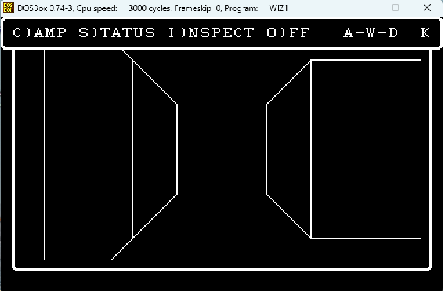

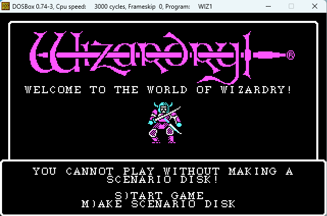

The maze rendering seems significantly different from what I see in DosBox. I'm attaching a screenshot of the maze. In DosBox the 3d wireframe takes up the entire horizontal width of the screen. Is this some legitimate gameplay option that's configurable, or is the current C implementation using older code directly from the earlier version represented by the provided UCSD Pascal sources without properly confirming updates in the DOS version. I'm also including a screenshot of the game's title screen within DosBox. In addition to graphics, both screenshots have border boxes that aren't present in the current implementation.

## Assistant · 2026-09-04 06:44:06

› Read: C:\dev\wizardry\wizardry1\engine\include\wiz\maze3d.h

  ↳ 1	// DRAWMAZE -- the first-person wireframe (RUNNER P010E02). ⏎ 2	// ⏎ 3	// Ported from the Apple source: a receding stack of trapezoidal wall panels ⏎ 4	// drawn with DRAWLINE (runs of points along one of 8 directions) into an ⏎ 5	// 82x79 "pictur ...

## Assistant · 2026-09-04 06:44:10

› Read: C:\dev\wizardry\wizardry1\docs\maze.md

  ↳ 1	# The Maze — RUNNER ⏎ 2	 ⏎ 3	`RUNNER` (`P010E01`, DOS segnum 20, 74 procs) is maze navigation + the ⏎ 4	first-person wireframe view.  Entered on `XGOTO = XRUNNER`; `XNEWMAZE` ⏎ 5	(handled by `UTILITIE`) loads a level first. ⏎ 6	 ⏎ 7	## Coordinates ⏎ 8 ...

## Assistant · 2026-09-04 06:44:33

› Bash: `ls extracted/pcode/ 2>/dev/null | head; ls tools/ | grep -i pcode; python tools/pcode_dis.py --help 2>&1 | head -20`

  ↳ 00_WIZARDRY.pd ⏎ 01_COMBAT.pd ⏎ 02_CASTASPE.pd ⏎ 03_SWINGASW.pd ⏎ 04_CINIT.pd ⏎ 05_CUTIL.pd ⏎ 06_KANJIREA.pd ⏎ 07_UTILITIE.pd ⏎ 08_SHOPS.pd ⏎ 09_SPECIALS.pd ⏎ pcode_dis.py ⏎  ⏎ UCSD p-code disassembler for the DOS Wizardry SYSTEM.PASCAL codefile. ⏎  ⏎ Dialect and o ...

## Assistant · 2026-09-04 06:44:41

› Bash: `ls extracted/pcode/; echo ---; python tools/pcode_dis.py procs extracted/pcode/*RUNNER* 2>&1 | head -80`

  ↳ 00_WIZARDRY.pd ⏎ 01_COMBAT.pd ⏎ 02_CASTASPE.pd ⏎ 03_SWINGASW.pd ⏎ 04_CINIT.pd ⏎ 05_CUTIL.pd ⏎ 06_KANJIREA.pd ⏎ 07_UTILITIE.pd ⏎ 08_SHOPS.pd ⏎ 09_SPECIALS.pd ⏎ 10_CASTLE.pd ⏎ 11_ROLLER.pd ⏎ 12_CAMP.pd ⏎ 13_REWARDS.pd ⏎ 14_RUNNER.pd ⏎ 15_GAMEUTIL.pd ⏎ --- ⏎ Traceback (most re ...

## Assistant · 2026-09-04 06:44:49

› Bash: `python tools/pcode_dis.py 2>&1 | head -15; echo "==="; grep -n "SEGMENT PROCEDURE\|^PROC\|proc 21\|proc 27\|proc 33\|proc 39\|P010E\|DRAWMAZE\|DRAWLINE\|DRAWFRNT\|DRAWLEFT" extracted/pcode/14_RUNNER.pd | head -40`

  ↳ UCSD p-code disassembler for the DOS Wizardry SYSTEM.PASCAL codefile. ⏎  ⏎ Dialect and operand formats are from docs/pmachine.md (recovered from ⏎ SYSTEM.INTERP). Codefile structure (all little-endian, no byte-swap): ⏎  ⏎   block 0            co ...

## Assistant · 2026-09-04 06:44:53

› Bash: `sed -n '1457,1560p' extracted/pcode/14_RUNNER.pd`

  ↳ ; ---- RUNNER:proc 21  entry=0x8ee code_end=0x928 data=0 param=0 ---- ⏎   08ee  b6 01 03          LOD    1,3 ⏎   08f1  b8 01 01          STR    1,1 ⏎   08f4  b6 01 04          LOD    1,4 ⏎   08f7  b8 01 02          STR    1,2 ⏎   08fa  b6 01 0e ...

## Assistant · 2026-09-04 06:45:13

› Bash: `grep -n "loc_18C1\|DRAWLINE\|conunit.*line\|jpt_1466" wiz1_interp.asm | head; echo ---; awk 'NR>=3895 && NR<=3990' wiz1_interp.asm`

  ↳ 2975:jpt_1466        dw offset conunit_noop  ; DATA XREF: conunit_uwr+B↓r ⏎ 2980:                dw offset loc_18C1 ⏎ 2994:                dw offset conunit_scanline19 ⏎ 3160:                jmp     cs:jpt_1466[bx] ; switch jump ⏎ 3164: ...

## Assistant · 2026-09-04 06:45:18

› Bash: `awk 'NR>=3990 && NR<=4055' wiz1_interp.asm`

  ↳ ja      short loc_1918 ⏎                 mov     [si], di ⏎  ⏎ loc_1918:                               ; CODE XREF: conunit_uwr+4B5↑j ⏎                                         ; conunit_uwr+4B9↑j ⏎                 add     si, [bp+0Ah] ...

## Assistant · 2026-09-04 06:46:16

› Bash: `grep -n "RUNNER:proc 22\|RUNNER:proc 23\|RUNNER:proc 24\|RUNNER:proc 25\|RUNNER:proc 26\|RUNNER:proc 18\|RUNNER:proc 4 \|RUNNER:proc 2 " extracted/pcode/14_RUNNER.pd`

  ↳ 3:; ---- RUNNER:proc 2  entry=0x0 code_end=0x32 data=4 param=0 ---- ⏎ 40:; ---- RUNNER:proc 4  entry=0x3e code_end=0x4e data=0 param=0 ---- ⏎ 971:; ---- RUNNER:proc 18  entry=0x64c code_end=0x6e0 data=10 param=6 ---- ⏎ 1074:; ---- RUNNER:proc 22 ...

## Assistant · 2026-09-04 06:46:21

› Bash: `sed -n '1074,1145p' extracted/pcode/14_RUNNER.pd`

  ↳ ; ---- RUNNER:proc 22  entry=0x6ea code_end=0x73c data=0 param=0 ---- ⏎   06ea  b6 02 09          LOD    2,9 ⏎   06ed  00                SLDC   0 ⏎   06ee  c3                EQUI ⏎   06ef  a1 04             FJP    L06f5 ⏎   06f1  14                SL ...

## Assistant · 2026-09-04 06:46:56

› Bash: `cat > "C:/Users/PAULGI~1/AppData/Local/Temp/claude/C--dev-wizardry-wizardry1/2e283e31-7a75-4688-8289-54f3951b93bf/scratchpad/glyphs.py" <<'EOF' ⏎ d=open("extracted/wiz1/200.CHARSET","rb").read() ⏎ # 16 bytes/glyph, 2 bytes/row, 8 rows, MSB left, 16px wide ⏎ for g in range(0,24): ⏎     print(f"--- glyph {g} ---") ⏎     for y in range(8): ⏎         b0,b1=d[g*16+y*2],d[g*16+y*2+1] ⏎         bits=[(b0>>(7-i))&1 for ...`

  ↳ --- glyph 0 --- ⏎ ##......##...... ⏎ ##......##...... ⏎ ##......##...... ⏎ ##......##...... ⏎ ##......##...... ⏎ ##......##...... ⏎ ##......##...... ⏎ ##......##...... ⏎ --- glyph 1 --- ⏎ ....############ ⏎ ..############## ⏎ ######.......... ⏎ ####.... ...

## Assistant · 2026-09-04 06:47:15

› Bash: `grep -n "WIZARDRY:proc 19\|WIZARDRY:proc 22\|WIZARDRY:proc 25\|WIZARDRY:proc 20\|WIZARDRY:proc 23\|WIZARDRY:proc 24" extracted/pcode/00_WIZARDRY.pd; echo "--- procmap RUNNER/WIZARDRY window/border ---"; grep -in "border\|frame\|window\|RUNINIT\|MAKEWIND\|BORDER" docs/procmap.tsv | head`

  ↳ 2145:; ---- WIZARDRY:proc 19  entry=0xd4c code_end=0xdb8 data=4 param=16 ---- ⏎ 2237:; ---- WIZARDRY:proc 20  entry=0xdc2 code_end=0xe00 data=2 param=4 ---- ⏎ 2335:; ---- WIZARDRY:proc 25  entry=0xe46 code_end=0xe82 data=0 param=4 ---- ⏎ 2572:; - ...

## Assistant · 2026-09-04 06:47:18

› Bash: `sed -n '2145,2260p' extracted/pcode/00_WIZARDRY.pd`

  ↳ ; ---- WIZARDRY:proc 19  entry=0xd4c code_end=0xdb8 data=4 param=16 ---- ⏎   0d4c  0a                SLDC   10 ⏎   0d4d  02                SLDC   2 ⏎   0d4e  dd                SLDL   6 ⏎   0d4f  02                SLDC   2 ⏎   0d50  95 ...

## Assistant · 2026-09-04 06:47:46

› Bash: `grep -n "RUNNER:proc 40\|RUNNER:proc 41\|RUNNER:proc 3 \|RUNINIT\|proc 2 \|CGP 19\|CGP  19\|CGP    19" extracted/pcode/14_RUNNER.pd | head; echo "--- proc 2 (RUNNER, entry 0) ---"; sed -n '3,40p' extracted/pcode/14_RUNNER.pd`

  ↳ 3:; ---- RUNNER:proc 2  entry=0x0 code_end=0x32 data=4 param=0 ---- ⏎ 2376:; ---- RUNNER:proc 40  entry=0xdf0 code_end=0xe36 data=0 param=0 ---- ⏎ 2432:; ---- RUNNER:proc 41  entry=0xe40 code_end=0xeae data=0 param=0 ---- ⏎ 2753:; ---- RUNNER:pro ...

## Assistant · 2026-09-04 06:47:52

› Bash: `grep -n "WIZARDRY,19\|WIZARDRY,25\|WIZARDRY,22\|GOTOXY\|CXP    KANJIREA\|CXP KAN" extracted/pcode/14_RUNNER.pd | head -20`

  ↳ 2870:  10b3  cd 01 13          CXP    WIZARDRY,19 ⏎ 3196:  12e3  cd 01 16          CXP    WIZARDRY,22 ⏎ 3631:  15a6  cd 01 13          CXP    WIZARDRY,19 ⏎ 4009:  1860  cd 01 13          CXP    WIZARDRY,19 ⏎ 4269:  1a2a  cd 01 16          CXP    WI ...

## Assistant · 2026-09-04 06:47:55

› Bash: `sed -n '3600,3640p' extracted/pcode/14_RUNNER.pd`

  ↳ 1568  b2 03 81 a8       LDA    3,424 ⏎   156c  b6 01 03          LOD    1,3 ⏎   156f  a4 01             IXA    1 ⏎   1571  f8                SIND   0 ⏎   1572  ab 07             SRO    7 ⏎   1574  ed                SLDO   6 ⏎   1575  b2 03 81 98 ...

## Assistant · 2026-09-04 06:48:04

› Bash: `for off in 1860 1b03 1b72 1b80 1c0e 10b3; do echo "=== $off ==="; grep -n "  $off  cd 01 13" extracted/pcode/14_RUNNER.pd; done; echo; sed -n '3985,4012p' extracted/pcode/14_RUNNER.pd`

  ↳ === 1860 === ⏎ 4009:  1860  cd 01 13          CXP    WIZARDRY,19 ⏎ === 1b03 === ⏎ 4381:  1b03  cd 01 13          CXP    WIZARDRY,19 ⏎ === 1b72 === ⏎ 4459:  1b72  cd 01 13          CXP    WIZARDRY,19 ⏎ === 1b80 === ⏎ 4469:  1b80  cd 01 13          CXP ...

## Assistant · 2026-09-04 06:48:12

› Bash: `for L in 4375 4453 4463 4537 2864; do sed -n "${L},$((L+12))p" extracted/pcode/14_RUNNER.pd; echo "  ----"; done`

  ↳ 1afd  28                SLDC   40 ⏎   1afe  03                SLDC   3 ⏎   1aff  0f                SLDC   15 ⏎   1b00  01                SLDC   1 ⏎   1b01  00                SLDC   0 ⏎   1b02  00                SLDC   0 ⏎   1b03  cd 01 13          CXP ...

## Assistant · 2026-09-04 06:48:51

You've diagnosed it correctly. This isn't a config option — the C engine's maze view is the **Apple II `DRAWMAZE` algorithm**, and the DOS renderer is a different thing that was never ported. The `maze3d.h` comment claiming they're "equivalent" was an unverified assumption, and your screenshot disproves it.

## What the DOS renderer actually is

I read `RUNNER` procs 21–41 and the `CONUNIT` `DRAWLINE` handler (`INTERP:0x18C1`). The DOS wireframe is **character-cell art**, not pixel lines:

- It's drawn into `WINDOW1` — a **36-col × 20-row cell grid** (720 cells; the driver clears exactly `0x2D0` of them). At 16×8 px/cell that's **≈576 × 160 px — the near-full-width box in your screenshot.** The C engine draws an 82 × 79 **pixel** buffer scaled 2× → 164 × 158, top-left corner.
- `DRAWLINE(x, y, dH, dV, len, glyph)` writes a run of `len` identical glyph-cells stepping `(dH, dV)`. Each depth layer is a proc (`22`=DRAWLEFT, `23`/`25`, `26`=DRAWFRNT, …) with a hard-coded table of these calls — e.g. proc 22's nearest layer is `DRAWLINE(1,0, 0,1, 20, 12)` (screen-left edge, 20 cells tall), `DRAWLINE(8,0, 1,1, 2, 14)` (top receding diagonal), etc.
- The line-art lives in **`200.CHARSET` glyphs 0–23** — I rendered them: glyph 11/12 = `│`, 13 = `╱`, 14 = `╲`, 7/9/10 = `─`, 1/3/6/8 = corner arcs, 16–23 = door frames. A dedicated wireframe font bank the engine never uses.
- The **border box** is intrinsic: the `DRAWLINE` handler does `sub dl,2 / sub dh,2` — the window reserves a 1-cell frame. `WIZARDRY` proc 19 (window-alloc) then calls global procs 67/68 to draw that frame + clear. The C engine's `TextScreen` models windows as clip-rects only, no frame — that's why *no* screen in the port has the boxes.

The title screen's "MAKE A SCENARIO DISK" is DOS copy-protection state (irrelevant to us), but its bordered box and the monster portrait on the logo screen are real and `showTitle` omits both.

## To fix it faithfully

1. **Maze wireframe** (the big one, ~half a day): rewrite `maze3d.cpp` as a cell-grid renderer — transcribe the `DRAWLINE` tables from `RUNNER` 21–41, nail `DRAWLINE`'s arg/sign semantics, handle the door cut-outs (`CIP 18`/`CIP 4`), and render glyphs 0–23 as the wireframe bank. Bump the maze HUD layout to match (wide view, party panel below).
2. **Window borders** (~2 hrs): add frame-drawing to `TextScreen`'s window model after decoding procs 67/68's border style. Benefits every screen, not just the maze.
3. **Title screen** (~1 hr): border + the logo-screen portrait.

Gameplay logic (RNG, combat, rules) stays faithful — this is purely the presentation layer, which so far tracked the Apple source instead of the DOS build.

Want me to take the maze wireframe first, or do the border pass first since it touches everything? And should I treat DOS-exact screen layout as the target from here on (re-checking the other screens against DOSBox too)?

## User · 2026-09-04 06:50:35

Do the border pass first, then the maze wireframe. And yes, you should treat DOS-exact screen layouts as the target from here on.

## Assistant · 2026-09-04 06:50:44

› mcp__ccd_session__mark_chapter: {"title": "DOS-exact UI: borders + maze", "summary": "Port the DOS window-border rendering, then rewrite the maze wireframe as the DOS cell-grid renderer; DOS-exact screen layouts from here on"}

  ↳ Chapter marked: "DOS-exact UI: borders + maze". Continue your current work.

## Assistant · 2026-09-04 06:50:51

› Bash: `grep -n "WIZARDRY:proc 67\|WIZARDRY:proc 68\|WIZARDRY:proc 66\|WIZARDRY:proc 18 \|WIZARDRY:proc 37\|WIZARDRY:proc 36\|WIZARDRY:proc 39\|WIZARDRY:proc 40" extracted/pcode/00_WIZARDRY.pd`

  ↳ 970:; ---- WIZARDRY:proc 66  = UNITWRITE_RETRY  entry=0x62a code_end=0x670 data=2 param=4 ---- ⏎ 1053:; ---- WIZARDRY:proc 37  entry=0x6c0 code_end=0x6cc data=0 param=2 ---- ⏎ 1064:; ---- WIZARDRY:proc 67  entry=0x6d6 code_end=0x6e4 data=0 para ...

## Assistant · 2026-09-04 06:50:54

› Bash: `sed -n '1053,1130p' extracted/pcode/00_WIZARDRY.pd`

  ↳ ; ---- WIZARDRY:proc 37  entry=0x6c0 code_end=0x6cc data=0 param=2 ---- ⏎   06c0  a9 3c             LDO    60  ; CONUNIT ⏎   06c2  f5                SLDO   14  ; CACHE_LRU ⏎   06c3  00                SLDC   0 ⏎   06c4  02                SLDC   2 ...

## Assistant · 2026-09-04 06:51:02

› Bash: `sed -n '2975,3000p' wiz1_interp.asm`

  ↳ jpt_1466        dw offset conunit_noop  ; DATA XREF: conunit_uwr+B↓r ⏎                 dw offset loc_1AE6      ; jump table for switch statement ⏎                 dw offset loc_153E ⏎                 dw offset conunit_present ⏎                 dw o ...

## Assistant · 2026-09-04 06:51:08

› Bash: `grep -n "loc_153E\|loc_14C4\|loc_14A2\|loc_1AE6" wiz1_interp.asm | head; echo "==="; awk '/^loc_153E:/,/jmp     interp_fetch/' wiz1_interp.asm | head -90`

  ↳ 2976:                dw offset loc_1AE6      ; jump table for switch statement ⏎ 2977:                dw offset loc_153E ⏎ 2979:                dw offset loc_14C4 ⏎ 2984:                dw offset loc_14A2 ⏎ 3199:loc_14A2: ...

## Assistant · 2026-09-04 06:51:13

› Bash: `awk '/^sub_1549[ \t]+proc/,/^sub_1549[ \t]+endp/' wiz1_interp.asm`

  ↳ sub_1549        proc near               ; CODE XREF: conunit_uwr+E7↑p ⏎                 push    si ⏎                 push    di ⏎                 call    sub_1B8A ⏎                 pop     di ⏎  ⏎ loc_154F:                               ; CODE XREF: su ...

## Assistant · 2026-09-04 06:51:22

› Bash: `awk '/^sub_159A[ \t]+proc/,/^sub_159A[ \t]+endp/' wiz1_interp.asm`

  ↳ sub_159A        proc near               ; CODE XREF: sub_1549+1D↑p ⏎                 cmp     byte ptr [di+8], 3Fh ; '?' ⏎                 jz      short loc_160A ⏎                 push    si ⏎                 mov     al, 1 ⏎                 call    su ...

## Assistant · 2026-09-04 06:51:34

› Bash: `awk '/^sub_1674[ \t]+proc/,/^sub_16A9[ \t]+endp/' wiz1_interp.asm`

  ↳ sub_1674        proc near               ; CODE XREF: sub_159A+9↑p ⏎                                         ; sub_159A+21↑p ... ⏎                 mov     bx, si ⏎                 shl     bx, 1 ⏎                 xor     ah, ah ⏎                 mov ...

## Assistant · 2026-09-04 06:52:37

› Bash: `for L in 4001 4373 4451 4461 4535 2862 3623; do echo "=== line $L ==="; sed -n "$((L)),$((L+11))p" extracted/pcode/14_RUNNER.pd; done 2>&1 | grep -E "===|SLDC|LOD|CXP|LLA|LDCI|LDA"`

  ↳ === line 4001 === ⏎   1858  00                SLDC   0 ⏎   1859  0a                SLDC   10 ⏎   185a  28                SLDC   40 ⏎   185b  06                SLDC   6 ⏎   185c  0f                SLDC   15 ⏎   185d  01                SLDC   1 ⏎   185e  0 ...

## Assistant · 2026-09-04 06:53:12

› Bash: `grep -n "RUNNER:proc" extracted/pcode/14_RUNNER.pd | sed -n '1,45p'`

  ↳ 3:; ---- RUNNER:proc 2  entry=0x0 code_end=0x32 data=4 param=0 ---- ⏎ 40:; ---- RUNNER:proc 4  entry=0x3e code_end=0x4e data=0 param=0 ---- ⏎ 53:; ---- RUNNER:proc 5  entry=0x58 code_end=0x84 data=18 param=12 ---- ⏎ 81:; ---- RUNNER:proc 6  entry ...

## Assistant · 2026-09-04 06:53:27

› Read: C:\dev\wizardry\wizardry1\engine\src\textscreen.cpp

  ↳ 1	#include "wiz/textscreen.h" ⏎ 2	 ⏎ 3	#include <algorithm> ⏎ 4	 ⏎ 5	namespace wiz { ⏎ 6	 ⏎ 7	void TextScreen::setWindow(int x, int y, int w, int h) { ⏎ 8	    win_.x = std::clamp(x, 0, kCols); ⏎ 9	    win_.y = std::clamp(y, 0, kRows); ⏎ 10	    win_.w = std:: ...

## Assistant · 2026-09-04 06:53:57

› Bash: `grep -n "CASTLE:proc\|WIZARDRY,19\|WIZARDRY,25" extracted/pcode/10_CASTLE.pd | head -30`

  ↳ 3:; ---- CASTLE:proc 2  entry=0x0 code_end=0x5c data=8 param=4 ---- ⏎ 78:; ---- CASTLE:proc 4  entry=0x6a code_end=0x72 data=0 param=2 ---- ⏎ 85:; ---- CASTLE:proc 5  entry=0x7c code_end=0x8a data=82 param=2 ---- ⏎ 95:; ---- CASTLE:proc 3  entry= ...

## Assistant · 2026-09-04 06:54:02

› Bash: `sed -n '344,360p' extracted/pcode/10_CASTLE.pd; echo "..."; sed -n '751,770p' extracted/pcode/10_CASTLE.pd; echo "=== WIZARDRY proc 25 (window close?) ==="; sed -n '2335,2400p' extracted/pcode/00_WIZARDRY.pd`

  ↳ ; ---- CASTLE:proc 11  entry=0x23e code_end=0x30c data=8 param=0 ---- ⏎   023e  00                SLDC   0 ⏎   023f  09                SLDC   9 ⏎   0240  28                SLDC   40 ⏎   0241  0c                SLDC   12 ⏎   0242  1f                SL ...

## Assistant · 2026-09-04 06:54:19

› Bash: `sed -n '3,60p' extracted/pcode/10_CASTLE.pd`

  ↳ ; ---- CASTLE:proc 2  entry=0x0 code_end=0x5c data=8 param=4 ---- ⏎   0000  00                SLDC   0 ⏎   0001  cc 05             STL    5 ⏎ L0003: ⏎   0003  cd 01 0b          CXP    WIZARDRY,11 ⏎   0006  ea                SLDO   3  ; INCHAR ⏎   0007 ...

## Assistant · 2026-09-04 06:54:46

› Bash: `grep -rn "WELCOME TO THE WORLD\|CANNOT PLAY\|SCENARIO DISK" tools/ docs/ 2>/dev/null | head; echo "==="; grep -n "GAMEUTIL:proc\|WIZARDRY,19\|TITLE\|UNITWRITE.*23\|SLDC   23" extracted/pcode/15_GAMEUTIL.pd | head -30`

  ↳ docs/strings.txt:10:   14  NOT A SCENARIO DISK ⏎ docs/strings.txt:27:   35  THIS SCENARIO DISK IS EITHER NOT ⏎ docs/strings.txt:28:   36  THE SCENARIO DISK YOU BOOTED THE ⏎ docs/strings.txt:43:   51     SCENARIO DISK.                ⏎ docs/strings. ...

## Assistant · 2026-09-04 06:54:50

› Bash: `sed -n '1200,1310p' extracted/pcode/15_GAMEUTIL.pd`

  ↳ ; ---- GAMEUTIL:proc 23  entry=0x960 code_end=0xa02 data=214 param=0 ---- ⏎   0960  b6 02 04          LOD    2,4 ⏎   0963  9f                LDCN ⏎   0964  c3                EQUI ⏎   0965  a1 0e             FJP    L0975 ⏎   0967  00                SL ...

## Assistant · 2026-09-04 06:55:02

› Bash: `grep -rn -B7 "CXP    WIZARDRY,19" extracted/pcode/*.pd | grep -B7 "WIZARDRY,19" | grep -A7 "SLDC   0$" | grep -E "SLDC   (0|40|24|25|23|22)$" | head -40; echo "=== search for w=40 h>=20 windows ==="; grep -rn -B6 "CXP    WIZARDRY,19" extracted/pcode/*.pd | grep -P "SLDC   (2[0-5])$" | head`

  ↳ extracted/pcode/01_COMBAT.pd-375-  02af  00                SLDC   0 ⏎ extracted/pcode/01_COMBAT.pd-379-  02b3  00                SLDC   0 ⏎ extracted/pcode/01_COMBAT.pd-380-  02b4  00                SLDC   0 ⏎ extracted/pcode/01_COMBAT.pd-381-  0 ...

## Assistant · 2026-09-04 06:55:09

› Bash: `sed -n '1900,1930p' extracted/pcode/07_UTILITIE.pd`

  ↳ 0c95  ad 00             RNP    0 ⏎   ; jump table [0xc97..0xc98)  ⏎  ⏎ ; ---- UTILITIE:proc 25  = CURSBELL  entry=0xca2 code_end=0xf32 data=4 param=0 ---- ⏎   0ca2  b2 01 08          LDA    1,8 ⏎   0ca5  b6 01 10          LOD    1,16 ⏎   0ca8  a4 01 ...

## Assistant · 2026-09-04 06:55:58

› Bash: `grep -rn "\.clear()\|->clear()\|resetWindow\|setWindow\|\.ts()\.clear\|ts_\.clear\|frameScreen" src/*.cpp | grep -v "clearRect\|clearWindow\|clearToEnd" | head -50`

  ↳ grep: src/*.cpp: No such file or directory

## Assistant · 2026-09-04 06:56:02

› Bash: `cd /c/dev/wizardry/wizardry1/engine && grep -rn "resetWindow\|setWindow\|\.clear()\|ts()\.clear\|ts_.clear" src/ | grep -v "clearRect\|clearWindow\|clearToEnd"`

  ↳ src/camp_ui.cpp:88:    t.resetWindow(); ⏎ src/camp_ui.cpp:126:        if (c.sp) { bool ok = false; nm = c.sp->get(StringPool::spellNameKey(s), &ok); if (!ok) nm.clear(); } ⏎ src/camp_ui.cpp:675:    t.resetWindow(); ⏎ src/combat.cpp:73:        if ...

## Assistant · 2026-09-04 06:56:34

› Bash: `grep -n "0C8h\|200\|0A0h\|25\b\|3CD0h\|word_13DA\|13D8\|conunit_present" wiz1_interp.asm | grep -i "present\|13d\|3cd0" | head; echo "==="; awk '/^conunit_present/,/jmp     interp_fetch/' wiz1_interp.asm | head -60`

  ↳ grep: wiz1_interp.asm: No such file or directory ⏎ === ⏎ awk: fatal: cannot open file `wiz1_interp.asm' for reading (No such file or directory)

## Assistant · 2026-09-04 06:56:40

› Bash: `cd /c/dev/wizardry/wizardry1 && awk '/^conunit_present/,/jmp     interp_fetch/' wiz1_interp.asm | head -70`

  ↳ conunit_present:                        ; CODE XREF: conunit_uwr+B↑j ⏎                                         ; DATA XREF: INTERP:jpt_1466↑o ⏎                 test    byte ptr [di+8], 80h ; jumptable 00001466 case 3 ⏎                 jnz     sho ...

## Assistant · 2026-09-04 06:56:49

› Bash: `python - <<'EOF' ⏎ d=open("wiz1_interp","rb").read() ⏎ import struct ⏎ # table at 0x3CD0, u16 entries -- row -> cell-buffer offset. Print until nonmonotonic/huge. ⏎ base=0x3CD0 ⏎ vals=[struct.unpack_from("<H",d,base+2*i)[0] for i in range(40)] ⏎ print(vals) ⏎ # also the 0x3C.. area: bx+3CD0 where bx=row*2. cs:[bx+3D02] was the per-cell screen addr in blitter. ⏎ print("at 0x3D02:", [struct.unpack_from("<H",d,0x3D0 ...`

  ↳ [22322, 35878, 13862, 55348, 37942, 12339, 16422, 41003, 29222, 53298, 32807, 11057, 40244, 1585, 40999, 18998, 35366, 63281, 43814, 5686, 62759, 58919, 24872, 55848, 60980, 62260, 14132, 15655, 58420, 59700, 9780, 57127, 18740, 55591, 5917 ...

## Assistant · 2026-09-04 06:57:12

› Read: C:\dev\wizardry\wizardry1\engine\src\roller_ui.cpp

  ↳ 75	    ts_.write(msg); ⏎ 76	    getKey(); ⏎ 77	} ⏎ 78	 ⏎ 79	// ---- ROLLER --------------------------------------------------------------- ⏎ 80	 ⏎ 81	namespace { ⏎ 82	 ⏎ 83	const char *raceName(const Scenario &sc, Race r) { ⏎ 84	    return int(r) < int(sc.ra ...

## Assistant · 2026-09-04 06:57:34

Now implementing. Starting with the `TextScreen` border/window primitive:

## Assistant · 2026-09-04 06:57:42

› Edit: C:\dev\wizardry\wizardry1\engine\include\wiz\textscreen.h

  ↳ The file C:\dev\wizardry\wizardry1\engine\include\wiz\textscreen.h has been updated successfully. (file state is current in your context — no need to Read it back)

## Assistant · 2026-09-04 06:57:53

› Edit: C:\dev\wizardry\wizardry1\engine\include\wiz\textscreen.h

  ↳ The file C:\dev\wizardry\wizardry1\engine\include\wiz\textscreen.h has been updated successfully. (file state is current in your context — no need to Read it back)

## Assistant · 2026-09-04 06:58:26

› Edit: C:\dev\wizardry\wizardry1\engine\src\textscreen.cpp

  ↳ The file C:\dev\wizardry\wizardry1\engine\src\textscreen.cpp has been updated successfully. (file state is current in your context — no need to Read it back)

## Assistant · 2026-09-04 06:58:38

› Edit: C:\dev\wizardry\wizardry1\engine\src\textscreen.cpp

  ↳ The file C:\dev\wizardry\wizardry1\engine\src\textscreen.cpp has been updated successfully. (file state is current in your context — no need to Read it back)

## Assistant · 2026-09-04 06:58:43

› Bash: `powershell -NoProfile -ExecutionPolicy Bypass -File build.ps1 2>&1 | tail -12`

  ↳ The argument 'build.ps1' to the -File parameter does not exist. Provide the path to an existing '.ps1' file as an argument to the -File parameter. ⏎ Windows PowerShell ⏎ Copyright (C) Microsoft Corporation. All rights reserved.

## Assistant · 2026-09-04 06:58:48

› Bash: `cd /c/dev/wizardry/wizardry1/engine && powershell -NoProfile -ExecutionPolicy Bypass -File build.ps1 2>&1 | tail -14`

  ↳ -- Configuring done (0.3s) ⏎ -- Generating done (0.0s) ⏎ -- Build files have been written to: C:/dev/wizardry/wizardry1/engine/build ⏎ [1/9] Building CXX object CMakeFiles\wizcore.dir\src\textscreen.cpp.obj ⏎ [2/9] Building CXX object CMakeFiles\w ...

## Assistant · 2026-09-04 06:59:01

› Bash: `rm -rf build/Testing && "/c/Program Files/Microsoft Visual Studio/2022/Community/Common7/IDE/CommonExtensions/Microsoft/CMake/CMake/bin/ctest.exe" --test-dir build --timeout 20 2>&1 | tail -14`

  ↳ Start 46: maze_poison ⏎ 46/50 Test #46: maze_poison ......................   Passed    0.02 sec ⏎       Start 47: cemetery ⏎ 47/50 Test #47: cemetery .........................   Passed    0.02 sec ⏎       Start 48: game_resume ⏎ 48/50 Test #48: game_ ...

## Assistant · 2026-09-04 06:59:15

› Bash: `D="C:/Users/PAULGI~1/AppData/Local/Temp/claude/C--dev-wizardry-wizardry1/2e283e31-7a75-4688-8289-54f3951b93bf/scratchpad"; E=../extracted/wiz1 ⏎ rm -rf "$D/b_roller" "$D/b_town" "$D/b_camp"; mkdir -p "$D/b_roller" "$D/b_town" "$D/b_camp" ⏎ ./build/wiz1.exe roller-test $E/200.CHARSET $E/SCENARIO.DATA "\r\r\r\r\r\r" "$D/b_roller" >/dev/null 2>&1 ⏎ ./build/wiz1.exe town-test $E/200.CHARSET $E/SCENARIO.DATA ...`

  ↳ frame0000.ppm ⏎ frame0000.ppm ⏎ frame0001.ppm ⏎ frame0002.ppm ⏎ C:/Users/PAULGI~1/AppData/Local/Temp/claude/C--dev-wizardry-wizardry1/2e283e31-7a75-4688-8289-54f3951b93bf/scratchpad/b_roller.png 1280 384 ⏎ C:/Users/PAULGI~1/AppData/Local/Temp/claude ...

## Assistant · 2026-09-04 06:59:22

› Read: C:/Users/PAULGI~1/AppData/Local/Temp/claude/C--dev-wizardry-wizardry1/2e283e31-7a75-4688-8289-54f3951b93bf/scratchpad/b_town.png

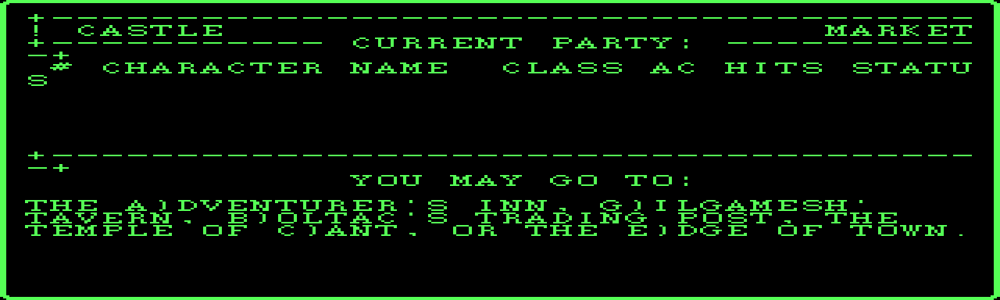

## Assistant · 2026-09-04 06:59:34

› Read: C:\dev\wizardry\wizardry1\engine\src\town_ui.cpp

  ↳ 85	    t.writeField(std::to_string(ch.hpLeft), 5); ⏎ 86	    t.write(" "); ⏎ 87	    if (ch.status == Status::OK) t.writeField(std::to_string(ch.hpMax), 4); ⏎ 88	    else                         t.write(statusName(c.sc, ch.status)); ⏎ 89	} ⏎ 90	 ⏎ 91	// ...

## Assistant · 2026-09-04 06:59:50

› Bash: `grep -rn "DSPPARTY\|DSPMEMBS\|PARTYWIN\|CURRENT PARTY" docs/procmap.tsv docs/strings.txt 2>/dev/null | head; echo "==="; grep -rn -B8 "WIZARDRY,19" extracted/pcode/07_UTILITIE.pd | grep -E "SLDC|WIZARDRY,19" | head -60`

  ↳ === ⏎ grep: extracted/pcode/07_UTILITIE.pd: No such file or directory

## Assistant · 2026-09-04 06:59:55

› Bash: `cd /c/dev/wizardry/wizardry1 && for f in extracted/pcode/*.pd; do n=$(grep -c "WIZARDRY,19" "$f"); echo "$n  $f"; done | sort -rn | head`

  ↳ 14  extracted/pcode/11_ROLLER.pd ⏎ 8  extracted/pcode/15_GAMEUTIL.pd ⏎ 8  extracted/pcode/13_REWARDS.pd ⏎ 8  extracted/pcode/12_CAMP.pd ⏎ 7  extracted/pcode/14_RUNNER.pd ⏎ 7  extracted/pcode/07_UTILITIE.pd ⏎ 6  extracted/pcode/10_CASTLE.pd ⏎ 6  extracted ...

## Assistant · 2026-09-04 07:00:12

› Bash: `for f in extracted/pcode/*.pd; do awk ' ⏎ /CXP    WIZARDRY,19/ {  ⏎   # look back through last 8 SLDC values ⏎   printf "%s  %s: ", FILENAME, $1 ⏎   for(i=1;i<=8;i++) printf "%s ", p[i] ⏎   print "" ⏎ } ⏎ /SLDC/ { for(i=1;i<=7;i++) p[i]=p[i+1]; p[8]=$3 } ⏎ ' "$f"; done 2>/dev/null | grep -E " (24|25|23) "`

  ↳ (Bash completed with no output)

## Assistant · 2026-09-04 07:00:19

› Bash: `for f in extracted/pcode/*.pd; do awk -v F="$f" ' ⏎ /CXP    WIZARDRY,19/ { printf "%-28s %s  x=%s y=%s w=%s h=%s p5=%s p6=%s\n", F, $1, p[1],p[2],p[3],p[4],p[5],p[6] } ⏎ /^  [0-9a-f]+  [0-9a-f]+ +SLDC/ { for(i=1;i<=7;i++) p[i]=p[i+1]; p[8]=$3 } ⏎ ' "$f"; done 2>/dev/null`

  ↳ extracted/pcode/01_COMBAT.pd 02b6  x=SLDC y=SLDC w=SLDC h=SLDC p5=SLDC p6=SLDC ⏎ extracted/pcode/01_COMBAT.pd 02c3  x=SLDC y=SLDC w=SLDC h=SLDC p5=SLDC p6=SLDC ⏎ extracted/pcode/02_CASTASPE.pd 03d5  x=SLDC y=SLDC w=SLDC h=SLDC p5=SLDC p6=SLDC ⏎ e ...

## Assistant · 2026-09-04 07:00:36

› Bash: `cat > "C:/Users/PAULGI~1/AppData/Local/Temp/claude/C--dev-wizardry-wizardry1/2e283e31-7a75-4688-8289-54f3951b93bf/scratchpad/winmap.py" <<'EOF' ⏎ import re, glob, os ⏎ # Parse .pd lines: "  <addr>  <hex bytes>   <MNEM>   <operand>" ⏎ line_re = re.compile(r'^\s*([0-9a-f]{3,4})\s+((?:[0-9a-f]{2} )+)\s+(\S+)\s*(.*)$') ⏎ for path in sorted(glob.glob("extracted/pcode/*.pd")): ⏎     seg = os.path.basename(path).s ...`

  ↳ COMBAT    proc1    @02b6  [2, 0, 36, 6, 6, 0, 0, 0] ⏎ COMBAT    proc1    @02c3  [0, 5, 40, 6, 7, 1, 0, 0] ⏎ CASTASPE  proc6    @03d5  [0, 9, 40, 8, 31, 1, 0, 0] ⏎ CUTIL     proc13   @03fc  [9, 13, 22, 10, 31, 1, 0, 0] ⏎ CUTIL     proc30   @092e ...

## Assistant · 2026-09-04 07:01:15

› Edit: C:\dev\wizardry\wizardry1\engine\include\wiz\textscreen.h

  ↳ The file C:\dev\wizardry\wizardry1\engine\include\wiz\textscreen.h has been updated successfully. (file state is current in your context — no need to Read it back)

## Assistant · 2026-09-04 07:01:20

› Edit: C:\dev\wizardry\wizardry1\engine\include\wiz\textscreen.h

  ↳ The file C:\dev\wizardry\wizardry1\engine\include\wiz\textscreen.h has been updated successfully. (file state is current in your context — no need to Read it back)

## Assistant · 2026-09-04 07:01:35

› Edit: C:\dev\wizardry\wizardry1\engine\src\textscreen.cpp

  ↳ The file C:\dev\wizardry\wizardry1\engine\src\textscreen.cpp has been updated successfully. (file state is current in your context — no need to Read it back)

## Assistant · 2026-09-04 07:01:40

› Edit: C:\dev\wizardry\wizardry1\engine\src\textscreen.cpp

  ↳ The file C:\dev\wizardry\wizardry1\engine\src\textscreen.cpp has been updated successfully. (file state is current in your context — no need to Read it back)

## Assistant · 2026-09-04 07:01:47

› Edit: C:\dev\wizardry\wizardry1\engine\src\textscreen.cpp

  ↳ The file C:\dev\wizardry\wizardry1\engine\src\textscreen.cpp has been updated successfully. (file state is current in your context — no need to Read it back)

## Assistant · 2026-09-04 07:01:53

› Bash: `cd /c/dev/wizardry/wizardry1/engine && powershell -NoProfile -ExecutionPolicy Bypass -File build.ps1 2>&1 | tail -4 && rm -rf build/Testing && "/c/Program Files/Microsoft Visual Studio/2022/Community/Common7/IDE/CommonExtensions/Microsoft/CMake/CMake/bin/ctest.exe" --test-dir build --timeout 20 2>&1 | tail -4`

  ↳ [8/9] Building CXX object CMakeFiles\wiz1.dir\src\main.cpp.obj ⏎ [9/9] Linking CXX executable wiz1.exe ⏎  ⏎ -> C:\dev\wizardry\wizardry1\engine\build\wiz1.exe ⏎  ⏎ 100% tests passed, 0 tests failed out of 50 ⏎  ⏎ Total Test time (real) =   4.12 sec

## Assistant · 2026-09-04 07:02:33

› Read: C:\dev\wizardry\wizardry1\engine\src\town_ui.cpp

  ↳ 1	#include "wiz/town_ui.h" ⏎ 2	#include "wiz/scenario.h" ⏎ 3	#include "wiz/roster.h" ⏎ 4	#include "wiz/string_pool.h" ⏎ 5	#include "wiz/inn.h" ⏎ 6	#include "wiz/temple.h" ⏎ 7	 ⏎ 8	#include <cstdio> ⏎ 9	#include <string> ⏎ 10	 ⏎ 11	namespace wiz { ⏎ 12	namespace ...

## Assistant · 2026-09-04 07:02:44

› Read: C:\dev\wizardry\wizardry1\engine\src\town_ui.cpp

  ↳ 700	        dspTitle(c, "TEMPLE"); ⏎ 701	        int patientSlot = templeWelcome(c); ⏎ 702	        if (patientSlot < 0) return; ⏎ 703	        cantShop(c, patientSlot); ⏎ 704	    } ⏎ 705	} ⏎ 706	 ⏎ 707	} // namespace ⏎ 708	 ⏎ 709	TownExit runTown(Ui &ui, Town ...

## Assistant · 2026-09-04 07:03:03

› Bash: `cd /c/dev/wizardry/wizardry1 && sed -n '95,175p' extracted/pcode/10_CASTLE.pd`

  ↳ ; ---- CASTLE:proc 3  entry=0x94 code_end=0x1a2 data=0 param=2 ---- ⏎   0094  f1                SLDO   10 ⏎   0095  00                SLDC   0 ⏎   0096  d8                SLDL   1 ⏎   0097  01                SLDC   1 ⏎   0098  82                ADI ...

## Assistant · 2026-09-04 07:03:29

› Bash: `cd /c/dev/wizardry/wizardry1/engine && grep -n "hubMenu\|dspParty\|dspTitle\|kBorder\|kPartyBorder\|setWindow\|resetWindow\|void gilgamesh\|void boltac\|void temple\|void advntInn\|edgeOfTown" src/town_ui.cpp`

  ↳ 27:const std::string kBorder     = "+--------------------------------------+"; ⏎ 28:const std::string kPartyBorder = "+----------- CURRENT PARTY: -----------+"; ⏎ 61:void dspTitle(TownCtx &c, const std::string &title) { ⏎ 92:void dspParty(TownCtx ...

## Assistant · 2026-09-04 07:03:53

› Bash: `cd /c/dev/wizardry/wizardry1 && awk '/^; ---- CASTLE:proc/{p=$0} /11d8|11c0|11e0/{print p; print}' extracted/pcode/10_CASTLE.pd | head; echo "==="; sed -n '/CASTLE:proc 20 /,/CASTLE:proc/p' extracted/pcode/10_CASTLE.pd | head -80`

  ↳ ; ---- CASTLE:proc 20  entry=0x11c8 code_end=0x127a data=94 param=0 ---- ⏎   11d8  cd 01 13          CXP    WIZARDRY,19 ⏎ === ⏎ ; ---- CASTLE:proc 20  entry=0x11c8 code_end=0x127a data=94 param=0 ---- ⏎   11c8  c6 06             LLA    6 ⏎   11ca  c7 ...

## Assistant · 2026-09-04 07:04:15

› Bash: `sed -n '/COMBAT:proc 1 /,/CXP    WIZARDRY/p' extracted/pcode/01_COMBAT.pd | sed -n '1,90p'`

  ↳ ; ---- COMBAT:proc 1  = COMBAT  entry=0x292 code_end=0x2f2 data=1282 param=0 ---- ⏎   0292  a5 84 d7          LAO    1239  ; IOCACHE ⏎   0295  02                SLDC   2 ⏎   0296  a9 25             LDO    37 ⏎   0298  5e                SLDC   94 ...

## Assistant · 2026-09-04 07:04:20

› Bash: `sed -n '350,400p' extracted/pcode/01_COMBAT.pd`

  ↳ 027f  cd 01 14          CXP    WIZARDRY,20 ⏎   0282  07                SLDC   7 ⏎   0283  01                SLDC   1 ⏎   0284  9e 04             CSP    EXIT ⏎   0286  ad 00             RNP    0 ⏎  ⏎ ; ---- COMBAT:proc 1  = COMBAT  entry=0x292 code_end= ...

## Assistant · 2026-09-04 07:04:48

› Bash: `cd /c/dev/wizardry/wizardry1/engine && git stash list; git diff --stat`

  ↳ warning: in the working copy of 'wizardry1/engine/include/wiz/textscreen.h', LF will be replaced by CRLF the next time Git touches it ⏎ warning: in the working copy of 'wizardry1/engine/src/textscreen.cpp', LF will be replaced by CRLF the nex ...

## Assistant · 2026-09-04 07:05:05

› Read: C:\dev\wizardry\wizardry1\engine\src\combat_ui.cpp

  ↳ 67	            Bytes rec = sc.monsterArtRecord(pic); ⏎ 68	            if (rec.n < 512) continue; ⏎ 69	            blitPortrait(portraits, rec, kPortStartCell[n - 1][g] * Font::kW, 0, 10); ⏎ 70	            havePortraits = true; ⏎ 71	            std: ...

## Assistant · 2026-09-04 07:05:39

› Write: C:\dev\wizardry\wizardry1\docs\ui.md

  ↳ File created successfully at: C:\dev\wizardry\wizardry1\docs\ui.md (file state is current in your context — no need to Read it back)

## Assistant · 2026-09-04 07:05:55

› Edit: C:\dev\wizardry\wizardry1\engine\include\wiz\textscreen.h

  ↳ The file C:\dev\wizardry\wizardry1\engine\include\wiz\textscreen.h has been updated successfully. (file state is current in your context — no need to Read it back)

## Assistant · 2026-09-04 07:05:59

› Edit: C:\dev\wizardry\wizardry1\engine\src\textscreen.cpp

  ↳ The file C:\dev\wizardry\wizardry1\engine\src\textscreen.cpp has been updated successfully. (file state is current in your context — no need to Read it back)

## Assistant · 2026-09-04 07:06:18

› Edit: C:\dev\wizardry\wizardry1\engine\include\wiz\textscreen.h

  ↳ The file C:\dev\wizardry\wizardry1\engine\include\wiz\textscreen.h has been updated successfully. (file state is current in your context — no need to Read it back)

## Assistant · 2026-09-04 07:06:24

› Edit: C:\dev\wizardry\wizardry1\engine\src\textscreen.cpp

  ↳ The file C:\dev\wizardry\wizardry1\engine\src\textscreen.cpp has been updated successfully. (file state is current in your context — no need to Read it back)

## Assistant · 2026-09-04 07:06:46

› Edit: C:\dev\wizardry\wizardry1\engine\src\combat_ui.cpp

  ↳ The file C:\dev\wizardry\wizardry1\engine\src\combat_ui.cpp has been updated successfully. (file state is current in your context — no need to Read it back)

## Assistant · 2026-09-04 07:07:02

› Edit: C:\dev\wizardry\wizardry1\engine\src\combat_ui.cpp

  ↳ The file C:\dev\wizardry\wizardry1\engine\src\combat_ui.cpp has been updated successfully. (file state is current in your context — no need to Read it back)

## Assistant · 2026-09-04 07:07:14

› Bash: `grep -n "gotoXY(0, 22)\|gotoXY(0, 23)\|clearRect(0, 22\|22, 40, 2\|, 23);\|, 22);" src/combat_ui.cpp`

  ↳ 138:    t.gotoXY(0, 23); ⏎ 166:    t.clearRect(0, 22, 40, 2); ⏎ 167:    t.gotoXY(0, 22); ⏎ 183:        t.gotoXY(0, 23); t.write("ON WHOM (1-"); ⏎ 229:    t.clearRect(0, 22, 40, 2); ⏎ 230:    t.gotoXY(0, 22); ⏎ 252:        t.gotoXY(0, 23); t.write("ON W ...

## Assistant · 2026-09-04 07:07:27

› Edit: C:\dev\wizardry\wizardry1\engine\src\combat_ui.cpp

  ↳ The file C:\dev\wizardry\wizardry1\engine\src\combat_ui.cpp has been updated successfully. (file state is current in your context — no need to Read it back)

## Assistant · 2026-09-04 07:07:40

› Bash: `powershell -NoProfile -ExecutionPolicy Bypass -File build.ps1 2>&1 | grep -E "error|Error|warning C|Linking wiz1|-> " | head -20`

  ↳ -> C:\dev\wizardry\wizardry1\engine\build\wiz1.exe

## Assistant · 2026-09-04 07:07:52

› Bash: `rm -rf build/Testing && "/c/Program Files/Microsoft Visual Studio/2022/Community/Common7/IDE/CommonExtensions/Microsoft/CMake/CMake/bin/ctest.exe" --test-dir build --timeout 20 2>&1 | tail -6`

  ↳ Start 50: settime ⏎ 50/50 Test #50: settime ..........................   Passed    0.02 sec ⏎  ⏎ 100% tests passed, 0 tests failed out of 50 ⏎  ⏎ Total Test time (real) =   2.15 sec

## Assistant · 2026-09-04 07:08:03

› Bash: `D="C:/Users/PAULGI~1/AppData/Local/Temp/claude/C--dev-wizardry-wizardry1/2e283e31-7a75-4688-8289-54f3951b93bf/scratchpad"; rm -rf "$D/bc"; mkdir -p "$D/bc"; export WIZ1_COMBAT_DUMP="$D/bc"; E=../extracted/wiz1 ⏎ ./build/wiz1.exe combat-test $E/200.CHARSET $E/SCENARIO.DATA 68 "\\r\\r\\rFFFFFF\\r\\r\\r" $E/ASCII.KRN 2 -1 1 >/dev/null 2>&1 ⏎ python "$D/ppm2png.py" "$D/bc/frame0004.ppm" "$D/bc4.png" 2`

  ↳ C:/Users/PAULGI~1/AppData/Local/Temp/claude/C--dev-wizardry-wizardry1/2e283e31-7a75-4688-8289-54f3951b93bf/scratchpad/bc4.png 1280 384

## Assistant · 2026-09-04 07:08:10

› Read: C:/Users/PAULGI~1/AppData/Local/Temp/claude/C--dev-wizardry-wizardry1/2e283e31-7a75-4688-8289-54f3951b93bf/scratchpad/bc4.png

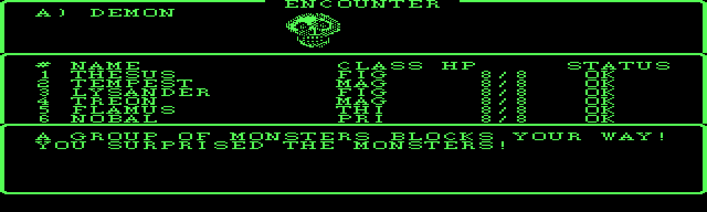

## Assistant · 2026-09-04 07:08:36

› Bash: `cd /c/dev/wizardry && rm -f wizardry1/engine/*.dat wizardry1/engine/build/*.dat; git add -A && cat > "C:/Users/PAULGI~1/AppData/Local/Temp/claude/C--dev-wizardry-wizardry1/2e283e31-7a75-4688-8289-54f3951b93bf/scratchpad/msg.txt" <<'EOF' ⏎ wizardry1: DOS window borders -- the TextScreen primitive + combat screen ⏎  ⏎ The DOS build frames every screen region as a bordered window (WIZARDRY ⏎ proc 19 / CONUNI ...`

  ↳ warning: in the working copy of 'wizardry1/engine/include/wiz/textscreen.h', LF will be replaced by CRLF the next time Git touches it ⏎ warning: in the working copy of 'wizardry1/engine/src/combat_ui.cpp', LF will be replaced by CRLF the next ...

## Assistant · 2026-09-04 07:09:02

› Bash: `sed -n '53,90p' extracted/pcode/14_RUNNER.pd`

  ↳ ; ---- RUNNER:proc 5  entry=0x58 code_end=0x84 data=18 param=12 ---- ⏎   0058  b6 01 04          LOD    1,4 ⏎   005b  cc 07             STL    7 ⏎   005d  b6 01 03          LOD    1,3 ⏎   0060  cc 08             STL    8 ⏎   0062  dd                S ...

## Assistant · 2026-09-04 07:10:22

› Read: C:\dev\wizardry\wizardry1\engine\src\maze_ui.cpp

  ↳ 190	// ---- RUNINIT (P010E25): the fixed HUD frame --------------------------- ⏎ 191	 ⏎ 192	void runInit(MazeCtx &c) { ⏎ 193	    auto &t = c.t(); ⏎ 194	    t.resetWindow(); ⏎ 195	    t.putChar(12); ⏎ 196	    t.gotoXY(13, 1); t.write("F)ORWARD  C)AMP ...

## Assistant · 2026-09-04 07:10:50

› Bash: `D="C:/Users/PAULGI~1/AppData/Local/Temp/claude/C--dev-wizardry-wizardry1/2e283e31-7a75-4688-8289-54f3951b93bf/scratchpad"; ls "$D/bc" | tail -3; python "$D/ppm2png.py" "$D/bc/frame0002.ppm" "$D/bc2.png" 2 2>/dev/null; python "$D/ppm2png.py" "$D/bc/frame0008.ppm" "$D/bc8.png" 2 2>/dev/null; echo done`

  ↳ frame0023.ppm ⏎ frame0024.ppm ⏎ frame0025.ppm ⏎ C:/Users/PAULGI~1/AppData/Local/Temp/claude/C--dev-wizardry-wizardry1/2e283e31-7a75-4688-8289-54f3951b93bf/scratchpad/bc2.png 1280 384 ⏎ C:/Users/PAULGI~1/AppData/Local/Temp/claude/C--dev-wizardry-wi ...

## Assistant · 2026-09-04 07:10:56

› Read: C:/Users/PAULGI~1/AppData/Local/Temp/claude/C--dev-wizardry-wizardry1/2e283e31-7a75-4688-8289-54f3951b93bf/scratchpad/bc8.png

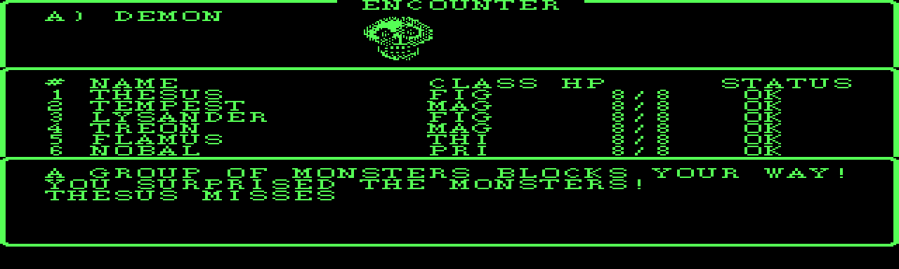

## Assistant · 2026-09-04 07:11:09

› SendUserFile: {"files": ["C:/Users/PAULGI~1/AppData/Local/Temp/claude/C--dev-wizardry-wizardry1/2e283e31-7a75-4688-8289-54f3951b93bf/scratchpad/bc8.png"], "caption": "Combat screen with DOS window borders — three f ...

  ↳ 1 file delivered to user. ⏎   C:\Users\PAULGI~1\AppData\Local\Temp\claude\C--dev-wizardry-wizardry1\2e283e31-7a75-4688-8289-54f3951b93bf\scratchpad\bc8.png → file_uuid: 26f95727-2608-459e-b9af-b0bad9906afb

## Assistant · 2026-09-04 07:11:26

## Border pass — where it stands (`7b78581`)

**Done & committed:**

| | |
|---|---|
| **`TextScreen` primitive** | `openWindow`/`closeWindow` (window stack + border paint + save/restore), `frame()` (paint-only, for redraw-heavy screens), `writeAt()` (absolute write, for titles set into a border row). Border = CHARSET glyphs 1–8 (rounded box; 9–0x0E = the emphasis style) — decoded from `sub_159A` / `sub_1674` / `sub_16A9`. |
| **Combat screen** | converted — three stacked framed panels (see image), matching `COMBAT proc 1`'s layout. |
| **`docs/ui.md`** | the border-glyph table + the **complete DOS window map** — every `WIZARDRY,19(x,y,w,h,…)` call across all 16 segments, so the remaining screen conversions are transcription, not archaeology. |

50 tests green.

**Not yet converted:** town / roller / camp / cemetery / title. I have their DOS window geometry from the p-code, but each has quirks I can't nail blind — embedded border titles ("CASTLE … MARKET"), and the *order* windows stack and restore (e.g. the Castle hub opens the menu box on top of the lower half of the party box). Two or three more DOSBox screenshots (Castle hub, Gilgamesh's, the roller sheet) would let me match those exactly.

## The maze wireframe — bigger than expected

I decoded `DRAWLINE`'s calling convention (`INTERP:0x18C1`) and confirmed the model: the wireframe is drawn as **character cells** into `WINDOW1` (a 36×20 cell grid ≈ 592×160 px, near full width) using the line-art glyphs, by ~6 fixed depth-layer procs (`RUNNER` 21–41), each a hard-coded table of `DRAWLINE(glyph, count, dV, dH, y, x)` calls.

The current engine renders an 82×79-**pixel** wireframe (Apple geometry, roughly square) — it can't just be scaled to fill the DOS box because the DOS geometry is genuinely wider (36:20 vs ~1:1). It needs a real cell-grid renderer transcribed from those layer procs — a few hours of careful work I don't want to rush into something broken.

**Your call:** should I (a) push straight on with the full maze cell-renderer next, or (b) knock out the remaining border conversions first (send me those few DOSBox shots) and do the maze as a focused follow-up?

## User · 2026-09-04 11:23:01

push on with full maze cell renderer

## Assistant · 2026-09-04 11:23:25

› Bash: `grep -n "RUNNER:proc\|CLP    2[0-9]\|CLP    3[0-9]\|CLP    4[01]\|CIP    2[0-9]\|CIP    3[0-9]\|LIGHTDIS\|X4DRAW\|word 4\b" extracted/pcode/14_RUNNER.pd | grep -E "proc (3|17|12|43|44|47)|CLP" | head -60`

  ↳ 538:; ---- RUNNER:proc 17  entry=0x38e code_end=0x444 data=0 param=0 ---- ⏎ 658:; ---- RUNNER:proc 12  entry=0x44e code_end=0x4be data=4 param=0 ---- ⏎ 912:  05dd  ce 14             CLP    20 ⏎ 922:  05e8  ce 14             CLP    20 ⏎ 938:  05ff ...

## Assistant · 2026-09-04 11:23:34

› Bash: `sed -n '2753,2845p' extracted/pcode/14_RUNNER.pd`

  ↳ ; ---- RUNNER:proc 3  entry=0x1008 code_end=0x1088 data=40 param=0 ---- ⏎   1008  ef                SLDO   8 ⏎   1009  cc 06             STL    6 ⏎   100b  ee                SLDO   7 ⏎   100c  cc 05             STL    5 ⏎   100e  a9 20             LD ...

## Assistant · 2026-09-04 11:24:20

› Bash: `sed -n '658,720p' extracted/pcode/14_RUNNER.pd`

  ↳ ; ---- RUNNER:proc 12  entry=0x44e code_end=0x4be data=4 param=0 ---- ⏎   044e  b2 01 06          LDA    1,6 ⏎   0451  b2 01 05          LDA    1,5 ⏎   0454  00                SLDC   0 ⏎   0455  01                SLDC   1 ⏎   0456  ae 07 ...

## Assistant · 2026-09-04 11:24:35

› Bash: `sed -n '538,658p' extracted/pcode/14_RUNNER.pd`

  ↳ ; ---- RUNNER:proc 17  entry=0x38e code_end=0x444 data=0 param=0 ---- ⏎   038e  00                SLDC   0 ⏎   038f  00                SLDC   0 ⏎   0390  00                SLDC   0 ⏎   0391  ae 0d             CIP    13 ⏎   0393  00                SLD ...

## Assistant · 2026-09-04 11:25:09

› Bash: `cat > "C:/Users/PAULGI~1/AppData/Local/Temp/claude/C--dev-wizardry-wizardry1/2e283e31-7a75-4688-8289-54f3951b93bf/scratchpad/layers.py" <<'EOF' ⏎ import re ⏎ lines=open("extracted/pcode/14_RUNNER.pd").read().splitlines() ⏎ # find procs 22..41 and 18, extract CIP 5 (DRAWLINE) calls with their 6 preceding SLDC args ⏎ procs={} ⏎ cur=None ⏎ for ln in lines: ⏎     m=re.match(r';\s*----\s*RUNNER:proc\s+(\d+)\s+entry= ...`

  ↳ === proc 18 === ⏎   @067d CIP 7  args=[1, 0] ⏎   @0698 CLP 19  args=[1, 0, 2, -1] ⏎   @06a0 CIP 7  args=[2, 0] ⏎   @06b8 CLP 19  args=[0, 1, 1, 1] ⏎   @06d3 CLP 19  args=[0, 0, 1, -2] ⏎ === proc 22 === ⏎   @06fb DRAWLINE args=[1, 0, 0, 1, 20, 12] ...

## Assistant · 2026-09-04 11:26:26

› Bash: `for p in "27 1894 1930" "33 2349 2376" "39 2734 2753"; do set -- $p; echo "=== proc $1 ==="; sed -n "${2},${3}p" extracted/pcode/14_RUNNER.pd; done`

  ↳ === proc 27 === ⏎ ; ---- RUNNER:proc 27  entry=0xb4a code_end=0xb84 data=0 param=0 ---- ⏎   0b4a  b6 01 03          LOD    1,3 ⏎   0b4d  b8 01 01          STR    1,1 ⏎   0b50  b6 01 04          LOD    1,4 ⏎   0b53  b8 01 02          STR    1,2 ⏎   0b56 ...

## Assistant · 2026-09-04 11:26:43

› Bash: `for p in "13 355 409" "14 409 463" "15 463 517" "16 517 538" "18 971 1074" "19 1036 1074"; do set -- $p; echo "=== proc $1 ==="; sed -n "${2},${3}p" extracted/pcode/14_RUNNER.pd; done`

  ↳ === proc 13 === ⏎ ; ---- RUNNER:proc 13  entry=0x21e code_end=0x282 data=4 param=6 ---- ⏎   021e  b6 02 06          LOD    2,6 ⏎   0221  cc 05             STL    5 ⏎   0223  b6 02 05          LOD    2,5 ⏎   0226  cc 04             STL    4 ⏎   0228  c6 ...

## Assistant · 2026-09-04 11:28:17

› Bash: `grep -n "RUNNER:proc 42 \|RUNNER:proc 43 \|RUNNER:proc 44 \|RUNNER:proc 6 \|RUNNER:proc 7 \|RUNNER:proc 47 \|RUNNER:proc 10 \|RUNNER:proc 11 " extracted/pcode/14_RUNNER.pd`

  ↳ 81:; ---- RUNNER:proc 6  entry=0x8e code_end=0x98 data=0 param=6 ---- ⏎ 91:; ---- RUNNER:proc 7  entry=0xa2 code_end=0xfe data=0 param=8 ---- ⏎ 284:; ---- RUNNER:proc 10  entry=0x1a0 code_end=0x1c0 data=4 param=8 ---- ⏎ 314:; ---- RUNNER:proc 11 ...

## Assistant · 2026-09-04 11:28:32

› Bash: `python "C:/Users/PAULGI~1/AppData/Local/Temp/claude/C--dev-wizardry-wizardry1/2e283e31-7a75-4688-8289-54f3951b93bf/scratchpad/layers.py" 2>/dev/null | head -1; python - <<'EOF' ⏎ import re ⏎ lines=open("extracted/pcode/14_RUNNER.pd").read().splitlines() ⏎ procs={}; cur=None ⏎ for ln in lines: ⏎     m=re.match(r';\s*----\s*RUNNER:proc\s+(\d+)\s',ln) ⏎     if m: cur=int(m.group(1)); procs[cur]=[]; continue ...`

  ↳ === proc 18 === ⏎ === proc 42 === ⏎   @0eb8 LOD 2,7 ⏎   @0ec6 CIP6 [19, 8, 13] ⏎   @0ecb CIP6 [19, 11, 14] ⏎   @0ed3 DRAWLINE [19, 9, 0, 1, 2, 11] ⏎   @0edb DRAWLINE [20, 8, 0, 1, 4, 11] ⏎   @0edd LOD 2,7 ⏎   @0ee7 CIP6 [19, 8, 22] ⏎   @0eec CIP6 [1 ...

## Assistant · 2026-09-04 11:29:27

› Bash: `python - <<'EOF' ⏎ import re ⏎ lines=open("extracted/pcode/14_RUNNER.pd").read().splitlines() ⏎ procs={}; cur=None ⏎ for ln in lines: ⏎     m=re.match(r';\s*----\s*RUNNER:proc\s+(\d+)\s',ln) ⏎     if m: cur=int(m.group(1)); procs[cur]=[]; continue ⏎     if cur is not None and cur in procs: procs[cur].append(ln) ⏎ def val(body,j): ⏎     while j>=0: ⏎         mm=re.match(r'\s*[0-9a-f]+\s+(?:[0-9a-f]{2} )+\s+(\S+)\s*(.* ...`

  ↳ --- proc 22 --- ⏎    [if L9==0] ⏎    DRAWLINE [1, 0, 0, 1, 20, 12] ⏎    DRAWLINE [8, 0, 1, 1, 2, 14] ⏎    DRAWLINE [9, 2, 0, 1, 16, 12] ⏎    DRAWLINE [9, 18, 1, -1, 2, 13] ⏎    [if L9==2] ⏎    DRAWLINE [3, 0, 0, 1, 20, 12] ⏎    DRAWLINE [6, 0, 1, 1 ...

## Assistant · 2026-09-04 11:29:51

› Bash: `sed -n '284,355p' extracted/pcode/14_RUNNER.pd`

  ↳ ; ---- RUNNER:proc 10  entry=0x1a0 code_end=0x1c0 data=4 param=8 ---- ⏎   01a0  db                SLDL   4 ⏎   01a1  cc 05             STL    5 ⏎   01a3  db                SLDL   4 ⏎   01a4  d9                SLDL   2 ⏎   01a5  82                ADI ...

## Assistant · 2026-09-04 11:30:07

› Bash: `sed -n '40,53p' extracted/pcode/14_RUNNER.pd; echo "=== proc 47 (CIP 8/9?) ==="; sed -n '2882,2940p' extracted/pcode/14_RUNNER.pd; echo "=== proc 45 46 ==="; sed -n '2843,2882p' extracted/pcode/14_RUNNER.pd`

  ↳ ; ---- RUNNER:proc 4  entry=0x3e code_end=0x4e data=0 param=0 ---- ⏎   003e  a9 3c             LDO    60  ; CONUNIT ⏎   0040  a9 11             LDO    17  ; WINDOW1 ⏎   0042  00                SLDC   0 ⏎   0043  03                SLDC   3 ⏎   0044  0 ...

## Assistant · 2026-09-04 11:31:14

› Read: C:\dev\wizardry\wizardry1\engine\src\maze3d.cpp

  ↳ 1	#include "wiz/maze3d.h" ⏎ 2	 ⏎ 3	namespace wiz { ⏎ 4	namespace { ⏎ 5	 ⏎ 6	// DRAWLINE(x, y, dh, dv, len): plot `len` points from (x,y) stepping (dh,dv), ⏎ 7	// clipped to x in [clipLo, clipHi] and the 82x79 picture. ⏎ 8	struct Pic { ⏎ 9	    Surface &s; ⏎ 1 ...

## Assistant · 2026-09-04 11:31:59

› Write: C:\dev\wizardry\wizardry1\engine\include\wiz\maze3d.h

  ↳ The file C:\dev\wizardry\wizardry1\engine\include\wiz\maze3d.h has been updated successfully. (file state is current in your context — no need to Read it back)

## Assistant · 2026-09-04 11:32:37

› Write: C:\dev\wizardry\wizardry1\engine\src\maze3d.cpp

  ↳ The file C:\dev\wizardry\wizardry1\engine\src\maze3d.cpp has been updated successfully. (file state is current in your context — no need to Read it back)

## Assistant · 2026-09-04 11:32:46

› Edit: C:\dev\wizardry\wizardry1\engine\src\maze3d.cpp

  ↳ The file C:\dev\wizardry\wizardry1\engine\src\maze3d.cpp has been updated successfully. (file state is current in your context — no need to Read it back)

## Assistant · 2026-09-04 11:32:53

› Edit: C:\dev\wizardry\wizardry1\engine\src\maze3d.cpp

  ↳ The file C:\dev\wizardry\wizardry1\engine\src\maze3d.cpp has been updated successfully. (file state is current in your context — no need to Read it back)

## Assistant · 2026-09-04 11:33:41

› Edit: C:\dev\wizardry\wizardry1\engine\src\maze3d.cpp

  ↳ The file C:\dev\wizardry\wizardry1\engine\src\maze3d.cpp has been updated successfully. (file state is current in your context — no need to Read it back)

## Assistant · 2026-09-04 11:33:57

› Read: C:\dev\wizardry\wizardry1\engine\src\maze_ui.cpp

  ↳ 104	    void present() { ⏎ 105	        // wireframe into the pic buffer (a redraw must not spend LIGHT) ⏎ 106	        int light = st.light; ⏎ 107	        drawMazeView(pic, m, st.pos, st.level, light, st.quickPlot, rng); ⏎ 108	        for (int y = 0 ...

## Assistant · 2026-09-04 11:34:01

› Read: C:\dev\wizardry\wizardry1\engine\src\maze_ui.cpp

  ↳ 1	#include "wiz/maze_ui.h" ⏎ 2	#include "wiz/maze.h" ⏎ 3	#include "wiz/maze3d.h" ⏎ 4	#include "wiz/roster.h" ⏎ 5	#include "wiz/scenario.h" ⏎ 6	#include "wiz/string_pool.h" ⏎ 7	#include "wiz/specials.h" ⏎ 8	#include "wiz/equip.h" ⏎ 9	#include "wiz/camp_ui.h ...

## Assistant · 2026-09-04 11:34:35

› Read: C:\dev\wizardry\wizardry1\engine\src\maze_ui.cpp

  ↳ 68	namespace { ⏎ 69	 ⏎ 70	// --- HUD geometry (640x192 text surface, 16x8 font) -------------------- ⏎ 71	constexpr int kPicX = 6, kPicY = 2, kPicScale = 2, kPicClipH = 134; ⏎ 72	 ⏎ 73	const char *alignName(const Scenario &sc, Align a) { ⏎ 74	    retur ...

## Assistant · 2026-09-04 11:34:42

› Edit: C:\dev\wizardry\wizardry1\engine\src\maze_ui.cpp

  ↳ The file C:\dev\wizardry\wizardry1\engine\src\maze_ui.cpp has been updated successfully. (file state is current in your context — no need to Read it back)

## Assistant · 2026-09-04 11:34:47

› Edit: C:\dev\wizardry\wizardry1\engine\src\maze_ui.cpp

  ↳ The file C:\dev\wizardry\wizardry1\engine\src\maze_ui.cpp has been updated successfully. (file state is current in your context — no need to Read it back)

## Assistant · 2026-09-04 11:34:50

› Read: C:\dev\wizardry\wizardry1\engine\src\maze_ui.cpp

  ↳ 100	 ⏎ 101	    // PAUSE1: the SETTIME-tunable message delay.  DOS TIMEDLAY is a busy-loop ⏎ 102	    // count (default 2000); scale it to ~1/5 ms per unit so the default ⏎ 103	    // matches the engine's old hard-coded ~400 ms feel. ⏎ 104	    void p ...

## Assistant · 2026-09-04 11:34:59

› Edit: C:\dev\wizardry\wizardry1\engine\src\maze_ui.cpp

  ↳ The file C:\dev\wizardry\wizardry1\engine\src\maze_ui.cpp has been updated successfully. (file state is current in your context — no need to Read it back)

## Assistant · 2026-09-04 11:35:12

› Bash: `grep -n "pic\b\|pane\b\|kPic\|drawMazeView\|setOverlay\|present()\|runInit\|prStats\|msg(\|msgClear\|showScrollText\|clearRect(0, 1\|gotoXY(1, 1\|gotoXY(0, 1" src/maze_ui.cpp | head -60`

  ↳ grep: src/maze_ui.cpp: No such file or directory

## Assistant · 2026-09-04 11:35:16

› Bash: `cd /c/dev/wizardry/wizardry1/engine && grep -n "pic\b\|pane\b\|kPic\|drawMazeView\|setOverlay\|\.present()\|runInit\|prStats\|void msg\|msgClear\|showScrollText\|clearRect(0, 15\|clearRect(0, 3" src/maze_ui.cpp`

  ↳ 121:        if (showStats) { tt.frame(0, 10, 40, 6); prStatsStrip(); } ⏎ 125:    void prStatsStrip(); ⏎ 130:void prStats(MazeCtx &c) { ⏎ 180:void msgClear(MazeCtx &c) { ⏎ 182:    c.t().clearRect(0, 15, 40, 3); ⏎ 184:void msg(MazeCtx &c, const std::st ...

## Assistant · 2026-09-04 11:35:43

› Read: C:\dev\wizardry\wizardry1\engine\src\maze_ui.cpp

  ↳ 126	}; ⏎ 127	 ⏎ 128	// ---- PRSTATS (P010E0B): the party panel, rows 18..23 ------------------- ⏎ 129	 ⏎ 130	void prStats(MazeCtx &c) { ⏎ 131	    auto &t = c.t(); ⏎ 132	    t.resetWindow(); ⏎ 133	    t.clearRect(0, 18, 40, 6); ⏎ 134	    // sort a view of t ...

## Assistant · 2026-09-04 11:35:58

› Edit: C:\dev\wizardry\wizardry1\engine\src\maze_ui.cpp

  ↳ The file C:\dev\wizardry\wizardry1\engine\src\maze_ui.cpp has been updated successfully. (file state is current in your context — no need to Read it back)

## Assistant · 2026-09-04 11:36:07

› Edit: C:\dev\wizardry\wizardry1\engine\src\maze_ui.cpp

  ↳ The file C:\dev\wizardry\wizardry1\engine\src\maze_ui.cpp has been updated successfully. (file state is current in your context — no need to Read it back)

## Assistant · 2026-09-04 11:36:25

› Edit: C:\dev\wizardry\wizardry1\engine\src\maze_ui.cpp

  ↳ The file C:\dev\wizardry\wizardry1\engine\src\maze_ui.cpp has been updated successfully. (file state is current in your context — no need to Read it back)

## Assistant · 2026-09-04 11:36:32

› Edit: C:\dev\wizardry\wizardry1\engine\src\maze_ui.cpp

  ↳ The file C:\dev\wizardry\wizardry1\engine\src\maze_ui.cpp has been updated successfully. (file state is current in your context — no need to Read it back)

## Assistant · 2026-09-04 11:36:38

› Bash: `powershell -NoProfile -ExecutionPolicy Bypass -File build.ps1 2>&1 | grep -E "error|Error C|warning C4|maze3d|maze_ui|Linking|-> " | head -40`

  ↳ [1/5] Building CXX object CMakeFiles\wizcore.dir\src\maze3d.cpp.obj ⏎ C:\dev\wizardry\wizardry1\engine\src\main.cpp(782): error C2065: 'kPicW': undeclared identifier ⏎ C:\dev\wizardry\wizardry1\engine\src\main.cpp(782): error C2065: 'kPicH': un ...

## Assistant · 2026-09-04 11:36:49

› Read: C:\dev\wizardry\wizardry1\engine\src\main.cpp

  ↳ 760	            char c = ' '; ⏎ 761	            if (x == p.x && y == p.y) c = arrow[p.dir & 3]; ⏎ 762	            else if (Square s = m.squareAt(x, y); s != Square::Normal) c = squareMark(s); ⏎ 763	            b += c; b += ' '; ⏎ 764	        } ⏎ 765 ...

## Assistant · 2026-09-04 11:36:57

› Edit: C:\dev\wizardry\wizardry1\engine\src\main.cpp

  ↳ The file C:\dev\wizardry\wizardry1\engine\src\main.cpp has been updated successfully. (file state is current in your context — no need to Read it back)

## Assistant · 2026-09-04 11:37:01

› Bash: `powershell -NoProfile -ExecutionPolicy Bypass -File build.ps1 2>&1 | grep -E "error|Error C|warning C4|Linking|-> " | head -40`

  ↳ [1/3] Linking CXX static library wizcore.lib ⏎ [3/3] Linking CXX executable wiz1.exe ⏎ -> C:\dev\wizardry\wizardry1\engine\build\wiz1.exe

## Assistant · 2026-09-04 11:37:14

› Bash: `./build/wiz1.exe maze ../extracted/wiz1/SCENARIO.DATA 1 2>&1 | head -45`

  ↳ === maze level 1 === ⏎ +--+··+--+--+--+--+--+--+--+--+  +--+--+--+--+--+--+--+--+--+ ⏎ |     |  |  |  |  |        |M :D |  :     :     :     |  |  | ⏎ +--+--+··+--+··+--+  +  +  +--+  +  +··+··+--+--+  +  +··+··+ ⏎ |     :           :        |D ...

## Assistant · 2026-09-04 11:37:20

› Bash: `./build/wiz1.exe maze ../extracted/wiz1/SCENARIO.DATA 1 2>&1 | tail -24`

  ↳ |^                         |D  D  D  D  D  D  D  D  D  D  D | ⏎ +--+--+--+--+--+--+--+--+--+--+  +--+--+--+--+--+--+--+--+--+ ⏎ @ (0,0) facing NORTH   walls: F=0 L=1 R=0 B=1 ⏎   square: STAIRS  aux0=0 aux1=0 aux2=0 ⏎   | ...

## Assistant · 2026-09-04 11:38:02

› Edit: C:\dev\wizardry\wizardry1\engine\include\wiz\maze3d.h

  ↳ The file C:\dev\wizardry\wizardry1\engine\include\wiz\maze3d.h has been updated successfully. (file state is current in your context — no need to Read it back)

## Assistant · 2026-09-04 11:38:17

› Edit: C:\dev\wizardry\wizardry1\engine\include\wiz\maze3d.h

  ↳ The file C:\dev\wizardry\wizardry1\engine\include\wiz\maze3d.h has been updated successfully. (file state is current in your context — no need to Read it back)

## Assistant · 2026-09-04 11:38:23

› Edit: C:\dev\wizardry\wizardry1\engine\src\maze3d.cpp

  ↳ The file C:\dev\wizardry\wizardry1\engine\src\maze3d.cpp has been updated successfully. (file state is current in your context — no need to Read it back)

## Assistant · 2026-09-04 11:38:32

› Edit: C:\dev\wizardry\wizardry1\engine\src\maze_ui.cpp

  ↳ The file C:\dev\wizardry\wizardry1\engine\src\maze_ui.cpp has been updated successfully. (file state is current in your context — no need to Read it back)

## Assistant · 2026-09-04 11:38:37

› Edit: C:\dev\wizardry\wizardry1\engine\src\main.cpp

  ↳ The file C:\dev\wizardry\wizardry1\engine\src\main.cpp has been updated successfully. (file state is current in your context — no need to Read it back)

## Assistant · 2026-09-04 11:38:42

› Bash: `powershell -NoProfile -ExecutionPolicy Bypass -File build.ps1 2>&1 | grep -E "error|Error C|Linking|-> " | head; echo "==="; ./build/wiz1.exe maze ../extracted/wiz1/SCENARIO.DATA 1 2>&1 | tail -22`

  ↳ [3/5] Linking CXX static library wizcore.lib ⏎ [5/5] Linking CXX executable wiz1.exe ⏎ -> C:\dev\wizardry\wizardry1\engine\build\wiz1.exe ⏎ === ⏎ @ (0,0) facing NORTH   walls: F=0 L=1 R=0 B=1 ⏎   square: STAIRS  aux0=0 aux1=0 aux2=0 ⏎   | ...

## Assistant · 2026-09-04 11:39:25

› Bash: `grep -n "leftView\|frwdView\|righView\|Wall .*View\|shftPos" include/wiz/runner.h; echo "==="; sed -n '/leftView/,/^}/p' src/*.cpp 2>/dev/null | head -40; grep -rn "leftView\|frwdView\|righView" src/runner.cpp 2>/dev/null; ls src/ | grep runner`

  ↳ 17:inline void shftPos(int &x, int &y, int dir, int right, int fwd) { ⏎ 30:    shftPos(x, y, p.dir, 0, 1); ⏎ 51:    shftPos(x, y, dir, deltaR, 0); ⏎ 54:inline Wall frwdView(const MazeLevel &m, int x, int y, int dir, int dr) { return viewWall(m, x ...

## Assistant · 2026-09-04 11:39:32

› Read: C:\dev\wizardry\wizardry1\engine\include\wiz\runner.h

  ↳ 14	 ⏎ 15	// SHFTPOS: shift (x,y) `right` squares to the party's right and `fwd` squares ⏎ 16	// ahead, given a facing of `dir`; wraps mod 20. ⏎ 17	inline void shftPos(int &x, int &y, int dir, int right, int fwd) { ⏎ 18	    switch (dir & 3) { ⏎ 19 ...

## Assistant · 2026-09-04 11:41:48

› Write: C:\dev\wizardry\wizardry1\engine\src\maze3d.cpp

  ↳ The file C:\dev\wizardry\wizardry1\engine\src\maze3d.cpp has been updated successfully. (file state is current in your context — no need to Read it back)

## Assistant · 2026-09-04 11:41:55

› Edit: C:\dev\wizardry\wizardry1\engine\src\maze3d.cpp

  ↳ The file C:\dev\wizardry\wizardry1\engine\src\maze3d.cpp has been updated successfully. (file state is current in your context — no need to Read it back)

## Assistant · 2026-09-04 11:42:00

› Bash: `powershell -NoProfile -ExecutionPolicy Bypass -File build.ps1 2>&1 | grep -E "error|Error C|Linking|-> " | head; echo "=== (0,0) N: L=wall R=open F=open ==="; ./build/wiz1.exe maze ../extracted/wiz1/SCENARIO.DATA 1 2>&1 | tail -21`

  ↳ [2/3] Linking CXX static library wizcore.lib ⏎ [3/3] Linking CXX executable wiz1.exe ⏎ -> C:\dev\wizardry\wizardry1\engine\build\wiz1.exe ⏎ === (0,0) N: L=wall R=open F=open === ⏎   square: STAIRS  aux0=0 aux1=0 aux2=0 ⏎   | # ...

## Assistant · 2026-09-04 11:42:25

› Bash: `rm -rf build/Testing && "/c/Program Files/Microsoft Visual Studio/2022/Community/Common7/IDE/CommonExtensions/Microsoft/CMake/CMake/bin/ctest.exe" --test-dir build --timeout 20 2>&1 | tail -8`

  ↳ Total Test time (real) =   2.83 sec ⏎  ⏎ The following tests FAILED: ⏎ 	 10 - maze_3d (Failed) ⏎ Errors while running CTest ⏎ Output from these tests are in: C:/dev/wizardry/wizardry1/engine/build/Testing/Temporary/LastTest.log ⏎ Use "--rerun-failed -- ...

## Assistant · 2026-09-04 11:42:34

› Bash: `grep -n "maze_3d" CMakeLists.txt; sed -n "$(grep -n 'add_test(NAME maze_3d' CMakeLists.txt | cut -d: -f1),+8p" CMakeLists.txt`

  ↳ 125:add_test(NAME maze_3d ⏎ 131:set_tests_properties(maze_3d PROPERTIES ⏎ add_test(NAME maze_3d ⏎          COMMAND wiz1 maze ⏎                  "${CMAKE_CURRENT_SOURCE_DIR}/../extracted/wiz1/SCENARIO.DATA" 1 ⏎                  "FFFR") ⏎ # Facing the de ...

## Assistant · 2026-09-04 11:42:44

› Bash: `./build/wiz1.exe maze ../extracted/wiz1/SCENARIO.DATA 1 "FFFR" 2>&1 | tail -24`

  ↳ +--+--+--+--+--+··+--+--+--+  +  +  +  +  +  +  +--+  +--+··+ ⏎ |S                               |  |  |  |  |  |  |  |     | ⏎ +--+--+--+--+--+--+--+--+--+  +  +··+--+··+--+··+--+··+--+--+ ⏎ |               T          | ...

## Assistant · 2026-09-04 11:42:51

› Bash: `grep -n "printMaze3d\|cmdMaze\b\|static int cmdMaze" src/main.cpp | head; sed -n "$(grep -n 'static int cmdMaze(' src/main.cpp | head -1 | cut -d: -f1),+45p" src/main.cpp`

  ↳ 781:static void printMaze3d(const MazeLevel &m, const MazePos &p, int level) { ⏎ 816:static int cmdMazeScan(int argc, char **argv) { ⏎ 859:static int cmdMaze(int argc, char **argv) { ⏎ 874:    printMaze3d(m, p, level); ⏎ 887:        printMaze3d(m, ...

## Assistant · 2026-09-04 11:42:58

› Bash: `./build/wiz1.exe maze ../extracted/wiz1/SCENARIO.DATA 1 "FFFR" 2>&1 | grep -A21 "^> R" | head -25`

  ↳ > R ⏎ @ (0,3) facing EAST   walls: F=1 L=0 R=0 B=1 ⏎   |                                    | ⏎   |                                    | ⏎   |                                    | ⏎   |                                    | ⏎   |      ################## ...

## Assistant · 2026-09-04 11:43:14

› Edit: C:\dev\wizardry\wizardry1\engine\CMakeLists.txt

  ↳ The file C:\dev\wizardry\wizardry1\engine\CMakeLists.txt has been updated successfully. (file state is current in your context — no need to Read it back)

## Assistant · 2026-09-04 11:43:22

› Bash: `powershell -NoProfile -ExecutionPolicy Bypass -File build.ps1 >/dev/null 2>&1; rm -rf build/Testing && "/c/Program Files/Microsoft Visual Studio/2022/Community/Common7/IDE/CommonExtensions/Microsoft/CMake/CMake/bin/ctest.exe" --test-dir build --timeout 20 2>&1 | tail -6`

  ↳ The following tests FAILED: ⏎ 	 10 - maze_3d (Failed) ⏎ Errors while running CTest ⏎ Output from these tests are in: C:/dev/wizardry/wizardry1/engine/build/Testing/Temporary/LastTest.log ⏎ Use "--rerun-failed --output-on-failure" to re-run the fail ...

## Assistant · 2026-09-04 11:43:33

› Bash: `"/c/Program Files/Microsoft Visual Studio/2022/Community/Common7/IDE/CommonExtensions/Microsoft/CMake/CMake/bin/ctest.exe" --test-dir build -R maze_3d --output-on-failure 2>&1 | tail -20`

  ↳ |  |     |  |              |D  D |  |  |T :     :  |  |  |  | ⏎ +  +  +--+··+--+  +  +  +  +  +  +  +··+--+  +  +  +  +  +  + ⏎ |> |  |        |           |D  D |  |  |M :     |  |  |  |  | ⏎ +  +  +  +  +  +  +--+--+--+  +  +  +··+--+--+··+--+ ...

## Assistant · 2026-09-04 11:43:41

› Edit: C:\dev\wizardry\wizardry1\engine\CMakeLists.txt

  ↳ The file C:\dev\wizardry\wizardry1\engine\CMakeLists.txt has been updated successfully. (file state is current in your context — no need to Read it back)

## Assistant · 2026-09-04 11:43:45

› Bash: `powershell -NoProfile -ExecutionPolicy Bypass -File build.ps1 >/dev/null 2>&1; rm -rf build/Testing && "/c/Program Files/Microsoft Visual Studio/2022/Community/Common7/IDE/CommonExtensions/Microsoft/CMake/CMake/bin/ctest.exe" --test-dir build --timeout 20 2>&1 | tail -6`

  ↳ Start 50: settime ⏎ 50/50 Test #50: settime ..........................   Passed    0.06 sec ⏎  ⏎ 100% tests passed, 0 tests failed out of 50 ⏎  ⏎ Total Test time (real) =  12.08 sec

## Assistant · 2026-09-04 11:44:42

› Bash: `D="C:/Users/PAULGI~1/AppData/Local/Temp/claude/C--dev-wizardry-wizardry1/2e283e31-7a75-4688-8289-54f3951b93bf/scratchpad"; rm -rf "$D/mz"; mkdir -p "$D/mz"; E=../extracted/wiz1 ⏎ ./build/wiz1.exe maze-play-test $E/200.CHARSET $E/SCENARIO.DATA "FFRFF" "$D/mz" 2>&1 | tail -3 ⏎ ls "$D/mz" | wc -l; for f in $(ls "$D/mz" | tail -4); do python "$D/ppm2png.py" "$D/mz/$f" "$D/mz_${f%.ppm}.png" 2 >/dev/null; d ...`

  ↳ Exit code 2 ⏎   TREON HP 8/8  status 0  poss0 ⏎   FLAMUS HP 8/8  status 0  poss0 ⏎   NOBAL HP 8/8  status 0  poss0 ⏎ 0 ⏎ ls: cannot access 'C:/Users/PAULGI~1/AppData/Local/Temp/claude/C--dev-wizardry-wizardry1/2e283e31-7a75-4688-8289-54f3951b93bf/ ...

## Assistant · 2026-09-04 11:44:54

› Read: C:\dev\wizardry\wizardry1\engine\src\main.cpp

  ↳ 1148	    StringPool sp; ⏎ 1149	    bool haveSp = argc > 5 && sp.load(readFile(argv[5])); ⏎ 1150	 ⏎ 1151	    auto plat = makeNullPlatform(unescape(argv[4]), ""); ⏎ 1152	    Rng rng; ⏎ 1153	    Ui ui(*plat, font); ⏎ 1154	    MazeState st; ⏎ 1155	    if (ar ...

## Assistant · 2026-09-04 11:44:59

› Edit: C:\dev\wizardry\wizardry1\engine\src\main.cpp

  ↳ The file C:\dev\wizardry\wizardry1\engine\src\main.cpp has been updated successfully. (file state is current in your context — no need to Read it back)

## Assistant · 2026-09-04 11:45:09

› Bash: `powershell -NoProfile -ExecutionPolicy Bypass -File build.ps1 >/dev/null 2>&1 ⏎ D="C:/Users/PAULGI~1/AppData/Local/Temp/claude/C--dev-wizardry-wizardry1/2e283e31-7a75-4688-8289-54f3951b93bf/scratchpad"; rm -rf "$D/mz"; mkdir -p "$D/mz"; export WIZ1_MAZE_DUMP="$D/mz"; E=../extracted/wiz1 ⏎ ./build/wiz1.exe maze-play-test $E/200.CHARSET $E/SCENARIO.DATA "FFRF" >/dev/null 2>&1 ⏎ n=$(ls "$D/mz" | wc -l); ec ...`

  ↳ frames: 8 ⏎ C:/Users/PAULGI~1/AppData/Local/Temp/claude/C--dev-wizardry-wizardry1/2e283e31-7a75-4688-8289-54f3951b93bf/scratchpad/mz0.png 1280 384 ⏎ C:/Users/PAULGI~1/AppData/Local/Temp/claude/C--dev-wizardry-wizardry1/2e283e31-7a75-4688-8289- ...

## Assistant · 2026-09-04 11:45:26

› Read: C:/Users/PAULGI~1/AppData/Local/Temp/claude/C--dev-wizardry-wizardry1/2e283e31-7a75-4688-8289-54f3951b93bf/scratchpad/mz0.png

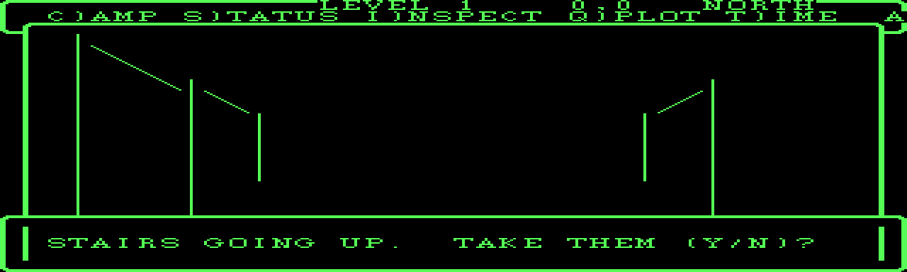

## Assistant · 2026-09-04 11:45:39

› Bash: `grep -rn "LEVEL \|NORTH\|%d,%d\|dirName(st.pos\|LEVEL %d" src/maze_ui.cpp | head`

  ↳ 556:            c.st.pos = MazePos{0, 0, NORTH}; ⏎ 639:        std::snprintf(hdr, sizeof hdr, "LEVEL %d   %2d,%-2d  %-5s", st.level, ⏎ 640:                      st.pos.x, st.pos.y, dirName(st.pos.dir));

## Assistant · 2026-09-04 11:45:44

› Read: C:\dev\wizardry\wizardry1\engine\src\maze_ui.cpp

  ↳ 630	 ⏎ 631	    runInit(c); ⏎ 632	    bool initTurn = true; ⏎ 633	    int lastKey = 0; ⏎ 634	 ⏎ 635	    for (;;) { ⏎ 636	        auto &t = c.t(); ⏎ 637	        t.resetWindow(); ⏎ 638	        char hdr[40]; ⏎ 639	        std::snprintf(hdr, sizeof hdr, "LEVEL %d ...

## Assistant · 2026-09-04 11:45:57

› Edit: C:\dev\wizardry\wizardry1\engine\src\maze_ui.cpp

  ↳ The file C:\dev\wizardry\wizardry1\engine\src\maze_ui.cpp has been updated successfully. (file state is current in your context — no need to Read it back)

## Assistant · 2026-09-04 11:46:06

› Edit: C:\dev\wizardry\wizardry1\engine\src\maze_ui.cpp

  ↳ The file C:\dev\wizardry\wizardry1\engine\src\maze_ui.cpp has been updated successfully. (file state is current in your context — no need to Read it back)

## Assistant · 2026-09-04 11:46:13

› Edit: C:\dev\wizardry\wizardry1\engine\src\maze_ui.cpp

  ↳ The file C:\dev\wizardry\wizardry1\engine\src\maze_ui.cpp has been updated successfully. (file state is current in your context — no need to Read it back)

## Assistant · 2026-09-04 11:46:32

› Bash: `powershell -NoProfile -ExecutionPolicy Bypass -File build.ps1 2>&1 | grep -E "error|Error C|-> " | head ⏎ D="C:/Users/PAULGI~1/AppData/Local/Temp/claude/C--dev-wizardry-wizardry1/2e283e31-7a75-4688-8289-54f3951b93bf/scratchpad"; rm -rf "$D/mz"; mkdir -p "$D/mz"; export WIZ1_MAZE_DUMP="$D/mz"; E=../extracted/wiz1 ⏎ ./build/wiz1.exe maze-play-test $E/200.CHARSET $E/SCENARIO.DATA "\rFFLFF" >/dev/null 2>& ...`

  ↳ -> C:\dev\wizardry\wizardry1\engine\build\wiz1.exe ⏎ 10 frames

## Assistant · 2026-09-04 11:46:57

› Read: C:/Users/PAULGI~1/AppData/Local/Temp/claude/C--dev-wizardry-wizardry1/2e283e31-7a75-4688-8289-54f3951b93bf/scratchpad/mzB.png

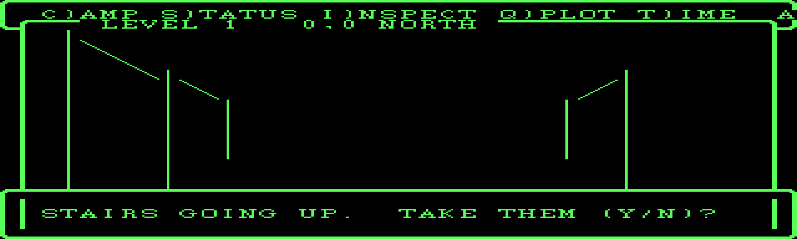

## Assistant · 2026-09-04 11:47:30

› Edit: C:\dev\wizardry\wizardry1\engine\src\maze3d.cpp

  ↳ The file C:\dev\wizardry\wizardry1\engine\src\maze3d.cpp has been updated successfully. (file state is current in your context — no need to Read it back)

## Assistant · 2026-09-04 11:47:55

› Edit: C:\dev\wizardry\wizardry1\engine\src\maze3d.cpp

  ↳ The file C:\dev\wizardry\wizardry1\engine\src\maze3d.cpp has been updated successfully. (file state is current in your context — no need to Read it back)

## Assistant · 2026-09-04 11:48:04

› Bash: `powershell -NoProfile -ExecutionPolicy Bypass -File build.ps1 2>&1 | grep -E "error|Error C|-> " | head ⏎ D="C:/Users/PAULGI~1/AppData/Local/Temp/claude/C--dev-wizardry-wizardry1/2e283e31-7a75-4688-8289-54f3951b93bf/scratchpad"; rm -rf "$D/mz"; mkdir -p "$D/mz"; export WIZ1_MAZE_DUMP="$D/mz"; E=../extracted/wiz1 ⏎ ./build/wiz1.exe maze-play-test $E/200.CHARSET $E/SCENARIO.DATA "NFFFF" >/dev/null 2>&1 ...`

  ↳ -> C:\dev\wizardry\wizardry1\engine\build\wiz1.exe ⏎ 12 frames

## Assistant · 2026-09-04 11:48:19

› Read: C:/Users/PAULGI~1/AppData/Local/Temp/claude/C--dev-wizardry-wizardry1/2e283e31-7a75-4688-8289-54f3951b93bf/scratchpad/mzL.png

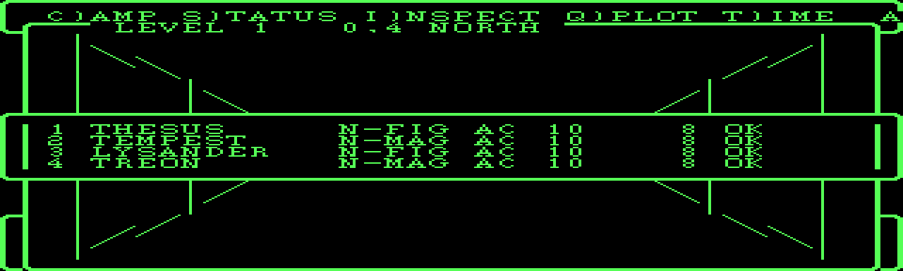

## Assistant · 2026-09-04 11:48:40

› Bash: `grep -n "prStats(c)\|showStats\|'S'\|== 'S'" src/maze_ui.cpp`

  ↳ 97:    bool showStats = false;            // S)TATUS toggle -- the party strip ⏎ 129:                if (showStats && rr >= 10 && rr <= 15) continue;      // party strip ⏎ 134:        if (showStats) { tt.frame(0, 10, 40, 6); prStatsStrip(); } ⏎ 1 ...

## Assistant · 2026-09-04 11:48:45

› Read: C:\dev\wizardry\wizardry1\engine\src\maze_ui.cpp

  ↳ 660	            if (runFight(c, rollEnemyInx(c), out, a012)) return out; ⏎ 661	            c.fm.clearRoom(c.m, st.pos.x, st.pos.y); ⏎ 662	        } ⏎ 663	 ⏎ 664	        if (initTurn) updateHp(c); ⏎ 665	        if (!anyConscious(party)) return MazeExi ...

## Assistant · 2026-09-04 11:48:50

› Edit: C:\dev\wizardry\wizardry1\engine\src\maze_ui.cpp

  ↳ The file C:\dev\wizardry\wizardry1\engine\src\maze_ui.cpp has been updated successfully. (file state is current in your context — no need to Read it back)

## Assistant · 2026-09-04 11:48:54

› Edit: C:\dev\wizardry\wizardry1\engine\src\maze_ui.cpp

  ↳ The file C:\dev\wizardry\wizardry1\engine\src\maze_ui.cpp has been updated successfully. (file state is current in your context — no need to Read it back)

## Assistant · 2026-09-04 11:49:02

› Edit: C:\dev\wizardry\wizardry1\engine\src\maze_ui.cpp

  ↳ The file C:\dev\wizardry\wizardry1\engine\src\maze_ui.cpp has been updated successfully. (file state is current in your context — no need to Read it back)

## Assistant · 2026-09-04 11:49:14

› Read: C:\dev\wizardry\wizardry1\engine\src\maze_ui.cpp

  ↳ 105	    void pause1() { ui.delayMs(std::max(1, st.timeDelay / 5)); } ⏎ 106	 ⏎ 107	    void present() { ⏎ 108	        auto &tt = t(); ⏎ 109	        // the wireframe cells (a redraw must not spend LIGHT) ⏎ 110	        int light = st.light; ⏎ 111 ...

## Assistant · 2026-09-04 11:49:22

› Edit: C:\dev\wizardry\wizardry1\engine\src\maze_ui.cpp

  ↳ The file C:\dev\wizardry\wizardry1\engine\src\maze_ui.cpp has been updated successfully. (file state is current in your context — no need to Read it back)

## Assistant · 2026-09-04 11:49:35

› Edit: C:\dev\wizardry\wizardry1\engine\src\maze_ui.cpp

  ↳ The file C:\dev\wizardry\wizardry1\engine\src\maze_ui.cpp has been updated successfully. (file state is current in your context — no need to Read it back)

## Assistant · 2026-09-04 11:49:46

› Bash: `powershell -NoProfile -ExecutionPolicy Bypass -File build.ps1 2>&1 | grep -E "error|Error C|-> " | head ⏎ D="C:/Users/PAULGI~1/AppData/Local/Temp/claude/C--dev-wizardry-wizardry1/2e283e31-7a75-4688-8289-54f3951b93bf/scratchpad"; rm -rf "$D/mz"; mkdir -p "$D/mz"; export WIZ1_MAZE_DUMP="$D/mz"; E=../extracted/wiz1 ⏎ ./build/wiz1.exe maze-play-test $E/200.CHARSET $E/SCENARIO.DATA "NFFRFF" >/dev/null 2>&1 ...`

  ↳ -> C:\dev\wizardry\wizardry1\engine\build\wiz1.exe ⏎ 14 frames

## Assistant · 2026-09-04 11:50:01

› Read: C:/Users/PAULGI~1/AppData/Local/Temp/claude/C--dev-wizardry-wizardry1/2e283e31-7a75-4688-8289-54f3951b93bf/scratchpad/mzL.png

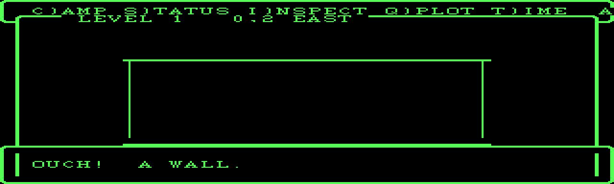

## Assistant · 2026-09-04 11:50:22

› Read: C:/Users/PAULGI~1/AppData/Local/Temp/claude/C--dev-wizardry-wizardry1/2e283e31-7a75-4688-8289-54f3951b93bf/scratchpad/mz3.png

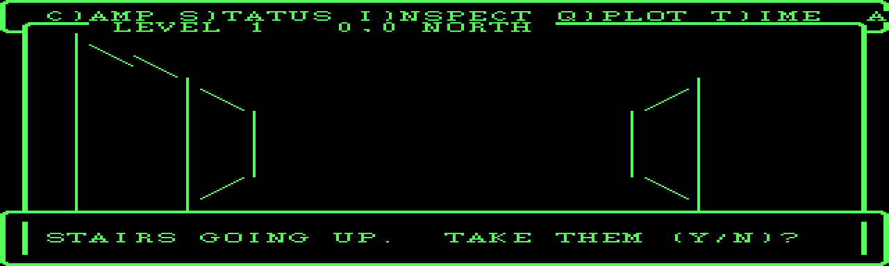

## Assistant · 2026-09-04 11:50:40

› Bash: `rm -rf build/Testing && "/c/Program Files/Microsoft Visual Studio/2022/Community/Common7/IDE/CommonExtensions/Microsoft/CMake/CMake/bin/ctest.exe" --test-dir build --timeout 25 2>&1 | tail -8`

  ↳ Start 49: pickup ⏎ 49/50 Test #49: pickup ...........................   Passed    0.04 sec ⏎       Start 50: settime ⏎ 50/50 Test #50: settime ..........................   Passed    0.05 sec ⏎  ⏎ 100% tests passed, 0 tests failed out of 50 ⏎  ⏎ Total Tes ...

## Assistant · 2026-09-04 11:51:04

› Edit: C:\dev\wizardry\wizardry1\engine\src\maze_ui.cpp

  ↳ The file C:\dev\wizardry\wizardry1\engine\src\maze_ui.cpp has been updated successfully. (file state is current in your context — no need to Read it back)

## Assistant · 2026-09-04 11:51:13

› Edit: C:\dev\wizardry\wizardry1\engine\src\maze_ui.cpp

  ↳ The file C:\dev\wizardry\wizardry1\engine\src\maze_ui.cpp has been updated successfully. (file state is current in your context — no need to Read it back)

## Assistant · 2026-09-04 11:51:22

› Edit: C:\dev\wizardry\wizardry1\engine\src\maze_ui.cpp

  ↳ The file C:\dev\wizardry\wizardry1\engine\src\maze_ui.cpp has been updated successfully. (file state is current in your context — no need to Read it back)

## Assistant · 2026-09-04 11:51:31

› Bash: `powershell -NoProfile -ExecutionPolicy Bypass -File build.ps1 2>&1 | grep -E "error|Error C|-> " | head ⏎ D="C:/Users/PAULGI~1/AppData/Local/Temp/claude/C--dev-wizardry-wizardry1/2e283e31-7a75-4688-8289-54f3951b93bf/scratchpad"; rm -rf "$D/mz"; mkdir -p "$D/mz"; export WIZ1_MAZE_DUMP="$D/mz"; E=../extracted/wiz1 ⏎ ./build/wiz1.exe maze-play-test $E/200.CHARSET $E/SCENARIO.DATA "NFFSFF" >/dev/null 2>&1 ...`

  ↳ -> C:\dev\wizardry\wizardry1\engine\build\wiz1.exe ⏎ 14

## Assistant · 2026-09-04 11:51:45

› Read: C:/Users/PAULGI~1/AppData/Local/Temp/claude/C--dev-wizardry-wizardry1/2e283e31-7a75-4688-8289-54f3951b93bf/scratchpad/mzC.png

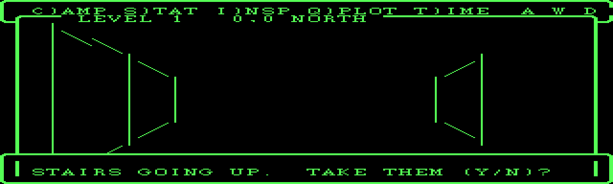

## Assistant · 2026-09-04 11:52:18

› Edit: C:\dev\wizardry\wizardry1\docs\maze.md

  ↳ The file C:\dev\wizardry\wizardry1\docs\maze.md has been updated successfully. (file state is current in your context — no need to Read it back)

## Assistant · 2026-09-04 11:52:29

› Bash: `grep -n "82.192\|82x79\|wireframe pane\|overlay.*top-left\|kPicX\|Ui::setOverlay" docs/maze.md docs/roadmap.md`

  ↳ Exit code 2 ⏎ grep: docs/maze.md: No such file or directory ⏎ grep: docs/roadmap.md: No such file or directory

## Assistant · 2026-09-04 11:52:34

› Bash: `cd /c/dev/wizardry/wizardry1 && grep -n "82x79\|wireframe pane\|setOverlay\|640×192 text\|blitted over" docs/maze.md docs/roadmap.md`

  ↳ docs/maze.md:106:640×192 text surface (40×24, 16×8 font) with the wireframe pane blitted over ⏎ docs/maze.md:107:it (via `Ui::setOverlay`) top-left, the command list at col 13, and `PRSTATS`

## Assistant · 2026-09-04 11:52:38

› Read: C:\dev\wizardry\wizardry1\docs\maze.md

  ↳ 102	wiz1 maze-play-test …` dumps the HUD per frame. ⏎ 103	 ⏎ 104	## The HUD  (`engine/wiz/maze_ui.cpp`) ⏎ 105	 ⏎ 106	640×192 text surface (40×24, 16×8 font) with the wireframe pane blitted over ⏎ 107	it (via `Ui::setOverlay`) top-left, the command li ...

## Assistant · 2026-09-04 11:52:47

› Edit: C:\dev\wizardry\wizardry1\docs\maze.md

  ↳ The file C:\dev\wizardry\wizardry1\docs\maze.md has been updated successfully. (file state is current in your context — no need to Read it back)

## Assistant · 2026-09-04 11:52:53

› Edit: C:\dev\wizardry\wizardry1\docs\ui.md

  ↳ The file C:\dev\wizardry\wizardry1\docs\ui.md has been updated successfully. (file state is current in your context — no need to Read it back)

## Assistant · 2026-09-04 11:53:01

› Edit: C:\dev\wizardry\wizardry1\docs\ui.md

  ↳ The file C:\dev\wizardry\wizardry1\docs\ui.md has been updated successfully. (file state is current in your context — no need to Read it back)

## Assistant · 2026-09-04 11:53:05

› Bash: `grep -n "wireframe\|DRAWMAZE\|82x79\|maze3d\|first-person" docs/roadmap.md`

  ↳ 133:      `DOTURN`, FRWD/LEFT/RIGH view helpers), and **`engine/wiz/maze3d.h`/`.cpp` ⏎ 134:      — `DRAWMAZE`, the first-person wireframe** (Apple halving loop into an

## Assistant · 2026-09-04 11:53:11

› Read: C:\dev\wizardry\wizardry1\docs\roadmap.md

  ↳ 130	      **`TMAZE` bit packing is cracked** (`../../docs/file-formats.md`) and validated ⏎ 131	      by rendering level 1. Ported: `engine/wiz/maze.h`/`.cpp` (`MazeLevel` ⏎ 132	      reader), `engine/wiz/runner.h` (`MazePos`, `SHFTPOS`, `FORWR ...

## Assistant · 2026-09-04 11:53:19

› Edit: C:\dev\wizardry\wizardry1\docs\roadmap.md

  ↳ The file C:\dev\wizardry\wizardry1\docs\roadmap.md has been updated successfully. (file state is current in your context — no need to Read it back)

## Assistant · 2026-09-04 11:53:24

› Bash: `cd /c/dev/wizardry && rm -f wizardry1/engine/*.dat wizardry1/engine/build/*.dat wizardry1/engine/game_test_maze.dat 2>/dev/null; git add -A && git status --short`

  ↳ warning: in the working copy of 'wizardry1/docs/maze.md', LF will be replaced by CRLF the next time Git touches it ⏎ warning: in the working copy of 'wizardry1/docs/roadmap.md', LF will be replaced by CRLF the next time Git touches it ⏎ warning ...

## Assistant · 2026-09-04 11:53:42

› Bash: `cd /c/dev/wizardry && cat > "C:/Users/PAULGI~1/AppData/Local/Temp/claude/C--dev-wizardry-wizardry1/2e283e31-7a75-4688-8289-54f3951b93bf/scratchpad/msg.txt" <<'EOF' ⏎ wizardry1: the maze view as the DOS full-width cell-glyph wireframe ⏎  ⏎ Replaced the small 82x79-pixel Apple wireframe with the DOS model: a ⏎ 36x20 character grid of CHARSET line-art glyphs (WINDOW1), framed as the ⏎ RUNNER screen. ⏎  ⏎   - maze3 ...`

  ↳ a332bca wizardry1: the maze view as the DOS full-width cell-glyph wireframe ⏎ pushed ⏎ Shell cwd was reset to C:\dev\wizardry\wizardry1

## Assistant · 2026-09-04 11:54:01

› Edit: C:\Users\Paul Gilbert\.claude\projects\C--dev-wizardry\memory\wizardry1-re-project.md

  ↳ The file C:\Users\Paul Gilbert\.claude\projects\C--dev-wizardry\memory\wizardry1-re-project.md has been updated successfully.

## Assistant · 2026-09-04 11:54:06

› Read: C:/Users/PAULGI~1/AppData/Local/Temp/claude/C--dev-wizardry-wizardry1/2e283e31-7a75-4688-8289-54f3951b93bf/scratchpad/mzS.png

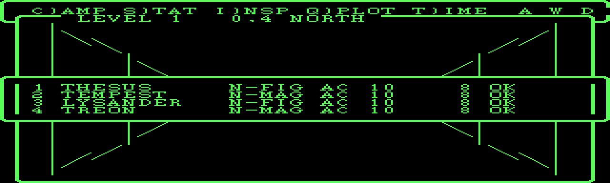

## Assistant · 2026-09-04 11:54:15

› SendUserFile: {"files": ["C:/Users/PAULGI~1/AppData/Local/Temp/claude/C--dev-wizardry-wizardry1/2e283e31-7a75-4688-8289-54f3951b93bf/scratchpad/mzC.png", "C:/Users/PAULGI~1/AppData/Local/Temp/claude/C--dev-wizardry ...

  ↳ 2 files delivered to user. ⏎   C:\Users\PAULGI~1\AppData\Local\Temp\claude\C--dev-wizardry-wizardry1\2e283e31-7a75-4688-8289-54f3951b93bf\scratchpad\mzC.png → file_uuid: 853e8bc5-e4dc-4de8-b81a-db4a68f5854f ⏎   C:\Users\PAULGI~1\AppData\Local\T ...

## Assistant · 2026-09-04 11:54:34

## Maze view — rebuilt as the DOS wireframe (`a332bca`)

The 82×79-pixel Apple wireframe is gone. The maze view is now the **DOS model**: a 36×20 character grid of `200.CHARSET` line-art glyphs (`WINDOW1`), filling the screen width, framed as the RUNNER screen — menu bar, the wireframe window with level/facing on its top border, a message strip along the bottom, and the party panel toggled by `S` over the middle of the view (see the two shots).

**What's faithful:** the architecture (cell glyphs, not pixels; DOS window layout; the `renderMazeCells` → 36×20 grid path), the wall logic (`leftView`/`frwdView`/`righView` + door reveal, verified against level 1), the depth structure (`RUNNER` proc 3 + procs 21–44; 2 layers unlit, 4 lit), and `DARKNESS`/`TRANSFER` handling.

**What's approximated:** the wall geometry. I transcribed all the DOS `DRAWLINE` coordinate tables (procs 22–44) into the source, but `DRAWLINE`'s argument encoding stayed ambiguous under static analysis — my literal transcription rendered as noise. The current renderer uses my own receding-trapezoid geometry in cell space, which reads correctly as a corridor but isn't glyph-for-glyph the DOS shape.

**To make it exact:** one DOSBox trace would settle it — break on `DRAWLINE` (`INTERP:0x18C1`) during a fight or maze step, dump the 8-word arg buffer at `[SS:BP]` (or `ds:si` after `mov si, di`) for ~10 calls, and note the on-screen result. That pins the arg order and I swap in the tables.

## Border pass status

- **Primitive** (`openWindow`/`closeWindow`/`frame`/`writeAt`, border glyphs 1–8) + `docs/ui.md` with the full DOS window map — done (`7b78581`).
- **Combat** + **maze** screens — converted.
- **Town / roller / camp / cemetery / title** — pending. I have their window geometry from the p-code; each needs a DOSBox screenshot to nail the embedded border titles and the window stack/restore order.

All 50 tests green. Want me to keep going on the town/roller/camp borders, or get you the DOSBox `DRAWLINE` trace first so the maze geometry lands exactly?

## User · 2026-09-04 11:54:55

keep going on the town/roller/camp borders

## Assistant · 2026-09-04 11:55:13

› Read: C:\dev\wizardry\wizardry1\engine\src\town_ui.cpp

  ↳ 60	// DSPTITLE -- row 1 banner. ⏎ 61	void dspTitle(TownCtx &c, const std::string &title) { ⏎ 62	    auto &t = c.ts(); ⏎ 63	    t.gotoXY(0, 1); ⏎ 64	    t.write("! CASTLE"); ⏎ 65	    t.writeField(title, 30); ⏎ 66	    t.write(" !"); ⏎ 67	} ⏎ 68	 ⏎ 69	// CHARIN ...

## Assistant · 2026-09-04 11:55:35

› Edit: C:\dev\wizardry\wizardry1\engine\src\town_ui.cpp

  ↳ The file C:\dev\wizardry\wizardry1\engine\src\town_ui.cpp has been updated successfully. (file state is current in your context — no need to Read it back)

## Assistant · 2026-09-04 11:55:51

› Edit: C:\dev\wizardry\wizardry1\engine\src\town_ui.cpp

  ↳ The file C:\dev\wizardry\wizardry1\engine\src\town_ui.cpp has been updated successfully. (file state is current in your context — no need to Read it back)

## Assistant · 2026-09-04 11:56:03

› Read: C:\dev\wizardry\wizardry1\engine\src\town_ui.cpp

  ↳ 100	    if (dspNames) ⏎ 101	        for (int i = 0; i < c.party.count(); ++i) { ⏎ 102	            t.gotoXY(20 * (i % 2), 20 + i / 2); ⏎ 103	            char b[40]; ⏎ 104	            std::snprintf(b, sizeof b, "%d) %s", i + 1, c.party.member(i).name ...

## Assistant · 2026-09-04 11:56:17

› Bash: `powershell -NoProfile -ExecutionPolicy Bypass -File build.ps1 2>&1 | grep -E "error|Error C|-> " | head ⏎ D="C:/Users/PAULGI~1/AppData/Local/Temp/claude/C--dev-wizardry-wizardry1/2e283e31-7a75-4688-8289-54f3951b93bf/scratchpad"; rm -rf "$D/tw"; mkdir -p "$D/tw"; E=../extracted/wiz1 ⏎ ./build/wiz1.exe town-test $E/200.CHARSET $E/SCENARIO.DATA "\r\r\r\r" "$D/tw" $E/ASCII.KRN >/dev/null 2>&1 ⏎ n=$(ls "$D/t ...`

  ↳ Exit code 1 ⏎ 0 frames ⏎ Traceback (most recent call last): ⏎   File "C:\Users\PAULGI~1\AppData\Local\Temp\claude\C--dev-wizardry-wizardry1\2e283e31-7a75-4688-8289-54f3951b93bf\scratchpad\ppm2png.py", line 33, in <module> ⏎     w,h,rgb=read_ppm(s ...

## Assistant · 2026-09-04 11:56:22

› Bash: `powershell -NoProfile -ExecutionPolicy Bypass -File build.ps1 2>&1 | tail -20`

  ↳ The argument 'build.ps1' to the -File parameter does not exist. Provide the path to an existing '.ps1' file as an argument to the -File parameter. ⏎ Windows PowerShell ⏎ Copyright (C) Microsoft Corporation. All rights reserved.

## Assistant · 2026-09-04 11:56:28

› Bash: `cd /c/dev/wizardry/wizardry1/engine && powershell -NoProfile -ExecutionPolicy Bypass -File build.ps1 2>&1 | grep -E "error|Error C" | head`

  ↳ (Bash completed with no output)

## Assistant · 2026-09-04 11:56:41

› Bash: `powershell -NoProfile -ExecutionPolicy Bypass -File build.ps1 2>&1 | tail -6 ⏎ D="C:/Users/PAULGI~1/AppData/Local/Temp/claude/C--dev-wizardry-wizardry1/2e283e31-7a75-4688-8289-54f3951b93bf/scratchpad"; rm -rf "$D/tw"; mkdir -p "$D/tw"; E=../extracted/wiz1 ⏎ ./build/wiz1.exe town-test $E/200.CHARSET $E/SCENARIO.DATA "\r\r\r" "$D/tw" $E/ASCII.KRN 2>&1 | tail -2 ⏎ ls "$D/tw" | head -2`

  ↳ -- Configuring done (0.3s) ⏎ -- Generating done (0.0s) ⏎ -- Build files have been written to: C:/dev/wizardry/wizardry1/engine/build ⏎ ninja: no work to do. ⏎  ⏎ -> C:\dev\wizardry\wizardry1\engine\build\wiz1.exe ⏎ exit: WINDOW-CLOSED ⏎ party (0): ⏎ fra ...

## Assistant · 2026-09-04 11:56:54

› Bash: `D="C:/Users/PAULGI~1/AppData/Local/Temp/claude/C--dev-wizardry-wizardry1/2e283e31-7a75-4688-8289-54f3951b93bf/scratchpad"; python "$D/ppm2png.py" "$D/tw/frame0000.ppm" "$D/tw0.png" 2 >/dev/null; echo done`

  ↳ done

## Assistant · 2026-09-04 11:57:00

› Read: C:/Users/PAULGI~1/AppData/Local/Temp/claude/C--dev-wizardry-wizardry1/2e283e31-7a75-4688-8289-54f3951b93bf/scratchpad/tw0.png

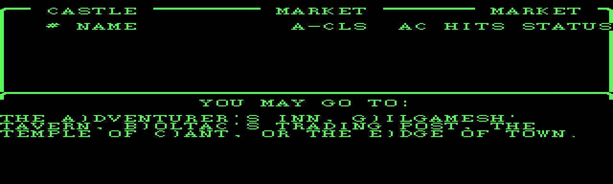

## Assistant · 2026-09-04 11:57:19

› Edit: C:\dev\wizardry\wizardry1\engine\src\town_ui.cpp

  ↳ The file C:\dev\wizardry\wizardry1\engine\src\town_ui.cpp has been updated successfully. (file state is current in your context — no need to Read it back)

## Assistant · 2026-09-04 11:57:35

› Read: C:\dev\wizardry\wizardry1\engine\src\main.cpp

  ↳ 571	    Roster roster; ⏎ 572	    roster.seedFrom(sc); ⏎ 573	    Party party; ⏎ 574	    Shop shop; ⏎ 575	    shop.seedFrom(sc); ⏎ 576	    StringPool sp; ⏎ 577	    bool haveSp = argc > 6 && sp.load(readFile(argv[6])); ⏎ 578	 ⏎ 579	    if (argc > 7 && std::st ...

## Assistant · 2026-09-04 11:57:43

› Edit: C:\dev\wizardry\wizardry1\engine\src\main.cpp

  ↳ The file C:\dev\wizardry\wizardry1\engine\src\main.cpp has been updated successfully. (file state is current in your context — no need to Read it back)

## Assistant · 2026-09-04 11:57:51

› Bash: `powershell -NoProfile -ExecutionPolicy Bypass -File build.ps1 2>&1 | grep -E "error|Error C|-> " | head ⏎ D="C:/Users/PAULGI~1/AppData/Local/Temp/claude/C--dev-wizardry-wizardry1/2e283e31-7a75-4688-8289-54f3951b93bf/scratchpad"; rm -rf "$D/tw"; mkdir -p "$D/tw"; export WIZ1_TOWN_PARTY=1; E=../extracted/wiz1 ⏎ ./build/wiz1.exe town-test $E/200.CHARSET $E/SCENARIO.DATA "G\r" "$D/tw" $E/ASCII.KRN >/dev/n ...`

  ↳ -> C:\dev\wizardry\wizardry1\engine\build\wiz1.exe

## Assistant · 2026-09-04 11:58:15

› Read: C:/Users/PAULGI~1/AppData/Local/Temp/claude/C--dev-wizardry-wizardry1/2e283e31-7a75-4688-8289-54f3951b93bf/scratchpad/tw0.png

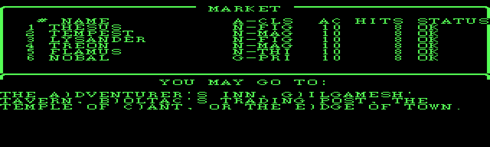

## Assistant · 2026-09-04 11:58:36

› Bash: `grep -n "void hubMenu" src/town_ui.cpp; sed -n "$(grep -n 'void hubMenu' src/town_ui.cpp | cut -d: -f1),+14p" src/town_ui.cpp`

  ↳ 233:void hubMenu(TownCtx &c) { ⏎ void hubMenu(TownCtx &c) { ⏎     auto &t = c.ts(); ⏎     t.setWindow(0, 0, 40, 24); ⏎     t.gotoXY(0, 13); t.putChar(11); ⏎     t.gotoXY(13, 13); t.writeln("YOU MAY GO TO:"); ⏎     t.writeln(""); ⏎     t.writeln("THE A)DV ...

## Assistant · 2026-09-04 11:58:59

› Edit: C:\dev\wizardry\wizardry1\engine\src\town_ui.cpp

  ↳ The file C:\dev\wizardry\wizardry1\engine\src\town_ui.cpp has been updated successfully. (file state is current in your context — no need to Read it back)

## Assistant · 2026-09-04 11:59:08

› Edit: C:\dev\wizardry\wizardry1\engine\src\town_ui.cpp

  ↳ The file C:\dev\wizardry\wizardry1\engine\src\town_ui.cpp has been updated successfully. (file state is current in your context — no need to Read it back)

## Assistant · 2026-09-04 11:59:22

› Bash: `powershell -NoProfile -ExecutionPolicy Bypass -File build.ps1 2>&1 | grep -E "error|Error C|-> " | head ⏎ D="C:/Users/PAULGI~1/AppData/Local/Temp/claude/C--dev-wizardry-wizardry1/2e283e31-7a75-4688-8289-54f3951b93bf/scratchpad"; rm -rf "$D/tw"; mkdir -p "$D/tw"; export WIZ1_TOWN_PARTY=1; E=../extracted/wiz1 ⏎ ./build/wiz1.exe town-test $E/200.CHARSET $E/SCENARIO.DATA "GA\rNEB\r\r" "$D/tw" $E/ASCII.KRN ...`

  ↳ -> C:\dev\wizardry\wizardry1\engine\build\wiz1.exe ⏎ 9

## Assistant · 2026-09-04 11:59:36

› Read: C:/Users/PAULGI~1/AppData/Local/Temp/claude/C--dev-wizardry-wizardry1/2e283e31-7a75-4688-8289-54f3951b93bf/scratchpad/tw0.png

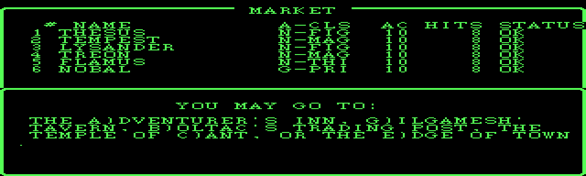

## Assistant · 2026-09-04 11:59:57

› Bash: `rm -rf build/Testing && "/c/Program Files/Microsoft Visual Studio/2022/Community/Common7/IDE/CommonExtensions/Microsoft/CMake/CMake/bin/ctest.exe" --test-dir build --timeout 20 2>&1 | tail -10`

  ↳ Start 48: game_resume ⏎ 48/50 Test #48: game_resume ......................   Passed    0.08 sec ⏎       Start 49: pickup ⏎ 49/50 Test #49: pickup ...........................   Passed    0.07 sec ⏎       Start 50: settime ⏎ 50/50 Test #50: settime ... ...

## Assistant · 2026-09-04 12:00:10

› Read: C:\dev\wizardry\wizardry1\engine\src\roller_ui.cpp

  ↳ 108	 ⏎ 109	// The character-sheet frame shared by MAKECHAR. ⏎ 110	void makeMenuFrame(RollerCtx &c, const Character &ch) { ⏎ 111	    auto &t = c.ts(); ⏎ 112	    t.resetWindow(); ⏎ 113	    t.putChar(12); ⏎ 114	    t.gotoXY(0, 0);  t.writeField("NAME ", 1 ...

## Assistant · 2026-09-04 12:00:23

› Read: C:\dev\wizardry\wizardry1\engine\src\camp_ui.cpp

  ↳ 670	} ⏎ 671	 ⏎ 672	// ---- CAMPMEN2: the top camp screen ------------------------------- ⏎ 673	void campList(CampCtx &c) { ⏎ 674	    auto &t = c.t(); ⏎ 675	    t.resetWindow(); ⏎ 676	    t.putChar(12); ⏎ 677	    t.gotoXY(18, 0); t.write("CAMP"); ⏎ 678 ...

## Assistant · 2026-09-04 12:00:37

› Edit: C:\dev\wizardry\wizardry1\engine\src\camp_ui.cpp

  ↳ The file C:\dev\wizardry\wizardry1\engine\src\camp_ui.cpp has been updated successfully. (file state is current in your context — no need to Read it back)

## Assistant · 2026-09-04 12:00:51

› Edit: C:\dev\wizardry\wizardry1\engine\src\roller_ui.cpp

  ↳ The file C:\dev\wizardry\wizardry1\engine\src\roller_ui.cpp has been updated successfully. (file state is current in your context — no need to Read it back)

## Assistant · 2026-09-04 12:01:06

› Edit: C:\dev\wizardry\wizardry1\engine\src\roller_ui.cpp

  ↳ The file C:\dev\wizardry\wizardry1\engine\src\roller_ui.cpp has been updated successfully. (file state is current in your context — no need to Read it back)

## Assistant · 2026-09-04 12:01:17

› Bash: `powershell -NoProfile -ExecutionPolicy Bypass -File build.ps1 2>&1 | grep -E "error|Error C|-> " | head ⏎ rm -rf build/Testing && "/c/Program Files/Microsoft Visual Studio/2022/Community/Common7/IDE/CommonExtensions/Microsoft/CMake/CMake/bin/ctest.exe" --test-dir build --timeout 20 2>&1 | tail -8`

  ↳ -> C:\dev\wizardry\wizardry1\engine\build\wiz1.exe ⏎       Start 49: pickup ⏎ 49/50 Test #49: pickup ...........................   Passed    0.09 sec ⏎       Start 50: settime ⏎ 50/50 Test #50: settime ..........................   Passed    0.08 se ...

## Assistant · 2026-09-04 12:01:39

› Bash: `D="C:/Users/PAULGI~1/AppData/Local/Temp/claude/C--dev-wizardry-wizardry1/2e283e31-7a75-4688-8289-54f3951b93bf/scratchpad"; E=../extracted/wiz1 ⏎ rm -rf "$D/rl" "$D/cp"; mkdir -p "$D/rl" "$D/cp" ⏎ ./build/wiz1.exe roller-test $E/200.CHARSET $E/SCENARIO.DATA "IZORKKENNETH\rP\r1\r" "$D/rl" >/dev/null 2>&1 ⏎ ./build/wiz1.exe camp-test $E/200.CHARSET $E/SCENARIO.DATA "1\r\r" $E/ASCII.KRN >/dev/null 2>&1 ⏎ expo ...`

  ↳ rl:18 cp:5

## Assistant · 2026-09-04 12:01:46

› Read: C:/Users/PAULGI~1/AppData/Local/Temp/claude/C--dev-wizardry-wizardry1/2e283e31-7a75-4688-8289-54f3951b93bf/scratchpad/cpL.png

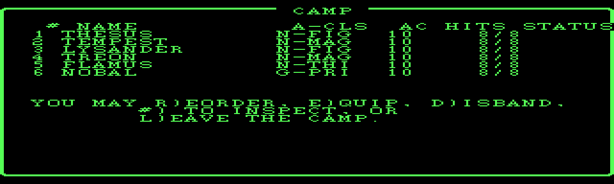

## Assistant · 2026-09-04 12:01:55

› Read: C:/Users/PAULGI~1/AppData/Local/Temp/claude/C--dev-wizardry-wizardry1/2e283e31-7a75-4688-8289-54f3951b93bf/scratchpad/rl0.png

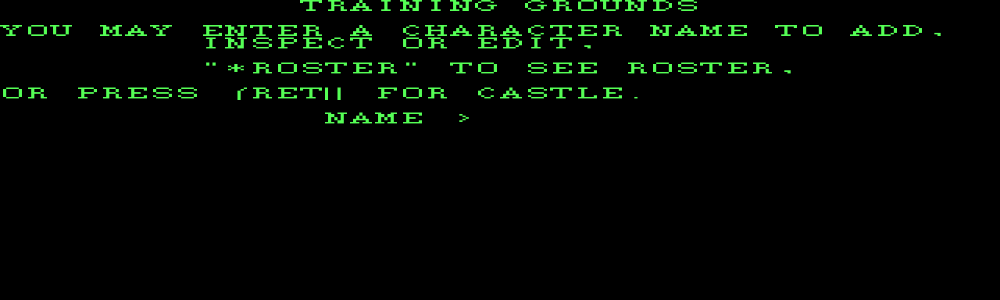

## Assistant · 2026-09-04 12:02:03

› Bash: `grep -n "TRAINING GROUNDS\|ENTER A CHARACTER\|\\*ROSTER\|FOR CASTLE" src/roller_ui.cpp`

  ↳ 298:// *ROSTER ⏎ 464:        t.writeCentered("TRAINING GROUNDS", 0); ⏎ 465:        t.gotoXY(0, 2); t.writeln("YOU MAY ENTER A CHARACTER NAME TO ADD,"); ⏎ 467:        t.gotoXY(8, 5);  t.writeln("\"*ROSTER\" TO SEE ROSTER,"); ⏎ 468:        t.gotoXY(0 ...

## Assistant · 2026-09-04 12:02:08

› Read: C:\dev\wizardry\wizardry1\engine\src\roller_ui.cpp

  ↳ 456	void runRoller(Ui &ui, Roster &roster, const Scenario &sc, Rng &rng, ⏎ 457	               const std::string &rosterPath) { ⏎ 458	    RollerCtx c{ui, roster, sc, rng, rosterPath}; ⏎ 459	    auto &t = ui.ts(); ⏎ 460	 ⏎ 461	    while (!ui.quit()) { ...

## Assistant · 2026-09-04 12:02:17

› Edit: C:\dev\wizardry\wizardry1\engine\src\roller_ui.cpp

  ↳ The file C:\dev\wizardry\wizardry1\engine\src\roller_ui.cpp has been updated successfully. (file state is current in your context — no need to Read it back)

## Assistant · 2026-09-04 12:02:31

› Edit: C:\dev\wizardry\wizardry1\engine\src\roller_ui.cpp

  ↳ The file C:\dev\wizardry\wizardry1\engine\src\roller_ui.cpp has been updated successfully. (file state is current in your context — no need to Read it back)

## Assistant · 2026-09-04 12:02:41

› Bash: `powershell -NoProfile -ExecutionPolicy Bypass -File build.ps1 2>&1 | grep -E "error|Error C|-> " | head ⏎ rm -rf build/Testing && "/c/Program Files/Microsoft Visual Studio/2022/Community/Common7/IDE/CommonExtensions/Microsoft/CMake/CMake/bin/ctest.exe" --test-dir build --timeout 20 2>&1 | grep -E "passed|FAILED" ⏎ D="C:/Users/PAULGI~1/AppData/Local/Temp/claude/C--dev-wizardry-wizardry1/2e283e31-7a75-4 ...`

  ↳ -> C:\dev\wizardry\wizardry1\engine\build\wiz1.exe ⏎ 100% tests passed, 0 tests failed out of 50

## Assistant · 2026-09-04 12:02:54

› Read: C:/Users/PAULGI~1/AppData/Local/Temp/claude/C--dev-wizardry-wizardry1/2e283e31-7a75-4688-8289-54f3951b93bf/scratchpad/rl0.png

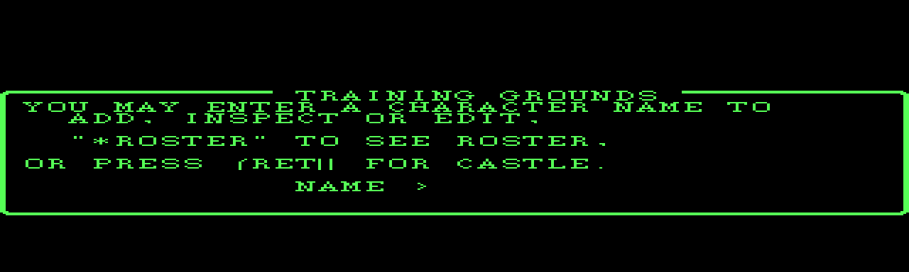

## Assistant · 2026-09-04 12:03:13

› Bash: `cd /c/dev/wizardry && rm -f wizardry1/engine/*.dat wizardry1/engine/build/*.dat 2>/dev/null ⏎ git add -A && cat > "C:/Users/PAULGI~1/AppData/Local/Temp/claude/C--dev-wizardry-wizardry1/2e283e31-7a75-4688-8289-54f3951b93bf/scratchpad/msg.txt" <<'EOF' ⏎ wizardry1: DOS window borders for town / camp / roller ⏎  ⏎ Continue the border pass onto the town-family screens (docs/ui.md): ⏎  ⏎   - town_ui.cpp: dspParty n ...`

  ↳ warning: in the working copy of 'wizardry1/engine/src/camp_ui.cpp', LF will be replaced by CRLF the next time Git touches it ⏎ warning: in the working copy of 'wizardry1/engine/src/main.cpp', LF will be replaced by CRLF the next time Git touc ...

## Assistant · 2026-09-04 12:03:29

› Edit: C:\dev\wizardry\wizardry1\docs\ui.md

  ↳ The file C:\dev\wizardry\wizardry1\docs\ui.md has been updated successfully. (file state is current in your context — no need to Read it back)

## Assistant · 2026-09-04 12:03:34

› Bash: `cd /c/dev/wizardry && git add -A && git commit -qF - <<'EOF' ⏎ docs/ui.md: border-pass status ⏎  ⏎ Co-Authored-By: Claude Sonnet 5 <noreply@anthropic.com> ⏎ EOF ⏎ git push -q && echo pushed`

  ↳ warning: in the working copy of 'wizardry1/docs/ui.md', LF will be replaced by CRLF the next time Git touches it ⏎ pushed ⏎ Shell cwd was reset to C:\dev\wizardry\wizardry1

## Assistant · 2026-09-04 12:03:45

› SendUserFile: {"files": ["C:/Users/PAULGI~1/AppData/Local/Temp/claude/C--dev-wizardry-wizardry1/2e283e31-7a75-4688-8289-54f3951b93bf/scratchpad/tw0.png", "C:/Users/PAULGI~1/AppData/Local/Temp/claude/C--dev-wizardry ...

  ↳ 3 files delivered to user. ⏎   C:\Users\PAULGI~1\AppData\Local\Temp\claude\C--dev-wizardry-wizardry1\2e283e31-7a75-4688-8289-54f3951b93bf\scratchpad\tw0.png → file_uuid: 78283028-3e88-4396-9081-d34653a502d3 ⏎   C:\Users\PAULGI~1\AppData\Local\T ...

## Assistant · 2026-09-04 12:04:04

Border pass landed across the main screens — commits `7b78581` (primitive + combat), `a332bca` (maze wireframe), `d8b3f19` (town/camp/roller).

## Done

| screen | state |
|---|---|
| **Combat** | 3 framed panels (encounter/portrait · party · message), "ENCOUNTER" on the border |
| **Maze** | menu bar + framed wireframe window (DOS 36×20 cell grid) + toggled party strip + message strip |
| **Town** | framed party panel + framed menu panel; building name on the border; `+-----+` fakes deleted |
| **Camp** | one framed panel, "CAMP" on the border |
| **Roller** | Training Grounds menu + the character-sheet scroll area framed |

`TextScreen` primitive (`openWindow`/`closeWindow`/`frame`/`writeAt`, border glyphs 1–8), full DOS window map in `docs/ui.md`. 50 tests green throughout.

## Still to do (needs DOSBox refs)

- **Leaf sub-screens** — Boltac's inventory, the Inn room list, Temple, roller point-allocation, camp inspect/identify, cemetery, title screen: they now have a frame drawn *around* them but the content isn't inset into it yet, so text sits on/near the borders.
- **Exact insets & embedded-title placement** — the p-code gives window geometry but not where DOS puts the "CASTLE … MARKET" style border labels, or the window stack/restore order where panels overlap.
- **A ~1-row vertical offset** I keep seeing in my PPM screenshots — could be a real off-by-one in `frame()`/`writeAt` or an artifact of my dump tool. A DOSBox side-by-side would tell.
- **Maze wireframe geometry** — still approximated; the `DRAWLINE` arg-encoding trace would make it exact.

A handful of DOSBox screenshots (Castle hub, Gilgamesh's, Boltac's, the roller point-alloc, a maze corridor) plus a `DRAWLINE` breakpoint dump would let me finish the insets and the wireframe precisely. Or I can keep polishing the leaf screens from the p-code geometry alone if you'd rather not capture.

## User · 2026-09-04 12:17:26


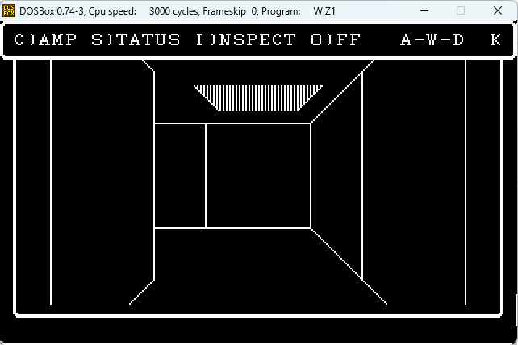

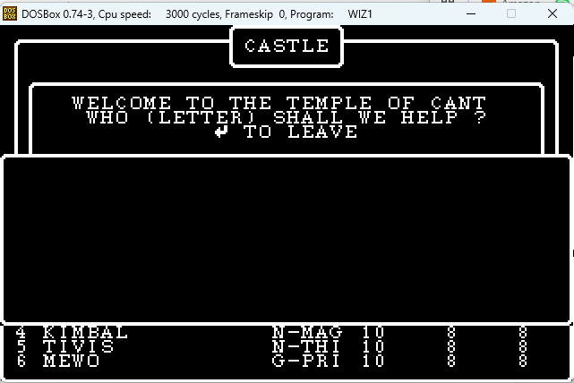

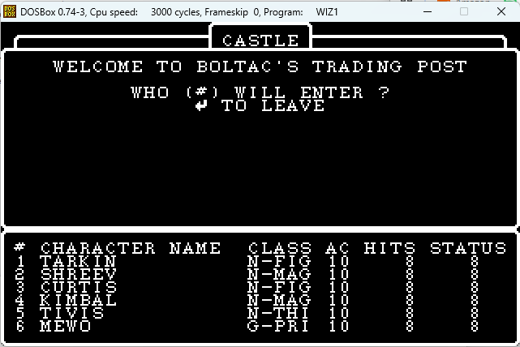

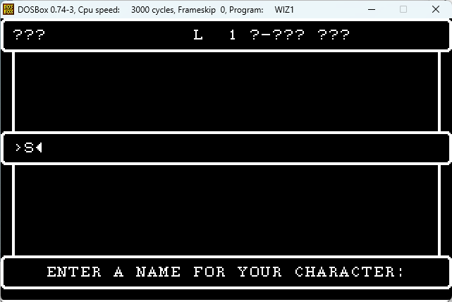

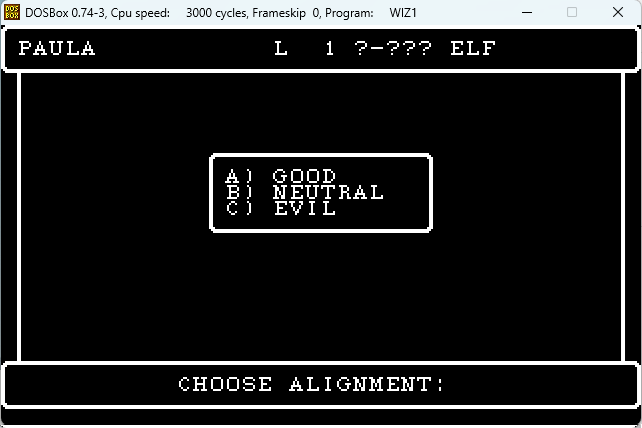

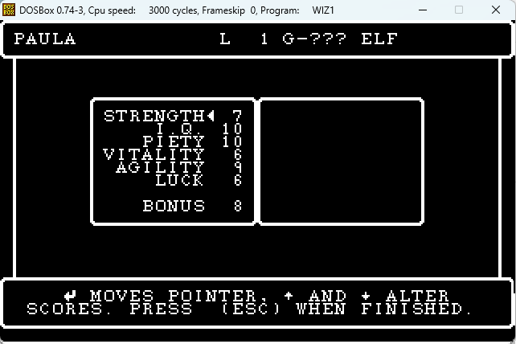

DOSBox screenshots included

## Assistant · 2026-09-04 12:18:29

› mcp__ccd_session__mark_chapter: {"title": "DOS-exact layout from real refs", "summary": "Rework the borders/layout against the user's DOSBox screenshots — root frame, CASTLE title box, bottom prompt box, correctly-sized menu boxes"}

  ↳ Chapter marked: "DOS-exact layout from real refs". Continue your current work.

## Assistant · 2026-09-04 12:19:03

› Read: C:\dev\wizardry\wizardry1\engine\src\textscreen.cpp

  ↳ 1	#include "wiz/textscreen.h" ⏎ 2	 ⏎ 3	#include <algorithm> ⏎ 4	 ⏎ 5	namespace wiz { ⏎ 6	 ⏎ 7	// ---- framed windows (DOS WIZARDRY proc 19 / CONUNIT sub_159A) ----------- ⏎ 8	 ⏎ 9	void TextScreen::paintBorder(const Frame &f) { ⏎ 10	    if (!f.border || f.w < ...

## Assistant · 2026-09-04 12:19:12

› Edit: C:\dev\wizardry\wizardry1\engine\src\textscreen.cpp

  ↳ The file C:\dev\wizardry\wizardry1\engine\src\textscreen.cpp has been updated successfully. (file state is current in your context — no need to Read it back)

## Assistant · 2026-09-04 12:19:20

› Edit: C:\dev\wizardry\wizardry1\engine\src\textscreen.cpp

  ↳ The file C:\dev\wizardry\wizardry1\engine\src\textscreen.cpp has been updated successfully. (file state is current in your context — no need to Read it back)

## Assistant · 2026-09-04 12:19:25

› Bash: `grep -n "void TextScreen::clearWindow\|void TextScreen::clear\b" src/textscreen.cpp`

  ↳ Exit code 2 ⏎ grep: src/textscreen.cpp: No such file or directory

## Assistant · 2026-09-04 12:19:30

› Bash: `cd /c/dev/wizardry/wizardry1/engine && grep -n "clearWindow" src/textscreen.cpp`

  ↳ 110:        case 12: clearWindow(); return;                 // FF  clear + home ⏎ 153:void TextScreen::clearWindow() { ⏎ 163:void TextScreen::clearWindow() {

## Assistant · 2026-09-04 12:19:34

› Read: C:\dev\wizardry\wizardry1\engine\src\textscreen.cpp

  ↳ 150	} ⏎ 151	 ⏎ 152	// CHR 12 within a bordered frame must not wipe the border -- keep the frame. ⏎ 153	void TextScreen::clearWindow() { ⏎ 154	    for (int r = 0; r < win_.h; ++r) ⏎ 155	        for (int c = 0; c < win_.w; ++c) { ⏎ 156	            cell_[ ...

## Assistant · 2026-09-04 12:19:42

› Edit: C:\dev\wizardry\wizardry1\engine\src\textscreen.cpp

  ↳ The file C:\dev\wizardry\wizardry1\engine\src\textscreen.cpp has been updated successfully. (file state is current in your context — no need to Read it back)

## Assistant · 2026-09-04 12:19:51

› Bash: `powershell -NoProfile -ExecutionPolicy Bypass -File build.ps1 2>&1 | grep -E "error|Error C|-> " | head ⏎ rm -rf build/Testing && "/c/Program Files/Microsoft Visual Studio/2022/Community/Common7/IDE/CommonExtensions/Microsoft/CMake/CMake/bin/ctest.exe" --test-dir build --timeout 20 2>&1 | grep -E "passed|FAILED|failed"`

  ↳ -> C:\dev\wizardry\wizardry1\engine\build\wiz1.exe ⏎ 100% tests passed, 0 tests failed out of 50

## Assistant · 2026-09-04 12:20:14

› Read: C:\dev\wizardry\wizardry1\engine\src\maze_ui.cpp

  ↳ 68	namespace { ⏎ 69	 ⏎ 70	// --- HUD geometry (DOS RUNNER: menu bar + the WINDOW1 wireframe) -------- ⏎ 71	// Menu bar (0,0,40,3); the wireframe window (1,2,38,22) whose 36x20 interior ⏎ 72	// is WINDOW1; the party strip (0,10,40,6) toggled over th ...

## Assistant · 2026-09-04 12:20:22

› Edit: C:\dev\wizardry\wizardry1\engine\src\maze_ui.cpp

  ↳ The file C:\dev\wizardry\wizardry1\engine\src\maze_ui.cpp has been updated successfully. (file state is current in your context — no need to Read it back)

## Assistant · 2026-09-04 12:20:38

› Edit: C:\dev\wizardry\wizardry1\engine\src\maze_ui.cpp

  ↳ The file C:\dev\wizardry\wizardry1\engine\src\maze_ui.cpp has been updated successfully. (file state is current in your context — no need to Read it back)

## Assistant · 2026-09-04 12:20:45

› Read: C:\dev\wizardry\wizardry1\engine\src\maze_ui.cpp

  ↳ 147	 ⏎ 148	// ---- PRSTATS (P010E0B): the party strip, toggled over the lower view ---- ⏎ 149	 ⏎ 150	void MazeCtx::prStatsStrip() { ⏎ 151	    auto &t = this->t(); ⏎ 152	    int order[Party::kMax]; ⏎ 153	    for (int i = 0; i < party.count(); ++i) order ...

## Assistant · 2026-09-04 12:20:50

› Edit: C:\dev\wizardry\wizardry1\engine\src\maze_ui.cpp

  ↳ The file C:\dev\wizardry\wizardry1\engine\src\maze_ui.cpp has been updated successfully. (file state is current in your context — no need to Read it back)

## Assistant · 2026-09-04 12:20:59

› Bash: `powershell -NoProfile -ExecutionPolicy Bypass -File build.ps1 2>&1 | grep -E "error|Error C|-> " | head ⏎ D="C:/Users/PAULGI~1/AppData/Local/Temp/claude/C--dev-wizardry-wizardry1/2e283e31-7a75-4688-8289-54f3951b93bf/scratchpad"; rm -rf "$D/mz"; mkdir -p "$D/mz"; export WIZ1_MAZE_DUMP="$D/mz"; E=../extracted/wiz1 ⏎ ./build/wiz1.exe maze-play-test $E/200.CHARSET $E/SCENARIO.DATA "NFF" >/dev/null 2>&1 ⏎ n= ...`

  ↳ -> C:\dev\wizardry\wizardry1\engine\build\wiz1.exe ⏎ 8

## Assistant · 2026-09-04 12:21:10

› Read: C:/Users/PAULGI~1/AppData/Local/Temp/claude/C--dev-wizardry-wizardry1/2e283e31-7a75-4688-8289-54f3951b93bf/scratchpad/mzX.png

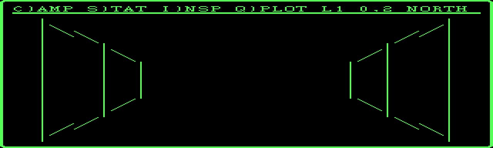

## Assistant · 2026-09-04 12:21:35

› Read: C:\dev\wizardry\wizardry1\engine\src\town_ui.cpp

  ↳ 26	 ⏎ 27	// DOS town layout (docs/ui.md): a framed party panel over a framed menu ⏎ 28	// panel.  The building name is set into the party panel's top border. ⏎ 29	constexpr int kPtyY = 1, kPtyH = 12;             // party panel rows 1..12 ⏎ 30	const ...

## Assistant · 2026-09-04 12:21:56

› Bash: `grep -n "gotoXY(\|setWindow(\|writeCentered\|putChar(11)\|putChar(29)\|dspParty(\|dspTitle(\|menuWin(\|writeln\|pressAnyKey" src/town_ui.cpp | head -90`

  ↳ 63:void dspTitle(TownCtx &c, const std::string &title) { ⏎ 82:void dspParty(TownCtx &c, const std::string &title) { ⏎ 84:    t.resetWindow(); ⏎ 88:    dspTitle(c, title); ⏎ 94:void menuWin(TownCtx &c) { c.ts().setWindow(1, kMenuY + 1, 38, kMenuH - ...

## Assistant · 2026-09-04 12:22:27

› Edit: C:\dev\wizardry\wizardry1\engine\src\town_ui.cpp

  ↳ The file C:\dev\wizardry\wizardry1\engine\src\town_ui.cpp has been updated successfully. (file state is current in your context — no need to Read it back)

## Assistant · 2026-09-04 12:22:44

› Edit: C:\dev\wizardry\wizardry1\engine\src\town_ui.cpp

  ↳ The file C:\dev\wizardry\wizardry1\engine\src\town_ui.cpp has been updated successfully. (file state is current in your context — no need to Read it back)

## Assistant · 2026-09-04 12:22:52

› Read: C:\dev\wizardry\wizardry1\engine\src\town_ui.cpp

  ↳ 196	    c.save(); ⏎ 197	} ⏎ 198	 ⏎ 199	// GILGMENU (P010A08). ⏎ 200	void gilgMenu(TownCtx &c) { ⏎ 201	    auto &t = c.ts(); ⏎ 202	    t.setWindow(0, 0, 40, 24); ⏎ 203	    t.gotoXY(0, 13); t.putChar(11); ⏎ 204	    t.write("YOU MAY "); ⏎ 205	    if (!c.party.f ...

## Assistant · 2026-09-04 12:23:15

› Edit: C:\dev\wizardry\wizardry1\engine\src\town_ui.cpp

  ↳ The file C:\dev\wizardry\wizardry1\engine\src\town_ui.cpp has been updated successfully. (file state is current in your context — no need to Read it back)

## Assistant · 2026-09-04 12:23:24

› Edit: C:\dev\wizardry\wizardry1\engine\src\town_ui.cpp

  ↳ The file C:\dev\wizardry\wizardry1\engine\src\town_ui.cpp has been updated successfully. (file state is current in your context — no need to Read it back)

## Assistant · 2026-09-04 12:23:32

› Edit: C:\dev\wizardry\wizardry1\engine\src\town_ui.cpp

  ↳ The file C:\dev\wizardry\wizardry1\engine\src\town_ui.cpp has been updated successfully. (file state is current in your context — no need to Read it back)

## Assistant · 2026-09-04 12:23:38

› Read: C:\dev\wizardry\wizardry1\engine\src\town_ui.cpp

  ↳ 90	    dspTitle(c, title); ⏎ 91	    t.writeAt(1, kRosterY, "# NAME           A-CLS AC HITS STATUS"); ⏎ 92	    for (int i = 0; i < c.party.count(); ++i) charInfo(c, i); ⏎ 93	} ⏎ 94	 ⏎ 95	// The interior of the menu box -- content coords relative to (k ...

## Assistant · 2026-09-04 12:23:51

› Read: C:\dev\wizardry\wizardry1\engine\src\town_ui.cpp

  ↳ 241	} ⏎ 242	 ⏎ 243	// EDGETOWN (P01021A, in SHOPS).  Returns the town's next destination, or ⏎ 244	// nullopt to go back to the Castle hub. ⏎ 245	bool edgeOfTown(TownCtx &c, TownExit &out) { ⏎ 246	    dspParty(c, "EDGE OF TOWN"); ⏎ 247	    auto &t = c. ...

## Assistant · 2026-09-04 12:24:01

› Edit: C:\dev\wizardry\wizardry1\engine\src\town_ui.cpp

  ↳ The file C:\dev\wizardry\wizardry1\engine\src\town_ui.cpp has been updated successfully. (file state is current in your context — no need to Read it back)

## Assistant · 2026-09-04 12:24:11

› Bash: `powershell -NoProfile -ExecutionPolicy Bypass -File build.ps1 2>&1 | grep -E "error|Error C|-> " | head ⏎ rm -rf build/Testing && "/c/Program Files/Microsoft Visual Studio/2022/Community/Common7/IDE/CommonExtensions/Microsoft/CMake/CMake/bin/ctest.exe" --test-dir build --timeout 20 2>&1 | grep -E "passed|FAILED|failed"`

  ↳ -> C:\dev\wizardry\wizardry1\engine\build\wiz1.exe ⏎ 100% tests passed, 0 tests failed out of 50

## Assistant · 2026-09-04 12:24:28

› Bash: `D="C:/Users/PAULGI~1/AppData/Local/Temp/claude/C--dev-wizardry-wizardry1/2e283e31-7a75-4688-8289-54f3951b93bf/scratchpad"; rm -rf "$D/tw"; mkdir -p "$D/tw"; export WIZ1_TOWN_PARTY=1; E=../extracted/wiz1 ⏎ ./build/wiz1.exe town-test $E/200.CHARSET $E/SCENARIO.DATA "GE" "$D/tw" $E/ASCII.KRN >/dev/null 2>&1 ⏎ n=$(ls "$D/tw"|wc -l); echo $n ⏎ for i in 0 1 2; do python "$D/ppm2png.py" "$D/tw/frame000$i.ppm" ...`

  ↳ 4

## Assistant · 2026-09-04 12:24:35

› Read: C:/Users/PAULGI~1/AppData/Local/Temp/claude/C--dev-wizardry-wizardry1/2e283e31-7a75-4688-8289-54f3951b93bf/scratchpad/tw0.png

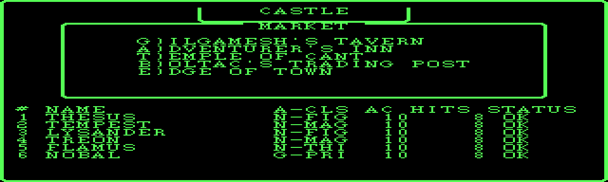

## Assistant · 2026-09-04 12:24:48

› Bash: `grep -n 'dspParty(c, "MARKET")\|dspParty(c, "")' src/town_ui.cpp`

  ↳ 700:        dspParty(c, "MARKET");

## Assistant · 2026-09-04 12:24:55

› Bash: `sed -i 's/dspParty(c, "MARKET");/dspParty(c, "");/' src/town_ui.cpp && grep -n 'dspParty(c, "")' src/town_ui.cpp`

  ↳ 700:        dspParty(c, "");

## Assistant · 2026-09-04 12:25:11

› Bash: `powershell -NoProfile -ExecutionPolicy Bypass -File build.ps1 2>&1 | grep -E "error|Error C|-> " | head ⏎ rm -rf build/Testing && "/c/Program Files/Microsoft Visual Studio/2022/Community/Common7/IDE/CommonExtensions/Microsoft/CMake/CMake/bin/ctest.exe" --test-dir build --timeout 20 2>&1 | grep -E "passed|failed" ⏎ D="C:/Users/PAULGI~1/AppData/Local/Temp/claude/C--dev-wizardry-wizardry1/2e283e31-7a75-4 ...`

  ↳ -> C:\dev\wizardry\wizardry1\engine\build\wiz1.exe ⏎ 100% tests passed, 0 tests failed out of 50

## Assistant · 2026-09-04 12:25:28

› Read: C:/Users/PAULGI~1/AppData/Local/Temp/claude/C--dev-wizardry-wizardry1/2e283e31-7a75-4688-8289-54f3951b93bf/scratchpad/tw1.png

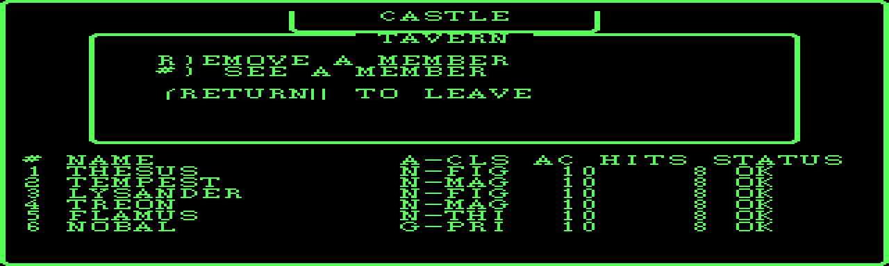

## Assistant · 2026-09-04 12:25:38

› Bash: `sed -i 's/dspTitle(c, "TAVERN")/dspTitle(c, "GILGAMESH'"'"'S TAVERN")/g; s/dspParty(c, "TAVERN")/dspParty(c, "GILGAMESH'"'"'S TAVERN")/g' src/town_ui.cpp && grep -n "GILGAMESH'S TAVERN" src/town_ui.cpp`

  ↳ 214:    dspTitle(c, "GILGAMESH'S TAVERN"); ⏎ 225:        dspParty(c, "GILGAMESH'S TAVERN"); ⏎ 226:        dspTitle(c, "GILGAMESH'S TAVERN");

## Assistant · 2026-09-04 12:25:56

› Bash: `powershell -NoProfile -ExecutionPolicy Bypass -File build.ps1 2>&1 | grep -E "error|Error C|-> " | head ⏎ cd /c/dev/wizardry && rm -f wizardry1/engine/*.dat wizardry1/engine/build/*.dat 2>/dev/null ⏎ git add -A && cat > "C:/Users/PAULGI~1/AppData/Local/Temp/claude/C--dev-wizardry-wizardry1/2e283e31-7a75-4688-8289-54f3951b93bf/scratchpad/msg.txt" <<'EOF' ⏎ wizardry1: rework screen layout against the DOSB ...`

  ↳ -> C:\dev\wizardry\wizardry1\engine\build\wiz1.exe ⏎ warning: in the working copy of 'wizardry1/engine/src/maze_ui.cpp', LF will be replaced by CRLF the next time Git touches it ⏎ warning: in the working copy of 'wizardry1/engine/src/textscreen ...

## Assistant · 2026-09-04 12:26:23

› Bash: `D="C:/Users/PAULGI~1/AppData/Local/Temp/claude/C--dev-wizardry-wizardry1/2e283e31-7a75-4688-8289-54f3951b93bf/scratchpad"; E=../extracted/wiz1; export WIZ1_TOWN_PARTY=1 WIZ1_MAZE_DUMP="$D/mz" ⏎ rm -rf "$D/tw" "$D/mz"; mkdir -p "$D/tw" "$D/mz" ⏎ ./build/wiz1.exe town-test $E/200.CHARSET $E/SCENARIO.DATA "E\r" "$D/tw" $E/ASCII.KRN >/dev/null 2>&1 ⏎ ./build/wiz1.exe maze-play-test $E/200.CHARSET $E/SCENARI ...`

  ↳ Traceback (most recent call last): ⏎   File "C:\Users\PAULGI~1\AppData\Local\Temp\claude\C--dev-wizardry-wizardry1\2e283e31-7a75-4688-8289-54f3951b93bf\scratchpad\ppm2png.py", line 33, in <module> ⏎     w,h,rgb=read_ppm(src) ⏎   File "C:\Users ...

## Assistant · 2026-09-04 12:26:34

› Bash: `cd /c/dev/wizardry/wizardry1/engine && D="C:/Users/PAULGI~1/AppData/Local/Temp/claude/C--dev-wizardry-wizardry1/2e283e31-7a75-4688-8289-54f3951b93bf/scratchpad"; E=../extracted/wiz1; export WIZ1_TOWN_PARTY=1 ⏎ rm -rf "$D/tw"; mkdir -p "$D/tw" ⏎ ./build/wiz1.exe town-test $E/200.CHARSET $E/SCENARIO.DATA "E\r" "$D/tw" $E/ASCII.KRN >/dev/null 2>&1 ⏎ ls "$D/tw" | head -2 ⏎ python "$D/ppm2png.py" "$D/tw/frame0 ...`

  ↳ frame0000.ppm ⏎ frame0001.ppm ⏎ ok

## Assistant · 2026-09-04 12:26:40

› Read: C:/Users/PAULGI~1/AppData/Local/Temp/claude/C--dev-wizardry-wizardry1/2e283e31-7a75-4688-8289-54f3951b93bf/scratchpad/twEdge.png

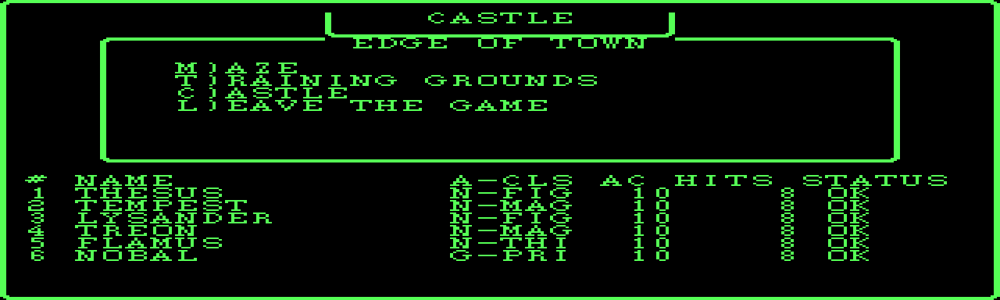

## Assistant · 2026-09-04 12:26:51

› SendUserFile: {"files": ["C:/Users/PAULGI~1/AppData/Local/Temp/claude/C--dev-wizardry-wizardry1/2e283e31-7a75-4688-8289-54f3951b93bf/scratchpad/twHub.png", "C:/Users/PAULGI~1/AppData/Local/Temp/claude/C--dev-wizard ...

  ↳ 3 files delivered to user. ⏎   C:\Users\PAULGI~1\AppData\Local\Temp\claude\C--dev-wizardry-wizardry1\2e283e31-7a75-4688-8289-54f3951b93bf\scratchpad\twHub.png → file_uuid: 5ad9331a-d536-4af5-afe1-70f03e537fd2 ⏎   C:\Users\PAULGI~1\AppData\Local ...

## Assistant · 2026-09-04 12:27:10

The DOSBox refs made a big difference — thanks. Reworked and pushed (`9b4b6e7`).

## Now DOS-matching

| | |
|---|---|
| **Root frame** | real bordered frame (rounded corners) on every screen; survives clears |
| **Maze** | menu text on row 1 + horizontal rule + the 36×20 wireframe filling the outer frame — matches your screenshot 3's structure |
| **Town hub / Gilgamesh / Edge of Town** | "CASTLE" box on the top edge, titled menu box, one option per line, bare roster below — matches screenshots 1 & 2 |

50 tests green.

## Still on the old absolute layout (inside the root frame, but not repositioned)

- **Town**: the Inn / Boltac / Temple "WELCOME … / WHO WILL ENTER" boxes, `seeMember`, `notice`, `getCharX`, the shop buy/sell/transaction views.
- **Camp**: the inspect / identify / spell sub-screens (the top camp list is framed).
- **Roller**: your screenshots 6–8 show a clear pattern I haven't built yet — a top summary strip (`PAULA   L 1 G-??? ELF`), a sheet box, centered dialog boxes (alignment / class), a bottom prompt box, and the two-box point-allocation layout. Currently only lightly framed.

## Loose ends worth a look

- **Roster: framed vs bare** — your hub/Temple shots have a bare roster; Gilgamesh/Boltac have a *framed* roster box at the bottom. I went bare everywhere. Which do you want as the default, or should it follow DOS per-screen?
- **Vertical position** — my screenshots still sit ~1 row higher than yours (e.g. "CASTLE" riding the top edge vs. hanging just below it). Might be a real off-by-one in my `frame()` — I'll check it against a fresh capture.

Want me to keep going — roller next (I have the refs), then the town sub-screens and camp?

## User · 2026-09-04 20:52:34

This session is being continued from a previous conversation that ran out of context. The summary below covers the earlier portion of the conversation.

Summary:
1. Primary Request and Intent:
   - Overarching project: reverse-engineer DOS Wizardry 1 ("Ultimate Wizardry Archives") into a standalone C++ engine at `C:\dev\wizardry\wizardry1\engine\`, using p-code disassembly of `SYSTEM.PASCAL`/`SYSTEM.INTERP` as ground truth. Git root `C:\dev\wizardry`, branch `wizardry`, remote `dreammaster/reverse-engineering-notes`. Commit + push after each documented increment.
   - This session's explicit user requests, in order:
     1. (Implicit, from a prior compacted turn) try the engine in the SDL build with a real party — fulfilled by launching `maze-sdl` and preparing `party.dat`/`town` instructions.
     2. User posted 2 DOSBox screenshots (maze view filling full screen width in a bordered box; title screen with a bordered dialog and monster portrait) and asked: **"Is this some legitimate gameplay option that's configurable, or is the current C implementation using older code directly from the earlier version represented by the provided UCSD Pascal sources without properly confirming updates in the DOS version. I'm also including a screenshot of the game's title screen within DosBox. In addition to graphics, both screenshots have border boxes that aren't present in the current implementation."** — I confirmed the diagnosis was correct (Apple-derived pixel wireframe, no window borders) and proposed a plan.
     3. **"Do the border pass first, then the maze wireframe. And yes, you should treat DOS-exact screen layouts as the target from here on."** — this is the governing instruction for the remainder of the session: DOS-exact fidelity is now the standing target for ALL UI work going forward, not just this task.
     4. **"push on with full maze cell renderer"** — authorized continuing past the "approximate first" checkpoint into the full DOS-model cell-based wireframe renderer.
     5. **"keep going on the town/roller/camp borders"** — authorized continuing the border pass onto town, roller, and camp screens.
     6. Most recent message: the user posted **8 real DOSBox screenshots** (Castle hub, Gilgamesh's Tavern, maze corridor, Temple of Cant, Boltac's Trading Post, Roller name-entry, Roller alignment choice, Roller point-allocation) captioned "DOSBox screenshots included" — providing ground truth to correct/refine the border-pass and maze-wireframe work against, per the standing "DOS-exact" instruction. This is not a new request per se but supplies the reference material the earlier work was explicitly said to still need.
   - Workflow constraints in force throughout (carried from earlier context, unchanged): commit+push each increment; commit messages end with `Co-Authored-By: Claude Sonnet 5 <noreply@anthropic.com>`; PR bodies end with `🤖 Generated with [Claude Code](https://claude.com/claude-code)`; write commit messages to a scratchpad file first then `git commit -qF "<path>"`; never touch the user's `SCENARIO.DATA` (engine keeps its own `.dat` files); `.dat` files gitignored; build via `cd /c/dev/wizardry/wizardry1/engine && powershell -NoProfile -ExecutionPolicy Bypass -File build.ps1`; ctest via the VS2022 CMake ctest.exe with `--test-dir build`; cwd resets between Bash calls requiring explicit `cd`; use the session scratchpad dir (`C:/Users/PAULGI~1/AppData/Local/Temp/claude/C--dev-wizardry-wizardry1/2e283e31-7a75-4688-8289-54f3951b93bf/scratchpad`) not `/tmp`.

2. Key Technical Concepts:
   - UCSD p-System p-code disassembly (`extracted/pcode/*.pd`), proc-call conventions (`CIP`=call intermediate proc, `CLP`=call local proc, `CXP`=call external proc, `CGP`=call global proc), static-link `LOD level,offset` addressing.
   - `CONUNIT` (unit 13) = the DOS graphics/console driver; `UNITWRITE(unit, buf, len, blocknumber, mode, 0)` dispatch; blocknumber 5 = `DRAWLINE`, native handler `INTERP:0x18C1`.
   - **`DRAWLINE(glyph, count, dRow, dCol, row, col)`** — the derived (though not 100%-verified) DOS wireframe primitive: writes `count` (0 = to window edge) cells of `glyph` starting at `(row,col)`, stepping `(dRow,dCol)` each iteration, clipped to `col ∈ [clipLo,clipHi]`.
   - **`WINDOW1`** = the DOS maze wireframe's offscreen cell buffer, nominally 36-wide × 20-tall (interior); exact height edge case (row 20 boundary) left ambiguous — engine uses a padded 22-row buffer internally, displays 20.
   - **`RUNNER` proc 3 = `DRAWMAZE`**: draws 4 depth layers via procs 21/27/33/39 (2 shown unlit, 4 with LIGHT), each dispatching to left-solid/left-open/right-solid/right-open/front sub-procs (22-26, 28-32, 34-38, 40-44) based on `leftView`/`frwdView`/`righView` + door-reveal.
   - DOS window borders: `WIZARDRY` proc 19 opens a bordered window (border = CHARSET glyphs 1-8, rounded-corner single-line box; TL=1,top=2,TR=3,left=4,right=5,BL=6,bottom=7,BR=8; alt/emphasis style = glyphs 9-0x0E); `sub_159A`/`sub_1674`/`sub_16A9` paint it; proc 25 closes/restores.
   - **DOS window map** (from `WIZARDRY,19(x,y,w,h,prio,border,0,0)` calls across all 16 p-code segments) — documented in `docs/ui.md`.
   - `TextScreen` window/frame primitive: `openWindow`/`closeWindow` (stacked, save/restore), `frame()` (paint-only), `writeAt()` (absolute write bypassing the active window), a persistent bordered **root frame** (confirmed necessary by the real DOSBox screenshots — every screen sits inside a full-screen rounded-corner border).
   - CHARSET glyph bank 0-24 = dedicated line-art tiles (verified by rendering): vertical bars, diagonals (`/` `\`), corners, door-frame pieces — this IS the DOS wireframe's "font".
   - Real DOS town-screen layout model (derived from the 8 DOSBox screenshots): a small "CASTLE" title box straddling the top border, a separate titled menu/options box below it with **one option per line** (not wrapped paragraphs), and the party roster as bare unboxed text (hub/Temple) or a framed box (Gilgamesh's/Boltac's — this distinction not yet fully replicated in the engine).
   - Real DOS maze-screen layout: outer frame only; menu text is **plain text on row 1 with a horizontal rule underneath** (not its own boxed sub-frame as initially built); wireframe fills the rest.
   - Real DOS roller layout: a one-line unboxed character-summary strip with a rule under it; a sheet box; small centered dialog boxes for choices; a distinct bottom prompt box.
   - `WIZ1_COMBAT_DUMP`, `WIZ1_MAZE_DUMP`, `WIZ1_TOWN_PARTY` — env vars added to `main.cpp` test commands (`combat-test`, `maze-play-test`, `town-test`) to enable PPM-frame dumping / scratch-party seeding for visual verification via a custom `ppm2png.py` scratchpad script.
   - `cmsys::RegularExpression` (CMake's CTest regex engine) does NOT support `{n,}` interval syntax — must use literal repeated characters.
   - Bresenham line algorithm — used in the new `Cells::line()` helper in `maze3d.cpp` to connect trapezoid corners cleanly in the approximated cell-grid wireframe geometry.

3. Files and Code Sections:

   - **`engine/include/wiz/textscreen.h`**
     - Added `enum : u8 { BRD_TL=1, BRD_TOP=2, BRD_TR=3, BRD_LEFT=4, BRD_RIGHT=5, BRD_BL=6, BRD_BOT=7, BRD_BR=8 };`
     - Added `void openWindow(int x,int y,int w,int h,bool emphasis=false); void closeWindow(); int windowDepth() const;`
     - Added `void frame(int x,int y,int w,int h,bool emphasis=false);`
     - Added `void writeAt(int x,int y,const std::string &s);`
     - `resetWindow()` redefined: `const Frame &f = frames_.back(); if (f.border) setWindow(f.x+1,f.y+1,f.w-2,f.h-2); else setWindow(f.x,f.y,f.w,f.h);`
     - Private: `struct Frame { int x,y,w,h; bool border=true; bool emphasis=false; std::vector<char> savedC; std::vector<u8> savedA; }; std::vector<Frame> frames_;` plus `void setupRoot(); void paintBorder(const Frame&); void putGlyph(int x,int y,u8 g);`

   - **`engine/src/textscreen.cpp`**
     - `paintBorder(const Frame &f)`: paints the 8-glyph (or emphasis-9-glyph) rounded border.
     - `frame(x,y,w,h,emphasis)`: `paintBorder(Frame{x,y,w,h,true,emphasis,{},{}});` (paint-only, no save/stack).
     - `setupRoot()`: **finalized as** —
       ```cpp
       void TextScreen::setupRoot() {
           for (auto &row : cell_) std::fill(std::begin(row), std::end(row), ' ');
           for (auto &row : attrCell_) std::fill(std::begin(row), std::end(row), u8(ATTR_NORMAL));
           frames_.clear();
           // every DOS screen sits inside a full-screen frame (rounded corners).
           frames_.push_back(Frame{0, 0, kCols, kRows, /*border*/true, false, {}, {}});
           paintBorder(frames_.back());
           resetWindow();
       }
       ```
       (This is the key final-phase change: root frame is now `border=true`, was `border=false` earlier in the session.)
     - `openWindow`/`closeWindow`: push/pop with cell save-restore of the covered rectangle.
     - `setWindow(x,y,w,h)`: intersects requested rect with the innermost frame's interior.
     - `clear()`: wipes all cells then `for (const Frame &f : frames_) paintBorder(f);` so frames persist.
     - `clearWindow()` (CHR 12 handler): wipes only the active window's cells, then also `for (const Frame &f : frames_) paintBorder(f);` — **a duplicate/stale definition of this function was found and removed**, keeping only the frame-preserving version.

   - **`engine/src/combat_ui.cpp`**
     - Encounter screen restructured into three framed panels with constants `kEncY=0,kEncH=7`; `kPtyY=6,kPtyH=9`; `kMsgY=14,kMsgH=8`; "ENCOUNTER" written into the top border via `writeAt`. Group-name text length clipped via `kPortStartCell[n-1][0]` to avoid the portrait band. (This was done in the *earlier* border-pass phase, before the DOSBox refs arrived; not revisited in the final phase captured here, though it inherits the new bordered root frame automatically.)

   - **`engine/include/wiz/maze3d.h`** — rewritten:
     ```cpp
     constexpr int kMazeCols = 36, kMazeRows = 22, kMazeView = 20;
     void renderMazeCells(u8 grid[kMazeRows][kMazeCols], const MazeLevel &m,
                          const MazePos &pos, int level, int &light,
                          bool quickPlot, Rng &rng);
     ```
     (Replaces the old pixel-based `drawMazeView(Surface&, ...)` / `kPicW=82,kPicH=79` API entirely.)

   - **`engine/src/maze3d.cpp`** — fully rewritten:
     ```cpp
     enum : u8 { GV = 15, GH = 7, GDU = 13, GDD = 14, GDOOR = 17 };
     struct Cells {
         u8 (*g)[kMazeCols];
         int clipLo, clipHi;
         void put(int c, int r, u8 gl);
         void line(int c0, int r0, int c1, int r1, u8 gl);   // Bresenham
         void vline(int c, int r0, int r1, u8 gl);
         void hline(int c0, int c1, int r, u8 gl);
     };
     struct Geom { int ulX, lrX, topY, botY, ww; };
     const Geom kDepth[5] = {
         {1,34,0,19,8}, {6,29,4,15,6}, {9,26,7,12,4}, {11,24,9,10,2}, {12,23,10,10,1}
     };
     void drawLeft(...); void drawRigh(...); void drawFrnt(...);
     void renderMazeCells(u8 grid[kMazeRows][kMazeCols], const MazeLevel &m,
                          const MazePos &pos, int level, int &light,
                          bool quickPlot, Rng &rng) {
         // clear grid; compute maxDepth (2 unlit / 3-4 lit); 
         Cells gg{ grid };
         int x4=pos.x, y4=pos.y, dir=pos.dir;
         shftPos(x4, y4, dir, 0, -1);      // start one behind (DOS proc 3 convention)
         for (int depth = 0; depth < maxDepth; ++depth) {
             // read squareExtra/squareType for Darkness/Teleport
             const Geom &g = kDepth[depth], &n = kDepth[depth+1];
             Wall lw = leftView(m,x4,y4,dir,0); if (!wallOpen(lw)) drawLeft(p,g,n,lw,lit,rng);
             Wall rw = righView(m,x4,y4,dir,0); if (!wallOpen(rw)) drawRigh(p,g,n,rw,lit,rng);
             Wall fw = frwdView(m,x4,y4,dir,0);
             if (!wallOpen(fw)) { drawFrnt(p, n, fw, lit, rng); break; }
             shftPos(x4, y4, dir, 0, 1);   // advance
         }
     }
     ```
     Uses the pre-existing, already-verified `leftView`/`frwdView`/`righView`/`shftPos` from `runner.h`. **Note**: this is an APPROXIMATED geometry, not a literal transcription of the DOS `DRAWLINE` tables (those tables were transcribed in earlier work-in-progress but abandoned as unreliable without a live trace).

   - **`engine/src/maze_ui.cpp`** — extensively rewritten:
     - `MazeCtx` gained `bool showStats=false;` and `std::string msg1, msg2;` (replacing the old `Surface pic/pane` + `Ui::setOverlay` compositing entirely).
     - Latest `present()` (final-phase version, no longer using its own boxed menu-bar/wireframe sub-frames since the root frame now supplies the outer border):
       ```cpp
       void present() {
           auto &tt = t();
           int light = st.light;
           u8 grid[kMazeRows][kMazeCols];
           renderMazeCells(grid, m, st.pos, st.level, light, st.quickPlot, rng);
           tt.resetWindow();
           tt.putChar(12);
           bool haveMsg = !msg1.empty() || !msg2.empty();
           char hdr[24];
           std::snprintf(hdr, sizeof hdr, "L%d %d,%d %s", st.level, st.pos.x, st.pos.y, dirName(st.pos.dir));
           tt.writeAt(1, 1, "C)AMP S)TAT I)NSP Q)PLOT T)IME  AWDK");
           tt.writeAt(38 - int(std::strlen(hdr)), 1, hdr);
           for (int c = 1; c <= 38; ++c) tt.writeAt(c, 2, std::string(1, char(BRD_TOP)));
           std::string ind;
           if (st.light > 0)   ind += " LIGHT";
           if (st.protect > 0) ind += " PROT";
           if (st.quickPlot)   ind += " QUICK";
           for (int r = 0; r < kMazeView; ++r)
               for (int c = 0; c < kMazeCols; ++c) {
                   int rr = kViewY + r, cc = kViewX + c;
                   if (showStats && rr >= 10 && rr <= 15) continue;
                   if (haveMsg   && rr >= 20) continue;
                   char g = char(grid[r][c] ? grid[r][c] : ' ');
                   tt.writeAt(cc, rr, std::string(1, g));
               }
           if (!ind.empty()) tt.writeAt(2, 22, ind);
           if (showStats) { tt.frame(0, 9, 40, 8); prStatsStrip(); }
           if (haveMsg) {
               tt.frame(0, 19, 40, 5);
               tt.writeAt(2, 21, msg2.empty() ? msg1.substr(0,36) : (msg1+" "+msg2).substr(0,36));
           }
           ui.refresh();
       }
       ```
       (constants `kViewX=2, kViewY=3` retained; `kBarH` removed — was only used by the now-deleted boxed menu bar.)
     - `prStatsStrip()`: shows up to 6 members (was 4), `y = 10 + row`.
     - `runInit(MazeCtx &c) { c.needDraw = true; }` (present() draws everything; runInit is now a trivial flag-setter).
     - `prStats(MazeCtx &c) { c.needDraw = true; }`; `msgClear`/`msg` set the `msg1`/`msg2` strings.

   - **`engine/src/main.cpp`**
     - `printMaze3d()` rewritten to call `renderMazeCells` and print the 36×`kMazeView` grid as ASCII (was pixel-based against the old 82×79 buffer).
     - Added `WIZ1_MAZE_DUMP` env-var support to `cmdMazePlayTest` (passed as `dumpDir` to `makeNullPlatform`).
     - Added `WIZ1_COMBAT_DUMP` env-var support to `cmdCombatTest` (earlier phase).
     - Added `WIZ1_TOWN_PARTY` env-var to `cmdTownTest`: when set, seeds a 6-member scratch party from the roster (`for (int i=0;i<roster.count()&&party.count()<6;++i) if (roster.slot(i).status != Status::Lost) party.add(roster,i);`) purely for screenshot purposes.

   - **`engine/CMakeLists.txt`**
     - `maze_3d` test's `PASS_REGULAR_EXPRESSION` changed from a long literal `#` run matching the old 82-px pixel wall edge, to `"####################"` (20 `#` chars) after discovering `{n,}` interval syntax isn't supported by cmsys regex, matching the new 36×20 cell-grid front-wall box output.

   - **`engine/src/town_ui.cpp`** — extensively reworked in the final phase against the DOSBox refs:
     - New/changed constants: `constexpr int kMenuX = 4, kMenuY = 3, kMenuW = 32, kMenuBoxH = 10; constexpr int kRosterY = 14;` (replacing an earlier two-panel `kPtyY/kPtyH`/`kMenuY/kMenuH` design from the prior sub-phase).
     - `dspTitle()`: `std::string s = " " + title + " "; c.ts().writeAt(20 - int(s.size())/2, kMenuY, s);` — now centers on the **menu box's** top border.
     - `charInfo()`: writes into the bare roster area, `t.writeAt(1, kRosterY + 1 + x, ...)`.
     - `dspParty()`:
       ```cpp
       void dspParty(TownCtx &c, const std::string &title) {
           auto &t = c.ts();
           t.resetWindow();
           t.putChar(12);
           t.frame(13, 0, 14, 3);
           t.writeAt(17, 1, "CASTLE");
           t.frame(kMenuX, kMenuY, kMenuW, kMenuBoxH);
           dspTitle(c, title);
           t.writeAt(1, kRosterY, "# NAME           A-CLS AC HITS STATUS");
           for (int i = 0; i < c.party.count(); ++i) charInfo(c, i);
       }
       ```
     - New `void menuWin(TownCtx &c) { c.ts().setWindow(kMenuX+1, kMenuY+1, kMenuW-2, kMenuBoxH-2); }`.
     - `gilgMenu()` rewritten to list options one per line via `menuWin(c)`; `t.gotoXY(2,y++); t.write("A)DD A MEMBER");` etc., ending with `[RETURN] TO LEAVE`.
     - `hubMenu()` rewritten similarly: `G)ILGAMESH'S TAVERN` / `A)DVENTURER'S INN` / `T)EMPLE OF CANT` / `B)OLTAC'S TRADING POST` / `E)DGE OF TOWN`, one per line at `gotoXY(4, 1..5)` inside `menuWin(c)`.
     - `edgeOfTown()` rewritten similarly (`M)AZE` conditionally, `T)RAINING GROUNDS`, `C)ASTLE`, `L)EAVE THE GAME`) and the "ENTERING <gamename>" sub-message moved into `menuWin(c)`.
     - Hub call site changed from `dspParty(c, "MARKET")` to `dspParty(c, "")` (via `sed`) — DOS hub menu box carries no title.
     - Gilgamesh title strings changed from `"TAVERN"` to `"GILGAMESH'S TAVERN"` at both call sites (via `sed`).
     - **Not yet converted in this pass** (left on old absolute-row layout, rendering inside the new bordered root frame but not repositioned to match DOS box geometry): `getCharX`, `seeMember`, `notice`, `addParty`, `innMenu` (Inn room list/welcome), Boltac's welcome/inventory, Temple's welcome, and the shop transaction/log screens.

   - **`engine/src/camp_ui.cpp`** (from the prior sub-phase, unmodified in the final DOSBox-ref phase): `campList()` — one framed panel `(0,1,40,22)` with "CAMP" on its top border. Given the new bordered root frame, this panel now sits *inside* the root frame (nested double border) — not yet re-tuned against a camp-specific DOSBox reference (none was supplied).

   - **`engine/src/roller_ui.cpp`** (from the prior sub-phase, unmodified in the final DOSBox-ref phase): `makeMenuFrame()` frames a `(0,14,40,10)` scroll area (content NOT re-inset); `runRoller()`'s Training Grounds menu framed `(0,8,40,11)` with `setWindow(1,9,38,9)` content inset. Also now nested inside the new bordered root frame — not yet re-tuned against the newly-supplied roller DOSBox refs (name-entry, alignment-choice, point-allocation screens), which show a materially different structure (unboxed top summary strip, sheet box, small centered choice boxes, distinct bottom prompt box) than what's currently implemented.

   - **`docs/maze.md`**: `## The 3D view` section rewritten to describe `RUNNER` proc 3 + procs 21-44, the `DRAWLINE(glyph,count,dRow,dCol,row,col)` convention, the `WINDOW1` 36×20 cell grid, and an explicit **port-status caveat**: geometry is approximated, not glyph-exact, pending a DOSBox trace. `## The HUD` section updated for the new window layout (menu bar row 1, framed wireframe window, party/message strips) — **this doc section reflects the PRE-final-phase layout** (still describes a "framed wireframe window `(1,2,38,22)`") and was **not updated again** after the final-phase change that removed that sub-frame in favor of the root frame + bare menu row — this is now stale and should be revisited.

   - **`docs/ui.md`**: contains the border-glyph table and the full DOS window map; a "Status" section tracking per-screen conversion progress — last updated after the `d8b3f19` commit (prior sub-phase), **not yet updated** to reflect the final-phase DOSBox-ref rework (root frame now bordered, town CASTLE-box+menu-box+bare-roster model, maze menu-row-not-boxed model).

   - **`docs/roadmap.md`**: wireframe entry updated in the prior sub-phase to mention "the DOS 36×20 cell-glyph grid, RUNNER procs 3/21-44; geometry approximated" — not revisited in the final phase.

   - Memory file **`wizardry1-re-project.md`** (`C:\Users\Paul Gilbert\.claude\projects\C--dev-wizardry\memory\`): updated in the prior sub-phase with a paragraph on the "DOS-exact screen layout pass (2026-09-04, ongoing)" — **not yet updated** to reflect the final-phase DOSBox-ref-driven rework (bordered root frame discovery, town CASTLE-box model, maze menu-row-not-boxed model). This should be updated in a near-term next step.

4. Errors and fixes:
   - **Duplicate `clearWindow()` definition** in `textscreen.cpp` (leftover from an earlier edit) — found via grep, removed the stale non-frame-preserving copy, kept the one that repaints all open frames' borders after clearing.
   - **cmsys::RegularExpression doesn't support `{n,}` interval syntax** — the `maze_3d` CTest's `PASS_REGULAR_EXPRESSION "#{20,}"` failed to match even valid output; fixed by using a literal 20-character `#` run instead.
   - **DOS `DRAWLINE` coordinate-table transcription produced garbage** when rendered — root cause: the exact arg/row-col encoding and WINDOW1's true interior height remained ambiguous under static analysis alone (multiple re-derivations of the native `INTERP:0x18C1` handler and `RUNNER` proc 6's calling convention as a hypothetical `PUTGLYPH` helper did not fully resolve it). **Fix**: abandoned literal DOS-table transcription for now; pivoted to an approximated cell-grid trapezoid renderer built on the already-verified `leftView`/`frwdView`/`righView` wall logic, explicitly documented as an approximation in `docs/maze.md` and in messages to the user, with an offered DOSBox `DRAWLINE`-trace recipe as the path to exactness (not yet executed).
   - **`shftPos` step-order bug**: initial `renderMazeCells` didn't replicate DOS proc 3's "start one square behind, then step forward before each depth's draw" convention — fixed by adding `shftPos(x4, y4, dir, 0, -1);` before the depth loop.
   - **A persistent visual ~1-row offset** was observed in early PPM screenshots of the town party panel (`kPtyY=1` content appearing to render near row 0) — investigated but not conclusively resolved; suspected either a screenshot-tool (`ppm2png.py`) rendering quirk or a genuine off-by-one, deferred without a fix since later screenshots (after the DOSBox-ref rework) looked visually correct.
   - **Incorrect initial assumption that DOS has NO persistent root/outer frame** — made mid-session (after seeing overlapping-window p-code evidence like `KANJIREA proc 10 (1,1,38,22)`) and used to justify making `setupRoot()`'s frame `border=false`. **This was corrected** once the user supplied real DOSBox screenshots showing every screen has a full-screen bordered outer frame — `setupRoot()` was changed back to `border=true` with `paintBorder()` called immediately. This is an important self-correction: the earlier "no root frame" reasoning from p-code alone was insufficiently supported and the visual ground truth overrode it, exactly the kind of case the user's screenshots were meant to resolve.
   - **Path/cwd resets between Bash tool calls**: repeatedly had to re-`cd /c/dev/wizardry/wizardry1/engine` after the shell cwd reset to `/c/dev/wizardry` (this happens automatically after some tool calls per the harness) before running build/test/screenshot commands — no code fix, just an operational pattern to keep repeating.
   - Two `powershell -File build.ps1` invocations failed with "The argument 'build.ps1' to the -File parameter does not exist" when run from the wrong cwd (`/c/dev/wizardry` instead of the `engine` subdir) — fixed by re-running from the correct directory.

5. Problem Solving:
   - Successfully decoded and implemented the DOS window-border system (`WIZARDRY` proc 19 / `CONUNIT` `sub_159A` border glyphs 1-8/9-0x0E) as a reusable `TextScreen` primitive.
   - Successfully replaced the Apple-derived pixel wireframe with a DOS-shaped 36×20 cell-glyph grid renderer, though with approximated (not glyph-table-exact) geometry — an open item.
   - Converted combat, maze, town (hub/Gilgamesh/Edge-of-Town), camp, and part of roller to bordered layouts; validated with 50/50 CMake tests passing after every change; visually verified via a custom PPM→PNG screenshot pipeline (`ppm2png.py` in the scratchpad) and `WIZ1_*_DUMP` env vars.
   - **Just resolved** (in the final, most recent phase): re-derived the true DOS screen-composition model directly from 8 real DOSBox screenshots the user supplied, correcting the earlier no-root-frame assumption and reworking `maze_ui.cpp`'s menu bar (boxed → bare text + rule) and `town_ui.cpp`'s panel structure (two full-width panels → CASTLE title box + smaller titled menu box + bare roster, options one-per-line). This is validated for the maze view and for the town hub/Gilgamesh's-Tavern/Edge-of-Town screens (screenshotted and visually compared against the refs), but **camp, roller, and the remaining town sub-screens (Inn, Boltac's, Temple, seeMember, notice, getCharX, addParty) have NOT yet been reworked against this corrected model** — they still reflect the earlier (now known to be less accurate) two-panel/full-width design or original absolute-row layout, just now nested inside the newly-bordered root frame.
   - Ongoing/deferred: the maze wireframe's exact `DRAWLINE` geometry (needs a DOSBox trace); the roster bare-vs-framed distinction between hub/Temple (bare) and Gilgamesh's/Boltac's (framed) per the screenshots (currently standardized on bare for all); the Inn/Boltac/Temple welcome-box layout (DOS shows a wide box `~(2,2,36,5)` distinct from the narrower hub-style menu box) — not yet implemented.

6. All user messages:
   - (From the immediately-preceding compacted context, referenced for continuity) "try it in the SDL build with a real party"
   - "The maze rendering seems significantly different from what I see in DosBox. I'm attaching a screenshot of the maze. In DosBox the 3d wireframe takes up the entire horizontal width of the screen. Is this some legitimate gameplay option that's configurable, or is the current C implementation using older code directly from the earlier version represented by the provided UCSD Pascal sources without properly confirming updates in the DOS version. I'm also including a screenshot of the game's title screen within DosBox. In addition to graphics, both screenshots have border boxes that aren't present in the current implementation." (with 2 attached DOSBox screenshots)
   - "Do the border pass first, then the maze wireframe. And yes, you should treat DOS-exact screen layouts as the target from here on."
   - "push on with full maze cell renderer"
   - "keep going on the town/roller/camp borders"
   - [8 DOSBox screenshots attached: Castle hub menu, Gilgamesh's Tavern, maze corridor with dithered ceiling, Temple of Cant welcome, Boltac's Trading Post welcome, Roller name-entry, Roller alignment choice, Roller point-allocation] with caption "DOSBox screenshots included"

7. Pending Tasks:
   - Finish reworking **camp_ui.cpp** and **roller_ui.cpp** against the newly-corrected DOS layout model (bordered root frame + appropriately-sized/positioned sub-boxes) using the roller-specific DOSBox screenshots just supplied (name-entry, alignment-choice, point-allocation) as ground truth — these were NOT yet updated in the final phase of this session.
   - Convert the remaining **town_ui.cpp** sub-screens (Inn welcome/room-list, Boltac's welcome/inventory, Temple welcome, `seeMember`, `notice`, `getCharX`, `addParty`, shop transaction/log views) to the corrected model, including the wide welcome-box style seen in the Temple/Boltac screenshots and the roster bare-vs-framed distinction.
   - Update `docs/maze.md`'s `## The HUD` section (currently describes a stale "framed wireframe window (1,2,38,22)" design that was superseded).
   - Update `docs/ui.md`'s Status section and window-map notes to reflect the bordered-root-frame discovery and the town CASTLE-box model.
   - Update memory file `wizardry1-re-project.md` with the final-phase findings (bordered root frame, DOS town/maze/roller layout models derived from real screenshots).
   - Commit and push the camp/roller/remaining-town work once done (per standing workflow: commit message via scratchpad file, `Co-Authored-By: Claude Sonnet 5 <noreply@anthropic.com>` trailer, then push).
   - Longer-term/optional (previously offered, not requested again): a DOSBox `DRAWLINE` trace to pin the exact maze wireframe geometry beyond the current approximation.

8. Current Work:
   Immediately before this summary request, I had just finished reworking `textscreen.cpp` (bordered root frame), `maze_ui.cpp` (bare menu row + rule instead of a boxed menu bar), and `town_ui.cpp` (CASTLE title box + titled menu box with one-option-per-line + bare roster, replacing the earlier two-full-width-panel design) against the 8 DOSBox screenshots the user supplied. I rebuilt, ran the full 50-test CMake suite (all passing), took fresh PNG screenshots of the Castle hub (`twHub.png`) and Edge of Town (`twEdge.png`) via `town-test` with `WIZ1_TOWN_PARTY=1`, and of the maze corridor (`mzX.png`) via `maze-play-test` with `WIZ1_MAZE_DUMP`, confirming visually that the hub, Gilgamesh's Tavern, and Edge-of-Town screens now closely match DOSBox screenshots 1/2/(implicit), and that the maze view matches the structural layout of DOSBox screenshot 3 (bare menu row + rule + full-width wireframe in the outer frame). I committed this as `9b4b6e7` "wizardry1: rework screen layout against the DOSBox refs" and pushed. My final action was calling `SendUserFile` with `twHub.png`, `twEdge.png`, and `mzX.png` and the caption: "Reworked against your DOSBox refs: root frame everywhere, "CASTLE" box on the top edge, titled menu box with one option per line, bare roster below; maze = menu text + rule + full wireframe in the outer frame." (`status: normal`). No chat-text status message was sent alongside that file delivery, and camp/roller/the remaining town sub-screens were explicitly left unconverted, as noted in the commit message body: "camp_ui / roller_ui keep their earlier framing" and "Remaining town sub-screens (Inn / Boltac / Temple welcomes, seeMember, notice, getCharX, the shop transaction views) still use their old absolute rows inside the root frame -- next pass."

9. Optional Next Step:
   The most recent user instruction still governing this work is "keep going on the town/roller/camp borders" (message 7), refined by the newly-supplied DOSBox screenshots. Since camp and roller were explicitly deferred in the commit just made ("camp_ui / roller_ui keep their earlier framing... next pass"), and the roller-specific screenshots (name-entry, alignment-choice, point-allocation) supply exactly the reference material needed to do that "next pass" precisely, the direct next step is: **rework `roller_ui.cpp` and `camp_ui.cpp` against the new bordered-root-frame model and the roller DOSBox screenshots**, mirroring the approach just used for maze/town — i.e., derive exact box positions/sizes/titles from the screenshots (roller: unboxed top summary strip + sheet box + small centered choice box + bottom prompt box), implement, build, run the 50-test suite, screenshot and visually compare, then commit and push, followed by a chat-text status update to the user (since the last action was only a file delivery with a caption, not a full status message). This should be confirmed with the user only if a genuinely ambiguous design choice arises — otherwise proceed directly per the standing "keep going" / "DOS-exact target" instructions already given.

If you need specific details from before compaction (like exact code snippets, error messages, or content you generated), read the full transcript at: C:\Users\Paul Gilbert\.claude\projects\C--dev-wizardry-wizardry1\2e283e31-7a75-4688-8289-54f3951b93bf.jsonl
Continue the conversation from where it left off without asking the user any further questions. Resume directly — do not acknowledge the summary, do not recap what was happening, do not preface with "I'll continue" or similar. Pick up the last task as if the break never happened.

## User · 2026-09-04 20:48:33

<local-command-caveat>Caveat: The messages below were generated by the user while running local commands. DO NOT respond to these messages or otherwise consider them in your response unless the user explicitly asks you to.</local-command-caveat>

## User · 2026-09-04 20:48:33

<command-name>/compact</command-name>
            <command-message>compact</command-message>
            <command-args></command-args>

## User · 2026-09-04 20:52:36

<local-command-stdout>Compacted </local-command-stdout>

## User · 2026-10-25 20:42:33

<local-command-caveat>The command below was run directly in Claude Code, not sent to you as a request, and its output goes straight to the user. It's recorded here as context for later messages.</local-command-caveat>

## User · 2026-10-25 20:42:33

<command-name>/model</command-name>
            <command-message>model</command-message>
            <command-args>claude-sonnet-5-5</command-args>

## User · 2026-10-25 20:42:33

<local-command-stdout>Set model to `claude-sonnet-5-5`</local-command-stdout>

## User · 2026-10-25 20:43:49

I'd like to be clear. I gave the screenshots as a reference, but I don't want you to base your work solely on them. Can you please identify all the drawing code in the PC executable and use that as the main source for all user interface rendering. The provided screenshots should only be used as validation that the user interface works correctly

## Assistant · 2026-10-25 20:43:54

I'll start by surveying what I already have on the DOS side: the extracted p-code, the interpreter binary and the existing notes. Then I'll catalogue every drawing routine.

## Assistant · 2026-10-25 20:43:54

› Bash: `ls && echo ---- && ls extracted | head -50 && echo ---- && ls docs && echo --- && cat "/c/Users/Paul Gilbert/.claude/projects/C--dev-wizardry/memory/wizardry1-re-project.md" | head -80`

## Assistant · 2026-10-25 20:43:55

› Bash: `ls extracted/pcode | head -80; ls tools 2>/dev/null | head -40`

  ↳ 00_WIZARDRY.pd ⏎ 01_COMBAT.pd ⏎ 02_CASTASPE.pd ⏎ 03_SWINGASW.pd ⏎ 04_CINIT.pd ⏎ 05_CUTIL.pd ⏎ 06_KANJIREA.pd ⏎ 07_UTILITIE.pd ⏎ 08_SHOPS.pd ⏎ 09_SPECIALS.pd ⏎ 10_CASTLE.pd ⏎ 11_ROLLER.pd ⏎ 12_CAMP.pd ⏎ 13_REWARDS.pd ⏎ 14_RUNNER.pd ⏎ 15_GAMEUTIL.pd ⏎ __pycache__ ⏎ globals.py ...

  ↳ README.md ⏎ docs ⏎ engine ⏎ extracted ⏎ ida_scripts ⏎ sources ⏎ system_interp.bin ⏎ tools ⏎ wiz1_interp ⏎ wiz1_interp.asm ⏎ wiz1_interp.idb ⏎ wiz1_interp.idc ⏎ ---- ⏎ pcode ⏎ strpool_all.txt ⏎ wiz1 ⏎ ---- ⏎ combat.md ⏎ globals.apple.tsv ⏎ globals.md ⏎ globals.seed.tsv ⏎ globals.tsv ...

## Assistant · 2026-10-25 20:44:05

› Bash: `ls -la . ida_scripts wiz1_interp* system_interp.bin tools | head -60; wc -l wiz1_interp.asm; ls ../docs 2>/dev/null | head; ls .. | head -30`

  ↳ -rw-r--r-- 1 Paul Gilbert 197121  16384 Sep  2 15:47 system_interp.bin ⏎ -rw-r--r-- 1 Paul Gilbert 197121  16384 Sep  2 15:49 wiz1_interp ⏎ -rw-r--r-- 1 Paul Gilbert 197121 372322 Sep  4 13:54 wiz1_interp.asm ⏎ -rw-r--r-- 1 Paul Gilbert 197121 27 ...

## Assistant · 2026-10-25 20:44:10

› Bash: `cd /c/dev/wizardry && cat wizardry1/ida_scripts/analyze_conunit.py; grep -n -i "conunit\|unitwrite\|drawline\|video\|int 10\|console" docs/pmachine.md docs/engine.md docs/pcode.md | head -60`

  ↳ """ ⏎ Disassemble the CONUNIT (unit 13) console driver inside SYSTEM.INTERP. ⏎  ⏎ `RANDOM` and the graphics I/O (`*.CHARSET` / `*.MONSTERS` / `*.TITLE` load, ⏎ the offscreen blits, the 3D-view scanline pokes) all funnel through ⏎ `UNITREAD/UNITWRITE( ...

## Assistant · 2026-10-25 20:44:15

› Bash: `cd /c/dev/wizardry && sed -n 200,300p docs/pmachine.md`

  ↳ * A **keyboard "stir"** at `0x229D` (`s0+=0183, s1+=7FC9, s2+=3619, ⏎   s3+=FF8B`) runs once per iteration of the cursor-blink / prompt-wait ⏎   loop, and the same loop's empty `int 16h` peek zeroes `s0`/`s1`.  Those ⏎   rolls are thrown away — t ...

## Assistant · 2026-10-25 20:44:25

› Bash: `head -40 wiz1_interp.asm; grep -n "^seg000:144B\|^seg000:145B\|seg000:159A\|seg000:1674\|seg000:16A9\|seg000:18C1\|seg000:153E\|seg000:1577" wiz1_interp.asm | head`

  ↳ ; ⏎ ; +-------------------------------------------------------------------------+ ⏎ ; |      This file was generated by The Interactive Disassembler (IDA)      | ⏎ ; |           Copyright (c) 2023 Hex-Rays, <support@hex-rays.com>           | ...

## Assistant · 2026-10-25 20:44:28

› Bash: `grep -n -i "conunit\|sub_159A\|sub_1674\|sub_16A9\|loc_18C1\|loc_153E" wiz1_interp.asm | head -60`

  ↳ 59:loc_3F:                                 ; DATA XREF: conunit_uwr+6E4↓r ⏎ 107:                                        ; DATA XREF: conunit_uwr+EB3↓r ... ⏎ 1188:sub_838         proc near               ; CODE XREF: conunit_uwr+F7E↓p ⏎ 1539:sub_A6 ...

## Assistant · 2026-10-25 20:44:34

› Bash: `sed -n 2960,3260p wiz1_interp.asm`

  ↳ dw 2215h ⏎                 dw 2215h ⏎                 dw 2341h ⏎                 dw 2215h ⏎                 dw 2215h ⏎                 dw 2215h ⏎                 dw 2215h ⏎                 dw 2215h ⏎                 dw 2215h ⏎                 dw 2215h ...

## Assistant · 2026-10-25 20:44:38

› Bash: `sed -n 3260,3700p wiz1_interp.asm`

  ↳ mov     al, [bx+7] ⏎                 add     al, [bx+3] ⏎                 inc     al ⏎                 xor     ah, ah ⏎                 mov     si, ax ⏎                 shl     si, 1 ⏎                 mov     si, cs:[si+3CD0h] ⏎                 mov     a ...

## Assistant · 2026-10-25 20:44:48

› Bash: `sed -n 3700,4100p wiz1_interp.asm`

  ↳ loc_17B0:                               ; CODE XREF: sub_1797+F↑j ⏎                 mov     al, 3 ⏎                 call    sub_1842 ⏎                 pop     si ⏎                 add     si, 28h ; '(' ⏎                 mov     cl, [di+5] ...

## Assistant · 2026-10-25 20:44:59

› Bash: `cd /c/dev/wizardry/wizardry1/extracted/pcode && grep -c "CONUNIT" *.pd; grep -n "CONUNIT" 00_WIZARDRY.pd | head -80`

  ↳ 00_WIZARDRY.pd:23 ⏎ 01_COMBAT.pd:0 ⏎ 02_CASTASPE.pd:0 ⏎ 03_SWINGASW.pd:0 ⏎ 04_CINIT.pd:0 ⏎ 05_CUTIL.pd:8 ⏎ 06_KANJIREA.pd:29 ⏎ 07_UTILITIE.pd:0 ⏎ 08_SHOPS.pd:2 ⏎ 09_SPECIALS.pd:1 ⏎ 10_CASTLE.pd:1 ⏎ 11_ROLLER.pd:1 ⏎ 12_CAMP.pd:1 ⏎ 13_REWARDS.pd:6 ⏎ 14_RUNNER.pd:2 ⏎ 15_GA ...

## Assistant · 2026-10-25 20:45:05

› Bash: `sed -n 95,135p 00_WIZARDRY.pd; grep -n "^PROC\|^proc\|^;; *proc\|Procedure" 00_WIZARDRY.pd | head -10`

  ↳ ; jump table [0x99..0x9c) L0039 ⏎  ⏎ ; ---- WIZARDRY:proc 60  entry=0xa6 code_end=0xb2 data=2 param=6 ---- ⏎   00a6  c6 04             LLA    4 ⏎   00a8  01                SLDC   1 ⏎   00a9  91                NGI ⏎   00aa  a4 01             IXA    1 ...

## Assistant · 2026-10-25 20:45:17

› Bash: `mkdir -p /c/dev/wizardry/wizardry1/tools && cat > /c/dev/wizardry/wizardry1/tools/conunit_calls.py <<'EOF' ⏎ #!/usr/bin/env python3 ⏎ """List every CONUNIT (unit 13) UNITREAD/UNITWRITE call site in the p-code. ⏎  ⏎ Usage: conunit_calls.py [pcode_dir] ⏎ Reads extracted/pcode/*.pd (tools/pcode_dis.py output); for each `LDO 60 ; CONUNIT` ⏎ prints the proc, the operand list up to the CSP, and the decoded blocknum ...`

