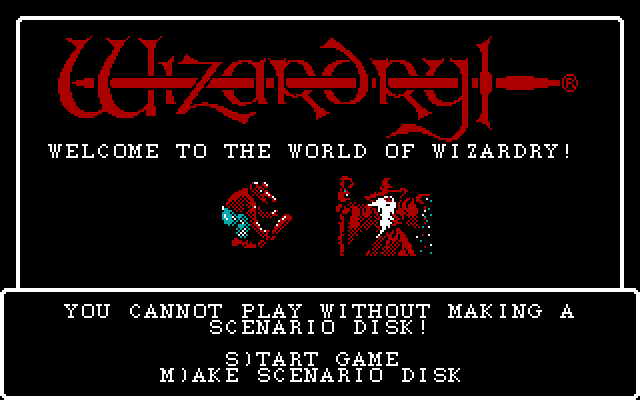
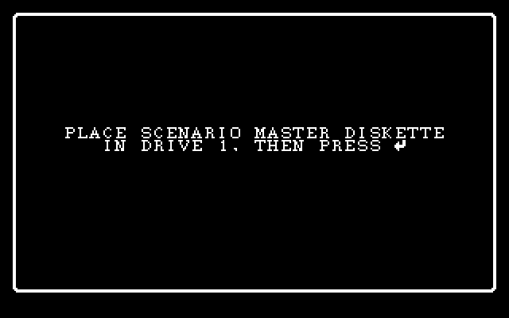
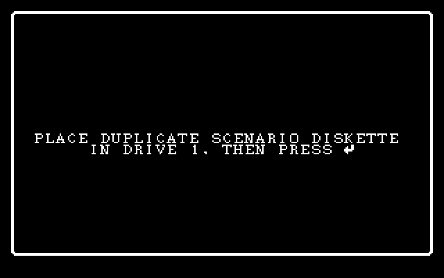
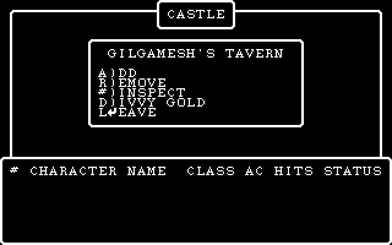
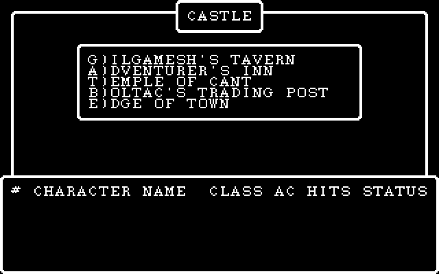
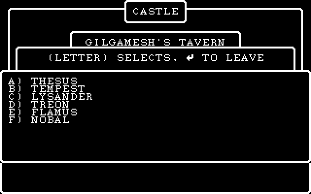
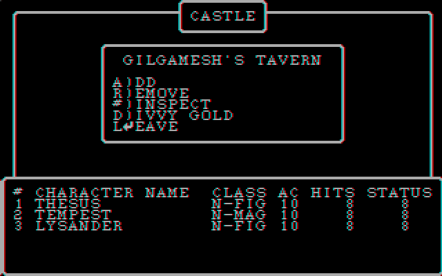
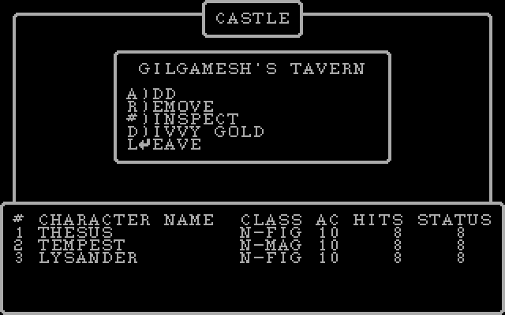
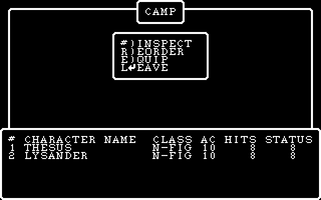
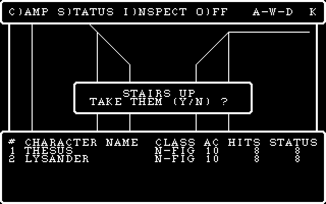

# session2 — part 7  (2026-10-25 20:45:19 … 2026-10-25 22:17:53)

  ↳ KANJIREA  proc   2 @005c UNITREAD  LLA 4; SLDC 0; SLDC 21; SLDC 0; SLDC 0 ⏎ KANJIREA  proc  16 @0cb7 UNITREAD  LLA 14; SLDC 0; SLDC 21; SLDC 0; SLDC 0 ⏎ WIZARDRY  proc  33 @0694 UNITREAD  LLA 3; SLDC 0; SLDC 11; SLDC 0; SLDC 0 ⏎ WIZARDRY  proc ...

## Assistant · 2026-10-25 20:45:24

› Bash: `sed -n 4100,4560p wiz1_interp.asm`

  ↳ push    ax ⏎                 push    bx ⏎                 lea     di, [si+0Ah] ⏎                 mov     bx, cs:[bx] ⏎                 add     bx, 144h ⏎                 shl     bx, 1 ⏎                 add     di, bx ⏎                 shl     ax, 1 ...

## Assistant · 2026-10-25 20:45:50

› Bash: `sed -n 4560,5100p wiz1_interp.asm`

  ↳ call    pm_format_msg ⏎                 pop     di ⏎  ⏎ loc_1C88:                               ; CODE XREF: sub_1BC8:loc_1C88↓j ⏎                 jmp     short loc_1C88 ⏎ ; --------------------------------------------------------------------------- ...

## Assistant · 2026-10-25 20:45:57

› Bash: `python -c "import capstone; print(capstone.__version__)" 2>&1 | head -2; which ndisasm objdump 2>&1 | head; ls "/c/Program Files/IDA"* 2>/dev/null | head -3; cat ida_scripts/run_ida_script.ps1 | head -30`

  ↳ Traceback (most recent call last): ⏎   File "<string>", line 1, in <module> ⏎ /c/mingw64/bin/ndisasm ⏎ /c/mingw64/bin/objdump ⏎ /c/Program Files/IDA Pro 7.7: ⏎ plugins ⏎  ⏎ <# ⏎ Run an IDA script headlessly against one of this project's .idb databases, ⏎ t ...

## Assistant · 2026-10-25 20:46:02

› Bash: `ndisasm -b16 -o 0x1DE7 -e 0x1DE7 wiz1_interp 2>/dev/null | head -400`

  ↳ 00001DE7  56                push si ⏎ 00001DE8  57                push di ⏎ 00001DE9  06                push es ⏎ 00001DEA  32FF              xor bh,bh ⏎ 00001DEC  8AD8              mov bl,al ⏎ 00001DEE  D1E6              shl si,0x0 ⏎ 00001DF0  2 ...

## Assistant · 2026-10-25 20:46:17

› Bash: `grep -n "^loc_2353\|^loc_234A\|^loc_235D\|^loc_23D8\|^loc_244A\|^loc_247B\|^loc_23CE\|^loc_24D5\|^loc_24F4\|^sub_2211\|^conunit_scanline19\|^conunit_noop\|^sub_229D\|^sub_1210\|^pm_load_startup_seg\|^interp_fetch" wiz1_interp.asm`

  ↳ 216:interp_fetch:                           ; CODE XREF: interp_reloc:loc_46↑j ⏎ 815:pm_load_startup_seg proc near           ; CODE XREF: pm_bootstrap_pascal+1D↑p ⏎ 851:pm_load_startup_seg endp ; sp-analysis failed ⏎ 2757:sub_1210        proc nea ...

## Assistant · 2026-10-25 20:46:19

› Bash: `sed -n 5365,5380p wiz1_interp.asm; sed -n 5500,6010p wiz1_interp.asm`

  ↳ ; =============== S U B R O U T I N E ======================================= ⏎  ⏎  ⏎ sub_2211        proc near               ; CODE XREF: conunit_uwr+6D1↑p ⏎                 mov     ax, 1 ⏎                 retn ⏎ sub_2211        endp ⏎  ⏎ ; -------------- ...

## Assistant · 2026-10-25 20:46:26

Still on the same step. I've read most of the native driver. The remaining routines are the keyboard, string and sound services (cases 20–34), and I'm checking which of them draw.

## Assistant · 2026-10-25 20:46:27

› Bash: `sed -n 2505,2560p wiz1_interp.asm; sed -n 1180,1260p wiz1_interp.asm; sed -n 1535,1600p wiz1_interp.asm`

  ↳ mov     ah, 0 ⏎                 retn ⏎ sub_1065        endp ⏎  ⏎  ⏎ ; =============== S U B R O U T I N E ======================================= ⏎  ⏎  ⏎ sub_10C5        proc near               ; CODE XREF: conunit_uwr+6C8↓p ...

## Assistant · 2026-10-25 20:46:32

› Bash: `head -5 docs/procmap.tsv; grep -i "^WIZARDRY\|^00_WIZ" docs/procmap.tsv | head -80; ls sources | head`

  ↳ # dos_seg	dos_proc	apple_name	conf	evidence ⏎ CAMP	1	CAMP	manual	segment main ⏎ CAMP	39	TRADGOLD	auto:6	calls:ADDLONGS,MULTLONG,SUBLONGS ⏎ CASTASPE	1	CASTASPE	manual	segment main ⏎ CASTLE	1	CASTLE	manual	segment main ⏎ WIZARDRY	1	WIZARDRY	manual ...

## Assistant · 2026-10-25 20:46:35

› Bash: `cd /c/dev/wizardry/wizardry1/extracted/pcode && grep -n "^; ---- WIZARDRY:proc" 00_WIZARDRY.pd | awk -F'[ :]' '{print $0}' | sed 's/; ---- //' | head -100`

  ↳ 3:WIZARDRY:proc 59  = FINDFILE  entry=0x0 code_end=0x9a data=2090 param=8 ---- ⏎ 97:WIZARDRY:proc 60  entry=0xa6 code_end=0xb2 data=2 param=6 ---- ⏎ 107:WIZARDRY:proc 58  entry=0xbc code_end=0xc8 data=0 param=2 ---- ⏎ 117:WIZARDRY:proc 61  entry= ...

## Assistant · 2026-10-25 20:46:40

› Bash: `sed -n 1766,2150p 00_WIZARDRY.pd`

  ↳ ; ---- WIZARDRY:proc 12  entry=0xb30 code_end=0xb3a data=0 param=0 ---- ⏎ L0b30: ⏎   0b30  cf 0b             CGP    11 ⏎   0b32  ea                SLDO   3  ; INCHAR ⏎   0b33  0d                SLDC   13 ⏎   0b34  c3                EQUI ⏎   0b35  a1 f6 ...

## Assistant · 2026-10-25 20:46:45

› Bash: `sed -n 2145,2460p 00_WIZARDRY.pd`

  ↳ ; ---- WIZARDRY:proc 19  entry=0xd4c code_end=0xdb8 data=4 param=16 ---- ⏎   0d4c  0a                SLDC   10 ⏎   0d4d  02                SLDC   2 ⏎   0d4e  dd                SLDL   6 ⏎   0d4f  02                SLDC   2 ⏎   0d50  95 ...

## Assistant · 2026-10-25 20:47:17

› Bash: `sed -n 1047,1080p 00_WIZARDRY.pd; sed -n 2452,2740p 00_WIZARDRY.pd`

  ↳ ; ---- WIZARDRY:proc 2  = PRINTBEL  entry=0x6b0 code_end=0x6b6 data=0 param=0 ---- ⏎   06b0  00                SLDC   0 ⏎   06b1  cf 3a             CGP    58 ⏎   06b3  ad 00             RNP    0 ⏎   ; jump table [0x6b5..0x6b6)  ⏎  ⏎ ; ---- WIZARDRY:pro ...

## Assistant · 2026-10-25 20:47:23

I'm hand-decoding the DOS window-manager procs, which is slow and easy to get wrong. I'm checking whether the repo already has a p-code interpreter I can use to run the real UI code instead.

## Assistant · 2026-10-25 20:47:23

› Bash: `cd /c/dev/wizardry && ls wizardry3 | head; ls wizardry1/engine wizardry1/engine/src | head -80; grep -rli "opcode\|p-machine\|pmachine" --include=*.cpp --include=*.py --include=*.h . 2>/dev/null | head`

  ↳ WizUtil.code ⏎ Wizardry III - Legacy of Llylgamyn - boot disk (san inc crack).dsk ⏎ Wizardry III - Legacy of Llylgamyn - master scenario disk (san inc crack).dsk ⏎ Wizardry.code ⏎ Wizardry_iii_19830820.asm ⏎ Wizardry_iii_19830820.zip ⏎ Wizardry_iii_Sou ...

## Assistant · 2026-10-25 20:47:27

› Bash: `cat tools/pcode_dis.py; sed -n 1,120p ../docs/pcode.md`

  ↳ #!/usr/bin/env python3 ⏎ """ ⏎ UCSD p-code disassembler for the DOS Wizardry SYSTEM.PASCAL codefile. ⏎  ⏎ Dialect and operand formats are from docs/pmachine.md (recovered from ⏎ SYSTEM.INTERP). Codefile structure (all little-endian, no byte-swap): ...

## Assistant · 2026-10-25 20:47:42

› Bash: `cd /c/dev/wizardry && sed -n 1,200p docs/pmachine.md`

  ↳ # The DOS Wizardry p-machine (`SYSTEM.INTERP`) ⏎  ⏎ 16 KB of 16-bit real-mode x86. Build string `9/10/87 00:22:00`, © 1987 RWI Inc. ⏎ It is a **standard UCSD p-System interpreter** (II.1 / IV lineage) — the opcode ⏎ numbering below is confirmed aga ...

## Assistant · 2026-10-25 20:48:43

› Bash: `cd /c/dev/wizardry/wizardry1/extracted/pcode && cat *.pd | grep -o "CSP    [A-Za-z0-9?_]*" | sort | uniq -c | sort -rn; cat *.pd | grep -E "^\s+[0-9a-f]{4}\s+.*\s(EQU|GEQ|GTR|LEQ|LES|NEQ)\s" | awk '{print $4,$5}' | sort | uniq -c`

  ↳ 287 CSP    EXIT ⏎     117 CSP    MOVELEFT ⏎      91 CSP    UNITWRITE ⏎      52 CSP    FILLCHAR ⏎      35 CSP    UNITREAD ⏎      19 CSP    34 ⏎      10 CSP    38 ⏎       4 CSP    RELEASE ⏎       4 CSP    MARK ⏎       2 CSP    40 ⏎      36 EQU STR ⏎       2 EQU WO ...

## Assistant · 2026-10-25 20:48:53

› Bash: `cd /c/dev/wizardry/wizardry1 && grep -n "loc_2B40:" wiz1_interp.asm; awk 'NR>=7050 && NR<=7120' wiz1_interp.asm | head -5; grep -n "jpt_2B4D" wiz1_interp.asm | head`

## Assistant · 2026-10-25 20:48:53

› Bash: `grep -n "CSP    34\|CSP    38\|CSP    40" *.pd | head -40`

  ↳ ; --------------------------------------------------------------------------- ⏎  ⏎ locret_2ABE:                            ; CODE XREF: sub_2AAC+4↑j ⏎                                         ; sub_2AAC+D↑j ⏎                 retn ⏎ 7079: ...

  ↳ grep: *.pd: No such file or directory

## Assistant · 2026-10-25 20:48:57

› Bash: `grep -n "CSP    34\|CSP    38\|CSP    40" extracted/pcode/*.pd | head -40; sed -n 7140,7165p wiz1_interp.asm`

  ↳ extracted/pcode/00_WIZARDRY.pd:19:  0019  9e 22             CSP    34 ⏎ extracted/pcode/00_WIZARDRY.pd:23:  001f  9e 22             CSP    34 ⏎ extracted/pcode/01_COMBAT.pd:304:  0215  9e 26             CSP    38 ⏎ extracted/pcode/05_CUTIL.pd:179 ...

## Assistant · 2026-10-25 20:49:04

› Bash: `sed -n 7160,7215p wiz1_interp.asm | grep -n "dw" ; grep -n "^loc_2E88\|^loc_2E95\|^loc_2EDB\|^loc_2BF8\|^loc_2CB4\|^loc_2BAC\|^loc_2BAF\|^loc_2B24" wiz1_interp.asm`

  ↳ 1:jpt_2B4D        dw offset loc_2E88      ; DATA XREF: INTERP:2B48↑r ⏎ 2:                dw offset loc_2BBD      ; jump table for switch statement ⏎ 3:                dw offset loc_2C86 ⏎ 4:                dw offset loc_2C73 ⏎ 5:                dw ...

## Assistant · 2026-10-25 20:49:09

› Bash: `for l in loc_2CC8 loc_2CBF loc_2E6B loc_2E6E loc_2E88 loc_2E95 loc_2EDB loc_2BF8 loc_2CB4 loc_2BAC loc_2BAF loc_2C34 loc_2C44; do n=$(grep -n "^$l:" wiz1_interp.asm | head -1 | cut -d: -f1); echo "=== $l @ $n"; sed -n "${n},$((n+28))p" wiz1_interp.asm | grep -v "^\s*;" ; done 2>/dev/null | head -400`

  ↳ === loc_2CC8 @ 7462 ⏎ loc_2CC8:                               ; CODE XREF: INTERP:jpt_CSP↑j ⏎                 push    word ptr ds:0E0DEh ; jumptable 00002B4D case 34 ⏎                 db 0E9h ⏎                 db  18h ⏎  ⏎ loc_2CCE: ...

## Assistant · 2026-10-25 20:49:17

› Bash: `sed -n 290,312p extracted/pcode/01_COMBAT.pd; n=$(grep -n "^pm_kbd_helper" wiz1_interp.asm | head -1 | cut -d: -f1); sed -n "${n},$((n+60))p" wiz1_interp.asm`

  ↳ 01f7  82                ADI ⏎   01f8  c6 02             LLA    2 ⏎   01fa  00                SLDC   0 ⏎   01fb  be                LDB ⏎   01fc  ca 80 83          LDL    131 ⏎   01ff  95                SBI ⏎   0200  cd 01 30          CXP    WIZARDRY,48 ...

## Assistant · 2026-10-25 20:49:24

› Bash: `n=$(grep -n "^loc_281A:" wiz1_interp.asm | head -1 | cut -d: -f1); sed -n "$((n-5)),$((n+330))p" wiz1_interp.asm | grep -v "^\s*; *\(CODE\|DATA\)"`

  ↳ sed: unknown option -- 5 ⏎ Usage: sed [OPTION]... {script-only-if-no-other-script} [input-file]... ⏎  ⏎   -n, --quiet, --silent ⏎                  suppress automatic printing of pattern space ⏎       --debug ⏎                  annotate program executio ...

## Assistant · 2026-10-25 20:49:27

› Bash: `grep -n "loc_281A\|sub_293E\|pm_proc_entry\|loc_28E6\|loc_2861\|loc_288E\|loc_284C\|loc_28D3\|loc_28A4" wiz1_interp.asm | head -30`

  ↳ 85:loc_58:                                 ; CODE XREF: pm_proc_entry:loc_293B↓j ⏎ 395:                call    pm_proc_entry ⏎ 6687:                call    pm_proc_entry ⏎ 6710:                call    pm_proc_entry ⏎ 6722:                call    pm ...

## Assistant · 2026-10-25 20:49:31

› Bash: `sed -n 6660,6940p wiz1_interp.asm | grep -v "^\s*; \(CODE\|DATA\) XREF"`

  ↳ ; INTERP:2804↑j ⏎                 lea     si, [si+4] ⏎  ⏎ loc_2817:                               ; CODE XREF: INTERP:2811↑j ⏎                 jmp     interp_fetch ⏎ ; --------------------------------------------------------------------------- ⏎  ⏎ op_CX ...

## Assistant · 2026-10-25 20:50:30

› Bash: `python - <<'EOF' ⏎ import struct ⏎ d=open('wiz1_interp','rb').read() ⏎ for base,name in ((0x2CF7,'URD'),(0x2DDE,'UWR')): ⏎     n=struct.unpack_from('<H',d,base)[0] ⏎     print(name,'max unit',n,[hex(struct.unpack_from('<H',d,base+2+2*i)[0]) for i in range(n)]) ⏎ EOF ⏎ sed -n 7462,7560p wiz1_interp.asm | grep -v "XREF"`

  ↳ URD max unit 13 ['0x2d13', '0x2d13', '0x2cf1', '0x2d94', '0x2d94', '0x2cf4', '0x2cf4', '0x2cf4', '0x2d94', '0x2d94', '0x2d94', '0x2d94', '0x144b'] ⏎ UWR max unit 13 ['0x2dfa', '0x2dfa', '0x2dda', '0x2e60', '0x2e60', '0x2dfa', '0x2ddc', '0x2d ...

## Assistant · 2026-10-25 20:50:39

› Bash: `ls -la extracted/wiz1 | head -40; ls /c/games/wizard15 2>/dev/null | head -30; sed -n 1,60p tools/ucsd_disk.py; cat .gitignore`

  ↳ total 338 ⏎ drwxr-xr-x 1 Paul Gilbert 197121      0 Sep  2 15:44 . ⏎ drwxr-xr-x 1 Paul Gilbert 197121      0 Sep  2 23:02 .. ⏎ -rw-r--r-- 1 Paul Gilbert 197121   8192 Sep  2 15:44 200.CHARSET ⏎ -rw-r--r-- 1 Paul Gilbert 197121  16384 Sep  2 15:44 2 ...

## Assistant · 2026-10-25 20:51:01

› Bash: `for l in loc_343D loc_3452 loc_3465 loc_3237 loc_3272 loc_32BF loc_32C2 loc_3359 loc_3394 loc_33E8 loc_31E7 loc_31F9 loc_31C3 loc_31B8 loc_319D loc_318A loc_3180 loc_342B; do n=$(grep -n "^$l:" wiz1_interp.asm | head -1 | cut -d: -f1); echo "=== $l @ $n"; sed -n "${n},$((n+40))p" wiz1_interp.asm | grep -v "XREF" | awk '/^[a-z_0-9]+:/ && NR>1 {exit} {print}' ; done 2>/dev/null`

  ↳ === loc_343D @  ⏎ === loc_3452 @  ⏎ === loc_3465 @  ⏎ === loc_3237 @  ⏎ === loc_3272 @  ⏎ === loc_32BF @  ⏎ === loc_32C2 @  ⏎ === loc_3359 @  ⏎ === loc_3394 @  ⏎ === loc_33E8 @  ⏎ === loc_31E7 @  ⏎ === loc_31F9 @  ⏎ === loc_31C3 @  ⏎ === loc_31B8 @  ⏎ === loc_319D @ ...

## Assistant · 2026-10-25 20:51:07

› Bash: `grep -n "^op_[A-Za-z0-9_]*:" wiz1_interp.asm | tr '\n' ' ' | fold -w 200`

  ↳ 229:op_SLDC_push:                           ; CODE XREF: interp_reloc+D2↑j 234:op_NOP2:                                ; CODE XREF: interp_reloc+DA↑j 6275:op_STE:                                 ; ⏎  CODE XREF: interp_reloc+DA↑j 6287:op_LAE: ...

## Assistant · 2026-10-25 20:51:10

› Bash: `sed -n 8033,8570p wiz1_interp.asm | grep -v "XREF"`

  ↳ call    pm_fetch_big    ; p-code opcode 0xa2 INC ⏎                 pop     bx ⏎                 add     bx, ax ⏎                 push    bx ⏎                 jmp     interp_fetch ⏎ ; ------------------------------------------------------------------- ...

## Assistant · 2026-10-25 20:51:19

Still on the interpreter. I'm confirming the set-constant layout against a real `INN` call before I write the opcode handlers.

## Assistant · 2026-10-25 20:51:19

› Bash: `grep -n -B6 "INN" extracted/pcode/10_CASTLE.pd | head -50; grep -c "LDE\|LAE\|STE" extracted/pcode/*.pd`

  ↳ extracted/pcode/00_WIZARDRY.pd:2 ⏎ extracted/pcode/01_COMBAT.pd:0 ⏎ extracted/pcode/02_CASTASPE.pd:0 ⏎ extracted/pcode/03_SWINGASW.pd:0 ⏎ extracted/pcode/04_CINIT.pd:0 ⏎ extracted/pcode/05_CUTIL.pd:0 ⏎ extracted/pcode/06_KANJIREA.pd:2 ⏎ extracted/pcode/0 ...

## Assistant · 2026-10-25 20:51:22

› Bash: `grep -n "\bINN\b\|\bSGS\b\|\bSRS\b\|\bUNI\b\|\bADJ\b\|\bDIF\b\|\bINT \|\bLDC \b" extracted/pcode/*.pd | head -20; grep -n -B8 "INN" extracted/pcode/00_WIZARDRY.pd | head -40`

  ↳ (Bash completed with no output)

## Assistant · 2026-10-25 20:51:27

› Bash: `cat extracted/pcode/*.pd | grep -E "^\s+[0-9a-f]{4}\s+" | sed -E 's/^\s+[0-9a-f]{4}\s+([0-9a-f]{2}\s)+\s*//' | awk '{print $1}' | sort | uniq -c | sort -rn | awk '{printf "%s:%s ",$2,$1} END{print ""}'`

  ↳ SLDC:10495 SLDL:3780 LOD:2146 CXP:2051 FJP:1854 IXA:1822 STL:1668 LAO:1592 UJP:1164 LDCI:1023 SLDO:1003 INC:947 LDA:936 ADI:896 SBI:827 CIP:733 CLP:716 RNP:658 EQUI:639 LLA:634 CSP:621 SIND:619 STR:526 SRO:479 STO:467 LDO:410 LDL:360 LEQI:3 ...

## Assistant · 2026-10-25 20:51:32

› Bash: `sed -n 8655,8720p wiz1_interp.asm | grep -v XREF; sed -n 8720,9140p wiz1_interp.asm | grep -v XREF | head -300`

  ↳ mov     bh, 1           ; p-code opcode 0xaf EQU ⏎                 jmp     short loc_34F8 ⏎ ; --------------------------------------------------------------------------- ⏎                 db 90h ⏎ ; ------------------------------------------------- ...

## Assistant · 2026-10-25 20:51:38

› Bash: `grep -n -A3 "EQU    WORD\|NEQ    WORD" extracted/pcode/*.pd | head -60`

  ↳ extracted/pcode/09_SPECIALS.pd:2082:  0e1f  b7 0c             NEQ    WORD ⏎ extracted/pcode/09_SPECIALS.pd-2083-  0e21  03                SLDC   3 ⏎ extracted/pcode/09_SPECIALS.pd-2084-  0e22  a1 47             FJP    L0e6b ⏎ extracted/pcode/09_S ...

## Assistant · 2026-10-25 20:51:54

› Bash: `python - <<'EOF' ⏎ d=open('wiz1_interp','rb').read() ⏎ print(d[0x3205:0x3240].hex(' ')) ⏎ print([hex(int.from_bytes(d[0x3215+2*i:0x3217+2*i],'little')) for i in range(0,17)]) ⏎ EOF`

  ↳ e3 d3 e2 23 d3 f7 d3 8b 05 23 c3 0b c2 89 05 e9 d0 ce 01 00 03 00 07 00 0f 00 1f 00 3f 00 7f 00 ff 00 ff 01 ff 03 ff 07 ff 0f ff 1f ff 3f ff 7f ff ff 5b d1 e3 8b fc 8b 01 a9 00 ⏎ ['0xced0', '0x1', '0x3', '0x7', '0xf', '0x1f', '0x3f', '0x7f', ...

## Assistant · 2026-10-25 20:52:10

› Bash: `for l in loc_2C86 loc_2C73 loc_2AD4 loc_2BDC loc_2BE9; do n=$(grep -n "^$l:" wiz1_interp.asm | head -1 | cut -d: -f1); echo "=== $l @ $n"; sed -n "${n},$((n+45))p" wiz1_interp.asm | grep -v XREF ; done | head -230`

  ↳ === loc_2C86 @ 7400 ⏎                 mov     dx, si          ; jumptable 00002B4D case 2 ⏎                 call    sub_2CA8 ⏎                 cld ⏎                 sub     ax, di ⏎                 cmp     ax, 2 ⏎                 jz      short loc_2C9A ...

## Assistant · 2026-10-25 20:52:21

› Bash: `n=$(grep -n "^pm_bootstrap_pascal" wiz1_interp.asm | head -1 | cut -d: -f1); sed -n "${n},$((n+120))p" wiz1_interp.asm | grep -v XREF`

  ↳ call    pm_scan_boot_volume ⏎                 or      ax, ax ⏎                 jz      short loc_133 ⏎                 jmp     loc_8A ⏎ ; --------------------------------------------------------------------------- ⏎  ⏎                 xor     ax, ax ...

## Assistant · 2026-10-25 20:52:36

› Bash: `sed -n 1718,1766p extracted/pcode/00_WIZARDRY.pd; python - <<'EOF' ⏎ import struct ⏎ d=open('wiz1_interp','rb').read() ⏎ print('URD tbl', [(i,hex(struct.unpack_from('<H',d,0x134E+2*i)[0])) for i in range(34)]) ⏎ EOF`

  ↳ ; ---- WIZARDRY:proc 11  entry=0xaea code_end=0xb22 data=4 param=0 ---- ⏎ L0aea: ⏎   0aea  00                SLDC   0 ⏎   0aeb  00                SLDC   0 ⏎   0aec  cf 21             CGP    33 ⏎   0aee  93                LNOT ⏎   0aef  a1 08 ...

## Assistant · 2026-10-25 20:52:50

› Bash: `sed -n 6383,6660p wiz1_interp.asm | grep -v "XREF" | sed -n 1,260p`

  ↳ sub     al, 0B0h        ; p-code opcode 0xd8 SLDL ⏎                 push    ax ⏎                 shr     ax, 1 ⏎                 inc     ax ⏎                 pop     ax ⏎                 xor     ah, ah ⏎                 mov     di, ax ⏎                 p ...

## Assistant · 2026-10-25 20:53:02

› Bash: `sed -n 9051,9145p wiz1_interp.asm | grep -v XREF; sed -n 8571,8654p wiz1_interp.asm | grep -v XREF | head -60`

  ↳ push    si              ; p-code opcode 0xa6 LSA ⏎                 mov     cl, [si] ⏎                 inc     si ⏎                 xor     ch, ch ⏎                 add     si, cx ⏎                 jmp     interp_fetch ⏎ ; ------------------------------ ...

## Assistant · 2026-10-25 20:53:14

› Bash: `ndisasm -b16 -o 0x2CCF -e 0x2CCF wiz1_interp | head -230`

  ↳ ndisasm: unknown byte code: 0300 ⏎ 00002CCF  58                pop ax ⏎ 00002CD0  5A                pop dx ⏎ 00002CD1  59                pop cx ⏎ 00002CD2  5B                pop bx ⏎ 00002CD3  5F                pop di ⏎ 00002CD4  03FB ...

## Assistant · 2026-10-25 20:53:35

› Bash: `sed -n 900,970p extracted/pcode/00_WIZARDRY.pd; sed -n 1,95p extracted/pcode/00_WIZARDRY.pd | head -100`

  ↳ ; ---- WIZARDRY:proc 65  = UNITREAD_RETRY  entry=0x5c0 code_end=0x620 data=2 param=4 ---- ⏎   05c0  a5 33             LAO    51  ; D_CACHE_TAIL ⏎   05c2  a5 32             LAO    50  ; D_CACHE_HEAD ⏎   05c4  d8                SLDL   1 ⏎   05c5  00 ...

## Assistant · 2026-10-25 20:56:04

› Write: C:\dev\wizardry\wizardry1\tools\wizvm.py

  ↳ File created successfully at: C:\dev\wizardry\wizardry1\tools\wizvm.py (file state is current in your context — no need to Read it back)

## Assistant · 2026-10-25 20:58:36

› Write: C:\dev\wizardry\wizardry1\tools\conunit.py

  ↳ File created successfully at: C:\dev\wizardry\wizardry1\tools\conunit.py (file state is current in your context — no need to Read it back)

## Assistant · 2026-10-25 20:58:40

› Bash: `timeout 300 python tools/wizvm.py run --shot "C:/Users/PAULGI~1/AppData/Local/Temp/claude/C--dev-wizardry-wizardry1/2e283e31-7a75-4688-8289-54f3951b93bf/scratchpad/boot.png" --steps 3000000 2>&1 | tail -20`

  ↳ Traceback (most recent call last): ⏎   File "C:\dev\wizardry\wizardry1\tools\wizvm.py", line 519, in <module> ⏎     main(sys.argv[1:]) ⏎   File "C:\dev\wizardry\wizardry1\tools\wizvm.py", line 508, in main ⏎     vm.run(a.steps) ⏎   File "C:\dev\ ...

## Assistant · 2026-10-25 20:58:46

› Bash: `python - <<'EOF' ⏎ import re ⏎ p='tools/wizvm.py' ⏎ s=open(p).read() ⏎ s=s.replace("""            if self.trace: ⏎                 print(f'{self.seg.name}:{self.frame.proc.num} {ip:04x} {op:02x} {st[-4:]}')""","""            self.hist.append((self.seg.name, self.frame.proc.num, ip, op, tuple(st[-3:]))) ⏎             if self.trace: ⏎                 print(f'{self.seg.name}:{self.frame.proc.num} {ip:04x} {op:02x} ...`

  ↳ TRAP: IndexError('index out of range') at KANJIREA 1 -0xddc3 ⏎    ('WIZARDRY', 59, 60, 202, (14,)) ⏎    ('WIZARDRY', 59, 63, 200, (14, 13)) ⏎    ('WIZARDRY', 59, 64, 161, (0,)) ⏎    ('WIZARDRY', 59, 128, 202, ()) ⏎    ('WIZARDRY', 59, 131, 0, (0 ...

## Assistant · 2026-10-25 20:58:56

› Bash: `python - <<'EOF' ⏎ import sys ⏎ sys.path.insert(0,'tools') ⏎ import wizvm ⏎ vm=wizvm.VM() ⏎ vm.start() ⏎ orig=vm.enter ⏎ def enter(key, mode): ⏎     if key==(1,59): ⏎         # peek params before they pop: top is word1 ⏎         st=vm.st ⏎         # psize 8 => 4 words: L1=top ⏎         print('FINDFILE params(top first):',[hex(x) for x in reversed(st[-4:])]) ⏎         L3=st[-3];  ⏎         print(' name:', vm.pstr(L3) if L3 an ...`

  ↳ FINDFILE params(top first): ['0x0', '0x0', '0x800', '0x4'] ⏎  name: IS.APPLE ⏎ FINDFILE params(top first): ['0x0', '0x0', '0x80a', '0x4'] ⏎  name: LINES.24 ⏎ FINDFILE params(top first): ['0x0', '0x0', '0x814', '0x4'] ⏎  name: HAS.CACHE ⏎ FINDFILE ...

## Assistant · 2026-10-25 20:59:03

› Bash: `sed -n 1,60p extracted/pcode/06_KANJIREA.pd | head -5; grep -n "proc 1 " extracted/pcode/06_KANJIREA.pd | head -3; awk '/KANJIREA:proc 1 /,/KANJIREA:proc 2 /' extracted/pcode/06_KANJIREA.pd | head -40; python tools/pcode_dis.py procs extracted/wiz1/SYSTEM.PASCAL KANJIREA | head -8`

  ↳ ; segment KANJIREA  segnum=12  procs=50 ⏎  ⏎ ; ---- KANJIREA:proc 4  entry=0x0 code_end=0x14 data=0 param=6 ---- ⏎   0000  04                SLDC   4 ⏎   0001  b2 02 06          LDA    2,6 ⏎ 3596:; ---- KANJIREA:proc 1  = KANJIREA  entry=0x18d0 code_ ...

## Assistant · 2026-10-25 20:59:12

› Bash: `awk '/WIZARDRY:proc 1  = WIZARDRY/,0' extracted/pcode/00_WIZARDRY.pd | head -200`

  ↳ ; ---- WIZARDRY:proc 1  = WIZARDRY  entry=0x17c2 code_end=0x1932 data=3498 param=4 ---- ⏎   17c2  d7                NOP ⏎   17c3  d7                NOP ⏎   17c4  0d                SLDC   13 ⏎   17c5  ab 3c             SRO    60  ; CONUNIT ⏎   17c7  0 ...

## Assistant · 2026-10-25 20:59:39

› Bash: `python - <<'EOF' ⏎ import sys ⏎ sys.path.insert(0,'tools') ⏎ import pcode_dis as pd ⏎ segs=pd.load_segments('extracted/wiz1/SYSTEM.PASCAL') ⏎ s=[x for x in segs if x.name=='KANJIREA'][0] ⏎ d=s.data ⏎ print(d[0x18f0:0x1920].hex(' ')) ⏎ import struct ⏎ q=0x18f2 ⏎ print('min,max',struct.unpack_from('<hh',d,q)) ⏎ for i in range(0,8): ⏎     slot=q+4+2*i ⏎     v=struct.unpack_from('<H',d,slot)[0] ⏎     print(i,hex(slot),hex(v),hex ...`

  ↳ ac 00 00 00 63 00 b9 f6 20 00 1e 00 1c 00 1a 00 18 00 0c 00 0e 00 10 00 12 00 14 00 16 00 18 00 1a 00 1c 00 1e 00 20 00 22 00 24 00 26 00 28 00 ⏎ min,max (0, 99) ⏎ 0 0x18f6 0xf6b9 -0xddc3 ⏎ 1 0x18f8 0x20 0x18d8 ⏎ 2 0x18fa 0x1e 0x18dc ⏎ 3 0x18fc ...

## Assistant · 2026-10-25 20:59:53

› Bash: `python - <<'EOF' ⏎ p='tools/pcode_dis.py' ⏎ s=open(p).read() ⏎ old="""        ncase = hi - lo + 1 ⏎         tbl = q + 4 ⏎         tgts = []""" ⏎ new="""        ncase = hi - lo + 1 ⏎         tbl = q + 6                     # q+4 holds the out-of-range UJP (2 bytes) ⏎         tgts = []""" ⏎ assert old in s ⏎ s=s.replace(old,new) ⏎ # comparison BYTE/WORD carries an extra 'big' operand (word count) ⏎ old2="""    if kind == " ...`

  ↳ wrote 16 listings to extracted/pcode/ ⏎ 9 ⏎   18e6  b9 f6             UJP    L19c0 ⏎ L18e8: ⏎   18e8  ce 1e             CLP    30 ⏎   18ea  b9 f6             UJP    L19c0 ⏎ L18ec: ⏎   18ec  ce 28             CLP    40 ⏎   18ee  b9 f6             UJP    L1 ...

## Assistant · 2026-10-25 21:00:05

› Bash: `python - <<'EOF' ⏎ p='tools/wizvm.py' ⏎ s=open(p).read() ⏎ old="""        tbl = q + 4 ⏎         if x < lo or x > hi: ⏎             self.ip = tbl + 2 * (hi - lo + 1) ⏎         else:""" ⏎ new="""        tbl = q + 6                      # q+4: out-of-range `UJP` (2 bytes) ⏎         if x < lo or x > hi: ⏎             self.ip = q + 4 ⏎         else:""" ⏎ assert old in s ⏎ open(p,'w').write(s.replace(old,new)) ⏎ EOF ⏎ timeout 600 ...`

  ↳ ('KANJIREA', 15, 1083, 219, (648, 24590, 72)) ⏎    ('KANJIREA', 15, 1084, 143, (24590, 72, 10)) ⏎    ('KANJIREA', 15, 1085, 216, (648, 24590, 720)) ⏎    ('KANJIREA', 15, 1086, 158, (24590, 720, 72)) ⏎    ('KANJIREA', 15, 1088, 219, ()) ⏎    ('KA ...

## Assistant · 2026-10-25 21:00:40

› Bash: `timeout 600 python tools/wizvm.py run --steps 5000000 --shot "C:/Users/PAULGI~1/AppData/Local/Temp/claude/C--dev-wizardry-wizardry1/2e283e31-7a75-4688-8289-54f3951b93bf/scratchpad/boot.png" 2>&1 | head -12`

  ↳ TRAP: Trap('step limit') at KANJIREA 15 0x45e ⏎    ('KANJIREA', 15, 1083, 219, (648, 24590, 72)) ⏎    ('KANJIREA', 15, 1084, 143, (24590, 72, 10)) ⏎    ('KANJIREA', 15, 1085, 216, (648, 24590, 720)) ⏎    ('KANJIREA', 15, 1086, 158, (24590, 720, ...

## Assistant · 2026-10-25 21:01:33

› Bash: `awk '/KANJIREA:proc 15 /,/KANJIREA:proc 1[0-9]  /' extracted/pcode/06_KANJIREA.pd | head -90; awk '/KANJIREA:proc 15 /{f=1} f&&/KANJIREA:proc/&&!/proc 15 /{exit} f' extracted/pcode/06_KANJIREA.pd | wc -l`

  ↳ ; ---- KANJIREA:proc 15  entry=0x408 code_end=0x466 data=14 param=0 ---- ⏎ 75

## Assistant · 2026-10-25 21:01:36

› Bash: `awk '/KANJIREA:proc 15 /{f=1} f&&/KANJIREA:proc/&&!/proc 15 /{exit} f' extracted/pcode/06_KANJIREA.pd`

  ↳ ; ---- KANJIREA:proc 15  entry=0x408 code_end=0x466 data=14 param=0 ---- ⏎   0408  02                SLDC   2 ⏎   0409  a9 11             LDO    17  ; WINDOW1 ⏎   040b  a2 02             INC    2 ⏎   040d  08                SLDC   8 ⏎   040e  00 ...

## Assistant · 2026-10-25 21:01:44

› Bash: `cat > tools/vmtrace.py <<'EOF' ⏎ """trace proc entries of the p-code run: vmtrace.py [steps] [keys]""" ⏎ import sys, time ⏎ sys.path.insert(0, __import__('os').path.dirname(__file__)) ⏎ import wizvm ⏎ steps = int(sys.argv[1]) if len(sys.argv) > 1 else 2_000_000 ⏎ keys = sys.argv[2].encode('latin1').decode('unicode_escape').encode('latin1') if len(sys.argv) > 2 else b'' ⏎ vm = wizvm.VM(keys=keys) ⏎ vm.start() ⏎ orig ...`

  ↳ first call ('WIZARDRY', 59) depth-from 1 ip 0x17d7 ⏎ first call ('KANJIREA', 1) depth-from 1 ip 0x1886 ⏎ first call ('KANJIREA', 10) depth-from 1 ip 0x18da ⏎ first call ('KANJIREA', 11) depth-from 10 ip 0x31a ⏎ first call ('WIZARDRY', 45) depth ...

## Assistant · 2026-10-25 21:02:03

› Bash: `python - <<'EOF' ⏎ p='tools/conunit.py' ⏎ s=open(p).read() ⏎ old="            elif sel == 11: vm.w16(buf, 1 if vm.keys else 0)          # key buffered?" ⏎ new="""            elif sel == 11:                                           # key buffered? ⏎                 vm.w16(buf, 1 if vm.keys else 0) ⏎                 self.idle = 0 if vm.keys else self.idle + 1 ⏎                 if self.idle > self.IDLE_LIMIT: ...`

  ↳ File "C:\dev\wizardry\wizardry1\tools\wizvm.py", line 464, in unit_io ⏎     self.con.call(write, buf, y, z, w) ⏎   File "C:\dev\wizardry\wizardry1\tools\conunit.py", line 73, in call ⏎     raise NeedInput() ⏎ wizvm.NeedInput

## Assistant · 2026-10-25 21:02:12

› Bash: `python - <<'EOF' ⏎ p='tools/conunit.py' ⏎ s=open(p).read() ⏎ s=s.replace("import struct\n\nCOLS, ROWS = 40, 25\n","""import struct, zlib ⏎  ⏎ COLS, ROWS = 40, 25 ⏎  ⏎  ⏎ class NeedInput(Exception): ⏎     \"\"\"the program is blocked waiting for a key and the script has none left\"\"\" ⏎  ⏎  ⏎ def write_png(path, w, h, rows): ⏎     \"\"\"rows: list of bytes (RGB) per scanline\"\"\" ⏎     raw = b''.join(b'\\0' + r for r in row ...`

  ↳ Traceback (most recent call last): ⏎   File "<stdin>", line 25, in <module> ⏎   File "C:\Program Files\Python310\lib\encodings\cp1252.py", line 19, in encode ⏎     return codecs.charmap_encode(input,self.errors,encoding_table)[0] ⏎ UnicodeEncod ...

## Assistant · 2026-10-25 21:02:17

The failed edit left `conunit.py` truncated. I'm rewriting it in full with the intended changes.

## Assistant · 2026-10-25 21:02:47

› Write: C:\dev\wizardry\wizardry1\tools\conunit.py

  ↳ <tool_use_error>File has been modified since read, either by the user or by a linter. Read it again before attempting to write it.</tool_use_error>

## Assistant · 2026-10-25 21:02:49

› Read: C:\dev\wizardry\wizardry1\tools\conunit.py

  ↳ <system-reminder>Warning: the file exists but the contents are empty.</system-reminder>

## Assistant · 2026-10-25 21:02:51

The file is empty, so I'll write it again in full.

## Assistant · 2026-10-25 21:03:20

› Write: C:\dev\wizardry\wizardry1\tools\conunit.py

  ↳ File created successfully at: C:\dev\wizardry\wizardry1\tools\conunit.py (file state is current in your context — no need to Read it back)

## Assistant · 2026-10-25 21:03:26

› Bash: `python - <<'EOF' ⏎ p='tools/wizvm.py' ⏎ s=open(p,encoding='utf-8').read() ⏎ s=s.replace('''class NeedInput(Exception): ⏎     """the program is blocked waiting for a key and the script has none left""" ⏎  ⏎  ⏎ ''','') ⏎ s=s.replace("import pcode_dis as pd\n","import pcode_dis as pd\nfrom conunit import Conunit, NeedInput, write_png\n",1) ⏎ s=s.replace("        from conunit import Conunit      # noqa: late import (ne ...`

  ↳ blocked waiting for a key ⏎ wrote C:/Users/PAULGI~1/AppData/Local/Temp/claude/C--dev-wizardry-wizardry1/2e283e31-7a75-4688-8289-54f3951b93bf/scratchpad/boot.png

## Assistant · 2026-10-25 21:03:33

› Read: C:\Users\PAULGI~1\AppData\Local\Temp\claude\C--dev-wizardry-wizardry1\2e283e31-7a75-4688-8289-54f3951b93bf\scratchpad\boot.png



## Assistant · 2026-10-25 21:03:52

› Bash: `python - <<'EOF' ⏎ p='tools/wizvm.py' ⏎ s=open(p,encoding='utf-8').read() ⏎ s=s.replace("""        elif unit in (1, 2): ⏎             if write: ⏎                 self.ioresult = 0 ⏎             else: ⏎                 for i in range(y): ⏎                     if not self.keys: raise NeedInput()""","""        elif unit in (1, 2): ⏎             if write: ⏎                 self.ioresult = 0 ⏎             else: ...`

  ↳ blocked waiting for a key ⏎ wrote C:/Users/PAULGI~1/AppData/Local/Temp/claude/C--dev-wizardry-wizardry1/2e283e31-7a75-4688-8289-54f3951b93bf/scratchpad/s1/final.png ⏎ 001_53.png ⏎ final.png

## Assistant · 2026-10-25 21:03:57

› Read: C:\Users\PAULGI~1\AppData\Local\Temp\claude\C--dev-wizardry-wizardry1\2e283e31-7a75-4688-8289-54f3951b93bf\scratchpad\s1\final.png


## Assistant · 2026-10-25 21:04:04

› Bash: `python - <<'EOF' ⏎ import sys ⏎ sys.path.insert(0,'tools') ⏎ import wizvm ⏎ vm=wizvm.VM(keys=b'S') ⏎ vm.start() ⏎ orig=vm.unit_io ⏎ def uio(write): ⏎     st=vm.st ⏎     w,z,y,x,buf,unit=st[-1],st[-2],st[-3],st[-4],st[-5],st[-6] ⏎     if unit!=13: print(('W' if write else 'R'),'unit',unit,'len',y,'blk',z,'buf',hex(buf+x), 'at',vm.seg.name,vm.frame.proc.num) ⏎     return orig(write) ⏎ vm.unit_io=uio ⏎ of=vm.enter ⏎ def enter(k ...`

  ↳ FINDFILE IS.APPLE unit 4 ⏎ R unit 4 len 2002 blk 2 buf 0xda7a at WIZARDRY 59 ⏎ FINDFILE LINES.24 unit 4 ⏎ R unit 4 len 2002 blk 2 buf 0xda7a at WIZARDRY 59 ⏎ FINDFILE HAS.CACHE unit 4 ⏎ R unit 4 len 2002 blk 2 buf 0xda7a at WIZARDRY 59 ⏎ FINDFILE ...

## Assistant · 2026-10-25 21:04:11

› Bash: `awk '/KANJIREA:proc 4 /{f=1} f&&/KANJIREA:proc/&&!/proc 4 /{exit} f' extracted/pcode/06_KANJIREA.pd; awk '/KANJIREA:proc 38 /{f=1} f&&/KANJIREA:proc/&&!/proc 38 /{exit} f' extracted/pcode/06_KANJIREA.pd | head -120`

  ↳ ; ---- KANJIREA:proc 4  entry=0x0 code_end=0x14 data=0 param=6 ---- ⏎   0000  04                SLDC   4 ⏎   0001  b2 02 06          LDA    2,6 ⏎   0004  00                SLDC   0 ⏎   0005  c7 00 02          LDCI   512 ⏎   0008  da                SL ...

## Assistant · 2026-10-25 21:04:19

› Bash: `grep -n "CLP    4\b\|CIP    4\b\|CLP    38\|CGP    4\b\|CLP    3\b" extracted/pcode/06_KANJIREA.pd | head; awk '/KANJIREA:proc 30 /{f=1} f&&/KANJIREA:proc/&&!/proc 30 /{exit} f' extracted/pcode/06_KANJIREA.pd | head -150`

  ↳ 25:  002a  ce 04             CLP    4 ⏎ 30:  0033  ce 04             CLP    4 ⏎ 38:  003f  ce 04             CLP    4 ⏎ 43:  0048  ce 04             CLP    4 ⏎ 58:  0066  ce 03             CLP    3 ⏎ 62:  006e  ce 03             CLP    3 ⏎ 2401:  1113 ...

## Assistant · 2026-10-25 21:04:27

› Bash: `for n in 35 3; do awk -v n=$n '$0 ~ "KANJIREA:proc "n" "{f=1} f&&/KANJIREA:proc/&&$0 !~ "proc "n" "{exit} f' extracted/pcode/06_KANJIREA.pd; done | head -200`

  ↳ ; ---- KANJIREA:proc 35  entry=0xf80 code_end=0xfa4 data=0 param=6 ---- ⏎   0f80  00                SLDC   0 ⏎   0f81  00                SLDC   0 ⏎   0f82  ae 02             CIP    2 ⏎   0f84  a1 05             FJP    L0f8b ⏎   0f86  01 ...

## Assistant · 2026-10-25 21:04:39

› Bash: `python - <<'EOF' ⏎ p='tools/wizvm.py' ⏎ s=open(p,encoding='utf-8').read() ⏎ old="""            if write: ⏎                 self.vol.write(z, bytes(self.mem[buf:buf + y])) ⏎             else: ⏎                 self.mem[buf:buf + y] = self.vol.read(z, y) ⏎             self.ioresult = 0""" ⏎ new="""            nblk = len(self.vol.data) // 512 ⏎             if z >= nblk or z < 0:                  # off the end of the d ...`

  ↳ blocked waiting for a key ⏎ wrote C:/Users/PAULGI~1/AppData/Local/Temp/claude/C--dev-wizardry-wizardry1/2e283e31-7a75-4688-8289-54f3951b93bf/scratchpad/s1/final.png ⏎ 001_53.png ⏎ final.png

## Assistant · 2026-10-25 21:04:43

› Read: C:\Users\PAULGI~1\AppData\Local\Temp\claude\C--dev-wizardry-wizardry1\2e283e31-7a75-4688-8289-54f3951b93bf\scratchpad\s1\final.png



## Assistant · 2026-10-25 21:04:47

› Bash: `awk '/KANJIREA:proc 2 /{f=1} f&&/KANJIREA:proc/&&!/proc 2 /{exit} f' extracted/pcode/06_KANJIREA.pd; awk '/KANJIREA:proc 5 /{f=1} f&&/KANJIREA:proc/&&!/proc 5 /{exit} f' extracted/pcode/06_KANJIREA.pd`

  ↳ ; ---- KANJIREA:proc 2  entry=0x5c code_end=0x78 data=520 param=4 ---- ⏎   005c  a9 3c             LDO    60  ; CONUNIT ⏎   005e  c6 04             LLA    4 ⏎   0060  00                SLDC   0 ⏎   0061  15                SLDC   21 ⏎   0062  00 ...

## Assistant · 2026-10-25 21:04:54

› Bash: `sed -n 2735,2775p wiz1_interp.asm | grep -v XREF; python - <<'EOF' ⏎ d=open('/c/dev/wizardry/wizardry1/wiz1_interp','rb').read() ⏎ import struct ⏎ print(len(open('C:/games/wizard15/WIZ1.DSK','rb').read())//512) ⏎ EOF ⏎ ndisasm -b16 -o 0x1210 -e 0x1210 wiz1_interp | head -30`

  ↳ ; sub_1186+65↑j ⏎                 dec     cs:byte_544 ⏎                 jz      short loc_120D ⏎                 cmp     cs:byte_544, 2 ⏎                 jnz     short loc_11C5 ⏎                 xor     ax, ax ⏎                 int     18h ...

## Assistant · 2026-10-25 21:04:59

› Bash: `ls -l /c/games/wizard15/WIZ1.DSK; python -c "print(327680//512, 0x278, 0x4f8, 368640//512)"`

  ↳ -rw-r--r-- 1 Paul Gilbert 197121 327680 Jul 10  1998 /c/games/wizard15/WIZ1.DSK ⏎ 640 632 1272 720

## Assistant · 2026-10-25 21:05:08

› Bash: `python - <<'EOF' ⏎ p='tools/wizvm.py' ⏎ s=open(p,encoding='utf-8').read() ⏎ s=s.replace("            nblk = len(self.vol.data) // 512\n","            nblk = 632                              # the drive geometry URD 21 reports (0x278)\n") ⏎ open(p,'w',encoding='utf-8').write(s) ⏎ p='tools/conunit.py' ⏎ s=open(p,encoding='utf-8').read() ⏎ s=s.replace("            elif sel == 21: vm.w16(buf, 0)","            elif ...`

  ↳ blocked waiting for a key ⏎ wrote C:/Users/PAULGI~1/AppData/Local/Temp/claude/C--dev-wizardry-wizardry1/2e283e31-7a75-4688-8289-54f3951b93bf/scratchpad/s1/final.png ⏎ 001_53.png ⏎ final.png

## Assistant · 2026-10-25 21:05:12

› Read: C:\Users\PAULGI~1\AppData\Local\Temp\claude\C--dev-wizardry-wizardry1\2e283e31-7a75-4688-8289-54f3951b93bf\scratchpad\s1\final.png



## Assistant · 2026-10-25 21:05:23

› Bash: `grep -n -i "CANNOT PLAY\|SCENARIO DISK\|DUPLICATE\|MASTER DISK\|S)TART\|M)AKE" docs/strings.txt | head;`

  ↳ 10:   14  NOT A SCENARIO DISK ⏎ 11:   15  NOT A DUPLICATE DISK ⏎ 12:   16  NOT A MASTER DISK ⏎ 26:   34  DUPLICATE SCENARIO ⏎ 27:   35  THIS SCENARIO DISK IS EITHER NOT ⏎ 28:   36  THE SCENARIO DISK YOU BOOTED THE ⏎ 34:   42  MASTER DISK THAT  MADE THE ...

## Assistant · 2026-10-25 21:05:26

› Bash: `sed -n 1,80p docs/strings.txt`

  ↳ 1  ** FIRST LINE ** ⏎     6  FOUND: ⏎     7  * NO ONE * ⏎     8  GET WHO (#) ? > ⏎     9  ~ TO LEAVE ⏎    10  SEARCHING. ⏎    11  G)ET/l(EAVE ⏎    12   - PRESS ~ ⏎    13  NOT FROM A MASTER ⏎    14  NOT A SCENARIO DISK ⏎    15  NOT A DUPLICATE DISK ⏎    16  NOT A ...

## Assistant · 2026-10-25 21:05:35

› Bash: `grep -n -i "WITHOUT\|START GAME\|AKE SCEN\|WELCOME" docs/strings.txt | head; sed -n 80,140p extracted/pcode/06_KANJIREA.pd | head -5; awk '/KANJIREA:proc 13 /{f=1} f&&/KANJIREA:proc/&&!/proc 13 /{exit} f' extracted/pcode/06_KANJIREA.pd`

  ↳ 60:  106  NOT WITHOUT PAYMENT! ⏎ 159:  420  WELCOME, ^.  WE HAVE: ⏎ 188:  512  WELCOME TO THE TEMPLE OF CANT ⏎ 225:  573  WELCOME, ^. ⏎ 229:  577  WELCOME TO BOLTAC'S TRADING POST ⏎ 492: 1230  (ESC) TO EXIT WITHOUT MOVING ⏎ 664: 1709  MACHINES WITHOUT ...

## Assistant · 2026-10-25 21:05:58

› Bash: `SP="C:/Users/PAULGI~1/AppData/Local/Temp/claude/C--dev-wizardry-wizardry1/2e283e31-7a75-4688-8289-54f3951b93bf/scratchpad"; rm -rf "$SP/s2"; timeout 900 python tools/wizvm.py run --keys 'S\r\r' --steps 20000000 --shotdir "$SP/s2" --shot "$SP/s2/final.png" 2>&1 | tail -6; ls "$SP/s2"`

  ↳ ('GAMEUTIL', 2, 12, 0, (13, 55286)) ⏎    ('GAMEUTIL', 2, 13, 25, (13, 55286, 0)) ⏎    ('GAMEUTIL', 2, 14, 0, (55286, 0, 25)) ⏎    ('GAMEUTIL', 2, 15, 0, (0, 25, 0)) ⏎    ('GAMEUTIL', 2, 16, 158, (25, 0, 0)) ⏎ wrote C:/Users/PAULGI~1/AppData/Loca ...

## Assistant · 2026-10-25 21:06:06

› Bash: `timeout 900 python tools/wizvm.py run --keys 'S\r\r' --steps 20000000 2>&1 | head -5; for n in 2 3 4; do awk -v n=$n '$0 ~ "GAMEUTIL:proc "n" "{f=1} f&&/GAMEUTIL:proc/&&$0 !~ "proc "n" "{exit} f' extracted/pcode/15_GAMEUTIL.pd; done | head -120`

  ↳ TRAP: RuntimeError('CONUNIT write selector 25 not emulated (buf=d7f6 z=0000)') at GAMEUTIL 2 0x12 ⏎    ('KANJIREA', 30, 4774, 1, (12,)) ⏎    ('KANJIREA', 30, 4775, 158, (12, 1)) ⏎    ('KANJIREA', 1, 6599, 173, ()) ⏎    ('WIZARDRY', 1, 6278, 169 ...

## Assistant · 2026-10-25 21:06:19

› Bash: `python - <<'EOF' ⏎ p='tools/wizvm.py' ⏎ s=open(p,encoding='utf-8').read() ⏎ s=s.replace("""    def find(self, name):""","""    def hide(self, name): ⏎         \"\"\"make a directory entry invisible to FINDFILE (kind := 0) -- in the ⏎         in-memory copy only\"\"\" ⏎         for i in range(77): ⏎             o = 2 * 512 + 26 * (1 + i) ⏎             ln = self.data[o + 6] ⏎             if self.data[o + 7:o + 7 + ln ...`

  ↳ Exit code 2 ⏎   File "C:\dev\wizardry\wizardry1\tools\wizvm.py", line 73 ⏎     self.data[o + 4:o + 6] = b' ⏎                              ^ ⏎ SyntaxError: unterminated string literal (detected at line 73) ⏎ ls: cannot access 'C:/Users/PAULGI~1/Ap ...

## Assistant · 2026-10-25 21:06:23

› Bash: `sed -n 68,76p tools/wizvm.py | cat -A | cut -c1-100`

  ↳ in-memory copy only"""$ ⏎         for i in range(77):$ ⏎             o = 2 * 512 + 26 * (1 + i)$ ⏎             ln = self.data[o + 6]$ ⏎             if self.data[o + 7:o + 7 + ln].decode('latin1') == name:$ ⏎                 self.data[o + 4:o + 6] = b ...

## Assistant · 2026-10-25 21:06:27

› Bash: `python - <<'EOF' ⏎ p='tools/wizvm.py' ⏎ b=open(p,'rb').read() ⏎ b=b.replace(b"b'\x00\x00'",b"bytes(2)") ⏎ open(p,'wb').write(b) ⏎ EOF ⏎ SP="C:/Users/PAULGI~1/AppData/Local/Temp/claude/C--dev-wizardry-wizardry1/2e283e31-7a75-4688-8289-54f3951b93bf/scratchpad"; rm -rf "$SP/s2"; timeout 900 python tools/wizvm.py run --keys 'S\r\r' --steps 30000000 --shotdir "$SP/s2" --shot "$SP/s2/final.png" 2>&1 | tail -8; ls " ...`

  ↳ blocked waiting for a key ⏎ wrote C:/Users/PAULGI~1/AppData/Local/Temp/claude/C--dev-wizardry-wizardry1/2e283e31-7a75-4688-8289-54f3951b93bf/scratchpad/s2/final.png ⏎ 001_53.png ⏎ 002_0d.png ⏎ 003_0d.png ⏎ final.png

## Assistant · 2026-10-25 21:06:31

› Read: C:\Users\PAULGI~1\AppData\Local\Temp\claude\C--dev-wizardry-wizardry1\2e283e31-7a75-4688-8289-54f3951b93bf\scratchpad\s2\final.png


## Assistant · 2026-10-25 21:07:15

› Bash: `sed -n 2732,2900p extracted/pcode/00_WIZARDRY.pd`

  ↳ ; ---- WIZARDRY:proc 23  entry=0x1090 code_end=0x10d8 data=82 param=6 ---- ⏎   1090  d9                SLDL   2 ⏎   1091  c6 04             LLA    4 ⏎   1093  cf 33             CGP    51 ⏎   1095  c6 04             LLA    4 ⏎   1097  00 ...

## Assistant · 2026-10-25 21:07:32

› Bash: `sed -n 1077,1145p extracted/pcode/00_WIZARDRY.pd; sed -n 2890,3100p extracted/pcode/00_WIZARDRY.pd`

  ↳ ; ---- WIZARDRY:proc 68  entry=0x6ee code_end=0x73c data=6 param=0 ---- ⏎   06ee  9f                LDCN ⏎   06ef  cc 03             STL    3 ⏎   06f1  f5                SLDO   14  ; CACHE_LRU ⏎   06f2  cc 02             STL    2 ⏎ L06f4: ⏎   06f4  d9 ...

## Assistant · 2026-10-25 21:07:53

› Bash: `cat > tools/drawcalls.py <<'EOF' ⏎ #!/usr/bin/env python3 ⏎ """ ⏎ Inventory of every procedure in SYSTEM.PASCAL that draws, directly or through ⏎ a helper, built from the p-code listings (extracted/pcode/*.pd). ⏎  ⏎   direct   -- the proc issues UNITREAD/UNITWRITE(CONUNIT, ..., selector, ...) ⏎   via      -- it calls (CXP/CLP/CIP/CGP) a proc that draws ⏎   roots    -- the WIZARDRY resident UI procs everything els ...`

  ↳ 659 procedures; 52 call CONUNIT directly; 528 draw (directly or transitively) ⏎  ⏎  ⏎ ### CAMP ⏎  ⏎ | proc | name | direct CONUNIT calls | draws via helper | ⏎ |--:|---|---|---| ⏎ | 1 | CAMP |  | 3, 5, WIZARDRY:20, WIZARDRY:30, WIZARDRY:37, WIZARD ...

## Assistant · 2026-10-25 21:08:01

› Bash: `python - <<'EOF' ⏎ p='tools/drawcalls.py' ⏎ s=open(p,encoding='utf-8').read() ⏎ s=s.replace("draws = {k for k, v in procs.items() if v['direct']}","""DRAW_SELS = {1, 2, 3, 4, 5, 13, 14, 15, 17, 18, 23, 30}      # selectors that touch the screen ⏎ for v in procs.values(): ⏎     v['direct'] = collections.Counter({k: n for k, n in v['direct'].items() ⏎                                        if k[0] == 'UNITWRITE ...`

  ↳ 659 procedures; 19 call CONUNIT directly; 416 draw (directly or transitively) ⏎  ⏎  ⏎ 500 ⏎ 474:### WIZARDRY ⏎ 475- ⏎ 476-| proc | name | direct CONUNIT calls | draws via helper | ⏎ 477-|--:|---|---|---| ⏎ 478-| 1 | WIZARDRY |  | CAMP:1, CASTLE:1, COMBA ...

## Assistant · 2026-10-25 21:08:11

› Bash: `sed -n 3084,3470p extracted/pcode/00_WIZARDRY.pd`

  ↳ ; ---- WIZARDRY:proc 30  entry=0x129c code_end=0x146e data=330 param=8 ---- ⏎   129c  c6 05             LLA    5 ⏎   129e  da                SLDL   3 ⏎   129f  aa ff             SAS    255 ⏎   12a1  01                SLDC   1 ⏎   12a2  91 ...

## Assistant · 2026-10-25 21:08:19

› Bash: `sed -n 3702,3870p extracted/pcode/00_WIZARDRY.pd`

  ↳ ; ---- WIZARDRY:proc 39  entry=0x167e code_end=0x168a data=256 param=4 ---- ⏎   167e  c6 03             LLA    3 ⏎   1680  d8                SLDL   1 ⏎   1681  cf 26             CGP    38  ; GETSTR ⏎   1683  d9                SLDL   2 ⏎   1684  c6 03 ...

## Assistant · 2026-10-25 21:08:37

› Bash: `git status --short | head; cat .gitignore | head -3`

  ↳ M tools/pcode_dis.py ⏎ ?? docs/drawing-inventory.md ⏎ ?? tools/conunit.py ⏎ ?? tools/conunit_calls.py ⏎ ?? tools/drawcalls.py ⏎ ?? tools/vmtrace.py ⏎ ?? tools/wizvm.py ⏎ # IDA databases (regenerable from the disk images + scripts; .asm/.idc are the ⏎ # com ...

## Assistant · 2026-10-25 21:09:11

› Write: C:\dev\wizardry\wizardry1\docs\drawing.md

  ↳ File created successfully at: C:\dev\wizardry\wizardry1\docs\drawing.md (file state is current in your context — no need to Read it back)

## Assistant · 2026-10-25 21:09:25

› Bash: `python - <<'EOF' ⏎ p='docs/drawing.md' ⏎ s=open(p,encoding='utf-8').read() ⏎ s=s.replace("| 18 | alloc a window record (reuses the free list, `MARK`/`RELEASE`) |","| 18 | `Alloc(size)` — first-fit over a free list of released records, else `NEW`; the record gets linked at the list head |") ⏎ s=s.replace("| 68 | stable sort of the list by priority (descending / higher last) |","| 68 | one bubble pass over ...`

  ↳ warning: in the working copy of 'wizardry1/tools/conunit_calls.py', LF will be replaced by CRLF the next time Git touches it ⏎ warning: in the working copy of 'wizardry1/tools/vmtrace.py', LF will be replaced by CRLF the next time Git touches ...

## Assistant · 2026-10-25 21:09:56

Next I'll walk the oracle through the town to collect the real screens: Tavern, Inn, Temple, Boltac's, Edge of Town and Training Grounds.

## Assistant · 2026-10-25 21:09:58

› Bash: `SP="C:/Users/PAULGI~1/AppData/Local/Temp/claude/C--dev-wizardry-wizardry1/2e283e31-7a75-4688-8289-54f3951b93bf/scratchpad"; rm -rf "$SP/s3"; timeout 900 python tools/wizvm.py run --keys 'S\r\rG\r\x1bA\r\x1bT\r\x1bB\r\x1bE' --steps 60000000 --shotdir "$SP/s3" --shot "$SP/s3/final.png" 2>&1 | tail -5; ls "$SP/s3"`

  ↳ blocked waiting for a key ⏎ wrote C:/Users/PAULGI~1/AppData/Local/Temp/claude/C--dev-wizardry-wizardry1/2e283e31-7a75-4688-8289-54f3951b93bf/scratchpad/s3/final.png ⏎ 001_53.png ⏎ 002_0d.png ⏎ 003_0d.png ⏎ 004_47.png ⏎ 005_0d.png ⏎ 006_1b.png ⏎ 007_41.pn ...

## Assistant · 2026-10-25 21:10:05

› Read: C:\Users\PAULGI~1\AppData\Local\Temp\claude\C--dev-wizardry-wizardry1\2e283e31-7a75-4688-8289-54f3951b93bf\scratchpad\s3\005_0d.png



## Assistant · 2026-10-25 21:10:06

› Read: C:\Users\PAULGI~1\AppData\Local\Temp\claude\C--dev-wizardry-wizardry1\2e283e31-7a75-4688-8289-54f3951b93bf\scratchpad\s3\008_0d.png



## Assistant · 2026-10-25 21:10:07

› Read: C:\Users\PAULGI~1\AppData\Local\Temp\claude\C--dev-wizardry-wizardry1\2e283e31-7a75-4688-8289-54f3951b93bf\scratchpad\s3\011_0d.png


## Assistant · 2026-10-25 21:10:15

› Bash: `SP="C:/Users/PAULGI~1/AppData/Local/Temp/claude/C--dev-wizardry-wizardry1/2e283e31-7a75-4688-8289-54f3951b93bf/scratchpad"; rm -rf "$SP/s4"; timeout 900 python tools/wizvm.py run --keys 'S\r\rGA' --steps 60000000 --shotdir "$SP/s4" --shot "$SP/s4/final.png" 2>&1 | tail -3`

## Assistant · 2026-10-25 21:10:16

› Read: C:\Users\PAULGI~1\AppData\Local\Temp\claude\C--dev-wizardry-wizardry1\2e283e31-7a75-4688-8289-54f3951b93bf\scratchpad\s4\final.png

  ↳ blocked waiting for a key ⏎ wrote C:/Users/PAULGI~1/AppData/Local/Temp/claude/C--dev-wizardry-wizardry1/2e283e31-7a75-4688-8289-54f3951b93bf/scratchpad/s4/final.png



## Assistant · 2026-10-25 21:10:28

› Bash: `cd /c/dev/wizardry/wizardry1/engine && wc -l src/*.cpp include/wiz/*.h | sort -n | tail -40; grep -c "writeAt\|gotoXY\|putChar\|write(\|writeln\|openWindow\|setWindow\|frame(" src/town_ui.cpp src/roller_ui.cpp src/camp_ui.cpp src/maze_ui.cpp src/combat_ui.cpp src/shop.cpp src/rewards.cpp`

  ↳ 48 include/wiz/surface.h ⏎     48 include/wiz/ucsd_volume.h ⏎     54 include/wiz/maze_ui.h ⏎     54 include/wiz/roller_ui.h ⏎     56 include/wiz/types.h ⏎     60 include/wiz/party.h ⏎     63 include/wiz/runner.h ⏎     63 src/roster.cpp ⏎     65 include/wiz ...

## Assistant · 2026-10-25 21:10:35

› Bash: `cd /c/dev/wizardry/wizardry1 && sed -n 170,260p extracted/pcode/00_WIZARDRY.pd; sed -n 356,540p extracted/pcode/00_WIZARDRY.pd`

  ↳ ; ---- WIZARDRY:proc 49  entry=0x132 code_end=0x1b4 data=516 param=8 ---- ⏎   0132  c6 80 85          LLA    133 ⏎   0135  db                SLDL   4 ⏎   0136  aa ff             SAS    255 ⏎   0138  c6 05             LLA    5 ⏎   013a  da ...

## Assistant · 2026-10-25 21:10:51

› Bash: `cd /c/dev/wizardry/wizardry1/engine && cat include/wiz/surface.h include/wiz/platform.h include/wiz/font.h include/wiz/textscreen.h`

  ↳ // A simple 8-bit indexed framebuffer + drawing primitives.  No dependencies; ⏎ // a Platform backend turns it into pixels on screen. ⏎ #pragma once ⏎ #include "wiz/types.h" ⏎  ⏎ namespace wiz { ⏎  ⏎ struct Color { u8 r = 0, g = 0, b = 0; }; ⏎  ⏎ class Surfa ...

## Assistant · 2026-10-25 21:11:00

› Bash: `cat include/wiz/roller_ui.h; sed -n 1,140p src/roller_ui.cpp`

  ↳ // The interactive "Training Grounds" -- character creation + editing. ⏎ // Ports SEGMENT PROCEDURE ROLLER (P010B01) from the Apple source; rules live ⏎ // in wiz/roller.h, this is the menu flow. ⏎ #pragma once ⏎ #include "wiz/platform.h" ⏎ #include ...

## Assistant · 2026-10-25 21:11:22

› Bash: `cd /c/dev/wizardry/wizardry1 && for n in 13 22 23 25 26 40 41 43; do :; done; sed -n 1805,1812p extracted/pcode/00_WIZARDRY.pd; awk '/WIZARDRY:proc 10 /{f=1} f&&/WIZARDRY:proc/&&!/proc 10 /{exit} f' extracted/pcode/00_WIZARDRY.pd; awk '/WIZARDRY:proc 56 /{f=1} f&&/WIZARDRY:proc/&&!/proc 56 /{exit} f' extracted/pcode/00_WIZARDRY.pd | head -50`

  ↳ ; ---- WIZARDRY:proc 13  entry=0xb7e code_end=0xbba data=258 param=4 ---- ⏎   0b7e  c6 03             LLA    3 ⏎   0b80  d8                SLDL   1 ⏎   0b81  aa ff             SAS    255 ⏎   0b83  d9                SLDL   2 ⏎   0b84  a2 03 ...

## Assistant · 2026-10-25 21:11:40

Reading raw p-code is slow and error-prone. I'm writing a small decompiler (stack to expressions) so I can read the UI procs as pseudo-Pascal.

## Assistant · 2026-10-25 21:12:10

› Write: C:\dev\wizardry\wizardry1\tools\pcode_decomp.py

  ↳ File created successfully at: C:\dev\wizardry\wizardry1\tools\pcode_decomp.py (file state is current in your context — no need to Read it back)

## Assistant · 2026-10-25 21:12:13

› Bash: `python tools/pcode_decomp.py WIZARDRY 19 18 68 25 36 2>&1 | head -150`

  ↳ // ---- WIZARDRY:68   params=0 locals=3 ⏎    L3 := NIL ⏎    L2 := CACHE_LRU ⏎ L06f4: ⏎    if not (L2 <> NIL) goto L0739 ⏎    L1 := *L2 ⏎    if not (L1 <> NIL) goto L0730 ⏎    if not ((bits((L2+4w),8,0) mod 128) < (bits((L1+4w),8,0) mod 128)) goto ...

## Assistant · 2026-10-25 21:12:29

› Bash: `python - <<'EOF' ⏎ p='tools/pcode_decomp.py' ⏎ s=open(p,encoding='utf-8').read() ⏎ s=s.replace("""    def L(self, k): ⏎         return f'P{k}' if k <= self.np else f'L{k}'""","""    def L(self, k): ⏎         if k > self.np: ⏎             return f'L{k - self.np}'          # locals numbered from 1 after the params ⏎         j = self.np - k                      # push index (0 = first pushed) ⏎         rn = self.rn ...`

  ↳ // ---- WIZARDRY:19   params=8 locals=2 ⏎    L2 := (10 + ((2 * (w - 2)) * (h - 2))) ⏎    L1 := 18 WinAlloc(size=L2, a=0) ⏎    if not (L1 <> NIL) goto L0daf ⏎    *L1 := CACHE_LRU ⏎    CACHE_LRU := L1 ⏎    bits((L1+1w),8,0) := x ⏎    bits((L1+1w),8, ...

## Assistant · 2026-10-25 21:13:04

› Bash: `python - <<'EOF' ⏎ p='tools/pcode_decomp.py' ⏎ s=open(p,encoding='utf-8').read() ⏎ s=s.replace("    26: ('WinClearRect', 'win x y w h'.split()),","    26: ('WinClearRect', 'win x y w h'.split()),") ⏎ s=s.replace("    77: ('Clamp', 'a b win'.split()),","    77: ('ClampXY', 'win px py'.split()),") ⏎ open(p,'w',encoding='utf-8').write(s) ⏎  ⏎ # --- ops logging in the VM -------------------------------------------- ...`

  ↳ done

## Assistant · 2026-10-25 21:13:17

› Bash: `python - <<'EOF' ⏎ p='tools/conunit.py' ⏎ s=open(p,encoding='utf-8').read() ⏎ s=s.replace("""        self.calls.append((write, sel, z)) ⏎ ""","""        self.calls.append((write, sel, z)) ⏎         if vm.oplog is not None and write: ⏎             self.log0(sel, buf, z) ⏎ """) ⏎ s=s.replace("""    def noop(self, buf, z, w): pass""","""    def log0(self, sel, buf, z): ⏎         vm = self.vm ⏎         L = vm.oplog ...`

  ↳ open(base + '.ops', 'w').write(' ⏎                                    ^ ⏎ SyntaxError: unterminated string literal (detected at line 501) ⏎ ls: cannot access 'C:/Users/PAULGI~1/AppData/Local/Temp/claude/C--dev-wizardry-wizardry1/2e283e31-7a75- ...

## Assistant · 2026-10-25 21:13:27

› Bash: `grep -n "open(base + '.ops'" -A3 tools/wizvm.py | cat -A | head -8; grep -n "f.write(' '.join" -A3 tools/conunit.py | cat -A | head`

  ↳ 501:                            open(base + '.ops', 'w').write('$ ⏎ 502-'.join(self.oplog) + '$ ⏎ 503-')$ ⏎ 504-                            del self.oplog[:]$ ⏎ 142:                f.write(' '.join(f'{c:04x}' for c in v[r * COLS:(r + 1) * COLS]) + ...

## Assistant · 2026-10-25 21:13:33

› Bash: `python - <<'PYEOF' ⏎ import re ⏎ for p,subs in (('tools/wizvm.py',[("write('\n'.join(self.oplog) + '\n')", "write(chr(10).join(self.oplog) + chr(10))")]), ⏎                ('tools/conunit.py',[("+ '\n')\n            f.write(f'vram {zlib.crc32(bytes(self.vram)) & 0xFFFFFFFF:08x}\n')", "+ chr(10))\n            f.write(f'vram {zlib.crc32(bytes(self.vram)) & 0xFFFFFFFF:08x}' + chr(10))")])): ⏎     s=open(p,en ...`

  ↳ File "C:\dev\wizardry\wizardry1\tools\wizvm.py", line 156, in enter ⏎     if self.oplog is not None and key[0] == 1 and key[1] in OPDEF: ⏎ NameError: name 'OPDEF' is not defined ⏎ cat: 'C:/Users/PAULGI~1/AppData/Local/Temp/claude/C--dev-wizard ...

## Assistant · 2026-10-25 21:13:45

› Bash: `python - <<'PYEOF' ⏎ p='tools/wizvm.py' ⏎ s=open(p,encoding='utf-8').read() ⏎ g="if __name__ == '__main__':\n    main(sys.argv[1:])\n" ⏎ assert g in s ⏎ s=s.replace(g,'') ⏎ s=s.rstrip()+"\n\n\n"+g ⏎ open(p,'w',encoding='utf-8').write(s) ⏎ PYEOF ⏎ SP="C:/Users/PAULGI~1/AppData/Local/Temp/claude/C--dev-wizardry-wizardry1/2e283e31-7a75-4688-8289-54f3951b93bf/scratchpad"; rm -rf "$SP/s5"; timeout 900 python tools/wizvm ...`

  ↳ blocked waiting for a key ⏎ 001_53.grid ⏎ 001_53.ops ⏎ 001_53.png ⏎ 002_0d.grid ⏎ 002_0d.ops ⏎ 002_0d.png ⏎ 003_0d.grid ⏎ 003_0d.ops ⏎ 003_0d.png ⏎ 004_47.grid ⏎ 004_47.ops ⏎ 004_47.png ⏎ cat: 'C:/Users/PAULGI~1/AppData/Local/Temp/claude/C--dev-wizardry-wizardry1/2 ...

## Assistant · 2026-10-25 21:13:55

› Bash: `SP="C:/Users/PAULGI~1/AppData/Local/Temp/claude/C--dev-wizardry-wizardry1/2e283e31-7a75-4688-8289-54f3951b93bf/scratchpad"; echo "--- 003 (before hub? )"; head -70 "$SP/s5/003_0d.ops"; echo; echo "--- 004_47 (hub, G pending)"; cat "$SP/s5/004_47.ops" | head -80`

  ↳ --- 003 (before hub? ) ⏎ GotoXY(W6004, 0, 0) ⏎ PutC(W6004, 96) ⏎   L0 putc W6004 0060 ⏎ PutC(W6004, 96) ⏎   L0 putc W6004 0060 ⏎ PutC(W6004, 96) ⏎   L0 putc W6004 0060 ⏎ PutC(W6004, 96) ⏎   L0 putc W6004 0060 ⏎ PutC(W6004, 96) ⏎   L0 putc W6004 0060 ⏎ P ...

## Assistant · 2026-10-25 21:14:03

› Bash: `cat > tools/opsum.py <<'EOF' ⏎ """condense an .ops file: merge PutC runs into strings, drop the L0 echo of L2 ops""" ⏎ import sys, re ⏎ lines = open(sys.argv[1]).read().split('\n') ⏎ out = [] ⏎ buf = []; bufw = None ⏎ def flush(): ⏎     global buf, bufw ⏎     if buf: ⏎         out.append(f'PutC*({bufw}, {"".join(buf)!r})') ⏎     buf = []; bufw = None ⏎ for l in lines: ⏎     m = re.match(r'PutC\((W\w+), (\d+)\)', l) ⏎     i ...`

  ↳ GotoXY(W6004, 0, 0) ⏎ PutC*(W6004, '````````````````````````````````````````````````````````````````````````````````````````````````````````````````````````````````````````````````````````````````````````````````````````````````````````````` ...

## Assistant · 2026-10-25 21:14:12

› Bash: `python tools/pcode_decomp.py WIZARDRY 30 13 23 24 43 41 42 77 78 79 80 81 2>&1`

  ↳ // ---- WIZARDRY:13   params=2 locals=129 ⏎    &L1 := s   // string assign (max 255) ⏎    L129 := bits((win+3w),8,8) ⏎    22 GotoXY(win=win, x=(((bits((win+2w),8,0) - 2) div 2) - ((1 + 42 VisLen(&L1, 0)) div 2)), y=bits((win+3w),8,8)) ⏎    36 P ...

## Assistant · 2026-10-25 21:14:23

› Bash: `python tools/pcode_decomp.py WIZARDRY 20 21 27 28 17 16 67 37 2>&1`

  ↳ // ---- WIZARDRY:37   params=1 locals=0 ⏎    UNITWRITE(unit=CONUNIT, buf=CACHE_LRU+0, sel/len=2, z/blk=0, w=0) ⏎    return ⏎    // stack: ['0'] ⏎  ⏎ // ---- WIZARDRY:67   params=1 locals=0 ⏎    if not flag goto L06e2 ⏎    UNITWRITE(unit=CONUNIT, b ...

## Assistant · 2026-10-25 21:14:56

Now the C++ side. First the faithful console, a port of the native driver and the window manager.

## Assistant · 2026-10-25 21:14:57

› Bash: `cd /c/dev/wizardry/wizardry1/engine && cat include/wiz/types.h && sed -n 1,80p CMakeLists.txt && grep -n "string\|Scenario" include/wiz/scenario.h | head -40`

  ↳ // Core value types for the DOS Wizardry data layer. ⏎ // Layouts recovered in docs/ (pmachine.md, file-formats.md, globals.md). ⏎ #pragma once ⏎ #include <cstdint> ⏎ #include <cstddef> ⏎ #include <string> ⏎ #include <vector> ⏎  ⏎ namespace wiz { ⏎  ⏎ using u8 ...

## Assistant · 2026-10-25 21:15:14

› Write: C:\dev\wizardry\wizardry1\engine\include\wiz\console.h

  ↳ File created successfully at: C:\dev\wizardry\wizardry1\engine\include\wiz\console.h (file state is current in your context — no need to Read it back)

## Assistant · 2026-10-25 21:16:00

› Write: C:\dev\wizardry\wizardry1\engine\src\console.cpp

  ↳ File created successfully at: C:\dev\wizardry\wizardry1\engine\src\console.cpp (file state is current in your context — no need to Read it back)

## Assistant · 2026-10-25 21:16:30

› Bash: `cd /c/dev/wizardry/wizardry1 && python - <<'PYEOF' ⏎ p='engine/src/console.cpp' ⏎ s=open(p,encoding='utf-8').read() ⏎ s=s.replace("constexpr u16 Console::kStdBorder[8];\nconstexpr u16 Console::kEmphBorder[8];\n\n","") ⏎ open(p,'w',encoding='utf-8').write(s) ⏎  ⏎ p='tools/wizvm.py' ⏎ s=open(p,encoding='utf-8').read() ⏎ # depth tracking + deref'd window var for Close ⏎ s=s.replace("""        if self.oplog is not None ...`

  ↳ blocked waiting for a key ⏎ 001_53.grid ⏎ 001_53.ops ⏎ 001_53.png ⏎ 002_0d.grid ⏎ 002_0d.ops ⏎ 002_0d.png ⏎ 003_0d.grid ⏎ 003_0d.ops ⏎ 003_0d.png ⏎ 004_47.grid ⏎ 004_47.ops ⏎ 004_47.png ⏎ 005_41.grid ⏎ 005_41.ops ⏎ 005_41.png ⏎ 006_0d.grid ⏎ 006_0d.ops ⏎ 006_0d.png ⏎ Close(W96 ...

## Assistant · 2026-10-25 21:16:44

› Bash: `cd /c/dev/wizardry/wizardry1/engine && grep -n "int main" -A60 src/main.cpp | head -120; grep -n "readFile\|static.*std::vector<u8>" src/main.cpp | head`

  ↳ 1248:int main(int argc, char **argv) { ⏎ 1249-    if (argc < 2) return usage(); ⏎ 1250-    std::string cmd = argv[1]; ⏎ 1251-    if (cmd == "maze") return cmdMaze(argc, argv); ⏎ 1252-    if (cmd == "maze-scan") return cmdMazeScan(argc, argv); ⏎ 1253- ...

## Assistant · 2026-10-25 21:16:47

Now the replay harness: it replays the oracle's recorded operations through the C++ `Console` and compares the composed screen cell by cell.

## Assistant · 2026-10-25 21:17:08

› Write: C:\dev\wizardry\wizardry1\engine\src\console_replay.cpp

  ↳ File created successfully at: C:\dev\wizardry\wizardry1\engine\src\console_replay.cpp (file state is current in your context — no need to Read it back)

## Assistant · 2026-10-25 21:17:13

› Bash: `python - <<'PYEOF' ⏎ p='CMakeLists.txt' ⏎ s=open(p,encoding='utf-8').read() ⏎ s=s.replace("  src/textscreen.cpp\n","  src/textscreen.cpp\n  src/console.cpp\n  src/console_replay.cpp\n",1) ⏎ open(p,'w',encoding='utf-8').write(s) ⏎ p='src/main.cpp' ⏎ s=open(p,encoding='utf-8').read() ⏎ s=s.replace("int main(int argc, char **argv) {","namespace wiz { int cmdConsoleReplay(int argc, char **argv); }\n\nint main(int a ...`

  ↳ # Configure + build the standalone engine with the CMake/Ninja/MSVC that ships ⏎ # with Visual Studio 2022 Community.  Run from anywhere. ⏎ $ErrorActionPreference = "Stop" ⏎ $vs = "C:\Program Files\Microsoft Visual Studio\2022\Community" ⏎ $cmake = ...

## Assistant · 2026-10-25 21:17:29

› Bash: `cd /c/dev/wizardry/wizardry1 && SP="C:/Users/PAULGI~1/AppData/Local/Temp/claude/C--dev-wizardry-wizardry1/2e283e31-7a75-4688-8289-54f3951b93bf/scratchpad"; rm -rf "$SP/s6"; timeout 900 python tools/wizvm.py run --ops --keys 'S\r\rGA\r\x1bA' --steps 60000000 --shotdir "$SP/s6" 2>&1 | tail -2; ./engine/build/wiz1.exe console-replay extracted/wiz1 "$SP/s6" 2>&1 | head -40`

  ↳ blocked waiting for a key ⏎ 001_53: unhandled L0d op: sel1 ⏎ 001_53: unhandled L0d op: sel26 ⏎ 001_53: unhandled L0d op: sel14 ⏎ 001_53: unhandled L0d op: sel26 ⏎ 001_53: unhandled L0d op: sel18 ⏎ 001_53: ok ⏎ 002_0d: unhandled L0d op: sel1 ⏎ 002_0 ...

## Assistant · 2026-10-25 21:17:44

› Bash: `python - <<'PYEOF' ⏎ p='engine/src/console_replay.cpp' ⏎ s=open(p,encoding='utf-8').read() ⏎ s=s.replace("""        } else { ⏎             err = "unhandled L0d op: " + op; ⏎             return false; ⏎         } ⏎         return true;""","""        } else if (op == "sel1") { ⏎             con.init(); ⏎         } ⏎         // sel14/18 (assets, loaded up front), 22/24/25/26/29/31 (disk, sound, string helpers): no pixel ...`

  ↳ -> C:\dev\wizardry\wizardry1\engine\build\wiz1.exe ⏎ 006_0d: ok ⏎ 007_1b: ok ⏎ 008_41: ok ⏎ 8 screens, 0 bad

## Assistant · 2026-10-25 21:18:02

› Bash: `cat > tools/replay_check.py <<'EOF' ⏎ #!/usr/bin/env python3 ⏎ """ ⏎ Console regression: run the real game under the oracle for a keystroke script, ⏎ then replay its recorded driver/window-manager calls through wiz::Console and ⏎ compare every composed screen (cells + VRAM CRC). ⏎  ⏎     replay_check.py <wiz1.exe> [keys] ⏎  ⏎ Exit 0 = identical, 1 = mismatch, 77 = skipped (no game disk / python deps). ⏎ """ ⏎ import os ...`

  ↳ -> C:\dev\wizardry\wizardry1\engine\build\wiz1.exe ⏎ Internal ctest changing into directory: C:/dev/wizardry/wizardry1/engine/build ⏎ Test project C:/dev/wizardry/wizardry1/engine/build ⏎     Start 51: console_replay ⏎ 1/1 Test #51: console_replay ...

## Assistant · 2026-10-25 21:18:13

› Bash: `python ../tools/replay_check.py build/wiz1.exe 2>&1 | tail -15`

  ↳ Traceback (most recent call last): ⏎   File "C:\dev\wizardry\wizardry1\tools\replay_check.py", line 29, in <module> ⏎     r = subprocess.run([exe, 'console-replay', os.path.join(ROOT, 'extracted', 'wiz1'), tmp], ⏎   File "C:\Program Files\Pyth ...

## Assistant · 2026-10-25 21:18:18

› Bash: `time python ../tools/replay_check.py "$(pwd)/build/wiz1.exe" 2>&1 | tail -8; echo "exit=$?"`

  ↳ 012_0d: ok ⏎ 013_1b: ok ⏎ 014_42: ok ⏎ 015_0d: ok ⏎ 016_1b: ok ⏎ 017_45: ok ⏎ 17 screens, 0 bad ⏎  ⏎  ⏎ real	0m1.314s ⏎ user	0m0.030s ⏎ sys	0m0.060s ⏎ exit=0

## Assistant · 2026-10-25 21:18:37

› Bash: `cd /c/dev/wizardry/wizardry1 && cat > "C:/Users/PAULGI~1/AppData/Local/Temp/claude/C--dev-wizardry-wizardry1/2e283e31-7a75-4688-8289-54f3951b93bf/scratchpad/c2.txt" <<'EOF' ⏎ wizardry1: wiz::Console -- a port of the DOS window compositor, checked bit-exact vs the oracle ⏎  ⏎ engine/{include/wiz,src}/console.{h,cpp}: CONUNIT selectors 1/2/3/4/5/13/17/23/30 ⏎ (layout, present, putchar/putstring, DRAWLINE, p ...`

  ↳ warning: in the working copy of 'wizardry1/engine/include/wiz/console.h', LF will be replaced by CRLF the next time Git touches it ⏎ warning: in the working copy of 'wizardry1/tools/opsum.py', LF will be replaced by CRLF the next time Git tou ...

## Assistant · 2026-10-25 21:18:48

› Bash: `cd /c/dev/wizardry/wizardry1/engine && cat include/wiz/town_ui.h 2>/dev/null | head -80; ls include/wiz; grep -n "cmdTown\b" -A40 src/main.cpp | head -90`

  ↳ // The Castle and its establishments -- the "town". ⏎ // ⏎ // Ports the menu flow of CASTLE (P010A01) and SHOPS (P010201); see ⏎ // docs/town.md.  Ported: the Castle hub, Gilgamesh's Tavern, the Adventurer's ⏎ // Inn, Boltac's Trading Post, the Tem ...

## Assistant · 2026-10-25 21:19:08

› Bash: `cd /c/dev/wizardry/wizardry1 && python tools/pcode_decomp.py WIZARDRY 51 52 53 54 55 56 57 63 10 31 2>&1`

  ↳ // ---- WIZARDRY:51   params=2 locals=5 ⏎    L4 := (a1 < 0) ⏎    a1 := abs(a1) ⏎    L3 := 1 ⏎    a2.b[1] := 48 ⏎ L03a0: ⏎    if not (a1 <> 0) goto L03b9 ⏎    a2.b[L3] := (48 + (a1 mod 10)) ⏎    a1 := (a1 div 10) ⏎    L3 := (L3 + 1) ⏎    goto L03a0 ⏎ L ...

## Assistant · 2026-10-25 21:19:24

› Bash: `SP="C:/Users/PAULGI~1/AppData/Local/Temp/claude/C--dev-wizardry-wizardry1/2e283e31-7a75-4688-8289-54f3951b93bf/scratchpad"; mkdir -p "$SP/dc"; for s in KANJIREA UTILITIE SHOPS SPECIALS CASTLE ROLLER CAMP REWARDS RUNNER GAMEUTIL COMBAT CASTASPE SWINGASW CINIT CUTIL WIZARDRY; do python tools/pcode_decomp.py $s all > "$SP/dc/$s.txt" 2>&1; done; wc -l "$SP/dc/"*.txt; head -c 300 "$SP/dc/CASTLE.txt"`

  ↳ 1087 C:/Users/PAULGI~1/AppData/Local/Temp/claude/C--dev-wizardry-wizardry1/2e283e31-7a75-4688-8289-54f3951b93bf/scratchpad/dc/CAMP.txt ⏎    860 C:/Users/PAULGI~1/AppData/Local/Temp/claude/C--dev-wizardry-wizardry1/2e283e31-7a75-4688-8289-54f3 ...

## Assistant · 2026-10-25 21:19:33

› Bash: `SP="C:/Users/PAULGI~1/AppData/Local/Temp/claude/C--dev-wizardry-wizardry1/2e283e31-7a75-4688-8289-54f3951b93bf/scratchpad"; sed -n 1,330p "$SP/dc/CASTLE.txt"`

  ↳ // ---- CASTLE:2   params=2 locals=4 ⏎    L3 := 0 ⏎ L0003: ⏎    WIZARDRY:11 GetKey() ⏎    if not (INCHAR <> 13) goto L004c ⏎    if not (L3 < 15) goto L0049 ⏎    L2 := 0 ⏎    L4 := (WIZARDRY:34 Random(0) mod 2) ⏎ L001c: ⏎    if not (L2 <= L4) goto L003e ⏎    if ...

## Assistant · 2026-10-25 21:19:41

› Bash: `SP="C:/Users/PAULGI~1/AppData/Local/Temp/claude/C--dev-wizardry-wizardry1/2e283e31-7a75-4688-8289-54f3951b93bf/scratchpad"; sed -n 330,700p "$SP/dc/CASTLE.txt"`

  ↳ goto L0708 ⏎ L06e1: ⏎    WIZARDRY:20 WinClose(pwin=&L1, refresh=0) ⏎    EXIT(16:8) ⏎    goto L0708 ⏎ L06ed: ⏎    switch ?: 0..9 -> L06bd, L06c6, L06cf, L06cf, L06cf, L06cf, L06cf, L06cf, L06d8, L06e1 ⏎ L0708: ⏎    if not 0 goto L069a ⏎    return ⏎    // stack: ...

## Assistant · 2026-10-25 21:19:50

› Bash: `SP="C:/Users/PAULGI~1/AppData/Local/Temp/claude/C--dev-wizardry-wizardry1/2e283e31-7a75-4688-8289-54f3951b93bf/scratchpad"; sed -n 700,943p "$SP/dc/CASTLE.txt"`

  ↳ L0e3e: ⏎    if not (*(&CHARACTR[U2.2]*104w+18) = 5) goto L0e54 ⏎    L2 := (L2 + 32(0)) ⏎ L0e54: ⏎    if not (L2 <= *(&CHARACTR[U2.2]*104w+68)) goto L0e70 ⏎    L2 := (*(&CHARACTR[U2.2]*104w+68) + 1) ⏎ L0e70: ⏎    WIZARDRY:38 GetStr(n=&G67, pstr=442) ⏎    WI ...

## Assistant · 2026-10-25 21:20:02

› Bash: `cd /c/dev/wizardry/wizardry1/engine && cat include/wiz/roster.h include/wiz/party.h include/wiz/character.h include/wiz/string_pool.h | head -330`

  ↳ // The character roster -- 20 TCHAR slots. ⏎ // ⏎ // The DOS game keeps this in SCENARIO.DATA (ZCHAR records).  The standalone ⏎ // engine keeps it in its own file so it never touches the user's game data; ⏎ // an unseeded roster is filled from a S ...

## Assistant · 2026-10-25 21:20:39

› Bash: `cd /c/dev/wizardry/wizardry1 && SP="C:/Users/PAULGI~1/AppData/Local/Temp/claude/C--dev-wizardry-wizardry1/2e283e31-7a75-4688-8289-54f3951b93bf/scratchpad"; python tools/pcode_decomp.py KANJIREA 13 14 15 16 2>&1 | head -230`

  ↳ // ---- KANJIREA:14   params=3 locals=2 ⏎    WIZARDRY:22 GotoXY(win=BACKGND, x=0, y=a1) ⏎    L1 := a2 ⏎    L2 := ((a2 + a3) - 1) ⏎ L03e8: ⏎    if not (L1 <= L2) goto L03f9 ⏎    WIZARDRY:40 PutStrLn(win=BACKGND, n=L1) ⏎    L1 := (L1 + 1) ⏎    goto L ...

## Assistant · 2026-10-25 21:20:59

› Bash: `cd /c/dev/wizardry/wizardry1/engine && sed -n 1,103p src/platform_sdl.cpp; sed -n 1,80p src/platform_null.cpp`

  ↳ // SDL2 backend for Platform.  Compiled only when WIZ_HAVE_SDL is defined ⏎ // (CMake found SDL2). ⏎ #ifdef WIZ_HAVE_SDL ⏎ #include "wiz/platform.h" ⏎  ⏎ #include <SDL.h> ⏎ #include <vector> ⏎  ⏎ namespace wiz { ⏎  ⏎ namespace { ⏎ class SdlPlatform : public Plat ...

## Assistant · 2026-10-25 21:21:15

Now the faithful text layer (`Dos`): ports of the WIZARDRY print, number, centre, box and menu procs, keyboard handling, and presentation.

## Assistant · 2026-10-25 21:21:23

› Write: C:\dev\wizardry\wizardry1\engine\include\wiz\dos.h

  ↳ File created successfully at: C:\dev\wizardry\wizardry1\engine\include\wiz\dos.h (file state is current in your context — no need to Read it back)

## Assistant · 2026-10-25 21:21:31

› Bash: `cd /c/dev/wizardry/wizardry1 && python tools/pcode_decomp.py WIZARDRY 29 12 11 2>&1 | head -120`

  ↳ // ---- WIZARDRY:11   params=0 locals=2 ⏎ L0aea: ⏎    if not not 33 KeyReady(0) goto L0af9 ⏎    L2 := 34 Random(0) ⏎    goto L0aea ⏎ L0af9: ⏎    UNITREAD(unit=2, buf=&L1+0, sel/len=1, z/blk=0, w=0) ⏎    INCHAR := &L1.b[0] ⏎    if not ((INCHAR > 95) ...

## Assistant · 2026-10-25 21:21:54

› Write: C:\dev\wizardry\wizardry1\engine\src\dos.cpp

  ↳ File created successfully at: C:\dev\wizardry\wizardry1\engine\src\dos.cpp (file state is current in your context — no need to Read it back)

## Assistant · 2026-10-25 21:22:02

› Bash: `cd /c/dev/wizardry/wizardry1/engine && grep -n "^[A-Za-z].*(\|^static\|^void\|^bool\|^TownExit\|^namespace\|^struct\|^class" src/town_ui.cpp | head -80; grep -n "playTownLoop" src/*.cpp | head`

  ↳ 11:namespace wiz { ⏎ 12:namespace { ⏎ 14:const char *raceName(const Scenario &sc, Race r) { ⏎ 17:const char *className(const Scenario &sc, Class c) { ⏎ 20:const char *alignName(const Scenario &sc, Align a) { ⏎ 23:const char *statusName(const Scenario ...

## Assistant · 2026-10-25 21:22:12

› Bash: `cd /c/dev/wizardry/wizardry1 && SP="C:/Users/PAULGI~1/AppData/Local/Temp/claude/C--dev-wizardry-wizardry1/2e283e31-7a75-4688-8289-54f3951b93bf/scratchpad"; for f in 001_53 002_0d 003_0d; do echo "=== $f"; python tools/opsum.py "$SP/s6/$f.ops" | grep -v "^  L0e" | cut -c1-200 | head -40; done`

  ↳ === 001_53 ⏎   L0d sel1 buf=e250 z=0000 ⏎   L0d sel26 buf=e2d6 z=e0ea ⏎   L0d sel14 buf=e23e z=017c ⏎   L0d sel26 buf=e2d6 z=e0ea ⏎   L0d sel18 buf=e23e z=0134 ⏎ Open(1, 1, 38, 22, 0, 1, 0) -> W6004 ⏎ Open(0, 18, 40, 7, 30, 1, 0) -> W7f16 ⏎ Clear(W6004, 1) ...

## Assistant · 2026-10-25 21:22:32

› Bash: `cd /c/dev/wizardry/wizardry1/engine && sed -n 1,161p src/character.cpp`

  ↳ #include "wiz/character.h" ⏎  ⏎ #include <algorithm> ⏎ #include <cstring> ⏎  ⏎ namespace wiz { ⏎  ⏎ namespace { ⏎ // word view over the record ⏎ inline u16 w(const u8 *p, int word) { return rd16(p + 2 * word); } ⏎ inline void setw(u8 *p, int word, u16 v) { p[2 ...

## Assistant · 2026-10-25 21:22:42

› Bash: `cd /c/dev/wizardry/wizardry1 && awk '/CASTLE:proc 3 /{f=1} f&&/CASTLE:proc/&&!/proc 3 /{exit} f' extracted/pcode/10_CASTLE.pd | sed -n 60,100p; grep -n "99\|POISN\|LOSTXYL" docs/file-formats.md | head`

  ↳ 00f4  01                SLDC   1 ⏎   00f5  03                SLDC   3 ⏎   00f6  cd 01 30          CXP    WIZARDRY,48 ⏎   00f9  a5 43             LAO    67 ⏎   00fb  ce 05             CLP    5 ⏎   00fd  20                SLDC   32 ⏎   00fe  ce 04 ...

## Assistant · 2026-10-25 21:22:46

› Bash: `awk '/CASTLE:proc 3 /{f=1} f&&/CASTLE:proc/&&!/proc 3 /{exit} f' extracted/pcode/10_CASTLE.pd | sed -n 100,130p`

  ↳ 013b  d8                SLDL   1 ⏎   013c  a4 68             IXA    104 ⏎   013e  a3 14             IND    20 ⏎   0140  00                SLDC   0 ⏎   0141  c3                EQUI ⏎   0142  a1 2f             FJP    L0173 ⏎   0144  a5 81 6b          LAO ...

## Assistant · 2026-10-25 21:22:59

› Bash: `grep -rn "LOSTXYL\|WEPVSTYP\|HEALPTS" sources/*/*.txt 2>/dev/null | head -8; ls sources/*`

  ↳ Binary file sources/SystemStartup/STARTUP.txt matches ⏎ sources/SystemStartup/Wiz1StartupPascal.txt:114:   115   1    1:D     3            HEALPTS  : INTEGER; ⏎ sources/SystemStartup/Wiz1StartupPascal.txt:120:   121   1    1:D     3 ...

## Assistant · 2026-10-25 21:23:05

› Bash: `sed -n 60,110p sources/WizardryCode/Wiz1WizardryPascal.txt`

  ↳ 61   1    1:D     3             INMAZE   : BOOLEAN; ⏎     62   1    1:D     3             RACE     : TRACE; ⏎     63   1    1:D     3             CLASS    : TCLASS; ⏎     64   1    1:D     3             AGE      : INTEGER; ⏎     65   1    1:D     3 ...

## Assistant · 2026-10-25 21:23:23

› Bash: `cd /c/dev/wizardry/wizardry1/engine && python - <<'PYEOF' ⏎ p='src/character.cpp' ⏎ s=open(p,encoding='utf-8').read() ⏎ s=s.replace("""    poison     = i16(w(p, 99)); ⏎     lostX      = i16(w(p, 99)); ⏎     lostY      = i16(w(p, 100)); ⏎     lostLevel  = i16(w(p, 101));""","""    // LOSTXYL = ARRAY[1..4] OF INTEGER at the end of the 104-word record: words ⏎     // 100..103 (CASTLE proc 3 reads POISNAMT[1] as `I ...`

  ↳ 68:    // combat tail (TCHAR words 87-99) -- derived from level/str/class/gear by ⏎ 76:    int  poison   = 0;              // word 100 LOSTXYL.POISNAMT[1] ⏎ 81:    // (-1,-1,-1) = lost for good.  `poison` and `lostX` alias word 100 -- a

## Assistant · 2026-10-25 21:23:56

› Bash: `cd /c/dev/wizardry/wizardry1 && awk '$1>=400 && $1<=445' docs/strings.txt; awk '$1>=10000 && $1<=10050' docs/strings.txt | head -60`

  ↳ 400  LO ⏎   401  POISON ⏎   402  # CHARACTER NAME  CLASS AC HITS STATUS ⏎   403  CASTLE ⏎   404  G)ILGAMESH'S TAVERN/A)DVENTURER'S INN/T)EMPLE OF CANT/ ⏎   405  B)OLTAC'S TRADING POST/E)DGE OF TOWN ⏎   406  (LETTER) SELECTS, ~ TO LEAVE ⏎   407  * WHO ? * ...

## Assistant · 2026-10-25 21:24:07

› Bash: `python tools/pcode_decomp.py WIZARDRY 1 2>&1 | head -150`

  ↳ // ---- WIZARDRY:1 WIZARDRY  params=2 locals=1749 ⏎    CONUNIT := 13 ⏎    HAS_EXTRAM := (59 FindFile(4, 'IS.APPLE', 0) > 0) ⏎    HIRES400 := (59 FindFile(4, 'LINES.24', 0) > 0) ⏎    G56 := (59 FindFile(4, 'HAS.CACHE', 0) > 0) ⏎    G55 := (59 Fin ...

## Assistant · 2026-10-25 21:24:20

› Bash: `cd /c/dev/wizardry/wizardry1/engine && sed -n 20,100p src/town_ui.cpp; sed -n 160,235p src/town_ui.cpp`

  ↳ const char *alignName(const Scenario &sc, Align a) { ⏎     return int(a) < int(sc.aligns().size()) ? sc.aligns()[int(a)].c_str() : "?"; ⏎ } ⏎ const char *statusName(const Scenario &sc, Status s) { ⏎     return int(s) < int(sc.statuses().size()) ? s ...

## Assistant · 2026-10-25 21:24:38

› Bash: `cd /c/dev/wizardry/wizardry1 && python tools/pcode_decomp.py WIZARDRY 32 15 2>&1; python tools/pcode_decomp.py CASTLE 2 2>&1 | head -5`

  ↳ // ---- WIZARDRY:32   params=3 locals=1 ⏎ L0748: ⏎    11 GetKey() ⏎    if not (INCHAR = 13) goto L0754 ⏎    INCHAR := 48 ⏎    goto L075c ⏎ L0754: ⏎    if not (INCHAR = 48) goto L075c ⏎    INCHAR := 0 ⏎ L075c: ⏎    L1 := (INCHAR - 48) ⏎    if not ((L1 ...

## Assistant · 2026-10-25 21:24:45

› Bash: `cd /c/dev/wizardry/wizardry1/engine && sed -n 440,515p src/main.cpp; sed -n 690,730p src/town_ui.cpp`

  ↳ } ⏎     return o; ⏎ } ⏎  ⏎ static int cmdRollerTest(int argc, char **argv) { ⏎     if (argc < 5) { ⏎         std::puts("roller-test <CHARSET> <SCENARIO.DATA> <keyscript> [dumpdir]"); ⏎         return 2; ⏎     } ⏎     Font font; ⏎     Scenario sc; ⏎     if (!font ...

## Assistant · 2026-10-25 21:24:57

› Bash: `cat include/wiz/camp_ui.h | head -60; cat include/wiz/maze_ui.h | sed -n 1,54p`

  ↳ // CAMP (P010C01) -- the in-maze camp menu: the party roster, a full ⏎ // character sheet (DSPSTATS + DSPSPELS + DSPITEMS), REORDER, DROP / TRADE an ⏎ // item, READ spell books, cast S)PELLS / U)SE an item, EQUIP, and DISBAND. ⏎ // See docs/maze. ...

## Assistant · 2026-10-25 21:25:49

› Bash: `cat include/wiz/inn.h`

  ↳ // Adventurer's Inn rules -- rest, spell refill, and level-up. ⏎ // ⏎ // Ports ADVNTINN's numeric guts (P010A0F..P010A25) from the Apple source, ⏎ // cross-checked against DOS CASTLE procs 20/40/41: the DOS Inn additionally ⏎ // ages the character ...

## Assistant · 2026-10-25 21:26:31

Now the Castle port itself, written from the decompiled CASTLE segment: hub, Gilgamesh's Tavern (add/remove/divvy/inspect), and the Adventurer's Inn.

## Assistant · 2026-10-25 21:26:39

› Write: C:\dev\wizardry\wizardry1\engine\include\wiz\castle.h

  ↳ File created successfully at: C:\dev\wizardry\wizardry1\engine\include\wiz\castle.h (file state is current in your context — no need to Read it back)

## Assistant · 2026-10-25 21:26:42

› Bash: `sed -n 1,137p include/wiz/scenario.h; sed -n 1,79p include/wiz/rng.h`

  ↳ // Reader for SCENARIO.DATA -- the Wizardry scenario database (mazes, monsters, ⏎ // items, rewards, roster, xp table).  Container format decoded in ⏎ // /docs/file-formats.md; record field layouts follow the Apple structs (+289 ⏎ // global-word ...

## Assistant · 2026-10-25 21:27:25

› Write: C:\dev\wizardry\wizardry1\engine\src\castle.cpp

  ↳ File created successfully at: C:\dev\wizardry\wizardry1\engine\src\castle.cpp (file state is current in your context — no need to Read it back)

## Assistant · 2026-10-25 21:27:42

› Bash: `cd /c/dev/wizardry/wizardry1 && python tools/pcode_decomp.py WIZARDRY 8 9 5 6 7 2>&1 | head -150`

  ↳ // ---- WIZARDRY:5 ADDLONGS  params=2 locals=0 ⏎    *a1 := (*a1 + *a2) ⏎    69(a1, (a1+1w)) ⏎    *(a1+1w) := (*(a1+1) + *(a2+1)) ⏎    69((a1+1w), (a1+2w)) ⏎    *(a1+2w) := (*(a1+2) + *(a2+2)) ⏎    if not (*(a1+2) >= 10000) goto L086a ⏎    *(a1+2w) ...

## Assistant · 2026-10-25 21:27:57

› Bash: `awk '/WIZARDRY:proc 9 /{f=1} f&&/WIZARDRY:proc/&&!/proc 9 /{exit} f' extracted/pcode/00_WIZARDRY.pd; awk '/WIZARDRY:proc 76 /{f=1} f&&/WIZARDRY:proc/&&!/proc 76 /{exit} f' extracted/pcode/00_WIZARDRY.pd; python tools/pcode_decomp.py WIZARDRY 76 69 70 73 2>&1 | head -60`

  ↳ ; ---- WIZARDRY:proc 9  = MULTLONG  entry=0xa8c code_end=0xaa8 data=12 param=8 ---- ⏎   0a8c  c6 08             LLA    8 ⏎   0a8e  db                SLDL   4 ⏎   0a8f  a8 03             MOV    3 ⏎   0a91  c6 05             LLA    5 ⏎   0a93  da ...

## Assistant · 2026-10-25 21:28:17

› Bash: `cd /c/dev/wizardry/wizardry1/engine && python - <<'PYEOF' ⏎ p='include/wiz/dos.h' ⏎ s=open(p,encoding='utf-8').read() ⏎ s=s.replace("""    bool quit = false;           // the window was closed / the key script ended ⏎ ""","""    bool quit = false;           // the window was closed / the key script ended ⏎     Win *window1 = nullptr;      // WINDOW1 (global 17): the (1,1,38,22) backdrop frame ⏎  ⏎     // CONUNI ...`

  ↳ 57:void Dos::dumpGrid(int key) { ⏎ 94:        dumpGrid(k);

## Assistant · 2026-10-25 21:28:32

› Bash: `cat > src/dos_cmds.cpp <<'EOF' ⏎ // Commands that drive the DOS-faithful screens (wiz::Dos / wiz::Console). ⏎ #include "wiz/castle.h" ⏎ #include "wiz/platform.h" ⏎ #include "wiz/scenario.h" ⏎ #include "wiz/string_pool.h" ⏎  ⏎ #include <cstdio> ⏎ #include <cstdlib> ⏎ #include <fstream> ⏎ #include <iterator> ⏎  ⏎ namespace wiz { ⏎ namespace { ⏎  ⏎ std::vector<u8> slurp(const std::string &path) { ⏎     std::ifstream f(path, std::io ...`

  ↳ 71:    if (d_.window1) con.clear(d_.window1, false); ⏎ FAILED: CMakeFiles/wizcore.dir/src/dos.cpp.obj  ⏎ C:\dev\wizardry\wizardry1\engine\src\dos.cpp(69): error C2001: newline in constant ⏎ C:\dev\wizardry\wizardry1\engine\src\dos.cpp(69): error ...

## Assistant · 2026-10-25 21:28:48

› Bash: `sed -n 66,76p src/dos.cpp | cat -A | cut -c1-100; sed -n 20,26p src/dos_cmds.cpp | cat -A | cut -c1-100`

  ↳ std::snprintf(b, sizeof b, c ? " %04x" : "%04x", vis[size_t(r) * Console::kCols + c]);$ ⏎             out += b;$ ⏎         }$ ⏎         out += '$ ⏎ ';$ ⏎     }$ ⏎     std::snprintf(b, sizeof b, "%08x", con.vramCrc());$ ⏎     out += std::string("vram ") + ...

## Assistant · 2026-10-25 21:28:55

› Edit: C:\dev\wizardry\wizardry1\engine\src\dos_cmds.cpp

## Assistant · 2026-10-25 21:28:55

› Read: C:\dev\wizardry\wizardry1\engine\src\dos.cpp

  ↳ The file C:\dev\wizardry\wizardry1\engine\src\dos_cmds.cpp has been updated successfully.

  ↳ 56	 ⏎ 57	void Dos::dumpGrid(int key) { ⏎ 58	    if (dumpDir_.empty()) return; ⏎ 59	    char name[64]; ⏎ 60	    std::snprintf(name, sizeof name, "/%03d_%02x.grid", ++dumpN_, key & 0xFF); ⏎ 61	    std::string out; ⏎ 62	    auto vis = con.visible(); ⏎ 63 ...

## Assistant · 2026-10-25 21:28:58

› Edit: C:\dev\wizardry\wizardry1\engine\src\dos.cpp

## Assistant · 2026-10-25 21:28:59

› Bash: `grep -n "unescapeKeys" -B1 -A16 src/dos_cmds.cpp | head -30; powershell -NoProfile -ExecutionPolicy Bypass -File build.ps1 2>&1 | grep -E "error|FAILED|->" | head -30`

  ↳ The file C:\dev\wizardry\wizardry1\engine\src\dos.cpp has been updated successfully.

  ↳ 19- ⏎ 20:std::string unescapeKeys(const char *s) {                 // "\r" "\e" "\xNN" ⏎ 21-    std::string o; ⏎ 22-    for (; *s; ++s) { ⏎ 23-        if (*s != '\\' || !s[1]) { o += *s; continue; } ⏎ 24-        ++s; ⏎ 25-        switch (*s) { ⏎ 26- ...

## Assistant · 2026-10-25 21:29:19

› Bash: `cd /c/dev/wizardry/wizardry1 && cat > tools/cmpgrids.py <<'EOF' ⏎ #!/usr/bin/env python3 ⏎ """ ⏎ Compare composed-screen dumps (NNN_KK.grid) from the oracle (tools/wizvm.py --ops) ⏎ and from the C++ engine (WIZ1 ... gridDir), screen by screen. ⏎  ⏎     cmpgrids.py <oracleDir> <engineDir> [--skip N] ⏎  ⏎ Engine screen i is compared with oracle screen i+N (the oracle starts at the ⏎ title / disk prompts).  Prints the ...`

  ↳ Exit code 1 ⏎ blocked waiting for a key ⏎ castle -> xgoto 2 member -1 (closed)  party 0 ⏎   1 <->   4  keys 47/47  ok ⏎   2 <->   5  keys 41/41  ok ⏎   3 <->   6  keys 0d/1b  MISMATCH  15 cells  vram d097834c vs 845c6f91 ⏎       (1,14) oracle 0045 ...

## Assistant · 2026-10-25 21:29:27

› Bash: `cd /c/dev/wizardry/wizardry1 && SP="C:/Users/PAULGI~1/AppData/Local/Temp/claude/C--dev-wizardry-wizardry1/2e283e31-7a75-4688-8289-54f3951b93bf/scratchpad"; rm -rf "$SP/o1" "$SP/e1"; mkdir -p "$SP/e1"; timeout 900 python tools/wizvm.py run --ops --keys 'S\r\rGA\rRLAE' --steps 60000000 --shotdir "$SP/o1" 2>&1 | tail -1; engine/build/wiz1.exe castle-test extracted/wiz1 'GA\rRLAE' "$SP/e1"; python too ...`

  ↳ Exit code 1 ⏎ blocked waiting for a key ⏎ castle -> xgoto 25 member -1  party 0 ⏎   1 <->   4  keys 47/47  ok ⏎   2 <->   5  keys 41/41  ok ⏎   3 <->   6  keys 0d/0d  MISMATCH  15 cells  vram d097834c vs 845c6f91 ⏎       (1,14) oracle 0045  engine ...

## Assistant · 2026-10-25 21:29:37

› Bash: `./build/wiz1.exe roster ../extracted/wiz1/SCENARIO.DATA 2>&1 | head -30`

  ↳ [ 0] THESUS           HUM FIGHTER N L1  OK      S17 I 8 P 5 V 8 A 8 L 9  AC10 HP 8/8  185gp ⏎ [ 1] TEMPEST          DWA MAGE    N L1  OK      S10 I12 P10 V10 A 5 L 6  AC10 HP 8/8  190gp ⏎ [ 2] LYSANDER         HUM FIGHTER N L1  OK      S17 I ...

## Assistant · 2026-10-25 21:29:45

› Bash: `cd /c/dev/wizardry/wizardry1 && SP="C:/Users/PAULGI~1/AppData/Local/Temp/claude/C--dev-wizardry-wizardry1/2e283e31-7a75-4688-8289-54f3951b93bf/scratchpad"; python - <<EOF ⏎ import glob ⏎ def show(p): ⏎     rows=open(p).read().split('\n')[:25] ⏎     for y,r in enumerate(rows): ⏎         cs=r.split() ⏎         s=''.join(chr(int(c,16)) if 32<=int(c,16)<127 else ('.' if int(c,16)==0 else '#') for c in cs) ...`

  ↳ ORACLE ⏎  0 ................########................ ⏎  1 .################CASTLE################. ⏎  2 .#..............########..............#. ⏎  3 .#....................................#. ⏎  4 .#.......######################.......#. ⏎  5 .#.. ...

## Assistant · 2026-10-25 21:29:52

› Bash: `python - <<'EOF' ⏎ import sys ⏎ sys.path.insert(0,'tools') ⏎ import struct ⏎ d=open('extracted/wiz1/SCENARIO.DATA','rb').read() ⏎ import scenario ⏎ EOF ⏎ sed -n 1,60p tools/scenario.py | head -70`

  ↳ #!/usr/bin/env python3 ⏎ """ ⏎ Reader for the DOS Wizardry SCENARIO.DATA scenario database. ⏎  ⏎ Layout (all little-endian, 512-byte blocks, offsets from the start of the file): ⏎  ⏎   block 0    TSCNTOC header (table of contents) ⏎   block N..  one cont ...

## Assistant · 2026-10-25 21:29:56

› Bash: `python tools/scenario.py rec extracted/wiz1/SCENARIO.DATA char 4 --raw 2>&1 | head -20; python tools/scenario.py rec extracted/wiz1/SCENARIO.DATA char 5 --raw 2>&1 | tail -5`

  ↳ type char record 4/20  size=208  block=4 off=0 ⏎   0000  06 46 4c 41 4d 55 53 00 00 00 00 00 00 00 00 00  .FLAMUS......... ⏎   0010  00 00 00 00 00 00 00 00 00 00 00 00 00 00 00 00  ................ ⏎   0020  01 00 05 00 03 00 24 03 00 00 02 0 ...

## Assistant · 2026-10-25 21:30:15

› Bash: `python - <<'PYEOF' ⏎ import sys ⏎ sys.path.insert(0,'tools') ⏎ import wizvm, struct ⏎ orig=open(r'C:\games\wizard15\WIZ1.DSK','rb').read() ⏎ vm=wizvm.VM(keys=b'S\r\r') ⏎ vm.start() ⏎ try: vm.run(60000000) ⏎ except Exception as e: print('stop',type(e).__name__) ⏎ # find SCENARIO.DATA block range ⏎ first,last=vm.vol.find('SCENARIO.DATA') ⏎ print('scenario blocks',first,last) ⏎ # roster records are type 5: blocks per TOC; j ...`

  ↳ stop NeedInput ⏎ scenario blocks 234 308 ⏎ changed bytes 3 first ['0x486', '0x1dc20', '0x1dcf0'] ⏎ changed blocks [2, 238]

## Assistant · 2026-10-25 21:30:24

› Bash: `python tools/pcode_decomp.py GAMEUTIL 4 2>&1 | head -150`

  ↳ // ---- GAMEUTIL:4   params=0 locals=1289 ⏎    XGOTO := 2 ⏎    if not not G56 goto L03c0 ⏎    EXIT(21:4) ⏎ L03c0: ⏎    2() ⏎    L5 := -3 ⏎    UNITWRITE(unit=CONUNIT, buf=&L5+0, sel/len=25, z/blk=0, w=0) ⏎    WIZARDRY:25 WinClear(win=WINDOW1, refres ...

## Assistant · 2026-10-25 21:30:35

› Bash: `SP="C:/Users/PAULGI~1/AppData/Local/Temp/claude/C--dev-wizardry-wizardry1/2e283e31-7a75-4688-8289-54f3951b93bf/scratchpad"; grep -n "+16w) := 0\|+16w) :=" "$SP/dc/"*.txt | head -20`

  ↳ C:/Users/PAULGI~1/AppData/Local/Temp/claude/C--dev-wizardry-wizardry1/2e283e31-7a75-4688-8289-54f3951b93bf/scratchpad/dc/CASTLE.txt:198:   *(&CHARACTR[PARTYCNT]*104w+16w) := 1 ⏎ C:/Users/PAULGI~1/AppData/Local/Temp/claude/C--dev-wizardry-wiza ...

## Assistant · 2026-10-25 21:30:41

› Bash: `SP="C:/Users/PAULGI~1/AppData/Local/Temp/claude/C--dev-wizardry-wizardry1/2e283e31-7a75-4688-8289-54f3951b93bf/scratchpad"; sed -n 740,800p "$SP/dc/KANJIREA.txt"; grep -n "KANJIREA:2[0-9] \|KANJIREA:3[0-9] \|// ---- KANJIREA" "$SP/dc/KANJIREA.txt" | head -60`

  ↳ goto L0f74 ⏎ L0f67: ⏎    result := 0 ⏎    WIZARDRY:38 GetStr(n=&G67, pstr=15) ⏎    32(&G67) ⏎ L0f74: ⏎    return 1 word(s) from L1.. ⏎  ⏎ // ---- KANJIREA:35   params=3 locals=0 ⏎    if not 2(0) goto L0f8b ⏎    result := 1 ⏎    goto L0fa1 ⏎ L0f8b: ⏎    result := 0 ...

## Assistant · 2026-10-25 21:30:55

› Bash: `cd /c/dev/wizardry/wizardry1/engine && python - <<'PYEOF' ⏎ p='include/wiz/castle.h' ⏎ s=open(p,encoding='utf-8').read() ⏎ s=s.replace("""class Castle { ⏎ public:""","""// KANJIREA:37 -- S)TART GAME: every character still flagged INMAZE from the last ⏎ // session walks back to town (INMAZE := false; a character not lost in the ⏎ // dungeon also has LOCATION[2] zeroed). ⏎ void startupResetInMaze(Roster &roster); ...`

  ↳ -> C:\dev\wizardry\wizardry1\engine\build\wiz1.exe ⏎ castle -> xgoto 25 member -1  party 0 ⏎   1 <->   4  keys 47/47  ok ⏎   2 <->   5  keys 41/41  ok ⏎   3 <->   6  keys 0d/0d  ok ⏎   4 <->   7  keys 52/52  ok ⏎   5 <->   8  keys 4c/4c  ok ⏎   6 < ...

## Assistant · 2026-10-25 21:31:11

› Bash: `SP="C:/Users/PAULGI~1/AppData/Local/Temp/claude/C--dev-wizardry-wizardry1/2e283e31-7a75-4688-8289-54f3951b93bf/scratchpad"; K='GAABC\rR2DLA1B\rL\rE'; rm -rf "$SP/o2" "$SP/e2"; mkdir -p "$SP/e2"; timeout 900 python tools/wizvm.py run --ops --keys "S\\r\\r$K" --steps 80000000 --shotdir "$SP/o2" 2>&1 | tail -1; engine/build/wiz1.exe castle-test extracted/wiz1 "$K" "$SP/e2"; python tools/cmpgrids.py " ...`

  ↳ blocked waiting for a key ⏎ castle -> xgoto 2 member -1 (closed)  party 2 ⏎   1 <->   4  keys 47/47  ok ⏎   2 <->   5  keys 41/41  ok ⏎   3 <->   6  keys 41/41  ok ⏎   4 <->   7  keys 42/42  ok ⏎   5 <->   8  keys 43/43  ok ⏎   6 <->   9  keys 0d/ ...

## Assistant · 2026-10-25 21:31:39

› Bash: `python - <<'PYEOF' ⏎ p='tools/wizvm.py' ⏎ s=open(p,encoding='utf-8').read() ⏎ s=s.replace("""    def find(self, name):""","""    def patch_roster(self, slot, word, value): ⏎         \"\"\"poke a 16-bit word of roster record `slot` in the in-memory SCENARIO.DATA\"\"\" ⏎         first, _ = self.find('SCENARIO.DATA') ⏎         toc = self.read(first, 512) ⏎         per2b = struct.unpack_from('<H', toc, 0x2A + 2 * 5 ...`

  ↳ 532:    ap.add_argument('cmd', choices=['run']) ⏎ 533:    ap.add_argument('--keys', default='') ⏎ 534:    ap.add_argument('--shot', default='') ⏎ 535:    ap.add_argument('--steps', type=int, default=20_000_000) ⏎ 536:    ap.add_argument('--trace', ...

## Assistant · 2026-10-25 21:31:44

› Bash: `sed -n 541,575p tools/wizvm.py`

  ↳ a = ap.parse_args(argv) ⏎     vm = VM(keys=a.keys.encode('latin1').decode('unicode_escape').encode('latin1')) ⏎     vm.trace = a.trace ⏎     if a.ops: ⏎         vm.oplog = [] ⏎     if a.shotdir: ⏎         os.makedirs(a.shotdir, exist_ok=True) ⏎         v ...

## Assistant · 2026-10-25 21:32:02

› Bash: `cd /c/dev/wizardry/wizardry1/engine && python - <<'PYEOF' ⏎ p='src/platform_null.cpp' ⏎ s=open(p,encoding='utf-8').read() ⏎ s=s.replace("    int pollKey() override { return nextKey(); }","""    int pollKey() override { ⏎         // an exhausted script means "no key yet" (waitKey then reports the quit); ⏎         // a runaway poll loop is cut off so headless runs always terminate ⏎         if (pos_ >= keys_.si ...`

  ↳ -> C:\dev\wizardry\wizardry1\engine\build\wiz1.exe

## Assistant · 2026-10-25 21:32:19

› Bash: `cd /c/dev/wizardry/wizardry1 && SP="C:/Users/PAULGI~1/AppData/Local/Temp/claude/C--dev-wizardry-wizardry1/2e283e31-7a75-4688-8289-54f3951b93bf/scratchpad"; K='GAA\rLA1B'; PATCH='0:62:1500,0:67:2'; rm -rf "$SP/o3" "$SP/e3"; mkdir -p "$SP/e3"; timeout 900 python tools/wizvm.py run --ops --patch "$PATCH" --keys "S\\r\\r$K" --steps 80000000 --shotdir "$SP/o3" 2>&1 | tail -1; RNG=$(grep '^rng' "$SP/o3/ ...`

  ↳ blocked waiting for a key ⏎ rng at hub: 5bab,d02b,7e15,7351 ⏎ castle -> xgoto 2 member -1 (closed)  party 1 ⏎   1 <->   4  keys 47/47  ok ⏎   2 <->   5  keys 41/41  ok ⏎   3 <->   6  keys 41/41  ok ⏎   4 <->   7  keys 0d/0d  ok ⏎   5 <->   8  keys ...

## Assistant · 2026-10-25 21:32:30

› Bash: `cd /c/dev/wizardry/wizardry1/engine && python - <<'PYEOF' ⏎ p='src/dos.cpp' ⏎ s=open(p,encoding='utf-8').read() ⏎ s=s.replace("""        if (k == KEY_QUIT) { quit = true; inchar = 0; return 0; } ⏎         dumpGrid(k);""","""        dumpGrid(k == KEY_QUIT ? 0 : k);                  // the screen the player is looking at ⏎         if (k == KEY_QUIT) { quit = true; inchar = 0; return 0; }""") ⏎ open(p,'w',encodi ...`

  ↳ castle -> xgoto 2 member -1 (closed)  party 1 ⏎   1 <->   4  keys 47/47  ok ⏎   2 <->   5  keys 41/41  ok ⏎   3 <->   6  keys 41/41  ok ⏎   4 <->   7  keys 0d/0d  ok ⏎   5 <->   8  keys 4c/4c  ok ⏎   6 <->   9  keys 41/41  ok ⏎   7 <->  10  keys 3 ...

## Assistant · 2026-10-25 21:32:42

› Bash: `SP="C:/Users/PAULGI~1/AppData/Local/Temp/claude/C--dev-wizardry-wizardry1/2e283e31-7a75-4688-8289-54f3951b93bf/scratchpad"; ls "$SP/o3" | tail -8; ls "$SP/e3" | tail -4; python - <<EOF ⏎ import glob ⏎ def show(p): ⏎     rows=open(p).read().split('\n')[:25] ⏎     for y,r in enumerate(rows): ⏎         cs=r.split() ⏎         print('%2d %s'%(y,''.join(chr(int(c,16)) if 32<=int(c,16)<127 else ('.' if int(c,16)==0 ...`

  ↳ 009_41.ops ⏎ 009_41.png ⏎ 010_31.grid ⏎ 010_31.ops ⏎ 010_31.png ⏎ 011_42.grid ⏎ 011_42.ops ⏎ 011_42.png ⏎ 007_31.grid ⏎ 008_42.grid ⏎ 009_00.grid ⏎ 010_00.grid ⏎ ENGINE 9 ⏎  0 ................########................ ⏎  1 .################CASTLE################. ⏎  2 ...

## Assistant · 2026-10-25 21:32:57

› Bash: `python - <<'PYEOF' ⏎ p='tools/wizvm.py' ⏎ s=open(p,encoding='utf-8').read() ⏎ old=s[s.index("                    if self.shotdir:\n                        self.shotn += 1"):s.index("                    if not self.keys: raise NeedInput()")] ⏎ s=s.replace(old,"                    self.shot(self.keys[0] if self.keys else 0)\n") ⏎ s=s.replace("    def key_ready(self):","""    def shot(self, k): ⏎         \"\"\"s ...`

  ↳ blocked waiting for a key ⏎ 010_31.grid ⏎ 011_42.grid ⏎ 012_00.grid ⏎   1 <->   4  keys 47/47  ok ⏎   2 <->   5  keys 41/41  ok ⏎   3 <->   6  keys 41/41  ok ⏎   4 <->   7  keys 0d/0d  ok ⏎   5 <->   8  keys 4c/4c  ok ⏎   6 <->   9  keys 41/41  ok ⏎   7 ...

## Assistant · 2026-10-25 21:33:24

› Bash: `python - <<'PYEOF' ⏎ p='engine/src/castle.cpp' ⏎ s=open(p,encoding='utf-8').read() ⏎ s=s.replace("w_.rng.mod(","rnd(") ⏎ s=s.replace("// ---- helpers ----","""int Castle::rnd(int n) {                                            // RANDOM MOD n ⏎     int v = w_.rng.mod(n); ⏎     if (std::getenv("WIZ1_RNGLOG")) std::fprintf(stderr, "rng mod %d = %d\\n", n, v); ⏎     return v; ⏎ } ⏎  ⏎ // ---- helpers ----""",1) ⏎ s=s.repl ...`

  ↳ 70:    rnglog = None ⏎ 163:        if self.rnglog is not None: self.rnglog.append(sw & 0x700F)

## Assistant · 2026-10-25 21:33:39

› Bash: `python - <<'PYEOF' ⏎ p='engine/src/castle.cpp' ⏎ s=open(p,encoding='utf-8').read() ⏎ s=s.replace("""    int v = w_.rng.mod(n); ⏎     if (std::getenv("WIZ1_RNGLOG")) std::fprintf(stderr, "rng mod %d = %d\\n", n, v); ⏎     return v;""","""    u16 r = w_.rng.next(); ⏎     int v = n > 0 ? int(r % u16(n)) : 0; ⏎     if (std::getenv("WIZ1_RNGLOG")) std::fprintf(stderr, "rng %04x mod %d = %d\\n", r, n, v); ⏎     return ...`

  ↳ FAILED: CMakeFiles/wizcore.dir/src/castle.cpp.obj  ⏎ C:\dev\wizardry\wizardry1\engine\src\castle.cpp(21): error C2001: newline in constant ⏎ C:\dev\wizardry\wizardry1\engine\src\castle.cpp(22): error C2001: newline in constant ⏎ C:\dev\wizardry\w ...

## Assistant · 2026-10-25 21:33:50

› Read: C:\dev\wizardry\wizardry1\engine\src\castle.cpp

  ↳ 14	        if (c.lostLevel == 0) c.lostY = 0; ⏎ 15	    } ⏎ 16	} ⏎ 17	 ⏎ 18	int Castle::rnd(int n) {                                            // RANDOM MOD n ⏎ 19	    u16 r = w_.rng.next(); ⏎ 20	    int v = n > 0 ? int(r % u16(n)) : 0; ⏎ 21	    if (std: ...

## Assistant · 2026-10-25 21:33:52

› Edit: C:\dev\wizardry\wizardry1\engine\src\castle.cpp

## Assistant · 2026-10-25 21:33:54

› Bash: `cd /c/dev/wizardry/wizardry1/engine && powershell -NoProfile -ExecutionPolicy Bypass -File build.ps1 2>&1 | grep -E "error|FAILED" | head; cd ..; SP="C:/Users/PAULGI~1/AppData/Local/Temp/claude/C--dev-wizardry-wizardry1/2e283e31-7a75-4688-8289-54f3951b93bf/scratchpad"; K='GAA\rLA1B'; PATCH='0:62:1500,0:67:2'; rm -rf "$SP/e3"; mkdir -p "$SP/e3"; WIZ1_RNGLOG=1 WIZ1_RNG=5bab,d02b,7e15,7351 WIZ1_PATCH ...`

  ↳ The file C:\dev\wizardry\wizardry1\engine\src\castle.cpp has been updated successfully.

  ↳ rng 700e mod 4 = 2 ⏎ rng 600c mod 130 = 18 ⏎ rng 700b mod 4 = 3 ⏎ rng 600f mod 130 = 21 ⏎ rng 6003 mod 4 = 3 ⏎ rng 3007 mod 130 = 75 ⏎ rng 3001 mod 4 = 1 ⏎ rng 700d mod 130 = 85 ⏎ rng 500e mod 4 = 2 ⏎ rng 100c mod 130 = 78 ⏎ rng 6005 mod 4 = 1 ⏎ rng 0 ...

## Assistant · 2026-10-25 21:34:17

› Bash: `SP="C:/Users/PAULGI~1/AppData/Local/Temp/claude/C--dev-wizardry-wizardry1/2e283e31-7a75-4688-8289-54f3951b93bf/scratchpad"; python - <<EOF ⏎ import glob ⏎ def show(p): ⏎     rows=open(p).read().split('\n')[:25] ⏎     for y,r in enumerate(rows): ⏎         cs=r.split() ⏎         print('%2d %s'%(y,''.join(chr(int(c,16)) if 32<=int(c,16)<127 else ('.' if int(c,16)==0 else '#') for c in cs))) ⏎ show(glob.glob("$SP/o ...`

  ↳ 0 ................########................ ⏎  1 .################CASTLE################. ⏎  2 ######################################## ⏎  3 #YOU.MADE.THE.NEXT.LEVEL!..............# ⏎  4 #YOU.GAINED.STRENGTH...................# ⏎  5 #YOU.GAINED.I ...

## Assistant · 2026-10-25 21:34:29

› Bash: `python - <<'PYEOF' ⏎ import sys ⏎ sys.path.insert(0,'tools') ⏎ import wizvm ⏎ vm=wizvm.VM(keys=b'S\r\rGAA\rLA1B') ⏎ vm.vol.patch_roster(0,62,1500); vm.vol.patch_roster(0,67,2) ⏎ vm.start() ⏎ con=vm.con ⏎ orig=con.random ⏎ def rnd(buf): ⏎     orig(buf) ⏎     f=vm.frame; chain=[] ⏎     while f is not None and len(chain)<6: ⏎         chain.append(f'{vm.segs[f.proc.seg].name[:4]}:{f.proc.num}') ⏎         f=f.dyn ⏎     print(f'{vm. ...`

  ↳ 700e WIZA:34 <- CAST:37 <- CAST:31 <- CAST:30 <- CAST:40 <- CAST:20 ⏎ 600c WIZA:34 <- CAST:37 <- CAST:31 <- CAST:30 <- CAST:40 <- CAST:20 ⏎ 700b WIZA:34 <- CAST:37 <- CAST:31 <- CAST:30 <- CAST:40 <- CAST:20 ⏎ 600f WIZA:34 <- CAST:37 <- CAST:3 ...

## Assistant · 2026-10-25 21:34:43

› Bash: `python - <<'PYEOF' ⏎ p='engine/src/castle.cpp' ⏎ s=open(p,encoding='utf-8').read() ⏎ old="""            if (v == 18 && rnd(6) != 4) { ⏎                 // untouched ⏎             } else {""" ⏎ new="""            int r6 = rnd(6);                                       // p-code LAND: both operands run ⏎             if (v == 18 && r6 != 4) { ⏎                 // untouched ⏎             } else {""" ⏎ assert old in s ⏎ s=s. ...`

  ↳ castle -> xgoto 2 member -1 (closed)  party 1 ⏎   7 <->  10  keys 31/31  ok ⏎   8 <->  11  keys 42/42  ok ⏎   9 <->  12  keys 00/00  ok ⏎ engine screen 10: no oracle screen 13 ⏎ bad: 1

## Assistant · 2026-10-25 21:35:04

› Bash: `python - <<'PYEOF' ⏎ p='engine/src/dos.cpp' ⏎ s=open(p,encoding='utf-8').read() ⏎ s=s.replace("int Dos::getKey() {                                       // WIZARDRY:11\n    present();","int Dos::getKey() {                                       // WIZARDRY:11\n    if (quit) { inchar = 0; return 0; }\n    present();") ⏎ open(p,'w',encoding='utf-8').write(s) ⏎ PYEOF ⏎ cat > tools/screens_check.py <<'EOF' ⏎ #!/usr/ ...`

  ↳ Start 51: console_replay ⏎ 51/52 Test #51: console_replay ...................   Passed    0.97 sec ⏎       Start 52: castle_screens ⏎ 52/52 Test #52: castle_screens ...................   Passed    2.76 sec ⏎  ⏎ 100% tests passed, 0 tests failed out o ...

## Assistant · 2026-10-25 21:35:26

› Bash: `cd /c/dev/wizardry/wizardry1 && cat > "C:/Users/PAULGI~1/AppData/Local/Temp/claude/C--dev-wizardry-wizardry1/2e283e31-7a75-4688-8289-54f3951b93bf/scratchpad/c3.txt" <<'EOF' ⏎ wizardry1: the Castle hub, Gilgamesh's Tavern and the Adventurer's Inn, ported from the DOS p-code ⏎  ⏎ wiz::Dos (engine/src/dos.cpp): the WIZARDRY text layer on top of wiz::Console -- ⏎ GETKEY (upper-cases, ignores 91..127), KEYREAD ...`

  ↳ warning: in the working copy of 'wizardry1/tools/cmpgrids.py', LF will be replaced by CRLF the next time Git touches it ⏎ warning: in the working copy of 'wizardry1/tools/screens_check.py', LF will be replaced by CRLF the next time Git touche ...

## Assistant · 2026-10-25 21:35:34

› Bash: `cd "C:/Users/Paul Gilbert/.claude/projects/C--dev-wizardry/memory" && ls; tail -30 wizardry1-re-project.md`

  ↳ MEMORY.md ⏎ wizardry-trilogy-shared-engine.md ⏎ wizardry1-ida-binary-load.md ⏎ wizardry1-re-project.md ⏎ env vars dump HUD frames. ⏎  ⏎ **Monster portraits DONE (2026-09-04).** 200.MONSTERS is NOT compressed -- ⏎ each 512-B record (PIC 1-based) is a 6x5 ...

## Assistant · 2026-10-25 21:35:46

› Bash: `cd "C:/Users/Paul Gilbert/.claude/projects/C--dev-wizardry/memory" && python - <<'PYEOF' ⏎ p='wizardry1-re-project.md' ⏎ s=open(p,encoding='utf-8').read() ⏎ s=s.replace("**Tooling:** `tools/ucsd_disk.py`","""**UI = DOS drawing code, not screenshots (user directive 2026-10-26).** The ⏎ DOS UI is ONE native driver (CONUNIT) -- a z-ordered window compositor on a ⏎ 40x25-cell, 8x8-px CGA mode-5 screen -- plus W ...`

  ↳ # Memory index ⏎  ⏎ - [Wizardry trilogy shared engine](wizardry-trilogy-shared-engine.md) — RE Wiz 1/2/3 into similar C sources for one ScummVM engine; Wiz1 Phase 4 paused ⏎ - [Wizardry 1 RE project](wizardry1-re-project.md) — layout, UCSD-dis ...

## Assistant · 2026-10-25 21:36:12

Next is the SHOPS segment (Edge of Town and Boltac's). Reading its decompile first:

## Assistant · 2026-10-25 21:36:13

› Bash: `SP="C:/Users/PAULGI~1/AppData/Local/Temp/claude/C--dev-wizardry-wizardry1/2e283e31-7a75-4688-8289-54f3951b93bf/scratchpad"; sed -n 1,250p "$SP/dc/SHOPS.txt"`

  ↳ // ---- SHOPS:3   params=0 locals=0 ⏎    WIZARDRY:20 WinClose(pwin=&U1.1, refresh=0) ⏎    EXIT(14:2) ⏎    return ⏎    // stack: ['0'] ⏎  ⏎ // ---- SHOPS:5   params=2 locals=41 ⏎    &L1 := a1   // string assign (max 80) ⏎    WIZARDRY:22 GotoXY(win=U2.1, x=0 ...

## Assistant · 2026-10-25 21:36:20

› Bash: `SP="C:/Users/PAULGI~1/AppData/Local/Temp/claude/C--dev-wizardry-wizardry1/2e283e31-7a75-4688-8289-54f3951b93bf/scratchpad"; sed -n 250,472p "$SP/dc/SHOPS.txt"`

  ↳ L1 := (L1 + 1) ⏎    goto L05a2 ⏎ L05b2: ⏎    return ⏎    // stack: ['18', '0'] ⏎  ⏎ // ---- SHOPS:19   params=0 locals=2 ⏎    U3.2 := (*&U2.1[(1 - 1)] + 1) ⏎    L1 := 6 ⏎    L2 := 1 ⏎ L05d4: ⏎    if not (L1 >= L2) goto L05e5 ⏎    17(L1, -1) ⏎    L1 := (L1 - 1) ⏎    go ...

## Assistant · 2026-10-25 21:36:27

› Bash: `python - <<'PYEOF' ⏎ p='tools/pcode_decomp.py' ⏎ s=open(p,encoding='utf-8').read() ⏎ s=s.replace("""            elif kind == 'xjp': ⏎                 for t in txt.split('->')[1].split(','): ⏎                     self.labels.add(int(t.strip()[1:], 16))""","""            elif kind == 'xjp': ⏎                 for t in txt.split('->')[1].split(','): ⏎                     t = t.strip()[1:] ⏎                     try: ...`

  ↳ 1013 C:/Users/PAULGI~1/AppData/Local/Temp/claude/C--dev-wizardry-wizardry1/2e283e31-7a75-4688-8289-54f3951b93bf/scratchpad/dc/SHOPS.txt ⏎    return ⏎    // stack: ['0'] ⏎  ⏎ // ---- SHOPS:25 CONGRATS  params=0 locals=2 ⏎    MOVELEFT(&IOCACHE+WIZARDRY ...

## Assistant · 2026-10-25 21:36:37

› Bash: `SP="C:/Users/PAULGI~1/AppData/Local/Temp/claude/C--dev-wizardry-wizardry1/2e283e31-7a75-4688-8289-54f3951b93bf/scratchpad"; sed -n 700,1013p "$SP/dc/SHOPS.txt"`

  ↳ goto L1067 ⏎ L105a: ⏎    BACKGND := WIZARDRY:19 WinOpen(0, 20, 40, 4, 1, 1, 0) ⏎ L1067: ⏎    WIZARDRY:40 PutStrLn(win=BACKGND, n=510) ⏎    WIZARDRY:40 PutStrLn(win=BACKGND, n=511) ⏎    FILLCHAR(&G67+0, 4, 3) ⏎    UNITWRITE(unit=CONUNIT, buf=&G67+0, sel/l ...

## Assistant · 2026-10-25 21:36:48

› Bash: `awk '$1>=500 && $1<=585' docs/strings.txt`

  ↳ 500  ENTERING ⏎   501  PROVING GROUNDS OF THE MAD OVERLORD ⏎   502  T)RAINING/M)AZE/C)ASTLE/U)TILITIES/L)EAVE GAME ⏎   510  YOUR ENTIRE PARTY HAS BEEN SLAUGHTERED ⏎   511  PRESS ~ TO LEAVE THE CEMETERY! ⏎   512  WELCOME TO THE TEMPLE OF CANT ⏎   513  W ...

## Assistant · 2026-10-25 21:37:00

› Bash: `cd /c/dev/wizardry/wizardry1/engine && cat include/wiz/shop.h include/wiz/temple.h | head -150`

  ↳ // Boltac's Trading Post -- shop stock + price rules. ⏎ // ⏎ // Ports BOLTAC (P01020A) from the Apple source, cross-checked against DOS ⏎ // SHOPS procs 14-23.  The DOS game keeps per-object stock counts (BOLTACXX) ⏎ // in SCENARIO.DATA and rewrite ...

## Assistant · 2026-10-25 21:37:21

› Bash: `cd /c/dev/wizardry/wizardry1 && awk '/SHOPS:proc 10 /{f=1} f&&/SHOPS:proc/&&!/proc 10 /{exit} f' extracted/pcode/08_SHOPS.pd | sed -n 36,100p`

  ↳ 0331  ba                LDP ⏎   0332  8f                MPI ⏎   0333  82                ADI ⏎   0334  c5                GTRI ⏎   0335  a1 04             FJP    L033b ⏎   0337  ce 0b             CLP    11 ⏎   0339  b9 04             UJP    L033f ⏎ L033b: ...

## Assistant · 2026-10-25 21:38:05

› Bash: `awk '/SHOPS:proc 16 /{f=1} f&&/SHOPS:proc/&&!/proc 16 /{exit} f' extracted/pcode/08_SHOPS.pd | sed -n 55,110p`

  ↳ 0881  a5 43             LAO    67 ⏎   0883  cd 01 34          CXP    WIZARDRY,52 ⏎   0886  b6 02 01          LOD    2,1 ⏎   0889  a5 43             LAO    67 ⏎   088b  cd 01 24          CXP    WIZARDRY,36 ⏎   088e  b6 02 01          LOD    2,1 ⏎   0891 ...

## Assistant · 2026-10-25 21:38:44

Now SHOPS: the Edge of Town menu, the Temple of Cant, and Boltac's. First two small helpers the shops share (party write-back and the spell recompute).

## Assistant · 2026-10-25 21:38:45

› Bash: `cd /c/dev/wizardry/wizardry1/engine && sed -n 1,92p src/party.cpp`

  ↳ #include "wiz/party.h" ⏎ #include "wiz/roster.h" ⏎  ⏎ #include <cstdio> ⏎ #include <utility> ⏎  ⏎ namespace wiz { ⏎  ⏎ Align Party::align() const { ⏎     Align a = Align::Neutral;                       // GETALIGN default ⏎     for (int i = 0; i < count_; ++i) ...

## Assistant · 2026-10-25 21:38:55

› Bash: `python - <<'PYEOF' ⏎ p='include/wiz/party.h' ⏎ s=open(p,encoding='utf-8').read() ⏎ s=s.replace("""    // REORDER: swap two members""","""    // SHOPS:12 -- write every member's working copy back over its roster record. ⏎     void writeBack(Roster &roster) const; ⏎  ⏎     // REORDER: swap two members""",1) ⏎ open(p,'w',encoding='utf-8').write(s) ⏎ p='src/party.cpp' ⏎ s=open(p,encoding='utf-8').read() ⏎ s=s.replace("vo ...`

  ↳ 343:void recalcSpellCounts(Character &c) {                              // CASTLE:23 ⏎ 378:    recalcSpellCounts(c); ⏎ 415:    recalcSpellCounts(c); ⏎ 489:    recalcSpellCounts(c);                                                // CASTLE:23

## Assistant · 2026-10-25 21:39:39

› Bash: `python - <<'PYEOF' ⏎ p='include/wiz/dos.h' ⏎ s=open(p,encoding='utf-8').read() ⏎ s=s.replace("""    void waitCR();               // proc 12""","""    void waitCR();               // proc 12 ⏎     // proc 32: a digit 0..max (RETURN = 0); anything else beeps.  -1 if the window closed. ⏎     int  getNum(int max);""",1) ⏎ open(p,'w',encoding='utf-8').write(s) ⏎ p='src/dos.cpp' ⏎ s=open(p,encoding='utf-8').read() ⏎ s=s. ...`

  ↳ 253:    int who = d_.getNum(w_.party.count()) - 1; ⏎ 499:        int who = d_.getNum(w_.party.count()) - 1;

## Assistant · 2026-10-25 21:39:45

Now `shops.h` / `shops.cpp`: the Edge of Town menu, the Temple of Cant and Boltac's Trading Post, ported from SHOPS.

## Assistant · 2026-10-25 21:39:52

› Write: C:\dev\wizardry\wizardry1\engine\include\wiz\shops.h

  ↳ File created successfully at: C:\dev\wizardry\wizardry1\engine\include\wiz\shops.h (file state is current in your context — no need to Read it back)

## Assistant · 2026-10-25 21:41:05

› Write: C:\dev\wizardry\wizardry1\engine\src\shops.cpp

  ↳ File created successfully at: C:\dev\wizardry\wizardry1\engine\src\shops.cpp (file state is current in your context — no need to Read it back)

## Assistant · 2026-10-25 21:41:30

› Bash: `python - <<'PYEOF' ⏎ p='include/wiz/castle.h' ⏎ s=open(p,encoding='utf-8').read() ⏎ s=s.replace("""    void closeWindows(); ⏎ ""","""    void closeWindows(); ⏎     void closeTitleWindow() { if (title_) d_.con.close(title_, false); }   // SHOPS:31 closes G13 only ⏎ """,1) ⏎ open(p,'w',encoding='utf-8').write(s) ⏎ p='src/dos_cmds.cpp' ⏎ s=open(p,encoding='utf-8').read() ⏎ s=s.replace('#include "wiz/castle.h"','#include ...`

  ↳ FAILED: CMakeFiles/wizcore.dir/src/dos_cmds.cpp.obj  ⏎ C:\dev\wizardry\wizardry1\engine\src\dos_cmds.cpp(126): error C2001: newline in constant ⏎ C:\dev\wizardry\wizardry1\engine\src\dos_cmds.cpp(127): error C2001: newline in constant ⏎ C:\dev\wi ...

## Assistant · 2026-10-25 21:41:41

The tool keeps unescaping backslashes in the Python edits. I'll fix that line with the Edit tool.

## Assistant · 2026-10-25 21:41:42

› Read: C:\dev\wizardry\wizardry1\engine\src\dos_cmds.cpp

  ↳ 122	            if (r.windowClosed) break; ⏎ 123	            xgoto = r.xgoto; ⏎ 124	        } else break;                                   // not ported yet: CAMP, ROLLER, maze, ... ⏎ 125	    } ⏎ 126	    std::printf("dos -> xgoto %d member %d  par ...

## Assistant · 2026-10-25 21:41:45

› Edit: C:\dev\wizardry\wizardry1\engine\src\dos_cmds.cpp

## Assistant · 2026-10-25 21:41:48

› Bash: `powershell -NoProfile -ExecutionPolicy Bypass -File build.ps1 2>&1 | grep -E "error|FAILED|warning C" | head -20; cd ..; SP="C:/Users/PAULGI~1/AppData/Local/Temp/claude/C--dev-wizardry-wizardry1/2e283e31-7a75-4688-8289-54f3951b93bf/scratchpad"; K='GAABCDE\rLTBLA'; rm -rf "$SP/o4" "$SP/e4"; mkdir -p "$SP/e4"; timeout 900 python tools/wizvm.py run --ops --keys "S\\r\\r$K" --steps 80000000 --shotdir ...`

  ↳ The file C:\dev\wizardry\wizardry1\engine\src\dos_cmds.cpp has been updated successfully.

  ↳ blocked waiting for a key ⏎ dos -> xgoto 2 member -1  party 5 ⏎   1 <->   4  keys 47/47  ok ⏎   2 <->   5  keys 41/41  ok ⏎   3 <->   6  keys 41/41  ok ⏎   4 <->   7  keys 42/42  ok ⏎   5 <->   8  keys 43/43  ok ⏎   6 <->   9  keys 44/44  ok ⏎   7 ...

## Assistant · 2026-10-25 21:42:13

› Bash: `python - <<'PYEOF' ⏎ p='tools/screens_check.py' ⏎ s=open(p,encoding='utf-8').read() ⏎ s=s.replace("""    'castle_levelup': ('castle-test', r'GAA\\r\\rLA1B', '0:62:1500,0:67:2', 3), ⏎ }""","""    'castle_levelup': ('castle-test', r'GAA\\rLA1B', '0:62:1500,0:67:2', 3), ⏎     # Temple: TEMPEST (slot 1) is DEAD; THESUS + LYSANDER join and pool gold to pay ⏎     'shops_temple': ('castle-test', r'GAAC\\rLTA1\\rE', ...`

  ↳ Traceback (most recent call last): ⏎   File "C:\dev\wizardry\wizardry1\tools\screens_check.py", line 56, in <module> ⏎     try: bad |= run(exe, n, tmp) ⏎   File "C:\dev\wizardry\wizardry1\tools\screens_check.py", line 26, in run ⏎     cmd, keys ...

## Assistant · 2026-10-25 21:42:19

› Edit: C:\dev\wizardry\wizardry1\tools\screens_check.py

## Assistant · 2026-10-25 21:42:20

› Bash: `python ../tools/screens_check.py "$(pwd)/build/wiz1.exe" shops_temple shops_temple2 shops_boltac shops_edge 2>&1 | tail -80`

  ↳ The file C:\dev\wizardry\wizardry1\tools\screens_check.py has been updated successfully.

  ↳ [shops_temple] ⏎   1 <->   4  keys 47/47  ok ⏎   2 <->   5  keys 41/41  ok ⏎   3 <->   6  keys 41/41  ok ⏎   4 <->   7  keys 43/43  ok ⏎   5 <->   8  keys 0d/0d  ok ⏎   6 <->   9  keys 4c/4c  ok ⏎   7 <->  10  keys 54/54  ok ⏎   8 <->  11  keys 41/ ...

## Assistant · 2026-10-25 21:42:35

› Bash: `cd /c/dev/wizardry/wizardry1 && python - <<'PYEOF' ⏎ p='tools/conunit.py' ⏎ s=open(p,encoding='utf-8').read() ⏎ s=s.replace("    def pause(self, buf, z, w): pass","    def pause(self, buf, z, w):\n        self.vm.shot(0xFF)                  # a pause is a visible beat: snapshot it\n",1) ⏎ open(p,'w',encoding='utf-8').write(s) ⏎ p='engine/src/dos.cpp' ⏎ s=open(p,encoding='utf-8').read() ⏎ s=s.replace("void Dos:: ...`

  ↳ 118:    dumpGrid(0xFF); ⏎ [castle_tavern] ⏎ bad: 0 ⏎ [castle_party] ⏎ bad: 0 ⏎ [castle_levelup] ⏎ bad: 0 ⏎ [shops_temple] ⏎ bad: 0 ⏎ [shops_temple2] ⏎ bad: 0 ⏎ [shops_boltac] ⏎ bad: 0 ⏎ [shops_edge] ⏎ bad: 0

## Assistant · 2026-10-25 21:42:53

› Bash: `python ../tools/screens_check.py "$(pwd)/build/wiz1.exe" shops_temple castle_levelup 2>&1 | head -50`

  ↳ [shops_temple] ⏎   1 <->   4  keys 47/47  ok ⏎   2 <->   5  keys 41/41  ok ⏎   3 <->   6  keys 41/41  ok ⏎   4 <->   7  keys 43/43  ok ⏎   5 <->   8  keys 0d/0d  ok ⏎   6 <->   9  keys 4c/4c  ok ⏎   7 <->  10  keys 54/54  ok ⏎   8 <->  11  keys 41/ ...

## Assistant · 2026-10-25 21:43:05

› Bash: `cd /c/dev/wizardry/wizardry1 && cd engine && "/c/Program Files/Microsoft Visual Studio/2022/Community/Common7/IDE/CommonExtensions/Microsoft/CMake/CMake/bin/ctest.exe" --test-dir build 2>&1 | tail -4; cd .. && cat > "C:/Users/PAULGI~1/AppData/Local/Temp/claude/C--dev-wizardry-wizardry1/2e283e31-7a75-4688-8289-54f3951b93bf/scratchpad/c4.txt" <<'EOF' ⏎ wizardry1: SHOPS ported from the DOS p-code -- Ed ...`

  ↳ 100% tests passed, 0 tests failed out of 52 ⏎  ⏎ Total Test time (real) =  10.42 sec ⏎ warning: in the working copy of 'wizardry1/engine/include/wiz/shops.h', LF will be replaced by CRLF the next time Git touches it ⏎ warning: in the working copy o ...

## Assistant · 2026-10-25 21:43:28

› Bash: `cd /c/dev/wizardry/wizardry1/engine && sed -n 100,162p src/town_ui.cpp`

  ↳ // GETCHARX -- pick a party member by number; -1 on RETURN. ⏎ int getCharX(TownCtx &c, bool dspNames, const std::string &solicit) { ⏎     auto &t = c.ts(); ⏎     t.setWindow(0, 0, 40, 24); ⏎     t.gotoXY(0, 18); t.putChar(11); ⏎     if (dspNames) ...

## Assistant · 2026-10-25 21:43:49

› Bash: `cat > include/wiz/title.h <<'EOF' ⏎ // KANJIREA:13 (+14, 15) -- the title screen: the Wizardry logo bitmap, the ⏎ // "WELCOME TO THE WORLD OF WIZARDRY!" line, the S)TART / M)AKE dialog, and the ⏎ // wandering monster portraits that appear and dissolve until a key is pressed. ⏎ #pragma once ⏎ #include "wiz/dos.h" ⏎ #include "wiz/rng.h" ⏎  ⏎ namespace wiz { ⏎  ⏎ enum class TitleResult { Start, MakeDisk, Quit }; ⏎  ⏎ // `ti ...`

  ↳ ok

## Assistant · 2026-10-25 21:44:08

› Bash: `python - <<'PYEOF' ⏎ p='include/wiz/town_ui.h' ⏎ s=open(p,encoding='utf-8').read() ⏎ s=s.replace("// CHK4WIN (SHOPS","""// The legacy (Apple-derived) character sheet, used until CAMP is ported from the ⏎ // DOS p-code: the Tavern's #)INSPECT. ⏎ void legacySeeMember(Ui &ui, TownWorld &world, int member); ⏎  ⏎ // CHK4WIN (SHOPS""",1) ⏎ open(p,'w',encoding='utf-8').write(s) ⏎ p='src/town_ui.cpp' ⏎ s=open(p,encoding='utf ...`

  ↳ src/town_ui.cpp:727:void legacySeeMember(Ui &ui, TownWorld &w, int i) { ⏎ include/wiz/town_ui.h:42:void legacySeeMember(Ui &ui, TownWorld &world, int member);

## Assistant · 2026-10-25 21:44:18

Now the commands: `title-test` (verification) and `dosgame` (the interactive SDL build with the ported screens, bridging to the legacy ones for what isn't ported yet).

## Assistant · 2026-10-25 21:44:31

› Bash: `python - <<'PYEOF' ⏎ p='src/dos_cmds.cpp' ⏎ s=open(p,encoding='utf-8').read() ⏎ s=s.replace('#include "wiz/shops.h"','#include "wiz/shops.h"\n#include "wiz/title.h"\n#include "wiz/town_ui.h"\n#include "wiz/maze_ui.h"\n#include "wiz/cemetery.h"\n#include "wiz/roller_ui.h"\n#include "wiz/font.h"',1) ⏎ # ---- append the new commands before the closing namespace ⏎ tail="\n} // namespace wiz\n" ⏎ assert s.rstrip() ...`

  ↳ 27:std::string unescapeKeys(const char *s) {                 // "\r" "\e" "\xNN" ⏎ 35:            case 'n': o += '\n'; break; ⏎ 65:    if (!a.load(argv[2])) { std::fprintf(stderr, "bad data dir\n"); return 1; } ⏎ 66:    auto plat = makeNullPlatfo ...

## Assistant · 2026-10-25 21:44:38

› Bash: `powershell -NoProfile -ExecutionPolicy Bypass -File build.ps1 2>&1 | grep -E "error|FAILED|warning C" | head -20; cd ..; SP="C:/Users/PAULGI~1/AppData/Local/Temp/claude/C--dev-wizardry-wizardry1/2e283e31-7a75-4688-8289-54f3951b93bf/scratchpad"; rm -rf "$SP/o5" "$SP/e5"; mkdir -p "$SP/e5"; timeout 600 python tools/wizvm.py run --ops --keys 'S' --steps 20000000 --shotdir "$SP/o5" 2>&1 | tail -1; eng ...`

  ↳ FAILED: CMakeFiles/wizcore.dir/src/dos_cmds.cpp.obj  ⏎ C:\dev\wizardry\wizardry1\engine\src\dos_cmds.cpp(140): error C2001: newline in constant ⏎ C:\dev\wizardry\wizardry1\engine\src\dos_cmds.cpp(141): error C2001: newline in constant ⏎ C:\dev\wi ...

## Assistant · 2026-10-25 21:44:55

› Bash: `cd /c/dev/wizardry/wizardry1/engine && python - <<'PYEOF' ⏎ import re ⏎ p='src/dos_cmds.cpp' ⏎ b=open(p,'rb').read().decode('utf-8') ⏎ # a string literal that was split by a real newline:  "....<NL>"   or  '<NL>' ⏎ fixed=re.sub(r'(?<![\\])(\"[^\"\n]*)\n(\"[,)])', lambda m: m.group(1)+'\\n'+m.group(2), b) ⏎ fixed=re.sub(r'(\"[^\"\n]*)\n(\", )', lambda m: m.group(1)+'\\n'+m.group(2), fixed) ⏎ open(p,'wb').write(f ...`

  ↳ Traceback (most recent call last): ⏎   File "<stdin>", line 5, in <module> ⏎   File "C:\Program Files\Python310\lib\re.py", line 209, in sub ⏎     return _compile(pattern, flags).sub(repl, string, count) ⏎   File "C:\Program Files\Python310\lib ...

## Assistant · 2026-10-25 21:45:09

› Bash: `git checkout src/dos_cmds.cpp && sed -n 1,60p src/dos_cmds.cpp`

  ↳ Updated 1 path from the index ⏎ // Commands that drive the DOS-faithful screens (wiz::Dos / wiz::Console). ⏎ #include "wiz/castle.h" ⏎ #include "wiz/shops.h" ⏎ #include "wiz/platform.h" ⏎ #include "wiz/scenario.h" ⏎ #include "wiz/string_pool.h" ⏎  ⏎ #inclu ...

## Assistant · 2026-10-25 21:45:16

› Write: C:\dev\wizardry\wizardry1\engine\src\dos_assets.h

## Assistant · 2026-10-25 21:45:27

› Write: C:\dev\wizardry\wizardry1\engine\src\dos_game.cpp

  ↳ File created successfully at: C:\dev\wizardry\wizardry1\engine\src\dos_assets.h (file state is current in your context — no need to Read it back)

  ↳ File created successfully at: C:\dev\wizardry\wizardry1\engine\src\dos_game.cpp (file state is current in your context — no need to Read it back)

## Assistant · 2026-10-25 21:45:29

Now removing the duplicated helpers from `dos_cmds.cpp`, wiring `main.cpp` and CMake, and building.

## Assistant · 2026-10-25 21:45:33

› Bash: `python - <<'PYEOF' ⏎ p='src/dos_cmds.cpp' ⏎ s=open(p,encoding='utf-8').read() ⏎ a=s.index("namespace wiz {\nnamespace {") ⏎ b=s.index("// wiz1 castle-test") ⏎ s=s[:a]+"namespace wiz {\n\n"+s[b:] ⏎ s=s.replace('#include "wiz/castle.h"','#include "dos_assets.h"\n#include "wiz/castle.h"',1) ⏎ s=s.replace('#include "wiz/scenario.h"\n#include "wiz/string_pool.h"\n\n#include <cstdio>\n#include <cstdlib>\n#include <fs ...`

  ↳ // Commands that drive the DOS-faithful screens (wiz::Dos / wiz::Console). ⏎ #include "dos_assets.h" ⏎ #include "wiz/castle.h" ⏎ #include "wiz/shops.h" ⏎ #include "wiz/platform.h" ⏎  ⏎ #include <cstdio> ⏎ #include <cstdlib> ⏎  ⏎ namespace wiz { ⏎  ⏎ / ...

## Assistant · 2026-10-25 21:45:46

› Bash: `cd /c/dev/wizardry/wizardry1; SP="C:/Users/PAULGI~1/AppData/Local/Temp/claude/C--dev-wizardry-wizardry1/2e283e31-7a75-4688-8289-54f3951b93bf/scratchpad"; ls engine/build/wiz1.exe && rm -rf "$SP/o5" "$SP/e5"; mkdir -p "$SP/e5"; timeout 600 python tools/wizvm.py run --ops --keys 'S' --steps 20000000 --shotdir "$SP/o5" 2>&1 | tail -1; engine/build/wiz1.exe title-test extracted/wiz1 'S' "$SP/e5"; pyth ...`

  ↳ engine/build/wiz1.exe ⏎ blocked waiting for a key ⏎ title -> 0 ⏎   1 <->   1  keys 53/53  ok ⏎ bad: 0

## Assistant · 2026-10-25 21:46:03

› Bash: `python - <<'PYEOF' ⏎ p='engine/src/dos.cpp' ⏎ s=open(p,encoding='utf-8').read() ⏎ s=s.replace("""    if (FILE *f = std::fopen((dumpDir_ + name).c_str(), "wb")) { ⏎         std::fwrite(out.data(), 1, out.size(), f); ⏎         std::fclose(f); ⏎     } ⏎ }""","""    if (FILE *f = std::fopen((dumpDir_ + name).c_str(), "wb")) { ⏎         std::fwrite(out.data(), 1, out.size(), f); ⏎         std::fclose(f); ⏎     } ⏎     if (c ...`

  ↳ blocked waiting for a key ⏎ 282 ⏎ title -> 2 ⏎ bad: 0

## Assistant · 2026-10-25 21:46:28

› Bash: `cd /c/dev/wizardry/wizardry1/engine && python - <<'PYEOF' ⏎ for p in ('src/dos_cmds.cpp','src/dos_game.cpp'): ⏎     s=open(p,encoding='utf-8').read() ⏎     s=s.replace('makeNullPlatform(unescapeKeys(argv[3]), "")','makeNullPlatform(unescapeKeys(argv[3]), std::getenv("WIZ1_FRAMES") ? std::getenv("WIZ1_FRAMES") : "")') ⏎     open(p,'w',encoding='utf-8').write(s) ⏎ PYEOF ⏎ grep -n "include <cstdlib>" src/dos_gam ...`

  ↳ C:/Users/PAULGI~1/AppData/Local/Temp/claude/C--dev-wizardry-wizardry1/2e283e31-7a75-4688-8289-54f3951b93bf/scratchpad/glyphs.py ⏎ C:/Users/PAULGI~1/AppData/Local/Temp/claude/C--dev-wizardry-wizardry1/2e283e31-7a75-4688-8289-54f3951b93bf/scrat ...

## Assistant · 2026-10-25 21:46:42

› Bash: `cd /c/dev/wizardry/wizardry1; SP="C:/Users/PAULGI~1/AppData/Local/Temp/claude/C--dev-wizardry-wizardry1/2e283e31-7a75-4688-8289-54f3951b93bf/scratchpad"; python - <<EOF ⏎ import sys ⏎ sys.path.insert(0,'tools') ⏎ from conunit import write_png ⏎ def conv(src,dst,scale=2): ⏎     d=open(src,'rb').read() ⏎     # P6 header ⏎     i=0; parts=[] ⏎     pos=0 ⏎     for _ in range(3): ⏎         while d[pos] in b' \n\r\t': pos+= ...`

## Assistant · 2026-10-25 21:46:42

› Read: C:\Users\PAULGI~1\AppData\Local\Temp\claude\C--dev-wizardry-wizardry1\2e283e31-7a75-4688-8289-54f3951b93bf\scratchpad\f1\last.png

  ↳ 7



## Assistant · 2026-10-25 21:47:10

› Bash: `python - <<'PYEOF' ⏎ for name in ('200.CHARSET','400.CHARSET'): ⏎     d=open('extracted/wiz1/'+name,'rb').read() ⏎     print(name,len(d)) ⏎     g=d[ord('A')*16:ord('A')*16+16] ⏎     for r in range(8): ⏎         b0,b1=g[2*r],g[2*r+1] ⏎         print(f'{b0:08b}{b1:08b}', ''.join('#' if (b0<<8|b1)>>(15-i)&1 else '.' for i in range(16))) ⏎     # count mixed pairs in letters ⏎     mixed=0; tot=0 ⏎     for ch in range(ord( ...`

  ↳ 200.CHARSET 8192 ⏎ 0000001100000000 ......##........ ⏎ 0000001100000000 ......##........ ⏎ 0000110011000000 ....##..##...... ⏎ 0000110011000000 ....##..##...... ⏎ 0011111111110000 ..##########.... ⏎ 0011000000110000 ..##......##.... ⏎ 111111001111 ...

## Assistant · 2026-10-25 21:47:23

› Bash: `cd /c/dev/wizardry/wizardry1; cat > tools/ppm2png.py <<'EOF' ⏎ #!/usr/bin/env python3 ⏎ """ppm2png.py in.ppm out.png [scale]   -- Netpbm P6 -> PNG (scale = integer pixel multiplier)""" ⏎ import sys, os ⏎ sys.path.insert(0, os.path.dirname(os.path.abspath(__file__))) ⏎ from conunit import write_png ⏎  ⏎ def read_ppm(path): ⏎     d = open(path, 'rb').read() ⏎     pos, toks = 0, [] ⏎     while len(toks) < 4: ⏎         whi ...`

## Assistant · 2026-10-25 21:47:24

› Read: C:\Users\PAULGI~1\AppData\Local\Temp\claude\C--dev-wizardry-wizardry1\2e283e31-7a75-4688-8289-54f3951b93bf\scratchpad\f1\last.png

  ↳ (Bash completed with no output)



## Assistant · 2026-10-25 21:47:33

› Bash: `python - <<'PYEOF' ⏎ p='tools/screens_check.py' ⏎ s=open(p,encoding='utf-8').read() ⏎ open(p,'w',encoding='utf-8').write(s) ⏎ PYEOF ⏎ cd engine && "/c/Program Files/Microsoft Visual Studio/2022/Community/Common7/IDE/CommonExtensions/Microsoft/CMake/CMake/bin/ctest.exe" --test-dir build 2>&1 | tail -3; cd ..; cat > "C:/Users/PAULGI~1/AppData/Local/Temp/claude/C--dev-wizardry-wizardry1/2e283e31-7a75-4688-8289 ...`

  ↳ 100% tests passed, 0 tests failed out of 52 ⏎  ⏎ Total Test time (real) =  10.36 sec ⏎ warning: in the working copy of 'wizardry1/engine/include/wiz/title.h', LF will be replaced by CRLF the next time Git touches it ⏎ warning: in the working copy o ...

## Assistant · 2026-10-25 21:48:08

› Write: C:\dev\wizardry\wizardry1\tools\screens_check.py

## Assistant · 2026-10-25 21:48:08

› Bash: `cd /c/dev/wizardry/wizardry1/engine && python ../tools/screens_check.py "$(pwd)/build/wiz1.exe" 2>&1 | grep -E "^\[|bad:|MISMATCH" | head -30`

  ↳ The file C:\dev\wizardry\wizardry1\tools\screens_check.py has been updated successfully. (file state is current in your context — no need to Read it back)

  ↳ [title_static] ⏎ bad: 0 ⏎ [title_anim] ⏎ bad: 0 ⏎ [castle_tavern] ⏎ bad: 0 ⏎ [castle_party] ⏎ bad: 0 ⏎ [castle_levelup] ⏎ bad: 0 ⏎ [shops_temple] ⏎ bad: 0 ⏎ [shops_temple2] ⏎ bad: 0 ⏎ [shops_boltac] ⏎ bad: 0 ⏎ [shops_edge] ⏎ bad: 0

## Assistant · 2026-10-25 21:48:34

› Bash: `cd /c/dev/wizardry/wizardry1 && git add -A tools && git commit -qm "wizardry1: screens_check covers the title (static + animation) ⏎  ⏎ Co-Authored-By: Claude Sonnet 5.5 <noreply@anthropic.com>" && git push -q 2>&1 | tail -1; SP="C:/Users/PAULGI~1/AppData/Local/Temp/claude/C--dev-wizardry-wizardry1/2e283e31-7a75-4688-8289-54f3951b93bf/scratchpad"; rm -rf "$SP/f2" "$SP/f3" "$SP/f4"; mkdir -p "$SP/f2" " ...`

  ↳ Command did not complete within its 120s timeout and was moved to the background (ID: beiumfc9g). Output is being written to: C:\Users\PAULGI~1\AppData\Local\Temp\claude\C--dev-wizardry-wizardry1\2e283e31-7a75-4688-8289-54f3951b93bf\tasks\b ...

## Assistant · 2026-10-25 21:50:43

› Bash: `pkill -f "wiz1.exe title-test" 2>/dev/null; sleep 1; cd /c/dev/wizardry/wizardry1; SP="C:/Users/PAULGI~1/AppData/Local/Temp/claude/C--dev-wizardry-wizardry1/2e283e31-7a75-4688-8289-54f3951b93bf/scratchpad"; ls "$SP/f2" | wc -l; rm -rf "$SP/f2"; echo cleaned`

  ↳ 16206 ⏎ rm: cannot remove 'C:/Users/PAULGI~1/AppData/Local/Temp/claude/C--dev-wizardry-wizardry1/2e283e31-7a75-4688-8289-54f3951b93bf/scratchpad/f2': Directory not empty ⏎ cleaned

## Assistant · 2026-10-25 21:51:10

› Bash: `cd /c/dev/wizardry/wizardry1; SP="C:/Users/PAULGI~1/AppData/Local/Temp/claude/C--dev-wizardry-wizardry1/2e283e31-7a75-4688-8289-54f3951b93bf/scratchpad"; tasklist 2>/dev/null | grep -i wiz1 | head -3; powershell -NoProfile -Command "Get-Process wiz1 -ErrorAction SilentlyContinue | Stop-Process -Force; Start-Sleep 2; Remove-Item -Recurse -Force '$SP/f2' -ErrorAction SilentlyContinue; (Test-Path '$S ...`

  ↳ wiz1.exe                     18228 Console                    1      7,736 K ⏎ False

## Assistant · 2026-10-25 21:51:22

› Bash: `cd /c/dev/wizardry/wizardry1; git log --oneline | head -2; SP="C:/Users/PAULGI~1/AppData/Local/Temp/claude/C--dev-wizardry-wizardry1/2e283e31-7a75-4688-8289-54f3951b93bf/scratchpad"; ls "$SP/f3" 2>/dev/null | wc -l; ls "$SP/f4" 2>/dev/null | wc -l; rm -rf "$SP/f2" "$SP/g2"; mkdir -p "$SP/f2" "$SP/g2"; WIZ1_FRAMES="$SP/f2" WIZ1_MAXDUMPS=4 timeout 60 engine/build/wiz1.exe title-test extracted/wiz1 ' ...`

  ↳ b01fd4d wizardry1: screens_check covers the title (static + animation) ⏎ 67eb6e2 wizardry1: the DOS title screen + `wiz1 dosgame` -- the playable build of the ported screens ⏎ 11 ⏎ 9 ⏎ title -> 2 ⏎ 4

## Assistant · 2026-10-25 21:51:27

› Bash: `cd /c/dev/wizardry/wizardry1; SP="C:/Users/PAULGI~1/AppData/Local/Temp/claude/C--dev-wizardry-wizardry1/2e283e31-7a75-4688-8289-54f3951b93bf/scratchpad"; mkdir -p "$SP/out"; ls "$SP/f2"; python tools/ppm2png.py "$SP/f2/frame0003.ppm" "$SP/out/title.png" 2; ls "$SP/f3" | tail -2; python tools/ppm2png.py "$SP/f3/frame0010.ppm" "$SP/out/boltac.png" 2; python tools/ppm2png.py "$SP/f4/frame0008.ppm" "$ ...`

  ↳ frame0000.ppm ⏎ frame0001.ppm ⏎ frame0002.ppm ⏎ frame0003.ppm ⏎ frame0009.ppm ⏎ frame0010.ppm ⏎ boltac.png ⏎ temple.png ⏎ title.png

## Assistant · 2026-10-25 21:51:34

› SendUserFile: {"files": ["C:\\Users\\PAULGI~1\\AppData\\Local\\Temp\\claude\\C--dev-wizardry-wizardry1\\2e283e31-7a75-4688-8289-54f3951b93bf\\scratchpad\\out\\title.png", "C:\\Users\\PAULGI~1\\AppData\\Local\\Temp\ ...

  ↳ 3 files delivered to user.

## Assistant · 2026-10-25 21:51:46

› Bash: `SP="C:/Users/PAULGI~1/AppData/Local/Temp/claude/C--dev-wizardry-wizardry1/2e283e31-7a75-4688-8289-54f3951b93bf/scratchpad"; rm -rf "$SP/f2" "$SP/f3" "$SP/f4" "$SP/g2"; sed -n 1,140p "$SP/dc/ROLLER.txt"`

  ↳ // ---- ROLLER:2   params=2 locals=4 ⏎    L3 := 0 ⏎ L0003: ⏎    WIZARDRY:11 GetKey() ⏎    if not (INCHAR <> 13) goto L004c ⏎    if not (L3 < 15) goto L0049 ⏎    L2 := 0 ⏎    L4 := (WIZARDRY:34 Random(0) mod 2) ⏎ L001c: ⏎    if not (L2 <= L4) goto L003e ⏎    if ...

## Assistant · 2026-10-25 21:51:52

› Bash: `SP="C:/Users/PAULGI~1/AppData/Local/Temp/claude/C--dev-wizardry-wizardry1/2e283e31-7a75-4688-8289-54f3951b93bf/scratchpad"; sed -n 140,420p "$SP/dc/ROLLER.txt"`

  ↳ goto L0376 ⏎ L0330: ⏎    12('7::696') ⏎    goto L0376 ⏎ L033d: ⏎    12(':7::56') ⏎    goto L0376 ⏎ L034a: ⏎    12('77:8:7') ⏎    goto L0376 ⏎ L0357: ⏎    12('5776:?') ⏎    goto L0376 ⏎ L0364: ⏎    switch ?: 1..5 -> L0323, L0330, L033d, L034a, L0357 ⏎ L0376: ⏎    return ⏎  ⏎ / ...

## Assistant · 2026-10-25 21:51:59

› Bash: `SP="C:/Users/PAULGI~1/AppData/Local/Temp/claude/C--dev-wizardry-wizardry1/2e283e31-7a75-4688-8289-54f3951b93bf/scratchpad"; sed -n 420,700p "$SP/dc/ROLLER.txt"`

  ↳ goto L08ee ⏎ L08de: ⏎    WIZARDRY:39 PutStr(win=WINDOW1, n=315) ⏎    WIZARDRY:39 PutStr(win=WINDOW1, n=316) ⏎ L08ee: ⏎    WIZARDRY:12 WaitCR() ⏎    return ⏎    // stack: ['0'] ⏎  ⏎ // ---- ROLLER:24   params=0 locals=4 ⏎    U1.1 := WIZARDRY:19 WinOpen(0, 9, 40 ...

## Assistant · 2026-10-25 21:52:08

› Bash: `SP="C:/Users/PAULGI~1/AppData/Local/Temp/claude/C--dev-wizardry-wizardry1/2e283e31-7a75-4688-8289-54f3951b93bf/scratchpad"; sed -n 700,966p "$SP/dc/ROLLER.txt"; awk '$1>=300 && $1<=335' docs/strings.txt`

  ↳ L2 := (L2 + 1) ⏎    goto L0ef3 ⏎ L0f09: ⏎    31('') ⏎    WIZARDRY:38 GetStr(n=&G67, pstr=323) ⏎    31(&G67) ⏎    WIZARDRY:25 WinClear(win=U1.1, refresh=1) ⏎    WIZARDRY:40 PutStrLn(win=U1.1, n=324) ⏎    WIZARDRY:40 PutStrLn(win=U1.1, n=325) ⏎    U1.9 := 0 ...

## Assistant · 2026-10-25 21:52:28

› Bash: `cd /c/dev/wizardry/wizardry1/engine && cat include/wiz/roller.h; sed -n 140,484p src/roller_ui.cpp`

  ↳ // Character creation rules -- the "Training Grounds" roller. ⏎ // ⏎ // Ported from the released Apple Pascal source (SEGMENT PROCEDURE ROLLER, ⏎ // P010B01..) which the 1987 DOS build follows closely.  These are the pure ⏎ // rules; the interactiv ...

## Assistant · 2026-10-25 21:53:46

› Bash: `cd /c/dev/wizardry/wizardry1 && SP="C:/Users/PAULGI~1/AppData/Local/Temp/claude/C--dev-wizardry-wizardry1/2e283e31-7a75-4688-8289-54f3951b93bf/scratchpad"; awk '/^\/\/ ---- KANJIREA:42 /{f=1} f&&/^\/\/ ---- KANJIREA:1 /{exit} f' "$SP/dc/KANJIREA.txt" | head -190`

  ↳ // ---- KANJIREA:42   params=0 locals=175 ⏎    UNITREAD(unit=4, buf=&L48+0, sel/len=256, z/blk=G25, w=0) ⏎    FILLCHAR(U1.2+0, (U1.1 + 1), 0) ⏎    L1 := 0 ⏎    L5 := 1 ⏎    L6 := 0 ⏎    L9 := 130 ⏎    L10 := 158 ⏎    &L12 := '  '   // string assign (max 2) ...

## Assistant · 2026-10-25 21:53:56

› Bash: `SP="C:/Users/PAULGI~1/AppData/Local/Temp/claude/C--dev-wizardry-wizardry1/2e283e31-7a75-4688-8289-54f3951b93bf/scratchpad"; awk '/^\/\/ ---- KANJIREA:43 /{f=1} f&&/^\/\/ ---- KANJIREA:42 /{exit} f' "$SP/dc/KANJIREA.txt" | head -140`

  ↳ // ---- KANJIREA:43   params=0 locals=0 ⏎    U1.1 := (U1.1 - 1) ⏎    if not ((U2.2.b[U1.1] >= 129) and (U2.2.b[U1.1] <= 159)) goto L1377 ⏎    U1.1 := (U1.1 - 1) ⏎ L1377: ⏎    U1.3 := (U1.3 - 1) ⏎    WIZARDRY:22 GotoXY(win=U2.3, x=U1.3, y=U1.2) ⏎    WIZAR ...

## Assistant · 2026-10-25 21:54:33

› Bash: `cd /c/dev/wizardry/wizardry1/engine && python - <<'PYEOF' ⏎ p='include/wiz/dos.h' ⏎ s=open(p,encoding='utf-8').read() ⏎ s=s.replace("""    // ---- line input (proc 29) --------------------------------------------------------------- ⏎     std::string getLine(Win *w, int maxLen); ⏎ ""","""    // ---- line input (proc 29) --------------------------------------------------------------- ⏎     std::string getLine(W ...`

  ↳ done

## Assistant · 2026-10-25 21:54:40

› Bash: `python - <<'PYEOF' ⏎ p='src/castle.cpp' ⏎ s=open(p,encoding='utf-8').read() ⏎ a=s.index("            // CASTLE:2 -- password entry, echoing 1-2 'X' per key") ⏎ b=s.index("            if (pw != c.password) {") ⏎ s=s[:a]+"""            std::string pw = d_.getPassword(prompt, w_.rng);          // CASTLE:2 ⏎             if (d_.quit) return; ⏎ """+s[b:] ⏎ open(p,'w',encoding='utf-8').write(s) ⏎ PYEOF ⏎ sed -n '/CASTLE:2/, ...`

  ↳ std::string pw = d_.getPassword(prompt, w_.rng);          // CASTLE:2 ⏎             if (d_.quit) return; ⏎             if (pw != c.password) { ⏎ // ---- the Adventurer's Inn (CASTLE:20..41) -------------------------------------------------------- ...

## Assistant · 2026-10-25 21:54:43

Now the Training Grounds port (`ROLLER` segment).

## Assistant · 2026-10-25 21:54:51

› Write: C:\dev\wizardry\wizardry1\engine\include\wiz\roller_dos.h

  ↳ File created successfully at: C:\dev\wizardry\wizardry1\engine\include\wiz\roller_dos.h (file state is current in your context — no need to Read it back)

## Assistant · 2026-10-25 21:55:15

› Bash: `cd /c/dev/wizardry/wizardry1 && awk '/ROLLER:proc 32 /{f=1} f&&/ROLLER:proc/&&!/proc 32 /{exit} f' extracted/pcode/11_ROLLER.pd | sed -n 20,48p`

  ↳ 0c95  ea                SLDO   3  ; INCHAR ⏎   0c96  41                SLDC   65 ⏎   0c97  95                SBI ⏎   0c98  cc 01             STL    1 ⏎   0c9a  d8                SLDL   1 ⏎   0c9b  00                SLDC   0 ⏎   0c9c  c9 ...

## Assistant · 2026-10-25 21:56:19

› Write: C:\dev\wizardry\wizardry1\engine\src\roller_dos.cpp

  ↳ File created successfully at: C:\dev\wizardry\wizardry1\engine\src\roller_dos.cpp (file state is current in your context — no need to Read it back)

## Assistant · 2026-10-25 21:56:55

› Bash: `cd /c/dev/wizardry/wizardry1/engine && python - <<'PYEOF' ⏎ import re ⏎ p='src/roller_dos.cpp' ⏎ s=open(p,encoding='utf-8').read() ⏎ s=s.replace("d_.rngMod(w_.rng, ","w_.rng.mod(") ⏎ # trainingMenu returns an int: 0 back to menu, 1 inspect, 2 window closed ⏎ s=s.replace("bool RollerScreen::trainingMenu(int xgotoIn, RollerResult &res) {","int RollerScreen::trainingMenu(int xgotoIn) {") ⏎ s=s.replace("""        i ...`

  ↳ C:\dev\wizardry\wizardry1\engine\src\roller_dos.cpp(476): warning C4100: 'mid': unreferenced formal parameter ⏎ C:\dev\wizardry\wizardry1\engine\src\combat.cpp(66): warning C4100: 'sc': unreferenced formal parameter

## Assistant · 2026-10-25 21:57:17

› Bash: `python - <<'PYEOF' ⏎ p='src/dos_cmds.cpp' ⏎ s=open(p,encoding='utf-8').read() ⏎ s=s.replace('#include "wiz/shops.h"','#include "wiz/roller_dos.h"\n#include "wiz/shops.h"',1) ⏎ s=s.replace("    Shops shops(dos, sworld, castle);\n","    Shops shops(dos, sworld, castle);\n    RollerWorld rworld{party, roster, a.sc, rng, \"\", \"\"};\n    RollerScreen roller(dos, rworld);\n",1) ⏎ s=s.replace("        } else bre ...`

  ↳ blocked waiting for a key ⏎ dos -> xgoto 1 member -1  party 0 ⏎   1 <->   4  keys 45/45  ok ⏎   2 <->   5  keys 54/54  ok ⏎   3 <->   6  keys 52/52  ok ⏎   4 <->   7  keys ff/ff  ok ⏎   5 <->   8  keys 0d/0d  ok ⏎   6 <->   9  keys 00/00  ok ⏎ bad: ...

## Assistant · 2026-10-25 21:57:38

› Bash: `python - <<'PYEOF' ⏎ p='tools/screens_check.py' ⏎ s=open(p,encoding='utf-8').read() ⏎ s=s.replace("    'shops_edge':    dict(cmd='castle-test', keys=r'GAA\\rLEMXC'),\n}","""    'shops_edge':    dict(cmd='castle-test', keys=r'GAA\\rLEMXC'), ⏎     'roller_menu':   dict(cmd='castle-test', keys=r'ETR\\rTIA'), ⏎     'roller_inspect': dict(cmd='castle-test', keys=r'ETIAL\\rIB'), ⏎     'roller_pw':     dict(cmd='cas ...`

  ↳ (Bash completed with no output)

## Assistant · 2026-10-25 21:57:44

› Edit: C:\dev\wizardry\wizardry1\tools\screens_check.py

## Assistant · 2026-10-25 21:57:45

› Bash: `cd /c/dev/wizardry/wizardry1/engine && python ../tools/screens_check.py "$(pwd)/build/wiz1.exe" roller_menu roller_inspect roller_pw roller_delete roller_class roller_create roller_create_n 2>&1 | grep -E "^\[|bad|MISMATCH|oracle|engine screen" | head -60`

  ↳ The file C:\dev\wizardry\wizardry1\tools\screens_check.py has been updated successfully. (file state is current in your context — no need to Read it back)

  ↳ [roller_menu] ⏎ bad: 0 ⏎ [roller_inspect] ⏎ bad: 0 ⏎ [roller_pw] ⏎ bad: 0 ⏎ [roller_delete] ⏎ bad: 0 ⏎ [roller_class] ⏎ bad: 0 ⏎ [roller_create] ⏎ bad: 0 ⏎ [roller_create_n] ⏎ bad: 0

## Assistant · 2026-10-25 21:58:00

› Bash: `python ../tools/screens_check.py "$(pwd)/build/wiz1.exe" roller_create 2>&1 | head -50`

  ↳ [roller_create] ⏎   1 <->   4  keys 45/45  ok ⏎   2 <->   5  keys 54/54  ok ⏎   3 <->   6  keys 43/43  ok ⏎   4 <->   7  keys 5a/5a  ok ⏎   5 <->   8  keys 4f/4f  ok ⏎   6 <->   9  keys 52/52  ok ⏎   7 <->  10  keys 4b/4b  ok ⏎   8 <->  11  keys 0d ...

## Assistant · 2026-10-25 21:58:17

› Bash: `python - <<'PYEOF' ⏎ p='src/dos_game.cpp' ⏎ s=open(p,encoding='utf-8').read() ⏎ s=s.replace('#include "wiz/roller_ui.h"','#include "wiz/roller_dos.h"\n#include "wiz/roller_ui.h"',1) ⏎ s=s.replace("    Shops shops(dos, sw, castle);\n","    Shops shops(dos, sw, castle);\n    RollerWorld rw{party, roster, a.sc, rng, rosterPath, partyPath};\n    RollerScreen roller(dos, rw);\n",1) ⏎ old=s[s.index("        } els ...`

  ↳ 100% tests passed, 0 tests failed out of 52 ⏎  ⏎ Total Test time (real) =  37.62 sec ⏎ 852c674 wizardry1: the Training Grounds (ROLLER) ported from the DOS p-code

## Assistant · 2026-10-25 21:59:12

› Bash: `SP="C:/Users/PAULGI~1/AppData/Local/Temp/claude/C--dev-wizardry-wizardry1/2e283e31-7a75-4688-8289-54f3951b93bf/scratchpad"; grep -n "^// ----" "$SP/dc/CAMP.txt" | head -60; awk '/^\/\/ ---- CAMP:1 /{f=1} f' "$SP/dc/CAMP.txt" | head -120`

  ↳ 1:// ---- CAMP:2   params=1 locals=0 ⏎ 6:// ---- CAMP:3   params=1 locals=0 ⏎ 52:// ---- CAMP:4   params=1 locals=41 ⏎ 66:// ---- CAMP:6   params=0 locals=3 ⏎ 96:// ---- CAMP:8   params=1 locals=4 ⏎ 128:// ---- CAMP:7   params=0 locals=27 ⏎ 186:// ---- ...

## Assistant · 2026-10-25 21:59:19

› Bash: `SP="C:/Users/PAULGI~1/AppData/Local/Temp/claude/C--dev-wizardry-wizardry1/2e283e31-7a75-4688-8289-54f3951b93bf/scratchpad"; sed -n 1,300p "$SP/dc/CAMP.txt"`

  ↳ // ---- CAMP:2   params=1 locals=0 ⏎    WIZARDRY:40 PutStrLn(win=a1, n=600) ⏎    return ⏎    // stack: ['0'] ⏎  ⏎ // ---- CAMP:3   params=1 locals=0 ⏎    WIZARDRY:22 GotoXY(win=G10, x=0, y=(a1 + 1)) ⏎    WIZARDRY:23 PutNum(win=G10, n=(a1 + 1), width=1) ...

## Assistant · 2026-10-25 21:59:27

› Bash: `SP="C:/Users/PAULGI~1/AppData/Local/Temp/claude/C--dev-wizardry-wizardry1/2e283e31-7a75-4688-8289-54f3951b93bf/scratchpad"; sed -n 300,640p "$SP/dc/CAMP.txt"`

  ↳ if not (*(&CHARACTR[U1.6]*104w+20) < 5) goto L0725 ⏎    *(&CHARACTR[U1.6]*104w+20w) := 0 ⏎ L0725: ⏎    goto L0740 ⏎ L0727: ⏎    if not (a1 > 0) goto L0740 ⏎    L1 := ((L1 + (WIZARDRY:34 Random(0) mod a2)) + 1) ⏎    a1 := (a1 - 1) ⏎    goto L0727 ⏎ L0740: ...

## Assistant · 2026-10-25 21:59:31

› Bash: `SP="C:/Users/PAULGI~1/AppData/Local/Temp/claude/C--dev-wizardry-wizardry1/2e283e31-7a75-4688-8289-54f3951b93bf/scratchpad"; sed -n 640,1009p "$SP/dc/CAMP.txt"`

  ↳ L71 := 50 ⏎ L0e43: ⏎    if not (L1 <= L71) goto L0e80 ⏎    27(L1) ⏎    if not (WIZARDRY:49 StrPos(a1, &L2, 0) = 1) goto L0e79 ⏎    if not bits(?,?,(&CHARACTR[U2.2]*104w+69w).pk[L1]) goto L0e79 ⏎    L20 := (L20 + 1) ⏎    *&L21[(L20 - 1)] := L1 ⏎ L0e79: ⏎    L ...

## Assistant · 2026-10-25 21:59:53

› Bash: `SP="C:/Users/PAULGI~1/AppData/Local/Temp/claude/C--dev-wizardry-wizardry1/2e283e31-7a75-4688-8289-54f3951b93bf/scratchpad"; rm -rf "$SP/m1"; timeout 900 python tools/wizvm.py run --ops --keys 'S\r\rGAAC\rLEM' --steps 150000000 --shotdir "$SP/m1" --shot "$SP/m1/final.png" 2>&1 | tail -3; ls "$SP/m1" | tail -6`

  ↳ blocked waiting for a key ⏎ wrote C:/Users/PAULGI~1/AppData/Local/Temp/claude/C--dev-wizardry-wizardry1/2e283e31-7a75-4688-8289-54f3951b93bf/scratchpad/m1/final.png ⏎ 011_4d.ops ⏎ 011_4d.png ⏎ 012_00.grid ⏎ 012_00.ops ⏎ 012_00.png ⏎ final.png

## Assistant · 2026-10-25 21:59:59

› Read: C:\Users\PAULGI~1\AppData\Local\Temp\claude\C--dev-wizardry-wizardry1\2e283e31-7a75-4688-8289-54f3951b93bf\scratchpad\m1\final.png



## Assistant · 2026-10-25 22:00:05

› Bash: `SP="C:/Users/PAULGI~1/AppData/Local/Temp/claude/C--dev-wizardry-wizardry1/2e283e31-7a75-4688-8289-54f3951b93bf/scratchpad"; rm -rf "$SP/m2"; timeout 900 python tools/wizvm.py run --ops --keys 'S\r\rGAAC\rLEML' --steps 150000000 --shotdir "$SP/m2" --shot "$SP/m2/final.png" 2>&1 | tail -3`

## Assistant · 2026-10-25 22:00:05

› Read: C:\Users\PAULGI~1\AppData\Local\Temp\claude\C--dev-wizardry-wizardry1\2e283e31-7a75-4688-8289-54f3951b93bf\scratchpad\m2\final.png

  ↳ blocked waiting for a key ⏎ wrote C:/Users/PAULGI~1/AppData/Local/Temp/claude/C--dev-wizardry-wizardry1/2e283e31-7a75-4688-8289-54f3951b93bf/scratchpad/m2/final.png



## User · 2026-10-25 22:01:13

This session is being continued from a previous conversation that ran out of context. The summary below covers the earlier portion of the conversation.

<tools-used-before-summary>Bash, Edit, Read, SendUserFile, Write</tools-used-before-summary>
Summary:
1. Primary Request and Intent:
   - Overall project: reverse-engineer DOS Wizardry 1 into a standalone C++ engine at `C:\dev\wizardry\wizardry1\engine\` (git root `C:\dev\wizardry`, branch `wizardry`, remote `dreammaster/reverse-engineering-notes`), using SYSTEM.PASCAL p-code + SYSTEM.INTERP as ground truth. Commit + push after each increment; commit messages end with `Co-Authored-By: Claude Sonnet 5.5 <noreply@anthropic.com>` (write message to a scratchpad file, `git commit -qF`); PR bodies end with `🤖 Generated with [Claude Code](https://claude.com/claude-code)`; never touch the user's real `SCENARIO.DATA` (engine keeps own `.dat` files; `.dat` gitignored); use the session scratchpad dir not `/tmp`.
   - Standing user directives (most recent, governing): "I'd like to be clear. I gave the screenshots as a reference, but I don't want you to base your work solely on them. Can you please identify all the drawing code in the PC executable and use that as the main source for all user interface rendering. The provided screenshots should only be used as validation that the user interface works correctly". Earlier standing instructions: DOS-exact screen layouts are the target for all UI work ("treat DOS-exact screen layouts as the target from here on"), and "keep going" on town/roller/camp/maze work.
   - No new user message arrived after that directive; the assistant has been working autonomously on it (porting every screen from the DOS p-code, verified against the oracle).

2. Key Technical Concepts:
   - DOS UI = ONE native console driver `CONUNIT` (unit 13) in SYSTEM.INTERP: `UNITREAD/UNITWRITE(unit, buf, X, Y=selector, Z=param, W)`; selectors: 1 init, 2 layout (compose all windows + flush), 3 present one window, 4 putchar, 30 putstring, 5 DRAWLINE (maze wireframe, writes into window cell array; args clipLo, clipHi, col, row, dCol, dRow, count, glyph; stops at col==W or row==H or negative; count 0 = to edge), 13 blit portrait tiles (6×5 tiles at cols {15}/{11,19}/{7,15,23}/{3,11,19,27}, row 9), 17 clear attrs, 14 load charset (320 glyphs×16 B), 18 monsters file, 23 title bitmap (56 scanlines×70 B at cell (2,2)), 19 pause, 24 sound, 26/29 string concat/POS, RD 10 RANDOM, RD 11 key-buffered, RD 21 drive blocks (0x278).
   - Window record: +0 next, +2 x,+3 y,+4 w,+5 h (incl. border), +6 cx,+7 cy, +8 prio (logical+1; bit7 hidden; 0x3F = emphasis border), +0xA cells (lo glyph, hi attr; filled 0x2020). List kept descending by priority via one bubble pass (new window inserted at head; stable before equal prios). Screen 40×25 cells; PRIO[1000] (bit7 dirty, bit6) + CELL[1000] shadow arrays; final image f(PRIO,CELL); cell word → blank / charset glyph / solid (attr≥0x80) / monster tile (tile=(attr&0x1F)−1, group=(attr>>5)&3); borders glyphs 1..8 (std) or 0D,0A,0E,0B,0C,0E,09,0D (emphasis at prio 0x3F); present uses std borders always; putchar wraps (no scroll). Video: int 10h mode 5 (200.* assets, 200.CHARSET is pixel-doubled 1bpp = clean white); mode 6 → 400.* assets.
   - WIZARDRY seg-1 procs: 19 Open(x,y,w,h,prio,refresh), 20 Close(var win,refresh), 21 SetPrio, 22 GotoXY (clamped; x≥w−2 wraps to next row), 23 PutNum, 24 Newline, 25 Clear, 26 ClearRect, 27 Hide/28 Show (prio±128), 13 PutCentered, 30 Menu (hotkey `X)`, '/' separators, lowercase = RETURN item shown as glyph 126, '#' = party digits using 6 indices), 29 GetLine, 32 GetNum, 35 PutC, 36 PutS, 37 Refresh, 38 GETSTR, 39 PutStr, 40 centered PutStr ("PutStrLn"), 41 MenuStr, 42 VisLen, 43 BoxMsg(n,y,extraH,prio), 53 menu width, 55 centerBox, 44 pool gold, 5/6/9 long add/sub/compare (MULTLONG = 3-way compare), 8 LONG2BCD (long ÷ int), 7 BCD2LONG (× int), 51/52 itoa/long2str, 57 substitute '^'. GETKEY uppercases a–z, ignores 91..127.
   - p-code semantics: frame word k addressing, static link by lexical level byte at PAT anchor+1 (CLP=caller frame, CIP/CXP=search dynamic chain for level−1, CGP=global frame), RNP n returns words L1..Ln, LAND/LOR evaluate both operands (RNG consumption), XJP default UJP, EXIT(seg:proc) unwinds to that proc's exit code, eval stack top = param word 1.
   - Decompiler notation: Pk/names, `U<n>.<k>` = word k of frame n static levels up, `bits(...)` packed fields, `INC k` = +k words.
   - Verification method: run identical key scripts in oracle and C++ port, compare every key-wait and pause-beat screen (composed cells + VRAM CRC), RNG synced via oracle's `rng` line at the first Castle screen (`WIZ1_RNG`), roster pokes via `--patch` / `WIZ1_PATCH`.
   - Game-state quirks: INMAZE-flagged roster chars cleared at S)TART (KANJIREA:37); Character LOSTXYL = words 100..103 (POISNAMT[1] at 100, LOCATION[3] at 102); 104-word records; XGOTO dispatch table: 1 ROLLER, 2/3 CASTLE, 4 CAMP, 5/6/10/16/25 SHOPS (5 Boltac:14, 6 Temple:2, 25 Edge:30, 10:41, 16:27), 7 RUNNER, 8 COMBAT, 9 UTILITIE, 17/18/27 etc. CAMP, 19 ROLLER, 29/28 GAMEUTIL.

3. Files and Code Sections:
   - tools/wizvm.py — UCSD p-machine (opcodes/CSPs actually used), Volume (hide, patch_roster, find), VM with oplog/shot/key handling, `OPDEF` op-log table at file end, `if __name__` guard must stay last; main options above.
   - tools/conunit.py — transcription of the driver (Win view, Conunit: layout/present/putchar/putstring/drawline/blit13/title/random/visible()/dump_grid/save_png, NeedInput, write_png); IDLE_LIMIT 300 on KeyReady-without-key aborts (dumps a final shot).
   - tools/pcode_decomp.py (KNOWN table of WIZARDRY proc names/params; `python tools/pcode_decomp.py SEG all`), tools/pcode_dis.py (XJP/EQU fixes), tools/conunit_calls.py, drawcalls.py (+docs/drawing-inventory.md), vmtrace.py, opsum.py, cmpgrids.py (`<oracleDir> <engineDir> --skip N`), screens_check.py (SCEN dict: cmd, keys, patch, skip default 3, prefix default `S\r\r`, env), replay_check.py, ppm2png.py.
   - docs/drawing.md (map of layers/selectors/window record/compositor/DRAWLINE), docs/drawing-inventory.md. (docs/ui.md and docs/maze.md still describe the old screenshot-derived model — stale; need updating.)
   - engine/include/wiz/console.h + src/console.cpp — Console: init, layout, present, putChar, putString, drawLine(DrawLineArgs), clearAttr, blit13, titleBitmap, open/close/setPrio/clear/clearRect/hide/show/gotoXY/newline, render(Surface 320×200 idx0..3), palette() {black,(0,170,170),(170,0,0),(170,170,170)}, visible(), vramCrc().
   - engine/src/console_replay.cpp — `wiz1 console-replay <dataDir> <opsDir>`.
   - engine/include/wiz/dos.h + src/dos.cpp — Dos: str, visLen, itoa, long2str, substitute, getKey/keyReady/waitCR/pause/getNum, putC/putS/gotoXY/newline/putNum/putCentered/putStr/putStrC/putPadded, menuWidth/centerBox/boxMsg/menu/menuStr, getLine/getName/getPassword, initScreen (window1 = open(1,1,38,22,0,true)), setGridDump + env WIZ1_MAXDUMPS, dumpGrid at key waits and pauses (key code ff for pause, 00 for quit).
   - engine/include/wiz/castle.h + src/castle.cpp — Castle (run(entry), hub window G10 = open(0,16,40,9,3), title box BoxMsg(403,0,1,7), tavern add/remove/divvy/inspect→XCAMP, Inn with nap loop/level-up/gainLose/hpRoll/recalcSpellCounts, rnd() with WIZ1_RNGLOG), startupResetInMaze, XGoto enum (XTRAININ=1, XCASTLE=2, XCASTLE2=3, XCAMP=4, XSHOPS=5, XTEMPLE=6, XEDGE=25), closeWindows/closeTitleWindow.
   - engine/include/wiz/shops.h + src/shops.cpp — Shops: edgeOfTown (menu 502; T→XROLLER 1, M→enterMaze XMAZE_ENTRY 9, C→2, U→29, L→0; disbandParty), temple, boltac (buy pages, purchase, sell/uncurse/identify, restock, poolGold); uses Shop stock (BOLTACXX) in shop.dat.
   - engine/include/wiz/title.h + src/title.cpp — runTitle (animation: pics 4+rnd(26), blit13, 30 pauses of 2, dissolve).
   - engine/include/wiz/roller_dos.h + src/roller_dos.cpp — RollerScreen (run(xgoto), summaryLine, computeEligible, setBase, applyClass, rosterList, trainingMenu(returns 0/1 inspect/2 closed), confirm, changeClass, alterPassword, pickCharacter, create/findFreeSlot/enterName/promptLine/choose/allocate). (Unused-parameter warning for `mid` in allocate.)
   - engine/src/dos_cmds.cpp (castle-test: runs castle/shops/roller XGOTO loop with NullPlatform; env WIZ1_RNG, WIZ1_PATCH, WIZ1_TOWN_PARTY, WIZ1_FRAMES), engine/src/dos_game.cpp (title-test, dosgame SDL game with legacy bridging for maze/cemetery/inspect sheet via legacySeeMember), engine/src/dos_assets.h (slurp, unescapeKeys, DosAssets), engine/src/main.cpp dispatch entries, engine/CMakeLists.txt (new sources + console_replay and castle_screens tests).
   - engine/src/party.cpp/party.h — added writeBack, setSingle, disbandQuiet; engine/src/character.cpp/h — LOSTXYL moved to words 100..103; engine/src/town_ui.cpp — added exported legacySeeMember; engine/src/platform_null.cpp — pollKey semantics.
   - Memory: C:\Users\Paul Gilbert\.claude\projects\C--dev-wizardry\memory\ (wizardry1-re-project.md updated; feedback-dos-code-is-source-of-truth.md added).
   - Legacy (still used for unported screens): textscreen.*, roller_ui.cpp (Ui class), town_ui.cpp, camp_ui.cpp, maze_ui.cpp, maze3d.cpp (approximated cell wireframe), combat_ui.cpp, cemetery, rewards.

4. Errors and fixes:
   - XJP mis-decode in pcode_dis (default UJP slot) → fixed; EQU/NEQ WORD/BYTE extra operand → fixed; regenerate `extracted/pcode/*.pd` with `python tools/pcode_dis.py dis-all extracted/wiz1/SYSTEM.PASCAL extracted/pcode`.
   - Oracle initially hit "PLACE SCENARIO MASTER/DUPLICATE" prompts → needed 632-block drive geometry + URD 21; HAS.CACHE hidden; keys `S\r\r` pass the disk prompts.
   - Tool backslash-unescaping corrupted Python/C++ edits several times (conunit.py truncated and rewritten; broken `'\n'` literals in dos.cpp, dos_cmds.cpp, castle.cpp) → rewritten with Write/Edit tools.
   - Roster list in tavern missing 2 chars → INMAZE reset (startupResetInMaze).
   - Inn level-up HP mismatch → RNG consumption (p-code LAND evaluates both operands) fixed.
   - Oracle final blocked screen not dumped → dump on idle-abort and at QUIT; engine extra dumps after quit → getKey returns early when quit.
   - Runaway frame dump (16K PPMs) from title-test without grid dir → killed/deleted; use gridDir arg when using WIZ1_MAXDUMPS.
   - PPM→PNG color fringes were a converter bug (maxval token) not engine; fixed in tools/ppm2png.py.
   - Earlier "root frame at (0,0,40,24)" assumption was wrong; real backdrop is WINDOW1 = (1,1,38,22) prio 0.

5. Problem Solving:
   - Solved: identification of the full DOS drawing stack; exact oracle; bit-exact Console port; faithful ports of title, Castle hub/Tavern/Inn, Temple, Boltac, Edge of Town menu, Training Grounds; automated cell+VRAM regression; playable `wiz1 dosgame`.
   - Ongoing: tracing what happens after Edge → M)AZE (oracle showed the CAMP menu screen: title box "CAMP", menu `#)INSPECT/R)EORDER/E)QUIP/L↵EAVE`, roster window) — the entry chain UTILITIE:1 (XGOTO 9) → CAMP → RUNNER still to be mapped; legacy screens (maze, camp, combat, cemetery, rewards) remain on old TextScreen/Ui.

6. All user messages:
   - (Carried from earlier context) "try it in the SDL build with a real party"; the DOSBox-screenshot message about maze width/borders/title ("The maze rendering seems significantly different from what I see in DosBox... both screenshots have border boxes that aren't present in the current implementation."); "Do the border pass first, then the maze wireframe. And yes, you should treat DOS-exact screen layouts as the target from here on."; "push on with full maze cell renderer"; "keep going on the town/roller/camp borders"; "DOSBox screenshots included" (8 screenshots).
   - After /compact and /model (claude-sonnet-5-5): "I'd like to be clear. I gave the screenshots as a reference, but I don't want you to base your work solely on them. Can you please identify all the drawing code in the PC executable and use that as the main source for all user interface rendering. The provided screenshots should only be used as validation that the user interface works correctly"
   - (System background-task notifications and a summary request are not user requests.)

7. Pending Tasks:
   - Continue porting remaining screens from the DOS p-code with oracle verification, in rough order: CAMP (char sheet CAMP:5, menus 41/42, items/spells; also used for Tavern/Roller inspect via XGOTO 4/17), RUNNER (maze: DRAWLINE wireframe procs 3, 21–44, HUD, camp-in-maze), UTILITIE (maze-entry XGOTO 9, etc.), COMBAT + CUTIL/CASTASPE/SWINGASW, REWARDS, SPECIALS, GAMEUTIL (utilities XGOTO 28/29), cemetery, level/return-from-maze procs (SHOPS:41/27/42 CHK4WIN etc.).
   - Replace legacy bridging in dosgame (maze, cemetery, inspect sheet) as segments are ported; retire legacy TextScreen/Ui and old UI modules.
   - Update stale docs (docs/ui.md status/window map, docs/maze.md HUD/3D view sections, roadmap) and memory file with new progress.
   - Optional: send user periodic status; they were last told: dosgame usage `engine\build\wiz1.exe dosgame extracted\wiz1 <stateDir>`.

8. Current Work:
   Immediately before the summary request, the assistant had just read the whole CAMP decompile (CAMP:1 menu loop with BoxMsg(652,0,1,1) title box + Menu(653); CAMP:5 sheet window G15 = Open(0,4,40,17,7) with name/level/align/class/race line then 9()/6()/7()/43(); CAMP:3 party row; 6 spell points line; 7 item list two columns at y 11+; 9 stats block; 41/42 action menus 649/650/651 by context; 11 spell cast prompt; 32 use item; 34 drop; 37/39/40 trade gold/item; 24 spell-hash dispatch) and was deciding whether to port RUNNER (maze, the user's original complaint) before CAMP. It ran the oracle with `python tools/wizvm.py run --ops --keys 'S\r\rGAAC\rLEM' --steps 150000000 --shotdir <scratchpad>/m1 --shot final.png` and viewed final.png: the DOS CAMP screen reached after Edge→M)AZE (menu #)INSPECT / R)EORDER / E)QUIP / L)EAVE, roster of THESUS and LYSANDER, "CAMP" title box). Last commit pushed: 852c674 "the Training Grounds (ROLLER) ported from the DOS p-code"; all 52 ctests passed at that point.

9. Optional Next Step:
   Continue the maze/camp port: trace the oracle's post-Edge M)AZE chain (UTILITIE:1 with XGOTO 9 → CAMP menu → RUNNER) by reading the decompiles in `<scratchpad>/dc/UTILITIE.txt` and `RUNNER.txt` and the `.ops` of `<scratchpad>/m1/012_00.ops`, then port CAMP (starting with the castle-context sheet CAMP:5/41/42 used by Tavern inspect and Training Grounds INSPECT, replacing `legacySeeMember` in `dos_game.cpp`) and RUNNER's wireframe (DRAWLINE procs 3, 21–44) with new screens_check scenarios, committing each increment. This follows the user's directive: "identify all the drawing code in the PC executable and use that as the main source for all user interface rendering. The provided screenshots should only be used as validation".

If you need specific details from before compaction (like exact code snippets, error messages, or content you generated), read the full transcript at: C:\Users\Paul Gilbert\.claude\projects\C--dev-wizardry-wizardry1\2e283e31-7a75-4688-8289-54f3951b93bf.jsonl
Continue the conversation from where it left off without asking the user any further questions. Resume directly — do not acknowledge the summary, do not recap what was happening, do not preface with "I'll continue" or similar. Pick up the last task as if the break never happened.

The messages after this summary are the most recent messages from before compaction, kept verbatim. The summary was written without seeing them, so something it says has not happened yet may already have happened in them.

## Assistant · 2026-10-25 22:01:22

› Bash: `SP="C:/Users/PAULGI~1/AppData/Local/Temp/claude/C--dev-wizardry-wizardry1/2e283e31-7a75-4688-8289-54f3951b93bf/scratchpad"; ls "$SP/dc" | head -50; wc -l "$SP/dc/"*.txt | tail -20`

  ↳ CAMP.txt ⏎ CASTASPE.txt ⏎ CASTLE.txt ⏎ CINIT.txt ⏎ COMBAT.txt ⏎ CUTIL.txt ⏎ GAMEUTIL.txt ⏎ KANJIREA.txt ⏎ REWARDS.txt ⏎ ROLLER.txt ⏎ RUNNER.txt ⏎ SHOPS.txt ⏎ SPECIALS.txt ⏎ SWINGASW.txt ⏎ UTILITIE.txt ⏎ WIZARDRY.txt ⏎   1087 C:/Users/PAULGI~1/AppData/Local/Temp/claude/C-- ...

## Assistant · 2026-10-25 22:01:26

› Bash: `SP="C:/Users/PAULGI~1/AppData/Local/Temp/claude/C--dev-wizardry-wizardry1/2e283e31-7a75-4688-8289-54f3951b93bf/scratchpad"; grep -n "^PROC\|^== \|^proc\|^---" "$SP/dc/RUNNER.txt" | head -80; sed -n 1,40p "$SP/dc/RUNNER.txt"`

  ↳ // ---- RUNNER:2   params=0 locals=2 ⏎    WIZARDRY:11 GetKey() ⏎    L1 := 1 ⏎    L2 := &U1.7.b[0] ⏎ L000d: ⏎    if not (L1 <= L2) goto L002a ⏎    if not (&U1.7.b[L1] = INCHAR) goto L0023 ⏎    U1.23 := L1 ⏎    EXIT(20:2) ⏎ L0023: ⏎    L1 := (L1 + 1) ⏎    goto L00 ...

## Assistant · 2026-10-25 22:01:29

› Bash: `SP="C:/Users/PAULGI~1/AppData/Local/Temp/claude/C--dev-wizardry-wizardry1/2e283e31-7a75-4688-8289-54f3951b93bf/scratchpad"; grep -n "^// ---- " "$SP/dc/RUNNER.txt"`

  ↳ 1:// ---- RUNNER:2   params=0 locals=2 ⏎ 18:// ---- RUNNER:4   params=0 locals=0 ⏎ 23:// ---- RUNNER:5   params=6 locals=9 ⏎ 36:// ---- RUNNER:6   params=3 locals=0 ⏎ 40:// ---- RUNNER:7   params=4 locals=0 ⏎ 66:// ---- RUNNER:8   params=5 locals=2 ⏎ 8 ...

## Assistant · 2026-10-25 22:01:33

› Read: C:\Users\PAULGI~1\AppData\Local\Temp\claude\C--dev-wizardry-wizardry1\2e283e31-7a75-4688-8289-54f3951b93bf\scratchpad\dc\RUNNER.txt

  ↳ 36	// ---- RUNNER:6   params=3 locals=0 ⏎ 37	   5(a1, a2, 0, 0, 1, a3) ⏎ 38	   return ⏎ 39	 ⏎ 40	// ---- RUNNER:7   params=4 locals=0 ⏎ 41	   // stack: ['G5'] ⏎ 42	   goto L00dd ⏎ 43	L00a5: ⏎ 44	   *a1 := (*a1 + a3) ⏎ 45	   *a2 := (*a2 + a4) ⏎ 46	   goto L00ec ...

## Assistant · 2026-10-25 22:01:38

› Read: C:\Users\PAULGI~1\AppData\Local\Temp\claude\C--dev-wizardry-wizardry1\2e283e31-7a75-4688-8289-54f3951b93bf\scratchpad\dc\RUNNER.txt

  ↳ 515	   U2.4 := 14 ⏎ 516	L09b6: ⏎ 517	   EXIT(20:29) ⏎ 518	L09ba: ⏎ 519	   5(6, 5, 1, 0, 8, 9) ⏎ 520	   5(6, 14, 1, 0, 8, 10) ⏎ 521	   5(5, 6, 0, 1, 8, 12) ⏎ 522	   5(13, 6, 0, 1, 8, 12) ⏎ 523	   if not (U2.9 = 2) goto L09f9 ⏎ 524	   5(7, 6, 1, 0, 6, 9) ⏎ 525 ...

## Assistant · 2026-10-25 22:01:49

› Read: C:\Users\PAULGI~1\AppData\Local\Temp\claude\C--dev-wizardry-wizardry1\2e283e31-7a75-4688-8289-54f3951b93bf\scratchpad\dc\RUNNER.txt

  ↳ 906	// ---- RUNNER:45   params=1 locals=2 ⏎ 907	   WIZARDRY:38 GetStr(n=&G67, pstr=a1) ⏎ 908	   L2 := ((WIZARDRY:42 VisLen(&G67, 0) + 1) div 2) ⏎ 909	   L1 := WIZARDRY:19 WinOpen((19 - L2), 10, ((2 + L2) + L2), 3, 15, 1, 0) ⏎ 910	   WIZARDRY:36 Put ...

## Assistant · 2026-10-25 22:01:58

› Bash: `cd /c/dev/wizardry/wizardry1/engine && ls include/wiz src | head -120; sed -n 1,120p include/wiz/maze.h`

  ↳ include/wiz: ⏎ bitmap.h ⏎ camp_ui.h ⏎ castle.h ⏎ cemetery.h ⏎ character.h ⏎ combat.h ⏎ combat_ui.h ⏎ console.h ⏎ dos.h ⏎ equip.h ⏎ font.h ⏎ inn.h ⏎ maze.h ⏎ maze3d.h ⏎ maze_ui.h ⏎ monster_art.h ⏎ party.h ⏎ platform.h ⏎ rewards.h ⏎ rng.h ⏎ roller.h ⏎ roller_dos.h ⏎ roller_ui.h ⏎ roster.h ...

## Assistant · 2026-10-25 22:02:34

› Bash: `cat src/maze.cpp | sed -n 1,140p; grep -n "enum class Square\|enum Square\|enum class Wall\|enum Wall" -A12 include/wiz/types.h`

  ↳ #include "wiz/maze.h" ⏎ #include "wiz/rng.h" ⏎  ⏎ namespace wiz { ⏎  ⏎ bool MazeLevel::load(Bytes rec) { ⏎     if (rec.size() < kBytes) { p_ = nullptr; return false; } ⏎     p_ = rec.p; ⏎     return true; ⏎ } ⏎  ⏎ int MazeLevel::packed_(int baseWord, int rowWord ...

## Assistant · 2026-10-25 22:03:46

› Bash: `cd /c/dev/wizardry/wizardry1 && ls extracted/pcode | head -30; grep -n "RUNNER:19\|RUNNER:18\|RUNNER:20 " -A30 extracted/pcode/RUNNER.pd | head -150`

  ↳ 00_WIZARDRY.pd ⏎ 01_COMBAT.pd ⏎ 02_CASTASPE.pd ⏎ 03_SWINGASW.pd ⏎ 04_CINIT.pd ⏎ 05_CUTIL.pd ⏎ 06_KANJIREA.pd ⏎ 07_UTILITIE.pd ⏎ 08_SHOPS.pd ⏎ 09_SPECIALS.pd ⏎ 10_CASTLE.pd ⏎ 11_ROLLER.pd ⏎ 12_CAMP.pd ⏎ 13_REWARDS.pd ⏎ 14_RUNNER.pd ⏎ 15_GAMEUTIL.pd ⏎ grep: extracted/pcode/ ...

## Assistant · 2026-10-25 22:03:50

› Bash: `grep -n "^proc\|^PROC\|^== \|^; proc\|RUNNER:19\|RUNNER:18\b" extracted/pcode/14_RUNNER.pd | head -30; awk '/proc 19|:19 /{f=1} f{print; n++} n>70{exit}' extracted/pcode/14_RUNNER.pd`

  ↳ ; ---- RUNNER:proc 19  entry=0x5aa code_end=0x642 data=0 param=28 ---- ⏎   05aa  b2 03 81 30       LDA    3,304 ⏎   05ae  b6 01 05          LOD    1,5 ⏎   05b1  a4 05             IXA    5 ⏎   05b3  b6 01 04          LOD    1,4 ⏎   05b6  c0 04 04 ...

## Assistant · 2026-10-25 22:04:13

› Bash: `awk '/RUNNER:proc 18 /{f=1} f{print; n++} n>75{exit}' extracted/pcode/14_RUNNER.pd; grep -n "proc 1[0-9] \|proc 2[0-9] \|proc 3 " extracted/pcode/14_RUNNER.pd`

  ↳ ; ---- RUNNER:proc 18  entry=0x64c code_end=0x6e0 data=10 param=6 ---- ⏎   064c  b6 01 0a          LOD    1,10 ⏎   064f  93                LNOT ⏎   0650  a1 04             FJP    L0656 ⏎   0652  14                SLDC   20 ⏎   0653  12 ...

## Assistant · 2026-10-25 22:04:54

› Bash: `ls tools; grep -n "usage\|argv\[1\]\|== \"" engine/src/main.cpp | head -40`

  ↳ __pycache__ ⏎ cmpgrids.py ⏎ conunit.py ⏎ conunit_calls.py ⏎ drawcalls.py ⏎ globals.py ⏎ monsters.py ⏎ opsum.py ⏎ pcode_decomp.py ⏎ pcode_dis.py ⏎ ppm2png.py ⏎ procmatch.py ⏎ replay_check.py ⏎ scenario.py ⏎ screens_check.py ⏎ strpool.py ⏎ ucsd_disk.py ⏎ vmtrace.py ⏎ wizvm.py ⏎ 6 ...

## Assistant · 2026-10-25 22:04:58

Status: porting the DOS maze view (RUNNER:3 and its helpers). I've worked out how the decompiler numbers frame words, so I can transcribe it accurately. Now I'm pulling the message strings it uses.

## Assistant · 2026-10-25 22:04:58

› Bash: `sed -n 1,40p tools/strpool.py; python tools/strpool.py extracted/wiz1/ASCII.KRN 2>&1 | sed -n 1,5p`

  ↳ #!/usr/bin/env python3 ⏎ """ ⏎ Decoder for the DOS Wizardry string pool (ASCII.KRN). ⏎  ⏎ Recovered from SYSTEM.PASCAL: WIZARDRY proc 38 = GetStr (a binary search over ⏎ a range tree), WIZARDRY proc 82 = the string loader/decoder, KANJIREA procs ⏎ 8/10 ...

## Assistant · 2026-10-25 22:05:01

› Bash: `python tools/strpool.py dump extracted/wiz1/ASCII.KRN 700 730; python tools/strpool.py dump extracted/wiz1/ASCII.KRN 10000 10002`

  ↳ 700  POISON ⏎   701  LO ⏎   702  AN ENCOUNTER ⏎   703  STAIRS DOWN ⏎   704  STAIRS UP ⏎   705  TAKE THEM (Y/N) ? ⏎   706  Y ⏎   707  N ⏎   708  IT'S DARK ⏎   709  YOU ARE IN ROCK! ⏎   710  THERE ARE BUTTONS HERE ⏎   711  MARKED A THROUGH ^. ⏎   712  PR ...

## Assistant · 2026-10-25 22:05:30

› Bash: `awk '/RUNNER:proc 53 /{f=1} f' extracted/pcode/14_RUNNER.pd | sed -n 1,260p`

  ↳ ; ---- RUNNER:proc 53  entry=0x1cf8 code_end=0x1f26 data=0 param=0 ---- ⏎   1cf8  ce 48             CLP    72 ⏎ L1cfa: ⏎   1cfa  a9 17             LDO    23 ⏎   1cfc  93                LNOT ⏎   1cfd  a9 21             LDO    33 ⏎   1cff  00 ...

## Assistant · 2026-10-25 22:05:47

› Bash: `awk '/RUNNER:proc 61 /{f=1} f' extracted/pcode/14_RUNNER.pd | sed -n 1,75p; awk '/RUNNER:proc 47 /{f=1} f' extracted/pcode/14_RUNNER.pd | sed -n 1,130p`

  ↳ ; ---- RUNNER:proc 61  entry=0x1676 code_end=0x1724 data=10 param=0 ---- ⏎   1676  00                SLDC   0 ⏎   1677  cc 03             STL    3 ⏎   1679  eb                SLDO   4  ; PARTYCNT ⏎   167a  01                SLDC   1 ⏎   167b  95 ...

## Assistant · 2026-10-25 22:06:04

› Bash: `SP="C:/Users/PAULGI~1/AppData/Local/Temp/claude/C--dev-wizardry-wizardry1/2e283e31-7a75-4688-8289-54f3951b93bf/scratchpad"; grep -n "G10 :=\|G10:=" $SP/dc/*.txt | head -20; grep -n "^// ---- UTILITIE:1 " -A80 $SP/dc/UTILITIE.txt | head -140`

  ↳ C:/Users/PAULGI~1/AppData/Local/Temp/claude/C--dev-wizardry-wizardry1/2e283e31-7a75-4688-8289-54f3951b93bf/scratchpad/dc/CASTLE.txt:884:   G10 := WIZARDRY:19 WinOpen(0, 15, 40, 9, 3, 0, 0) ⏎ C:/Users/PAULGI~1/AppData/Local/Temp/claude/C--dev- ...

## Assistant · 2026-10-25 22:06:10

› Bash: `SP="C:/Users/PAULGI~1/AppData/Local/Temp/claude/C--dev-wizardry-wizardry1/2e283e31-7a75-4688-8289-54f3951b93bf/scratchpad"; grep -n "XGOTO" $SP/dc/WIZARDRY.txt | head -40; grep -n "^// ---- UTILITIE:9 " -A60 $SP/dc/UTILITIE.txt | head -90`

  ↳ 1267:   // stack: ['XGOTO'] ⏎ 1318:   if not (XGOTO = 0) goto L1886 ⏎ 299:// ---- UTILITIE:9   params=0 locals=853 ⏎ 300-   if not (G6 = 0) goto L059b ⏎ 301-   14() ⏎ 302-L059b: ⏎ 303-   if not (G6 < 0) goto L05ab ⏎ 304-   G6 := -(1 * G6) ⏎ 305-   XGOTO := ...

## Assistant · 2026-10-25 22:06:15

Status: still on the maze port. I'm tracing which windows the DOS code opens between "M)AZE" and the first maze view, so the engine's screen composition matches it.

## Assistant · 2026-10-25 22:06:15

› Bash: `sed -n 1,30p tools/vmtrace.py; sed -n 1,25p tools/conunit_calls.py`

  ↳ """trace proc entries of the p-code run: vmtrace.py [steps] [keys]""" ⏎ import sys, time ⏎ sys.path.insert(0, __import__('os').path.dirname(__file__)) ⏎ import wizvm ⏎ steps = int(sys.argv[1]) if len(sys.argv) > 1 else 2_000_000 ⏎ keys = sys.argv[2]. ...

## Assistant · 2026-10-25 22:06:20

› Bash: `SP="C:/Users/PAULGI~1/AppData/Local/Temp/claude/C--dev-wizardry-wizardry1/2e283e31-7a75-4688-8289-54f3951b93bf/scratchpad"; ls $SP/m2 | tail -12; f=$(ls $SP/m2/*.grid | tail -1); cat "$f" | head -50`

  ↳ 010_45.ops ⏎ 010_45.png ⏎ 011_4d.grid ⏎ 011_4d.ops ⏎ 011_4d.png ⏎ 012_4c.grid ⏎ 012_4c.ops ⏎ 012_4c.png ⏎ 013_00.grid ⏎ 013_00.ops ⏎ 013_00.png ⏎ final.png ⏎ 0001 0002 0002 0002 0002 0002 0002 0002 0002 0002 0002 0002 0002 0002 0002 0002 0002 0002 0002 0002 0002 0 ...

## Assistant · 2026-10-25 22:06:40

› Bash: `SP="C:/Users/PAULGI~1/AppData/Local/Temp/claude/C--dev-wizardry-wizardry1/2e283e31-7a75-4688-8289-54f3951b93bf/scratchpad"; grep -n "^// ---- UTILITIE:1[0-7] " -A45 $SP/dc/UTILITIE.txt | head -230`

  ↳ 162:// ---- UTILITIE:11   params=0 locals=2 ⏎ 163-   U1.2 := (WIZARDRY:34 Random(0) mod 20) ⏎ 164-   U1.1 := (WIZARDRY:34 Random(0) mod 20) ⏎ 165-   L1 := 1 ⏎ 166-   L2 := 400 ⏎ 167-L02e2: ⏎ 168-   if not (L1 <= L2) goto L034a ⏎ 169-   if not (bits(?,?,& ...

## Assistant · 2026-10-25 22:07:04

› Bash: `cd /c/dev/wizardry/wizardry1/engine && cat include/wiz/dos.h; sed -n 1,140p include/wiz/castle.h`

  ↳ // The DOS runtime the screens are written against: the WIZARDRY (segment 1) ⏎ // text procs on top of wiz::Console, the keyboard (GETKEY / KEYREADY / ⏎ // WAITCR), GETSTR, and putting the composed screen on the Platform. ⏎ // ⏎ // Every method ...

## Assistant · 2026-10-25 22:07:16

› Bash: `cd /c/dev/wizardry/wizardry1 && SP="C:/Users/PAULGI~1/AppData/Local/Temp/claude/C--dev-wizardry-wizardry1/2e283e31-7a75-4688-8289-54f3951b93bf/scratchpad"; for p in 58 15 4 34; do grep -n "^// ---- WIZARDRY:$p " -A25 $SP/dc/WIZARDRY.txt | head -40; done`

  ↳ 35:// ---- WIZARDRY:58   params=1 locals=0 ⏎ 36-   UNITWRITE(unit=CONUNIT, buf=&a1+0, sel/len=24, z/blk=a1, w=0) ⏎ 37-   return ⏎ 38- ⏎ 39-// ---- WIZARDRY:61   params=1 locals=0 ⏎ 40-   U1.1 := a1 ⏎ 41-   EXIT(1:49) ⏎ 42-   return ⏎ 43- ⏎ 44-// ---- WIZARDR ...

## Assistant · 2026-10-25 22:07:22

› Bash: `cd /c/dev/wizardry/wizardry1/engine && grep -rn -i "flush" src/castle.cpp src/dos.cpp src/shops.cpp include/wiz/*.h | head; grep -n "FLUSHKEYS" -B2 -A10 ../tools/wizvm.py | head -40`

  ↳ include/wiz/console.h:65:    void layout();                                // 2: compose all windows + flush ⏎ include/wiz/console.h:99:    void flush();

## Assistant · 2026-10-25 22:07:26

Status: the maze data model and the view-drawing procedures are mapped. I'm looking up the one remaining runtime primitive (`FLUSHKEYS`), then I'll write the C++ maze screen.

## Assistant · 2026-10-25 22:07:26

› Bash: `cd /c/dev/wizardry/wizardry1 && grep -n "FLUSHKEYS" tools/*.py | head; grep -n "'CSP'\|CSPS\|0x0c\|def csp" tools/wizvm.py | head -20`

  ↳ tools/pcode_decomp.py:278:        elif name == '38': self.emit(f'   FLUSHKEYS({self.pop()})') ⏎ 448:    def csp(self):

## Assistant · 2026-10-25 22:07:29

› Bash: `sed -n 448,470p tools/wizvm.py; grep -n "== 38\|38:" tools/wizvm.py | head; grep -n "KeyReady\|key_buffer\|keybuf\|def flush" tools/wizvm.py tools/conunit.py | head -20`

  ↳ def csp(self): ⏎         st = self.st ⏎         n = self.seg.data[self.ip]; self.ip += 1 ⏎         if n == 1:                                               # NEW ⏎             size = st.pop(); ptr = st.pop() ⏎             self.w16(ptr, self.hp) ...

## Assistant · 2026-10-25 22:07:34

› Bash: `cd /c/dev/wizardry/wizardry1/engine && cat include/wiz/platform.h | sed -n 1,80p; sed -n 1,140p include/wiz/console.h`

  ↳ // Platform abstraction -- input + presenting a Surface.  The standalone ⏎ // engine talks only to this; backends: NullPlatform (headless, PPM dumps) ⏎ // and SdlPlatform (window).  A future ScummVM engine backs it with OSystem. ⏎ #pragma once ⏎ #i ...

## Assistant · 2026-10-25 22:08:03

› Bash: `cd /c/dev/wizardry/wizardry1 && awk '/RUNNER:proc 11 /{f=1} f' extracted/pcode/14_RUNNER.pd | sed -n 1,50p`

  ↳ ; ---- RUNNER:proc 11  entry=0x1cc code_end=0x214 data=4 param=8 ---- ⏎   01cc  b6 01 06          LOD    1,6 ⏎   01cf  cc 06             STL    6 ⏎   01d1  b6 01 05          LOD    1,5 ⏎   01d4  cc 05             STL    5 ⏎   01d6  c6 06 ...

## Assistant · 2026-10-25 22:09:31

› Bash: `cd /c/dev/wizardry/wizardry1/engine && grep -n "roster_\|title_\|closeWindows\|closeTitleWindow" src/castle.cpp src/shops.cpp src/dos_cmds.cpp include/wiz/shops.h | head -60`

  ↳ src/castle.cpp:41:void Castle::closeWindows() { ⏎ src/castle.cpp:42:    if (roster_) d_.con.close(roster_, false); ⏎ src/castle.cpp:43:    if (title_) d_.con.close(title_, false); ⏎ src/castle.cpp:49:    Win *w = roster_; ⏎ src/castle.cpp:73:    d_ ...

## Assistant · 2026-10-25 22:09:34

› Bash: `sed -n 1,140p src/shops.cpp; sed -n 30,120p src/castle.cpp`

  ↳ #include "wiz/shops.h" ⏎  ⏎ #include <algorithm> ⏎  ⏎ namespace wiz { ⏎  ⏎ static const long long kMaxGold = 999999999999LL; ⏎  ⏎ void Shops::save() { ⏎     if (!w_.rosterPath.empty()) w_.roster.save(w_.rosterPath); ⏎     if (!w_.partyPath.empty()) w_.party.sa ...

## Assistant · 2026-10-25 22:09:44

Status: writing the maze screen port now. First I'm checking where the DOS code initialises its globals (G22, G23, G28, G31 and so on) so the starting state matches.

## Assistant · 2026-10-25 22:09:46

› Bash: `cd /c/dev/wizardry/wizardry1 && SP="C:/Users/PAULGI~1/AppData/Local/Temp/claude/C--dev-wizardry-wizardry1/2e283e31-7a75-4688-8289-54f3951b93bf/scratchpad"; grep -n "G2[2389] :=\|G3[0-4] :=\|G54 :=\|G5 :=\|G4[01] :=\|G6 :=\|G3[789] :=\|G40 :=" $SP/dc/*.txt | grep -v "RUNNER.txt" | head -80`

  ↳ C:/Users/PAULGI~1/AppData/Local/Temp/claude/C--dev-wizardry-wizardry1/2e283e31-7a75-4688-8289-54f3951b93bf/scratchpad/dc/CAMP.txt:439:   G32 := 10000 ⏎ C:/Users/PAULGI~1/AppData/Local/Temp/claude/C--dev-wizardry-wizardry1/2e283e31-7a75-4688-8 ...

## Assistant · 2026-10-25 22:09:54

› Bash: `SP="C:/Users/PAULGI~1/AppData/Local/Temp/claude/C--dev-wizardry-wizardry1/2e283e31-7a75-4688-8289-54f3951b93bf/scratchpad"; sed -n 805,840p $SP/dc/SHOPS.txt; sed -n 860,910p $SP/dc/KANJIREA.txt`

  ↳ L1262: ⏎    34(3, 2) ⏎    goto L1282 ⏎ L1268: ⏎    35(3, 3) ⏎    goto L1282 ⏎ L126e: ⏎    switch ?: 1..6 -> L1252, L124c, L1274, L1258, L1268, L1262 ⏎ L1282: ⏎    return ⏎  ⏎ // ---- SHOPS:31   params=0 locals=108 ⏎    WIZARDRY:20 WinClose(pwin=&G13, refresh=0) ...

## Assistant · 2026-10-25 22:10:03

› Bash: `SP="C:/Users/PAULGI~1/AppData/Local/Temp/claude/C--dev-wizardry-wizardry1/2e283e31-7a75-4688-8289-54f3951b93bf/scratchpad"; grep -n "^// ---- CAMP:" $SP/dc/CAMP.txt; grep -n "^// ---- CAMP:1 " -A140 $SP/dc/CAMP.txt | head -200`

  ↳ 1:// ---- CAMP:2   params=1 locals=0 ⏎ 6:// ---- CAMP:3   params=1 locals=0 ⏎ 52:// ---- CAMP:4   params=1 locals=41 ⏎ 66:// ---- CAMP:6   params=0 locals=3 ⏎ 96:// ---- CAMP:8   params=1 locals=4 ⏎ 128:// ---- CAMP:7   params=0 locals=27 ⏎ 186:// ---- ...

## Assistant · 2026-10-25 22:10:13

› Bash: `SP="C:/Users/PAULGI~1/AppData/Local/Temp/claude/C--dev-wizardry-wizardry1/2e283e31-7a75-4688-8289-54f3951b93bf/scratchpad"; grep -n "^// ---- UTILITIE:29 " -A60 $SP/dc/UTILITIE.txt | head -100; grep -n "^// ---- UTILITIE:2 " -A30 $SP/dc/UTILITIE.txt | head -50`

  ↳ 877:// ---- UTILITIE:29   params=0 locals=2 ⏎ 878-   U1.3 := 1 ⏎ 879-   L1 := 0 ⏎ 880-   L2 := (PARTYCNT - 1) ⏎ 881-L1272: ⏎ 882-   if not (L1 <= L2) goto L1281 ⏎ 883-   15(L1) ⏎ 884-   L1 := (L1 + 1) ⏎ 885-   goto L1272 ⏎ 886-L1281: ⏎ 887-   if not (XGOTO = 1 ...

## Assistant · 2026-10-25 22:10:29

› Bash: `SP="C:/Users/PAULGI~1/AppData/Local/Temp/claude/C--dev-wizardry-wizardry1/2e283e31-7a75-4688-8289-54f3951b93bf/scratchpad"; sed -n 1,66p $SP/dc/CAMP.txt; sed -n 974,1008p $SP/dc/CAMP.txt; grep -n "^// ---- UTILITIE:15 " -A60 $SP/dc/UTILITIE.txt | head -90`

  ↳ // ---- CAMP:2   params=1 locals=0 ⏎    WIZARDRY:40 PutStrLn(win=a1, n=600) ⏎    return ⏎    // stack: ['0'] ⏎  ⏎ // ---- CAMP:3   params=1 locals=0 ⏎    WIZARDRY:22 GotoXY(win=G10, x=0, y=(a1 + 1)) ⏎    WIZARDRY:23 PutNum(win=G10, n=(a1 + 1), width=1) ...

## Assistant · 2026-10-25 22:10:36

Status: writing `maze_dos.h` and `maze_dos.cpp` now. They hold the DOS maze view (RUNNER:3 and its helpers), the maze main loop and the HUD, transcribed from the p-code.

## Assistant · 2026-10-25 22:10:55

› Write: C:\dev\wizardry\wizardry1\engine\include\wiz\maze_dos.h

  ↳ File created successfully at: C:\dev\wizardry\wizardry1\engine\include\wiz\maze_dos.h (file state is current in your context — no need to Read it back)

## Assistant · 2026-10-25 22:10:58

› Bash: `cd /c/dev/wizardry/wizardry1/engine && cat include/wiz/scenario.h | sed -n 1,80p; cat include/wiz/party.h; sed -n 1,140p include/wiz/character.h; cat include/wiz/rng.h`

  ↳ // Reader for SCENARIO.DATA -- the Wizardry scenario database (mazes, monsters, ⏎ // items, rewards, roster, xp table).  Container format decoded in ⏎ // /docs/file-formats.md; record field layouts follow the Apple structs (+289 ⏎ // global-word ...

## Assistant · 2026-10-25 22:11:57

› Bash: `cd /c/dev/wizardry/wizardry1 && SP="C:/Users/PAULGI~1/AppData/Local/Temp/claude/C--dev-wizardry-wizardry1/2e283e31-7a75-4688-8289-54f3951b93bf/scratchpad"; grep -n "^// ---- WIZARDRY:38 " -A25 $SP/dc/WIZARDRY.txt | head -40; grep -n "^// ---- WIZARDRY:57 " -A25 $SP/dc/WIZARDRY.txt | head -35`

  ↳ 1161:// ---- WIZARDRY:38 GETSTR  params=2 locals=3 ⏎ 1162-   if not (pstr = -1) goto L15e5 ⏎ 1163-   n := &G67   // string assign (max 255) ⏎ 1164-   EXIT(1:38) ⏎ 1165-L15e5: ⏎ 1166-   if not (pstr >= *STR_TREE[STR_NODE]*5w) goto L1613 ⏎ 1167-   if not ...

## Assistant · 2026-10-25 22:12:27

› Bash: `SP="C:/Users/PAULGI~1/AppData/Local/Temp/claude/C--dev-wizardry-wizardry1/2e283e31-7a75-4688-8289-54f3951b93bf/scratchpad"; sed -n 270,300p $SP/dc/UTILITIE.txt; grep -n "UTILITIE:10 \|proc 10 " ../../wizardry1/extracted/pcode/07_UTILITIE.pd | head -3`

  ↳ L4 := (L4 + 1) ⏎    goto L04e8 ⏎ L0530: ⏎    L4 := 0 ⏎    L5 := 19 ⏎ L0536: ⏎    if not (L4 <= L5) goto L056a ⏎    L3 := 0 ⏎    L6 := 19 ⏎ L0541: ⏎    if not (L3 <= L6) goto L0563 ⏎    bits(?,?,&G323[L4]*2w.pk[L3]) := *&U1.453[L4]*20w[L3] ⏎    L3 := (L3 + 1) ⏎    go ...

## Assistant · 2026-10-25 22:13:29

› Bash: `cd /c/dev/wizardry/wizardry1/engine && grep -n "DrawLineArgs\|void Console::drawLine" -A40 src/console.cpp | sed -n 1,80p; grep -n "int Dos::getKey" -A25 src/dos.cpp | head -50; grep -n "void Dos::pause" -A20 src/dos.cpp | head -30`

  ↳ 196:void Console::drawLine(Win *w, DrawLineArgs &a) { ⏎ 197-    int dl = w->iw(), dh = w->ih(); ⏎ 198-    int lo = a.clipLo & 0xFF, hi = a.clipHi & 0xFF; ⏎ 199-    int col = a.col & 0xFF, row = a.row & 0xFF; ⏎ 200-    int dcol = a.dCol & 0xFF, drow ...

## Assistant · 2026-10-25 22:14:57

› Write: C:\dev\wizardry\wizardry1\engine\src\maze_dos.cpp

  ↳ File created successfully at: C:\dev\wizardry\wizardry1\engine\src\maze_dos.cpp (file state is current in your context — no need to Read it back)

## Assistant · 2026-10-25 22:15:30

› Bash: `grep -n "struct Bytes" -B2 -A15 include/wiz/types.h; grep -n "enum class Status" -A6 include/wiz/types.h; grep -n "Align\b" include/wiz/types.h | head -3`

  ↳ 15- ⏎ 16-// A non-owning view over bytes (std::span is C++20). ⏎ 17:struct Bytes { ⏎ 18-    const u8 *p = nullptr; ⏎ 19-    size_t n = 0; ⏎ 20-    const u8 &operator[](size_t i) const { return p[i]; } ⏎ 21-    size_t size() const { return n; } ⏎ 22-    b ...

## Assistant · 2026-10-25 22:15:49

› Write: C:\dev\wizardry\wizardry1\engine\include\wiz\maze_dos.h

  ↳ The file C:\dev\wizardry\wizardry1\engine\include\wiz\maze_dos.h has been updated successfully. (file state is current in your context — no need to Read it back)

## Assistant · 2026-10-25 22:15:52

Now fix the issues I spotted (RNG short-circuit, placeholder line, teleport refresh), add `Dos::sound`, and register the new source.

## Assistant · 2026-10-25 22:15:55

› Bash: `python - <<'EOF' ⏎ import re ⏎ p='src/maze_dos.cpp' ⏎ s=open(p,encoding='utf-8').read() ⏎ s=s.replace("        g_.level = g_.level;                         // XGOTO := 16\n","") ⏎ s=s.replace("""        bool a = canWander_ && (rnd(99) == 35); ⏎         bool t = a || g_.g31 == 1 || g_.fight[g_.x][g_.y]; ⏎         int r8 = 0; ⏎         bool b = canWander_ && moved_ && (lastKey_ == 1 || lastKey_ == 4) && level_.figh ...`

  ↳ 30:  src/roller_dos.cpp

## Assistant · 2026-10-25 22:16:00

› Bash: `cat src/dos_cmds.cpp; sed -n 20,45p CMakeLists.txt; grep -n "castle_screens\|console_replay" CMakeLists.txt`

  ↳ // Commands that drive the DOS-faithful screens (wiz::Dos / wiz::Console). ⏎ #include "dos_assets.h" ⏎ #include "wiz/castle.h" ⏎ #include "wiz/roller_dos.h" ⏎ #include "wiz/shops.h" ⏎ #include "wiz/platform.h" ⏎  ⏎ #include <cstdio> ⏎ #include <cst ...

## Assistant · 2026-10-25 22:16:21

› Bash: `cd /c/dev/wizardry/wizardry1 && SP="C:/Users/PAULGI~1/AppData/Local/Temp/claude/C--dev-wizardry-wizardry1/2e283e31-7a75-4688-8289-54f3951b93bf/scratchpad"; sed -n 741,880p $SP/dc/UTILITIE.txt; grep -n "^// ---- UTILITIE:27 " -A25 $SP/dc/UTILITIE.txt`

  ↳ // ---- UTILITIE:15   params=1 locals=48 ⏎    L47 := &CHARACTR[a1]*104w ⏎    L4 := (? - (bits(?,(20 - (*(L47+66) div 5)),(L47+22w).pk[5]) div 6)) ⏎    if not (L4 < 1) goto L101e ⏎    L4 := 1 ⏎ L101e: ⏎    L14 := 0 ⏎    L48 := 4 ⏎ L1024: ⏎    if not (L14 <= L ...

## Assistant · 2026-10-25 22:16:28

› Bash: `cd /c/dev/wizardry/wizardry1/engine && grep -rn "deriveStats" include src | head; sed -n 1,60p include/wiz/roller.h`

  ↳ include/wiz/character.h:69:    // deriveStats() (roller.h); the shipped roster records already carry them. ⏎ include/wiz/equip.h:9:#include "wiz/roller.h"          // deriveStats (the base, unarmed stats) ⏎ include/wiz/equip.h:74:    deriveStat ...

## Assistant · 2026-10-25 22:16:40

› Bash: `cat > include/wiz/camp_dos.h <<'EOF' ⏎ // SEGMENT CAMP (DOS p-code segnum 18): the camp menu -- the roster rows, the CAMP title ⏎ // box and the #)INSPECT / R)EORDER / E)QUIP / L)EAVE menu (CAMP:1, 3).  Ported from the ⏎ // DOS p-code (tools/pcode_decomp.py CAMP all).  The character sheet (CAMP:5) and the ⏎ // R)EORDER / E)QUIP screens are not ported yet: they come back to the caller as XGOTO ⏎ // values so ...`

  ↳ (Bash completed with no output)

## Assistant · 2026-10-25 22:16:57

› Bash: `python - <<'EOF' ⏎ p='include/wiz/castle.h' ⏎ s=open(p,encoding='utf-8').read() ⏎ s=s.replace("    void closeTitleWindow() {","    // G10: the roster window the Castle opens and CAMP / the maze keep using\n    Win *&partyWindow() { return roster_; }\n    void closeTitleWindow() {",1) ⏎ open(p,'w',encoding='utf-8').write(s) ⏎ p='CMakeLists.txt' ⏎ s=open(p,encoding='utf-8').read() ⏎ s=s.replace("  src/roller_dos. ...`

  ↳ 15:    XMAZE_ENTRY = 9,    // M)AZE (UTILITIE:1 sets the delve up) ⏎ CMakeCache.txt ⏎ CMakeFiles ⏎ CTestTestfile.cmake

## Assistant · 2026-10-25 22:17:00

Status: wiring up the new maze/camp screens in the test harness and building. Next I'll compare against the p-code oracle.

## Assistant · 2026-10-25 22:17:01

› Bash: `cmake --build build -j 8 2>&1 | grep -E "error|Error|warning: unused|FAILED" | head -40; echo BUILD-DONE`

  ↳ FAILED: CMakeFiles/wizcore.dir/src/shops.cpp.obj  ⏎ C:\dev\wizardry\wizardry1\engine\include\wiz/types.h(4): fatal error C1083: Cannot open include file: 'cstdint': No such file or directory ⏎ FAILED: CMakeFiles/wizcore.dir/src/camp_dos.cpp.obj ...

## Assistant · 2026-10-25 22:17:08

› Bash: `grep -E "CMAKE_CXX_COMPILER:|CMAKE_GENERATOR:|CMAKE_MAKE_PROGRAM" build/CMakeCache.txt; ls; ls ../*.bat ../*.sh *.bat *.ps1 2>/dev/null; grep -rn "vcvars\|VsDevCmd" ../docs ../*.md *.md 2>/dev/null | head`

  ↳ CMAKE_CXX_COMPILER:FILEPATH=C:/Program Files/Microsoft Visual Studio/2022/Community/VC/Tools/MSVC/14.38.33130/bin/Hostx64/x64/cl.exe ⏎ CMAKE_MAKE_PROGRAM:FILEPATH=C:/PROGRA~1/MICROS~3/2022/COMMUN~1/Common7/IDE/COMMON~1/MICROS~1/CMake/Ninja/ni ...

## Assistant · 2026-10-25 22:17:11

› Bash: `cat build.ps1 | head -40`

  ↳ # Configure + build the standalone engine with the CMake/Ninja/MSVC that ships ⏎ # with Visual Studio 2022 Community.  Run from anywhere. ⏎ $ErrorActionPreference = "Stop" ⏎ $vs = "C:\Program Files\Microsoft Visual Studio\2022\Community" ⏎ $cmake = ...

## Assistant · 2026-10-25 22:17:14

› PowerShell: `cd C:\dev\wizardry\wizardry1\engine; .\build.ps1 2>&1 | Select-String -Pattern "error|warning C|FAILED|-> " | Select-Object -First 40`

  ↳ C:\dev\wizardry\wizardry1\engine\src\camp_dos.cpp(34): warning C4100: 'xgoto': unreferenced formal parameter ⏎ C:\dev\wizardry\wizardry1\engine\src\roller_dos.cpp(476): warning C4100: 'mid': unreferenced formal parameter ⏎  ⏎ -> C:\dev\wizardry ...

## Assistant · 2026-10-25 22:17:30

› Bash: `cd /c/dev/wizardry/wizardry1 && python - <<'EOF' ⏎ p='tools/screens_check.py' ⏎ s=open(p,encoding='utf-8').read() ⏎ s=s.replace("""    'roller_create_n':""","""    # the maze: Edge of Town -> M)AZE -> CAMP -> L)EAVE -> the first view (stairs prompt) ⏎     'maze_enter':    dict(cmd='castle-test', keys=r'GAAC\\rLEML'), ⏎     'roller_create_n':""",1) ⏎ open(p,'w',encoding='utf-8').write(s) ⏎ EOF ⏎ grep -n "maze_ente ...`

  ↳ 40:    'maze_enter':    dict(cmd='castle-test', keys=r'GAACLEML'), ⏎   File "C:\dev\wizardry\wizardry1\tools\screens_check.py", line 40 ⏎     'maze_enter':    dict(cmd='castle-test', keys=r'GAAC ...

## Assistant · 2026-10-25 22:17:33

› Bash: `git checkout tools/screens_check.py && grep -n "roller_create_n" tools/screens_check.py`

  ↳ Updated 1 path from the index ⏎ 39:    'roller_create_n': dict(cmd='castle-test', keys=r'ETCBEAR\rPW\rPW\rBC++++\r++++++++\rC\rEN'),

## Assistant · 2026-10-25 22:17:37

› Edit: C:\dev\wizardry\wizardry1\tools\screens_check.py

  ↳ The file C:\dev\wizardry\wizardry1\tools\screens_check.py has been updated successfully. (file state is current in your context — no need to Read it back)

## Assistant · 2026-10-25 22:17:39

› Bash: `time python tools/screens_check.py engine/build/wiz1.exe maze_enter 2>&1 | tail -30`

  ↳ Traceback (most recent call last): ⏎   File "C:\dev\wizardry\wizardry1\tools\screens_check.py", line 82, in <module> ⏎     try: bad |= run(exe, n, tmp) ⏎   File "C:\dev\wizardry\wizardry1\tools\screens_check.py", line 66, in run ⏎     r = subpr ...

## Assistant · 2026-10-25 22:17:46

› Bash: `time python tools/screens_check.py "C:\\dev\\wizardry\\wizardry1\\engine\\build\\wiz1.exe" maze_enter 2>&1 | tail -30`

  ↳ [maze_enter] ⏎   1 <->   4  keys 47/47  ok ⏎   2 <->   5  keys 41/41  ok ⏎   3 <->   6  keys 41/41  ok ⏎   4 <->   7  keys 43/43  ok ⏎   5 <->   8  keys 0d/0d  ok ⏎   6 <->   9  keys 4c/4c  ok ⏎   7 <->  10  keys 45/45  ok ⏎   8 <->  11  keys 4d/4d ...

## Assistant · 2026-10-25 22:17:53

› Bash: `grep -n "rng" tools/cmpgrids.py | head`

