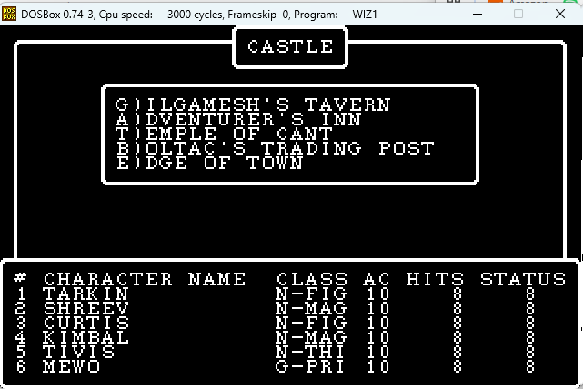
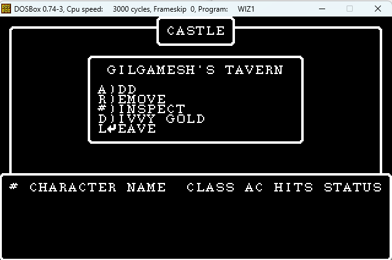

# session2 — part 9  (2026-10-27 11:26:09 … 2026-10-28 01:22:26)

  ↳ M engine/CMakeLists.txt ⏎  M engine/include/wiz/camp_dos.h ⏎  M engine/src/dos_flow.h ⏎  M engine/src/dos_game.cpp ⏎  M tools/screens_check.py ⏎ ?? engine/include/wiz/utilities_dos.h ⏎ ?? engine/src/utilities_dos.cpp ⏎ warning: in the working copy of 'wi ...

## User · 2026-10-27 11:26:09

[Usage limit reached; a short grace allowance remains, then this turn is cut off without warning. Judge what's left: if it's genuinely only a few steps, finish it properly, then stop and say so without extra polishing. Otherwise don't attempt it all: finish the piece in hand and at most two more like it, then stop. The allowance also pays for any subagents you have running: they don't get this message and will keep going, so it's up to you how to handle them. Either way, end by telling the user their usage limit was reached, what's done and what's left.]

## Assistant · 2026-10-27 11:26:19

I've hit the usage limit, so I'm stopping here. The camp-side UTILITIE port is finished and pushed as `4fa4d33` on the `wizardry` branch.

**Done**
- **New module:** `engine/src/utilities_dos.cpp` and `engine/include/wiz/utilities_dos.h`, ported from the UTILITIE p-code. It covers the character stat derivation, equipment handling, E)QUIP, special-power items and cursed items, R)EORDER, and MALOR's teleport prompt and arrival.
- **Flow wiring:** `DosFlow` now sends XGOTO 13, 20, 14, 15 and 24 with G36=4 to `Utilities`. The `hooks.other` stub is removed from `dos_flow.h` and `dos_game.cpp`. `Camp` now exposes its two windows (G11 and G15), because UTILITIE:3 closes them when MALOR takes the party away.
- **Oracle scenarios:** I added `camp_equip`, `camp_equip2`, `camp_equipall`, `camp_equipall2`, `camp_power`, `camp_reorder`, `camp_reorder3` and `camp_malor`, `camp_malorq`, `camp_malor0`, `camp_malorr`, `camp_malorm`. They match the oracle on cells, VRAM and RNG. The full suite is 50 scenarios with no mismatches.
- **Bug found by the oracle:** the select-item prompt was drawn at the wrong row. It is now placed on the row after the item list.

**Left**
- Port GAMEUTIL (XGOTO 28/29), the Edge-of-Town U)TILITIES path, and the KANJIREA remnants.
- Exercise more combat paths against the oracle: U)SE items, R)UN, D)ISPELL, breath, call for help, HAMAN/MAHAMAN, level drain. The same goes for the reward trap effects, disarm, CALFO and the drain refund.
- Update the stale docs (`docs/ui.md`, `docs/maze.md`, the roadmap) and my memory notes, which I didn't touch this turn. Retire the legacy TextScreen/Ui modules.
- Known limitations: the level-drain refund assumes 0 for an uninitialised value, and monster and maze record changes are kept in memory only, not saved to disk.

## User · 2026-10-28 01:13:44

I'm considering handing work on the Wizardry games over to another person. Could you ensure that the current documentation is sufficient for the current state of the project. Maybe also add a copy of this thread and associated screenshots for better context of what work has been done

## User · 2026-10-28 01:13:44

[Earlier usage-limit notes no longer apply. Continue working normally. Don't mention this to the user.]

## Assistant · 2026-10-28 01:13:55

› Bash: `cd C:/dev/wizardry; git status --short | head; ls; ls wizardry1 wizardry1/docs wizardry1/tools | head -100; wc -l wizardry1/README.md wizardry1/docs/*.md | tail -30; ls "C:/Users/Paul Gilbert/.claude/projects/C--dev-wizardry-wizardry1/" | head; ls -la "C:/Users/Paul Gilbert/.claude/projects/C--dev-wizardry-wizardry1/"*.jsonl`

  ↳ README.md ⏎ docs ⏎ wizardry1 ⏎ wizardry3 ⏎ wizardry1: ⏎ README.md ⏎ docs ⏎ engine ⏎ extracted ⏎ ida_scripts ⏎ sources ⏎ system_interp.bin ⏎ tools ⏎ wiz1_interp ⏎ wiz1_interp.asm ⏎ wiz1_interp.idb ⏎ wiz1_interp.idc ⏎  ⏎ wizardry1/docs: ⏎ combat.md ⏎ drawing-inventory.md ⏎ drawing.md ...

## Assistant · 2026-10-28 01:14:06

› Bash: `cd C:/dev/wizardry; cat README.md | head -60; echo ------; cat wizardry1/README.md; echo ------; cat wizardry1/docs/overview.md; ls wizardry1/engine wizardry1/engine/docs 2>/dev/null | head -40; ls "C:/Users/Paul Gilbert/.claude/projects/C--dev-wizardry-wizardry1/2e283e31-7a75-4688-8289-54f3951b93bf"| head; git log --oneline | wc -l`

  ↳ # Wizardry reverse-engineering notes ⏎  ⏎ Reverse-engineering the classic **Wizardry** games (the Sir-Tech / Andrew ⏎ Greenberg engine, Wizardry **I–V**) from the DOS *Ultimate Wizardry Archives* ⏎ release, toward clean reimplementations and eventu ...

## Assistant · 2026-10-28 01:14:11

› Bash: `cd C:/dev/wizardry; ls docs; cat wizardry1/engine/README.md; echo -----; cat wizardry1/docs/roadmap.md`

  ↳ README.md ⏎ engine.md ⏎ file-formats.md ⏎ pcode.md ⏎ pmachine.md ⏎ rng-validation.md ⏎ # Wizardry I — standalone C++ engine (Phase 3) ⏎  ⏎ A dependency-free reimplementation of the DOS "Ultimate Wizardry Archives" ⏎ release, built directly from the reverse-e ...

## Assistant · 2026-10-28 01:14:21

› Bash: `cd "C:/Users/Paul Gilbert/.claude/projects/C--dev-wizardry/memory"; ls; cat wizardry1-re-project.md feedback-dos-code-is-source-of-truth.md wizardry-trilogy-shared-engine.md; cd C:/dev/wizardry; find . -type f \( -iname "*.png" -o -iname "*.jpg" -o -iname "*.bmp" -o -iname "*.gif" \) -not -path "*/build/*" 2>/dev/null | head -30; git check-ignore -v wizardry1/extracted wizardry1/engine/build | hea ...`

  ↳ <persisted-output> ⏎ Output too large (36.5KB). Full output saved to: C:\Users\Paul Gilbert\.claude\projects\C--dev-wizardry-wizardry1\2e283e31-7a75-4688-8289-54f3951b93bf\tool-results\b8qvg1hqd.txt ⏎  ⏎ Preview (first 2KB): ⏎ MEMORY.md ⏎ feedback-do ...

## Assistant · 2026-10-28 01:14:30

› Bash: `cd C:/dev/wizardry; find . -type f \( -iname "*.png" -o -iname "*.jpg" -o -iname "*.jpeg" -o -iname "*.bmp" -o -iname "*.gif" \) -not -path "*/build/*" 2>/dev/null | head -30; echo ---; cat .gitignore wizardry1/.gitignore 2>/dev/null | head -30; echo ---; grep -rl "screenshot" "C:/Users/Paul Gilbert/.claude/projects/C--dev-wizardry/memory" | head; sed -n 1,80p "C:/Users/Paul Gilbert/.claude/projec ...`

  ↳ --- ⏎ *.idb ⏎ *.id0 ⏎ *.id1 ⏎ *.id2 ⏎ *.nam ⏎ *.til ⏎  ⏎ __pycache__/ ⏎ *.pyc ⏎ # IDA databases (regenerable from the disk images + scripts; .asm/.idc are the ⏎ # committed backups instead) ⏎ *.id0 ⏎ *.id1 ⏎ *.id2 ⏎ *.nam ⏎ *.til ⏎ *.$$$ ⏎  ⏎ # Extracted disk contents (re ...

## Assistant · 2026-10-28 01:14:39

I'm auditing the docs and locating the transcripts and screenshots so I can build the handoff package.

## Assistant · 2026-10-28 01:14:41

› Bash: `cd "C:/Users/Paul Gilbert/.claude/projects/C--dev-wizardry-wizardry1"; python - <<'EOF' ⏎ import json,collections ⏎ for f in ['4dc1a062-1708-4f14-97ef-d51b3233e5e0.jsonl','2e283e31-7a75-4688-8289-54f3951b93bf.jsonl']: ⏎     n=collections.Counter(); imgs=0; first=None; last=None; users=0 ⏎     for line in open(f,encoding='utf-8'): ⏎         try: o=json.loads(line) ⏎         except: continue ⏎         n[o.get('ty ...`

  ↳ 4dc1a062-1708-4f14-97ef-d51b3233e5e0.jsonl {'queue-operation': 70, 'user': 1398, 'attachment': 1429, 'custom-title': 363, 'bridge-session': 365, 'ai-title': 362, 'atis-latch': 362, 'assistant': 2161, 'last-prompt': 362, 'system': 29, 'mode' ...

## Assistant · 2026-10-28 01:14:55

› Bash: `mkdir -p /c/Users/PAULGI~1/AppData/Local/Temp/claude/C--dev-wizardry-wizardry1/2e283e31-7a75-4688-8289-54f3951b93bf/scratchpad/hist; cd "C:/Users/Paul Gilbert/.claude/projects/C--dev-wizardry-wizardry1"; python - <<'EOF' ⏎ import json,re,base64,os,collections ⏎ out=r'C:\Users\PAULGI~1\AppData\Local\Temp\claude\C--dev-wizardry-wizardry1\2e283e31-7a75-4688-8289-54f3951b93bf\scratchpad\hist' ⏎ paths=collec ...`

  ↳ 4dc1a062-1708-4f14-97ef-d51b3233e5e0.jsonl 1.051248120300752 MB {('user', 'toolres'): 18} ⏎ 2e283e31-7a75-4688-8289-54f3951b93bf.jsonl 0.6004481203007519 MB {('user', 'toolres'): 65, ('user', 'top'): 10, ('api-request-blob', 'toolres'): 10} ...

## Assistant · 2026-10-28 01:15:20

› Write: C:\dev\wizardry\wizardry1\tools\export_transcript.py

  ↳ File created successfully at: C:\dev\wizardry\wizardry1\tools\export_transcript.py (file state is current in your context — no need to Read it back)

## Assistant · 2026-10-28 01:15:24

› Bash: `cd C:/dev/wizardry/wizardry1; P="C:/Users/Paul Gilbert/.claude/projects/C--dev-wizardry-wizardry1"; mkdir -p docs/history; python tools/export_transcript.py "$P/4dc1a062-1708-4f14-97ef-d51b3233e5e0.jsonl" docs/history session1 && python tools/export_transcript.py "$P/2e283e31-7a75-4688-8289-54f3951b93bf.jsonl" docs/history session2; du -sh docs/history; ls docs/history | head -30; cat docs/history ...`

  ↳ 2782 messages, 4 parts, 18 images ⏎ 5623 messages, 9 parts, 75 images ⏎ 3.8M	docs/history ⏎ screenshots ⏎ session1-images.tsv ⏎ session1-part01.md ⏎ session1-part02.md ⏎ session1-part03.md ⏎ session1-part04.md ⏎ session2-images.tsv ⏎ session2-part01.md ⏎ sessi ...

## Assistant · 2026-10-28 01:15:39

› Bash: `cd C:/dev/wizardry/wizardry1/docs/history; grep -l -E "sk-ant|ghp_|AKIA|BEGIN (RSA|PRIVATE)" *.md | head; grep -c "" session2-part01.md; awk -F'\t' '$3=="user"' session2-images.tsv session1-images.tsv; head -40 session1-part01.md; head -c 1500 session2-part01.md`

  ↳ 2781 ⏎ session2-014.png	2026-09-04 06:43:40	user ⏎ session2-015.png	2026-09-04 06:43:40	user ⏎ session2-032.png	2026-09-04 12:17:26	user ⏎ session2-033.png	2026-09-04 12:17:26	user ⏎ session2-034.png	2026-09-04 12:17:26	user ⏎ session2-035.png	2026-09- ...

## Assistant · 2026-10-28 01:15:45

› Bash: `cd C:/dev/wizardry/wizardry1/engine; ls src include/wiz | tr '\n' ' '; echo; wc -l src/*.cpp src/*.h include/wiz/*.h | tail -1; grep -n "add_test\|add_executable\|add_library" CMakeLists.txt | head -60; sed -n 1,60p src/main.cpp | head -80; grep -n "\"[a-z0-9-]*\"" src/main.cpp | grep -o 'cmd == "[a-z0-9-]*"' | sort -u | tr '\n' ' '`

  ↳ include/wiz: bitmap.h camp_dos.h camp_ui.h castle.h cemetery.h character.h combat.h combat_dos.h combat_ui.h console.h dos.h equip.h font.h inn.h maze.h maze3d.h maze_dos.h maze_ui.h monster_art.h party.h platform.h rewards.h rewards_dos.h ...

## Assistant · 2026-10-28 01:15:51

Status: the docs describe the older Apple-source engine, so I'm checking what's stale and gathering facts for a handoff guide. The transcripts and screenshots are already exported to `docs/history`.

## Assistant · 2026-10-28 01:15:51

› Bash: `cd C:/dev/wizardry/wizardry1; sed -n '/static int usage/,/^}/p' engine/src/main.cpp | head -70; sed -n 495,530p engine/CMakeLists.txt; cat docs/ui.md; sed -n 1,40p docs/drawing.md; head -30 tools/wizvm.py; head -20 tools/conunit.py`

  ↳ static int usage() { ⏎     std::puts( ⏎         "wiz1 <command> <args>\n" ⏎         "  files   <WIZ1.DSK>                 list the p-System volume\n" ⏎         "  extract <WIZ1.DSK> <NAME> <out>    write one file out\n" ⏎         "  toc     <SCENARIO ...

## Assistant · 2026-10-28 01:16:04

› Bash: `cd C:/dev/wizardry/wizardry1; sed -n 1,60p engine/src/dos_game.cpp; grep -n "argv\|getenv\|WIZ1_" engine/src/dos_cmds.cpp engine/src/dos_game.cpp engine/src/main.cpp | head -40; for f in tools/*.py; do echo "== $f"; python - "$f" <<'EOF' ⏎ import sys,ast ⏎ s=open(sys.argv[1],encoding='utf-8').read() ⏎ d=ast.get_docstring(ast.parse(s)) or '' ⏎ print('\n'.join(d.split('\n')[:4])) ⏎ EOF ⏎ done 2>&1 | head -150`

  ↳ // The DOS-faithful game: title screen + the WIZARDRY mainline's XGOTO dispatch ⏎ // over the segments ported from the p-code so far (CASTLE, SHOPS), bridging to ⏎ // the legacy screens for the rest (Training Grounds, maze, camp). ⏎ #include "dos ...

## Assistant · 2026-10-28 01:16:21

› Bash: `cd C:/dev/wizardry/wizardry1/engine; sed -n 60,200p src/dos_game.cpp; grep -n "XGOTO\|xgoto" src/shops.cpp | grep -i "util\|28\|29" | head`

  ↳ Roster roster; ⏎     if (!roster.load(rosterPath)) roster.seedFrom(a.sc); ⏎     startupResetInMaze(roster);                         // S)TART: everyone is back in town ⏎     Party party; ⏎     Shop shop; ⏎     if (!shop.load(shopPath, a.sc)) shop.see ...

## Assistant · 2026-10-28 01:16:27

› Bash: `cd C:/dev/wizardry/wizardry1/engine; grep -rn "XUTILITIES\|XEDGE\b\|constexpr int X" include src | head -20; git -C .. log --oneline | head -45`

  ↳ include/wiz/castle.h:25:    XEDGE = 25,         // SHOPS: Edge of Town ⏎ include/wiz/shops.h:16:    XUTILITIES = 29,    // U)TILITIES ⏎ src/castle.cpp:124:                res.xgoto = XEDGE; ⏎ src/dos_flow.h:90:            else if (xgoto == XEDGE) ...

## Assistant · 2026-10-28 01:16:34

› Bash: `cd C:/dev/wizardry/wizardry1/engine; grep -h '#include "wiz/' src/castle.cpp src/shops.cpp src/roller_dos.cpp src/maze_dos.cpp src/camp_dos.cpp src/combat_dos.cpp src/rewards_dos.cpp src/specials_dos.cpp src/dos.cpp src/console.cpp include/wiz/castle.h include/wiz/shops.h | sort | uniq -c | sort -rn; ctest --test-dir build 2>&1 | tail -8`

  ↳ 2 #include "wiz/scenario.h" ⏎       2 #include "wiz/rng.h" ⏎       2 #include "wiz/dos.h" ⏎       2 #include "wiz/castle.h" ⏎       1 #include "wiz/specials_dos.h" ⏎       1 #include "wiz/shops.h" ⏎       1 #include "wiz/shop.h" ⏎       1 #include "wiz/r ...

## Assistant · 2026-10-28 01:19:03

› Bash: `cd C:/dev/wizardry/wizardry1; grep -n "argv\|argparse\|add_argument\|usage" tools/pcode_dis.py tools/pcode_decomp.py tools/wizvm.py tools/ucsd_disk.py | head -50; ls extracted extracted/pcode 2>/dev/null | head -30; cat engine/build.ps1`

  ↳ tools/pcode_dis.py:423:def main(argv): ⏎ tools/pcode_dis.py:424:    if len(argv) < 2: ⏎ tools/pcode_dis.py:430:     "dis-all": cmd_dis_all}[argv[0]](argv[1:]) ⏎ tools/pcode_dis.py:434:    main(sys.argv[1:]) ⏎ tools/pcode_decomp.py:329:    main(sys. ...

## Assistant · 2026-10-28 01:19:07

› Bash: `cd C:/dev/wizardry/wizardry1; sed -n 415,432p tools/pcode_dis.py; sed -n '/^def main/,$p' tools/pcode_decomp.py | head -30`

  ↳ for p in sorted(s.procs, key=lambda x: x.entry): ⏎             disasm_proc(s, p, out) ⏎             out.append("") ⏎         with open(os.path.join(outdir, f"{s.idx:02d}_{s.name}.pd"), "w") as fh: ⏎             fh.write("\n".join(out)) ⏎     print(f" ...

## Assistant · 2026-10-28 01:19:12

› Bash: `cd C:/dev/wizardry/wizardry1; sed -n '/^def cmd_dis_all/,/^        for p/p' tools/pcode_dis.py | head -12; sed -n 1,25p tools/pcode_dis.py | head -30; python tools/pcode_decomp.py UTILITIE 32 | head -5`

  ↳ def cmd_dis_all(a): ⏎     segs = load_segments(a[0]) ⏎     outdir = a[1] ⏎     os.makedirs(outdir, exist_ok=True) ⏎     for s in segs: ⏎         out = [f"; segment {s.name}  segnum={s.segnum}  procs={s.nproc}\n"] ⏎         for p in sorted(s.procs, key= ...

## Assistant · 2026-10-28 01:20:03

› Write: C:\dev\wizardry\wizardry1\docs\handoff.md

  ↳ File created successfully at: C:\dev\wizardry\wizardry1\docs\handoff.md (file state is current in your context — no need to Read it back)

## Assistant · 2026-10-28 01:20:07

› Bash: `cd C:/dev/wizardry/wizardry1; grep -n -i "inn\b\|Adventurer\|levelUp\|CHNEWLEV" engine/src/castle.cpp | head -5; grep -n "XGOTO table\|town.md" docs/handoff.md`

  ↳ 114:                if (w_.party.count() > 0) inn(); ⏎ 265:// ---- the Adventurer's Inn (CASTLE:20..41) --------------------------------------------------------- ⏎ 389:void Castle::levelUp(Win *win, int m) {                            // CASTLE ...

## Assistant · 2026-10-28 01:20:12

› Bash: `cd C:/dev/wizardry/wizardry1; sed -i 's#The XGOTO table is in `town.md`/the header of `dos_flow.h`:#The XGOTO table (also in the header comment of `dos_flow.h`):#' docs/handoff.md; for f in town maze combat; do echo "== $f"; sed -n 1,12p docs/$f.md; done; sed -n 40,152p docs/drawing.md | grep -n "^## "`

  ↳ == town ⏎ # The Town — CASTLE / SHOPS ⏎  ⏎ The "town" is everything outside the maze: the Castle hub and its four ⏎ establishments, plus the Edge of Town. It is driven by the `XGOTO` state ⏎ machine in `WIZARDRY` proc 1 (the mainline), which dispatch ...

## Assistant · 2026-10-28 01:20:18

Status: adding "superseded" banners to the stale area docs, then rewriting the engine README, roadmap and indexes.

## Assistant · 2026-10-28 01:20:26

› Write: C:\Users\PAULGI~1\AppData\Local\Temp\claude\C--dev-wizardry-wizardry1\2e283e31-7a75-4688-8289-54f3951b93bf\scratchpad\banners.py

  ↳ File created successfully at: C:\Users\PAULGI~1\AppData\Local\Temp\claude\C--dev-wizardry-wizardry1\2e283e31-7a75-4688-8289-54f3951b93bf\scratchpad\banners.py (file state is current in your context — no need to Read it back)

## Assistant · 2026-10-28 01:20:31

› Bash: `cd C:/dev/wizardry/wizardry1/docs; python "C:/Users/PAULGI~1/AppData/Local/Temp/claude/C--dev-wizardry-wizardry1/2e283e31-7a75-4688-8289-54f3951b93bf/scratchpad/banners.py"; head -8 ui.md; head -6 town.md; git diff --stat | tail -8`

  ↳ ok ⏎ # Screen layout — DOS windows & borders ⏎  ⏎ > **SUPERSEDED (2026-10-28).** This describes the early `TextScreen` window model built from the first CONUNIT reading and DOSBox screenshots. The real model is `wiz::Console` (a bit-exact port o ...

## Assistant · 2026-10-28 01:20:48

› Write: C:\dev\wizardry\wizardry1\engine\README.md

  ↳ The file C:\dev\wizardry\wizardry1\engine\README.md has been updated successfully. (file state is current in your context — no need to Read it back)

## Assistant · 2026-10-28 01:20:59

› Edit: C:\dev\wizardry\wizardry1\docs\roadmap.md

## Assistant · 2026-10-28 01:21:00

› Edit: C:\dev\wizardry\wizardry1\docs\roadmap.md

  ↳ The file C:\dev\wizardry\wizardry1\docs\roadmap.md has been updated successfully.

  ↳ The file C:\dev\wizardry\wizardry1\docs\roadmap.md has been updated successfully.

## Assistant · 2026-10-28 01:21:05

› Bash: `cd C:/dev/wizardry/wizardry1/docs; grep -n "TBD\|Recovering its opcode\|prerequisite\|HAS.CACHE" overview.md`

  ↳ 3:> **Status note (2026-10-28).** This is the day-one overview; some details ("TBD" entries, the "prerequisite" remark about the p-code dialect) were resolved long ago -- see [`roadmap.md`](roadmap.md) and [`handoff.md`](handoff.md) for the ...

## Assistant · 2026-10-28 01:21:10

› Bash: `cd C:/dev/wizardry/wizardry1/docs; python - <<'EOF' ⏎ import io ⏎ p='overview.md' ⏎ s=io.open(p,encoding='utf-8',newline='').read() ⏎ s=s.replace('high-entropy; font/graphics "kernel" or packed data — TBD','the keyed, enciphered **string pool** (`GetStr(KN)`; cipher in `tools/strpool.py`, decoded text in `strings.txt`)') ⏎ s=s.replace('Recovering its opcode dispatch tells us the exact p-code dialect (II vs ...`

  ↳ (`Stack overflow!!`, `EXIT to uncalled procedure`, `call unlinked segment`, ⏎ `Unimplemented Instruction`, `OOPS! end of code encountered!!`, …) and what ⏎ looks like a p-code mnemonic table near `0x2fb0` (`AND`, `ARRAY`, …). ⏎ Its opcode dispatc ...

## Assistant · 2026-10-28 01:21:19

› Bash: `cd C:/dev/wizardry/wizardry1; python - <<'EOF' ⏎ import io ⏎ p='README.md' ⏎ s=io.open(p,encoding='utf-8',newline='').read() ⏎ s=s.replace("Start with [`../docs/engine.md`](../docs/engine.md), then\n[`docs/overview.md`](docs/overview.md) and [`docs/roadmap.md`](docs/roadmap.md).", ⏎ "**Taking over the project? Start with [`docs/handoff.md`](docs/handoff.md)** (current state, workflow, gaps).\nThen [`../docs ...`

  ↳ warning: in the working copy of 'README.md', LF will be replaced by CRLF the next time Git touches it ⏎ warning: in the working copy of 'wizardry1/README.md', LF will be replaced by CRLF the next time Git touches it ⏎  README.md           |  4 ...

## Assistant · 2026-10-28 01:21:26

› Bash: `cd C:/dev/wizardry/wizardry1/docs/history; for f in session1-part0*.md session2-part0*.md; do echo "$f: $(head -1 $f | sed 's/^# //')"; done; python - <<'EOF' ⏎ import re,glob ⏎ for f in sorted(glob.glob('session*-part*.md')): ⏎     txt=open(f,encoding='utf-8').read() ⏎     for m in re.finditer(r'^## User · (\S+ \S+)\n\n(.*?)(?=\n## |\Z)',txt,re.S|re.M): ⏎         t=m.group(2).strip() ⏎         if t.startswit ...`

  ↳ session1-part01.md: session1 — part 1  (2026-09-02 05:37:14 … 2026-09-02 11:28:39) ⏎ session1-part02.md: session1 — part 2  (2026-09-02 11:28:53 … 2026-09-02 20:30:38) ⏎ session1-part03.md: session1 — part 3  (2026-09-02 20:30:38 … 2026-09-03 0 ...

## Assistant · 2026-10-28 01:21:35

› Bash: `cd C:/dev/wizardry/wizardry1/docs/history; grep -n -A6 "## User · 2026-09-02 12:38\|## User · 2026-09-02 12:45" session1-part01.md session1-part02.md | cut -c1-400 | head -40; grep -n -B1 -A8 "## User · 2026-09-04 12:17" session2-part06.md | cut -c1-600 | head -30`

  ↳ Binary file session1-part02.md matches ⏎ 1891- ⏎ 1892:## User · 2026-09-04 12:17:26 ⏎ 1893- ⏎ 1894- ⏎ 1895- ⏎ 1896- ⏎ 1897- ⏎ 1898-.read() ⏎ s=s.replace("def head(s, n):","CTRL = dict.fromkeys([c for c in range(32) if c not in (9, 10)] + [127])\n\n\ndef head(s, n):",1) ⏎ s=s.replace("            f.write(f'# {prefix} — part {n}","            f.write(f'# {prefix} — part {n}",1) ⏎ s=s.replace("                f.write(f'## {who}{\" ( ...`

  ↳ 16:CTRL = dict.fromkeys([c for c in range(32) if c not in (9, 10)] + [127]) ⏎ 2782 messages, 4 parts, 18 images ⏎ 5675 messages, 9 parts, 75 images ⏎ 2665 ⏎ docs/history/session1-part02.md: data

## Assistant · 2026-10-28 01:22:04

› Bash: `cd C:/dev/wizardry/wizardry1/docs/history; python - <<'EOF' ⏎ import re,collections ⏎ b=open('session1-part02.md','rb').read() ⏎ print(len(b), b.count(b'\x00')) ⏎ c=collections.Counter(x for x in b if x<32 and x not in (9,10,13)) ⏎ print(c) ⏎ try: b.decode('utf-8'); print('utf8 ok') ⏎ except Exception as e: print(e) ⏎ s=b.decode('utf-8') ⏎ print(collections.Counter(ch for ch in s if 0x80<=ord(ch)<0xa0 or ord(ch) in ...`

  ↳ 181255 231 ⏎ Counter({0: 231, 16: 6, 1: 5, 28: 3, 5: 2, 29: 1}) ⏎ utf8 ok ⏎ [] ⏎ 2803

## Assistant · 2026-10-28 01:22:09

› Bash: `cd C:/dev/wizardry/wizardry1; grep -n "f.write\|translate" tools/export_transcript.py`

  ↳ 65:                f.write(base64.b64decode(data)) ⏎ 109:            f.write(f'# {prefix} — part {n}  ({chunk[0][0]} … {chunk[-1][0]})\n\n') ⏎ 112:                    f.write(body + '\n\n') ⏎ 114:                    f.write(f'## {who}{" (subagent ...

## Assistant · 2026-10-28 01:22:14

› Read: C:\dev\wizardry\wizardry1\tools\export_transcript.py

  ↳ 100	            who = 'Tool' ⏎ 101	        msgs.append((ts, who, body, bool(o.get('isSidechain')))) ⏎ 102	 ⏎ 103	    n = 0 ⏎ 104	    for start in range(0, len(msgs), PART_MESSAGES): ⏎ 105	        n += 1 ⏎ 106	        chunk = msgs[start:start + PART_MES ...

## Assistant · 2026-10-28 01:22:16

Applying the sanitising edits directly to the file.

## Assistant · 2026-10-28 01:22:18

› Edit: C:\dev\wizardry\wizardry1\tools\export_transcript.py

## Assistant · 2026-10-28 01:22:19

› Bash: `cd C:/dev/wizardry/wizardry1; P="C:/Users/Paul Gilbert/.claude/projects/C--dev-wizardry-wizardry1"; rm -rf docs/history/screenshots; python tools/export_transcript.py "$P/4dc1a062-1708-4f14-97ef-d51b3233e5e0.jsonl" docs/history session1 && python tools/export_transcript.py "$P/2e283e31-7a75-4688-8289-54f3951b93bf.jsonl" docs/history session2; file docs/history/session1-part02.md; du -sh docs/histo ...`

  ↳ The file C:\dev\wizardry\wizardry1\tools\export_transcript.py has been updated successfully.

